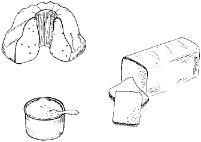
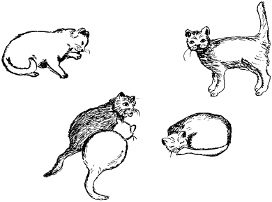
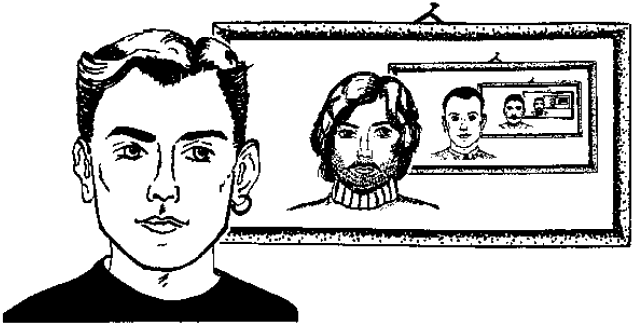

<!--

author:   André Dietrich
email:    andre.dietrich@ovgu.de
version:  1.0.3
language: de
narrator: Deutsch Female
logo:     img/logo.jpg

comment:  Dieses Buch soll in die Programmiersprache PROLOG und in die mit ihr verbundene
          'Logik-programmierung' einführen. Die Idee, 'Logik als eine Programmiersprache'
          zu verwenden, führt zu einer völlig neuen Auffassung vom Programmieren: Das
          Programm ist nicht eine Folge von Handlungsanweisungen, sondern eine Sammlung
          von Fakten und Regeln. Das zu lösende Problem wird als eine Anfrage an diese
          Sammlung formuliert. Im Idealfall führt die logisch korrekte Formulierung der
          Regeln und der Anfrage zur Lösung des Problems.


import: https://raw.githubusercontent.com/liaTemplates/tau-prolog/master/README.md


@stammbaum_db
```prolog @0
maennl(adam).
maennl(alfred).
maennl(anton).
maennl(arthur).
maennl(baldur).
maennl(bernd).
maennl(boris).
maennl(casanova).
maennl(clemens).
maennl(donald).

weibl(adele).
weibl(alwine).
weibl(anna).
weibl(ariadne).
weibl(barbara).
weibl(berta).
weibl(cleopatra).
weibl(cosima).
weibl(daisy).

verheiratet(adam,adele).
verheiratet(adele,adam).
verheiratet(alfred,alwine).
verheiratet(alwine,alfred).
verheiratet(anton,anna).
verheiratet(anna,anton).
verheiratet(arthur,ariadne).
verheiratet(ariadne,arthur).
verheiratet(baldur,barbara).
verheiratet(barbara,baldur).
verheiratet(bernd,berta).
verheiratet(berta,bernd).
verheiratet(clemens,cleopatra).
verheiratet(cleopatra,clemens).

/* elter(X,Y) heißt: Y ist Elternteil von X */

elter(baldur,adam).
elter(baldur,adele).
elter(barbara,alfred).
elter(barbara,alwine).
elter(bernd,anton).
elter(bernd,anna).
elter(berta,arthur).
elter(berta,ariadne).
elter(boris,arthur).
elter(boris,ariadne).
elter(casanova,baldur).
elter(casanova,barbara).
elter(clemens,baldur).
elter(clemens,barbara).
elter(cleopatra,bernd).
elter(cleopatra,berta).
elter(cosima,bernd).
elter(cosima,berta).
elter(donald,clemens).
elter(donald,cleopatra).
elter(daisy,clemens).
elter(daisy,cleopatra).
```
@end

-->

# Arbeitsbuch PROLOG

## Originales Vorwort

Dieses Buch soll in die Programmiersprache PROLOG und in die mit ihr verbundene 'Logik-programmierung' einführen.
Die Idee, 'Logik als eine Programmiersprache' zu verwenden, führt zu einer völlig neuen Auffassung vom Programmieren: Das Programm ist nicht eine Folge von Handlungsanweisungen, sondern eine Sammlung von Fakten und Regeln.
Das zu lösende Problem wird als eine Anfrage an diese Sammlung formuliert.
Im Idealfall führt die logisch korrekte Formulierung der Regeln und der Anfrage zur Lösung des Problems.

Dieser Ansatz ist faszinierend, und das allein schon wäre Grund genug, PROLOG als zweite Programmiersprache für die Schule in Betracht zu ziehen.
Hinzu kommen aber noch andere Vorteile:

* Die Beschäftigung mit einer Sprache, die sich völlig von den befehlsorientierten Sprachen wie PASCAL unterscheidet, weitet den Horizont; altbekannte Algorithmen erscheinen in einem neuen Licht und neuartige Probleme können behandelt werden.
* Die wesentlichen Grundelemente von PROLOG bilden eine kleine, überschaubare Menge.
  (Sie zu beherrschen ist allerdings nicht ganz einfach.)
* Der aktive Umgang mit logischen, deklarativen Programmen fördert (so hoffen wir) das logische Denken.

Den letzten Punkt halten wir für entscheidend; daher haben wir uns in diesem Buch sehr stark auf den logischen Kern der Sprache -- auf 'pures' PROLOG -- beschränkt (und nehmen eine etwas spartanische 'Oberfläche' in Kauf).
Es geht uns nicht um die möglichst umfassende Vermittlung der Programmiersprache, sondern um das Bekanntmachen eines neuen, mächtigen und schönen Programmierkonzeptes.
Zum Vertrautwerden mit diesem neuen Konzept bedarf es vieler sinnvoller Beispiele und Aufgaben; wir hoffen, hier genügend bereitgestellt zu haben.

Das Buch besteht im wesentlichen aus zwei Teilen.
Der erste Teil gibt eine Einführung in die Arbeitsweise von PROLOG, das grundlegende Verfahren der Rekursion und den Datentyp der Liste.
Der zweite Teil besteht aus elf Vertiefungen; diese sind weitgehend unabhängig voneinander und nach steigender
Komplexität geordnet.
Für einen Kurs schlagen wir vor, zuerst den ersten Teil (evtl. ohne [Kapitel 7](#7.-not-und-cut)) und dann mindestens eine Vertiefung durchzuarbeiten.
Ein 'Schnupperkurs' von wenigen Stunden (vielleicht schon in Sekundarstufe I) könnte aus [Kapitel 1](#1-grundlagen) und [2](#2-regeln), dem Anfang von [Kapitel 3](#3-so-arbeitet-prolog) und der [Vertiefung B](#b-datenbasis-programmierung), der Datenbasisprogrammierung, bestehen.
Bei Bedarf könnte dies noch mit einigen Rätseln aus [Vertiefung A](#a-rätsel) gewürzt werden.

Wir verwenden PROLOG nach dem sogenannten Edinburgh-Standard, der durch das Buch von CLOCKSIN und MELLISH definiert wurde und sich inzwischen weitgehend durchgesetzt hat.
In Versionen, die sich nach diesem Standard richten, laufen die Programme des Buches problemlos.
Für einige gängige Versionen sind gezielte Hinweise im Anhang gegeben.
Dort findet man auch Hinweise auf die Bezugsquellen.

Wir bedanken uns bei dem Herausgeber, Herrn StD Dietrich Pohlmann, für zahlreiche Anregungen und Verbesserungsvorschläge und beim Verlag Ferd.
Dümmler für die freundliche Betreuung.
Wir danken weiterhin Ingrid Hafenbrak für die Illustrationen, Frau Sylvia Platz und Herrn Martin Kammerer für die Hilfe bei der Gestaltung des Manuskriptes und Herrn Dr. Klaus Scheler für das sorgfältige Korrekturlesen.
Schließlich gilt unser Dank den Mannheimer Schülern und Lehrern vom Elisabeth Gymnasium und vom Gymnasium Feudenheim, die uns ermöglichten, unsere Ideen in der Schulpraxis zu erproben.

Es freut uns, dass nach recht kurzer Zeit eine Neuauflage erforderlich wurde.
Dabei wurden nur einige Druckfehler und Unstimmigkeiten berichtigt; die beiden Auflagen sind also uneingeschränkt nebeneinander im Unterricht einsetzbar.

Heidelberg und Weingarten

Hartmut Göhner, Bernd Hafenbrak

Wir bedanken uns bei den beiden Autoren, die dem Landesinstitut für Schule und Ausbildung Mecklenburg-Vorpommern (L.I.S.A.) die Texte und Programme zur Verfügung stellten, damit wir das – leider vergriffene – Arbeitsbuch PROLOG in den Landesbildungsserver einstellen konnten.

Schwerin

Gabriele Lehmann

## 1. Grundlagen

                            --{{0}}--
Einen kleinen Blumenstrauß zu beginn.

<!-- style="max-width: 100%;" -->

                            --{{1}}--
Dieses Buch ist leider im original nicht im Vierfarbendruck erschienen aber wir können den Willkommensstrauß auch kurz mit einfachen Worten wie:

                              {{1}}
* Die Rose ist rot.
* Die Tulpe ist gelb.
* Die Nelke ist weiß.
* Das Vergißmeinnicht ist blau.
* Das Veilchen ist blau.
<!-- --{{1}}--
Die Rose ist rot, die Tulpe ist gelb oder das Veilchen ist blau.
-->

                            --{{2}}--
Solche **Fakten** (Tatsachen) wie die Zusammensetzung eines Straußes können in PROLOG wie folgt abgebildet werden:

    {{2}}
```prolog
rot(rose).
gelb(tulpe).
weiss(nelke).
blau(vergissmeinnicht).
blau(veilchen).
```

                            --{{2}}--
Die **Prädikate** (Eigenschaften) _rot_, _gelb_, _weiss_ und _blau_ treffen auf gewisse Konstanten wie zum Beispiel _rose_ zu, dies schreiben wir in der obigen Form.
Sowohl Prädikate als auch Konstanten werden mit kleinem Anfangsbuchstaben geschrieben, deutsche Sonderzeichen vermeiden wir.
Jedes Faktum wird mit einem Punkt und dem Drücken der <kbd>RETURN</kbd>-Taste abgeschlossen.

### PROLOG-Programme

                            --{{0}}--
Die hier genuzte PROLOG-IDE besteht immer aus zwei Teilen, einer Eingabe für das Programm.
Wenn du hier auf Ausführen klickst, so wird dieses Programm geladen.
Da dieses Programm jedoch einen syntaktischen Fehler hat, erhältst du zunächst eine Fehlermeldung, die auf ein Syntax-Problem hinweist.

                            --{{1}}--
Du kannst den Code auch direkt editieren und den fehlenden Punkt am Ende der letzten Zeile einfügen.
Wenn du dann wieder auf Ausführen klickst, so wird dir angezeigt, dass deine Datenbasis erfolgreich geladen werden konnte.
Und falls du dir später mal wegen einer Änderung nicht sicher bist, so kannst du auch jede beliebige Version wieder herstellen, indem du einfach auf die Pfeil-Buttons neben der aktuellen Versionnummer klickst.

```prolog blumenstrauss.pro
rot(rose).
gelb(tulpe).
weiss(nelke).
blau(vergissmeinnicht).
blau(veilchen)
```
@Tau.program(blumenstrauss.pro)

                            --{{2}}--
Um anfragen an deine Datenbasis zu stellen, benötigst du noch eine zweite
Eingabemöglichkeit:

    {{2-4}}
```prolog
rot(rose).
```
@Tau.query(blumenstrauss.pro)

                            --{{3}}--
Solche Eingaben werden als Fragen aufgefasst.
Umgangsprachlich formuliert heißt das: "Ist die Rose rot?".
Als Antwort erscheint `true`.

                            --{{4}}--
Und auf die Frage `gelb(veilchen).` erhalten wir `false`.
Versuch weitere solcher Fragen einzugeben.
Du wirst sehen: Kommt die Frage buchstabengetreu als Faktum in der Datenbasis vor, so antwortet PROLOG mit `true`, andernfalls mit `false`.

    {{4}}
```prolog
gelb(veilchen).
```
@Tau.query(blumenstrauss.pro)

### Variablen

                            --{{0}}--
Wir können mit Hilfe von Variablen auch etwas anspruchsvoller fragen: "Was ist blau?".
Gibt es mehrere Lösungen, so wird zunächst immer nur eine angeboten.
Du kannst  weitere Lösungen anfordern, indem du wiederholt auf Ausführen klickst.
Gibt es schließlich keine weitere Lösung mehr, so erscheint `false.` mit einem einem abschließenden Punkt.

```prolog
blau(X).
```
@Tau.query(blumenstrauss.pro)

                            --{{1}}--
Variablen werden mit einem großen Anfangsbuchstaben geschrieben.
Dieselbe Frage können wir auch mit einer anderen (mehr aussagekräftigeren) Variablen stellen.
Beachte wie sich die Ausgabe verändert.

    {{1}}
```prolog
blau(Blume).
```
@Tau.query(blumenstrauss.pro)


### Zweistellige Prädikate

                            --{{0}}--
Dies ist die Urlaubsplanung für die nächsten Ferien, die umgangssprachliche Formulierung kann ganz einfach in eine PROLOG-Programm übersetzt werden.

**Umgangsprachlich:** Axel fährt nach England, Beate fährt nach Griechenland und in die Türkei, Clemens, Elmar und Frederike fahren nach Frankreich, Dagmar fährt nach Italien.

--------------------------------------------------------------------------------

```prolog urlaubsplanung.pro
faehrt_nach(axel,england).
faehrt_nach(beate,griechenland).
faehrt_nach(beate,tuerkei).
faehrt_nach(clemens,frankreich).
faehrt_nach(dagmar,italien).
faehrt_nach(elmar,frankreich).
faehrt_nach(frederike,frankreich).
```
@Tau.program(urlaubsplanung.pro)

                            --{{1}}--
In dieser **Datenbasis** gibt es nur ein Prädikat, das zweistellige Prädikat `faehrt_nach`.
Laden die obige Datenbasis in PROLOG.
Die Frage "Wer fährt nach England?" heißt in PROLOG:

    {{1}}
```prolog Anfrage:
faehrt_nach(X,england).
```
@Tau.query(urlaubsplanung.pro)

                            --{{2}}--
Beantworte die folgenden Fragen, indem du sie in PROLOG übersetzt und vergleiche deine Anfragen mit den Auflösungen:

1. Fährt Axel nach Griechenland?

       [( )] Ja
       [(X)] Nein
   *************************************
   ```prolog
   faehrt_nach(axel, griechenland).
   ```
   @Tau.query(urlaubsplanung.pro)
   *************************************

2. Wohin fährt Beate?

       [[ ]] england
       [[ ]] frankreich
       [[X]] griechenland
       [[ ]] italien
       [[X]] tuerkei
   *************************************
   ```prolog
   faehrt_nach(beate, X).
   ```
   @Tau.query(urlaubsplanung.pro)
   *************************************

3. Wohin fährt Xaver?

       [[ ]] england
       [[ ]] frankreich
       [[ ]] griechenland
       [[ ]] italien
       [[ ]] tuerkei
   *************************************
   Xaver fährt nirgends hin, er ist nicht in der Datenbasis enthalten.

   ```prolog
   faehrt_nach(xaver, Urlaubsziel).
   ```
   @Tau.query(urlaubsplanung.pro)
   *************************************
4. Wer fährt nach Frankreich?

       [[ ]] Axel
       [[ ]] Beate
       [[X]] Clemens
       [[ ]] Dagmar
       [[X]] Elmar
       [[X]] Frederike
   *************************************
   ```prolog
   faehrt_nach(Wer, frankreich).
   ```
   @Tau.query(urlaubsplanung.pro)
   *************************************
5. Wer fährt wohin?

       [[!]]
   <script>true;</script>
   *************************************
   ```prolog
   faehrt_nach(Person, Ziel).
   ```
   @Tau.query(urlaubsplanung.pro)
   *************************************

### _und_ & _oder_ Operatoren

    {{0-1}}
<!-- style="max-width: 100%" -->

                            --{{0}}--
Die Vorlieben und Abneigungen am Frühstückstisch seien in der folgenden PROLOG-Datenbasis mit dem Namen 'fruehstueck.pro' festgehalten:

```prolog fruehstueck.pro
mag(papa,muesli).
mag(papa,brot).
mag(mami,kuchen).
mag(mami,brot).
mag(oma,brot).
mag(baby,muesli).
mag(baby,kuchen).
hasst(papa,kuchen).
hasst(mami,muesli).
hasst(oma,muesli).
hasst(oma,kuchen).
hasst(baby,brot).
```
@Tau.program(fruehstueck.pro)

```prolog Anfrage:
mag(papa, brot).
```
@Tau.query(fruehstueck.pro)

                            --{{1}}--
Bis jetzt jetzt soltest du in der Lage sein, vier Arten von Fragen stellen.
Du kannst dich selber testen und PROLOG dazu bringen, diese Fragen zu beantworten.

      {{1-2}}
1. Mag Papa Kuchen?
2. Wer haßt Müsli?
3. Was mag Oma?
4. Wer mag was?

                            --{{2}}--
Für die Frühstücksplanung sind aber auch zusammengesetzte Fragen wichtig die
Prädikate mit _und_ oder _oder_ verknüpft. Das Zeichen in PROLOG für _und_ ist
ein Komma, für _oder_ schreibt man Semikolon.

                            --{{3}}--
Damit ergeben sich folgende PROLOG-Fragen:

    {{2-4}}
* Wer haßt Kuchen _und_ mag Müsli?

      {{3}}
  ***********************************
  ```prolog
  hasst(X,kuchen), mag(X,muesli).
  ```
  @Tau.query(fruehstueck.pro)
  ***********************************
* Wer mag Kuchen _und_ Brot?

      {{3}}
  ***********************************
  ```prolog
  mag(X,brot), mag(X,kuchen).
  ```
  @Tau.query(fruehstueck.pro)
  ***********************************
* Wer mag Brot _oder_ Kuchen?

      {{3}}
  ***********************************
  ```prolog
  mag(X,brot); mag(X,kuchen).
  ```
  @Tau.query(fruehstueck.pro)
  ***********************************


                            --{{4}}--
Teste jetzt dein Wissen und versuch die folgenden Fragen mit PROLOG zu
beantworten und  vergleiche deine Lösungen mit den Auflösungen.

          {{4}}
1. Wer mag Kuchen und Müsli?

       [[ ]] Mami
       [[X]] Baby
       [[ ]] Papa
       [[ ]] Omi
   **************************
   ```prolog
   mag(X, kuchen), mag(X, muesli).
   ```
   @Tau.query(fruehstueck.pro)
   **************************
2. Was mögen sowohl Papa als auch Mami?

       [[ ]] Kuchen
       [[X]] Brot
       [[ ]] Müsli
   *********************************
   ```prolog
   mag(papa, X), mag(mami, X).
   ```
   @Tau.query(fruehstueck.pro)
   *********************************
3. Wer mag Kuchen und haßt Müsli?

       [[ ]] Baby
       [[X]] Mami
       [[ ]] Papa
       [[ ]] Omi
   **************************
   ```prolog
   mag(X, kuchen), hasst(X, muesli).
   ```
   @Tau.query(fruehstueck.pro)
   **************************


### Aufgaben

                            --{{0}}--
Die folgenden beiden Abschnitte sollen dazu dienen, das bereits gelernte zu
wiederholen und zu festigen, bevor wir lernen wie man komplexere Sachverhalte
durch die Nutzung von Regeln abbildet.


#### Blumenstrauß #2

Stellen Sie die Gegebenheiten des Willkommensstraußes von Aufgabe 1 mit Hilfe
eines zweistelligen Prädikates farbe dar.

```prolog blumenstrauss2.pro
rot(rose).
gelb(tulpe).
weiss(nelke).
blau(vergissmeinnicht).
blau(veilchen).
```
@Tau.program(blumenstrauss2.pro)

```prolog Anfrage:

```
@Tau.query(blumenstrauss2.pro)

Welchen Vorteil hat diese zweistellige Darstellung?

    [[!]]
**************************************

**Vorteil:** Man kann auch Fragen stellen wie: "_Welche Farbe hat die Rose?_"

```prolog
blume(rot, rose).
blume(gelb, tulpe).
blume(weiss, nelke).
...

?- blume(rot, X).
```

**************************************

#### Beziehungen

                            --{{0}}--
Übersetz die folgenden Sätze in eine PROLOG-Datenbasis.


    {{0-1}}


* Peter liebt Susi.
* Hans liebt Susi und Sabine.
* Sabine liebt Peter und haßt Hans.
* Susi liebt Peter und Felix.
* Susi haßt Sabine.
* Peter haßt Felix.
* Felix liebt sich selbst.

```prolog @Tau(beziehungen.pro,% und hier deine fragen)
% gib hier die Beziehungen ein
```


                            --{{1}}--
Versuch die folgenden Anfragen selbst zu lösen, bevor du sie mit den Auflösungen
vergleichst:


    {{1}}
* Wen liebt Sabine?

      [[!]]
  *************************
  ```prolog
  liebt(sabine, X).
  ```
  *************************
* Wer liebt Sabine?

      [[!]]
  *************************
  ```prolog
  liebt(X, sabine).
  ```
  *************************
* Wer liebt wen?

      [[!]]
  *************************
  ```prolog
  liebt(Wer, Wen).
  ```
  *************************
* Wer liebt jemanden, der ihn auch liebt?

      [[!]]
  *************************
  ```prolog
  liebt(X, Y), liebt(Y, X).
  ```
  *************************
* Wessen Liebe wird mit Haß vergolten?

      [[!]]
  *************************
  ```prolog
  liebt(X, Y), hasst(Y, X).
  ```
  *************************


#### Stammbaum

                            --{{0}}--
Der folgende Stammbaum von Donald und Daisy läßt eine gewisse Systematik bei der
Namensgebung erkennen, die den Überblick erleichtert:

<!-- style="display: block; margin-left: auto; margin-right: auto; max-width: 600px;" -->
``````````
♂ Adam ━━━━━┓
            ┣━━━━ ♂ Baldur ━━━━━┓
♀ Adele ━━━━┛                   ┣━━━━ ♂ Casanova
♂ Alfred ━━━┓                   ┣━━━━ ♂ Clemens ━━━━┓
            ┣━━━━ ♀ Barbara ━━━━┛                   ┃
♀ Alwine ━━━┛                                       ┣━━━━ ♂ Donald
♂ Anton ━━━━┓                                       ┣━━━━ ♀ Daisy
            ┣━━━━ ♀ Berta ━━━━━━┓                   ┃
♀ Anna ━━━━━┛                   ┣━━━━ ♀ Cleopatra ━━┛
♂ Arthur ━━━┓                   ┣━━━━ ♀ Cosima
            ┣━━━━ ♂ Bernd ━━━━━━┛
            ┣━━━━ ♂ Boris
♀ Adriane ━━┛
``````````


                            --{{1}}--
Es gibt verschiedene Möglichkeiten, die Informationen dieses Stammbaumes in
einer Datenbasis festzuhalten. Wir wählen dazu die Prädikate _maennl_, _weibl_,
_verheiratet_ und _elter_. Die Datenbasis wird schon recht groß. In Ihrer Datei
erscheint sie einspaltig, da jedes Faktum mit Punkt und RETURN abgeschlossen
wird.

                              {{1}}
*******************************************************************************
```prolog stammbaum.pro
maennl(adam).
maennl(alfred).
maennl(anton).
maennl(arthur).
maennl(baldur).
maennl(bernd).
maennl(boris).
maennl(casanova).
maennl(clemens).
maennl(donald).

weibl(adele).
weibl(alwine).
weibl(anna).
weibl(ariadne).
weibl(barbara).
weibl(berta).
weibl(cleopatra).
weibl(cosima).
weibl(daisy).

verheiratet(adam,adele).
verheiratet(adele,adam).
verheiratet(alfred,alwine).
verheiratet(alwine,alfred).
verheiratet(anton,anna).
verheiratet(anna,anton).
verheiratet(arthur,ariadne).
verheiratet(ariadne,arthur).
verheiratet(baldur,barbara).
verheiratet(barbara,baldur).
verheiratet(bernd,berta).
verheiratet(berta,bernd).
verheiratet(clemens,cleopatra).
verheiratet(cleopatra,clemens).

/* elter(X,Y) heißt: Y ist Elternteil von X */

elter(baldur,adam).
elter(baldur,adele).
elter(barbara,alfred).
elter(barbara,alwine).
elter(bernd,anton).
elter(bernd,anna).
elter(berta,arthur).
elter(berta,ariadne).
elter(boris,arthur).
elter(boris,ariadne).
elter(casanova,baldur).
elter(casanova,barbara).
elter(clemens,baldur).
elter(clemens,barbara).
elter(cleopatra,bernd).
elter(cleopatra,berta).
elter(cosima,bernd).
elter(cosima,berta).
elter(donald,clemens).
elter(donald,cleopatra).
elter(daisy,clemens).
elter(daisy,cleopatra).
```
@Tau.program(stammbaum.pro)

```prolog Anfrage:
% Anfragen hier eingeben.
```
@Tau.query(stammbaum.pro)
*******************************************************************************

                            --{{2}}--
Beachte, wie sich die Symmetrie des Prädikats `verheiratet` in der Datenbasis
ausdrückt. Das Prädikat `elter` bedarf einer Erläuterung. Hierzu wurde ein
noch einen Kommentar eingefügt:

                             {{2-3}}
**Kommentar:** `/* elter(X,Y) heißt: Y ist Elternteil von X */ `

                            --{{2}}--
Alles was zwischen den Kommentarzeichen `/*` und `*/` steht, wird von PROLOG
ignoriert. Für den Benutzer ist im obigen Fall ein solcher Kommentar notwendig,
da die Reihenfolge von X und Y von uns willkürlich (in Anlehnung an
Gepflogenheiten der Mathematiker) festgelegt wurde.

                            --{{3}}--
Lade das Programm und versuche die folgenden Fragen zu stellen und zu
beantworten. Nutze bei deinen Anfragen `X` als freie Variable!

                             {{3-4}}
*******************************************************************************
* Wer sind die Eltern von Daisy?

      [[elter(daisy, X).]]
      @Tau.check(stammbaum.pro,`setof(X, @input, [clemens, cleopatra])`)

* Mit wem ist Baldur verheiratet?

      [[verheiratet(baldur, X).]]
      @Tau.check(stammbaum.pro,`setof(X, @input, [barbara])`)


* Wie heißen die Kinder von Arthur?

      [[elter(X, arthur).]]
      @Tau.check(stammbaum.pro,`setof(X, @input, [barbara])`)

*******************************************************************************

                            --{{4}}--
Wenn wir nun die Mutter von Cosima suchen, müssen wir eine zusammengesetzte
Frage stellen: _Welchen weiblichen Elternteil hat Cosima?_. In PROLOG lautet das
wie folgt. Beide Fragen sind logisch gleichwertig und erzielen dieselbe Antwort.
Auf Unterschiede bei der Abarbeitung der beiden Anfragen wollen wir erst in
Kapitel 3 eingehen.

                             {{4-5}}
********************************************************************************
Wer ist die Mutter von Cosima?

```prolog
elter(cosima,X), weibl(X).
```
@Tau.query(stammbaum.pro)

oder ...

```prolog
weibl(X), elter(cosima,X).
```
@Tau.query(stammbaum.pro)
****************************************************************************


                              {{5}}
Versuche selbst als kleine Fingerübung auf jeweils zwei verschiedene Arten nach
dem Vater von Daisy, nach den Söhnen von Barbara und nach den Töchtern von
Anton!

                            --{{6}}--
Suchen wir die Großeltern von Donald, dann erreichen wir dies durch die folgende
Anfrage. In Worten: "Gesucht sind _E_ und _G_, so dass _E_ Elternteil von Donald
und _G_ Elternteil von _E_ ist.

    {{6-7}}
```prolog
elter(donald,E), elter(E,G).
```
@Tau.query(stammbaum.pro)

                            --{{7}}--
Versuche selbst die folgenden Fragen zu lösen!

<!-- --{{7}}-- Und suche die Großmütter von Clemens, die Urgroßeltern von Daisy,
die Schwiegermutter von Bernd! -->

    {{7-8}}
* Wer ist die Großmütter von Clemens?

      [[!]]
  *******************************
  ```prolog
  weibl(Oma), elter(E, Oma), elter(clemens, E).
  ```
  @Tau.query(stammbaum.pro)
  *******************************
* Wer sind die Urgroßeltern von Daisy?

      [[!]]
  *******************************
  ```prolog
  elter(G, E), elter(E, G), elter(daisy, E).
  ```
  @Tau.query(stammbaum.pro)
  *******************************
* Wie heißt die Schwiegermutter von Bernd?

      [[!]]
  *******************************
  ```prolog
  verheiratet(bernd, F), elter(F, S), weibl(S).
  ```
  @Tau.query(stammbaum.pro)
  *******************************

                            --{{8}}--
Eine besondere Schwierigkeit tritt auf, wenn wir den Bruder von Clemens suchen.
Der Bruder ist das Kind der beiden Eltern von Clemens, das ergibt die folgende
Anfrage. Da sich diese Frage sich nicht mehr in einer Zeile unterbringen läßt,
können wir auch mehrere Zeilen für eine Anfrage nutzen. Erst durch den Punkt
wird die Anfrage abgeschlossen.


    {{8-9}}
```prolog
elter(clemens, V), maennl(V), elter(clemens, M), weibl(M),
elter(X, V), elter(X, M), maennl(X).
```
@Tau.query(stammbaum.pro)

                            --{{9}}--
Diese Anfrage nach den Brüdern von Clemens ist jedoch noch fehlerhaft. Außer der
richtigen Lösung Casanova erscheint auch Clemens selbst als Antwort. Wir
benötigen hier ein Prädikat für die Ungleichheit, dies wird in PROLOG
geschrieben als `\=`. Unsere Frage nach dem Bruder von Clemens lautet damit wie
folgt:

    {{9}}
```prolog
elter(clemens, V), maennl(V), elter(clemens, M), weibl(M),
elter(X, V), elter(X, M), maennl(X), X \= clemens.
```
@Tau.query(stammbaum.pro)

                           --{{10}}--
Versuch diese Anfrage selbst verändern um auch nach den Schwestern
von Cosima zu suchen.


## 2. Regeln

                            --{{0}}--
Im vorigen Beispiel waren einige Grundbegriffe wie Elternteil, männlich,
weiblich durch die Datenbasis erklärt, andere Begriffe wie Vater,
Schwiegermutter oder Bruder mussten wir bei Anfragen in diese Grundbegriffe
übersetzen. Dieses umständliche Verfahren können wir vereinfachen, indem wir zu
den Fakten unserer Datenbasis noch **Regeln** hinzufügen. Im Beispiel wären das
die Regeln

```prolog +regeln.pro
mutter(X,Y) :- elter(X,Y), weibl(Y).

vater(X,Y) :-  elter(X,Y), maennl(Y).

kind(X,Y) :-   elter(Y,X).

schwiegermutter(X,Y) :- verheiratet(X,Z), mutter(Z,Y).

bruder(X,Y) :- vater(X,V), mutter(X,M),
               vater(Y,V), mutter(Y,M), maennl(Y), Y\=X.

maennl(adam).
maennl(alfred).
maennl(anton).
maennl(arthur).
maennl(baldur).
maennl(bernd).
maennl(boris).
maennl(casanova).
maennl(clemens).
maennl(donald).

weibl(adele).
weibl(alwine).
weibl(anna).
weibl(ariadne).
weibl(barbara).
weibl(berta).
weibl(cleopatra).
weibl(cosima).
weibl(daisy).

verheiratet(adam,adele).
verheiratet(adele,adam).
verheiratet(alfred,alwine).
verheiratet(alwine,alfred).
verheiratet(anton,anna).
verheiratet(anna,anton).
verheiratet(arthur,ariadne).
verheiratet(ariadne,arthur).
verheiratet(baldur,barbara).
verheiratet(barbara,baldur).
verheiratet(bernd,berta).
verheiratet(berta,bernd).
verheiratet(clemens,cleopatra).
verheiratet(cleopatra,clemens).

/* elter(X,Y) heißt: Y ist Elternteil von X */

elter(baldur,adam).
elter(baldur,adele).
elter(barbara,alfred).
elter(barbara,alwine).
elter(bernd,anton).
elter(bernd,anna).
elter(berta,arthur).
elter(berta,ariadne).
elter(boris,arthur).
elter(boris,ariadne).
elter(casanova,baldur).
elter(casanova,barbara).
elter(clemens,baldur).
elter(clemens,barbara).
elter(cleopatra,bernd).
elter(cleopatra,berta).
elter(cosima,bernd).
elter(cosima,berta).
elter(donald,clemens).
elter(donald,cleopatra).
elter(daisy,clemens).
elter(daisy,cleopatra).
```
@Tau.program(stammbaum+regeln.pro,@input)

```prolog
mutter(X,Y).
```
@Tau.query(stammbaum+regeln.pro)


{{1-5}} **Neues Zeichen:** `:-` ==> falls

                            --{{1}}--
Dabei wird das Zeichen `:-` gelesen als 'falls' oder 'wenn'.  Der Regelteil vor
dem Zeichen `:-` heißt **Kopf der Regel**, der Rest heißt **Rumpf der Regel**.

                            --{{1}}--
Umgangssprachlich lesen wir die Regel für mutter als:
_Y ist Mutter von X, wenn Y Elternteil von X ist und Y weiblich ist._

                            --{{1}}--
Die Regel für schwiegermutter heißt:
_Y ist Schwiegermutter von X, falls eine Person Z mit X verheiratet ist und Y Mutter von Z ist._

                            --{{2}}--
Manche Prädikate werden durch mehrere Regeln beschrieben:

                             {{2-3}}
*******************************************************************************
```prolog
schwager(X,Y) :- verheiratet(X,Z), bruder(Z,Y).
schwager(X,Y) :- schwester(X,Z),   verheiratet(Z,Y).
```

**In Worten:** Y ist Schwager von X, falls X mit einer Person Z verheiratet ist
und Y Bruder von Z ist oder falls X eine Schwester Z hat, die mit Y
verheiratet ist.

*******************************************************************************

                            --{{3}}--
Sowohl Fakten als auch Regeln bezeichnen wir als **Klauseln**. Die Gesamtheit
aller Klauseln bildet ein PROLOG-**Programm**. Dieses wird mit Hilfe des Editors
als Datei angelegt. Mit _consult_ wird das Programm geladen.

                            --{{4}}--
Lies die Regel für das Prädikat `bruder` umgangssprachlich. Ergänze die das
Programm `stammbaum2.pro` um Regeln für die folgenden Verwandtschaftsbeziehungen
und schreibe vor jedes Prädikat einen Kommentar zur Erläuterung:

    {{4-5}}
1. Sohn

      [[!]]
   ************************
   ```prolog
   /* sohn(X, Y) heißt: Y ist Kind von X und Y ist männlich */
   sohn(X, Y) :- kind(X, Y), maennl(Y).
   ```
   ************************
2. Tochter

      [[!]]
   ************************
   ```prolog
   /* tochter(X,Y) heißt: Y ist Kind von X und Y ist weiblich */
   tochter(X, Y) :- kind(X, Y), weibl(Y).
   ```
   ************************
3. Schwester

       [[!]]
   ************************
   ```prolog
   /* schwester(X,Y) heißt: Y ist die Schwester von X, wenn beide den gleichen
   Vater und die gleiche Mutter haben und Y ist weiblich und X und Y nicht die
   gleiche Person sind. */
   schwester(X,Y) :- vater(X,V), mutter(X,M),
                     vater(Y,V), mutter(Y,M), weibl(Y), Y\=X.
   ```
   ************************
4. Großeltern


5. Füge Kommentare ein, w. z. B. `/* vater(X,Y) heißt: Y ist Vater von X */`


                            --{{5}}--
Lade dein Programm und frage mit Hilfe der neuen Prädikate nach den Großeltern
von Donald, dem Bruder von Clemens usw. Überprüfen Sie, ob PROLOG die Antworten
gibt, die du aufgrund des Stammbaums erwartest.

                              {{5}}
******************************************************
**Frage nach:**

* Großeltern von Donald,
* dem Bruder von Clemens
* usw.
******************************************************

### Geltungsbereiche

                            --{{0}}--
Bis jetzt haben wir Regeln verwendet, um neue Prädikate mit Hilfe der schon
bekannten zu definieren. Man kann Regeln auch dazu benutzen, den Geltungsbereich
von schon bekannten Prädikaten zu erweitern; zum Beispiel haben wir in der Datei
`fruehstueck.pro` die Prädikate mag und hasst vorliegen, die Vorlieben und
Abneigungen beim Frühstück beschreiben. Nun sei bekannt, dass der Opa dieser
Familie alles mag, was Oma haßt. Diese Regel lautet dann in PROLOG:

```prolog
mag(opa,X):- hasst(oma,X).
```

2) Nehmen Sie diese Regel in das PROLOG-Programm auf. Welche Antworten erwarten Sie
bei den Fragen

?- mag(opa,X).
?- mag(X,kuchen).
?- mag(opa,muesli).
?- hasst(opa,X).

### Aufgaben

#### Urlaub #2

Zur Gruppe aus der Datei urlaub.pro stößt Romeo. Er fährt überall hin, wo Beate
hinfährt. Wie lautet diese Regel in PROLOG? Ergänzen Sie die Datei urlaub.pro.

#### Nibelungen

Der Nibelungen Not:

1. Siegfried liebt Krimhild und mag Gunther.
2. Krimhild liebt Siegfried und haßt Brunhild.
3. Gunther liebt Brunhild und mag Krimhild und Hagen.
4. Brunhild haßt Siegfried, Gunther und Krimhild.
5. Hagen haßt Siegfried und alle, die Siegfried lieben.
6. Brunhild mag alle, die Siegfried hassen.
7. Alberich haßt alle, mit Ausnahme von sich selbst.

                            --{{0}}--
Schreibe die obigen Aussagen als PROLOG-Programm in eine Datei `nibelungen.pro`.

@Tau(nibelungen.pro,%program,%fragen)

                            --{{1}}--
Stelle die folgenden Fragen:

    {{1-2}}
1. Wer haßt Siegfried?
2. Wen mag Brunhild?
3. Wer haßt wen?
4. Wer liebt wen?


                              {{2}}
*******************************************************************************
Definieren ein Prädikat _ideales\_paar_, das auf _(X,Y)_ zutrifft, falls _X_
von _Y_ und _Y_ von _X_ geliebt wird.

   [[!]]
************************
```prolog
/* schwester(X,Y) heißt: Y ist die Schwester von X, wenn beide den gleichen
Vater und die gleiche Mutter haben und Y ist weiblich und X und Y nicht die
gleiche Person sind. */
schwester(X,Y) :- vater(X,V), mutter(X,M),
                  vater(Y,V), mutter(Y,M), weibl(Y), Y\=X.
```
@Tau.query(nibelungen.pro)
************************

*******************************************************************************

#### Grammtiken

                            --{{0}}--
Regeln kennen wir auch aus der Grammatik. An einem sehr einfachen Beispiel
wollen wir einen Zusammenhang mit PROLOG aufzeigen.

* Der Hund bellt.
* Der Hase flieht.
* Der Fuchs flieht.
* Der Jäger schießt.


                            --{{1}}--
Diese Sätze sind alle nach demselben Schema gebildet, das wir als PROLOG-Regel
schreiben können:

                              {{1}}
```prolog
artikel(der).

nomen(hund).
nomen(hase).
nomen(fuchs).
nomen(jaeger).

verb(bellt).
verb(flieht).
verb(schiesst).

satz(X,Y,Z):- artikel(X), nomen(Y), verb(Z).
```
@Tau.program(grammatik.pro)

                            --{{1}}--
Damit haben wir eine kleine Sprache definiert, die über einen sehr begrenzten
Wortschatz und über eine einzige grammatikalische Regel verfügt und natürlich
nur einen ganz engen Bereich unserer Umgangssprache abdeckt.

                            --{{2}}--
Verwenden Sie das Prädikat satz, um zu überprüfen, ob drei Worte einen Satz
unserer Sprache bilden. Beispiele:


                             {{2-3}}
********************************************************************************
```prolog
satz(der,jaeger,bellt).
```
@Tau.query(grammatik.pro)


```prolog
satz(flieht,der,hund).
```
@Tau.query(grammatik.pro)
********************************************************************************


                            --{{3}}--
Verwende das Prädikat _satz_ auch, um alle möglichen Sätze dieser Sprache zu
erzeugen (Wieviele verschiedene Sätze erwartest du):

                              {{3}}
```prolog
satz(A,B,C).
```
@Tau.query(grammatik.pro)


#### Aufgabe

In einer Gaststätte gibt es

* __Vorspeisen:__    Tomatensuppe, Lauchsuppe, Fleischbrühe mit Backerbsen.
* __Hauptgerichte:__ Sauerbraten mit Spätzle, Leberkäse mit Kartoffeln,
                     Hackbraten mit Reis.
* __Nachspeisen:__   Eis, Obstsalat, Bienenstich.


Ein Menü besteht aus Vorspeise, Hauptgericht und Nachspeise.

Schreiben Sie ein Programm, das ein dreistelliges Prädikat menue enthält. Dieses
Prädikat soll Menüvorschläge überprüfen und erzeugen können.

#### 4-Farbenproblem

                            --{{0}}--
Das dargestellte Rechteck besteht aus 4 Gebieten, die mit den drei Farben _rot_,
_gelb_ und _blau_ so eingefärbt werden sollen, dass keine gleichfarbigen Gebiete
längs einer Linie aneinandergrenzen.


<!-- style="display: block; margin-left: auto; margin-right: auto; max-width: 315px;" -->
``````````
 ┏━━━━━━━━━━━━━┳━━━━━━━━━━━━━━━━━━━┓
 ┃             ┃                   ┃
 ┃      1      ┃         2         ┃
 ┃             ┃                   ┃
 ┣━━━━━━━━━━━━━┻━━━━━┳━━━━━━━━━━━━━┫
 ┃                   ┃             ┃
 ┃         4         ┃      3      ┃
 ┃                   ┃             ┃
 ┗━━━━━━━━━━━━━━━━━━━┻━━━━━━━━━━━━━┛
``````````

                            --{{1}}--
Wir lassen ein Programm nach den Lösungen suchen. Die Farbe des Gebietes 1
bezeichnen wir mit der Variablen `F1`, und so weiter. Dabei bedeutet
`einfaerbung(F1, F2, F3, F4)`, dass die Farben `F1`, `F2`, `F3`, `F4` eine
erlaubte Einfärbung des Rechtecks liefern.

    {{1}}
```prolog vier_farben.pro
farbe(rot).
farbe(gelb).
farbe(blau).

einfaerbung(F1, F2, F3, F4) :-
  farbe(F1), farbe(F2), farbe(F3), farbe(F4),
  F1\==F2, F1\==F4, F2\==F3, F2\==F4, F3\==F4.

% todo: einfaerbung2
```
@Tau.program(vier_farben.pro)

                            --{{2}}--
Wir bekommen also die Lösungen durch die folgende Anfrage:

    {{2}}
```prolog Anfrage:
einfaerbung(F1, F2, F3, F4).
```
@Tau.query(vier_farben.pro)


                              {{3}}
***********************************************************************

Versuche nun selbst eine Regel `einfaerbung2(F1, F2, F3, F4, F5)` für das das
folgende Rechteck, bestehend aus 5 Gebieten, zu definieren. Nutze wieder nur
drei Farben und achte darauf, dass keine gleichfarbigen Gebiete
aneinandergrenzen?


<!-- style="display: block; margin-left: auto; margin-right: auto; max-width: 315px;" -->
``````````
 ┏━━━━━━━━━━━━━━━━┳━━━━━━━━━━━━━━━━┓
 ┃                ┃                ┃
 ┃     1     ┏━━━━┻━━━━┓     2     ┃
 ┃           ┃         ┃           ┃
 ┣━━━━━━━━━━━┫    3    ┣━━━━━━━━━━━┫
 ┃           ┃         ┃           ┃
 ┃     5     ┗━━━━┳━━━━┛     4     ┃
 ┃                ┃                ┃
 ┗━━━━━━━━━━━━━━━━┻━━━━━━━━━━━━━━━━┛
``````````

Überprüfe deine Regel.

    [[!]]
```prolog @Tau.check(vier_farben.pro)

setof([A,B,C,D,E], einfaerbung2(A,B,C,D,E),
     [[blau, gelb, rot, blau, gelb],
      [blau, rot, gelb, blau, rot],
      [gelb, blau, rot, gelb, blau],
      [gelb, rot, blau, gelb, rot],
      [rot, blau, gelb, rot, blau],
      [rot, gelb, blau, rot, gelb]]).
```
****************************************
Der Körper der Regel `einfaerbung2` müßte in etwa wie folgt aussehen:

```prolog
% einfaerbung2(F1,F2,F3,F4,F5) :-
   farbe(F1), farbe(F2), farbe(F3), farbe(F4), farbe(F5),
   F1\==F2, F1\==F3, F1\==F5,
   F2\==F3, F2\==F4,
   F3\==F4, F3\==F5,
   F4\==F5.
```
@Tau.query(vier_farben.pro)
****************************************

*******************************************************************************

## 3. So arbeitet Prolog

                            --{{0}}--
Der junge Prinz sucht die schöne Tänzerin der vergangenen Nacht. Auf der Flucht
hat sie ihren goldenen Schuh verloren. Mit diesem besucht er nun die Töchter des
Landes, um nachzuschauen, bei welcher der Fuß in den Schuh passt.


                            --{{1}}--
Die Suche wäre weniger mühsam, wenn die Daten der Untertanen schon auf dem
Computer verfügbar wären. Es sei etwa auf dem königlichen Hofcomputer eine
PROLOG-Datenbasis abgelegt:


    {{1}}
```prolog aschenputtel.pro
schuhgroesse(adelheid,34).
schuhgroesse(agnes,28).
schuhgroesse(aschenputtel,26).
schuhgroesse(brunhilde,44).
schuhgroesse(kunigunde,28).
schuhgroesse(walburga,38).
```
@Tau.program(aschenputtel.pro)


    {{2-6}}
```prolog
schuhgroesse(aschenputtel,26).
```
@Tau.query(aschenputtel.pro)

                            --{{3}}--
Bei der der obigen Abfrage vergleicht PROLOG vergleicht diese der Reihe nach mit
den Fakten der Datenbasis in `aschenputtel.pro`. Beim dritten Faktum erreicht es
eine Deckung, die Anfrage und dieses Faktum matchen (sprich: mätschen, vom
englischen to match, zusammenpassen).

                            --{{4}}--
PROLOG arbeitet hier also genau wie unser Prinz. Die Anfrage (der Schuh) wird
mit einem Faktum (einem Fuß) verglichen. Passen beide nicht zusammen, so geht
PROLOG zum nächsten Faktum; passen sie, wird das dem Benutzer mit `true`
mitgeteilt. Wurde die ganze Datenbasis durchlaufen, ohne dass ein zur Frage
passendes Faktum gefunden wurde, so gibt PROLOG die Meldung `false` aus.

                            --{{5}}--
Es ist einleuchtend, dass diese schematische Suche von einer Maschine verrichtet
werden kann; und du hast auch schon oft beobachtet, dass PROLOG diese Fertigkeit
fehlerfrei beherrscht. Als Modell können wir uns vorstellen, dass die Maschine
eine Schablone mit der Anfrage über die Datenbasis zieht, bis eine Deckung
erreicht ist.

{{5-6}} **Schablone ==>** `schuhgroesse(aschenputtel,26).`


                            --{{6}}--
Nehmen wir an, der Prinz mit dem Schuh in der Hand stelle die folgende Anfrage.

    {{6-10}}
```prolog
schuhgroesse(X, 26).
```
@Tau.query(aschenputtel.pro)


                            --{{7}}--
Wieder macht sich PROLOG ans Suchen, ob zu dieser Anfrage ein Faktum passt.
Hierbei befolgt es den Grundsatz:

{{7-8}} **Eine Variable kann mit jeder Konstanten matchen.**

                            --{{8}}--
Die Anfrage matcht mit dem dritten Faktum der Datenbasis, dabei matcht `X` mit
`aschenputtel`. Das Ergebnis der erfolgreichen Suche wird wie unten dargestellt
zurückgegeben. Das heißt, die Anfrage ist erfüllbar, wenn die Variable `X` an
die Konstante `aschenputtel` gebunden wird.

    {{8-10}}
```prolog
X = aschenputtel ;
```

                            --{{9}}--
Verlangen wir vom System weitere Antworten auf die Frage, so löst PROLOG die
Variable `X` von der Konstanten `aschenputtel` und setzt die Suche fort. Da es
in der Datenbasis keine weitere Möglichkeit des Matchens findet, gibt es die
Antwort `false` aus.

                            --{{10}}--
Betrachten wir die Abarbeitung einer Frage, die mehrere Antworten zuläßt:

    {{10}}
```prolog
schuhgroesse(X, 28).
```
@Tau.query(aschenputtel.pro)

                            --{{11}}--
PROLOG vergleicht Faktum für Faktum mit der Frage und kann beim zweiten Faktum
matchen, indem es `X` mit `agnes` belegt. Die Antwort lautet also:

    {{11}}
```prolog
X = agnes ;
```

                            --{{11}}--
Fordern wir PROLOG auf, weiter zu suchen, so wird `X` wieder von `agnes` gelöst
und die Frage mit dem dritten, vierten und fünften Faktum verglichen. Erst beim
fünften ist wieder das Matchen möglich:

    {{12}}
```prolog
X = kunigunde ;
```

                            --{{12}}--
Lassen wir nochmals weitersuchen, so wird `X` wieder von `kunigunde` gelöst und
die Frage mit dem sechsten Faktum verglichen. Dort ist Matchen nicht möglich,
und damit ist die Datenbasis erschöpft, also erhalten wir die Antwort `false`.


### Logging der Teilschritte mit `write`

    --{{0}}--
Damit verlassen wir das schlichte Aschenputtel und wenden uns einem reichhaltigeren Beispiel zu, dem Stammbaum von Donald und Daisy aus Kapitel 1. Dort hattest du in einer Aufgabe nach dem Vater von Daisy gesucht:

      {{0}}
@stammbaum_db(stammbaum2.pro)
@Tau.program(stammbaum2.pro)

      {{0}}
```prolog Anfrage
elter(daisy, X), maennl(X).
```
@Tau.query(stammbaum2.pro)

                            --{{1}}--
Das Ziel von PROLOG ist es, die zwei Forderungen an `X` zu erfüllen.
Dies macht es, indem es nacheinander zwei Teilziele anstrebt.
Zunächst versucht es, das erste Teilziel `elter(daisy, X)` zu erreichen und findet auch nach etlichen Vergleichen eine Möglichkeit zu matchen mit `X = clemens`.
Die Variable `X` ist damit instantiiert (belegt) mit `clemens`.
Das zweite Teilziel lautet damit `maennl(clemens)`, diese Forderung kann beim Durchsuchen der Datenbasis bestätigt werden.
Erst wenn beide Teilziele erreicht sind, wird die Antwort ausgegeben:

      {{1}}
```prolog
X = clemens;
false.
```

    --{{2}}--
Fragen wir nochmals nach dem Vater von Daisy, diesmal mit der Anfrage:

      {{2}}
```prolog
maennl(X), elter(daisy,X).

% 1: maennl(X)
%    1: X = adam
%    2: eltern(daisy, adam) = false
% 2: maennl(X)
%    1: X = alfred
%    2: eltern(daisy, alfred) = false
% .: ...
%
% 9: maennl(X)
%    1: X = clemens
%    2: eltern(daisy, clemens) = true
```
@Tau.query(stammbaum2.pro)

                           --{{3}}--
PROLOG versucht das erste Teilziel `maennl(X)` zu erreichen, und dies gelingt auch sofort mit `X = adam`.
Mit dieser Instantiierung von `X` wird das zweite Teilziel angegangen, also `elter(daisy, adam)`.
Diese Ergebnisse können leicht mit dem originalen [Stammbaum](#stammbaum) verglichen werden; PROLOG muss Faktum für Faktum mit der Frage vergleichen und geht die ganze Datenbasis durch, bis es zum gleichen Ergebnis kommt.
Die Instantiierung von `X` mit `adam` führt also nicht zum Ziel und wird deshalb rückgängig gemacht.
PROLOG gibt die Variable `X` wieder frei und versucht `maennl(X)` mit einem anderen Faktum zu matchen.
Schon beim nächsten Faktum ist dies möglich und ergibt `X = alfred`.
Aber auch damit scheitert es am zweiten Teilziel, und so probiert PROLOG nacheinander `adam`, `alfred`, `anton` usw. aus, bis es schließlich mit `X = clemens` beide Teilforderungen erfüllen kann.

    --{{4}}--
Die folgende Anfragen ist vom __deklarativen__ (beschreibenden) Standpunkt aus gleichwertig zu der gerade besprochenen; sie sind aber verschieden, wenn man sie unter __prozeduralen__ Gesichtspunkten betrachtet, das heißt, ihre Abarbeitung verfolgt.
Fragen an das System können vom prozeduralen Standpunkt aus als Anweisungen gesehen werden.
Die untere Anfrage  können wir deklarativ übersetzen mit _"Wer ist Elternteil von Daisy und männlich?"_ oder prozedural mit "Suche ein Elternteil X von Daisy, suche solange, bis du ein männliches X mit dieser Eigenschaft findest".

      {{4}}
```prolog
elter(daisy,X), maennl(X).
% maennl(X), elter(daisy,X).
```
@Tau.query(stammbaum2.pro)

    --{{5}}--
Mit einer Anfrage geben wir PROLOG ein Ziel für eine Suche.
Dieses Ziel besteht meist aus mehreren Teilzielen, die PROLOG nacheinander anstrebt.
Ein Teilziel ist erreicht, wenn PROLOG geeignete Variablenbelegungen gefunden hat, welche die
Forderung des Teilziels erfüllen.
Man sagt dann kurz (und sprachlich unsauber):
_"Das Teilziel ist erfüllt"._

      {{6}}
1. __Aufgabe:__

              --{{6}}--
   Es werde die Frage nach der Mutter von Daisy gestellt:

   ```prolog
   elter(daisy,X), weibl(X).
   ```
   @Tau.query(stammbaum2.pro)

              --{{7}}--
   Beschreiben Sie das Vorgehen von PROLOG, insbesondere, mit welchen Konstanten `X` instantiiert wird.
   Begründen Sie, warum die Anfrage vom prozeduralen Standpunkt aus ungünstiger ist.

      {{7}}
   ```prolog
   weibl(X), elter(daisy,X).
   ```
   @Tau.query(stammbaum2.pro)

             --{{8}}--
Es gibt eine Möglichkeit, PROLOG bei seiner Arbeit Protokoll führen zu lassen, und zwar mit Hilfe des Prädikats `write`.
Dieses Prädikat ist vom deklarativen Standpunkt nicht beschreibbar; man kann höchstens die Eigenschaft festhalten, dass es immer wahr ist.
Es hat aber den 'Seiteneffekt', dass `write(X)` die jeweilige Belegung der Variable `X` auf den Bildschirm bringt.
Durch Einfügen dieses Prädikats können wir also Zwischenergebnisse sichtbar machen.

      {{9}}
2. __Aufgabe:__

   --{{9}}--
   Überprüfen Sie Ihre Überlegungen von Aufgabe 1 durch Einfügen von `write(X)` in die obigen Abfragen:

   ``` prolog
   elter(daisy,X), write(X), nl, weibl(X).
   % weibl(X), write(X), nl, elter(daisy,X).
   ```
   @Tau.query(stammbaum2.pro)

       --{{10}}--
   Das Prädikat `nl` bedeutet 'new line' und bewirkt einen Zeilenvorschub.

      --{{11}}--
In [Kapitel 2](#2-regeln) haben wir mit Regeln gearbeitet. Auch sie wollen wir noch kurz prozedural betrachten. Zur Datenbasis des Stammbaums wurde zum Beispiel die Regel hinzugefügt

        {{11}}
``` prolog
vater(X,Y):- elter(X,Y), maennl(Y).
```
@Tau.program_append(stammbaum2.pro)

   --{{12}}--
Die deklarative Lesart dieser Regel kennen wir schon: "Y ist Vater von X, falls Y Elternteil von X und männlich ist." Prozedural gesehen ist diese Regel eine Anweisung für den Computer, wie er bei der Suche nach dem Vater vorzugehen hat: "Ist der Vater Y von X gesucht, so suche zunächst ein Elternteil Y und versuche auch noch die Bedingung zu erfüllen, dass dieses männlich ist."

      --{{13}}--
Also wird zum Beispiel die Anfrage

      {{13}}
``` prolog
vater(daisy,V).
```
@Tau.query(stammbaum2.pro)

    --{{14}}--
intern ersetzt durch die Frage

      {{14}}
``` prolog
elter(daisy,V), maennl(V).
```
@Tau.query(stammbaum2.pro)

    --{{15}}--
Die Abarbeitung dieser Frage haben wir schon oben betrachtet.

    --{{16}}--
Manche Prädikate werden durch mehrere Regeln festgelegt; zum Beispiel brauchen wir für den Begriff 'Schwager' zwei Regeln:

      {{16}}
``` prolog
`/* schwager(X,Y) heißt: Y ist Schwager von X */`

schwager(X,Y):- verheiratet(X,Z), bruder(Z,Y).
schwager(X,Y):- schwester(X,Z), verheiratet(Z,Y).
```
@Tau.program_append(stammbaum2.pro)

    --{{17}}--
Es werde jetzt die Frage gestellt

      {{17}}
``` prolog
schwager(cosima,S).
```
@Tau.query(stammbaum2.pro)

   --{{18}}--
Nach der ersten Regel versucht PROLOG zunächst die Teilziele `verheiratet(cosima,Z)` und `bruder(Z,S)` zu erfüllen. Dies gelingt nicht.
Deshalb wird diese Regel verlassen und der Schwager von Cosima wird nach der zweiten Regel gesucht.
Dazu versucht PROLOG die beiden Teilziele `schwester(cosima,Z)` und `verheiratet(Z,S)` zu erfüllen, was schließlich auch gelingt.

   --{{18}}--
Wie Sie gesehen haben, verfügt PROLOG bei der Suche nach Lösungen über einen recht leistungsfähigen Grundalgorithmus.
Entscheidungen, die in eine Sackgasse führen, werden wieder rückgängig gemacht und es wird die nächste Möglichkeit
ausprobiert.
Ein solches Vorgehen wird von den Informatikern __Backtracking__ (Rücksetzen) genannt.

### Vier-Farben-Problem

    --{{0}}--
Dieses Backtracking wollen wir zum Schluss noch am letzten Beispiel des vorigen Kapitels erläutern. Es ging dort um die Einfärbung eines Gebietes mit drei Farben und wir hatten folgendes Programm angegeben:

      {{0}}
```prolog
farbe(rot).
farbe(gelb).
farbe(blau).

einfaerbung(F1,F2,F3,F4):-
   farbe(F1), farbe(F2), farbe(F3), farbe(F4),
   F1\=F2, F1\=F4, F2\=F3, F2\=F4, F3\=F4.
```
@Tau.program(vier_farben.pro)

    --{{1}}--
Wir fragen jetzt nach der Lösung des Problems

      {{1}}
```prolog
einfaerbung(F1,F2,F3,F4).
```
@Tau.query(vier_farben.pro)

    --{{2}}--
PROLOG will diese Anfrage mit Hilfe der Regel lösen. Dazu versucht es nacheinander die Teilziele auf der rechten Seite zu erfüllen. Die ersten Teilziele `farbe(F1)`, `farbe(F2)`, `farbe(F3)`, `farbe(F4)` sind schnell erfüllbar, indem alle Variablen `F1` bis `F4` mit rot belegt werden: `F1=rot, F2=rot, F3=rot, F4=rot`. Damit sind alle Variablen, die in der obigen Regel vorkommen, belegt; es ist eine vollständige Belegung der Variablenmenge erzeugt. Die nächsten Teilziele `F1\=F2, F1\=F4`, ... __überprüfen__ nun, ob diese Variablenbelegungen das Einfärbeproblem lösen. Schon die erste Überprüfung `F1\=F2` scheitert, damit setzt das Backtracking ein.

    --{{3}}--
Als erstes wird die letzte Entscheidung `F4=rot` rückgängig gemacht; `F4` wird wieder freigegeben und versuchsweise mit `gelb` beziehungsweise `blau` belegt. Da dies auch nicht zum Ziel führt, wird dann die vorletzte Entscheidung `F3=rot` aufgehoben; die Variable `F3` ist nun frei und es werden die Belegungen probiert

      {{3}}
``` prolog
F3=gelb, F4=rot
F3=gelb, F4=gelb
F3=gelb, F4=blau
F3=blau, F4=rot
F3=blau, F4=gelb
F3=blau, F4=blau
```

    --{{4}}--
Sicher haben Sie schon bemerkt, dass diese Versuche für die Erfüllung des Teilziels `F1\=F2` alle zwecklos sind; PROLOG kommt durch braves Ausprobieren zum selben Schluss und hebt nun auch die drittletzte Entscheidung `F2=rot` auf. Es versucht die nächste Möglichkeit `F2=gelb`, `F3=rot`, `F4=rot`, und damit sind die ersten fünf Teilziele der rechten Seite erfüllt. PROLOG wendet sich nun dem sechsten Teilziel zu: `F1\=F4`. Mit der derzeitigen Variablenbelegung ist dieses Teilziel nicht erfüllt, also beginnt wieder das Backtracking. Die letzte Entscheidung `F4=rot` wird aufgehoben und die nächste Möglichkeit, die die Datenbasis anbietet, wird versucht: `F4=gelb`. Wir haben jetzt also die Belegung `F1=rot`, `F2=gelb`, `F3=rot`, `F4=gelb`, die die ersten sechs Teilziele erfüllt. Diese Belegung erfüllt allerdings noch nicht die beiden letzten Teilziele `F2\=F4` und `F3\=F4`. Durch nochmaliges Backtracking landen wir aber schließlich bei der Belegung `F1=rot`, `F2=gelb`, `F3=rot`, `F4=blau`, die sämtliche Bedingungen erfüllt.

    --{{5}}--
Wir veranschaulichen uns das Backtracking in einem Diagramm. Es sind 4 Entscheidungen zu treffen, die Belegungen der Variablen `F1`, `F2`, `F3`, `F4`. Bei jeder Entscheidung gibt es 3 Möglichkeiten, damit gibt es insgesamt 3 hoch 4 gleich 81 Möglichkeiten, die in einem Baum, der hier von links nach rechts wächst, dargestellt werden können. Hier ist nur ein Teil des Baumes gezeichnet.

      {{5}}
<!-- style="display: block; margin-left: auto; margin-right: auto; max-width: 350px;" -->
``````````
  .         .         .         ┏━━━ rrrr
  .         .         ┏━━━ r ━━━╋━━━ rrrg
  .         .         ┃         ┗━━━ rrrb
  .         .         ┃         .
  .         .         ┃         ┏━━━ rrgr
  .         ┏━━━ r ━━━╋━━━ g ━━━╋━━━ rrgg
  .         ┃         ┃         ┗━━━ rrgb
  .         ┃         ┃         .
  .         ┃         ┃         ┏━━━ rrbr
  .━━━ r ━━━┫         ┗━━━ b ━━━╋━━━ rrbg
  .         ┃         .         ┗━━━ rrbb
  .         ┃         .         .
  .         ┃         .         ┏━━━ rgrr
  .         ┗━━━ g ━━━━━━ r ━━━━╋━━━ rgrg
  .         .         .         ┗━━━ rgrb
  .         .         .         .
 F.1       F.2       F.3       F.4
``````````

    --{{6}}--
Wir durchlaufen den Entscheidungsbaum von links nach rechts. Die Entscheidung für rot wird symbolisiert durch einen Weg nach schräg oben, gelb entspricht waagrecht nach rechts, blau wird dargestellt durch schräg nach unten. Nach vier Entscheidungen landet man ganz rechts bei einer Belegung der vier Variablen. Der Rücknahme einer Entscheidung entspricht das Zurückgehen nach links bis zum vorigen Knoten, wo dann eine neue Entscheidung getroffen werden kann. Wir waren zunächst beim Endpunkt 'rrrr' angelangt, durch Überprüfen, Zurückgehen und nochmaliges Versuchen kamen wir zu den Zuständen 'rrrg' und 'rrrb'. Da diese auch nicht die Bedingungen erfüllten, mussten wir noch eine Entscheidungsebene zurückgehen und so weiter. So können Sie im Baumdiagramm die Entscheidungen und das Backtracking verfolgen, die uns schließlich zum Zustand 'rgrb' geführt haben. Sie sehen, dass PROLOG zwölf Belegungen der vier Variablen ausprobieren musste, bis es fündig wurde.

    --{{7}}--
Das Programm arbeitet nach dem Prinzip 'Erzeuge und Überprüfe', auf englisch generate and test. Die ersten vier Teilziele `farbe(F1)` bis `farbe(F4)` erzeugen die Belegung sämtlicher Variablen. Diese Belegungen werden durch die folgenden Teilziele `F1\=F2` bis `F3\=F4` überprüft.

      {{8}}
3. __Aufgabe:__ 

    --{{8}}--
   Der Benutzer erfragt bei obigem Programm weitere Lösungen.
   Ergänzen Sie das obige Baumdiagramm und verfolgen Sie das Backtracking bis zur nächsten Lösung.

       {{9}}
4. __Aufgabe 4:__

    --{{9}}--
   Ergänzen Sie das Programm durch vier `write`-Befehle für die Variablen `F1` bis `F4`, die nach den ersten vier Teilzielen gesetzt werden. Damit lassen Sie die Belegung der Variablen protokollieren. Vergleichen Sie mit dem Baumdiagramm.

   ```prolog
   einfaerbung2(F1,F2,F3,F4):-
     farbe(F1),
     farbe(F2),
     farbe(F3),
     farbe(F4),
     F1\=F2, F1\=F4, F2\=F3, F2\=F4, F3\=F4.
   ```
   @Tau.program_append(vier_farben.pro)

   ``` prolog
   einfaerbung2(F1,F2,F3,F4).
   ```
   @Tau.query(vier_farben.pro)

   <details>

   <summary>Auflösung</summary>

   ```prolog
   einfaerbung2(F1,F2,F3,F4):-
      farbe(F1), write('F1: '), write(F1), nl,
      farbe(F2), write('F2: '), write(F2), nl,
      farbe(F3), write('F3: '), write(F3), nl,
      farbe(F4), write('F4: '), write(F4), nl,
      write('------------------'), nl,
      F1\=F2, F1\=F4, F2\=F3, F2\=F4, F3\=F4.
   ```

   </details>

       {{10}}
5. __Aufgabe 5:__
   
    --{{10}}--
   Machen Sie das obige Programm schneller, indem Sie die Reihenfolge der Teilziele verändern. Das Überprüfen sollte nicht erst am Schluss, sondern so bald wie möglich geschehen.

    --{{11}}--
Wenn Sie PROLOG bei seiner Suche zuschauen wollen, können Sie das im Trace-Modus tun, siehe Anhang. Das Schöne bei PROLOG ist aber, dass sich der Programmierer um die Organisation der Suche nicht kümmern muss. Für viele Probleme reicht daher eine deklarative Beschreibung des Problems aus, die vielleicht durch eine grobe Vorstellung des Suchvorgangs abgerundet wird. Keinesfalls ist es nötig, sich bei jeder Anfrage Gedanken darüber zu machen, welche Instantiierungen und Vergleiche bei der Bearbeitung vorgenommen werden.


## 4. Rekursion

    --{{0}}--
Hier sehen Sie ein Bild von Donald, dessen Stammbaum uns schon in den Kapiteln 1 und 2 beschäftigt hat. Donald hat sich vor dem Bild seines Vaters Clemens fotografieren lassen. Als dieses Bild von Clemens vor etwa 25 Jahren aufgenommen wurde, hat sich Clemens vor das Bild seines Vaters Baldur gestellt, der sich vor 50 Jahren vor dem Bild seines Vaters Adam aufgestellt hatte. Auf diese Weise ist in einem Bild eine ganze Galerie von Vorfahren eingefangen.

      {{0}}


    --{{1}}--
Um den Begriff 'Vorfahr' geht es in diesem Abschnitt. Schon einem kleinen Kind können wir diesen Begriff schnell erklären: Vorfahren sind die Eltern, Großeltern, Urgroßeltern, Ururgroßeltern, Urururgroßeltern und so weiter.

    --{{2}}--
Wir erklären PROLOG zunächst diese Begriffe:

      {{2}}
```prolog Großeltern
      grosselter(X,Y):- elter(X,Z), elter(Z,Y).
    urgrosselter(X,Y):- elter(X,Z), grosselter(Z,Y).
  ururgrosselter(X,Y):- elter(X,Z), urgrosselter(Z,Y).
urururgrosselter(X,Y):- elter(X,Z), ururgrosselter(Z,Y).
```
@Tau.program_append(stammbaum2.pro)

    --{{3}}--
Schwierig ist nur die Verallgemeinerung, der Begriff 'Vorfahr', da PROLOG im Gegensatz zu uns mit dem 'usw.' nichts anzufangen weiß. Dieses 'usw.' dient uns dazu, die unendlich vielen Möglichkeiten einzufangen. In PROLOG benötigen wir hierfür die Rekursion. Die rekursive Definition von 'Vorfahr' lautet:

      {{3}}
``` prolog
vorfahr(X,Y):- elter(X,Y).
vorfahr(X,Y):- elter(X,Z), vorfahr(Z,Y).
```
@Tau.program_append(stammbaum2.pro)

    --{{4}}--
Das heißt: Vorfahren von X sind die Eltern von X und die Vorfahren der Eltern von X. Der Begriff 'Vorfahr' wird also teilweise durch sich selbst erklärt. Dass dies trotzdem keine unsinnige, in sich kreisende Definition ist, sieht man am besten, wenn man sie prozedural betrachtet. Dann sind die obigen Regeln eine Anweisung an PROLOG:

      {{4}}
* Wenn du einen Vorfahr von X suchen sollst, so suche zunächst die Eltern von X.
* Wenn du noch weiter nach Vorfahren suchen sollst, so suche ein Elternteil Z
  und von diesem einen Vorfahr.

    --{{5}}--
Dieses Vorgehen wollen wir für eine spezielle Anfrage nachvollziehen. Es sei gefragt:

      {{5}}
```prolog
vorfahr(donald,V).
```
@Tau.query(stammbaum2.pro)

    --{{6}}--
Den Vorfahr V wird das System zunächst nach der ersten Regel suchen, es wird also mit dem Ziel elter von donald, V weitersuchen. Das ergibt die Antworten X gleich clemens und X gleich cleopatra. Fordern wir nun das System auf, noch weitere Lösungen zu finden, so ist das nach der ersten Regel nicht mehr möglich, PROLOG geht also zur zweiten Regel über. Die Anfrage

      {{6}}
```prolog
vorfahr(donald,V).
```
@Tau.query(stammbaum2.pro)

    --{{7}}--
wird dazu intern ersetzt durch die Anfrage

      {{7}}
```prolog
elter(donald,Z), vorfahr(Z,V).
```
@Tau.query(stammbaum2.pro)

    --{{8}}--
Das erste Teilziel hiervon wird zuerst mit Z gleich clemens erfüllt. Das zweite Teilziel lautet damit vorfahr von clemens, V. Um die Vorfahren von Clemens zu finden, wird PROLOG zunächst wieder nach der ersten Regel die Eltern aufspüren, das heißt: die Antworten ausgeben:

      {{8}}
```prolog
V=baldur
V=barbara
```

    --{{9}}--
Dieses sind Großeltern von Donald. Wird das System noch weiter zum Suchen angehalten, so wird es die zweite Regel anwenden, um die Vorfahren von Clemens zu finden, und dabei Urgroßeltern von Donald finden usw. Sind irgendwann alle Vorfahren von Clemens gefunden, wird die Variable Z wieder von clemens gelöst und mit cleopatra belegt, und damit werden dann alle Vorfahren von Cleopatra als Lösungen der Anfrage ausgegeben.

### Aufgaben

#### Vorfahren & Nachfahren

Nehmen Sie die Regeln für vorfahr in die Datei stammb.pro auf und suchen Sie
die Vorfahren von Donald. Welche Antworten erwarten Sie auf die Fragen

```prolog
?- vorfahr(daisy,cosima).
?- vorfahr(clemens,anna).
?- vorfahr(cosima,X).
?- vorfahr(X,bernd).
```

Prüfen Sie Ihre Vermutungen nach.

**Aufgabe 2:**

Suchen Sie mit Hilfe des Prädikats vorfahr die Nachfahren von Anna.

**Aufgabe 3:**

Wie Sie gesehen haben, ist es möglich, mit Hilfe von vorfahr die Nachfahren zu
suchen. Besser ist es, ein eigenes Prädikat nachfahr zu benutzen. Definieren Sie
dieses Prädikat. Verwenden Sie dazu das Prädikat kind.

#### Türme

Auf den Plätzen a, b und c liegen die Blöcke 1, 2, 3, 4, 5, 6, 7 in der unten
gezeichneten Anordnung.

``` ascii
                                 +-----+
                                 |  7  |
                                 +-----+
                                 |  6  |
   +-----+                       +-----+
   |  2  |                       |  5  |
   +-----+        +-----+        +-----+
   |  1  |        |  3  |        |  4  |
---+-----+--------+-----+--------+-----+---
      a              b
```

``` prolog
/* auf(X,Y) heißt: Y liegt auf X */

auf(a,1).
auf(1,2).
auf(b,3).
auf(c,4).
auf(4,5).
auf(5,6).
auf(6,7).
```

Für Anordnungen dieser Art soll ein Prädikat ueber definiert werden. Dabei soll
ueber(X,Y) heißen, dass Y über X liegt. Hinweis: Ein Block Y liegt über X, falls
er auf X liegt, oder falls er über einem Block Z liegt, der auf X liegt.

#### Weisungsbefugnisse

Gegeben ist die folgende Hierarchie von Weisungsbefugnissen in einer Firma.

``` ascii
                   Argmann
                    |
       .------------+------------.
       |                         |
       V                         V
      Blau                      Banaus
       |                         |
 .-----+-----.                   |
 |     |     |                   |
 V     V     V                   V
Clar  Clon  Clauer              Calauer
  \    |                         |
   \   |                   .-----+-----.
    \  |                   |           |
     V V                   V           V
    Dorkel                Darb        Dreggler
```

In der Firma gilt die Regel: Der Weisungsbefugte eines Weisungsbefugten ist
weisungsbefugt.

Die Fakten und die Firmenregel wollen wir in PROLOG niederschreiben. Eine allzu
wörtliche Übersetzung wäre:

```prolog
/*weisungsbefugt(X,Y) heißt: Y ist Weisungsbefugter von X*/
weisungsbefugt(blau,argmann).
weisungsbefugt(banaus,argmann).
weisungsbefugt(clar,blau).
weisungsbefugt(clon,blau).
weisungsbefugt(clauer,blau).
weisungsbefugt(calauer,banaus).
weisungsbefugt(dorkel,clar).
weisungsbefugt(dorkel,clon).
weisungsbefugt(darb,calauer).
weisungsbefugt(dreggler,calauer).
weisungsbefugt(X,Y):- weisungsbefugt(X,Z), weisungsbefugt(Z,Y).
```

Das Programm ist noch fehlerhaft. Manche Anfragen werden zwar richtig
beantwortet:

```prolog
?- weisungsbefugt(banaus,argmann).
?- weisungsbefugt(darb,banaus).
```

Bei der folgenden Anfrage (und bei vielen ähnlichen) aber versagt das Programm:

```prolog
?- weisungsbefugt(argmann,Y).
```

Wir erwarten die Antwort no. Stattdessen kommt der Computer bei seiner Suche zu
keinem Ende. Um das fehlerhafte Verhalten zu verstehen, müssen wir die
Abarbeitung der Anfrage verfolgen. Zunächst versucht das System, die Anfrage mit
einem Faktum zu matchen; das gelingt nicht. Es bleibt also nur noch die Regel,
und hier ist das System insofern erfolgreich, als die linke Seite mit der Anfrage
matcht (mit der Bindung X=argmann). Das System versucht deshalb, die Teilziele
auf der rechten Seite zu erfüllen; diese sind weisungsbefugt(argmann,Z) und
weisungsbefugt(Z,X). Das erste dieser Teilziele ist aber nichts anderes als die
ursprüngliche Anfrage, lediglich der Variablenname hat sich geändert. Daher
beginnt das Spiel von vorn und kommt nie zu einem Ende, wir befinden uns in
einer 'Endlosschleife'.

Um dies zu beheben, lernen wir von der Definition des Prädikates vorfahr. Dort
wurde zwischen den direkten Vorfahren (den Eltern) und den allgemeinen Vorfahren
unterschieden. Beim jetzigen Beispiel müssen wir zwischen direkten
Weisungsbefugten und Weisungsbefugten unterscheiden. Haben wir die direkten
Weisungsbefugten in der Datenbasis abgelegt, so können wir die rekursive Regel
für die Weisungsbefugten formulieren.

```prolog
/*dir_weisungsbefugt(X,Y) heißt: Y ist direkter Weisungsbefugter von X*/

dir_weisungsbefugt(blau,argmann).
...
...
dir_weisungsbefugt(dreggler,calauer).
weisungsbefugt(X,Y):- dir_weisungsbefugt(X,Y).
weisungsbefugt(X,Y):- dir_weisungsbefugt(X,Z), weisungsbefugt(Z,Y).
```

**Aufgabe 5:**

Begründen Sie, warum bei diesem Programm bei der Frage nach den
Weisungsbefugten von Argmann keine Endlosschleife entsteht. Erstellen Sie das
korrekte Programm und überprüfen Sie die Antworten auf die Anfragen:

```prolog
?- weisungsbefugt(argmann,Y).
?- dir_weisungsbefugt(clauer,argmann).
?- weisungsbefugt(clauer,argmann).
?- weisungsbefugt(dorkel,X).
```

**Aufgabe 6:**

Bei der letzten Regel kommt es auf die Reihenfolge der Teilziele auf der rechten
Seite an. Die Regel

```prolog
weisungsbefugt(X,Y):- weisungsbefugt(Z,Y), dir_weisungsbefugt(X,Z).
```

ist zwar logisch gleichwertig, wäre aber (prozedural gesehen) falsch. Geben Sie
Beispiele von Anfragen, die zu Endlosschleifen führen würden.

**Aufgabe 7:**

Das folgende Prädikat vorfahr1 ist eine leichte Abwandlung von vorfahr.
Untersuchen Sie die deklarativen und prozeduralen Unterschiede, insbesondere die
Reihenfolge, in der die Vorfahren einer Person gefunden werden.

```prolog
vorfahr1(X,X).
vorfahr1(X,Y):- elter(X,Z), vorfahr1(Z,Y).
```

**Aufgabe 8:**

Das Diagramm soll einen Überblick über die Teile eines Autos geben:

```
        Auto

Motor   Getriebe   Karosserie

Vergaser Zylinder  Kardanwelle Schaltung  Boden Tür Kotflügel

         Zylinderkopf           Schalthebel      Türgriff
```

Legen Sie den Inhalt des Diagramms in einer PROLOG-Datenbasis ab und definieren
Sie ein Prädikat teil. Dabei soll teil(X,Y) heißen, dass Y Teil von X ist. Es
soll gelten: Ist A Teil von B und B Teil von C, so ist A Teil von C.
Unterscheiden Sie bei der Programmierung zwischen 'direktem Teil' und 'Teil'.

**Aufgabe 9:**

Schreiben Sie ein achtstelliges Prädikat zyklisch_vertauscht. Dabei soll
zyklisch_vertauscht(A,B,C,D,W,X,Y,Z) bedeuten, dass die Symbole W, X, Y, Z durch
zyklische Vertauschung aus A, B, C, D hervorgehen. Das System soll z. B. auf die
Anfrage

```prolog
?- zyklisch_vertauscht(1,2,3,4,W,X,Y,Z).
```

die Antworten geben:

```
W=2, X=3, Y=4, Z=1
W=3, X=4, Y=1, Z=2
W=4, X=1, Y=2, Z=3
```

usw.

**Aufgabe 10:**

Das Haus der Vierecke

```
                Viereck

        schiefer Drachen   Trapez

    Drachen  Parallelogramm  symmetrisches Trapez

          Raute    Rechteck

              Quadrat
```

Ein Quadrat ist ein Spezialfall eines Rechtecks und damit auch Spezialfall eines
Parallelogramms, usw. Definieren Sie mit Hilfe einer rekursiven Prozedur ein
Prädikat spezialfall, so dass z. B. gilt
spezialfall(parallelogramm,quadrat).

Bei allen Aufgaben dieses Abschnitts wurden Prädikate rekursiv definiert, und
zwar nach dem Muster des Prädikats vorfahr:

```prolog
vorfahr(X,Y):- elter(X,Y).
vorfahr(X,Y):- elter(X,Z), vorfahr(Z,Y).
```

Betrachten wir diese beiden Regeln zunächst deklarativ. Die erste Regel schildert
den einfachsten Fall. Die zweite Regel umfasst alle Regeln für die Prädikate
grosselter, urgrosselter, ururgrosselter, usw., die zu Beginn dieses Abschnitts
angegeben sind.

Mit dieser deklarativen Betrachtung können Sie sich durchaus zufriedengeben. Sie
zeigt, dass die Definition von vorfahr logisch richtig ist. Dass sie auch die
richtigen Ergebnisse liefert, haben Sie (hoffentlich) durch viele verschiedenartige
Anfragen überprüft.

Die meisten Menschen haben allerdings bei der Rekursion ein ungutes Gefühl,
solange sie nicht die beiden Regeln (wenigstens in Ansätzen) prozedural
verstanden haben. Der Grundgedanke der prozeduralen Betrachtung ist dieser: die
zweite, die rekursive Regel löst nie eine Anfrage direkt, sondern dient dazu,
eine Suche auf eine einfachere, gleichartige Suche zurückzuführen.

Es werde z. B. die Lösung der 'schwierigen' Anfrage

```prolog
?- vorfahr(donald,baldur).
```

gesucht. Die Anfrage ist insofern schwierig, als die Suche mit Hilfe der ersten
Regel nicht zum Ziel führt. Deshalb versucht PROLOG die zweite Regel, kann mit
Z=clemens das erste Teilziel der rechten Seite erfüllen und muss jetzt die Frage
untersuchen

```prolog
?- vorfahr(clemens,baldur).
```

Diese Frage ist zwar sehr ähnlich zur ursprünglichen Frage, läßt sich aber mit
Hilfe der ersten Regel beantworten.

Betrachten wir eine Anfrage, die noch schwieriger ist:

```prolog
?- vorfahr(donald,adam).
```

Wieder führt die erste Regel nicht zum Ziel. Die zweite Regel führt mit
Z=clemens zum Teilziel

```prolog
?- vorfahr(clemens,adam).
```

Diese Frage ist zwar schon einfacher als die ursprüngliche (der
Generationenabstand ist vermindert), aber immer noch nicht mit der ersten Regel
lösbar. Die rekursive Regel muss also ein zweites Mal angewandt werden, das
ergibt das Teilziel

```prolog
?- vorfahr(baldur,adam).
```

Diese Frage kann mit Hilfe der ersten Regel beantwortet werden.

Am Schluß der erfolgreichen Beantwortung einer Frage der obigen Form wird stets
die erste Regel angewandt. Deshalb bezeichnet man sie als Rekursionsausstieg.


## 5. Listen

Beim nebenstehenden Labyrinth gibt es zwei Wege von Raum a nach Raum f. Wir geben
sie an als Listen:

```prolog
[a,b,c,e,f]
[a,b,c,d,e,f]
```

Hierbei haben wir schon die PROLOG-Schreibweise von Listen verwendet: Die
Elemente stehen zwischen zwei eckigen Klammern und sind durch Kommas getrennt.
Die Elemente können Konstante, Variable oder selbst wieder Listen sein.

Um mit Listen umgehen zu können, gibt es eine Schreibweise, die eine Liste in
Kopf und Schwanz aufteilt. Das erste Element einer Liste heißt Kopf, der übrige
Rest heißt Restliste oder Schwanz. Dies wird mit Hilfe des Zeichens '|' (lies:
Strich, bei MS-DOS-Geräten ASCII-Code 124) ausgedrückt. Geben Sie hinter dem
Promptzeichen ein:

```prolog
?- [Kopf|Restliste] = [a,b,c,d,e,f].
```

Als Antwort erhalten Sie

```
Kopf = a
Restliste = [b,c,d,e,f]
```

Das Gleichheitszeichen bei der Anfrage können wir im deklarativen Sinn ganz naiv
auffassen als die Frage nach der Gleichheit. Prozedural bedeutet diese Frage eine
Aufforderung an das System, die linke und die rechte Seite zu matchen. Im obigen
Fall ist dies gelungen und die Variable Kopf ist nun an die Konstante a, die
Variable Restliste an die Liste [b,c,d,e,f] gebunden.

Als nächstes versuchen wir die Aufteilung in Kopf und Schwanz bei einer Liste
von Listen:

```prolog
?- [Kopf|Restliste] = [[a,b],[c,d],[e,f]].
```

Hier ergibt sich die Antwort

```
Kopf = [a,b]
Restliste = [[c,d],[e,f]]
```

Was geschieht, wenn die Liste nur ein Element besitzt?

```prolog
?- [X|Rs] = [13].
```

Die Antwort lautet:

```
X=13
Rs=[]
```

Damit haben Sie die leere Liste [] kennengelernt, die im folgenden noch eine
große Rolle spielen wird. Außer der leeren Liste kann jede Liste in Kopf und
Schwanz zerlegt werden.

Meist kennzeichnen wir Variablen, die für Listen stehen mit einem 's' am Ende des
Variablennamens (vom Plural-'s' im Englischen).

**Aufgabe 1:**

Versuchen Sie das Ergebnis der folgenden Anfragen vorauszusagen, bevor Sie die
RETURN-Taste drücken:

```prolog
?- [Z|Rs] = [1,2,3,4,5].
?- [3,4,5] = [X|Rs].
?- [Kopf|Rs] = [a].
?- [Y|Rs] = [].
?- [Erstes|Schwanz] = [[1,2,3]].
?- [X|Rs] = [[]].
```

**Aufgabe 2:**

Vor dem senkrechten Strich kann nicht nur der Kopf der Liste stehen, wir können
auch mehrere Elemente vor dieses Zeichen schreiben. Machen Sie sich mit dieser
Schreibweise durch die folgenden Anfragen vertraut.

```prolog
?- [X,Y|Rs] = [a,b,c,d,e].
?- [X,Y,Z|Rs] = [a,b,c,d,e].
?- [1,2,3,4,5] = [1,2|Rs].
?- [1,2,3,4,5] = [2,1|Rs].
?- [X,Y|Rs] = [a].
```

Wir wollen ein Prädikat erstes_element definieren, so dass erstes_element(X,Ls)
bedeutet: X ist das erste Element von Liste Ls. Mit Hilfe der eben gelernten
Schreibweise lautet die Definition überraschend knapp:

```prolog
erstes_element(X,[X|Rs]).
```

**Aufgabe 3:**

Geben Sie diese eine Zeile als Programm in eine Datei list.pro ein und richten
Sie Anfragen an das Programm, z. B.:

```prolog
?- erstes_element(E,[x,y,z]).
?- erstes_element(Erstes,[[1,2],[3,4]]).
?- erstes_element(X,[]).
?- erstes_element(a,[X|[1,2,3]]).
?- erstes_element(a,Ls).
```

Bei der letzten Frage gibt es keine eindeutige Lösung. PROLOG gibt auch hier die
richtige Antwort: Die gesuchte Liste Ls hat den Kopf a, für den Schwanz wird eine
Variable gesetzt.

Als nächstes wollen wir ein Prädikat letztes_element definieren. Da wir nicht
wissen, wie lang die Liste ist, verwenden wir die Rekursion. Als
Rekursionsaustieg notieren wir zunächst den einfachsten Fall, die einelementigen
Listen. Alle mehrelementigen Listen werden durch Rekursion hierauf zurückgeführt:
Das letzte Element einer mehrelementigen Liste ist das letzte Element des
Schwanzes.

```prolog
letztes_element(X,[X]).
letztes_element(X,[K|Rs]):- letztes_element(X,Rs).
```

Es lohnt sich, die rekursive Regel prozedural zu betrachten. Sie führt die Frage
nach dem letzten Element einer Liste der Form [K|Rs] auf die entsprechende Frage
für die Liste Rs zurück. Die Frage wird also nicht gelöst, sondern auf eine
kürzere Liste zurückgegeben. Nach endlich vielen Anwendungen der rekursiven Regel
landet man zwangsläufig bei einer Liste der Länge 1, wo dann der
Rekursionsausstieg stattfindet.

**Aufgabe 4:**

Geben Sie die beiden Regeln für das Prädikat letztes_element in die Datei
list.pro ein und stellen Sie die Fragen:

```prolog
?- letztes_element(Letztes,[1,2,3]).
?- letztes_element(L,[[1,2],[3,4],[5,6]]).
?- letztes_element(Le,[1]).
?- letztes_element(X,[]).
?- letztes_element(a,Ls).
```

**Aufgabe 5:**

Definieren Sie ein Prädikat vorletztes_element. Es soll vorletztes_element(X,Ls)
bedeuten, dass X das vorletzte Element von Ls ist, falls ein solches existiert.

Nach diesen Vorübungen soll nun die grundlegende Beziehung element definiert
werden. Dabei heißt element(X,Ls), dass X ein Element der Liste Ls ist. Als
Rekursionsausstieg nehmen wir den einfachen Fall, dass X das erste Element der
Liste Ls ist. Alle anderen Fälle führen wir auf diesen rekursiv zurück, indem wir
X in der Restliste suchen.

```prolog
element(X,[X|Rs]).
element(X,[Y|Rs]):- element(X,Rs).
```

X ist Element einer Liste, wenn es das erste Element ist oder in der Restliste
vorkommt.

**Aufgabe 6:**

Nehmen Sie diese Regeln für element in die Datei list.pro auf und stellen Sie
folgende Anfragen an das Programm. Lassen Sie nach weiteren Lösungen suchen,
falls dies möglich ist. Versuchen Sie, die Abarbeitung prozedural zu verstehen.

```prolog
?- element(1,[1,2,3,2]).
?- element(2,[1,2,3,2]).
?- element(X,[1,2,3,2]).
?- element(X,[[1,2],[3,2]]).
?- element(1,Ls).
```

Bei der letzten Frage erzeugt PROLOG mit Hilfe von Variablen 'allgemeine' Listen,
die 1 als Element enthalten.

Das Prädikat element kommt in den meisten PROLOG-Versionen als Systemprädikat
member vor, da es beim Umgang mit Listen unentbehrlich ist.

Es soll geloescht(X,Ls,Ms) bedeuten, dass die Liste Ms aus Ls dadurch entsteht,
dass X aus Ls gelöscht wird. Falls X nicht in Ls vorkommt, soll Ms=Ls sein; falls
X mehrfach in Ls vorkommt, soll es vollständig gelöscht werden.

Als Rekursionsausstieg nehmen wir den einfachsten Fall für Ls, die leere Liste
[]. Jede andere Liste denken wir uns in Kopf und Schwanz zerlegt. Ist X gleich
dem Kopf der Liste Ls, so ist Ms die Liste, die entsteht, wenn man aus dem
Schwanz das Element X tilgt (Rekursion); ist X ungleich dem Kopf, so muss dieser
beibehalten werden und aus dem Schwanz müssen alle möglicherweise vorkommenden
Elemente X gelöscht werden.

```prolog
geloescht(X,[],[]).
geloescht(X,[X|Rs],Qs):- geloescht(X,Rs,Qs).
geloescht(X,[Y|Rs],[Y|Qs]):- X\=Y, geloescht(X,Rs,Qs).
```

**Aufgabe 7:**

Nehmen Sie die Definition dieses Prädikats in die Datei list.pro auf und fragen
Sie:

```prolog
?- geloescht(a,[a,b,a,c,1,2,3],Zs).
?- geloescht(2,[a,b,a,c,1,2,3],Zs).
?- geloescht(4,[a,b,a,c,1,2,3],Ls).
?- geloescht(a,[],Xs).
?- geloescht(b,Xs,[]).
```

**Aufgabe 8:**

Definieren Sie geloescht1(X,Ls,Rs), das die selben Eigenschaften wie geloescht
haben soll, nur dass ein mehrfach vorkommendes Element X nur einmal, und zwar an
der vordersten Stelle, gelöscht wird.

**Aufgabe 9:**

Definieren Sie das Prädikat kein_element(X,Ls), das wahr ist, wenn X kein Element
von Ls ist. Verwenden Sie dazu das Systemprädikat '\='.

Ein häufig gebrauchtes Prädikat ist append. Es bedeutet append(As,Bs,Cs), dass
die Liste Cs durch Anhängen von Bs an As entsteht. Folgende Anfragen sollen also
mit yes beantwortet werden:

```prolog
?-append([1,2,3],[4,5],[1,2,3,4,5]).
?-append([a,b],[],[a,b]).
?-append([],[a,b],[a,b]).
```

In vielen PROLOG-Versionen ist dieses Prädikat im System enthalten, wir wollen es
zur Sicherheit hier definieren.

```prolog
append([],Ls,Ls).
append([X|As],Bs,[X|Cs]):- append(As,Bs,Cs).
```

Als Rekursionsausstieg wurde der einfache Fall gewählt, dass die erste Liste leer
ist. Ist dies nicht der Fall, so ist der Kopf der ersten Liste sicher auch der
Kopf der Liste, die durch das Aneinanderhängen entsteht. Der Schwanz Cs dieser
Liste wird gebildet durch das Anhängen der zweiten Liste Bs an den Schwanz As der
ersten Liste. Die rekursive Regel führt damit die Anfrage zurück auf eine
gleichlautende Frage mit einer kürzeren Liste. Nach endlich vielen Durchgängen
durch die rekursive Regel landet man sicher beim Rekursionsausstieg.

**Aufgabe 10:**

Das Prädikat append dient nicht nur zum Aneinanderhängen von Listen (wie der Name
nahelegt), sondern auch zum Zerlegen einer Liste. Stellen Sie die Anfragen:

```prolog
?-append([a,b,c],[a,b],Ls).
?-append(Xs,Ys,[1,2,3,4,5]).
?-append([1,2],Xs,[1,2,3,4,5]).
?-append([1,2],Zs,[2,1,3,4,5]).
```

**Aufgabe 11:**

Das Prädikat revers(Ls,Ms) soll gelten, falls die Listen Ls und Ms
spiegelsymmetrisch zueinander sind, also z. B. Ls = [1,2,3] und Ms = [3,2,1].
Verwenden Sie bei der Definition von revers das Prädikat append.


## 6. Arithmetik

Sie werden sich wundern, dass in einem Buch über eine Programmiersprache bis
jetzt kein Wort über Zahlen und das Rechnen mit ihnen gefallen ist. Nun ist
PROLOG zwar nicht zur Durchführung numerischer Berechnungen geschaffen worden,
aber als eine viel benutzte Programmiersprache kann es auf Zahlen und
arithmetische Operationen nicht verzichten. Wir haben die Behandlung der
Arithmetik vor allem deswegen zurückgestellt, weil aus Effektivitätsgründen die
arithmetischen Operationen durchaus 'PROLOG-untypisch' implementiert sind.

**Aufgabe 1:**

Laden Sie die Datei brd.pro der Kanzler der Bundesrepublik Deutschland bis 1990
oder geben Sie ein:

```prolog
kanzler(adenauer, 1949,1963).
kanzler(erhard, 1963,1966).
kanzler(kiesinger, 1966,1969).
kanzler(brandt, 1969,1974).
kanzler(schmidt, 1974,1982).
kanzler(kohl, 1982,1990).
```

Wir möchten wissen, wer in einem bestimmten Jahr Kanzler war. Dazu definieren wir
ein Prädikat regiert(K,J), das wahr ist, wenn Kanzler K im Jahr J regiert:

```prolog
regiert(K,J):- kanzler(K,A,E), A =< J, E >= J.
```

Beachten Sie die Notation = < für 'kleiner oder gleich' (bzw. > = für 'größer
oder gleich'). Die 'umgekehrte' Notation < = bzw. = > ist für Vergleiche nicht
erlaubt, da für PROLOG die 'Pfeile' eine andere Bedeutung haben, die uns aber
hier nicht interessiert.

**Aufgabe 2:**

Versuchen Sie das Ergebnis der Anfragen vorauszusagen:

```prolog
?- regiert(K, 1960).
?- regiert(K, 1974).
?- regiert(K, 1900).
?- regiert(kohl,1980).
?- regiert(kohl,1988).
```

```prolog
?- regiert(kohl,J).
```

Beachten Sie: Die letzte Anfrage wird mit no beantwortet, PROLOG erzeugt nicht
die Jahre von 1982 bis 1990!

**Aufgabe 3:**

Stellen Sie die Anfragen:

```prolog
?-2<3.
?-2>3.
?-X<3.
?-X =< 3.
?-X<Y.
?- X=2, Y=3,X<Y.
```

Wir halten fest: Bei einem Vergleich X < Y, X =< Y usw. müssen beide Variable X
und Y mit Zahlen belegt (instantiiert) sein.

Wir wollen die Regierungsdauer der einzelnen Kanzler wissen:

```prolog
reg_dauer(K,D):- kanzler(K,A,E), D is E-A.
```

In dieser Regel tritt der is-Operator neu auf: Rechts vom is-Operator steht ein
arithmetischer Ausdruck, links eine Variable. Der Ausdruck im rechten Argument
von is wird ausgewertet, die Variable im linken Argument mit dem berechneten Wert
belegt (instantiiert). 'is' kann also mit dem Wertezuweisungsoperator ':=' in
PASCAL oder COMAL verglichen werden.

**Aufgabe 4:**

Stellen Sie die Anfragen:

```prolog
?-X is 4+2.
?-4+2 is X.
?-6 is 4+2.
?-4+2 is 6.
?-X is 2-5.
?- X is 3*4.
```

```prolog
?- Y is 17/3.
?-Y is 17 mod 3.
?-4+X is 6.
?-6 is 4+X.
?-Y is 4+X.
?-X=3,X is X+2.
```

Viele PROLOG-Versionen erlauben nur ganze Zahlen, die Division ist dann die
ganzzahlige Division. Durch X mod Y wird der Rest von X bei Division durch Y
berechnet. Der arithmetische Term im rechten Argument von 'is' darf nur
instantiierte Variable enthalten.

**Anmerkung:** PROLOG-typischer wäre die Realisierung etwa von
Addition/Subtraktion durch ein dreistelliges Prädikat plus(X,Y,Z). Das Prädikat
plus müßte sowohl zum Testen geeignet sein, wie mplus(3,5,7), als auch zur
Berechnung von Summe und Differenz, wie mplus(3,5,S) bzw. plus(3,D,8). Aus
Effektivitätsgründen wurden die Grundrechenarten in PROLOG aber ähnlich
implementiert wie in einer anweisungsorientierten Sprache wie PASCAL.

**Aufgabe 5:**

Versuchen Sie die Antworten von PROLOG vorherzusagen:

```prolog
?- reg_dauer(adenauer,J).
?- reg_dauer(brandt,10).
?- reg_dauer(K,3).
```

**Aufgabe 6:**

Stellen Sie die Anfragen

```prolog
?- 3*4 < 10.
?- 3*4 > 10.
?- 3*4 =< 10+2
?- 3*4 = 12.
```

Wir stellen fest: Links und rechts von den Vergleichsoperatoren '<', '=<', '>',
'>=' können Terme stehen (die aber keine freien Variablen enthalten dürfen). Der
Operator '=' ist in PROLOG kein Vergleichsoperator. Wenn Sie arithmetische Terme
auf Gleichheit prüfen wollen, verwenden Sie den is-Operator, wobei aber der linke
Term eine Zahl oder eine Variable sein muß.

Es ist notwendig, die Operatoren 'is' und '=' voneinander abzugrenzen. Wenn die
Anfrage

```prolog
?-X=Y.
```

erfüllt werden soll, versucht PROLOG X und Y zu matchen. Daher kann eine Anfrage
wie

```prolog
?-5=2+3.
```

nicht gelingen, da die Konstante 5 nur mit sich selbst matcht. Die Anfrage
gelingt jedoch stets, wenn X 'frei' (nicht instantiiert) ist, egal wofür Y
steht, und in diesem Fall wird X mit Y instantiiert:

```prolog
?-X=2+3.
?- X = hallo.
?- X = mag(oma,muesli).
?-X=Y.
```

Die Anfrage ?-X is Y. gelingt nur, wenn Y ein auswertbarer arithmetischer Term
und X gerade der Wert von Y ist (wie etwa in ?- 6 is 4 + 2.), oder wenn X eine
'freie' Variable ist; X wird dann mit dem Wert von Y instantiiert.

```prolog
?- 12 =3*4.
?- 3*4 is 12.
?- 12 is 3*4.
```

**Aufgabe 7:**

Die Datei eg.pro enthält eine Sammlung von Fakten über die Länder der
Europäischen Gemeinschaft:

```prolog
/* land (Land, Fläche_in_1000_qkm,Einwohner_in_100000) */
land(belgien,31,98).
land(daenemark,43,51).
land(deutschland,357,785).
land(frankreich,547,541).
land(irland,70,34).
...
```

Ein Land soll groß heißen, wenn es mehr als 20 Millionen Einwohner oder eine
Fläche von mehr als 100.000 qkm besitzt. Definieren Sie ein entsprechendes
Prädikat grossesLand(Land). Definieren Sie ein Prädikat dichte(L,D), wobei D die
Anzahl der Einwohner des Landes L pro qkm ist.

Wir definieren ein Prädikat max(X,Y,M), das zutrifft, wenn M die größere der
beiden Zahlen X und Y ist. In Worten können wir die gewünschte Definition so
fassen: Das Maximum von X und Y ist X, falls X größer als Y ist, im anderen Fall
ist es Y.

```prolog
max(X,Y,X):-X>Y.
max(X,Y,Y):- X =< Y.
```

**Aufgabe 8:**

Definieren Sie entsprechend ein Prädikat min(X,Y,M). Testen Sie die beiden
Prädikate max und min mit verschiedenen Anfragen.

**Aufgabe 9:**

Definieren Sie ein vierstelliges Prädikat max, so dass max(X,Y,Z,M) bedeutet,
dass M das Maximum der drei Zahlen X, Y und Z ist.

Die Mathematiker verwenden den Begriff der Fakultät. So ist z.B. 4! = 1*2*3*4 =
24 (das Zeichen 4! wird gelesen als '4 Fakultät'.) Die allgemeine Definition
dieses Begriffs benötigt die Rekursion:

```
0! = 1
n! = n*(n-1)! für n>0
```

Auch hier erkennen wir den Grundgedanken der Rekursion: Der 'schwierige' Fall n!
wird durch die Rekursionsgleichung auf den 'leichteren' Fall (n-1)! zurückgeführt.
Nach endlich vielen Anwendungen der Rekursionsgleichungen sind wir bei 0!
angekommen, wo dann der Rekursionsausstieg stattfindet.

Zur Berechnung von n! durch ein PROLOG-Programm definieren wir eine Relation
fak(N,F), die zutrifft, wenn F die Fakultät von N ist. Die rekursive Definition
der Fakultät spiegelt sich wieder in zwei Klauseln für fak:

```prolog
fak(0,1).
fak(N,F):-N>0,N1 is N-1, fak(N1,F1), F is N*F1.
```

Die Bedingung N>0 in der zweiten Klausel ist notwendig, um nicht terminierende
Berechnungen bei Anfragen wie fak(-2,F) oder beim backtracking von z.B. fak(4,F)
bei der Suche nach weiteren Lösungen zu verhindern.

**Aufgabe 10:**

Testen Sie das Programm mit den Anfragen

```prolog
?- fak(4,F).
?- fak(3,6).
?- fak(N,24).
```

Die letzte Anfrage scheitert. Ursache hierfür ist, dass die arithmetischen
Operationen N>0, N1 is N-1 mit Variablen nicht ausführbar sind.

**Aufgabe 11:**

Schreiben Sie ein PROLOG-Programm für summe(N,S), wobei N>0 und S die Summe der
natürlichen Zahlen von 1 bis N ist.

Eine wichtige Eigenschaft einer Liste ist ihre Länge, d. h. die Zahl ihrer
Elemente. Das Prädikat laenge(Ls,N) trifft zu, wenn die Liste Ls aus N Elementen
besteht. Die rekursive Definition dieses Prädikats liegt auf der Hand: Die leere
Liste hat die Länge 0 (Rekursionsabbruch), die Liste [X|Ls] hat eine um 1
größere Länge als die Liste Ls. Die Übersetzung in PROLOG-Klauseln liest sich so:

```prolog
laenge([],0).
laenge([X|Ls],N):- laenge(Ls,N1), N is N1+1.
```

**Aufgabe 12:**

Nehmen Sie das Prädikat laenge in die Datei list.pro mit auf. Testen Sie es mit
geeigneten Anfragen.

Ein rekursives Programm zur Bestimmung des Maximums M einer Liste Zs ganzer
Zahlen:

```prolog
/* max(Zs,M) heißt: M ist das Maximum in der Liste Zs ganzer Zahlen */
max([X],X).
max([X|Rs],N):- max(Rs,N),N>X.
max([X|Rs],X):- max(Rs,N), N=<X.
```

**Aufgabe 13:**

Stellen Sie die Anfragen:

```prolog
?- max([2,1,4,3],M).
?- max([c,a,b],M).
?- max(Zs,4).
?- max([a],M).
```

Die letzte (sinnlose) Anfrage gelingt mit M=a. Um dieses fehlerhafte Verhalten
unseres Programms zu korrigieren, ändern wir die erste Klausel:

```prolog
max([X],X):- integer(X).
```

**Aufgabe 14:**

Testen Sie das geänderte Programm mit den Anfragen der vorigen Aufgabe. Vergleichen
Sie beide Versionen des Prädikats max.

**Aufgabe 15:**

Stellen Sie die Anfragen

```prolog
?- integer(5).
?- integer(-13).
?- integer(a).
?- integer(X).
```

Das Systemprädikat integer kann nur zur Überprüfung auf Ganzzahligkeit verwendet
werden, nicht jedoch zur Erzeugung ganzer Zahlen. Wir halten fest: Die mehrfache
Verwendbarkeit von PROLOG-Prädikaten, eine der Besonderheiten des logischen
Programmierens, ist bei arithmetischen Prädikaten und aus diesen abgeleiteten
Prädikaten nicht möglich.

**Aufgabe 16:**

Definieren Sie ein Prädikat min(Zs,Min), das zutrifft, wenn Min das kleinste
Element der Liste Zs ganzer Zahlen ist.

Wir definieren uns selbst ein Prädikat zahl, welches geeignet ist, natürliche
Zahlen zu erzeugen. Die Idee ist folgende: Sicher ist 1 eine natürliche Zahl;
vergrößern wir eine natürliche Zahl um 1, so erhalten wir wieder eine natürliche
Zahl:

```prolog
zahl(1).
zahl(X):- zahl(Y), X is Y+1.
```

**Aufgabe 17:**

Testen Sie das Prädikat zahl durch geeignete Anfragen.

Dies ist eine Aufgabe von Adam Ries:

Item ein Vatter ligt am todtbett, verlasset sein haußfraw mit einem sun und
zweyen töchtern. Ist sein letzter wil, das der sun zweymal sovil als die Mutter
und die Mutter zweymal sovil als iedliche tochter empfahe, und des geldes ist inn
summa 360 gülden.

Setzen wir für das Erbe einer Tochter x Gulden an, erhalten wir die Gleichung
x+x+2x+ 2*2x = 360. PROLOG löst das Rätsel mit diesem Programm:

```prolog
loesung(X):- zahl(X), 360 is X+X+2*X+2*2*X.
zahl(1).
zahl(X):- zahl(Y), X is Y+1.
```

Die Lösung der Aufgabe von Adam Ries geschieht nach dem Prinzip 'Erzeuge und
Überprüfe': Das Prädikat zahl erzeugt der Reihe nach die natürlichen Zahlen, die
anschließend überprüft werden, ob sie die Bedingungen des Rätsels erfüllen.
Nachdem das Programm die Lösung gefunden hat, dürfen Sie es nicht noch nach
weiteren Lösungen suchen lassen. Können Sie das prozedural begründen?

**Aufgabe 18:**

Ein anderes Rätsel von Adam Ries: Item drei Gesellen haben gewunnen eine anzal
geldes, der erste numet 1/7, der andere 1/4 und der dritte numet das übrig, das
sind 17 gülden. Nun frage, wievil geldes ist, das sie gewunnen. Wenn Sie PROLOG
das Rätsel mit einem analogen Programm lösen lassen, erhalten Sie zuerst die
'falsche Lösung' X=26. Woran liegt das?

**Aufgabe 19:**

Vergleichen Sie zahl mit dem nachstehenden Prädikat:

```prolog
n_zahl(X):- integer(X), X>0.
```

Das Prädikat zwischen(I,J,K) erzeugt ganze Zahlen K zwischen den Grenzen I und J:

```prolog
zwischen(I,J,I):- I =< J.
zwischen(I,J,K):- I < J, I1 is I+1, zwischen(I1,J,K).
```

**Aufgabe 20:**

Testen Sie dieses Prädikat. Verwenden Sie es zur Lösung des Rätsels auf Seite 39
von Adam Ries.

Wir erzeugen eine Liste der Zahlen zwischen zwei Grenzen:

```prolog
/* abschnitt(I,J,Zs) heißt: Zs ist die Liste der ganzen Zahlen zwischen I und J */
abschnitt(I,I,[I]).
abschnitt(I,J,[I|Zs]):-I<J,I1 is I+1, abschnitt(I1,J,Zs).
```

**Aufgabe 21:**

Schreiben Sie ein Programm, das die geraden Zahlen zwischen zwei Grenzen erzeugt.

**Aufgabe 22:**

Schreiben Sie ein Programm für die Relation summe_liste(Zs,S), wobei S die Summe
der Elemente der Liste Zs ist. Zs sei eine Liste ganzer Zahlen.


## 7. NOT und CUT

### Verneinung

In Kapitel 5 haben Sie das Prädikat kein_element(X,Ls) mit Verwendung von
Rekursion und \= definiert:

```prolog
/* kein_element(X,Ls) heißt: X ist nicht in der Liste Ls enthalten */
kein_element(X,[]).
kein_element(X,[K|Rs]):- X\=K, kein_element(X,Rs).
```

Eine andere Lösung liegt näher: Nachdem wir schon das wichtige Prädikat element
kennen, ist kein_element doch nur die Verneinung von element. PROLOG besitzt das
Systemprädikat not mit dem Verneinungen möglich sind.

**Aufgabe 1:**

Vergleichen Sie die beiden Prädikate kein_element und not element.

Das Prädikat not ist sehr nützlich. Als Beispiel verwenden wir es bei der
Definition des Prädikats ist_menge(Ls).

```prolog
/* ist_menge(Ls) gilt genau dann, wenn die Liste Ls eine Menge darstellt,
   d. h. kein Element mehrfach in Ls vorkommt */
ist_menge([]).
ist_menge([K|Rs]):-not element(K,Rs), ist_menge(Rs).
```

**Aufgabe 2:**

Testen Sie das Prädikat ist_menge(Ls) mit verschiedenen Anfragen.

**Aufgabe 3:**

Definieren Sie das Prädikat disjunkt(Ls,Ms), welches wahr ist, wenn die Listen Ls
und Ms kein gemeinsames Element haben.

**Aufgabe 4:**

Definieren Sie das Prädikat liste_zu_menge(Ls,Ms), welches wahr ist, wenn Ms die
Elemente von Ls ohne mehrfaches Vorkommen enthält.

Der Gebrauch der Verneinung kann zu Komplikationen führen, wenn not auf ein
Prädikat angewendet wird, in dem noch 'freie' Variablen vorkommen:

**Aufgabe 5:**

Ersetzen Sie im Stammbaum von Aufgabe 7 in Kapitel 1 die einzelnen Fakten

```prolog
weibl(adele).
weibl(daisy).
```

alle durch die eine Regel

```prolog
weibl(X):- not maennl(X).
```

Stellen Sie nun die Anfragen:

```prolog
?- weibl(ariadne).
?- weibl(adam).
?- weibl(abraham).
?- weibl(X).
?- not weibl(X).
?- elter(baldur,X), weibl(X).
?- weibl(X), elter(baldur,X).
```

Eine gewisse Vorsicht bei der Verwendung von not ist also geboten. Vergewissern
Sie sich, dass not nur auf Prädikate mit instantiierten Variablen angewendet
wird, das heißt, dass Sie not nur zum Prüfen, nicht aber zum Erzeugen verwenden.

### Der Cut

Ein ineffizientes aber gut lesbares Programm zur Lösung der Gleichung x = 2x - 4
ist folgendes:

```prolog
loesung(X):- zahl(X), X is 2*X - 4.
```

Das Prädikat zahl ist definiert wie in Kapitel 6:

```prolog
zahl(1).
zahl(N):- zahl(M), N is M+1.
```

In Worten sagt unser Programm: X ist Lösung, wenn X eine Zahl ist, welche die
Bedingung X is 2*X - 4 erfüllt.

Das Programm beruht auf der Idee des 'Erzeuge und Überprüfe'. Das Prädikat zahl
dient hierbei als Erzeuger. Anfänglich erzeugt es die Zahl 1, d. h. die Variable
X wird mit 1 instantiiert. Anschließend wird versucht, das Ziel X is 2*X - 4 zu
erfüllen, was misslingt. Nun findet backtracking statt, d. h. die Bindung von X
an 1 wird aufgehoben und PROLOG versucht das vorhergehende Ziel zahl(X) neu zu
erfüllen, was mit 2 gelingt, X = 2 wird aber vom folgenden Test wieder verworfen,
neues backtracking zum Ziel zahl(X) erfolgt, usw. Schließlich wird mit X=4 die
Lösung gefunden, aber PROLOG bietet die Suche nach weiteren Lösungen an. Wenn Sie
darauf eingehen, findet wieder backtracking statt: Die Bindung von X an die
Lösung 4 wird aufgehoben, PROLOG versucht das Ziel zahl(X) neu zu erfüllen, was
mit X=5 gelingt; dieser Vorschlag wird aber vom anschließenden Test verworfen,
usw., das Programm läuft ins Leere. Der Programmierer müsste hier die Möglichkeit
haben, in den Arbeitsablauf von PROLOG einzugreifen, um unerwünschtes
backtracking zu vermeiden. Tatsächlich stellen alle PROLOG-Versionen hierfür ein
Systemprädikat zur Verfügung, den sog. Cut (Schnitt), bezeichnet mit !. Der Cut
soll verhindern, dass PROLOG überflüssige Suchversuche durchführt. Wir verzichten
auf eine exakte Definition seiner Wirkung und begnügen uns damit, an Beispielen
seine Verwendung zu zeigen. Da der Cut vorwiegend zur Steigerung der Effizienz
von PROLOG-Programmen gebraucht wird, ist er im Rahmen dieses Buchs auch
zweitrangig.

Das unerwünschte Verhalten unseres Programms wird durch einen Cut behoben:

```prolog
loesung(X):- zahl(X), X is 2*X - 4, !.
```

Auch der Cut ist ein Ziel, aber eines, das immer gelingt. Das Besondere an ihm
ist, dass kein backtracking zurück über den Cut möglich ist. Insofern wirkt der
Cut wie ein Gitter, das für den Programmfluß problemlos von links nach rechts
durchlässig ist, das aber kein Backtracking zu einem Ziel links vom Cut zuläßt.

**Aufgabe 6:**

Überzeugen Sie sich, dass das geänderte Programm nun das gewünschte Verhalten hat.
Schreiben Sie ein Programm, das die Gleichung 3x - 5 = x + 7 auf analoge Weise
löst.

Das Prädikat zerlegbar(N) soll wahr sein, wenn N einen Teiler hat. Mit Hilfe des
Prädikats zwischen aus Kapitel 6 erhalten wir eine einfache Beschreibung:

```prolog
zerlegbar(N):-N1 is N - 1,zwischen(2,N1,T),0 is N mod T.
```

In Worten: N ist zerlegbar, wenn es eine Zahl T zwischen 2 und N-1 gibt, so dass
N bei Division durch T den Rest 0 läßt.

**Aufgabe 7:**

Geben Sie dieses Programm ein, ergänzen Sie die Definition von zwischen. Stellen
Sie Anfragen:

```prolog
?- zerlegbar(5).
?- zerlegbar(18).
```

Bei der letzten Frage bietet das Programm noch mehr Antworten an. Wie kommt das?
Verhindern Sie überflüssige Alternativen durch einen Cut.

In Kapitel 6 haben wir bemängelt, dass PROLOG die Addition nicht als mehrfach
verwendbares Prädikat plus(X,Y,S) anbietet. Ein solches Prädikat können wir
selbst schreiben:

```prolog
plus(X,Y,S):- integer(X), integer(Y), S is X+Y.
plus(X,Y,S):- integer(X), integer(S), Y is S-X.
plus(X,Y,S):- integer(Y), integer(S), X is S-Y.
```

**Aufgabe 8:**

Geben Sie das Programm ein und stellen Sie die Anfragen

```prolog
?- plus(3,5,8).
?- plus(3,5,7).
```

Die Anfrage plus(3,5,8) gelingt mit der ersten Klausel für plus, es sind aber
noch ungetestete Klauseln in der Datenbasis. Also fragt PROLOG nach, ob weitere
Lösungen der Anfrage gewünscht sind, insgesamt gelingt die Anfrage also dreimal.
Die Anfrage plus(3,5,7) misslingt mit der ersten Klausel von plus, PROLOG
versucht daher sofort einen weiteren Beweis mit der noch nicht benutzten zweiten
Klausel. Dieser schlägt wieder fehl, ebenso der dritte mögliche Beweisversuch.
Obwohl bereits der Erfolg bzw. Fehlschlag der ersten Klausel gereicht hätte,
verwendet PROLOG auch noch die anderen Klauseln des Prädikats plus. Wir können nun
mit dem Cut verhindern, dass überflüssige Alternativen untersucht werden:

```prolog
plus(X,Y,S):- integer(X), integer(Y), !, S is X+Y.
plus(X,Y,S):- integer(X), integer(S), !, Y is S-X.
plus(X,Y,S):- integer(Y), integer(S), X is S-Y.
```

Die Cuts in den Klauseln für plus stehen hinter den Überprüfungen. Sie bewirken,
dass die erste Klausel, die PROLOG für geeignet zum Beweis eines plus-Ziels (wie
z. B. plus(3,5,8)) findet, beibehalten wird und alternative Klauseln
ausgeschlossen werden.

**Aufgabe 9:**

Geben Sie das geänderte plus-Programm ein und testen Sie es.

Ein weiteres Beispiel: Cuts können auch dem Programm aus Kapitel 6 zur Berechnung
des Maximums zweier Zahlen hinzugefügt werden. Gelingt ein arithmetischer Test,
gibt es keine Möglichkeit, dass der andere Test gelingt:

```prolog
maximum(X,Y,X):-X>Y,!.
maximum(X,Y,Y):- X =< Y.
```

**Aufgabe 10:**

Schreiben Sie entsprechend das Programm für die Berechnung des Minimums zweier
Zahlen um.

Das Wissen um die Wirkung des Cuts kann in obigem Beispiel den Programmierer
verleiten, den zweiten Test wegzulassen, mit der Begründung, dass die zweite
Klausel ja nur gewählt wird, wenn die erste nicht zutrifft, also X =< Y ist.

**Aufgabe 11:**

Geben Sie das Programm maximum1 ein:

```prolog
maximum1(X,Y,X):-X>Y,!.
maximum1(X,Y,Y).
```

Vergleichen Sie beide Programme mit den Aufrufen:

```prolog
?- maximum(5,2,M). ?- maximum1(5,2,M).
?- maximum(5,2,5). ?- maximum1(5,2,5).
?- maximum(5,2,2). ?- maximum1(5,2,2).
```

Das Programm maximum1 ist also nicht nur vom deklarativen Standpunkt aus
unleserlich, es ist auch nur noch zur Bestimmung des Maximums zu verwenden, als
Testprädikat würde es falsche Ergebnisse liefern. Durch das Weglassen der
Bedingung in der zweiten Klausel für maximum hat sich die Bedeutung des Prädikats
geändert. Solche Verwendungen des Cuts sind abzulehnen.

**Aufgabe 12:**

In Kapitel 6 haben Sie das Prädikat min(Ls,Min) definiert, das wahr ist, wenn Min
das kleinste Element in der Liste Ls ganzer Zahlen ist. Stellen Sie geeignete
Anfragen, um folgende drei Fassungen für dieses Prädikat zu vergleichen.

```prolog
min1([X],X).
min1([K|Rs],M):- min1(Rs,M),M<K.
min1([K|Rs],K):- min1(Rs,M), M >= K.
```

```prolog
min2([X],X):- !.
min2([K|Rs],M):- min2(Rs,M),M<K,!.
min2([K|Rs],K):- min2(Rs,M), M >= K.
```

```prolog
min3([X],X):- !.
min3([K|Rs],M):- min3(Rs,M),M<K,!.
min3([K|Rs],K).
```

**Aufgabe 13:**

Schreiben Sie ein gutes Programm für das Prädikat max(Ls,Max), das wahr ist, wenn
Max das größte Element der Liste Ls ist.

Weitere Beispiele für die Verwendung des Cuts finden Sie insbesondere im Kapitel
über Primzahlen und über das Sortieren von Listen.

``````````
                          ┏━━━━━┓
                          ┃  7  ┃
                          ┣━━━━━┫
                          ┃  6  ┃
  ┏━━━━━┓                 ┣━━━━━┫
  ┃  2  ┃                 ┃  5  ┃
  ┣━━━━━┫     ┏━━━━━┓     ┣━━━━━┫
  ┃  1  ┃     ┃  3  ┃     ┃  4  ┃
 ━┻━━━━━┻━━━━━┻━━━━━┻━━━━━┻━━━━━┻━
     a           b           c
``````````


# Vertiefungen

## A Rätsel

Die drei Jungen Fritz, Hans und Karl rudern mit ihren Booten auf einem See. Die
Boote haben die Farben rot, grün und blau. Der Junge im roten Boot ist der
Bruder von Fritz, Hans sitzt nicht im grünen Boot, der Junge im grünen Boot hat
Streit mit Fritz. Wir suchen jeweils den Namen des Jungen im roten, grünen bzw.
blauen Boot.

Dazu schreiben wir die obigen Aussagen in PROLOG auf, wobei wir für die drei
unbekannten Namen die Variablen J_rot, J_gruen und J_blau (als Abkürzung für
'Junge im roten Boot', usw.) einführen.

```prolog
junge(fritz).
junge(hans).
junge(karl).

loesung(J_rot,J_gruen,J_blau):-
    junge(J_rot), junge(J_gruen), junge(J_blau),
    J_rot\=J_gruen, J_rot\=J_blau, J_gruen\=J_blau,
    J_rot\=fritz, hans\=J_gruen, J_gruen\=fritz.
```

In Worten: Eine Lösung ist gefunden, wenn die drei unbekannten Variablen mit den
Namen der Jungen so belegt sind, dass alle drei Variablen verschiedenen
Jungennamen zugeordnet sind und die Bedingungen des Rätsels erfüllt sind. Dabei
haben wir verwendet, dass der Bruder von Fritz (der Junge im roten Boot) sicher
ungleich Fritz ist und dass der Junge im grünen Boot auch ungleich Fritz ist, da
er ja Streit mit Fritz hat. Eine Lösung des Rätsels wird angefordert durch die
Anfrage

```prolog
?- loesung(J_rot,J_gruen,J_blau).
```

Das Programm arbeitet nach dem Prinzip 'Erzeuge und Überprüfe'. Auf der rechten
Seite der Regel für loesung erzeugen die ersten drei Teilziele eine Belegung der
drei Variablen J_rot, J_gruen und J_blau; alle folgenden Teilziele überprüfen, ob
diese Belegung mit den Bedingungen des Rätsels vereinbar ist. Ist dies nicht der
Fall, dann werden durch Backtracking andere Belegungen erzeugt. Erst wenn alle
Teilziele erfüllt sind, ist eine richtige Lösung gewährleistet.

**Aufgabe 1:**

Beim obigen Programm treten zunächst die Teilziele zum Erzeugen auf,
anschließend die Teilziele zum Überprüfen. Dies ist sehr übersichtlich, führt
aber dazu, dass viele 'offensichtlich falsche' Belegungen erzeugt werden, wie z.
B. J_rot=fritz, J_gruen=fritz, J_blau=fritz. Dies kann man verhindern, indem man
das Überprüfen soweit wie möglich in das Erzeugen hineinzieht. Ändern Sie die
Reihenfolge der Teilziele so ab, dass die überprüfenden Teilziele möglichst früh
aufgerufen werden.

**Aufgabe 2:**

Alice, Beate, Clementine und Dagmar haben 4 verschiedene Lieblingsfächer
(Mathematik, Physik, Chemie, Sport) und 4 verschiedene Hobbies (Tennis, Surfen,
Rommee, Schach): Alice liebt Physik, die Chemikerin spielt gern Tennis, Beate
spielt Schach. Dagmar haßt Sport sowohl in der Schule als auch in der Freizeit.
Lösen Sie diese Denksportaufgabe zunächst selbst. Lassen Sie dann den Computer
die Lösung finden, indem Sie die vier Namen als Konstanten, die Schulfächer und
Hobbies als Variablen eines PROLOG-Programms einführen. Die Variable Ph bezeichne
etwa das Mädchen, das Physik als Lieblingsfach hat. Die erste Bedingung des
Rätsels lautet dann alice = Ph. Definieren Sie ein Prädikat
loesung(Ph,Ch,Ma,Sp,Te,Su,Ro,Sc), das obiges Rätsel löst. Verwenden Sie die
Methode 'Erzeuge und Überprüfe'.

**Aufgabe 3:**

Alice, Beate, Clementine und Dagmar treffen sich mit Emil, Fritz, Gustav und
Hans. Nachdem sie sich nicht auf eine gemeinsame Unternehmung einigen können,
gehen vier Paare (jeweils ein Mädchen und ein Junge) getrennte Wege. Alice will
in einer Diskothek tanzen, Beate tut sich mit Gustav zusammen, Clementine will
Fritz nicht mehr sehen, Hans geht ins Kino, Fritz besucht ein Orgelkonzert, ein
Paar geht im Park spazieren. Welche Konstanten und welche Variablen wählt man
hier? Sind die Namen der Mädchen konstant oder die der Jungen oder die Namen der
Unternehmungen? Sie können alle drei Möglichkeiten versuchen. Wenn Sie die erste
wählen, haben Sie die Konstanten alice, beate, clementine, dagmar und z. B. die
Variablen Ha und Or. Dabei ist dann Ha die Variable für das Mädchen, das sich mit
Hans zusammentut, Or die Variable für das Mädchen, das ein Orgelkonzert besucht.

Auch diese Aufgabe (wie die folgenden) sollten Sie erst selbst lösen, bevor Sie
ein PROLOG-Programm schreiben.

**Aufgabe 4:**

An einer Bar sitzen (von links nach rechts) Andy, Bernd, Claus und Dan.

Der Mann im blauen Hemd ist Fußgänger, Dan ist Radfahrer, Bernd sitzt neben dem
Autofahrer, der Mann im weißen Hemd sitzt neben dem Radfahrer, der
Motorradfahrer sitzt nicht neben dem Radfahrer. Wie heißt der Autofahrer? Legen
Sie die Angaben, wer neben wem sitzt, als Fakten ab (beachten Sie dabei die
Kommutativität), bevor Sie das Prädikat loesung formulieren.

**Aufgabe 5:**

Die drei Geschäftsleute Maier, Schmidt und Weber von der MSW KG Berlin müssen
einmal pro Woche ihre Filialen in Hamburg, Leipzig und Mannheim besuchen. Da
mindestens zwei von ihnen in der Zentrale benötigt werden, vereinbaren sie, dass
jeweils einer am Montag, Dienstag bzw. Mittwoch eine der drei Filialen besucht.
Keiner will zwei mal pro Woche fahren, so dass also jeder genau einmal fahren
muss. Nun haben die Herren noch einige Sonderwünsche:

- Niemand will montags nach Hamburg.
- Maier will nicht dienstags fahren und will nicht nach Mannheim.
- Schmidt will nicht montags fahren und will nicht nach Leipzig; außerdem will er
  mittwochs nicht nach Hamburg.
- Weber will nicht mittwochs fahren und will nicht nach Hamburg.

Kann man alle diese Sonderwünsche erfüllen?

Auch folgende Ziffernrätsel können wir nach der Methode 'Erzeuge und Überprüfe'
lösen. Machen wir ein Beispiel:

```
  AAL
+ AAL
----
FANG
```

Die Buchstaben sollen durch Ziffern ersetzt werden, wobei verschiedenen
Buchstaben verschiedene Ziffern entsprechen sollen; und zwar so, dass die
Rechnung stimmt.

Das Programm für dieses Rätsel kann etwa so aussehen:

```prolog
ziffer(0).
ziffer(1).
ziffer(2).
ziffer(3).
ziffer(4).
ziffer(5).
ziffer(6).
ziffer(7).
ziffer(8).
ziffer(9).

loesung(A,F,G,L,N):-
    ziffer(A),
    ziffer(F), F\=A,
    ziffer(G), G\=A, G\=F,
    ziffer(L), L\=A, L\=F, L\=G,
    ziffer(N), N\=A, N\=F, N\=G, N\=L,
    G is (L+L) mod 10, U1 is (L+L)/10,
    N is (A+A+U1) mod 10, U2 is (A+A+U1)/10,
    A is (A+A+U2) mod 10, U3 is (A+A+U2)/10,
    F is U3.
```

Das Programm erzeugt zunächst eine Belegung aller Variablen mit verschiedenen
Ziffern, dann wird überprüft, ob die Bedingungen der Rechnung erfüllt sind. Dazu
haben wir noch die Variablen U1 (Übertrag der Einerstelle), U2 (Übertrag der
Zehnerstelle) und U3 eingeführt. Es wird solange Backtracking durchgeführt, bis
eine Lösung gefunden ist. Das dauert allerdings lange, so dass Sie wahrscheinlich
die Geduld verlieren.

Auch hier ist es sinnvoll, die Aufgabe nicht nur dem Computer zu überlassen,
sondern auch selbst zu lösen. Auch Sie werden verschiedene Möglichkeiten
ausprobieren müssen, nur werden Sie hoffentlich etwas gezielter vorgehen und z.
B. ausnützen, dass G durch L eindeutig bestimmt ist. Das obige Programm ist also
sehr umständlich, indem es z. B. alle möglichen Belegungen von G und L
unabhängig voneinander ausprobiert. Der folgende Vorschlag für loesung macht das
Programm wesentlich effizienter:

```prolog
loesung(A,F,G,L,N):-
    ziffer(L), G is (L+L) mod 10, G\=L, U1 is (L+L)/10,
    ziffer(A), A\=L, A\=G,
    N is (A+A+U1) mod 10, N\=L, N\=G, N\=A,
    U2 is (A+A+U1)/10,
    A is (A+A+U2) mod 10,
    F is (A+A+U2)/10, F\=L, F\=G, F\=A, F\=N.
```

**Aufgabe 6:**

Geben Sie die effizientere Fassung des Programms ein und lösen Sie das
Zahlenrätsel.

Lösen Sie auch die folgenden Zahlenrätsel

**Aufgabe 7-10:**

```
7)  BILL       8)  SEND       9)   GAUSS      10)  ABCDEF
  + IRMA         + MORE           + RIESE          + CDEFAB
  ──────         ──────           ────────         ────────
   Liebe          MONEY            EUKLID           BCDEFA
```

## B Datenbasis-Programmierung

### Eine Schülerliste

Wir wollen eine Schülerliste mit folgenden Daten erstellen: Name, Vorname,
Geschlecht, Geburtsjahr, Adresse. Wir verteilen außerdem eine Schülernummer,
anhand derer wir die einzelnen Schüler bequem identifizieren können.

Beispiel:

Die Schülerin Vera Kettner hat die Schülernummer 473, ist weiblich, 1975 geboren
und ihre Anschrift ist 69 Heidelberg, Hauptstraße 29.

**Aufgabe 1:**

Folgende Darstellung für diesen Datensatz enthält Fehler:

```prolog
schueler(473,Kettner,Vera,w,1975,69,Heidelberg,Hauptstr. 29).
```

Diese Darstellung ist korrekt, aber unschön:

```prolog
schueler(473,kettner,vera,w,1975,69,heidelberg,hauptstr_29).
```

**Merke:**

Wollen Sie Großschreibung verwenden, müssen Sie Wörter, die mit Großbuchstaben
beginnen, in Hochkomma einschließen (PROLOG liest sie dann als Konstanten):

```prolog
schueler(473,'Kettner','Vera',w,1975,69,'Heidelberg','Hauptstr.',29).
```

Die Darstellung der Adresse stört noch. Eigentlich ist die Adresse ein eigenes
Prädikat:

```prolog
adresse(6900,'Heidelberg','Hauptstrasse',29).
```

Dieses Prädikat kann nun in das schueler-Prädikat 'geschachtelt' werden (man
spricht von strukturierten Daten):

```prolog
schueler(Schuelernr,Name,Vorname,Geschlecht,Geburtsjahr,
         adresse(PLZ,Ort,Strasse,Nr)).
```

**Aufgabe 2:**

Schreiben Sie in dieser Form die PROLOG-Datensätze für

- Vera Kettner (s. oben)
- Bernd Heuse, Schülernummer 513, männlich, 1977 geboren, wohnhaft in 6909
  Walldorf, Kiefernweg 34.
- Ute Winkel, Schülernr. 367, weiblich, geboren 1973, mit Wohnung in 6100
  Darmstadt, Ludwigstraße 47.

**Aufgabe 3:**

Welche Antworten gibt PROLOG nun auf diese Anfragen?

```prolog
?- schueler(S,Name,Vor,w,Geb,adresse(PLZ,Ort,Strasse,Nr)).
?- schueler(S,Name,Vor,m,Geb,Adresse).
```

Sie stellen fest: Eine Variable kann auch mit einer ganzen Struktur, nämlich dem
Prädikat adresse, instantiiert werden.

Wir nutzen die Möglichkeit, Daten zu strukturieren, noch weiter aus und legen die
endgültige Form unseres schueler-Prädikats so fest:

```prolog
schueler(Schuelernr,
         name(Name,Vorname),
         geschlecht(G),
         geboren(Jahr),
         adresse(PLZ,Ort,Strasse,Nr)).
```

Unser erstes Beispiel hat dann diese Form:

```prolog
schueler(473,name('Kettner','Vera'),geschlecht(w),
         geboren(1975),adresse(6900,'Heidelberg','Hauptstr.',29)).
```

**Aufgabe 4:**

Erstellen Sie die Datensätze für die Schüler aus Aufgabe 2. Welche Antworten
erhalten Sie auf die Anfragen:

```prolog
?- schueler(Nr,Name,geschlecht(w),GebJahr,Adresse).
?- schueler(Nr,name('Heuse',V),G,J,A).
?- schueler(Nr,Name,G,geboren(1973),A).
```

Häufig interessiert nicht die volle Information des Datensatzes. Bei folgender
Anfrage wollen wir nur die Namen der Schüler aus Heidelberg wissen:

```prolog
?- schueler(_,Name,_,_,adresse(_,'Heidelberg',_,_)).
```

Der Unterstrich ist eine sog. 'anonyme' Variable, er gibt dem System nur
Mitteilung über die Stelligkeit der Prädikate schueler und adresse, beim matchen
der Anfrage mit den Datensätzen in der Datenbasis werden anonyme Variable nicht
an Konstante gebunden.

**Aufgabe 5:**

Geben Sie nachfolgende Datensätze ein oder laden Sie die Datenbasis schuldat.pro.

```prolog
schueler(473,name('Kettner','Vera'),geschlecht(w),
         geboren(1975),adresse(6900,'Heidelberg','Hauptstr.',29)).
schueler(513,name('Heuse','Bernd'),geschlecht(m),
         geboren(1977),adresse(6909,'Walldorf','Kiefernweg',34)).
schueler(367,name('Winkel','Ute'),geschlecht(w),
         geboren(1973),adresse(6100,'Darmstadt','Ludwigstr.',47)).
schueler(211,name('Friedrichs','Ariane'),geschlecht(w),
         geboren(1972),adresse(6900,'Heidelberg','Ebertplatz',57)).
schueler(512,name('Lenhardt','Thomas'),geschlecht(m),
         geboren(1977),adresse(6903,'Leimen','St-Ilgener-Str.',18)).
schueler(405,name('Ritter','Juergen'),geschlecht(m),
         geboren(1972),adresse(6909,'Walldorf','Tannenweg',28)).
schueler(509,name('Moog','Ariane'),geschlecht(w),
         geboren(1976),adresse(6909,'Walldorf','Tannenweg',13)).
schueler(489,name('Wieden','Bernd'),geschlecht(m),
         geboren(1976),adresse(6100,'Darmstadt','Mathildenhoehe',56)).
schueler(389,name('Lotz','Tanja'),geschlecht(w),
         geboren(1974),adresse(6800,'Mannheim','Benz-Str.',143)).
schueler(409,name('Bauer','Daniela'),geschlecht(w),
         geboren(1975),adresse(6800,'Mannheim','Casterfeldstr.',342)).
schueler(501,name('Frey','Dirk'),geschlecht(m),
         geboren(1975),adresse(6700,'Ludwigshafen','Haardtstr.',46)).
schueler(519,name('Schindler','Heike'),geschlecht(w),
         geboren(1976),adresse(6800,'Mannheim','Ebert-Str.',79)).
```

**Aufgabe 6:**

Welche Mädchen (Name,Vorname) sind in der Liste?

```prolog
?- schueler(_,Name,geschlecht(w),_,_).
```

**Aufgabe 7:**

Welche Schüler/innen wohnen nicht in Heidelberg?

```prolog
?- schueler(_,Name,_,_,adresse(_,Ort,_,_)), Ort\='Heidelberg'.
```

**Aufgabe 8:**

Formulieren Sie Anfragen:

- Welche Schülernummer hat Bernd Wieden?
- In welcher Stadt wohnt Ute Winkel?
- Welche Anschriften haben die Schülerinnen in der Liste?

In der Schülerliste fehlt die Klasse, welche der/die jeweilige Schüler/in
besucht. Das ist auch sinnvoll, diese Information ändert sich schließlich jedes
Jahr, während die anderen Daten zumeist über die ganze Schulzeit festbleiben. Wir
führen daher ein Prädikat geht_in ein:

```prolog
/* geht_in(473,klasse('10a')) heißt: SchülerIn mit der Nummer 473 geht in Klasse 10a. */
```

**Aufgabe 9:**

Ergänzen Sie Ihre Datei:

```prolog
geht_in(473,klasse('10a')).
geht_in(513,klasse('8b')).
geht_in(367,klasse('12b')).
geht_in(211,klasse('12a')).
geht_in(512,klasse('8b')).
geht_in(509,klasse('8a')).
geht_in(489,klasse('8a')).
geht_in(405,klasse('12a')).
geht_in(389,klasse('12a')).
geht_in(409,klasse('10a')).
geht_in(501,klasse('10a')).
geht_in(519,klasse('8b')).
```

**Aufgabe 10:**

- In welche Klasse geht Vera Kettner?
- Welche Schüler besuchen die 8a (Name, Vorname)?
- Suchen Sie die Adressen aller Schülerinnen der 8. Klassen.

**Aufgabe 11:**

Welche Schüler sind älter als 15 Jahre (bezogen auf das Jahr 1991)?

Wir definieren ein Prädikat

```prolog
alter(Nr,Alter):-schueler(Nr,_,_,geboren(J),_),Alter is 1991-J.
```

**Aufgabe 12:**

Formulieren Sie nun die Anfrage zur Lösung von Aufgabe 11 unter Verwendung des
Prädikats alter.

**Aufgabe 13:**

Wie alt sind die Schüler der Klasse 8a?

### Eine Bibliotheksdatei

Die Schülerbücherei wird auf EDV umgestellt. Der Bestand muss in einer Datei
festgehalten werden. Um jedes Buch zu beschreiben wählen wir ein Prädikat

```prolog
buch(Inventarnummer,autor(Name,Vorname),Titel)
```

**Aufgabe 14:**

Wir geben folgende Datenbasis ein oder laden die Datei buecher.pro.

```prolog
buch(637,autor('Bradley','Marion Zimmer'),'Die Nebel von Avalon').
buch(645,autor('Dahl','Roald'),'Küßchen, Küßchen !').
buch(712,autor('Eco','Umberto'),'Der Name der Rose').
buch(789,autor('Ende','Michael'),'Momo').
buch(812,autor('Wolf','Christa'),'Der geteilte Himmel').
buch(867,autor('Lessing','Doris'),'Das goldene Notizbuch').
buch(880,autor('Mann','Thomas'),'Doktor Faustus').
buch(889,autor('Mann','Heinrich'),'Der Untertan').
buch(912,autor('Pausewang','Gudrun'),'Die Wolke').
buch(1015,autor('Hofstadter','Douglas R.'),'Gödel,Escher,Bach').
buch(1120,autor('Göhner/Hafenbrak','Hartmut, Bernd'),'Arbeitsbuch PROLOG').
buch(1217,autor('Huxley','Aldous'),'Brave New World').
buch(1226,autor('Lem','Stanislaw'),'Solaris').
buch(1227,autor('Lem','Stanislaw'),'Der Unbesiegbare').
buch(1338,autor('Engelmann','Bernt'),'Einig gegen Recht und Freiheit').
buch(1436,autor('Gerstäcker','Friedrich'),'Unter dem Äquator').
buch(1478,autor('London','Jack'),'König Alkohol').
buch(1567,autor('Christie','Agatha'),'Tod auf dem Nil').
buch(1587,autor('Highsmith','Patricia'),'Ripley underground').
buch(1572,autor('Dürrenmatt','Friedrich'),'Der Richter und sein Henker').
```

**Aufgabe 15:**

Stellen Sie Anfragen:

- Welche Bücher von Thomas Mann sind in der Bibliothek?
- Sind Bücher von Günter Grass in der Bücherei?
- Wie heißt der Autor von 'Solaris'?

**Aufgabe 16:**

Wir teilen den Buchbestand nach Sachgebieten ein: Belletristik, Science Fiction,
Fantasy, Jugendbuch, Abenteuer, Kriminalroman, Gesellschaftskritik. Wir verwenden
ein Prädikat gebiet(Inventarnummer,Gebiet). Nachstehende Daten wurden bereits mit
der Datei buecher.pro geladen. Listen Sie mit ?- listing(gebiet). bzw. geben Sie
die Daten ein.

```prolog
gebiet(637,'Fantasy').
gebiet(789,'Fantasy').
gebiet(645,'Belletristik').
gebiet(712,'Belletristik').
gebiet(812,'Belletristik').
gebiet(867,'Belletristik').
gebiet(880,'Belletristik').
gebiet(889,'Belletristik').
gebiet(912,'Jugendbuch').
gebiet(1015,'Sach/Lehrbuch').
gebiet(1120,'Sach/Lehrbuch').
gebiet(1226,'Science Fiction').
gebiet(1227,'Science Fiction').
gebiet(1217,'Gesellschaftskritik').
gebiet(1338,'Gesellschaftskritik').
gebiet(1436,'Abenteuer').
gebiet(1478,'Abenteuer').
gebiet(1567,'Kriminalroman').
gebiet(1572,'Kriminalroman').
gebiet(1587,'Kriminalroman').
```

**Aufgabe 17:**

Stellen Sie Anfragen:

- Welche Abenteuerbücher sind im Buchbestand?
- Welche Autoren schreiben gesellschaftskritische Bücher?

Die Verwaltung einer Bibliothek interessieren solche Fragen:

- Welches Buch ist entliehen?
- Wer hat ein bestimmtes Buch entliehen?
- Müssen Bücher wegen Überschreitung der Leihfrist gemahnt werden?

Die Daten, die zur Beantwortung solcher Fragen notwendig sind, halten wir in einem
Prädikat ausgeliehen fest:

```prolog
ausgeliehen(Inventarnummer,
            Schuelernummer,
            Ausleihdatum,
            Rueckgabedatum).
```

Da das Rechnen mit Datumsangaben mühselig ist, halten wir Ausleih- und
Rückgabedatum als natürliche Zahlen fest: So steht etwa 42 für den 42. Tag des
Jahres, also den 11. Februar. Eine 0 im Rückgabedatum bedeutet, dass das Buch
noch entliehen ist.

Die Datei buecher.pro enthält bereits Ausleihedaten:

```prolog
ausgeliehen(637,367,109,0).
ausgeliehen(880,211,72,101).
ausgeliehen(812,473,34,56).
ausgeliehen(889,409,69,0).
ausgeliehen(712,489,62,89).
ausgeliehen(912,519,83,0).
ausgeliehen(1478,512,60,0).
ausgeliehen(1567,501,91,0).
ausgeliehen(1436,512,60,0).
ausgeliehen(1572,501,91,0).
ausgeliehen(645,509,78,101).
ausgeliehen(789,519,68,0).
```

**Aufgabe 18:**

Wie kann man herausbekommen, ob 'Momo' gerade entliehen ist?

**Aufgabe 19:**

Sind die Bücher von Stanislaw Lem entliehen?

Alle diese Anfragen lassen sich leichter beantworten, wenn wir eine Regel für
entliehen(Autor,Titel) formulieren.

```prolog
entliehen(Autor,Titel):-
    ausgeliehen(Inventarnr,_,_,0),
    buch(Inventarnr,Autor,Titel).
```

**Aufgabe 20:**

Wiederholen Sie die Anfragen von Aufgabe 18 und 19.

Welche Antworten erhält man auf die Anfragen

```prolog
?- entliehen(X,'Doktor Faustus').
?- entliehen(X,'Die Wolke').
?- entliehen(autor('Mann',Vorname),Titel).
?- entliehen(X,Y).
```

**Aufgabe 21:**

Sie möchten wissen, welche Abenteuerbücher entliehen sind.

Überfällige Bücher sollen gemahnt werden. Das Prädikat wird_gemahnt muss das
Mahndatum (Heute), den Entleiher und das zu mahnende Buch enthalten. Gemahnt
werden nur Bücher, die noch entliehen sind (also eine 0 im Rückgabedatum tragen)
und deren Ausleihdatum mehr als 30 Tage gegen Heute zurückliegt. Über das Prädikat
ausgeliehen sind die Schülerdatei und die Buchdatei verknüpft. Wir müssen dafür
sorgen, dass PROLOG auch auf die Schülerdatei zugreifen kann. Falls diese nicht
mehr im Arbeitsspeicher ist, laden wir sie dazu mit consult(schuldat).

```prolog
wird_gemahnt(Heute,Name,Autor,Titel):-
    ausgeliehen(Inventarnr,Schuelernr,Ausleihdatum,0),
    Heute > Ausleihdatum + 30,
    schueler(Schuelernr,Name,_,_,_),
    buch(Inventarnr,Autor,Titel).
```

Bei Aufruf von wird_gemahnt muss Heute gebunden sein. Beispiel:

```prolog
?- wird_gemahnt(112,N,A,T).
```

liefert alle Mahnungen, die am 112. Tag des Jahres fällig sind.

**Aufgabe 22:**

Wir wollen auch die Adresse der säumigen Schüler wissen. Ändern Sie das Prädikat
wird_gemahnt entsprechend ab.

**Aufgabe 23:**

Definieren Sie ein Prädikat hat_entliehen(Schuelername,Autor,Titel).

**Aufgabe 24:**

- Welche Bücher hat Thomas Lenhardt entliehen?
- Wer hat 'Die Wolke' entliehen?
- Wer hat Bücher von Jack London entliehen?
- Wer hat Kriminalromane entliehen?

Anhand der Einteilung der Bücher in Sachgebiete und der Ausleihdatei können wir
nun die Interessengebiete der Schüler finden:

```prolog
interessiert_fuer(Name,Gebiet):-
    schueler(Schuelernr,Name,_,_,_),
    ausgeliehen(Buchnr,Schuelernr,_,_),
    gebiet(Buchnr,Gebiet).
```

**Aufgabe 25:**

- Welches sind die Interessen von Vera Kettner?
- Wer interessiert sich alles für Gesellschaftskritik?

**Aufgabe 26:**

Schreiben Sie Prädikate weibliche_interessen(Gebiet) und
maennliche_interessen(Gebiet).

Sie erkennen: Die Verknüpfung von Dateien, die einzeln ganz harmlose und auch
notwendige Daten enthalten, kann missbraucht werden, etwa um 'Persönlichkeitsprofile'
zu erstellen. Die Datenschutzgesetzgebung soll dies verhindern. So dürfen
Bibliotheken ihre Ausleihdaten nicht über den Rückgabezeitpunkt der Bücher hinaus
speichern bzw. müssen die Daten danach anonymisieren. Der Rektor einer Schule darf
seine Schülerdatei nur für Zwecke der Verwaltung verwenden usw.


## C Logische Grundlagen der Arithmetik

Was sind eigentlich (natürliche) Zahlen und wie kommt man zum Rechnen mit
diesen? Sicher nicht zufällig haben das Wort 'Zahl' und der Vorgang des 'Zählens'
dieselbe sprachliche Gestalt. Zählen aber heißt einfach eine Reihe bilden: eins,
zwei, drei, ...

Die bekannte römische Zahlenschreibweise erinnert an eine sehr ursprüngliche
Auffassung: Zahlen sind Namen für besonders einfache Reihen, nämlich für
Strichlisten!

```
Strichliste   römisches Zahlsymbol
│             I
││            II
│││           III
```

Für längere Strichlisten führt man zur besseren Lesbarkeit neue Symbole ein.
Wahrscheinlich ist das römische Zahlsymbol V nurein Stenogramm für ││││.

Ein so einfacher wie grundlegender Gedanke ist nun dieser: Fügen wir zu einer
Strichliste Ls einen weiteren Strich hinzu, erhalten wir wieder eine Strichliste,
die Nachfolgeliste von Ls. Unsere intuitive Vorstellung von Strichlisten sagt uns:
Jede Strichliste erhalten wir aus der einfachsten Strichliste, nämlich │, durch
wiederholtes Anwenden dieser 'Nachfolgebeziehung'.

Die geschilderte Auffassung des Begriffs 'natürliche Zahl' lässt sich nun in
PROLOG einfach realisieren: Wir notieren Strichlisten als wirkliche Listen, wobei
wir als Grundelement den Buchstaben i verwenden, der etwas an einen Strich
erinnert. Damit haben wir die Definition:

```prolog
zahl([i]).
zahl([i|X]):- zahl(X).
```

Das Faktum unseres kleinen Programms besagt, dass die Liste mit nur einem Strich
eine Strichliste (natürliche Zahl) ist. Die rekursive Klausel drückt genau aus,
dass durch Anhängen eines Strichs an eine Strichliste wieder eine Strichliste
entsteht.

**Aufgabe 1:**

Was leistet unser Programm? Stellen Sie Anfragen:

```prolog
?- zahl([i,i,i]).
?- zahl(X).
?- zahl(4).
```

Die natürlichen Zahlen haben eine 'natürliche' Ordnung: │ ist 'kleiner als' ││││
auf eine sehr naheliegende Art. Wir führen entsprechend eine Relation kleiner(X,Y)
ein, die gelten soll, wenn die Strichliste X weniger Striche hat als die
Strichliste Y:

```prolog
kleiner([i],[i|X]):- zahl(X).
kleiner([i|X],[i|Y]):- kleiner(X,Y).
```

**Aufgabe 2:**

Stellen Sie Anfragen:

```prolog
?- kleiner([i,i],[i,i,i,i]).
?- kleiner([i,i],[i,i]).
?- kleiner(X,[i,i,i]).
?- kleiner([i,i,i],X).
?- kleiner(X,Y).
```

**Aufgabe 3:**

Wieviel Schritte braucht der Beweis für kleiner([i,i],[i,i,i,i]), wieviel Schritte
der Beweis für kleiner([i,i,i,i,i,i],[i,i,i,i,i,i,i,i])?

**Aufgabe 4:**

Definieren Sie eine Relation kleinergleich(X,Y).

**Aufgabe 5:**

Definieren Sie die Relation groesser(X,Y).

Wie kann man nun mit unseren Zahlen rechnen? Als erstes wollen wir die Addition
zweier natürlicher Zahlen erklären:

```prolog
plus(X,[i],[i|X]):- zahl(X).
plus(X,[i|Y],[i|Z]):- plus(X,Y,Z).
```

Die erste Regel besagt, dass das Addieren der Liste mit nur einem Strich (der
'Eins') jede Strichliste in ihre Nachfolgeliste überführt. Die zweite Regel drückt
aus, dass die Summe einer Zahl X und des Nachfolgers einer Zahl Y gerade der
Nachfolger der Summe von X und Y ist. In Listensprechweise: die Nachfolgeliste
einer Liste Y an eine Liste X gehängt, gibt gerade die Nachfolgeliste der
Aneinanderreihung der Strichlisten X und Y.

**Aufgabe 6:**

Lösen Sie 'von Hand' die Aufgabe plus([i,i,i],[i,i],S).

Wir haben die Addition als Relation erklärt, der Vorteil ist, dass wir dasselbe
Programm für verschiedene Anfragen verwenden können. Die Anfrage
?- plus([i,i],[i,i],S) berechnet die Summe von 2 und 2. Das Programm kann aber
ebenso zur Subtraktion verwendet werden.

**Aufgabe 7:**

Welche Antworten erhalten Sie auf die Anfragen:

```prolog
?- plus([i,i],[i,i,i],S).
?- plus(X,[i,i],[i,i,i,i,i]).
?- plus([i],X,[i,i,i]).
?- plus([i,i],[i,i,i],[i,i,i]).
?- plus([i,i],[i,i,i],[i,i,i,i,i]).
?- plus(X,Y,[i,i,i,i]).
?- plus(X,X,[i,i,i,i,i,i]).
?- plus(X,Y,Z).
```

**Aufgabe 8:**

Formulieren Sie die zur Subtraktionsaufgabe '6 - 2' passende Anfrage mit
Strichlisten.

**Aufgabe 9:**

Definieren Sie Prädikate gerade(X) und ungerade(X) zur Bestimmung, ob eine
natürliche Zahl gerade oder ungerade ist.

**Aufgabe 10:**

Welche Antworten erhalten Sie auf die Anfragen:

```prolog
?- plus(X,Y,[i,i,i,i,i,i]), gerade(X), gerade(Y).
?- plus(X,Y,[i,i,i,i,i,i]), ungerade(X), ungerade(Y).
```

**Aufgabe 11:**

Sie können den Strichlisten die üblichen Namen geben. Fügen Sie Ihren Programmen
eine Reihe solcher Fakten hinzu:

```prolog
zeichen([i],1).
zeichen([i,i],2).
zeichen([i,i,i],3).
...
```

Definieren Sie nun eine Relation plusz(X,Y,Z), wobei X, Y und Z jetzt Variable für
die gewöhnlichen Zahlnamen sein sollen. Sie können nun Anfragen stellen wie
?- plusz(2,3,X).

**Aufgabe 12:**

Statt mit Strichlisten können wir den Begriff 'natürliche Zahl' auch
folgendermaßen fundieren: Wir haben das Symbol 1 und die Nachfolgefunktion n.
Alle natürlichen Zahlen sind dann rekursiv gegeben durch 1, n(1), n(n(1)),
n(n(n(1))), .... Formulieren Sie die Programme dieses Abschnitts für diese
Notation.

Für das vertraute Rechnen mit natürlichen Zahlen fehlt noch die Multiplikation.
Diese ist ja bekanntlich als wiederholte Addition erklärt. Wie können wir diese
Definition exakt fassen? Wieder hilft die Rekursion, wie wir uns an einem
einfachen Beispiel klarmachen:

Wie berechnen wir 3*7? Nun, wenn wir wissen was 2*7 ist, addieren wir zu diesem
Ergebnis einfach 7 hinzu. Und was ist 2*7? Nun, eben 1*7 + 7 und 1*7 setzen wir
gleich 7. Allgemein: Wenn wir wissen, was X*Y ist, so setzen wir (X+1)*Y = X*Y +
Y, als Rekursionsausstieg dient die Beziehung 1*Y = Y für jede Zahl Y. In unserer
Relationsschreibweise:

```prolog
mal([i],Y,Y):- zahl(Y).
mal([i|X],Y,Z):- mal(X,Y,W), plus(W,Y,Z).
```

**Aufgabe 13:**

Testen Sie unser Programm mit den Anfragen:

```prolog
?- mal([i,i],[i,i,i],P).
?- mal([i,i,i,i],[i,i,i],P).
?- mal(X,[i,i],[i,i,i,i,i,i]).
?- mal([i,i,i],Y,[i,i,i,i,i,i]).
```

Unser Programm scheint also wieder mehrfach verwendbar zu sein: Neben der
Berechnung des Produkts auch zu der des Quotienten.

**Aufgabe 14:**

Auf die Anfrage ?- mal(X,Y,Z). erhalten Sie der Reihe nach die Antworten:
X=[i], Y=[i], Z=[i]
X=[i], Y=[i,i], Z=[i,i]
X=[i], Y=[i,i,i], Z=[i,i,i] usw.
Begründen Sie dies.

**Aufgabe 15:**

Suchen Sie die multiplikativen Zerlegungen einer Zahl, z. B.:

```prolog
?- mal(X,Y,[i,i,i,i,i,i]).
```

Wir haben uns inzwischen an die mehrfache Verwendbarkeit unserer PROLOG-Prädikate
schon so gewöhnt, dass die Antworten auf die letzte Anfrage (nach allen
multiplikativen Zerlegungen von 6) uns sehr enttäuschen. Es werden nur die
Zerlegungen 1*6 und 2*3 gefunden und anschließend gerät das System offenbar in
eine Endlosschleife. Die Analyse dieses 'Versagens' ist sehr aufschlussreich,
weist sie doch auf die Unterschiede zwischen der 'reinen' Logik und PROLOG hin.
Als sequentiell arbeitende Sprache unterliegt PROLOG eben gewissen Beschränkungen.
Verfolgen wir also den Aufruf ?- mal(X,Y,[i,i,i,i,i,i]).

Als erstes wird der Aufruf mit dem Faktum unseres Multiplikationsprogramms
gematcht. Lösung: X=[i], Y=[i,i,i,i,i,i].

Bei der Suche nach alternativen Lösungen benutzt PROLOG jetzt die 2. Klausel,
setzt also X=[i|X1], und versucht nun das Ziel mal(X1,Y,W) zu beweisen. Beachten
Sie, dass alle drei Variable nun frei sind, denn die logisch gegebene Anforderung
an W und Y im nächsten Ziel (nämlich W + Y = 6), 'weiß' PROLOG ja im Moment gar
nicht. Bei Aufgabe 14 haben Sie festgestellt, dass PROLOG für den Aufruf
mal(X1,Y,W) nur die Lösungen X1=[i],Y=W=[i], [i,i], [i,i,i], [i,i,i,i], .. usw.
findet. Das anschließende Ziel plus(W,Y,[i,i,i,i,i,i]) wird für W = Y = [i,i,i]
erfüllt, was die Ausgabe X = [i|X1] = [i,i], Y = [i,i,i] ergibt.

Soll das System noch weitere Lösungen suchen, kehrt es wieder zum Ziel
mal(X1,Y,W) zurück, für die es nun die Lösung X1=[i], Y = W = [i,i,i,i] , X1= [i],
Y = W = [i,i,i,i,i] usw. erbringt, die aber alle vom anschließenden plus-Ziel
verworfen werden. PROLOG hängt nun in einer Endlosschleife.

**Aufgabe 16:**

Bestätigen Sie die Analyse, indem Sie der zweiten mal-Klausel folgende
Ausgabeanweisungen hinzufügen:

```prolog
mal([i|X],Y,Z):- mal(X,Y,W),
write(X), tab(2), write(Y),
tab(2), write(W), nl,
plus(W,Y,Z).
```

(Das Prädikat write(X) schreibt die Belegung von X auf den Bildschirm, das
Prädikat tab(N) rückt den Schreibkopf um N Positionen nach rechts.)

Die Ursache für das Versagen ist leicht zu beheben; wir vertauschen in der zweiten
Klausel das mal-Ziel und das plus-Ziel:

```prolog
mal([i|X],Y,Z):- plus(W,Y,Z), mal(X,Y,W).
```

Beim Aufruf mal(X,Y,[i,i,i,i,i,i]) werden jetzt zuerst alle additiven Zerlegungen
von 6 gesucht, W und Y damit an bestimmte Werte gebunden und dann geprüft, ob sich
mit diesen Werten das mal-Ziel erfüllen lässt. Das geänderte Programm ist nun gut
für die Division geeignet, weniger aber für die Multiplikation.

**Aufgabe 17:**

Bestätigen Sie die mehrfache Verwendbarkeit des neuen mal-Programms. Wie reagiert
das alte Programm, wie das neue, wenn eine Division nicht aufgeht, z. B. in der
Anfrage ?- mal(X,[i,i],[i,i,i]).

**Aufgabe 18:**

Schreiben Sie alle Programme dieses Abschnitts neu, indem Sie die natürlichen
Zahlen mit der Null, der leeren Strichliste, beginnen lassen.

**Aufgabe 19:**

Definieren Sie eine Relation exp(Basis, Exponent, Potenz), es soll also z. B.
gelten exp([i,i],[i,i,i],[i,i,i,i,i,i,i,i]). Hinweis: Das Potenzieren ist ein
wiederholtes Multiplizieren. Das Programm ist also dem Programm für die
Multiplikation analog, wobei nur plus durch mal zu ersetzen ist. Der grundlegende
Fakt ist die Beziehung X^1 = X für alle Zahlen X.

## D Primzahlen

PROLOG wurde nicht entworfen, um numerische Probleme zu lösen. Wir behandeln
trotzdem Beispiele aus der elementaren Zahlentheorie, weil an diesen bekannten
Themen einige Besonderheiten von PROLOG schön gezeigt werden können.

### Prüfung auf Primzahleigenschaft

Eine natürliche Zahl ist eine Primzahl, wenn sie nicht zerlegbar ist. Diese
Definition führt sofort zu einem PROLOG-Programm:

```prolog
prim(N):- zahl(N), N>1, not zerlegbar(N).
```

Um das Ziel prim(N) zu erfüllen, muss PROLOG nun die drei Ziele im Rumpf der
Klausel erfüllen.

Um zu erklären, was eine Zahl ist, stellen wir uns einfach eine Liste von Fakten
vor:

```prolog
zahl(1).
zahl(2).
...
zahl(11).
zahl(12).
```

Eine Zahl N heißt zerlegbar, wenn es eine Zahl Z zwischen 1 und N (jeweils
ausgeschlossen) gibt, die N teilt. Diese Definition lässt sich sofort in ein
Programm umsetzen:

```prolog
zerlegbar(N):- zahl(Z), Z>1, Z<N, 0 is N mod Z.
```

**Aufgabe 1:**

Geben Sie obiges Programm ein oder laden Sie es. Welche Antworten erhalten Sie auf
die folgenden Anfragen:

```prolog
?- prim(2).
?- prim(7).
?- prim(4).
?- prim(N).
```

Anmerkung: A.D.A.-PROLOG gibt bei der letzten Anfrage nur yes aus, nicht aber die
Belegung von N. Durch Hinzufügen des Ziels N=N erzwingen Sie diese Ausgabe.

Der Mangel unseres Programms ist offensichtlich; es kann nur im Bereich von 1 bis
12 Zahlen auf Primzahleigenschaft testen bzw. Primzahlen erzeugen. Um von dieser
Beschränkung loszukommen, müssen wir überlegen, wie wir sagen wollen, was eine
natürliche Zahl ist. Es ist doch so: Die natürlichen Zahlen beginnen mit der 1 und
folgen dann wie Perlen auf einer Schnur: 1, 1+1, 1+1+1, ... , wobei eine
nachfolgende 'Perle' aus der vorhergehenden durch Addition von 1 hervorgeht:

```prolog
zahl(1).
zahl(N):- zahl(M), N is M+1.
```

**Aufgabe 2:**

Testen Sie dieses Programm mit:

```prolog
?- zahl(3).
?- zahl(4).
?- zahl(N).
```

**Aufgabe 3:**

Mathematisch korrekt ist auch diese Überlegung: 1 ist eine natürliche Zahl und N>1
ist eine natürliche Zahl, sofern N-1 eine natürliche Zahl ist. Schreiben Sie das
entsprechende PROLOG-Programm und testen Sie es. Ist es zu obigem Programm
gleichwertig?

Mit dem neuen Prädikat zahl haben wir potentiell die unendlich vielen natürlichen
Zahlen zur Verfügung. Wir passen auch das Prädikat zerlegbar dieser Situation an,
indem wir nicht zuerst beliebige Zahlen erzeugen und dann nachträglich schauen, ob
sie zwischen 2 und N-1 liegen. In Kapitel 6 haben wir das Prädikat zwischen(A,B,C)
definiert, welches beim Aufruf mit gebundenen Variablen A und B alle Zahlen C
zwischen A und B erzeugt.

```prolog
zerlegbar(N):- N1 is N - 1,zwischen(2,N1,Z),0 is N mod Z.
```

**Aufgabe 4:**

Testen Sie das Programm mit den Anfragen:

```prolog
a) ?- prim(2).
b) ?- prim(7).
c) ?- prim(N).
d) ?- prim(4).
```

Zu Ihrer Überraschung stellen Sie fest, dass zwar 2, 3, 5, usw. richtig als
Primzahlen erkannt werden, dass das Prädikat prim auch zur Erzeugung von Primzahlen
verwendet werden kann, dass es aber offensichtlich versagt, wenn es auf
zusammengesetzte Zahlen angewendet wird. Woran liegt das?

Um z. B. prim(4) zu beweisen, wird zuerst das Ziel zahl(4) erfolgreich bewiesen,
dann scheitert das Ziel not teilbar(4). Es findet Backtracking statt, das System
versucht noch einmal das Ziel zahl(4) zu beweisen: zahl(4):- zahl(M), 4 is M+1.
Die beim ersten Beweis für zahl(4) gefundene Bindung von M an 3 wird aufgehoben
und das System versucht weitere Beweise für zahl(4) zu suchen, d. h. jetzt 4 als
Nachfolger von 4, von 5, von 6 usw. nachzuweisen und läuft so ins Leere.

**Aufgabe 5:**

Bestätigen Sie diese Analyse, indem Sie write-Anweisungen in das Programm
aufnehmen und dann die Anfrage ?- prim(4). stellen.

Das unerwünschte Backtracking nach Scheitern von not zerlegbar(N) verhindern wir
durch einen Cut. (Wir erinnern uns: Ziele vor dem Cut stehen für das Backtracking
nicht mehr zur Verfügung.)

```prolog
prim(N):-zahl(N), N>1, !, not zerlegbar(N).
```

**Aufgabe 6:**

Testen Sie die so geänderte Klausel prim.

**Aufgabe 7:**

Stellen Sie die Anfragen:

```prolog
?- zerlegbar(7).
?- zerlegbar(36).
```

Bei der ersten Anfrage (?- zerlegbar(7).) antwortet das System mit no, bei der
zweiten Anfrage (?- zerlegbar(36).) mit yes, fragt dann aber überflüssigerweise,
ob Sie noch weitere Lösungen wünschen. Jeder (echte) Teiler von 36 gibt eine
weitere Antwort, die uns aber überhaupt nicht mehr interessiert. Wieder sorgt ein
Cut, jetzt am Ende der Klausel von zerlegbar, dafür, dass keine weitere Lösung
gesucht wird.

```prolog
zerlegbar(N):- N1 isN-1,zwischen(2,N1,Z),
0 is N mod Z, !.
```

**Aufgabe 8:**

Vergleichen Sie die beiden Programme für zerlegbar.

### Effiziente Prüfprädikate auf Primzahleigenschaft

Unser Programm ist sehr ineffizient, wenn wir damit größere Zahlen auf
Primzahleigenschaft überprüfen. Wir verzichten daher auf die Möglichkeit der
Erzeugung von Primzahlen und begnügen uns mit der Testfunktion. Dann reicht dieses
einfache Programm:

```prolog
prim(N):- not zerlegbar(N).
zerlegbar(N):-N1 is N - 1,zwischen(2,N1,Z),0 is N mod Z.
zwischen(A,B,A):- A =< B.
zwischen(A,B,C):-A<B,A1isA+1,zwischen(A1,B,C).
```

**Aufgabe 9:**

Vergleichen Sie die beiden Programme mit der Anfrage ?- prim(31).

Nun brauchen wir uns gar nicht vergewissern, dass alle Zahlen zwischen 2 und N-1
keine Teiler von N sind, es genügt, wenn wir diese Prüfung für alle Zahlen von 2
bis zur ersten Zahl W durchführen, deren Quadrat größer als N ist. Wir verwenden
das Prädikat keine_teiler(A,B) das zutrifft, wenn B keine Teiler zwischen A und
sqr(B) besitzt. Die erste Klausel dieses Prädikats prüft, ob A einer der möglichen
Teilerkandidaten ist (also A*A=<B) und ob A kein Teiler von B ist. Anschließend
ruft sich dieses Prädikat rekursiv selbst auf mit A+1 anstelle von A. Der
rekursive Aufruf endet, wenn A*A > B. Somit ist keine_teiler(2,N) wahr, wenn N
keine Teiler zwischen 2 und der ersten Zahl A mit A*A>N hat, d. h. wenn N prim
ist.

Hier nun das vollständige Programm:

```prolog
prim(2).
prim(N):-N>2,keine_teiler(2,N).
keine_teiler(A,B):- A*A =< B,0<BmodA,A1isA+1,
keine_teiler(A1,B).
keine_teiler(A,B):- A*A > B.
```

**Aufgabe 10:**

Warum benötigen wir in diesem Programm das Faktum prim(2).?

**Aufgabe 11:**

Wann scheitert das Ziel keine_teiler(A,B)?

**Aufgabe 12:**

Stellen Sie fest, ob 101, 103, 107, 109, 111 Primzahlen sind.

**Aufgabe 13:**

Für welche Zahlen N trifft das Prädikat keine_teiler(3,N) zu?

**Aufgabe 14:**

Das Programm läßt sich noch optimieren: Wir testen die Teilbarkeit von N durch 2
getrennt und danach nur die ungeraden Zahlen ab 3. Ändern Sie das Programm
entsprechend.

### Primzahlen zwischen zwei Grenzen

Wir schreiben eine Prozedur primzahlen(L,R), die uns alle Primzahlen zwischen zwei
Grenzen L und R ausgibt. Dabei verwenden wir das in Aufgabe 14 gewonnene
effiziente Prüfprädikat prim. Einfachheitshalber setzen wir voraus, dass die
Prozedur nur mit ungeradem Wert für L aufgerufen wird.

Folgende Fälle sind zu unterscheiden:

(1) Es ist L kleinergleich R und L prim. Dann drucken wir L aus und die Prozedur
wird für L+2 und R rekursiv aufgerufen.

(2) Es ist L kleinergleich R aber keine Primzahl. Dann wird die Prozedur für L+2
und R aufgerufen.

(3) Es ist L größer als R. Dann brechen wir ab.

```prolog
primzahlen(L,R):- L =< R, prim(L), write(L), tab(1),
L1 is L+2, primzahlen(L1,R).
primzahlen(L,R):- L =< R, not prim(L), L1 is L+2,
primzahlen(L1,R).
primzahlen(L,R):-L>R.
```

Zur Erinnerung: Das Prädikat write(X) schreibt den Term X auf den Bildschirm, das
Prädikat tab(N) rückt den Schreibkopf um N Positionen nach rechts.

**Aufgabe 15:**

Testen Sie die Prozedur mit einer geeigneten Anfrage.

**Aufgabe 16:**

Ist die erste Klausel von primzahlen(L,R) fehlgeschlagen, wissen wir, dass L keine
Primzahl ist. Die nächste Klausel wird vom System gewählt und der Test auf
Primzahleigenschaft (nur in der verneinten Form) noch einmal durchgeführt. Dies
ist für große Zahlen ineffizient. Ersetzen Sie die explizite Bedingung not prim(L)
in der zweiten Klausel durch geeignete Cuts, die dafür sorgen, dass bei jedem
Prozeduraufruf genau eine der drei Klauseln gewählt wird. Was spricht gegen das so
geänderte Programm?

**Aufgabe 17:**

Ändern und ergänzen Sie die Prozedur primzahlen(L,R) so, dass die Beschränkung auf
ungerades L beim Aufruf entfällt.

### Das Sieb des Eratosthenes

Nach dem griechischen Philosophen und Mathematiker Eratosthenes (3. Jh. v. Chr.)
ist das folgende Verfahren benannt, das die Primzahlen zwischen 1 und einer
beliebigen Zahl N bestimmt:

1. Schreibe alle Zahlen von 2 bis N auf.
2. Markiere die 2 und streiche alle echten Vielfachen von 2 aus.
3. Solange das Quadrat der ersten nicht markierten Zahl kleiner als N ist,
   markiere diese Zahl und streiche alle ihre echten Vielfachen aus.

Es bleiben die Primzahlen zwischen 2 und N stehen.

Beispiel für N = 30:

```
2 3 4 5 6 7 8 9 10 11 12 13 14 15 16 17 18 19 20 21 22 23 24 25 26 27 28 29 30
2 3 5 7 9 11 13 15 17 19 21 23 25 27 29
2 3 5 7 11 13 17 19 23 25 29
2 3 5 7 11 13 17 19 23 29
```

```prolog
/* primsieb(N,Ps) heißt: Ps ist die Liste der Prim-zahlen
   zwischen 2 und N */
primsieb(N,Ps):- abschnitt(2,N,Zs), gesiebt(N,Zs,Ps).

/* abschnitt(2,N,Zs) heißt: Zs ist die Liste der ganzen
   Zahlen zwischen 2 und N */
abschnitt(A,A,[A]).
abschnitt(A,B,[A|Zs]):-A<B,A1isA+1,
abschnitt(A1,B,Zs).

/* gesiebt(N,Zs,Ps) heißt: Ps ist die nach dem
   Eratosthenes-Verfahren aus Zs ausgesiebte Liste */
gesiebt(N,[X|Xs],[X|Zs]):- X*X < N,
ohne_vielfache(X,Xs,Ys),
gesiebt(N,Ys,Zs).
gesiebt(N,[X|Xs],[X|Xs]):- X*X >= N.

/* ohne_vielfache(X,Xs,Ys) heißt: Ys geht aus der Liste Xs
   durch Streichen der Vielfachen von X hervor */
ohne_vielfache(X,[],[]).
ohne_vielfache(X,[Y|Ys],Zs):- 0 is Y mod X,
ohne_vielfache(X,Ys,Zs).
ohne_vielfache(X,[Y|Ys],[Y|Zs]):-0<YmodX,
ohne_vielfache(X,Ys,Zs).
```

**Aufgabe 18:**

Geben Sie das Programm ein oder laden Sie es. Testen Sie die einzelnen Prozeduren:

```prolog
?- abschnitt(5,30,Zs).
?- ohne_vielfache(2,[3,4,5,6,7,8,9,10],Ls).
?- gesiebt(15,[3,4,5,6,7,8,9,10,11,12,13,14,15],Ls).
?- primsieb(100,Ps).
```

**Aufgabe 19:**

Verbessern Sie das Siebverfahren:

```prolog
primsieb(N,[2|Ps]):- abschnittu(3,N,Us), gesiebt(N,Us,Ps).
```

Definieren Sie ein geeignetes Prädikat abschnittu(A,B,Ls), wobei abschnittu(3,N,Us)
heißt: Us ist die Liste der ungeraden Zahlen zwischen 3 und N.

## E Sortierverfahren

Sortierverfahren gehören zum klassischen Bestand der Informatik. Die Grundideen
einiger Verfahren lassen sich in PROLOG elegant ausdrücken. Einfachheitshalber
beschränken wir uns auf das Sortieren von Zahlenlisten. Wir werden die Programme
von oben nach unten (top down) entwickeln und dabei den Aufbau komplexerer
PROLOG-Programme üben.

### Permutationssortieren

Ein PROLOG-Programm zur Lösung eines Problems ist (im Idealfall) einfach die
Spezifikation (die genaue Beschreibung) des Problems. Was heißt es aber, eine
Liste Xs zu sortieren? Doch nur, eine geordnete Permutation Ys von Xs zu suchen:

```prolog
p_sortiert(Xs,Ys):- permutiert(Xs,Ys), geordnet(Ys).
```

**Aufgabe 1:**

Suchen Sie (von Hand) alle Permutationen der Liste [5,3,4,2] und markieren Sie
die geordnete Permutation.

**Aufgabe 2:**

Versuchen Sie umgangssprachlich zu formulieren, dass die Liste [X|Xs] geordnet
ist.

Um für die Lösung von Aufgabe 2 die Macht der Rekursion zu nutzen, beginnen wir
so: Es muss X kleinergleich dem Kopf der Restliste Xs sein und Xs muss eine
geordnete Liste sein. Als Rekursionsausstieg dient die Tatsache, dass eine
einelementige Liste sicher geordnet ist. Damit ist auch schon das Testprädikat
geordnet gefunden:

```prolog
geordnet([X]).
geordnet([X,Y|Ys]):- X =< Y, geordnet([Y|Ys]).
```

Schwieriger ist es, ein Programm für permutiert zu entwickeln. Bei der Lösung von
Aufgabe 1 sind Sie sicher systematisch vorgegangen. Eine naheliegender Weg, der
wieder die Macht der Rekursion ausnutzt, ist dabei dieser:

(1) Zuerst halten wir das erste Element (die 5) der Liste fest und permutieren die
Restliste.

(2) Dann wählen wir das nächste Element aus der Liste heraus, schreiben das
ausgewählte Element an den Anfang und permutieren die Restliste usw.. Dieses
Vorgehen wird ausgedrückt durch:

```prolog
permutiert(Xs,[Z|Zs]):- ausgewaehlt(Z,Xs,Ys),
permutiert(Ys,Zs).
permutiert([],[]).
```

Wir dürfen natürlich nicht den Rekursionsabbruch vergessen, den wir so ausdrücken
können, dass die leere Liste ihre eigene eindeutige Permutation ist.

**Aufgabe 3:**

Formulieren Sie einen anderen Rekursionsabbruch für das Prädikat permutiert.

Das Herauswählen der einzelnen Elemente einer Liste [X|Xs] läßt sich intuitiv so
beschreiben:

Zuerst wird X aus [X|Xs] gewählt mit Xs als Ergebnis. Dann wird der Kopf
beibehalten und der Vorgang des Herauswählens wird auf die Restliste angewendet:

```prolog
ausgewaehlt(X,[X|Xs],Xs).
ausgewaehlt(Y,[X|Xs],[X|Zs]):- ausgewaehlt(Y,Xs,Zs).
```

Permutationssortieren ist ein Beispiel des Prinzips 'Erzeuge und überprüfe':
Zunächst wird eine Permutation der Ausgangsliste erzeugt und anschließend
getestet, ob eine geordnete Permutation vorliegt.

### Listen von Zufallszahlen

Beim Testen der in diesem Abschnitt entwickelten Sortierverfahren ist es sehr
mühselig, die zu ordnenden Listen immer explizit einzugeben. Wir stellen daher in
der Datei zufall.pro ein Prädikat random(Grenze,Zufallszahl) zur Verfügung, das
Zufallzahl mit einer 'zufällig' gewählten ganzen Zahl zwischen 1 und Grenze
instantiiert. (s. Anhang.)

**Aufgabe 4:**

Testen Sie dieses Prädikat:

```prolog
:- use_module(library(random)).
```
@Tau.program(random)

```prolog
random(10,Z).
```
@Tau.query(random)

Lassen Sie PROLOG Zufallszahlen zwischen 1 und 100 ausgeben.

Wir wollen nun ein Prädikat, dass uns Listen von Zufallszahlen liefert:

```prolog
/* zliste(N,G,Zs) heißt: Zs ist eine Liste von N Zufalls-
   zahlen zwischen 1 und G. */

zliste(0,G,[]).
zliste(N,G,[Z|Zs]):-N>0,N1isN-1,random(G,Z),
zliste(N1,G,Zs).
```
@Tau.query(random)

**Aufgabe 5:**

Erzeugen Sie eine Liste von 5 Zufallszahlen zwischen 1 und 100 und sortieren Sie
diese.

### Sortieren durch Einfügen

Permutationssortieren ist kein gutes Verfahren zum Sortieren von Listen. Es ist
natürlich nicht sehr sinnvoll, die Ausgangsliste 'blind' zu permutieren und dabei
zu hoffen, eine geordnete Permutation zu erwischen. Wir müssen den rein
deklarativen Standpunkt modifizieren und den Vorgang des Sortierens beschreiben.
Vorbild ist uns das Verfahren, nach dem die meisten Leute ihre Karten ordnen.
Dabei versuchen wir die Macht der Rekursion auszunutzen. Da uns Listen in der Form
[Kopf|Schwanz] vorliegen, liegt folgende Überlegung nahe:

Um die ganze Liste [X|Xs] zu sortieren, sortieren wir rekursiv die Restliste Xs
und fügen X an der richtigen Stelle in die sortierte Liste ein. Als
Rekursionsausstieg nutzen wir die Tatsache, dass die leere Liste sicher geordnet
ist.

```prolog
e_sortiert([],[]).
e_sortiert([X|Xs],Ys):- e_sortiert(Xs,Zs),
eingefuegt(X,Zs,Ys).
```

Auch das Einfügen eines Elements in eine schon geordnete Liste [Kopf|Schwanz]
vollzieht sich rekursiv:

(1) Das Einfügen in die leere Liste ist klar.

(2) Ist das einzufügende Element kleiner als der Kopf der Liste, kommt es an den
Anfang, andernfalls wird es in den Schwanz der Liste eingefügt.

```prolog
eingefuegt(X,[],[X]).
eingefuegt(X,[Y|Ys],[X,Y|Ys]):- X =< Y.
eingefuegt(X,[Y|Ys],[Y|Zs]):- X > Y,eingefuegt(X,Ys,Zs).
```

**Aufgabe 6:**

Testen Sie das Programm mit einer Liste von 10 Zufallszahlen.

### Sortieren durch Auswahl

Ein unmittelbar einsichtiges Sortierverfahren beruht auf folgender Überlegung: Wir
erhalten aus der Liste Xs die geordnete Liste [X|Ys], wenn X das kleinste Element
von Xs ist und Ys die rekursiv geordnete Restliste Rs der Elemente von Xs ohne X
ist. Als Rekursionsausstieg wählen wir den Fall der einelementigen Liste:

```prolog
a_sortiert([X],[X]).
a_sortiert(Xs,[X|Ys]):- kleinstes(Xs,X,Rs),
a_sortiert(Rs,Ys).
/* kleinstes(Xs,X,Rs) heißt: X ist kleinstes Element von
   Xs und Rs die Liste der restlichen Elemente von Xs.*/
```

Das Prädikat kleinstes definieren wir wieder rekursiv. Als Rekursionsausstieg
dient der einfache Fall der einelementigen Liste:

```prolog
kleinstes([X],X,[]).
```

Für die rekursive Regel unterscheiden wir den Fall, wo das kleinste Element im
Schwanz der Liste steckt bzw. wo der Kopf der Liste bereits das kleinste Element
ist:

```prolog
kleinstes([K|Rs],M,[K|Zs]):- kleinstes(Rs,M,Zs), M<K.
kleinstes([K|Rs],K,Rs):- kleinstes(Rs,M,Zs), M>=K.
```

Schlägt die erste Klausel der rekursiven Regel von kleinstes fehl, muss die zweite
gelingen, der aufwendige Test braucht nicht ein zweites Mal durchgeführt werden.
Durch Hinzunahme eines Cuts erhalten wir so eine erhebliche Effizienzsteigerung.
Damit das Prädikat noch deklarativ lesbar ist, fügen wir die 'unterschlagene'
Bedingung als Kommentar hinzu.

```prolog
kleinstes([X],X,[]).
kleinstes([K|Rs],M,[K|Zs]):- kleinstes(Rs,M,Zs), M<K, !.
kleinstes([K|Rs],K,Rs). /* kleinstes(Rs,M,Zs), M>=K. */
```

**Aufgabe 7:**

Testen Sie obiges Programm für das Prädikat kleinstes mit folgenden Anfragen:

```prolog
?- kleinstes([2,3,1,5],X,Ls).
?- kleinstes([2,3,1,5],1,[2,3,5]).
?- kleinstes([2,3,1,5],2,[3,1,5]).
```

Offenbar ist unser neues Prädikat kleinstes(Xs,X,Ls) nur geeignet von einer
gegebenen Liste das kleinste Element und die Restliste zu erzeugen, nicht aber,
solche Zerlegungen zu testen.

Wir haben hier wieder ein Beispiel, wo ein Prädikat, in dem ein Cut eine Bedingung
ersetzt, sich nur richtig verhält, wenn es für den beabsichtigten Zweck verwendet
wird, nicht aber bei anderer Verwendung des Prädikats. Solange wir das Prädikat
kleinstes aber nur im Rahmen des Auswahl-sortierverfahrens verwenden, ist die
Fassung mit Cut gerechtfertigt.

**Aufgabe 8:**

Schreiben Sie ein anderes Programm für das Sortieren durch Auswahl, bei dem Sie
die Prädikate min(Ls,X) aus Kapitel 6 und geloescht1(X,Ls,Rs) aus Kapitel 5
verwenden. Es wird dadurch leichter lesbar, da Sie das 'schwierige' Prädikat
kleinstes vermeiden.

### Sortieren durch Austausch (Bubblesort)

Unter dem Namen Bubblesort ist dieses Sortierverfahren bekannt: Man sucht in der
Liste ein Paar benachbarter Elemente, die nicht angeordnet sind, vertauscht die
beiden und wiederholt das Verfahren, bis die Liste geordnet ist. Wenn wir zur
Abwechslung die Liste einmal vertikal statt horizontal betrachten und die Elemente
als Blasen (bubbles) ansehen, so sinkt bei jedem Durchgang durch die Liste eine
Blase auf die ihrem Gewicht entsprechende Tiefe ab, während leichtere Blasen
hochsprudeln.

**Aufgabe 9:**

Wende das Verfahren von Hand an auf: [44, 55, 12, 42, 94, 44, 6, 67]

Die Suche nach einem Paar benachbarter Elemente, die nicht geordnet sind, führt
das Prädikat append durch:

```prolog
b_sortiert(Xs,Xs):- geordnet(Xs).
b_sortiert(Xs,Ys):-
append(As,[X,Y|Rs],Xs),
X>Y,
append(As,[Y,X|Rs],Xs1),
b_sortiert(Xs1,Ys).
```

**Aufgabe 10:**

Geben Sie das Programm ein. Ergänzen Sie nach dem zweiten append-Prädikat:
write(Xs1), nl, Das Systemprädikat write(X) schreibt den Term X auf den
Bildschirm, das Systemprädikat nl (new line) bewirkt, dass die nächste Ausgabe in
einer neuen Zeile erfolgt. Überprüfen Sie nun die in Aufgabe 9 gefundenen
Zwischenschritte.

Betrachten wir das Ziel ?- b_sortiert([3,2,1],Ys). Dieses wird durch Vertauschen
von 3 mit 2, dann von 3 mit 1 und schließlich von 1 mit 2 erreicht. Es könnte auch
sortiert werden durch Vertauschen von 2 mit 1, dann 3 mit 1 und schließlich 3 mit
2. Da es nur eine sortierte Liste gibt, interessieren uns alternative Lösungen, die
unser Programm ebenfalls finden würde, nicht. Die Suche nach alternativen Lösungen
verhindern wir durch einen Cut nach dem Vergleich X > Y. Dies ist die früheste
Stelle, wo bekannt ist, dass ein Tausch notwendig ist; ein Backtracking zum
vorhergehenden append-Ziel, um weitere Fehlstände zu finden, wird durch diesen Cut
verhindert.

**Aufgabe 11:**

Bestätigen Sie diese Analyse mit dem Programm von Aufg. 10. Stellen Sie die
Anfrage:

```prolog
?- b_sortiert([3,2,1],Ys).
```

Lassen Sie sich auch die alternative Lösung ausgeben.

Das Austausch-Sortierprogramm mit Cut:

```prolog
b_sortiert(Xs,Xs):-geordnet(Xs).
b_sortiert(Xs,Ys):-
append(As,[X,Y|Rs],Xs),
X>Y, !,
append(As,[Y,X|Rs],Xs1),
b_sortiert(Xs1,Ys).
```

**Aufgabe 12:**

Bestätigen Sie, dass dieses Programm nun keine alternativen Lösungen für den
Sortiervorgang mehr sucht.

### Quicksort

Quicksort wendet eine 'Teile-und-herrsche'-Strategie auf das Problem des
Sortierens an: Die zu sortierende Liste wird in zwei Teile aufgeteilt, diese Teile
werden rekursiv sortiert und zu einer sortierten Liste zusammengeführt. Dabei
verfährt Quicksort nach diesem Algorithmus:

(1) Zerlege den Schwanz Xs der Liste [X|Xs] in zwei Listen Kleine und Grosse:
Kleine enthält alle Elemente die kleinergleich X sind, Grosse alle Elemente die
größer als X sind.

(2) Ordne (rekursiv) die Listen Kleine und Grosse und erhalte die Listen Ks und
Gs.

(3) Füge Ks und [X|Gs] zur gesuchten Liste zusammen.

Beispiel:

```
[44,55,12,42,94,44,6,67]
(1) [12,42,44,6] 44 [55,94,67]
(2) [6,12,42,44] 44 [55,67,94]
(3) [6,12,42,44,44,55,67,94]
```

```prolog
q_sortiert([],[]).
q_sortiert([X|Xs],Ys):-
zerlegt(Xs,X,Kleine,Grosse),
q_sortiert(Kleine,Ks),
q_sortiert(Grosse,Gs),
append(Ks,[X|Gs],Ys).
```

Beim Aufteilen einer Liste [Z|Zs] mit Hilfe eines Elements X sind zwei Fälle zu
betrachten: Wenn der Kopf Z kleinergleich X ist und wenn der Kopf größer als X
ist:

```prolog
zerlegt([Z|Zs],X,[Z|Ks],Gs):- Z=<X, zerlegt(Zs,X,Ks,Gs).
zerlegt([Z|Zs],X,Ks,[Z|Gs]):- Z>X, zerlegt(Zs,X,Ks,Gs).
zerlegt([],X,[],[]).
```

**Aufgabe 13:**

Vervollständigen Sie obiges Beispiel, indem Sie die rekursive Sortierung der
Teillisten 'von Hand' durchführen. Bestätigen Sie ihr Ergebnis, indem Sie in den
Quicksort-Algorithmus geeignete Ausgabeprädikate aufnehmen, die die
Zwischenergebnisse ausgeben.

## F Bäume

Eine wichtige Datenstrukturart in der Informatik sind Bäume. Die Abbildung zeigt
einen Baum: (in der Informatik wachsen die Bäume nach unten!)

```
Satz
  Nominalphrase  Verb  Nominalphrase
  Artikel Adjektiv Nomen       Artikel Adjektiv Nomen
  der     starke   Jim   liebt die     schöne   Vera
```

Die Daten in einem Baum werden durch Knoten dargestellt, die hierarchisch
angeordnet sind. Die Zweige stehen für die Beziehungen zwischen einem
Datenelement in einer Ebene und mehreren Datenelementen in der untergeordneten
Ebene. Der Knoten der höchsten Ebene heißt absurderweise die Wurzel des Baums.

Wir begnügen uns mit Binärbäumen, die so heißen, weil von jedem Knoten höchstens
zwei Zweige ausgehen. Binärbäume stellen wir in PROLOG durch ein dreistelliges
Prädikat baum(Element,Links,Rechts) dar. Dabei ist Element das Element im Knoten,
Links und Rechts sind der linke und der rechte Unterbaum. Den leeren Baum stellen
wir durch das Atom nil dar; z. B. können wir den rechts abgebildeten Baum
aufbauen als baum(a,Links,Rechts) mit Links =
baum(b,baum(d,nil,nil),baum(e,nil,nil)) und Rechts = baum(c,nil,nil), also
insgesamt baum(a,baum(b,baum(d,nil,nil),baum(e,nil,nil)),baum(c,nil,nil)).

Binärbäume eignen sich gut zum Sortieren, da die zwei Zweige eines jeden Knoten
verwendet werden können, um 'vor'- und 'nach'-Beziehungen darzustellen. Ein
Binärbaum heißt geordnet, wenn in jeder Ebene für jeden Knoten gilt, dass die
Daten in den Knoten des linken Teilbaums vor dem Datum im Knoten und dieses vor
den Daten der Knoten des rechten Teilbaums liegt; z. B. ist der abgebildete Baum
geordnet. Beachten Sie, dass nicht jeder Knoten zwei Zweige benötigt, anstelle
'fehlender' Zweige denken wir uns den leeren Baum.

**Aufgabe 1:**

Beschreiben Sie den abgebildeten Baum (mit Wurzel 8, linkem Teilbaum mit Wurzel 5
und rechtem Teilbaum mit Wurzel 12, usw.) durch das Prädikat baum.

Der Algorithmus für das Sortieren mit Hilfe von Binärbäumen ist einfach: Wir
verwandeln die ungeordnete Ausgangsliste in einen geordneten Binärbaum und
überführen dann diesen in eine geordnete Liste.

```prolog
sortiert(Xs,Ys):- liste_zu_baum(Xs,Baum),
baum_zu_liste(Baum,Ys).
```

Beispiel: Die Liste [3,1,5,2,4] soll in einen geordneten Binärbaum überführt
werden. Wir beginnen mit dem Kopf der Liste und setzen ihn in die Wurzel des
Baums, Bild (a): baum(3,Links,Rechts).

Das nächste Element, die 1 ist kleiner als die Wurzel, muss also in den linken
Teilbaum Links eingeordnet werden, Bild (b):
baum(3,baum(1,Links1,Rechts1),Rechts).

Anschließend muss die 5 eingeordnet werden. Der Vergleich mit der Wurzel zeigt,
dass 5 in den Teilbaum Rechts einzuordnen ist, Bild (c):
baum(3,baum(1,Links1,Rechts1),baum(5,Links2,Rechts2)).

```
(a)  3       (b)  3       (c)  3       (d)  3       (e)  3
              1              1  5            1  5            1  5
                                               2              2  4
```

**Aufgabe 2:**

Die Abbildungen (a) bis (e) zeigen, wie aus der Liste [3,1,5,2,4] ein geordneter
Binärbaum entsteht. Führen Sie die begonnene Beschreibung dieses Baums durch das
Prädikat baum zu Ende.

Wir beschreiben unser (iteratives) Vorgehen jetzt rekursiv: Aus der Liste [X|Xs]
entsteht der geordnete Binärbaum baum(W,L,R), indem wir rekursiv die Restliste Xs
in einen baum(W1,L1,R1) überführen und den Kopf  X in diesen Baum einfügen. Der
Rekursionsabbruch formuliert den Fall, dass eine einelementige Liste in einen Baum
überführt wird.

```prolog
liste_zu_baum([X],baum(X,nil,nil)).
liste_zu_baum([X|Xs],baum(W,L,R)):-
liste_zu_baum(Xs,baum(W1,L1,R1)),
in_baum_einfuegen(X,baum(W1,L1,R1),baum(W,L,R)).
```

Auch das Einfügen eines Elements X in einen geordneten Binärbaum baum(W,L,R)
vollzieht sich rekursiv: Ist das einzuordnende Element X kleinergleich als die
Wurzel W, so muss X in den linken Teilbaum L eingefügt werden, was den Baum L1
ergibt. Eine analoge Klausel formuliert den anderen Fall. Der Rekursionsabbruch
ist das Einordnen in den leeren Baum.

```prolog
in_baum_einfuegen(X,nil,baum(X,nil,nil)).
in_baum_einfuegen(X,baum(W,L,R),baum(W,L1,R)):-
X=<W, in_baum_einfuegen(X,L,L1).
in_baum_einfuegen(X,baum(W,L,R),baum(W,L,R1)):-
X>W, in_baum_einfuegen(X,R,R1).
```

**Aufgabe 3:**

Wenden Sie den Algorithmus auf unsere Beispielliste an, so erhalten Sie nicht den
Baum von Aufgabe 2, sondern einen anderen Baum. Warum?

Wir müssen noch den geordneten Binärbaum baum(W,L,R) in eine geordnete Liste
umwandeln. Auch hier gehen wir wieder rekursiv vor, wandeln den linken Teilbaum L
in eine Liste Ls, den rechten Teilbaum R in eine Liste Rs um und vereinigen Ls und
[W|Rs] zur gesuchten Liste. Der Rekursionsabbruch ist wieder trivial.

```prolog
baum_zu_liste(nil,[]).
baum_zu_liste(baum(W,L,R),Ys):-
baum_zu_liste(L,Ls),
baum_zu_liste(R,Rs),
append(Ls,[W|Rs],Ys).
```

**Aufgabe 4:**

Es ist unvernünftig, einen geordneten Binärbaum in eine Liste zu verwandeln,
vollzieht sich doch sowohl das Einfügen neuer Elemente wie auch das Suchen im Baum
wesentlich rascher als in einer linearen Liste. Ersetzen Sie die Prozedur
baum_zu_liste durch ein Prädikat ausgabe(baum(W,L,R)) und vergleichen Sie dann
Quicksort mit 'Baumsortieren'.

**Aufgabe 5:**

Die Prozedur zliste(N,S,Zs), erzeugt eine Liste Zs der Länge N von Zufallszahlen
zwischen 1 und S. Schreiben Sie eine entsprechende Prozedur
zbaum(N,S,baum(W,L,R)), die einen geordneten Binärbaum aus N Zufallszahlen
zwischen 1 und S erzeugt.

Eine Grundaufgabe beim Einsatz von Bäumen ist das Suchen in einem Baum.
Offensichtlich gilt: X ist Element eines Baums, wenn es die Wurzel des Baums ist
(Fakt) oder wenn es ein Element des linken oder des rechten Unterbaums ist (zwei
rekursive Regeln):

```prolog
baum_element(X,baum(X,Links,Rechts)).
baum_element(X,baum(Y,Links,Rechts)):-
baum_element(X,Links).
baum_element(X,baum(Y,Links,Rechts)):-
baum_element(X,Rechts).
```

**Aufgabe 6:**

Testen Sie die Anfragen:

```prolog
?- baum_element(7,baum(4,baum(3,nil,nil),baum(7,nil,nil))).
?- baum_element(X,baum(4,baum(3,nil,nil),baum(7,nil,nil))).
?- baum_element(5,B).
?- baum_element(5,baum(3,Links,Rechts)).
```

Vergleichen Sie die Prozedur baum_element(X,Baum) mit der Prozedur
element(X,Liste).

**Aufgabe 7:**

Zum effizienten Suchen in einem geordneten Binärbaum ist die Prozedur
baum_element nicht sehr geeignet, da sie die Ordnungsstruktur des Baums nicht
ausnützt. Verbessern Sie also baum_element zu einer Relation
vorhanden(X,baum(W,L,R)), die zutrifft, wenn X ein Element im geordneten
Binärbaum baum(W,L,R) ist.

**Aufgabe 8:**

Testen Sie Ihre Prozedur vorhanden mit:

```prolog
?-zbaum(10,20,B),ausgabe(B),vorhanden(5,B).
```

**Aufgabe 9:**

Definieren Sie eine Relation summe_von(Baum,Summe), die gilt, wenn Baum ein Baum
von Zahlen und Summe die Summe der Zahlen in den Knoten von Baum ist.

## G Manipulation symbolischer Ausdrücke

### Symbolisches Differenzieren

In der Mathematik spielt das Differenzieren von Funktionen eine wichtige Rolle. Ist f(x) eine
Funktion der Variablen x, so bezeichnet man mit f'(x) die Ableitung von f(x) nach x. Statt f'(x)
schreiben die Mathematiker auch df/dx. Die Ableitung der Standardfunktionen ist gegeben durch:

```
dx/dx = 1.
dc/dx = 0 für jede Konstante c.
dxn/dx = nxn-1.
d(sin(x))/dx = cos(x). (1)
d(cos(x))/dx = -sin(x).
d(exp(x))/dx = exp(x).
d(log(x))/dx = 1/x.
```
Weiter gelten die bekannten Ableitungregeln:

```
d(f + g)dx = df/dx + dg/dx.
d(f*g)/dx = f*dg/dx + g*df/dx. (2)
d(f/g)/dx = (g*df/dx - f*dg/dx)/g^2.
```
Damit ist die Ableitung jedes rationalen Ausdrucks in den Standardfunktionen formal bestimm-
bar.

Diese Regeln lassen sich nun in PROLOG übersetzen. Wir können rationale Ausdrücke auch in
PROLOG bilden, die Funktionen repräsentieren wir durch einstellige Prädikate. Bequemlich-
keitshalber verwenden wir für diese die mathematische Notation; z. B. soll das einstellige Prädi-
kat exp(x) die Exponentialfunktion darstellen. Unser Programm soll eine Relation d(F,X,DF)
erklären, welche besagt: DF ist die Ableitung von F nach X. Das Faktum

```
d(X,X,1).
```
ist also einfach die Übersetzung der Aussage der Analysis, dass die Funktion f(x) = x die Ablei-
tung dx/dx = 1 besitzt. Entsprechend liest sich das Faktum
d(sin(X),X,cos(X)).

als "die Ableitung von sin(x) nach x ist cos(x)".

Etwas Mühe machen die Potenzfunktionen f(x) = xn, denn die wenigsten PROLOG-Versionen
haben einen eingebauten Potenzierungsoperator ^. Wir benutzen daher ein zweistelliges Prädikat

pot(X,N), das die Funktion xn repräsentieren soll. Damit übersetzt sich (1) und (2) in nachstehen-
des PROLOG-Programm:
d(X,X,1).
d(C,X,0):- atomic(C), C\=X.
d(pot(X,N),X,N*pot(X,N1)):- N>1, N1 isN-1.
d(sin(X),X,cos(X)).
d(cos(X),X,0 - sin(X)).
d(exp(X),X,exp(X)).
d(log(X),X,1/X).
d(F+G,X,DF+DG):- d(F,X,DF), d(G,X,DG).
d(F-G,X,DF-DG):- d(F,X,DF), d(G,X,DG).


```
d(F*G,X,DF*G+F*DG):- d(F,X,DF), d(G,X,DG).
d(F/G,X,(G*DF-F*DG)/(G*G)):- d(F,X,DF), d(G,X,DG).
```
Anmerkungen:
a) Hier tritt zum ersten Mal das Systemprädikat atomic auf. Das Prüfprädikat atomic(X) ist
wahr, wenn X eine Konstante oder eine Zahl ist.

b) Die etwas merkwürdige Formulierung für die Ableitung der Cosinusfunktion kommt daher,
dass manche PROLOG-Versionen das Minuszeichen ' - ' nur als zweistellige Operation imp-
lementiert haben. Solche PROLOG-Versionen akzeptieren Ausdrücke wie -5 (als ganze
Zahl), nicht aber Ausdrücke wie -X mit ungebundener Variablen X, wo also ' - ' als einstelli-
ger Operator auftritt.

1) Geben Sie das Programm ein bzw. laden Sie die Datei. Das Programm soll die Ableitung der
Funktion f(x) = 2*x + 5 berechnen. Stellen Sie die Anfrage:
?- d(2*x+5,x,F).
Sie stellen fest, dass unser Programm die Regeln richtig anwendet, aber die 'selbstverständ-
liche' Vereinfachung des Ausdrucks F = (0*x+2*1) + 0 zu F = 2 nicht durchführt. Es wird die
Aufgabe des übernächsten Abschnitts sein, das schwierige Problem algebraischer Term-
umformungen wenigstens teilweise anzugehen.

2) Bestimmen Sie die Ableitungen folgender Funktionen: 5*x^3 + 2*x + 4, x^2 *sin(x),
sin(x)/cos(x)

3) Wir sind nicht an den Namen x für die Variable der Funktion gebunden: In der Physik spielt

```
die Funktion s = at^2 + vt + s0 eine Rolle. Wir leiten diese Funktion nach t ab:
?- d(a*pot(t,2)+v*t+s0,t,V).
Bestimmen Sie entsprechend die Ableitung nach t von: n*t*et, die Ableitung nach r von:
pi*r^2 + a*r
```
4) Bestimmen Sie 'per Hand' die Ableitung von f(x) = sin x^2. Stellen Sie dann die Anfrage
?- d(sin(pot(x,2)),x,F).

Es ist nicht verwunderlich, wenn unser Programm hier schlicht mit 'no' reagiert, schließlich haben

Sie bei der Berechnung der Ableitung von sin(x^2 ) die Kettenregel verwendet, welche wir
PROLOG ja noch gar nicht mitgeteilt haben. Die Kettenregel erlaubt es, die Ableitung von zu-
sammengesetzten Funktionen f(g(x)) zu bestimmen: Die Ableitung von f(g(x)) nach x ist die
Ableitung von f(g(x)) nach g(x) multipliziert mit der Ableitung von g(x) nach x, in den Symbolen
der Mathematik: d(f(g))/dx = df/dg*dg/dx.

Da wir keine Möglichkeit kennen, wie PROLOG auf die Argumente von Prädikaten (hier auf den
Funktionsnamen g, der Argument der Funktion f ist) zugreift, nehmen wir die Kettenregel nicht
als allgemeine zusätzliche Regel in unser Programm auf, sondern formulieren sie für jede ein-
zelne Standardfunktion:

Statt d(sin(x))/dx = cos(x) formulieren wir also d(sin(g))/dx = cos(g)*dg/dx, statt d(xn)/dx =

n*xn-1 also d(gn)/dx = n*gn-1*dg/dx usw.

In unserem PROLOG-Programm müssen entsprechend die Ableitungsfakten für die einzelnen
Funktionen ersetzt werden:
d(sin(U),X,cos(U)*DU):-d(U,X,DU).
d(pot(U,N),X,N*pot(U,N1)*DU):-N>1,N1 is N - 1,d(U,X,DU).


5) Ersetzen Sie die übrigen Fakten des Programms entsprechend bzw. laden Sie das Programm.
Bestimmen Sie die Ableitungen:
a) sin x^2 nach x.
b) (sin(x))^2 nach x.
c) n*exp(at^2 ) nach t.
d) a*sin(x^2 ) + b*cos(x) nach x.
e) (sin(x))^2 + (cos(x))^2 nach x.

Die Übersetzung der Potenzen in das Prädikat pot(X,N) ist schwerfällig und schlecht lesbar.
PROLOG bietet nun die Möglichkeit, Operatoren selbst zu definieren. Sinnvollerweise definieren

wir daher einen Operator ^, wobei X^Y für die Potenz XY steht. Einzelheiten lesen Sie bitte im
Anhang nach.

6) Formulieren Sie das Faktum für das Differenzieren der Potenzfunktionen unter Verwendung
des Operators ^.
?- op(10,yfx,^).
?- reconsult(g_6).
Die Ableitung von sin x^2 erhalten Sie dann mit der Anfrage:
?- d(sin(x^2),x,F).
Stellen Sie nun Anfragen zum Differenzieren der übrigen Funktionen aus Aufgabe 5.

Verfügt Ihre PROLOG-Version über keinen einstelligen Operator -, so definieren Sie einen Ope-
rator ~. Es soll ~X bedeuten 'minus X'. (Fehlt das Zeichen ~ auf Ihrer Tastatur, erhalten Sie es,
wenn Sie bei gedrückter Alt-Taste auf dem numerischen Tastenblock die Zahl 126 eingeben.) Mit
?- op(9,fx,~). ist der gewünschte Operator definiert.

7) Für das Differenzieren gilt das Gesetz d(-f)/dx = -df/dx. Nehmen Sie die entsprechende Klau-
sel in Ihr Programm auf.
Erweitern Sie die Gültigkeit für das Differenzieren von Potenzen auch auf negative Hoch-
zahlen.

Unser Programm bestimmt die Ableitung von x+5 oder sin(x)+2 usw. nach der Summenregel,
von 3*x oder 5*sin(x) usw. nach der Produktregel. Da das Programm keine algebraischen Ver-
einfachungen durchführt, sind die berechneten Ableitungsfunktionen entsprechend kompliziert
zusammengesetzt. Wir können unserem Ableitungsprogramm zusätzliches Wissen über das Um-
gehen mit Konstanten mitteilen:

```
d(X,X,1).
d(C,X,0):- atomic(C), C\=X.
d(~U,X,~DU):- d(U,X,DU).
d(U+C,X,DU):- atomic(C), C\=X, d(U,X,DU),!.
d(C+U,X,DU):- atomic(C), C\=X, d(U,X,DU),!.
d(F+G,X,DF+DG):- d(F,X,DF), d(G,X,DG).
d(U-C,X,DU):- atomic(C), C\=X, d(U,X,DU),!.
d(C-U,X,~DU):- atomic(C), C\=X, d(U,X,DU),!.
d(F-G,X,DF-DG):- d(F,X,DF), d(G,X,DG).
```
Zur Berechnung der Ableitung von z. B. x+5 sind jetzt zwei Klauseln anwendbar, eine für den
Spezialfall 'Addition einer Konstanten' und die allgemeine Summenformel. Damit nur die ge-
wünschte Klausel gewählt wird, muss zuerst der Spezialfall aufgeführt sein und mit einem Cut


verhindert werden, dass nach der Entscheidung für den Spezialfall noch die allgemeine Klausel
angewendet wird. Im Gegensatz zum ursprünglichen Programm ist jetzt also die Reihenfolge der
Klauseln wichtig.

8) Ergänzen Sie entsprechende Klauseln für die Multiplikation mit Konstanten.

9) Berechnen Sie mit dem geänderten Programm die Ableitung von:

```
3*x - 4, 3*x*exp(~x+1), sin(2*x)/cos(2*x)
Vergleichen Sie mit den Ergebnissen nach dem alten Programm.
```
Das Problem des Vereinfachens von Termen wird am Schluß des Kapitels noch einmal auf-
genommen.

### Ein Wortspiel

Ein 'Wort' ist die Verknüpfung von zwei Buchstaben a und b mit dem Zeichen *, z. B.
a*a*b*b*b*a. Dies ist ein PROLOG-Programm, das die für unser Spiel zulässigen Wörter er-
kennt:

```
wort(a).
wort(b).
wort(W*a):- wort(W).
wort(W*b):- wort(W).
```
Die zwei Fakten besagen, dass die Symbole a und b allein Wörter sind; die rekursiven Regeln
besagen, dass durch Anhängen eines Buchstaben a oder b an ein Wort W wieder ein Wort ent-
steht.

10) Welche der Ausdrücke sind Wörter? Stellen Sie Anfragen.

```
a*a, b*a*b*a, a*b, a+b+a, w*a*w, x*y.
Lassen Sie das Programm Wörter erzeugen.
```
Nun wird eine 'Grammatik' eingeführt: Zwei Wörter unserer 'Sprache' heißen gleich, wenn man
sie nach folgenden Regeln ineinander umformen kann:

(1) Drei aufeinanderfolgende Buchstaben a können weggelassen werden.

(2) Zwei aufeinanderfolgende Buchstaben b können weggelassen werden.

(3) Die Buchstabenkombination b*a kann durch die Kombination a*a*b ersetzt werden (und um-
gekehrt).

Beispiel:

b*a*a*b*a*b = (b*a)*a*b*a*b = (a*a*b)*a*b*a*b = a*a*(b*a)*b*a*b = a*a*(a*a*b)*b*a*b =
a*a*b. (Die Klammern sind nur zur besseren Lesbarkeit gesetzt, unsere Sprache benötigt sie
nicht.)

Die Regel (1) bis (3) lassen sich als Zuordnungsvorschrift lesen:

Gewissen Wörtern lassen sich andere (in der Regel einfachere) Wörter zuordnen. Dies drücken
wir durch eine Reihe von Fakten für das Zuordnungsprädikat v aus:

```
v(b*a,a*a*b).
v(X*b*a,X*a*a*b).
v(X*a*a*a,X).
v(X*b*b,X).
```

Ausführlich: Dem Wort b*a ist das Wort a*a*b zugeordnet. Einem Wort X*b*a (wobei X ein
beliebiges Wort ist), ist das Wort X*a*a*b zugeordnet. Die Lesart der letzten beiden Fakten ist
wohl offensichtlich.

Unser Ziel ist ein Prädikat vereinfacht(W,V), das zutrifft, wenn das Wort V eine Vereinfachung
des Worts W gemäß der Regeln (1) bis (3) ist. Dabei gehen wir wie im obigen Beispiel vor: W
wird von links her auf Anwendungen der Regeln, also der Fakten v, durchmustert. Dazu müssen
wir das Wort W in seine Bestandteile zerlegen.

11) Geben Sie zum Test ein:

```
?- X*Y=2*3*4*5.
PROLOG antwortet mit X=2*3*4, Y=5
Geben Sie nun ein:
?- a*X=a*a*b*a.
PROLOG antwortet mit no, matcht also nicht X mit a*b*a! Der Term a*a*b*a wird als
(a*a*b)*a aufgefasst, kann nur von rechts her zerlegt werden. Bestätigen Sie dies durch die
Anfrage
?- X*a=a*a*b*a.
```
Um ein beliebiges Wort W zu vereinfachen, spalten wir den rechten Buchstaben R und das linke
Teilwort L ab, vereinfachen das linke Teilwort L zu L1 (rekursiver Aufruf des Prädikats!) und
schauen nach, ob ein Faktum v(L1*R,V) existiert. Ein Wort, das ein Atom ist, kann nicht weiter
vereinfacht werden (Rekursionsabbruch!)

```
vereinfacht(W,W):- atomic(W).
vereinfacht(W,V):- W=L*R, vereinfacht(L,L1), v(L1*R,V).
```
Dabei bedeutet atomic(W), dass W ein Atom (d. h. kein Term) ist.

12) Stellen Sie mit dem bisher entwickelten Programm die Anfragen:

```
?- vereinfacht(b*a*b,V).
?- vereinfacht(a*b,V).
?- vereinfacht(b*a*a*b*a*b,V).
```
Die erste Anfrage gibt erwartungsgemäß die Antwort V = a*a, die zweite scheitert. Die Ursache
ist auch klar, der Aufruf v(a*b,V) scheitert, weil es keine passende Klausel v gibt. Wir nehmen
daher noch eine letzte Klausel für die Zuordnung v auf:

```
v(X*Y,X*Y).
```
Diese Klausel deckt alle die Fälle ab, welche durch die vorhergehenden Klauseln nicht erfasst
wurden (sog. default-Klausel). Damit ist nun durch v jedem Wort ein anderes zugeordnet.

Wir wollen uns am Beispiel der letzten Anfrage von Aufgabe 12 die Arbeitsweise des Prädikats
vereinfacht ausführlich klarmachen. Das Wort b*a*a*b*a*b wird zuerst schrittweise bis auf die
Atome zerlegt, anschließend werden in umgekehrter Reihenfolge die Fakten v aufgerufen:


```
b*a*a*b*a*b
```
```
b*a*a*b*a b v(a*a*b,V), V = a*a*b
```
```
b*a*a*b a v(a*a*a*a*a,V),V=a*a
```
```
b*a*a b v(a*a*a*a*b*b,V),V = a*a*a*a
```
```
b*a a v(a*a*b*a,V), V = a*a*a*a*b
```
b a v(b*a,V), V = a*a*b

13) Bestätigen Sie diese Analyse, indem Sie folgende Ausgabeanweisungen in das Prädikat ver-
einfacht aufnehmen:
write(L), tab(3), write(R), nl.

14) Vereinfachen Sie folgende Wörter: b*a*b*a*a, a*b*a*b*a*b, b*a*b*a, a*b*a*b, b*b*b*b.

Die letzten Wörter werden zu a*a*a bzw. b*b vereinfacht. Nach unseren Regeln sind beide
Wörter aber 'leer', stimmen also überein. Es ist daher sinnvoll, den Begriff des 'leeren Worts' ein-
zuführen. Das leere Wort enthält keinen Buchstaben und kann an jedes Wort W angefügt werden.
Verwenden wir als Symbol für das leere Wort den Buchstaben e, so können wir schreiben:
W*e = e*W = W für jedes Wort W. (Weil diese Gleichungen an die Eigenschaft der Eins bei der
Multiplikation erinnert, wurde für das leere Wort das Symbol e - von Eins - gewählt.) Die Regeln
(1) und (2) lassen sich nun kurz schreiben: a*a*a = e und b*b = e.

15) Ergänzen Sie das Prädikat wort um weitere Klauseln, so dass auch das leere Wort und Wör-
ter, die das Symbol e enthalten, richtig erkannt werden.

Unser Zuordnungsprädikat v muss noch um Fakten ergänzt werden, die den Umgang mit dem
leeren Wort regeln. Nachstehend die endgültige Version dieses Prädikats:

```
v(a*a*a,e).
v(b*b,e).
v(X*e,X).
v(e*X,X).
v(b*a,a*a*b).
v(X*b*a,X*a*a*b).
v(X*b*b,X).
v(X*a*a*a,X).
v(X*Y,X*Y). /* Die default-Klausel */
```
16) Zeichnen Sie den Zerlegungsbaum für den Aufruf

```
?- vereinfacht(a*a*b*a*a*b*a*a*b*a*a*b,V).
und notieren Sie das Zustandekommen von V.
```
Um jedes Wort sicher zu vereinfachen, rufen wir das Prädikat vereinfacht zweimal auf:
ver(W,V):- vereinfacht(W,X), vereinfacht(X,V).

17) Zeigen Sie, dass sich jedes Wort unserer 'Sprache' in genau eines der Wörter e, a, a*a, b, a*b,
a*a*b vereinfachen läßt.

Wir verknüpfen zwei Wörter, indem wir sie nebeneinanderschreiben und das Ergebnis nach den
Regeln (1) bis (3) vereinfachen.


Beispiel: b*(a*b) = (b*a)*b = a*a*b*b = a*a*e = a*a
(3) (2)

18) Tragen Sie in einer solchen
'Verknüp-fungstafel' die
möglichen Verknüpfungen
unserer 'Sprache' und ihre
Ergebnisse ein. Benutzen
Sie dazu das Prädikat ver.
Beispiel:
?-
ver(b*a*b,W).

```
* │ e a a*a b a*b a*a*b
─────┼────────────────────────────────
e │
│
a │
│
a*a │
│
b │ a*a
│
a*b │
│
a*a*b│
```
19) Wir ersetzen die Regel (3): b*a = a*a*b durch b*a = a*b. Ändern Sie die entsprechenden
Klauseln für v und berechnen Sie die zugehörige Verknüpfungstafel. Zeigen Sie, dass alle 6
Elemente unserer neuen 'Sprache' als wiederholte Verknüpfung von a*b mit sich selbst ent-
stehen (algebraisch gesehen beschreiben unsere 'Wortspiele' die beiden Gruppen der Ordnung
sechs).

### Vereinfachen algebraischer Terme

Die Ableitungsprogramme vom Anfang des Kapitels geben die Ergebnisse nicht in vereinfachter
Form aus:

```
?- d(x+1,x,F).
Ausgabe:F=1+0
?- d(x*x+2*x+5,x,F).
Ausgabe:F=1*x+x*1+0*x+2*1+0
```
Wollen wir solche Terme vereinfachen, benötigen wir eine Tabelle der Eigenschaften der Grund-
rechenoperationen. Das Verhalten der 0 bezüglich der Addition zum Beispiel wird durch die
Gleichungen X + 0 = X und 0 + X = X ausgedrückt. Ähnlich wie bei unserem Wortspiel formu-
lieren wir entsprechende Klauseln:

```
a(X+0,X).
a(0+X,X).
```
Die Relation a(L+R,V) drückt aus, dass ein Ausdruck L+R dem (einfacheren) Term V zugeordnet
ist. Wir können eine analoge Liste solcher Zuordnungsfakten für die Multiplikation festhalten:
m(0*X,0).
m(X*0,0).
m(1*X,X).
m(X*1,X).
m(X*Y,V):- integer(X), integer(Y), V is X*Y.

20) Vervollständigen Sie entsprechend die Fakten a für die Addition.

```
Formulieren Sie entsprechende Fakten s für die Subtraktion.
```
Um einen Term T mit Hilfe einer solchen Tabelle von Vereinfachungsregeln für die Grund-
rechenoperationen umzuformen, stellen wir zuerst die Operation Op in T fest, isolieren den lin-


ken Teilterm L und den rechten Teilterm R, vereinfachen (rekursiver Aufruf!) L zu L1 und R zu
R1 und schauen dann in der Tabelle nach, ob ein Faktum für die Vereinfachung von L1 verknüpft
durch Op mit R1 vorliegt. Ein Term, der ein Atom ist, kann nicht weiter vereinfacht werden (Ab-
bruchbedingung der Rekursion).

```
vereinfacht(T,T):- atomic(T).
vereinfacht(T,V):- T=L*R,
vereinfacht(L,L1),
vereinfacht(R,R1),
m(L1*R1,V).
vereinfacht(T,V):- T=L+R,
vereinfacht(L,L1),
vereinfacht(R,R1),
a(L1+R1,V).
```
21) Ergänzen Sie die entsprechende Klausel für die Subtraktion.

22) Stellen Sie mit dem bisher entwickelten Programm die Anfragen
?- vereinfacht(x*0,V).
?- vereinfacht(2*x,V).
Die erste Anfrage gibt erwartungsgemäß die Antwort V = 0, die zweite Anfrage scheitert. Die
Ursache ist auch klar, der Aufruf von m(2*x,V) scheitert, weil in der Tabelle für m kein pas-
sendes Faktum zu finden ist. Wir benötigen noch eine 'default-Klausel':
m(X*Y,X*Y).
Die default-Klausel soll alle Fälle abfangen, die durch die aufgezählten Sonderfälle nicht er-
fasst werden. Sie muss also in der Reihenfolge der Klauseln am Ende stehen. (Sollen keine al-
ternativen Lösungen gesucht werden, müssen alle Fakten m mit einem Cut beendet werden.)

23) Ergänzen Sie die Relationen a und s um die default-Klauseln. Vergleichen Sie mit dem Pro-
gramm auf der Diskette.

Wir wollen uns am Beispiel des Terms x*1+1*x - 0 die Arbeitsweise des Prädikats vereinfacht
klarmachen. Der Term wird gemäß den Prioritäten der Rechenarten (vgl. Anhang) folgender-
maßen zerlegt:

```
x*1 + 1*x - 0
```
```
x*1 + 1*x 0
```
```
x*1 1*x
```
```
x1 1 x
```
Der Reihe nach werden dann folgende Fakten aufgerufen:
m(x*1,V), also V=x
m(1*x,V), also V=x
a(x+x,V), also V=x+x
s(x+x-0,V), also V=x+x, die endgültige Ausgabe.

24) Bestätigen Sie diese Analyse, indem Sie in die Klauseln des Prädikats vereinfacht noch die
Ausgabeanweisungen write(L), tab(5), write(R), nl aufnehmen.


25) Stellen Sie die Anfragen:
?- vereinfacht(2+3+x,V).
?- vereinfacht(2+x+3,V).
?- vereinfacht(2*3*x,V).
?- vereinfacht(2*x*3,V).

Sie stellen fest, dass Terme, die algebraisch gleichwertig sind, von unserem Programm unter-
schiedlich behandelt werden. Wenn wir uns jeweils den Termzerlegungsbaum aufzeichnen, wird
der Grund auch klar:

```
2 + 3 + x 2 + x + 3
```
```
2 + 3 x 2 + x 3
```
```
23 2x
```
Beim ersten Baum werden diese Fakten aufgerufen: a(2+3,V), also V=5, anschließend a(5+x,V),
also V=5+x, die gewünschte Vereinfachung. Dagegen ruft die zweite Zerlegung folgende Fakten
nacheinander auf: a(2+x,V), also V=2+x und a(2+x+3,V), also V=2+x+3.

26) Bestätigen Sie diese Analyse, indem Sie zum Prädikat vereinfacht geeignete Ausgabeanwei-
sungen aufnehmen.
Zeichnen Sie entsprechende Bäume für die Zerlegung von 2*3*x und 2*x*3.

Um unser Programm leistungsfähiger zu machen, fügen wir weitere Klauseln für die Zuordnun-
gen a, s und m hinzu. Die Fälle von Aufgabe 25 übernehmen diese Klauseln:

```
a(Y+X+Z,V):- integer(Y), integer(Z), a(Y+Z,W), a(W+X,V).
m(Y*X*Z,V):- integer(Y), integer(Z), v(Y*Z,W), v(W*X,V).
```
27) Ergänzen Sie die entsprechenden Klauseln, um auch Terme wie x+2+3 und x*2*3 zu verein-
fachen.

Wir wollen auch 'gleichnamige' Terme zusammenfassen wie 2*x + 3*x, aber natürlich auch x*2
+ 3*x oder x + x, 3*x + x usw. Alle diese Terme werden erfasst durch folgende Regeln:
a(X+X,V):- m(2*X,V).
a(Z*X+X,V):- a(Z+1,W), m(W*X,V).
a(X+Z*X,V):- a(Z+1,W), m(W*X,V).
a(Y*X+Z*X,V):- a(Y+Z,W), m(W*X,V).
m(X*Z,Z*X):- integer(Z).

Wegen der aufgenommenen Klausel für die Multiplikation m, brauchen wir für die Verein-
fachung von Termen wie x*2 + 3*x keine eigenen weiteren Regeln a.

28) Ergänzen Sie entsprechende Fakten für die Subtraktion, so dass auch Terme wie x - x, 5*x -
x*2 usw. vereinfacht werden.

Das Programm vereinf.pro auf der Diskette enthält alle bisher besprochenen Vereinfachungs-
regeln, es ist aber noch weit von einem generellen algebraischen Termvereinfacher entfernt, feh-
len doch noch der Umgang mit Potenzen und Brüchen. (Die vielen Cuts im Programm haben nur
eine Wirkung: es wird jeweils die erste passende Klausel gewählt, sie schneiden also nur alterna-
tive 'Lösungen' ab.) Die bisherige Diskussion macht sicher deutlich, wie viele Überlegungen in so
simplen und meist geringgeschätzten Tätigkeiten wie den Termumformungen der Mittelstufen-
algebra stecken.


## H Parser und Interpreter

`.--..-. --- .-.. --- --.`

Nehmen wir an, Sie erhalten obige Botschaft. Sie vermuten, dass es sich um einen Morse-Text
handelt, und kennen vielleicht die Morse-Regel, dass Buchstaben durch eine Pause (bzw. Lücke)
getrennt werden. Nach dieser Regel zerlegen Sie den Text in einzelne Zeichenketten und mit
Hilfe des Lexikons können Sie dann prüfen, ob es sich wirklich um reguläre Morse-Zeichen han-
delt. Bei dieser Gelegenheit werden Sie auch die Bedeutung der Zeichen notieren, so dass Sie die
Botschaft interpretieren können.

An diesem einfachen Beispiel können wir die beiden grundlegenden Tätigkeiten beobachten, die
uns in diesem Kapitel beschäftigen. Wir versuchen, Zeichenketten nach bestimmten Regeln in
einfachere zu zerlegen, um die Korrektheit innerhalb eines formalen Systems zu überprüfen. Ist
diese Korrektheit gesichert, so ist es oft nicht mehr schwierig, die Zeichenkette zu interpretie-
ren.

Ein Programm, das eine Zeichenkette (z. B. ein PASCAL-Programm) zerlegt und auf ihre for-
male Korrektheit überprüft, wird von den Informatikern Parser genannt (engl.: to parse = nach
grammatikalischen Regeln zerlegen). Ein Interpreter im engeren Sinn (der Informatik) ist ein
Programm, das eine Zeichenkette in ein Maschinenprogramm übersetzt; wir verwenden das Wort
hier im weiteren Sinn für Übersetzer von Zeichenketten in eine andere (vertrautere) Sprache.

Kehren wir zu unserem Beispiel zurück. Zeichenketten stellen wir am einfachsten (wenn auch
nicht am bequemsten) durch Listen dar. Punkt und Strich müssten allerdings immer in Apostroph
eingeschlossen werden, da sie in PROLOG Sonderzeichen sind; deshalb vereinbaren wir zu unse-
rer Bequemlichkeit, dass die Morse-Texte als Listen mit den Elementen k, l, p (für kurz,
lang, pause) vorgegeben seien; die obige Botschaft hieße also

```
[k,l,l,k,p,k,l,k,p,l,l,l,p,k,l,k,k,p,l,l,l,p,l,l,k].
```
Ein Parser ist in diesem Falle ein Prädikat morsetext, das eine Liste daraufhin überprüft, ob sie
einen Morsetext darstellt. Der Aufruf

```
?-
morsetext([k,l,l,k,p,k,l,k,p,l,l,l,p,k,l,k,k,p,l,l,l,p,l,l,k
]).
```
soll also die Antwort yes ergeben. Als Interpreter definieren wir ein zweistelliges Prädikat
uebersetzung, das zu einer Liste Ms von Morsezeichen die entsprechende Liste Bs von Buchsta-
ben erzeugt. Dazu muss dem System zunächst mitgeteilt werden, welches die korrekten Morse-
buchstaben sind und wie ihre Übersetzung lautet. Beides geht aus einer Datenbasis hervor, die
eine Tabelle des Morsecodes darstellt:

```
morsecode([k,l],a).
morsecode([l,k,k,k],b).
morsecode([l,k,l,k],c).
morsecode([l,k,k],d).
morsecode([k],d).
...
morsecode([l,l,k,k],z).
morsecode([p],' ').
```

Die beiden gesuchten Prädikate müssen anhand der Pausen einen Text zerlegen; das geschieht
rekursiv: Die Liste wird zerlegt in die Teilliste vor der ersten Pause und die Restliste, die wir uns
als zerlegt vorstellen.

```
morsetext(Ms):- morsecode(Ms,A).
morsetext(Ms):- append(M1s,[p|Rs],Ms), morsecode(M1s,A),
morsetext(Rs).
uebersetzung(Ms,[A]):- morsecode(Ms,A).
uebersetzung(Ms,Bs):- append(M1s,[p|Rs],Ms),
morsecode(M1s,A), Bs=[A|BRs], uebersetzung(Rs,BRs).
```
Wie Sie sehen arbeiten Parser und Interpreter ganz entsprechend, insbesondere wird bei der
Übersetzung die Korrektheit gleich mitüberprüft; ein unkorrekter Ausdruck ergibt die Ausgabe
no.

Übersetzen Sie zur Übung den Morsetext vom Anfang des Kapitels.

Formale Sprachen werden häufig durch Syntaxdiagramme beschrieben (Syntax = Gesamtheit
der formalen Regeln). In unserem Beispiel gibt es nicht viele Regeln, deshalb ist auch das Syn-
taxdiagramm sehr übersichtlich:

Da das Diagramm sehr einfach aber umfangreich ist, verzichten wir auf seine vollständige Wie-
dergabe. Das Leerzeichen haben wir durch den Buchstaben p symbolisiert. Terminalsymbole, das
heißt Symbole, die letztendlich den Morsetext bilden, sind rund umrandet; Nichtterminalsymbole
(sozusagen grammatikalische Begriffe) sind rechteckig umrandet. Die Einzeldiagramme werden
in Pfeilrichtung durchlaufen, so dass ein Morsetext aus beliebig vielen Buchstaben bestehen
kann, während ein Buchstabe nur aus einem der Terminalsymbole besteht.

1) Es werde vereinbart, dass jeder korrekte Morsetext mit dem Schlußzeichen '.-.-.' enden
muss (siehe Syntaxdiagramm). Ändern Sie die Prädikate morsetext und uebersetzung entspre-
chend ab.


Natürliche Zahlen können durch Strichlisten dargestellt werden:
| , | | , | | | , | | | | , | | | | | , | | | | | | , | | | | | | | , | | | | | | | | , | | | | | | | | | , | | | | | | | | | | ,...

Die einfache Bildungsregel wird im Syntaxdiagramm beschrieben:

In Worten: Eine Strichliste ist leer oder besteht aus einem Strich, oder aus zwei Strichen, usw.
Diese iterative Formulierung müssen wir in PROLOG rekusiv formulieren (für den Strich wählen
wir ab jetzt das Symbol 'i'):

```
strichliste([]).
strichliste([i|Rs]):- strichliste(Rs).
```
Als Interpreter wollen wir ein Prädikat wert bezeichnen, das den Zahlenwert einer Strichliste in
der gewohnten Darstellung im Dezimalsystem ausweist.
wert([],0).
wert([i|Rs],W):- wert(Rs,W1), W is W1+1.

2) Die Strichlistendarstellung einer Zahl wird übersichtlicher, wenn man Fünferblöcke zusam-
menfasst. Die Syntax lautet in Worten: Eine Strichliste besteht aus beliebig vielen Fünfer-
blöcken gefolgt von 0, 1, 2, 3 oder 4 Strichen. Beschreiben Sie diese Syntax in einem Dia-
gramm und schreiben Sie in PROLOG einen Parser und einen Interpreter. Verwenden Sie als
Symbol für den Fünferblock ein 'v'.

Lange Zeit wurden Zahlen (wohl ausgehend von der obigen Strichlistendarstellung) mit römi-
schen Ziffern dargestellt, z. B.

```
M C M X C I
```
(im folgenden werden wir mit Rücksicht auf PROLOG kleine Buchstaben verwenden). Die Syn-
tax ist um einiges verzwickter als bei den Strichlisten. Beruhigend ist, dass der Aufbau wie bei
den Dezimalzahlen erfolgt: Ganz links die Tausender, dann die Hunderter, dann die Zehner, dann
die Einer.


Mit 'rechtseiner' wurden Strichlisten bezeichnet, die rechts von einem größeren Zahlsymbol ste-
hen dürfen. Die Regeln für Zehner, Hunderter, Tausender sind ganz entsprechend und wurden
aus Platzgründen nicht aufgeführt.

3) Schreiben Sie einen Parser und einen Interpreter für die römischen Zahlen bis 999.

Nach dieser schwierigen Zahldarstellung wollen wir die einfachste betrachten: Das Dualzahlen-
system. Die Einfachheit zeigt sich schon im Syntaxdiagramm:

``` ascii
┌────────┐                                     ┌──────────┐
│dualzahl│:                                    │dualziffer│:
└────────┘    ┌──────────┐                     └──────────┘
      ────────┤dualziffer├┬────────────┬────          ─────┬─ 0 ─┬─────
              └──────────┘│            │                   │     │
                          │┌──────────┐│                   └─ 1 ─┘
                          └┤dualziffer├┘
                           └──────────┘
```
Der Parser in PROLOG lautet entsprechend

```
dualzahl([X]):- dualziffer(X).
dualzahl([X|Rs]):- dualziffer(X), dualzahl(Rs).
dualziffer(0).
dualziffer(1).
```
Als Interpreter bezeichnen wir ein Prädikat dual_dezimal, das uns den Wert der Zahl im Dezi-
malsystem angibt. Während der Parser eine Dualzahl von links nach rechts überprüft, ist bei der
Berechnung des Wertes die Abarbeitung von rechts nach links angebracht:
dual_dezimal([X],X):- dualziffer(X).
dual_dezimal(Ds,W):- append(Ls,[X],Ds), dualziffer(X),
dual_dezimal(Ls,W1), W is X + 2*W1.

4) Der Interpreter ist vom prozeduralen Standpunkt aus umständlich, da das Prädikat append bei
der Zerlegung in Teilmengen von links nach rechts arbeitet. Verwenden Sie das Prädikat
revers, um den Interpreter effizienter zu machen.

5) Schreiben Sie Parser und Interpreter für das Hexadezimalsystem. Dieses System hat die Basis
16 und mithin 16 Ziffern, die mit 0, 1,.. .,9, a, b, c, d, e, f bezeichnet werden.

Eine formale 'Sprache', die Sie schon lange kennen und gut beherrschen ist die Sprache der ma-
thematischen Terme. Zwar entscheiden wir (ähnlich wie bei der Rechtschreibung) eher gefühls-
mäßig, ob ein Term korrekt gebildet ist oder nicht, aber es ist uns klar, dass es für die Bildung
dieser Ausdrücke auch formale Regeln gibt.

Welches Bildungsgesetz können wir etwa für mathematische Terme formulieren, die nur natürli-
che Zahlen und Pluszeichen enthalten? Einige Beispiele

3 + 4
3 + 4 +7
1 + 2 + 1 + 5
legen es nahe: Solche Terme bestehen abwechselnd aus Zahlen und Pluszeichen, wobei das erste
und das letzte Zeichen Zahlen sind. Auch eine einzelne Zahl bezeichnen wir als Term.


``` ascii
┌────┐
│term│:             ┌──────┐
└────┘            ──┤n_zahl├────┬─────────────────┬────
                    └──────┘    │                 │
                                │  ┌──────┐       │
                                └──┤n_zahl├── + ──┘
                                   └──────┘
```
Der Begriff der natürlichen Zahl werde hierbei als (dem Rechner) bekannt vorausgesetzt.

6) Schreiben Sie als Parser ein Prädikat term und als Interpreter ein Prädikat termwert zu die-
sem Syntaxdiagramm. Verwenden Sie dabei das Prüfprädikat
n_zahl(X):- integer(X), X>0.
Der Interpreter soll den Zahlwert des Terms berechnen. Repräsentieren Sie hierbei den Term
als eine Liste von Zeichen, also z. B. 3+4 als [3,+,4].

Als nächstes wollen wir noch das Minuszeichen und die Klammern zulassen. Die möglichen
Ausdrücke werden schon etwas reichhaltiger, z. B.
( 7 - 3 ) - 2 oder (3 - 1) + ( 4 - 1 ) oder 3 - ( 4 - ( 2 + 1 )).

In Listenschreibweise:

```
['(',7,-,3,')',-,2], ['(',3,-,1,')',+,'(',4,-,1,')'],...
```
Die Beschreibung der Bildungsgesetze kann auf verschiedene Arten erfolgen; wir geben hier ein
Syntaxdiagramm an, das auch schon den Interpreter im Blick hat, d. h. die Regeln so formuliert,
dass sie später für die Termwerte übernommen werden können.

``` ascii
┌────┐                                     ┌──────────┐
│term│:                                    │subtrahend│:
└────┘   ┌──────────┐                      └──────────┘ ┌──────┐
      ──┬┤subtrahend├───────────┬──            ───┬─────┤n_zahl├───┬──
        │└──────────┘           │                 │     └──────┘   │
        │┌────┐     ┌──────────┐│                 │     ┌────┐     │
        ├┤term├─ + ─┤subtrahend├┤                 └─ ( ─┤term├─ ) ─┘
        │└────┘     └──────────┘│                       └────┘
        │┌────┐     ┌──────────┐│
        └┤term├─ - ─┤subtrahend├┘
         └────┘     └──────────┘
```
Als Subtrahend bezeichnen wir einen Term, der von einem anderen subtrahiert werden kann
(aber auch für sich allein stehen kann). Die obige Formulierung ist rekursiv, da die Begiffe 'term'
und 'subtrahend' sich gegenseitig aufrufen. Den Parser bezeichnen wir wieder mit term, den
Interpreter mit termwert. Die Prädikate sind direkte Übertragungen des Diagramms.
term(Ts):- subtrahend(Ts).
term(Ts):- append(T1s,[+|Ss],Ts), term(T1s), subtrahend(Ss).
term(Ts):- append(T1s,[-|Ss],Ts), term(T1s), subtrahend(Ss).
subtrahend([Z]):- n_zahl(Z).
subtrahend(['('|Ls]):- append(Ts,[')'],Ls), term(Ts).
termwert(Ts,W):- subtrahendwert(Ts,W)
termwert(Ts,W):- append(T1s,[+|Ss],Ts), termwert(T1s,W1),
subtrahendwert(Ss,W2), W is W1 + W2.
termwert(Ts,W):- append(T1s,[-|Ss],Ts), termwert(T1s,W1),
subtrahendwert(Ss,W2), W is W1 - W2.
subtrahendwert([Z],Z):- n_zahl(Z).


```
subtrahendwert(['('|Ls],W):- append(Ts,[')'],Ls),
termwert(Ts,W).
```
Überzeugen Sie sich, dass der Interpreter termwert die Arbeit von term gleichsam nebenbei erle-
digt. Es werden also nur Werte für korrekt gebildete Terme ausgegeben.

Das Hinzufügen des Multiplikationszeichens macht nicht viel Mühe, wenn man sich überlegt,
dass ein Subtrahend, also eine Zahl oder ein Term in Klammern, immer auch als Faktor dienen
kann. Ein Term kann das Produkt von zwei Faktoren sein. Wir ersetzen den Begiff 'Subtrahend'
durch 'Faktor' und wandeln das Syntaxdiagramm entsprechend ab:

```ascii
┌────┐                             ┌──────┐
│term│:                            │faktor│:
└────┘         ┌──────┐            └──────┘┌──────┐
      ──┬──────┤faktor├───────┬───┬────────┤n_zahl├────────┐
        │      └──────┘       │   │        └──────┘        │
        │  ┌────┐     ┌──────┐│   │         ┌────┐         │
        ├──┤term├─ + ─┤faktor├┤   ├──── ( ──┤term├── ) ────┤
        │  └────┘     └──────┘│   │         └────┘         │
        │  ┌────┐     ┌──────┐│   │ ┌──────┐       ┌──────┐│
        └──┤term├─ - ─┤faktor├┘   └─┤faktor├── * ──┤faktor├┘
           └────┘     └──────┘      └──────┘       └──────┘
```
7) Schreiben Sie Parser und Interpreter zu diesem Syntaxdiagramm.

8) Wir wollen bei unseren Termen nicht nur Zahlen sondern auch die Buchstaben 'a', 'b', 'c' zu-
lassen. Außerdem soll auch die Division (dargestellt durch '/') möglich sein. Ändern Sie das
Syntaxdiagramm und den Parser entsprechend ab.

9) Ändern Sie den Parser so ab, dass als Grundelemente die 4 Rechenzeichen der Grundrechen-
arten und die Buchstaben 'a', 'b' und 'c' auftreten. Sie können dann den Parser auch als erzeu-
gendes Prädikat verwenden. Wollen Sie z. B. alle Terme der Länge 5 erzeugen lassen, so fra-
gen Sie
?- Ts=[A,B,C,D,E], term(Ts).

10) Im obigen Diagramm steht (links unten) die Regel: 'Ein Term minus ein Faktor ist ein Term'.
Wäre es nicht bequemer zu sagen: 'Ein Term minus ein Term ist ein Term'?

11) Entfernt man aus einem korrekten Term alle Zeichen mit Ausnahme der Klammern, so ent-
steht ein Ausdruck, den wir hier K-term nennen wollen. Beschreiben Sie umgangssprachlich
und durch ein Syntaxdiagramm die Bildungsregeln für K-Terme. Schreiben Sie einen Parser
k_term.

Wahrscheinlich sind Sie in LOGO, COMAL oder PASCAL schon der Turtle (bzw. bei deut-
schen Versionen dem Igel) begegnet, einem kleinen Tier, das durch ein geometrisches Symbol
auf dem Bildschirm angedeutet wird.

Wir wollen hier eine kleine Programmiersprache zum Steuern der Turtle entwerfen und lassen
uns dabei natürlich von den oben genannten Sprachen leiten. Die Turtle soll zwei Befehle verste-
hen: fd (lies: forward) und rt (lies: right). Dabei heißt z. B.


```
fd(20) gehe 20 Schritte nach vorn (d. h. deiner Nase nach)
rt(45) drehe dich um 45o nach rechts.
```
Wir wollen, dass die Turtle Folgen solcher Befehle versteht. Außerdem sollen Befehle (und Fol-
gen von Befehlen) wiederholt werden können. Die Sprache, die wir uns vorstellen, beschreiben
wir durch ein Syntaxdiagramm:

```
┌──────┐┌─────┐
│befehl│: │folge│:
└──────┘┌──────┐└─────┘
────┬─── fd ─┤n_zahl├───────┬──
──────┬────────────┬──────
│└──────┘││┌──────┐│
│┌──────┐│└──┤befehl├──┘
├─── rt ─┤n_zahl├───────┤└──────┘
│└──────┘│┌────────┐
│┌─────┐││schleife│:
├─ begin ─┤folge├─ end ─┤└────────┘
│└─────┘│┌──────┐┌──────┐
│┌────────┐│── repeat
─┤n_zahl├─┤befehl├─
└──────┤schleife├───────┘└──────┘└──────┘
└────────┘
┌────────┐
│programm│:
└────────┘┌─────┐
──────────┤folge├─────────
└─────┘
```
Der Begiff 'n_zahl' (natürliche Zahl) wird wieder als bekannt vorausgesetzt.

12) Schreiben Sie einen Parser zu diesem Syntaxdiagramm.

Schön wäre ein Interpreter zu dieser Sprache, der dafür sorgt, dass der Weg der Turtle auf den
Bildschirm gezeichnet wird, so wie ihn das Programm vorschreibt. Wenn ihre PROLOG-Version
über Turtle-Grafik verfügt, ist das einfach. Nehmen wir an, die entsprechenden Befehle hießen
forward und right, so wäre der Interpreter tue_programm definiert durch:
tue_befehl([fd,Z]):- n_zahl(Z), forward(Z).
tue_befehl([rt,Z]):- n_zahl(Z), right(Z).
tue_befehl([begin|Rs]):- append(Fs,[end],Rs), folge(Fs),
tue_folge(Fs).
tue_befehl(Ss):- schleife(Ss), tue_schleife(Ss).
tue_folge([]).
tue_folge(Fs):- append(Bs,F1s,Fs), befehl(Bs), folge(F1s),
tue_befehl(Bs), tue_folge(F1s).
tue_schleife([repeat,1|Rs]):- tue_befehl(Rs).
tue_schleife([repeat,Z|Rs]):- n_zahl(Z), Z>1,
tue_befehl(Rs), Z1 isZ-1,
tue_schleife([repeat,Z1|Rs]).
tue_programm(Fs):- tue_folge(Fs).


Das Programm setzt die Prädikate befehl, folge, schleife, n_zahl voraus, die im Parser definiert
worden sind.

13) Falls Sie eine PROLOG-Version mit Turtle-Grafik haben, geben Sie das Programm (ggf. ab-
geändert) ein. Falls ihre Version nur Kordinatengrafik erlaubt, müssen Sie die obigen Befehle
auf diese Grafik umrechnen. Das geht allerdings über den Rahmen dieses Buches hinaus.
Falls ihre Version überhaupt keine Grafik besitzt, können Sie einen Plotter über den Drucker-
port steuern; aber auch dabei haben Sie das Problem, dass Sie die Turtle-Grafik in Koordi-
natengrafik umwandeln müssen. Auf der Diskette finden Sie die Lösungen für diese Aufga-
ben. Die angemessenste Form des Interpreters ist ein Programm, das eine Turtle über ein
Interface steuert.

14) Das untenstehende Diagramm soll die Syntax einer kleinen PASCAL-ähnlichen Program-
miersprache darstellen. Schreiben Sie einen Parser in PROLOG.


``` ascii
┌────────┐
│programm│: ┌─────┐
└────────┘──────┤folge├─────
└─────┘
┌─────┐
│folge│:
└─────┘────┬──────────┬──
│┌──────┐│
└─┤befehl├─┘
└──────┘
┌──────┐
│befehl│: ┌─────────┐
└──────┘───┬────────┤zuweisung├──────────┬────
│└─────────┘│
│┌────────┐│
├────────┤schleife├───────────┤
│└────────┘│
│┌───────────┐│
├────────┤verzweigung├────────┤
│└───────────┘│
│┌─────┐│
└── begin ───┤folge├─── end ──┘
└─────┘
┌─────────┐
│zuweisung│: ┌────────┐┌────┐
└─────────┘────┤variable├── := ──┤term├───────
└────────┘└────┘
┌────────┐
│schleife│: ┌─────────┐┌──────┐
└────────┘──── while ──┤bedingung├── do ──┤befehl├──────
└─────────┘└──────┘
┌───────────┐
│verzweigung│: ┌─────────┐┌──────┐
┌──────┐
└───────────┘─── if ─┤bedingung├─ then ─┤befehl├─ else
─┤befehl│
└─────────┘└──────┘
└──────┘
┌─────────┐┌────────┐
│bedingung│: ┌────┐┌────┐│variable│:
└─────────┘───┬─┤term├── < ──┤term├─┬─└────────┘──┬─ a
─┬──
│└────┘└────┘│││
│┌────┐┌────┐│││
└─┤term├── = ──┤term├─┘└─ b ─┘
┌────┐└────┘└────┘
│term│: ┌────┐┌────┐
└────┘┌───┤zahl├───┐┌───┤zahl├───┐
│└────┘│┌── + ──┐│└────┘│
────┤├──┤├──┤├────
│┌────────┐│└── - ──┘│┌────────┐│
└─┤variable├─┘└─┤variable├─┘
└────────┘└────────┘
```

## I Sprachverarbeitung

Schon in Kapitel 2 hatten wir die Gramma-
tik einer kleinen Teilmenge unserer Um-
gangssprache formuliert, die einfache Sätze
erlaubt wie z. B.
Der Hund bellt.
Der Hase flieht.
Der Fuchs flieht.
Der Jäger schießt.

Wir wollen versuchen, auch größere Teil-
mengen unserer Umgangssprache zu erfas-
sen. Da es dabei ganz verschieden lange Sätze gibt, geben wir den Ansatz aus Kapitel 2 wieder
auf und fassen einen Satz nun als eine Liste von Wörtern auf. Unsere Beispiele schreiben wir also
so:
[der,hund,bellt]
[der,hase,flieht]
[der,fuchs,flieht]
[der,jaeger,schiesst]

Wie stellen wir fest, ob diese Listen von Wörtern eine korrekten Satz bilden? Die Linguisten ge-
ben uns dazu Regeln an, einige davon wollen wir in PROLOG formulieren.

Eine grundlegende Regel besagt, dass ein Satz aus
Nominalphrase und Verbalphrase besteht. In un-
seren einfachen Beispielen besteht die Nominal-
phrase aus Artikel und Nomen, die Verbalphrase
aus dem Verb. Ersetzt man die grammatikalischen
Begriffe Artikel, Nomen, Verb durch entspre-
chende konkrete Wörter (die Terminalsymbole),
so erhält man einen korrekten Satz.

```
Satz
```
```
Nominalphrase Verbalphrase
```
```
Artikel Nomen Verb
```
```
Der Hund bellt
```
Nach PROLOG übersetzt lauten diese Regeln:

```
satz(S):- append(NP,VP,S), nominalphrase(NP),
verbalphrase(VP).
nominalphrase([A,N]):- artikel(A), nomen(N).
verbalphrase([V]):- verb(V).
artikel(der).
nomen(hund).
nomen(hase).
nomen(fuchs).
nomen(jaeger).
verb(bellt).
verb(flieht).
verb(schiesst).
```
1) Geben Sie das Programm ein oder laden Sie es von der Diskette. Überprüfen Sie Beispiel-
sätze, ob sie den obigen Regeln genügen und erzeugen Sie erlaubte Sätze durch entspre-
chende Anfragen:


```
?- satz([der,jaeger,bellt]).
?- satz([flieht,der,hase]).
?- satz(Ls).
```
2) Es sollen zusätzlich auch die kurzen Sätze mit einem Personalpronomen erlaubt sein:

```
Er bellt.
Er flieht.
Er schießt.
Formulieren Sie dazu eine zusätzliche Klausel für die Nominalphrase.
```
Bei unseren einfachen Sätzen ist es leicht, aus dem Aussagesatz einen Fragesatz zu machen; wir
müssen nur die Reihenfolge von Nominalphrase und Verbalphrase vertauschen und ein Frage-
zeichen hinten anhängen:

Aus "Der Jäger schießt" wird "Schießt der Jäger?", aus "Er flieht" wird "Flieht er?".

Dies wollen wir nun in PROLOG mit einem Prädikat aussage_frage(As,Fs) nachvollziehen, wo-
bei Fs die zu As gehörende Frageform sein soll. Wir fügen dieses Prädikat zu obigem Programm
hinzu.

```
aussage_frage(As,Fs):-append(NP,VP,As),
```
```
nominalphrase(NP),verbalphrase(VP),
append(VP,NP,F1s),
append(F1s,['?'],Fs).
```
Das Prädikat wurde geschrieben, um einen Aussagesatz in einen Fragesatz umzuwandeln, es
kann aber auch für die umgekehrte Aufgabe dienen.

3) Übernehmen Sie das Prädikat in das Programm und stellen Sie Anfragen:
?- aussage_frage([der,hund,bellt],Fs).
?- aussage_frage([er,flieht],Fs).
?- aussage_frage([das,geht,nicht],Fs).
?- aussage_frage(As,[flieht,der,jaeger,'?']).
?- aussage_frage(As,Fs).

4) Wie Sie gesehen haben, schafft das Prädikat aussage_frage auch die Umwandlung einer
Frage in die entsprechende Aussage. Wenn Sie sich allerdings die Abarbeitung einer solchen
Anforderung überlegen, sehen Sie, dass dies sehr ineffektiv geschieht. Besser wäre in solch
einem Fall ein Prädikat frage_aussage, das einen Fragesatz in den entsprechenden Aussage-
satz umwandelt. Schreiben Sie dieses Prädikat.

5) Schreiben Sie ein Prädikat aussage_nachfrage(As,Fs), das zu einer Aussage die entspre-
chende Nachfrage konstruiert. Beispiele:
"Der Jäger schießt.", "Wer schießt?
"Er flieht.", "Wer flieht?"

6) Schreiben Sie ein Prädikat uebersetzung_d_e(Ds,Es), das einen deutschen Satz Ds in den ent-
sprechenden englischen Satz Es übersetzt. Fügen Sie dazu zunächst die benötigten Vokabeln
der Datenbasis hinzu:
deutsch_engl(der,the).
deutsch_engl(hund,dog).
deutsch_engl(fuchs,fox).
deutsch_engl(jaeger,hunter).
deutsch_engl(bellt,barks).


```
usw.
Es sollen nur deutsche Sätze, die nach den obigen Regeln gebildet sind, übersetzt werden. Da
bei allen diesen Sätzen die Reihenfolge der Wörter erhalten bleibt, können wir die Überset-
zung rekursiv definieren: Die Übersetzung einer Liste Ds ist die Liste Es, die als erstes Ele-
ment das übersetzte erste Element von Ds und als Restliste die Übersetzung der Restliste be-
sitzt.
```
Bis jetzt haben wir uns nur mit sehr kurzen Sätzen beschäftigt, wir wollen sie etwas ausschmü-
cken und auch Sätze zulassen wie

```
Der große Hund bellt.
Der große, dicke Jäger schießt.
Der große, große, dicke Fuchs flieht.
```
Dazu müssen wir zwischen Artikel und Nomen eine Adjektivliste einfügen. Damit die bisherigen
Sätze weiterhin in unserer Sprache enthalten sind, vereinbaren wir, dass diese Liste auch leer sein
darf. Andererseits wollen wir, dass diese Liste beliebig viele Adjektive enthalten kann. Das führt
zu der rekursiven Definition
adjektivliste([]).
adjektivliste([X|Rs]):- adjektiv(X), adjektivliste(Rs).

Natürlich müssen jetzt einige Adjektive in der Datenbasis abgelegt sein und die Regel für die
Nominalphrase muss abgeändert werden:

```
adjektiv(gross).
adjektiv(dick).
adjektiv(schoen).
nominalphrase([A|Rs]):- artikel(A), append(AL,[N],Rs),
adjektivliste(AL), nomen(N).
```
7) Nehmen Sie die obigen Regeln in das Programm auf. Stellen Sie Anfragen, um Sätze auf ihre
Korrektheit zu überprüfen. Da die obigen Regeln unendlich viele Sätze zulassen, gelingt es
nicht mehr, alle Sätze der Sprache zu erzeugen. Versuchen Sie vorauszusagen, was bei den
folgenden Anfragen geschieht:
?- satz(Ls).
?- satz([X1,X2,X3,X4,X5]).

Sie haben sicher schon bemerkt, dass unsere Regeln nur deshalb stimmen, weil der Wortschatz
nur männliche Artikel und Nomen enthält. Diesen aus feministischer und linguistischer Sicht
erheblichen Mangel wollen wir nun beheben. Wir lassen auch die Artikel 'die' und 'das' und No-
men wie 'Frau' und 'Kind' zu. Dann stimmt die obige Regel für die Nominalphrase nicht mehr,
denn nicht jeder Artikel ergibt mit einem Nomen eine Nominalphrase. Es liegt nur dann eine kor-
rekte Nominalphrase vor, wenn Artikel und Nomen im Geschlecht übereinstimmen. Um dies in
PROLOG auszudrücken, führen wir folgende Änderungen durch:

```
nominalphrase([A,N]):- artikel(A,G), nomen(N,G).
artikel(der,m).
artikel(die,w).
artikel(das,s).
nomen(hund,m).
nomen(frau,w).
nomen(kind,s).
```

Die Nominalphrase besteht aus Artikel und Nomen, die im Geschlecht übereinstimmen müssen,
die Prädikate artikel und nomen sind jetzt zweistellig, wobei die zweite Stelle das Geschlecht
bezeichnet.

8) Schreiben Sie nach obiger Anleitung ein Programm, das eine kleine 'Sprache' beschreibt mit
den Artikeln 'der', 'die', 'das', 'ein', 'eine' und 'ein', mit den Nomen 'Jäger', 'Hund', 'Frau',
'Kind', 'Katze', mit den Personalpronomen 'er', 'sie', 'es' und mit den Verben 'schießt', 'bellt'
und 'flieht'.

Wir wollen jetzt die Regeln der vorigen Aufgabe so erweitern, dass außer den bisherigen Sätzen
auch die folgenden enthalten sind:

```
Der Jäger schlägt den Hund.
Die Frau begegnet dem Jäger.
Das Kind widerspricht der Frau.
```
Die Verbalphrase kann also jetzt auch aus Verb und anschließender Nominalphrase bestehen, wie
das Diagramm andeutet:

```
Satz
```
```
Nominalphrase Verbalphrase
```
Artikel Nomen Verb Nominalphrase

```
Artikel Nomen
```
Der Mann schlägt den Hund

Das Diagramm beschreibt allerdings die Grammatik nur unvollständig, da in ihm die Deklination
des Objekts noch nicht ausgedrückt ist. Dazu muss man wissen, dass nach 'schlägt' der Akkusativ
folgt, nach 'begegnet' der Dativ, dass nach 'bellt' kein Objekt kommen kann usw. Dies müssen wir
in unserer Datenbasis vermerken, indem wir das Prädikat verb zweistellig machen und in der
zweiten Stelle den Fall vermerken. Die grammatikalischen Fälle müssen in den Regeln berück-
sichtigt werden: Die vordere Nominalphrase steht im Nominativ, der Fall der hinteren Nominal-
phrase richtet sich nach dem Verb. Da der Fall der Nominalphrase sich vor allem im Artikel
äußert, wird jetzt das Prädikat artikel dreistellig, die dritte Stelle notiert den Fall. Insgesamt ergibt
sich folgendes Programm:


```
satz(S):- append(NP,VP,Ls), nominalphrase(NP,n),
verbalphrase(VP).
nominalphrase([A,N],F):- artikel(A,G,F), nomen(N,G).
nominalphrase([P],F):- pronomen(P,F).
verbalphrase([V]):- verb(V,o).
verbalphrase([V|NP]):- verb(V,F), F\=o,
nominalphrase(NP,F).
artikel(der,m,n).
artikel(die,w,n).
artikel(das,s,n).
artikel(dem,m,d).
artikel(der,w,d).
artikel(dem,s,d).
artikel(den,m,a).
```
```
verb(bellt,o).
verb(begegnet,d).
verb(schlaegt,a).
```
```
pronomen(er,n).
pronomen(ihm,d).
pronomen(ihn,a).
```
9) Vervollständigen Sie das oben angedeutete Programm. Ändern Sie die Regeln so ab, dass
Adjektive möglich sind:
"Der große, dicke Jäger begegnet der schönen Frau."
"Das Kind schlägt den großen, großen Hund."
"Die schöne, große Katze flieht."
Erfragen Sie alle Sätze dieser Sprache, die fünf Wörter enthalten.

Weitere Aufgaben können Sie sich jetzt selbst ausdenken, da Sie sicher sehen, was dieser kleinen
Sprache noch am dringensten fehlt. Als nächstes müsste man wohl den Plural und die verschie-
denen Zeiten berücksichtigen, vielleicht können Sie auch noch Relativsätze zulassen. So können
Sie versuchen, eine etwas größere Teilmenge der deutschen Sprache über formale Regeln zu er-
fassen.

## J Suchen

Der nebenstehende Plan zeigt den Grundriß
eines Hauses. Wir legen in einer Datenbasis
nieder, welche Zimmer durch eine Tür verbun-
den sind:
tuer(a,b). tuer(d,e).
tuer(b,c). tuer(e,f).
tuer(c,d). tuer(g,h).
tuer(c,e). tuer(h,i).


Wenn eine Tür vom Raum X in Raum Y führt, so natürlich auch umgekehrt von Raum Y in
Raum X. Um diese Symmetrie von tuer auszudrücken, müssen wir für jeden tuer-Fakt einen
zweiten, mit vertauschtem Argument ergänzen:

```
tuer(b,a). tuer(e,d).
... ...
```
Eine andere Möglichkeit ist, ein neues Prädikat benachbart(X,Y) einzuführen, das zutrifft, wenn
Raum X mit Raum Y durch eine Tür verbunden ist:
benachbart(X,Y):- tuer(X,Y).
benachbart(X,Y):- tuer(Y,X).

In unserem Haus können wir von Zimmer a nach Zimmer f gelangen, nicht aber nach Zimmer h.
Wir wollen ein Prädikat verbunden(X,Y) definieren, mit dem wir abfragen können, ob Raum X
mit Raum Y verbunden ist. Naheliegend ist diese rekursive Idee:

Sicher ist X mit sich selbst verbunden. Außerdem ist X mit Y verbunden, wenn ein Nachbar-
zimmer Z von X mit Y verbunden ist.
verbunden(X,X).
verbunden(X,Y):- benachbart(X,Z), verbunden(Z,Y).

1) Testen Sie das Programm mit den Anfragen
?- verbunden(a,f).
?- verbunden(a,X).
?- verbunden(a,h).

Bei der ersten Anfrage scheint das Programm befriedigend zu arbeiten, stutzig macht allerdings,
dass endlos Alternativen angeboten werden. Die zweite Anfrage liefert alle von a aus erreich-
baren Zimmer, allerdings wiederholt. Die letzte Anfrage führt zum 'Absturz', das Programm ver-
heddert sich in einer Endlosschleife: PROLOG sucht immer weiter Zimmer, die von a aus er-
reichbar sind, in der Hoffnung einmal nach h zu kommen und merkt nicht, dass es im Labyrinth
der linken Haushälfte im Kreise herumirrt.

2) Das Prädikat verbunden(X,Y) ist völlig analog definiert wie das Prädikat vorfahr1(X,Y) in
Kapitel 4. Woran liegt es, dass das vorfahr1-Programm einwandfrei arbeitet, das verbunden-
Programm nicht?

Der klassische Fall einer erfolgreichen Labyrinthsuche ist uns aus grauer Vorzeit bekannt:
Ariadne gab damals Theseus einen Faden, an dem er erkennen konnte, ob er einen Raum des
minoischen Labyrinths bereits betreten hatte oder nicht. Einen solchen Ariadnefaden verwenden
auch wir: In einer Liste notieren wir jeden Raum, den wir besuchen und bevor wir einen Raum
betreten, schauen wir auf der Liste nach, ob er dort schon verzeichnet ist. Wir betreten den Raum
nur, wenn er in unserer Liste besuchter Räume nicht schon aufgeführt ist. Zu Beginn besteht die
Liste aus dem Startzimmer, sind wir am Ziel angekommen, enthält unsere Liste in der Folge der
besuchten Zimmer den Weg, der vom Start zum Ziel führt. Für diese 'Buchführung' braucht unser
Prädikat verbunden eine dritte Variable:

```
/* verbunden(X,Y,Ws) heißt, Ws ist die Liste der Zimmer,
die Raum X mit Raum Y verbinden. */
```
Im gezeichneten Beispiel wäre [a,b,c,e,f] ein Weg, der Raum a mit Raum f verbindet, [a,b,c,d,e,f]
ein anderer solcher Weg. Die gesuchte Wegliste entsteht dadurch, dass wir zur einelementigen
Liste [a] (a war der Start), geeignete Elemente hinzufügen. Da dieses Hinzufügen am Kopf einer
Liste einfacher geschieht als hinten, vereinbaren wir, die Wegliste Ws gerade umgekehrt zu


schreiben, also den Start a ganz hinten, das Ziel f ganz vorne. Diese Idee der Wegerweiterung
wird in nachstehenden Klauseln festgehalten:

```
verbunden(X,Y,Ws):- erweitert([X],Ws), endet(Ws,Y).
endet([K|Rs],K).
erweitert(Ls,Ls).
erweitert(Ls,Ms):-dir_erweitert(Ls,Ns),erweitert(Ns,Ms).
dir_erweitert(Ls,[Z|Ls]):- endet(Ls,K),
benachbart(K,Z), not element(Z,Ls).
```
Also: Ws ist ein Weg der X mit Y verbindet, wenn Ws den Weg [X] erweitert und in Y endet. Die
Wegerweiterung definieren wir rekursiv: Ein Weg Ms erweitert den Weg Ls, wenn Ms die direkte
Erweiterung [Z|Ls] von Ls erweitert. Dabei ist Z ein Nachbarzimmer des Kopfelements K von Ls,
das nicht schon besucht wurde, d. h. das in der Wegliste Ls nicht aufgeführt ist. Der Rekursions-
abbruch ist trivial. Das Prädikat erweitert ist ganz analog definiert wie das Prädikat vorfahr1 in
Kapitel 4. Um Zyklen zu vermeiden (siehe Aufgabe 2) beziehen wir uns nicht auf Zimmer, son-
dern auf Listen von Zimmern.

Für das vollständige Programm müssen wir noch das Prädikat element aus Kapitel 5 hinzufügen.
Die Lösung unseres Problems erfolgt nun durch den Aufruf
?- verbunden(a,f,Ws).

3) Testen Sie das neue Prädikat verbunden durch die Aufrufe:

```
?- verbunden(a,f,Ws). ?- verbunden(X,Y,[c,d,e]).
?- verbunden(f,a,Ws). ?- verbunden(a,X,Ws).
?- verbunden(a,h,Ws). ?- verbunden(X,Y,Ws).
```
4) Unser Prädikat verbunden(X,Y,Ws) liefert den Weg Ws von X nach Y in umgekehrter Rei-
henfolge. Ändern und ergänzen Sie das Programm derart, dass Ws die besuchten Räume in
korrekter Reihenfolge enthält. Verwenden Sie hierfür das Prädikat revers aus Kapitel 5.


5) Lassen Sie das Programm einen Weg durch
das nebenstehende Labyrinth von Zelle a
nach Zelle p suchen. Um PROLOG bei der
Arbeit zuschauen zu können, fügen wir in
die Regel für verbunden ein write-Prädikat
ein:
verbunden(X,Y,Ws):-
erweitert([X],Ws),
write(Ws), nl,
endet(Ws,Y).
Jetzt wird jeder Weg Ws, den PROLOG für
die Lösung in Erwägung zieht, aufgeschrie-
ben. Dadurch können wir beim Backtracking
zusehen.

6) Jede Zelle des unteren Labyrinths ist in na-
heliegender Weise durch ein Zahlenpaar,
(seine Koordinaten) gekennzeichnet. Wir be-
schreiben die Zellen durch z(1,1), z(1,2),
usw. Dabei ist z(1,1) die Zelle links unten,
z(9,5) die Zelle rechts oben. Schreiben Sie
ein Programm, das den Weg von z(1,1) nach
z(5,4) sucht.
Falls ihre Version Grafikmöglichkeiten besitzt, können Sie das Labyrinth und den gefunde-
nen Weg zeichnen lassen. Vielleicht schaffen Sie es sogar, das Backtracking grafisch darzu-
stellen. Falls Sie keine Grafikmöglichkeit haben, können Sie dasselbe mit einem Plotter errei-
chen. Auf der Diskette sind zu diesen Möglichkeiten Vorschläge gemacht.

Die Lösung vieler Probleme läßt sich als Suche eines 'Weges' von einem vorgegebenen Anfangs-
zustand zu einem gewünschten Endzustand auffassen, wobei eine Menge möglicher Zustände zu
durchlaufen ist, zwischen denen Übergänge nach den Regeln des Problems stattfinden können.
Als Beispiel betrachten wir das berühmte
Problem der Überfahrten:

Ein Bauer steht mit einem Wolf, einer Ziege
und einem Kohlkopf am Nordufer eines Flus-
ses. Es gibt ein Boot zum Übersetzen, doch
kann es außer dem Bauer nur einen weiteren
Passagier befördern. Wolf und Ziege sowie
Ziege und Kohlkopf dürfen nicht allein an
einem Ufer zurückgelassen werden. Wie kann
der Bauer alle heil zum Südufer befördern?

Wir müssen zuerst eine geeignete Datenstruk-
tur zur Beschreibung der Zustände unseres Problems wählen. Eine Möglichkeit sind Viertupel
z(Bauer,Wolf,Ziege,Kohlkopf), die angeben, auf welcher Seite des Flusses sich jeder der Akteure
gerade befindet. Beispielsweise be-schreibt z(n,s,n,s) den Zustand, dass sich Bauer und Ziege auf
der Nordseite, Wolf und Kohlkopf auf der Südseite des Flusses befinden. Der Anfangszustand ist
also z(n,n,n,n), der gewünschte Endzustand z(s,s,s,s). Es ist nicht schwer, die erlaubten Zwi-


schenzustände alle einzeln aufzuführen, wir können sie aber auch durch geeignete Klauseln be-
schreiben:

```
erlaubt(z(B,W,Z,K)):- not illegal(z(B,W,Z,K)).
illegal(z(B,W,Z,K)):- W=Z, gegenueber(B,Z).
/* Wolf frißt Ziege */
illegal(z(B,W,Z,K)):- Z=K, gegenueber(B,Z).
/* Ziege frißt Kohl */
gegenueber(n,s).
gegenueber(s,n).
```
Zustände sind benachbart, wenn sie durch mögliche Überfahrten ineinander übergehen. So sind
z(n,n,n,n) und z(s,n,s,n) benachbart, da sie durch die Überfahrt 'Bauer mit Ziege' auseinander her-
vorgehen. Es gibt vier verschiedene Arten von Übergängen zwischen zwei Zuständen: Bauer ru-
dert allein, Bauer rudert mit Wolf, Bauer rudert mit Ziege und Bauer rudert mit Kohlkopf. Jeder
Übergang führt zu einer Klausel, die ausdrückt, dass zwei Zustände 'benachbart' sind:

```
/* Bauer rudert allein: */
benachbart(z(B1,W,Z,K),z(B2,W,Z,K)):- gegenueber(B1,B2),
erlaubt(z(B1,W,Z,K)), erlaubt(z(B2,W,Z,K)).
/* Bauer rudert mit Wolf: */
benachbart(z(B1,B1,Z,K),z(B2,B2,Z,K)):- gegenueber(B1,B2),
erlaubt(z(B1,B1,Z,K)), erlaubt(z(B2,B2,Z,K)).
/* Bauer rudert mit Ziege: */
benachbart(z(B1,W,B1,K),z(B2,W,B2,K)):- gegenueber(B1,B2),
erlaubt(z(B1,W,B1,K)), erlaubt(z(B2,W,B2,K)).
/* Bauer rudert mit Kohlkopf: */
benachbart(z(B1,W,Z,B1),z(B2,W,Z,B2)):- gegenueber(B1,B2),
erlaubt(z(B1,W,Z,B1)), erlaubt(z(B2,W,Z,B2)).
```
7) Geben Sie das Programm ein und ergänzen Sie die Klauseln für das Prädikat verbunden oder
laden Sie die Programme bauer.pro und wegsuche.pro. Lassen Sie PROLOG das Problem lö-
sen mit dem Aufruf
?- verbunden(z(n,n,n,n),z(s,s,s,s),Ws).
Geben Sie explizit die einzelnen möglichen Zustände des Problems und ihre Verbindungen
ein und lassen Sie PROLOG den Weg vom Anfangszustand zum Endzustand suchen.

8) Drei Missionare stehen mit drei Kannibalen am Nordufer eines Flusses. Um ihn zu überque-
ren können sie ein Boot benutzen, das aber höchstens drei Personen zugleich trägt. Bei der
Überquerung dürfen niemals Kannibalen in der Überzahl sein, weder im Boot, noch am einen
oder anderen Ufer, da sonst die Gefahr besteht, dass sie ihren alten Sitten folgen und ein
Festmahl bereiten. Wie kommen die Missionare mit ihren Gästen heil ans andere Ufer?
Hinweis: Eine geeignete Datenstruktur zur Beschreibung der möglichen Zustände sind Tripel
z(M,K,B), wobei M bzw. K die Anzahl der Missionare bzw. Kannibalen am Nordufer und B
der Ort des Boots ist. Die Codierung des Ortes des Boots mit 1 (für Nordufer) und -1 (für das
gegenüberliegende Ufer) läßt eine bequeme Formulierung der möglichen Übergänge zu. Der
Startzustand ist also z(3,3,1), der Zielzustand z(0,0,-1). Formulieren Sie Regeln für erlaubte
Zustände und Regeln für den Übergang zwischen zwei Zuständen. Benutzen Sie dann das
wegsuche-Programm, um die Aufgabe zu lösen.

9) Das Boot fasst höchstens 2 Personen. Kommen die Missionare jetzt auch noch heil auf die
andere Seite?


10) Ist das Missionar-Kannibalen-Problem für je 4 Missionare und Kannibalen lösbar? Das Boot
fasst höchstens 4 (3, 2) Personen.

Wir wollen unser Wegsuche-Programm noch zur Lösung eines klassischen Such-Problems der
Unterhaltungsmathematik, des Wasserkrugproblems, verwenden. Es gibt zwei Krüge, die 8 bzw.
5 Liter fassen und keine Markierungen haben. Das Problem ist, mit diesen zwei Krügen 4 Liter
abzufüllen.

Die möglichen Zustände unseres Problems be-
schreiben wir in der Form z(K1,K2), wobei K1
der Inhalt des ersten, K2 der Inhalt des zweiten
Krugs ist. Der Anfangszustand ist z(0,0), der
gewünschte Endzustand z(4,0) oder z(0,4). Ver-
einbaren wir, dass der erste Krug größer ist,
brauchen wir nur den Endzustand z(4,0) spezifi-
zieren, da es einfach ist, die entsprechende
Menge aus dem zweiten in den ersten Krug um-
zuschütten.

Die möglichen Tätigkeiten sind das Leeren eines
Krugs, das Füllen eines Krugs und das Umschütten von einem Krug in den anderen, bis der erste
leer oder der zweite voll ist. Benachbart sind zwei Zustände, wenn sie durch eine der möglichen
Tätigkeiten ineinander überführt werden können:
benachbart(z(K1,K2),z(0,K2)):- K1 > 0. /* Krug 1 leeren */
benachbart(z(K1,K2),z(K1,0)):- K2 > 0. /* Krug 2 leeren */
benachbart(z(K1,K2),z(8,K2)):- K1 < 8. /* Krug 1 füllen */
benachbart(z(K1,K2),z(K1,5)):- K2 < 5. /* Krug 2 füllen */
/* Krug 2 in Krug 1 leeren, 2 Fälle */
benachbart(z(K1,K2),z(I,0)):- I is K1 + K2, I =< 8.
benachbart(z(K1,K2),z(8,Rest)):-
I is K1 + K2, I>8, Rest isI-8.
/* Krug 1 in Krug 2 leeren, 2 Fälle */
benachbart(z(K1,K2),z(0,I)):- I is K1 + K2, I =< 5.
benachbart(z(K1,K2),z(Rest,5)):-
IisK1+K2,I>5,Rest isI-5.
Auf die Spezifizierung erlaubter Zustände kann verzichtet werden, da alle von einem erlaubten
Zustand aus erreichbaren Zustände erlaubt sind.

11) Wenden Sie das wegsuche-Programm auf diese Datenbasis an und lösen Sie das Wasserkrug-
problem. Können mit den beiden Krügen auch 6 Liter abgemessen werden?

Der erste Weg, der ausgegeben wird, ist viel länger als nötig. Offensichtlich geschieht das Um-
füllen der Krüge zwar systematisch aber in Hinsicht auf das Ziel planlos, bis mehr oder weniger
zufällig der gewünschte Endzustand erreicht ist. Die meisten interessanten Probleme haben auch
einen viel zu großen Suchraum, um ihn mittels unseres Wegsucheprogramms erschöpfend durch-
suchen zu können. Eine Möglichkeit zur Verbesserung ist, mehr Wissen in die erlaubten Operati-
onen zu stecken. Im Fall des Wasserkrugproblems können wir etwa mit einer einzigen (aber
komplexeren) Umfülloperation auskommen: Fülle den kleineren Krug und schütte ihn in den
größeren. Ist dieser voll, wird er geleert und der Rest aus dem kleineren in den größeren Krug
geschüttet. Anstelle von 6 Operationen haben wir jetzt nur eine einzige erlaubte Operation:

```
benachbart(z(K1,K2),z(Rest,0)):- Rest is (K1 + 5) mod 8.
```

12) Lösen Sie das Wasserkrugproblem mit der geänderten benachbart-Regel. Finden Sie auch
eine Lösung für das Abfüllen von 6 Litern.

In Kapitel 4 ist uns kurz die 'Blockwelt' begegnet, die wir jetzt genauer betrachten wollen. Auf
drei Plätzen a, b und c liegen mehrere (in unserem Beispiel drei) Blöcke. Es sei erlaubt, den
obersten Block eines Stapels auf einen anderen Stapel zu legen. Gefragt ist, mit welchen Zügen
aus einem Anfangszustand ein vorgegebener Endzustand erzeugt wird.

```
Anfangszustand Endzustand ┌───┐
│ 3 │
┌───┐├───┤
│ 3 ││ 2 │
├───┤┌───┐├───┤
│ 1 ││ 2 ││ 1 │
──┴───┴─────────┴───┴──────────────────┴───┴──
abc abc
```
Wir repräsentieren die 3 Stapel durch drei Listen La, Lb, Lc. Ein Prädikat z dient zur Beschrei-
bung der Zustände. Im Beispiel:
Anfangszustand: z([3,1],[],[2])
Endzustand: z([],[],[3,2,1]).

Wir orientieren uns wieder an unserem Beispiel der Labyrinthsuche. Welche Zustände sind hier
benachbart? Diese Frage wird durch die obigen Spielregeln geklärt: Benachbart sind die Zu-
stände, die durch Umsetzen eines Blockes auf einen anderen Stapel entstehen. Es gibt höchstens
6 Möglichkeiten, einen Block umzusetzen; diese führen wir auf:

```
benachbart(z([X|Ra],Lb,Lc),z(Ra,[X|Lb],Lc)).
benachbart(z([X|Ra],Lb,Lc),z(Ra,Lb,[X|Lc])).
benachbart(z(La,[X|Rb],Lc),z([X|La],Rb,Lc)).
benachbart(z(La,[X|Rb],Lc),z(La,Rb,[X|Lc])).
benachbart(z(La,Lb,[X|Rc]),z([X|La],Lb,Rc)).
benachbart(z(La,Lb,[X|Rc]),z(La,[X|Lb],Rc)).
```
13) Ergänzen Sie die notwendigen Prozeduren, um einen Weg vom Anfangszustand zum End-
zustand zu finden (nicht ungeduldig werden, es dauert einige Zeit). Sie schaffen mit Nach-
denken diese Aufgabe in 5 Zügen, wieviele braucht das Programm? Testen Sie das Programm
mit anderen Anfangs- und Endzuständen; bleiben Sie aber bei 3 Blöcken. Bei 4 Blöcken
spielt Ihr Rechner wahrscheinlich nicht mehr mit.


## K Suchstrategien

Ein Graph besteht aus Knoten und Kanten, die
bestimmte Knotenpaare verbinden. Wir verein-
baren, dass wir Kanten in beiden Richtungen
durchlaufen können. Der nebenstehende Graph
wird durch diese Datenbasis beschrieben:

```
k(a,b). k(c,h).
k(f,o).
k(a,c). k(c,i).
k(g,p).
k(a,d). k(d,k).
k(h,q).
k(a,e). k(d,l).
k(p,r).
k(b,f). k(e,m).
k(s,t).
k(b,g). k(e,n). k(t,u).
benachbart(X,Y):- k(X,Y).
benachbart(X,Y):- k(Y,X).
```
Unser Prädikat verbunden(X,Y,Ws) prüft, ob Ws ein Weg ist, der den Knoten X mit dem Knoten
Y verbindet, dabei wird als Weg wieder die Folge der besuchten Knoten aufgefasst.

1) Geben Sie die Datenbasis ein und ergänzen Sie die Klauseln für das Prädikat verbunden oder
laden Sie die Dateien graph1.pro und wegsuche.pro. Stellen Sie die Anfrage
?- verbunden(a,Y,Ws).
In welcher Reihenfolge werden die Knoten des Graphen ausgegeben?

Suchen wir in unserem Graph z. B. einen Weg von a nach q, so organisiert unser verbunden-Pro-
gramm eine sogenannte Tiefensuche, da es der Reihe nach jeden 'Ast' des Graphen bis zu seinem
Ende verfolgt, dann zurücksetzt, die nächste mögliche Alternative wählt und auch hier bis zum
Ende des begonnenen Astes sucht.

Wir können unsere Probleme des vorigen Abschnitts als Suche in Graphen auffassen. Die Knoten
sind die möglichen Zustände des Problems, Kanten verbinden zwei Zustände, wenn es eine Regel
des Problems gibt, die einen Übergang zwischen den Zuständen erlaubt. Gewisse Knoten des
Graphen sind als Ausgangszustände, andere als Zielzustände ausgezeichnet. Ziel ist es, einen
Weg zwischen diesen Knoten zu finden.

```
2) Nebenstehend ist der Graph zum
Problem der Überfahrten begonnen.
Vervollständigen Sie den Graphen.
```
```
z(n,n,n,n)
```
```
z(s,n,s,n)
```
```
z(n,n,s,n)
```
```
z(s,s,s,n) z(s,n,s,s)
```

3) Das Missionar-Kannibalen-Problem besitzt schon einen recht umfangreichen Graphen. Dar-
gestellt sind nur die ersten möglichen Überfahrten. Setzen Sie den Graphen um zwei Ebenen
fort.
z(3,3,1)

```
z(0,3,-1) z(2,2,-1) z(3,2,-1) z(3,1,-1) z(3,0,-1)
```
Bei endlichen Graphen ist die Tiefensuche stets erfolgreich, d. h. sie findet einen möglichen Weg
(nicht unbedingt den kürzesten) oder entscheidet, dass das Problem nicht lösbar ist. Bei unendli-
chen Graphen ist dies nicht der Fall: Stellen wir uns in unserem Beispielgraph vor, wir suchen
einen Weg von a nach q, der Ast a-b-f-o... sei aber unbeschränkt fortsetzbar. Es gibt also einen
Weg von a nach q, unser verbunden-Prädikat kann ihn aber nicht finden, da es im unendlichen
Ast a-b-f-o-... hängenbleibt. In diesem Fall wäre eine andere Suchstrategie erfolgreich, die Brei-
tensuche: Wir gehen nicht 'in die Tiefe' sondern 'in die Breite', besuchen von a aus zunächst alle
mit a direkt verbundenen Knoten: b,c,d,e. Haben wir den Zielknoten noch nicht gefunden, unter-
suchen wir nun alle Knoten der nächsten Ebene, d. h. alle Nachfolger der zuletzt aufgesuchten
Knoten usw. Wir sehen, dass die Breitensuche, wenn es einen Weg vom Startknoten zum Ziel-
knoten gibt, diesen findet und, wenn es mehrere solcher Wege gibt, sogar den kürzesten zuerst
entdeckt.

Betrachten wir das Beispiel der Wegsuche von a nach q genauer. Die Breitensuche ermittelt zu-
nächst die Knoten b, c, d, e mit den zugehörigen Wegen [b,a], [c,a], [d,a], [e,a]. Die Mitführung
der Wege ist notwendig, um Zyklen zu vermeiden. Nun wird jeder dieser Wege fortgesetzt. Die
Fortsetzungen von [b,a] sind [f,b,a] und [g,b,a]. Der Fortsetzungsprozeß muss auf die nächsten
Wege angewendet werden und erst wenn alle Wege der Länge 2 fortgesetzt sind, werden die neu
gefundenen Wege fortgesetzt und zwar in der Reihenfolge, wie sie gefunden wurden. Der Prozeß
wird fortgeführt, bis der Zielknoten erreicht oder der Graph erschöpft ist.

Zur Formulierung der Breitensuche müssen wir alle Fortsetzungen eines vorliegenden Weges
finden. Dazu verwenden wir das Prädikat findealle(X,G(X),Ls), welches zutrifft, wenn Ls die
Liste aller X ist, die das Prädikat G(X) erfüllen. Viele PROLOG-Versionen haben dieses (oder ein
ähnliches) Prädikat als Systemprädikat, einfachere PROLOG-Versionen, wie auch die im Anhang
beschriebenen, verfügen über kein solches Prädikat. Wir haben daher auf der Diskette unter der
Datei finde.pro dieses Prädikat zur Verfügung gestellt. Das Listing dieses 'Dienstprogramms'
finden Sie im Anhang.

4) Laden Sie die Datei finde.pro und die Datei stammb.pro. Stellen Sie nun Anfragen wie:

```
?- findealle(X,maennl(X),Ls).
?- findealle(X,elter(donald,X),Ls).
?- findealle(X,elter(X,alfred),Ls).
```
5) Laden Sie die Dateien graph1.pro und breitens.pro. Stellen Sie nun die Anfragen
?- findealle(X,benachbart(X,b),Ls).
?- findealle(X,k(b,X),Ls).
?- findealle([Z|[b,a]],naechster(Z,[b,a]),Fortsetzungen).
Dabei ist das Prädikat naechster(Z,Ls) definiert als:
naechster(Z,Ls):- endet(Ls,K), benachbart(K,Z),
not element(Z,Ls).

Die Breitensuche wird durch das folgende Programm beschrieben:

```
bsuche(X,Y,Ws):- erweitert([[X]],[Ws|Andere]), endet(Ws,Y).
```

In Worten: Ws ist ein Weg von X nach Y, wenn Ws in Y endet und an der Spitze einer Wegliste
steht, welche die einelementige Wegliste [[X]] erweitert. Der Prozeß der Erweiterung der Weg-
liste wird wie die Wegerweiterung im vorigen Abschnitt beschrieben, nur dass jetzt nicht ein ein-
zelner Weg, sondern eine ganze Liste von Wegen zu erweitern ist:

```
erweitert(WLs,WLs).
erweitert(WLs,WMs):- dir_erweitert(WLs,WNs),
erweitert(WNs,WMs).
dir_erweitert([Erster|Restwege],Neue):-
fortgesetzt(Erster,Fortsetzungen),
append(Restwege,Fortsetzungen,Neue).
fortgesetzt(Erster,Fortsetzungen):-
findealle([Z|Erster],naechster(Z,Erster),Fortsetzungen).
naechster(Z,Erster):- endet(Erster,K), benachbart(K,Z),
not element(Z,Erster).
```
Wie im obigen Beispiel erläutert, erhalten wir die direkte Erweiterung einer Wegliste
[Erster|Restwege], indem wir alle Fortsetzungen des Wegs Erster bestimmen und diese zu der
Wegliste Restwege hinzunehmen: Das Prädikat fortgesetzt(Erster,Fortsetzungen) ist wahr, wenn
Fortsetzungen alle möglichen Fortsetzungen des Wegs Erster sind: Erster endet in K,
naechster(Z,Erster) trifft für einen Knoten Z zu, der K benachbart ist und noch nicht auf dem
Weg Erster liegt (Zyklenprüfung!). Das Prädikat findealle bestimmt alle diese Z und gibt in Fort-
setzungen alle verlängerten Wege [Z|Erster] zurück. Mit append fügen wir diese an die noch zu
betrachtenden Restwege an und erhalten die Wegemenge Neue, mit der die Erweiterung rekursiv
fortgeführt wird.

Der Algorithmus für die Breitensuche ist aufwendig, da der Rechner für jeden Knoten des Gra-
phen eine Liste der Knoten mitführt, die diesen mit dem Anfangsknoten verbindet.

6) Geben Sie das vollständige Programm zur Breitensuche ein oder laden Sie die Dateien
graph1.pro und breitens.pro. Stellen Sie nun die Anfrage:
?- bsuche(a,X,Ws).
In welcher Reihenfolge werden die Knoten unseres Graphen besucht?
Suchen Sie Wege von m nach k, von c nach t.

7) Was geschieht, wenn der Weg Erster nicht fortsetzbar ist, d. h. der Endknoten K von Erster
keine Nachfolgeknoten besitzt?

8) Ändern Sie das Prädikat dir_erweitert, indem Sie im append-Prädikat die Argumente Fortset-
zungen und Restwege vertauschen. Stellen Sie dann die Anfrage
?- bsuche(a,X,Ws).
In welcher Reihenfolge wird jetzt der Graph durchlaufen? Welche Suche wird also durch-
geführt? Worin liegt der Unterschied zum ursprünglichen verbunden-Prädikat?

Sowohl Breiten- wie Tiefensuche wählen die Knoten zur Verlängerung der Wege 'blind'. Eine
Möglichkeit zur Verbesserung der Such-Effizienz ist die heuristische Führung. Dabei werden die
einzelnen Knoten des Graphen bewertet. Die Bewertungsfunktion drückt dabei in irgendeiner
Weise die 'Nähe' der Knoten zum Zielknoten aus. Wir verlängern jeweils denjenigen Weg, dessen
Endknoten gerade die höchste Wertung erhält. Dieses Suchverfahren heißt Best-First-Suche.
Von der Wahl einer guten Bewertungsfunktion hängt es ab, ob das Suchverfahren rasch zum Ziel
kommt. Im Beispiel des Missionars-Problems könnte die Anzahl der Personen auf der Südseite
des Flußes als Bewertung der einzelnen Zustände dienen. Für unseren Beispielgraphen wählen


wir als Bewertungsfunktion den (negativen) Abstand der einzelnen Knoten vom Zielknoten q (die
Bewertungsfunktion hängt natürlich vom Zielknoten ab). Wir fügen unserer Datenbasis noch die
Informationen über den Wert der Knoten hinzu:

```
wert(a,-3). wert(g,-5). wert(r,-7).
wert(b,-4). wert(h,-1). wert(n,-5).
wert(c,-2). wert(i,-3). wert(o,-6).
wert(d,-4). wert(k,-5). wert(p,-6).
wert(e,-4). wert(l,-5). wert(q,0).
wert(f,-5). wert(m,-5).
```
Die einzige Änderung gegenüber dem Breitensuch-Programm findet sich im Prädikat
dir_erweitert(Wegliste,Neue_Wegliste). Wie dort werden zunächst alle Fortsetzungen des ersten
Wegs Erster der Wegliste bestimmt und diese zu den übrigen Wegen der Wegliste hinzugefügt.
In dieser erweiterten Wegliste Neue sucht das Prädikat bester nun den aussichtsreichsten Weg
Bester heraus und dir_erweitert gibt die Neue_Wegliste mit diesem aussichtsreichsten Kandida-
ten an der Spitze zurück. Im rekursiven Aufruf von erweitert wird also immer der am besten be-
wertete Weg verlängert. (Vergleichen Sie die Definition des Prädikats bester mit dem Prädikat
kleinstes zum Sortieren durch Auswahl in Kapitel E. Der Cut ist aus Effizienzgründen notwendig,
im Kommentar ist die logisch korrekte Formulierung der Klausel ergänzt.)

```
bfsuche(X,Y,Ws):- erweitert([[X]],[Ws|Andere]),
endet(Ws,Y).
dir_erweitert([Erster|Restwege],[Bester|Andere]):-
findealle([Z|Erster],naechster(Z,Erster),Fortsetzungen),
append(Restwege,Fortsetzungen,Neue),
bester(Neue,Bester,Andere).
bester([Weg|Wege],Bester,[Weg|Rest]):-
bester(Wege,Bester,Rest), besser(Bester,Weg),!.
bester([Weg|Wege],Weg,Wege).
/* :- bester(Wege,Bester,Rest), not besser(Bester,Weg).*/
besser([K1|Rs1],[K2|Rs2]):-
wert(K1,W1), wert(K2,W2), W1 > W2.
```
9) Vervollständigen Sie das Programm oder laden Sie die Dateien graph2.pro und best.pro.
Stellen Sie die Anfrage
?- bfsuche(a,X,Ws).
In welcher Reihenfolge werden die Knoten des Graphen ausgegeben?

10) Lösen Sie das Misssionar-Kannibalen-Problem mit der Best-First-Suche. Wählen Sie als Be-
wertungsfunktion die Zahl der Personen auf der Südseite des Flusses.

Die Best-First-Suche führt alle Wege zu den einzelnen Knoten des Graphen mit, entwickelt aber
immer nur den momentan aussichtsreichsten. Ob sie rasch zum Ziel kommt, hängt wesentlich von
einer 'guten' Bewertungsfunktion ab. Sonst wird der Vorteil einer gezielteren Suche durch die
zusätzliche Arbeit des Heraussuchens des 'Besten' unter den zahlreichen mitgeführten Wegen
aufgezehrt.

Im letzten Kapitel hatten wir eine kleine Blockwelt betrachtet. Schon bei drei Blöcken brauchte
das Programm recht lang, bis es einen Weg zum Endzustand gefunden hatte. Wir wollen sehen,
ob sich die Zeit durch eine geeignete Bewertungsfunktion verkürzen läßt.

```
Anfangszustand Endzustand ┌───┐
│ 3 │
┌───┐├───┤
│ 3 ││ 2 │
├───┤┌───┐├───┤
│ 1 ││ 2 ││ 1 │
┴───┴─────────┴───┴──────────────────┴───┴──
```

```
abc abc
```
Liegt der unterste Block eines Stapels schon auf dem richtigen Platz, so gibt es keinen Grund, ihn
wieder von diesem Platz zu entfernen. Genau dasselbe gilt, falls ein Block auf dem richtigen
Platz liegt und alle Blöcke unter ihm gleichfalls schon ihren Zielplatz eingenommen haben. Mit
unserer Bewertungsfunktion wollen wir verhindern, dass solche Blöcke wieder wegbewegt wer-
den. Wir vergeben daher für jeden 'von unten her' richtigen Block 2 Punkte. Ist ein Zielstapel
oder ein Ausgangsstapel leer, so ist dies günstiger, als wenn dort falsche Blöcke liegen. Deshalb
geben wir diesen Zuständen die Bewertung 0. Für alle übrigen Zustände legen wir den 'default-
Wert' -1 fest. Dies berechnen wir für jeden Stapel und addieren dann die 3 Beiträge:

```
/*wert(z(La,Lb,Lc),W) heißt: W ist der Wert eines Zustan-
des z(La,Lb,Lc) gemessen am Zielzustand z(ZLa,ZLb,ZLc) */
wert(z(La,Lb,Lc),W):- beitrag(La,ZLa,Wa),
beitrag(Lb,ZLb,Wb),
beitrag(Lc,ZLc,Wc),
WisWa+Wb+Wc.
beitrag([],ZLs,0):- !.
beitrag(Ls,[],0):- !.
beitrag(Ls,ZLs,W):- append(As,[X],Ls),append(Bs,[X],ZLs),
beitrag(As,Bs,W1), W is W1+2, !.
beitrag(Ls,ZLs,-1).
```
Das Prädikat beitrag ist nur prozedural zu verstehen: Die letzte Klausel wird erst versucht, wenn
die 3 ersten nicht mehr greifen. Dann wird der 'default-Wert' -1 vergeben.

11) Das vorstehende Programm beschreibt die Bewertungsfunktion für einen 'allgemeinen' End-
zustand z(ZLa,ZLb,ZLc). Damit man ein lauffähiges Programm erhält, muss statt dessen der
konkrete Zielzustand eingesetzt werden. Tun Sie das für den im Bild vorgegebenen Ziel-
zustand (die Funktion vereinfacht sich dadurch erheblich). Versuchen Sie die Best-First-
Suche mit dieser Bewertungsfunktion.

12) Starten Sie die Best-First-Suche mit den Anfangszuständen z([1],[2],[3]) bzw. z([3],[],[2,1]).
Vergleichen Sie mit der Tiefensuche des vorigen Kapitels.

13) Passen Sie die Bewertungsfunktion an den Zielzustand z([1,2],[3,4],[]) an. Starten Sie mit
dem Anfangszustand z([2],[4],[1,3]). Versuchen Sie auch andere Anfangszustände mit 4
Blöcken.

Wir können auch unserem alten verbunden-Programm, das eine Tiefensuche veranlaßte, mittels
der Bewertungsfunktion etwas mehr 'Intelligenz' bei der Auswahl des Knoten, der den anstehen-
den Weg verlängert, mitgeben. Das entsprechende Suchverfahren heißt Gradientensuche oder
'Bergsteigen'. Nur das Prädikat dir_erweitert ist anzupassen:

```
gsuche(X,Y,Ws):- erweitert([X],Ws), endet(Ws,Y).
dir_erweitert(Ws,[Z|Ws]):-
findealle(T,naechster(T,Ws),Ls),
sortiert(Ls,Gs),element(Z,Gs).
sortiert([],[]).
sortiert([X|Xs],Ys):-sortiert(Xs,Zs), eingefuegt(X,Zs,Ys).
```

```
eingefuegt(X,[],[X]).
eingefuegt(X,[Y|Ys],[Y|Zs]):- wert(X,WX), wert(Y,WY),
WY > WX, !, eingefuegt(X,Ys,Zs).
eingefuegt(X,[Y|Ys],[X,Y|Ys]). /* wert(X,WX), wert(Y,WY),
WY =< WX.*/
```
14) Wenden Sie die Gradientensuche auf unseren Beispielgraph an (Dateien graph2.pro und
grad.pro). Stellen Sie die Anfrage:
?- gsuche(a,X,Ws).
In welcher Reihenfolge wird der Graph vom Programm durchsucht?

15) Welches sind die Vorteile, welches die Nachteile der Gradientensuche? Lösen Sie das Missi-
onarsproblem (mit der Zahl der Personen auf der Südseite als Bewertungsfunktion) mit der
Gradientensuche.

16) Lösen Sie das Problem der Blockwelt mit Gradientensuche. Verwenden Sie die Bewertungs-
funktion von Seite 105. Versuchen Sie, eine bessere Bewertungsfunktion zu finden, um auch
Probleme mit 'vielen' (5 bis 10) Blöcken lösen zu können.

Nebenan sehen Sie eine fiktive Karte. Die Entfernungsangaben sind in der untenstehenden
Datenbasis aufgeführt:
d(a,b,40). d(c,f,50). a
d(a,c,40). d(d,f,40).
d(a,d,60). d(d,g,60). b d
d(b,c,35). d(e,f,80). c
d(b,e,50). d(e,g,90).
d(c,e,50). d(f,g,30). f
benachbart(X,Y,D):- d(X,Y,D). e
benachbart(X,Y,D):- d(Y,X,D). g

Das Prädikat strecke(Start,Ziel,Weg,Laenge) trifft zu, wenn Weg ein Weg der Länge Laenge zwi-
schen Start und Ziel ist. Dabei sollen zuerst die kürzesten Wege ermittelt werden. Der geeignete
Rahmen für dieses Problem ist die Best-First-Suche. Als Bewertungsfunktion eines Wegs wählen
wir dessen Länge (in Kilometern, gemäß dem Plan). Die Länge der Wege muss vom Programm
jeweils berechnet werden. Wir repräsentieren einen Weg nun als Paar l(Weg,Laenge_des_Wegs).
Mit dieser Struktur führen wir nun im wesentlichen die Best-First-Suche aus:

```
strecke(X,Y,Ws,Laenge):-
```
```
erweitert([l([X],0)],[l(Ws,Laenge)|Andere]),endet(Ws,Y).
```
Ws ist ein Weg der Länge Laenge welcher X mit Y verbindet, wenn l(Ws,Laenge) das erste Ele-
ment in der Liste der Verlängerungen von [l([X],0)] ist, so dass Ws in Y endet.

Das Prädikat erweitert ist definiert wie immer. Die wesentliche Idee steckt im Prädikat
dir_erweitert(Wegliste,Neue_Wegliste). Es arbeitet genau wie das gleichnamige Prädikat der
Best-First-Suche, nur ist es jetzt auf die Struktur l(Weg,Laenge) anzuwenden. Die Erweiterung
bezieht sich also sowohl auf die Wegverlängerung, als auch auf die Berechnung der neuen Weg-
länge.

```
dir_erweitert([Erster|Wege],[Kuerzester|Rest]):-
fortgesetzt(Erster,Fortsetzungen),
append(Wege,Fortsetzungen,Neue),
kuerzester(Neue,Kuerzester,Rest).
```

```
fortgesetzt(l(Weg,L),Wege):-
findealle(l([Z|Weg],L1),naechster(l(Weg,L),Z,L1),Wege).
naechster(l(Weg,L),Z,L1):-
endet(Weg,K),
benachbart(K,Z,D), not element(Z,Weg),
L1 is L+D.
```
```
kuerzer(l(W1,L1),l(W2,L2)):- L1<L2.
```
Das Prädikat naechster(l(Weg,L),Z,L1) bestimmt die Nachbarknoten Z des Endknoten K von Weg
und die Länge L1 des fortgesetzten Wegs [Z|Weg], findealle gibt in Wege die Liste dieser Fort-
setzungen von l(Weg,L) zurück. Das Prädikat kuerzester gibt den kürzesten Weg einer Wegliste
und die restlichen Pfade der Liste zurück. Es ist definiert wie das Prädikat bester in der Best-
First-Suche, nur muss die kuerzer-Relation angepaßt werden. dir_erweitert gibt also die Liste der
erweiterten Wege mit dem kürzesten Weg an der Spitze zurück. Damit ist erreicht, dass das Prä-
dikat erweitert jeweils den kürzesten Weg (genauer das Paar l(Weg,L)) verlängert.

17) Formulieren Sie das Prädikat kuerzester(Wege,Kuerzester,Wege_ohne_Kuerzester).

18) Ergänzen Sie das Programm zur Streckensuche oder laden Sie die Datei karte.pro. Lassen Sie
sich alle Wege von a nach d, von a nach f ausgeben.


# Anhang

## Definition von Operatoren in PROLOG

PROLOG kennt im Wesentlichen nur die Struktur der Prädikate (oder Relationen, oder Funkto-
ren), auch die Rechenoperationen sind solche Prädikate: der Term 3 + 4 müsste konsequenter-
weise als +(3,4) geschrieben werden, 3 + 4*5 als +(3,*(4,5)). Die meisten PROLOG-Versionen
akzeptieren diese Schreibweise. Da diese Notationen für uns schwer lesbar sind, sieht PROLOG
die uns vertraute Schreibweise vor: in Termen wie 3+4 oder 5*6 heißen die Rechenzeichen + und
* Operatoren. Die Operatoren +,* usw.bewirken keinerlei Rechnung, insofern sind für PROLOG
3+4, 2+5, 7 völlig verschiedene Terme. Das Gleichheitszeichen = bedeutet nicht die numerische
Gleichheit, sondern 'kann gematcht werden mit'.

1) Stellen Sie Anfragen:
?- 3+4 = 7.
?- X = 3+4.
?- X+Y = 3+4.
?- X = +(3,4).

2) Wir erinnern uns: Für die numerische Auswertung eines arithmetischen Terms ist der Opera-
tor is zuständig. Stellen Sie die Anfragen:
?- 7 is 3+4.
?- X is 3+4.
?- X is +(3,4).

Wir unterscheiden einstellige und zweistellige Operatoren. Ein einstelliger Operator ist z. B. not
oder der Minus-Operator. Steht der Operator (wie in diesen Beispielen) vor dem Argument, so
spricht man von einem Präfixoperator, steht der Operator nach dem Argument, von einem Post-
fixoperator. Ein bekanntes Beispiel eines Postfixoperators in der Mathematik ist die Fakultät:
x!.

Die in der Arithmetik üblichen Operatoren +,-,*,/ beziehen sich auf zwei Argumente – zweistel-
lige Operatoren – und stehen zwischen den Argumenten: man spricht von Infixoperatoren.

Um Ausdrücke wie 3 + 4*5 richtig zu lesen, muss die Priorität der Operatoren + und * geregelt
sein. Nach der bekannten 'Punkt-vor-Strich-Regel' ist hier zuerst die Multiplikation, dann die
Addition auszuführen. In PROLOG hat jeder Operator eine eigene Prioritätsklasse. Die Priori-
tätsklasse ist eine ganze Zahl (meist zwischen 1 und 255). Ein Operator mit kleinerer Priorität
wird vor dem Operator mit größerer Priorität ausgeführt. So hat die Multiplikation eine kleinere
Prioritätszahl als die Addition. In A.D.A-PROLOG haben Addition/Subtraktion die Priorität 31,
Multiplikation und Division die Priorität 21 (In Fix-PROLOG sind die entsprechenden Zahlen
500 bzw. 400.). Die konkreten Zahlen sind in den einzelnen PROLOG-Versionen verschieden,
aber die Ordnung der Operatoren entspricht der üblichen Konvention.

3) Stellen Sie die Anfragen:

```
a) ?- X+Y=3+4*5.
b) ?- X*Y=3+4*5.
```
Warum beantwortet PROLOG die letzte Anfrage mit no?


Als nächstes muss geregelt sein, wie ein Ausdruck zu lesen ist, in dem mehrere gleiche Operato-
ren (oder mehrere Operatoren gleicher Priorität) vorkommen, wie z. B. 8 - 5 - 3. Ist hier (8 - 5) - 3
oder 8 -(5 - 3) gemeint? Um beide Lesarten zu unterscheiden, benutzt man die Begriffe links-
assoziativer bzw. rechtsassoziativer Operator. Die erste Lesart nennt man linksassoziativ, die
zweite rechtsassoziativ. Genauer: bei einem linksassoziativen Operator darf das linke Argument
Operatoren niedrigerer und gleicher Priorität enthalten, das rechte Argument nur Operatoren
niedrigerer Priorität (bei rechtsassoziativen Operatoren gerade umgekehrt).

Die arithmetischen Operatoren sind alle linksassoziativ, es wird also
8 - 5 - 3 gelesen als (8 - 5) - 3,
denn bei der Zerlegung 8 - (5 - 3) hätte das erste Minuszeichen im rechten Argument einen Ope-
rator gleicher Priorität. 3 + 4 - 5 - 2 wird gelesen als ((3 + 4) - 5) - 2, jedes Rechenzeichen hat so
nur auf seiner linken Seite Argumente mit Operatoren gleicher Priorität. Bei jeder anderen Zerle-
gung hätte es auch im rechten Argument Operatoren gleicher Priorität.

4) Überprüfen Sie obige Aussagen mit den Anfragen:

```
?-X-Y=8-5-3.
?- X/Y = 8/4/2.
?-X-Y=3+4-5-2.
?-X+Y=3+4-5-2.
Warum antwortet PROLOG auf die letzte Anfrage mit no?
```
PROLOG erlaubt dem Benutzer, sich Operatoren zu definieren. Dazu muss der Gebrauch des
Operators in einem Muster spezifiziert werden:
f bezeichnet den Operator, x,y die Argumente.
fx, fy spezifizieren einen Präfixoperator,
xf, yf spezifizieren einen Postfixoperator,
xfx, xfy, yfx yfy spezifizieren einen Infixoperator.

Die beiden Symbole x und y für die Argumente drücken nun genau die gewünschte Assoziativität
des Operators aus:

Das Symbol x wird gewählt, wenn im Argument nur Operatoren niedrigerer Priorität vorkommen
dürfen, das Symbol y, wenn das Argument auch Operatoren gleicher Priorität enthalten darf.

Beispiele:

a) Würde not als Operator mit der Spezifikation fx definiert, ist ein Ausdruck wie not not 2 < 3
syntaktisch falsch und wird von PROLOG dann zurückgewiesen. Das übliche logische not ist
also ein Operator mit der Spezifikation fy.

b) Die arithmetischen Operatoren haben die Spezifikation yfx, sie sind linksassoziativ.

Um nun einen Operator zu definieren, verwendet man das Prädikat op und stellt die Anfrage:
?- op(Priorität, Spezifikation, Name).

Dabei ist Priorität eine ganze Zahl, welche die gewünschte Priorität des Operators angibt, Spezi-
fikation das eben geschilderte Gebrauchsmuster und Name das Symbol des Operators.

Beispiel:

Wir wollen einen Operator ^ für das Potenzieren definieren. Die übliche Lesart von Ausdrücken

wie 3^2 + 4^2 oder 3*2^4 ist: Potenzieren vor Addieren und Multiplizieren, die Priorität von ^ ist
also kleiner als die der Multiplikation zu wählen. Wie wird 4^3^2 ausgewertet? Üblicherweise als
4^9 und nicht als 64^2, d. h. unser Operator ist rechtsassoziativ. Wir definieren ihn also z. B. in
A.D.A-PROLOG durch die Anfrage:

```
?- op(10,xfy,^).
```

Ist die Operatordeklaration korrekt, gelingt sie immer.

5) Vereinbaren Sie den ^-Operator und stellen Sie die Anfragen:

```
?- X^Y = 4^3^2.
?- X*Y = 3*2^4.
?- X^Y = 3*2^4.
?- X is 3^4.
```
Achtung:

§ Die Operatordefinition wird als Anfrage eingegeben, sie kann nicht in die Datenbasis ge-
schrieben und mit consult geladen werden. Verwendet ein Programm einen selbstdefinierten
Operator, so muss die Operatordefinition als Anfrage gestellt werden, bevor das Programm
mit consult geladen wird!

§ Mit obiger Definition kennt nun das System das Zeichen ^ und geht mit ihm um, wie verein-
bart. Aufgabe 5 und die Programme des Kapitels G zeigen dies. Aber eine Anfrage zur Be-
rechnung etwa von 3^4 mißlingt.

Sollen Potenzen numerisch berechnet werden, müssen wir hierfür ein Programm schreiben. In
Analogie zur Auswertung arithmetischer Terme durch 'is' führen wir einen Operator 'ist' ein, der
den numerischen Wert von Potenzen berechnet. Auf die Anfrage

```
?- X ist 2^10.
```
soll PROLOG antworten X = 1024.

Folgendes Programm leistet das gewünschte:
X ist Y^0:- integer(Y), X is 1.
X ist Y^N:- integer(Y), N>0, N1 isN-1,
X1 ist Y^N1, X is Y*X1.

Bevor wir dieses Programm mit consult laden, müssen wir den 'ist'-Operator vereinbaren. Priori-
tät und Assoziativität legen wir wie für den Systemoperator 'is' fest, in A.D.A-PROLOG z. B.

```
?- op(40,xfx,ist).
```
Vergessen Sie nicht, bevor Sie das obige Programm laden, auch den Operator '^' zu definieren.

Wir können das Programm für 'ist' erweitern, so dass auch Anfragen zu den Grundrechenarten
gelingen:
X ist Y+Z:- X is Y+Z.

6) Ergänzen Sie weitere Klauseln zu 'ist', so dass mit 'ist' beliebige arithmetische Terme aus-
gewertet werden können.

Wir geben zum Abschluß eine Liste der wichtigsten eingebauten Operatoren, ihrer Priorität
(in A.D.A-PROLOG, Fix-PROLOG und in Toy-PROLOG) und Assoziativität.


Operator Priorität Assoziativität
ADA-PROLOG Fix-PROLOG Toy-PROLOG
mod 11 300 300 xfx
*,/ 21 400 400 yfx
+,- 31 500 500 yfx
= 40 700 700 xfx
\= 40 700 - xfx
<,>,=<,>= 40 700 700 xfx
is 40 700 700 xfx
not 60 900 900 fy
; 254 1200 1100 xfy
, 253 1200 1200 xfy

## Hinweise zum Arbeiten mit PROLOG

Alle uns bekannten PROLOG-Versionen bieten dem Programmierer relativ wenig Komfort beim
Eingeben und Korrigieren von Programmen. Sie können PROLOG-Programme mit jedem belie-
bigen Textverarbeitungssystem erstellen, meist wird allerdings von den Herstellern ein kleiner
Editor mitgeliefert, der in gewissem Umfang mit dem PROLOG Interpreter zusammenarbeitet.
Bei größeren Programmen lohnt sich oft trotzdem die Nutzung eines leistungsfähigen Textverar-
beitungssystems.

Eine typische Sitzung sei am ersten Beispiel des Buches erläutert:

Erstellen des Programms mit Hilfe eines Editors

Sie geben die Programmzeilen ein, jede Zeile wird mit Punkt und RETURN-Taste abgeschlossen.
Ist (in späteren Beispielen) Ihre Programmzeile länger als eine Bildschirmzeile, so können Sie
durch die RETURN-Taste in die neue Bildschirmzeile gelangen, ohne dass dies PROLOG beim
Interpretieren der Programmzeile beeinflußt. Wenn Sie dem Programm den Namen strauss geben
wollen, so speichern Sie es unter strauss.pro als Textdatei (unformatiert) ab. Dann verlassen Sie
den Editor.

Aufruf des PROLOG-Interpreters und Laden des Programms

Sie rufen den PROLOG-Interpreter auf. Dies ist in den einzelnen Versionen natürlich unter-
schiedlich (s. Handbuch). Ist der Interpreter geladen, so meldet er sich mit dem Promptzeichen:
?-

Falls sich die Datei strauss.pro im selben Verzeichnis wie PROLOG befindet, wird sie geladen
durch
?- consult(strauss).

Dabei geben Sie die Zeichen '?-' nicht ein, sie werden vom System als Promptzeichen vorgege-
ben, als Hinweis, dass Sie Anfragen stellen können. Wichtig ist, dass Sie mit Punkt und
RETURN-Taste abschließen. Haben Sie eines von beiden vergessen, so macht PROLOG solange
nichts, bis Sie die Eingabe von Punkt und RETURN nachholen.


Befindet sich die PROLOG-Datei in einem anderen Verzeichnis als der PROLOG-Interpreter, so
müssen Sie dieses mit angeben. Ist z. B. die Datei im Unterverzeichnis beispiele des Laufwerks
C, so lautet die Anfrage

```
?- consult('c:\beispiele\strauss').
```
Sie haben also die Frage an das System gerichtet: "Kannst du die Datei strauss laden?". Kommt
als Antwort yes, so ist die Datei geladen. Kommt als Antwort no, so befindet sich die Datei nicht
im angegebenen Verzeichnis oder das Programm ist fehlerhaft. Wenn Sie Glück haben, werden
Sie auf die Zeilennummer hingewiesen, in der PROLOG den Fehler bemerkt hat. Oft befindet
sich allerdings Ihr Fehler schon einige Zeilen vorher.

Anfragen an das Programm

Jetzt können Sie Anfragen an das Programm stellen, z. B.
?- rot(rose).
?- gelb(Blume).

Jede Anfrage müssen Sie mit Punkt und RETURN-Taste abschließen. Falls sich nach einer An-
frage längere Zeit auf dem Bildschirm nichts tut, schauen Sie als erstes nach, ob Sie den Punkt
am Schluß vergessen haben. Die RETURN-Taste allein wirkt in PROLOG nicht als Bestäti-
gungstaste, sondern schickt nur den Cursor in die nächste Zeile. Sie können den Punkt also im-
mer noch eingeben (mit anschließendem RETURN), falls Sie ihn vergessen haben.

Falls alles klappt, erhalten Sie die entsprechenden Antworten, im Beispiel

```
yes bzw. Blume=tulpe.
```
In manchen Versionen müssen Sie nach der Antwort einen Punkt (zum Zeichen, dass Sie sich mit
der Antwort zufriedengeben) oder einen Strichpunkt (zur Anforderung weiterer Antworten) ein-
geben. Die meisten Versionen sind aber benutzerfreundlicher: Erkennt das System, dass nur eine
Antwort möglich ist, so zeigt es sofort wieder das Promptzeichen, andernfalls werden Sie gefragt,
ob Sie noch weitere Antworten sehen wollen. Sie können solange nach weiteren Lösungen fra-
gen, bis die Antwort no (d. h keine weiteren Antworten möglich) erscheint.

Verlassen von PROLOG

Sie verlassen PROLOG durch
?- exit.

oder einen entsprechenden Befehl (z. B. exitsys, stop) Ihrer PROLOG-Version. Jetzt können Sie
wieder den Editor aufrufen und Ihr Programm abändern oder ein neues Programm erstellen.

Dieses Vorgehen ist natürlich recht umständlich, vor allem, wenn sich in Ihrer Datei noch Tipp-
oder Denkfehler befinden und Sie laufend zwischen Editor und PROLOG hin und her springen
müssen, um Ihre Datei zu verbessern bzw. zu testen. Trotzdem empfehlen wir Ihnen, die ersten
Beispiele dieses Buches nach dem obigen Schema zu bearbeiten, bis Sie mit den Eigenheiten
Ihrer Version etwas vertraut sind. Auch später, wenn Sie oder Ihre PROLOG-Version sich ver-
heddern, sollten Sie zur Sicherheit wieder auf dieses Schema zurückgreifen.

Jede PROLOG-Version versucht auf ihre Art, die Handhabung etwas benutzerfreundlicher zu
gestalten. Es wird meist ein Editor zur Verfügung gestellt, der von PROLOG aus aufgerufen
werden kann oder Sie haben die Möglichkeit, einen beliebigen Editor von PROLOG aus aufzuru-
fen. Verläßt man den Editor, so landet man automatisch wieder in PROLOG. Dies ist bequemer,
aber für Anfänger auch gefährlich: Wenn Sie mit dem Editor eine Datei verändern, so bleibt doch


im Arbeitsspeicher von PROLOG die alte Datei (das sind Sie vielleicht von BASIC anders ge-
wohnt). Sie müssen also immer zunächst die verbesserte Datei neu laden.

Wie schon oben gesagt, laden Sie z. B. die Datei strauss.pro mit der Anfrage

```
?- consult(strauss).
```
Dabei wird (im Unterschied zu anderen Programmiersprachen) der alte Inhalt des Arbeitsspei-
chers nicht gelöscht. Sie laden neue Programme also zu den alten dazu. Falls Sie ein verbessertes
oder abgeändertes Programm laden wollen, ist das natürlich höchst unerwünscht. Hier hilft das
Prädikat reconsult. Mit

```
?- reconsult(strauss).
```
wird die Datei strauss.pro geladen, vorher werden alle Fakten und Regeln gelöscht, die sich auf
Prädikate in der neuen Datei strauss.pro beziehen.

Leider ist es nicht in allen Versionen möglich, den Arbeitsspeicher vollständig zu löschen (außer
man verläßt PROLOG).

Sicher würden Sie ganz gerne sehen, was sich im Arbeitsspeicher befindet. Dazu dient das Prädi-
kat listing. Im Beispiel:

```
?- listing(blau).
```
zeigt Ihnen alle Fakten und Regeln zum Prädikat blau. In den meisten Versionen bewirkt

```
?- listing.
```
die Anzeige des gesamten Programms. Da aber Kommentarzeilen nicht gezeigt werden, Vari-
ablen eventuell umbenannt sind und die Reihenfolge der Klauseln geändert ist, werden Sie Ihre
Datei oft kaum wiedererkennen.

### Hinweise zu A.D.A.-PD-PROLOG

Diese Public-Domain-Version (für MS-DOS-Geräte) wird von der Firma A.D.A. (Automata
Design Associates) umsonst zur Verfügung gestellt, um für die leistungsfähigeren PROLOG-
Versionen dieser Firma zu werben. Für die Programme in diesem Buch genügt diese PD-Version
völlig, allerdings ist die Benutzeroberfläche recht spartanisch. Ein einfacher Editor wird mitgelie-
fert, der mit der Anfrage

```
?- exec.
```
aus PROLOG heraus aufgerufen werden kann.

Das Prädikat reconsult wird hier recon geschrieben, statt exit schreibt man exitsys. Prädikatna-
men dürfen nicht gleich lauten wie der Dateiname. Eine geladene Datei können Sie mit forget
wieder aus dem Arbeitsspeicher entfernen, z. B.

```
?- forget(strauss).
```
Dies müssen Sie unbedingt dann tun, wenn die Datei wegen eines Fehlers gar nicht vollständig
geladen wurde, d. h.' ?- consult(strauss).' nicht gelungen ist (Antwort no). Erst nachdem Sie die
obige forget-Anfrage gestellt haben, können Sie die verbesserte Datei laden.

Die Version enthält Befehle zur Koordinatengrafik, der Trace-Modus fehlt, eine recht ausführli-
che Dokumentation und sehr viele Beispielprogramme werden mitgeliefert.

Bezugsquelle: Public-Domain-Versandhandel, z. B. Computer Solutions, Postf. 1180,
8018 Grafing.


Es gibt inzwischen eine deutsche Umgebung für A.D.A.-PROLOG, die das Verändern von
Dateien angenehmer macht und Prädikate zur Turtle-Grafik bereitstellt (H.M. OTTO: ProLog
Programmierumgebung, Dümmler-Verlag).

### Hinweise zu Fix-PROLOG

Diese Version (für MS-DOS-Geräte) ist für unsere Zwecke sehr gut geeignet. Sie ist preiswert,
die Syntax hält sich stark an den Edinburgh-Standard, alle Programme dieses Buches laufen
problemlos und die Benutzeroberfläche ist verhältnismäßig komfortabel. Ein ausführlicher Trace-
Modus kann das prozedurale Verständnis fördern und bei der Fehlersuche helfen. Die Version
enthält Befehle zur Koordinatengrafik und zur Turtle-Grafik.

Als Besonderheit müssen Sie beachten: Wird das Minuszeichen als Verknüpfungszeichen ver-
wendet, muss es von den Argumenten durch Leerzeichen getrennt werden, z. B. 4 - 7.

Das deutsche Handbuch gibt eine gute Einführung in die Handhabung des Systems.

Bezugsquellen: Wenzel Microcomputer Anwendungen, Joachimstr. 8, 4630 Bochum,
Böhnhardt-Schütz-Software, Sandberg 47, 4150 Krefeld.

### Hinweise zu Toy-PROLOG

Diese Public-Domain-Version (für Atari ST Computer) stammt von Kluzniak und Szpakowicz,
die auch ein bekanntes Buch über PROLOG geschrieben haben. Eine Dokumentationsdatei be-
findet sich auf der Diskette.

Bezugsquelle: Public-Domain-Versandhandel.

### Fehlersuche

1. PROLOG kann ihre Datei nicht laden.

Mögliche Ursachen:

a) Die Datei enthält unerlaubte Zeichen, wie Formatierungszeichen oder deutsche Sonder-
zeichen wie ß, ö , ü usw.
Empfehlung:
Es ist bequem, die Programmdateien mit einem üblichen Textsystem (wie WORD, WORD-
STAR, usw.) zu erstellen. Sie müssen aber darauf achten, dass die Datei unformatiert und mit
dem Dateinamensuffix .pro abgespeichert wird. Auch der automatische Zeilenumbruch der
Textsysteme setzt unerlaubte Zeichen! Führen Sie den Zeilenumbruch also mit der RETURN-
Taste selber aus.

b) Die fragliche Datei ist nicht im aktuellen Verzeichnis/Laufwerk.

```
Empfehlung:
Da die meisten PROLOG-Versionen während des Betriebs keinen automatischen Platten-/
Diskettenzugriff ausführen, ist es sinnvoll, PROLOG von dem Verzeichnis/Laufwerk aus zu
starten, wo sich ihre Programmdateien befinden. Beim Betrieb mit Festplatte oder im Netz
richten Sie den path-Befehl entsprechend ein, bei Diskettenbetrieb können Sie nach Laden
des Systems die PROLOG-Diskette gegen die Programmdiskette austauschen. Wollen Sie ein
Programm aus einem anderen Laufwerk/Verzeichnis laden, müssen Sie den Suchpfad mit an-
```

```
geben. Suchpfad und Dateinamen sind dann in Hochkommata einzuschließen. Beispiel:
consult('c:\prolog\programs\buecher').
```
2. Das System beginnt zu compilieren, unterbricht aber mit einer Fehlermeldung.

Mögliche Ursachen:

Es wird zwar die Stelle genannt, an der PROLOG einen Syntaxfehler feststellt, doch liegt im all-
gemeinen die Quelle des Fehlers schon davor. Häufige Anfängerfehler:

a) Haben Sie jede Klausel mit einem Punkt '.' und RETURN abgeschlossen?

b) Jede geöffnete Klammer ( oder [ muss auch geschlossen werden. Natürlich gehört auch zu
jeder schließenden Klammer ) oder ] eine öffnende Klammer ( bzw. [.

c) Klammerwirkung haben auch die Kommentarzeichen /* und */ und das Hochkomma '. Auch
diese Zeichen müssen also immer paarweise auftreten.

Achtung: Wird der Compilierungsvorgang unterbrochen, so müssen Sie nach Korrektur der
Fehlerursache den nächsten Ladeversuch mit ?- reconsult(dateiname). durchführen! Das Prädikat
reconsult wirkt wie consult, nur dass alle Klauseln, die bereits im Arbeitsspeicher sind, von
gleichnamigen Klauseln der mit reconsult geladenen Datei überschrieben werden. Würden Sie
den zweiten Ladevorgang mit consult(dateiname) durchführen, würden alle Klauseln der zu
ladenden Datei einfach an die im Arbeitsspeicher vorhandenen angefügt.

Hinweis: In A.D.A-PROLOG müssen Sie die alte Datei mit forget löschen.

3. Ihr Programm verhält sich fehlerhaft.

Beispiele: Eine Anfrage wird unerwartet mit no beantwortet oder bringt unerwartete Variablen-
belegungen oder das Programm scheint in einer Endlosschleife zu stecken.

Mögliche Ursachen:

Gegen logische Fehler hilft nur scharfes Denken. Aber einige Fehlerquellen muss man zuerst
ausschließen, bevor man ein Programm als Ganzes neu durchdenkt.

a) Haben Sie alle Wörter richtig geschrieben, insbesondere die Namen der Systemprädikate
bzw. ihrer selbstdefinierten Prädikate?

b) Haben Sie immer die richtige Zahl der Argumente in ihren Prädikaten? Beachten Sie, dass die
meisten PROLOG-Versionen es erlauben, denselben Prädikatsnamen mit verschiedener
Argumentenanzahl zu verwenden.

c) Haben rekursive Prozeduren immer einen Rekursionsausstieg?

d) Rufen Sie Hilfsprädikate wie element oder append auf, ohne Sie definiert zu haben? Aus
Platzgründen haben wir die Definitionen dieser Prädikate im Programmlisting oft weggelas-
sen.

4. Sie haben eine Datei mit Hilfe des Editors verändert, Ihr Programm verhält sich aber
    weiter fehlerhaft.

Mögliche Ursache:

Haben Sie die geänderte Datei mit Hilfe des Prädikats reconsult geladen? Nur dann werden
gleichnamige Prädikate aus dem Arbeitsspeicher durch die aus der mit reconsult geladenen Datei
überschrieben. Haben Sie dagegen die geänderte Datei mit consult geladen, werden die Prädikate
dieser Datei zu den im Arbeitsspeicher vorhandenen einfach dazugeladen.

Hinweis: In A.D.A-PROLOG müssen Sie die alte Datei mit forget löschen.


Der Trace-Modus

Den Trace-Modus schalten Sie mit '?- trace.' ein (notrace schaltet ihn wieder aus). Stellen Sie im
Trace-Modus eine Anfrage, gibt PROLOG vollständige Informationen über deren Abarbeitung
aus. Einzelheiten können in den verschiedenen PROLOG-Versionen variieren, als Beispiel wäh-
len wir die sehr ausführliche Protokollierung des Trace-Modus von fix-PROLOG.

Schauen wir uns das Aschenputtel-Beispiel von Kapitel 3 im Trace-Modus an:
?- schuhgroesse(X,26).
CALL: schuhgroesse(X_1,26)
COMP: schuhgroesse(adelheid,34)
INST: X_1 <-- adelheid
FAIL: schuhgroesse(adelheid,26)
REDO: schuhgroesse(X_1,26)
COMP: schugroesse(agnes,28)
INST: X_1 <-- agnes
FAIL: schuhgroesse(agnes,26)
REDO: schuhgroesse(X_1,26)
COMP: schuhgroesse(aschenputtel,26)
INST: X_1 <-- aschenputtel
EXIT: schuhgroesse(aschenputtel,26)
X=aschenputtel

Die Ausgabe protokolliert die Arbeitsweise von PROLOG:

CALL: PROLOG versucht ein Ziel zu erfüllen.
COMP: Das zu erfüllende Ziel wird mit einer passenden Klausel der Datenbasis verglichen.

INST: Die durch Matchen erzwungene Instantiierung der Variablen wird festgehalten.

FAIL: Das Ziel scheitert.
REDO: PROLOG versucht das aktuelle Ziel erneut zu erfüllen (z. B. durch Weitersuchen

in der Datenbasis oder durch Backtracking).
EXIT: Das Ziel wurde erfüllt.

Mit diesen Informationen ist es nun möglich, die Abarbeitung einer Anfrage zu verfolgen. Für
das Beispiel unseres Aschenputtels wird Ihnen das nicht schwerfallen. Erheblich komplizierter
sieht aber die Abarbeitung eines rekursiven Programms aus. Als Beispiel nehmen wir das zahl-
Prädikat aus Kapitel 6:
zahl(1).
zahl(X):- zahl(Y), X is Y+1.

Auf die Anfrage ?- zahl(3). erhalten Sie im Trace-Modus diese Ausgabe:
CALL: zahl(3)
COMP: zahl(1)
FAIL: zahl(3)
REDO: zahl(3)
COMP: zahl(X_1):- zahl(Y_1), X_1 is Y_1 + 1
INST: X_1 <-- 3
CALL: zahl(Y_1)
COMP: zahl(1)
INST: Y_1 <-- 1
EXIT: zahl(1)
CALL: 3 is1+1
FAIL: 3 is1+1
REDO: zahl(Y_1)


```
COMP: zahl(X_2):- zahl(Y_2), X_2 is Y_2 + 1
IDEN: X_2 <-- Y_1
CALL: zahl(Y_2)
COMP: zahl(1)
INST: Y_2 <-- 1
EXIT: zahl(1)
CALL: X_2 is1+1
INST: Y_1 <-- 2
EXIT: 2 is1+1
CALL: 3 is2+1
EXIT: 3 is2+1
Yes
EXIT: zahl(2)
EXIT: zahl(3)
```
Zuerst wird die Anfrage mit dem Fakt zahl(1) verglichen, was natürlich scheitert. Nun kommt die
zweite zahl-Klausel zum Tragen:

```
zahl(X_1) :- zahl(Y_1), X_1 is Y_1 + 1
```
mit der Instantiierung von X_1 mit 3. PROLOG versucht das erste Ziel der rechten Seite zu er-
füllen: Matchen mit dem Fakt zahl(1) ergibt die Belegung von Y_1 mit 1, das zweite Ziel schei-
tert nun, es setzt Backtracking ein und PROLOG versucht nun für das Ziel zahl(Y_1) die zweite
zahl-Klausel anzuwenden:
zahl(X_2):- zahl(Y_2), X_2 is Y_2 + 1.

Die Indizierung der Variablen gibt an, in welcher Rekursionstiefe wir uns befinden, hier also in
der zweiten Ebene des rekursiven zahl-Aufrufs. Dabei ist X_2 mit Y_1 zu identifizieren, es soll ja
das Ziel zahl(Y_1) abgeleitet werden. PROLOG muss nun das Ziel zahl(Y_2) erfüllen, was durch
Matchen mit zahl(1) geschieht. Dies führt zur Instantiierung 'Y_2 <-- 1'. Das anschließende Ziel
X_2 is Y_2 + 1 bringt die Belegung von X_2 (und damit von Y_1) mit 2, mit dieser Belegung
schließlich gelingt auch das zweite Ziel des ursprünglichen zahl-Aufrufs:
X_1 is Y_1 + 1, nämlich 3 is 2 + 1 und PROLOG kann seine Ableitung erfolgreich beschließen.


### Lösungen ausgewählter Aufgaben

1 Willkommen in PROLOG

2)
?- violett(Blume).
?- blau(Blume).

3)
?- faehrt_nach(axel,griechenland).
?- faehrt_nach(beate,X).
?- faehrt_nach(xaver,X).
?- faehrt_nach(X,frankreich).
?- faehrt_nach(Person,Land).

4)
?- mag(X,kuchen), mag(X,muesli).
?- mag(papa,X), mag(mami,X).
?- mag(X,kuchen), hasst(X,muesli).

5) Vorteil: Man kann auch Fragen stellen wie: "Welche Farbe hat die Rose?"

7)
?- elter(daisy,X).
?- verheiratet(baldur,X).
?- elter(X,adam).

9)
?- elter(clemens,X), elter(X,Oma), weibl(Oma).
?- elter(daisy,X), elter(X,Y), elter(Y,Urgross).
?- verheiratet(bernd,X), elter(X,S_mutter), weibl(S_mutter).

2 Regeln

3)
faehrt_nach(romeo,X):- faehrt_nach(beate,X).

4)
liebt(siegfried,krimhild).
liebt(krimhild,siegfried).
liebt(gunther,brunhild).
mag(siegfried,gunther).
...
...
hasst(hagen,siegfried).
hasst(hagen,X):- liebt(X,siegfried).
hasst(alberich,X):- X\=alberich.
Vorsicht: Diese Regel dient nur zum Prüfen. Auf die Frage
?- hasst(alberich,X). kommt die Antwort no.

6)
menue(X,Y,Z):- vorspeise(X), hauptgericht(Y), nachspeise(Z).
vorspeise(tomatensuppe).
vorspeise(lauchsuppe).


```
vorspeise(fleischbruehe_mit_backerbsen).
...
```
3 So arbeitet PROLOG

4)
einfaerbung(F1,F2,F3,F4):-
farbe(F1), farbe(F2), farbe(F3), farbe(F4),
write(F1), tab(2), write(F2), tab(2), write(F3),
tab(2), write(F4), tab(2), nl,
F1\=F2, F1\=F4, F2\=F3, F2\=F4, F3\=F4.

5)
einfaerbung(F1,F2,F3,F4):-
farbe(F1), farbe(F2), F1\=F2, farbe(F3), F2\=F3,
farbe(F4),
F1\=F4, F2\=F4, F3\=F4.

4 Rekursion

4)
ueber(X,Y):- auf(X,Y).
ueber(X,Y):- auf(X,Z), ueber(Z,Y).

5) Die zweite Regel für weisungsbefugt enthält an der ersten Stelle im Regelrumpf das Teilziel
dir_weisungsbefugt(X,Z). Dieses Teilziel sorgt irgendwann für einen Abbruch, da man bei je-
dem Durchlaufen der Regel um eine Etage in der Hierarchie nach oben steigt und nur endlich
viele Etagen zur Verfügung stehen. Scheitert das erste Teilziel, so wird die Suche beendet.

6) Alle Anfragen, die als korrekte Antwort no erhalten müssten, führen in eine Endlosschleife,
z. B.
?- weisungsbefugt(argmann,X).
?- weisungsbefugt(X,darb).
?- weisungsbefugt(clar,banaus).

7) Deklarativ: Eine Person gilt jetzt als ihr eigener Vorfahr, sonst gibt es keine Unterschiede.

```
Prozedural: Die Vorfahren werden systematischer gesucht; der Stammbaum wird zunächst
nach links oben bis zum Ende abgearbeitet, dann werden Lösungen weiter rechts gesucht.
```
5Listen

8)
geloescht1(X,[],[]).
geloescht1(X,[X|Rs],Rs).
geloescht1(X,[Y|Rs],[Y|Qs]):- X\=Y, geloescht1(X,Rs,Qs).
9) kein_element(X,[]).
kein_element(X,[Y|Rs]):- X\=Y, kein_element(X,Rs).

6 Arithmetik

16) Sie können natürlich das Programm 'Maximum einer Liste' (S. 39) übertragen. Es gibt aber
eine elegantere Lösung, die nur eine rekursive Regel benötigt, und daher wesentlich effizien-
ter ist:


```
min([X],X).
min([K|Rs],M):- min(Rs,M1), min(K,M1,M).
min(X,Y,X):- X<Y.
min(X,Y,Y):- Y=<X.
```
17)
?- zahl(X). Es werden der Reihe nach die natürlichen Zahlen erzeugt.
?- zahl(5). Es wird richtig festgestellt, dass 5 eine Zahl ist.
?- zahl(-3). PROLOG gerät offenbar in eine Endlosschleife.

18)
loesung(X):- zahl(X), 17 is X - X/7 - X/4.
Kennt PROLOG nur die ganzzahlige Division, so gilt tatsächlich 17 = 26 - 26/7 - 26/4. Die
zweite ausgegebene Lösung X=28 ist korrekt, weitere Lösungen dürfen Sie nicht suchen las-
sen, da das Prädikat zahl(X) nun der Reihe nach die natürliche Zahlen X größer als 28 er-
zeugt, die alle vom Ziel 17 is X - X/7 - X/4 verworfen werden.

7 NOT und CUT

3)
/* disjunkt(Ls,Ms) heißt: Die Listen Ls und Ms
enthalten kein gemeinsames Element */
disjunkt(Ls,Ms):- not ( element(X,Ls), element(X,Ms) ).

4)
liste_zu_menge([],[]).
liste_zu_menge([K|Rs],Ms):-
element(K,Rs), liste_zu_menge(Rs,Ms).
liste_zu_menge([K|Rs],[K|Ms]):-
not element(K,Rs), liste_zu_menge(Rs,Ms).

5) Die ersten beiden Anfragen ergeben die erwarteten Antworten. Die dritte Anfrage weist
Abraham dem weiblichen Geschlecht zu, das war zu erwarten: Da Abraham nicht unter den
Personen des Stammbaums vorkommt, scheitert die Anfrage maennl(abraham), also gelingt
not maennl(abraham). (Folge der 'closed world assumption'.)
Die Antworten auf die vierte und fünfte Anfrage fallen in den einzelnen PROLOG-Versionen
etwas unterschiedlich aus, je nachdem wie not implementiert ist. not weibl(X) ist ja die dop-
pelte Verneinung not not maennl(X). Nach den Gesetzen der Logik, müsste sich PROLOG
jetzt also so verhalten, wie bei der Anfrage maennl(X), d. h. alle männlichen Mitglieder des
Stammbaums ausgeben. In fix-PROLOG wird auch adam ausgegeben, im anderen PROLOG-
Versionen bleibt X uninstantiiert:
Die Anfrage ?- not weibl(X). wird auf not not maennl(X) zurückgeführt:

1. Das Ziel maennl(X) ist erfüllt mit der Bindung von X an adam.
2. Das Ziel not maennl(X) schlägt damit fehl; die Bindung von X an adam wird aufgehoben,
    wie bei jedem Fehlschlag. (Hier verhält sich fix-PROLOG offenbar anders.)
3. Das Ziel not not maennl(X) schließlich gelingt, X ist aber nicht neu instantiiert worden.
Die sechste Anfrage ist problemlos: PROLOG erfüllt das Ziel elter(baldur,X), indem X mit
bestimmten Konstanten instantiiert wird und mit diesen mißlingt bzw. gelingt dann das Ziel
weibl(X). Die letzte Anfrage ist zwar zu der vorigen, erfolgreichen Anfrage logisch gleich-
wertig, nicht aber prozedural: Das Ziel weibl(X), also not maennl(X) kann mit einer 'freien'
Variablen nicht erfüllt werden.


#### 6)

```
loesung(X):- zahl(X), Links is 3*X - 5, Rechts isX+7,
Links is Rechts, !.
```
7)
zerlegbar(N):- N1 isN-1,zwischen(2,N1,T),
0 is N mod T, !.

12)
?- min([2,4,5,1,3],M).
?- min([2,4,5,1,3],2).

13)
max([X],X).
max([K|Rs],M):- max(Rs,M), M>K, !.
max([K|Rs],K):- max(Rs,M), M=<K.
Wird das Prädikat max(Ls,M) nur zur Bestimmung des Maximums M einer Liste Ls verwen-
det, bringt folgende Fassung einen erheblichen Effizienzgewinn: (Die durch den Cut ersparte
Bedingung ist der besseren Lesbarkeit wegen als Kommentar angefügt.)
max([X],X).
max([K|Rs],M):- max(Rs,M), M>K, !.
max([K|Rs],K). /* :- max(Rs,M), M=<K */
Ein effizientes Programm für das Maximum einer Liste, das keinen Cut benötigt, erhalten Sie
durch Übertragung der Lösungsidee von Aufgabe 16, Kapitel 6.

A Rätsel

5)
person(maier).
person(schmidt).
person(weber).
loesung(Mo,Di,Mi,HH,L,MA):-
person(Mo), Mo\=schmidt,
person(Di), Di\=maier, Di\=Mo,
person(Mi), Mi\=weber, Mi\=Mo, Mi\=Di,
person(HH), HH\=weber, HH\=Mo,
person(L), L\=schmidt, L\=HH,
person(MA), MA\=maier, MA\=HH, MA\=L,
not ( Mi=schmidt, HH=schmidt ).

B Datenbasisprogrammierung

1) Beginnen Wörter mit Großbuchstaben bezeichnen Sie in PROLOG eine Variable, keine Kon-
stante. Ein Punkt '.' beendet eine Klausel, darf also nicht mitten in einem Prädikat vorkom-
men. In Hochkomma können Umlaute, Sonderzeichen usw. vorkommen (amerikanische oder
englische PROLOG-Versionen geben diese Zeichen dann falsch wieder).

8)
?- schueler(Nr,name('Wieden','Bernd'),_,_,_).
?- schueler(_,name('Winkel','Ute'),_,_,

```
adresse(_,Stadt,_,_)).
?- schueler(_,Name,geschlecht(w),_,Adresse).
```

#### 10)

```
?- schueler(Nr,name('Kettner','Vera'),_,_,_),
geht_in(Nr,Klasse).
?- geht_in(Nr,klasse('8a')), schueler(Nr,Name,_,_,_).
?- (geht_in(Nr,klasse('8a')); geht_in(Nr,klasse('8b'))),
schueler(Nr,Name,geschlecht(w),_,Adresse).
```
12)
?- schueler(Nr,Name,_,_,_), alter(Nr,Alter), Alter > 15.

15)
?- buch(_,autor('Mann','Thomas'),Titel).
?- buch(_,autor('Grass','Günter'),Titel).
?- buch(_,Autor,'Solaris').

17)
?- gebiet(Nr,'Abenteuer'), buch(Nr,Autor,Titel).
?- gebiet(Nr,'Gesellschaftskritik'), buch(Nr,Autor,_).

18)
?- buch(Nr,_,'Momo'), ausgeliehen(Nr,_,_,0).

23)
hat_entliehen(Schuelername,Autor,Titel):-
schueler(Schuelernr,Schuelername,_,_,_),
ausgeliehen(Nr,Schuelernr,_,_),
buch(Nr,Autor,Titel).

C Logische Grundlagen der Arithmetik

3) kleiner([i,i],[i,i,i,i]) benötigt einen Aufruf der rekursiven Regel,
kleiner([i,i,i,i,i,i],[i,i,i,i,i,i,i]) benötigt fünf Aufrufe der rekursiven Regel. Ein effizientes Prä-
dikat kleiner(X,Y) darf natürlich nicht von der Größe der Zahlen X und Y abhängen.

8)
gerade([i,i]).
gerade([i,i|X]):- gerade(X).
ungerade([i]).
ungerade([i,i|X]):- ungerade(X).

D Primzahlen

3)
zahl(1).
zahl(N):- zahl(M), M isN-1.
Mit dem Aufruf ?- zahl(N). werden - außer der 1 - keine natürlichen Zahlen erzeugt. Ursache
ist das Ziel M is N - 1. Bei der ersten Anwendung der rekursiven Regel ist M mit 1 belegt und
das Ziel 1 is N - 1 scheitert, wie wir aus Kapitel 6 wissen.

14)
prim(2).
prim(N):- N>2, 0<N mod 2, keine_teiler(3,N).
keine_teiler(A,B):- A*A=<B, 0<B mod A, A1 is A+2,
keine_teiler(A1,B).
keine_teiler(A,B):- A*A>B.


16) Um die Lesbarkeit zu erhöhen, sollte die durch den Cut in der zweiten Klausel für primzah-
len(L,R) ersparte Bedingung als Kommentar beibehalten werden. Im Gegensatz zum ur-
sprünglichen Programm ist jetzt die Reihenfolge der drei Klauseln für das Prädikat primzah-
len(L,R) wesentlich. (Für das Programm vgl. mit Aufgabe 17)

17)
primzahlen(L,R):- L<R, 0 is L mod 2, !, L1 is L+1,
primzahlen(L1,R).
primzahlen(L,R):- L=<R, prim(L), !, write(L),tab(1),
L1 is L+2, primzahlen(L1,R).
primzahlen(L,R):- L=<R, !, /* not prim(L) */
L1 is L+2, primzahlen(L1,R).
primzahlen(L,R):- L>R.

19)
abschnittu(A,B,Us):- 0 is A mod 2, A<B, A1 is A+1,
abschnittu(A1,B,Us).
abschnittu(A,B,[A]):- 1 is A mod 2, (B is A; B is A+1).
abschnittu(A,B,[A|Us]):- 1 is A mod 2, A<B+1, A1 is A+2,
abschnittu(A1,B,Us).

E Sortierverfahren

13)
q_sortiert([X|Xs],Ys):-
zerlegt(Xs,X,Kleine,Grosse),
write(Kleine), tab(5), write(Grosse), nl,
q_sortiert(Kleine,Ks),
q_sortiert(Grosse,Gs),
append(Ks,[X|Gs],Ys).

FBäume

3) Die Liste wird von rechts her in einem Baum überführt, z. B. wird das Kopfelement 3 der
Liste als letztes Element in den rekursiv aufgebauten Baum eingefügt.

4)
ausgabe(nil).
ausgabe(baum(W,L,R)):-ausgabe(L), write(W),
tab(1),ausgabe(R).

H Parser und Interpreter

2)
strichliste(Ls):- append(Fs,Es,Ls), fuenferliste(Fs),
einerliste(Es).
fuenferliste([]).
fuenferliste([v|Fs]):- fuenferliste(Fs).
einerliste([]).
einerliste([i]).
einerliste([i,i]).
einerliste([i,i,i]).
einerliste([i,i,i,i]).


#### 6)

```
term([X]):- n_zahl(X).
term([X,+|Rs]):- n_zahl(X), term(Rs).
```
10) Dies scheint zunächst einfacher und wäre für PROLOG auch schneller abzuarbeiten, und der
Parser würde mit dieser Regel genau dieselben Terme als korrekt erkennen. Allerdings ent-
spräche die Zerlegung nicht immer der mathematisch sinnvollen Zerlegung, z. B. würde der
Term '5 - 3 - 2' zerlegt in die Differenz der Terme '5' und '3 - 2'. Für die Berechnung ist diese
Zerlegung aber sinnlos, wir rechnen den Term als '(5 - 3) -2 ', müssen also beim Interpreter
zerlegen in '5 - 3' und '2'. Diese Zerlegung erzwingen wir, wenn wir den obigen Term als
Term minus Faktor darstellen lassen. Da wir den Parser als Vorstufe des Interpreters auffas-
sen, haben wir die Zerlegungen so gewählt, dass sie beim Interpreter übernommen werden
können.

I Sprachverarbeitung

2)
nominalphrase([Pn]):- pronomen(Pn).
pronomen(er).

9) Nach Sätzen mit 5 Wörten fragen Sie mit

```
?- satz(X1,X2,X3,X4,X5).
Eine andere Möglichkeit, die eine angenehmere Ausgabe erzeugt, ist:
?- Ls=[X1,X2,X3,X4,X5], satz(Ls).
```
J Suchen

2) Das elter-Prädikat ist unsymmetrisch und die Kette der elter-Klauseln bricht einmal ab. Die
benachbart-Klauseln sind dagegen symmetrisch, daher können Zyklen auftreten. (Ein
Stammbaum ist ein endlicher gerichteter azyklischer Graph.)

4)
verbunden1(X,Y,Ws):- verbunden(X,Y,Wu) ,revers(Wu,Ws).

K Suchstrategien

8) Es wird eine Tiefensuche ausgeführt: Der zuletzt verlängerte Weg wird an die Spitze der zur
Erweiterung anstehenden Wegliste geschrieben. Im Gegensatz zum ursprünglichen verbun-
den-Prädikat führt das Programm jetzt eine ganze Liste von Wegen, die verlängert werden
sollen, mit sich.

15) Gradientensuche ist relativ schnell und benötigt wenig Speicherplatz, da nur ein Weg verfolgt
wird. Die Wertefunktion kann aber nur die einzelnen Knoten bewerten, nicht aber den bishe-
rigen Gesamtweg, wie dies bei der Best-First-Suche möglich wäre.

16) Wir zeigen die Lösung am Beispiel einer Blockwelt mit 6 Blöcken. Der Zielzustand sei
z([1,2],[3,4],[5,6]).
Zum allgemeinen Programm der Gradientensuche (S. 106) kommen folgende Klauseln hinzu:
benachbart(z([X|Ra],Lb,Lc),z(Ra,[X|Lb],Lc)).
benachbart(z([X|Ra],Lb,Lc),z(Ra,Lb,[X|Lc])).
benachbart(z(La,[X|Rb],Lc),z([X|La],Rb,Lc)).


```
benachbart(z(La,[X|Rb],Lc),z(La,Rb,[X|Lc])).
benachbart(z(La,Lb,[X|Rc]),z([X|La],Lb,Rc)).
benachbart(z(La,Lb,[X|Rc]),z(La,[X|Lb],Rc)).
/* wert(z(La,Lb,Lc),W) heißt: W ist der Wert eines Zustands
z(La,Lb,Lc) gemessen am Zielzustand z(ZLa,ZLb,ZLc) */
wert(z(La,Lb,Lc),W):- beitrag(La,[1,2],Wa),
beitrag(Lb,[3,4],Wb),
beitrag(Lc,[5,6],Wc), W is
Wa+Wb+Wc.
beitrag(Ls,[],0):- !.
beitrag([],ZLs,0):-!.
beitrag(Ls,ZLs,W):- append(As,[X],Ls), append(Bs,[X],ZLs),
!,
beitrag(As,Bs,W1), W is W1+10.
beitrag(Ls,ZLs,-1).
Natürlich brauchen Sie außerdem die Prädikate element und append, die wir aus Platzgründen
nicht mehr aufführen.
Eine Bewertungsfunktion, die in vielen Fällen günstiger ist, erhält man durch Abänderung der
default-Klausel für beitrag. Die letzte Klausel wird ersetzt durch
beitrag(Ls,ZLs,W):- laenge(Ls,LL), W is0-LL.
Dabei ist laenge das Prädikat zur Bestimmung der Länge einer Liste (s. Kapitel 6).
Außerdem ist es günstig, den besten Stapel weiter zu verbessern, dies erreichen wir durch
eine Gewichtung der 3 Stapel: Den besten Stapel zählen wir dreifach, den zweitbesten zwei-
fach so stark wie den schlechtesten. Dazu verändern wir das Prädikat wert:
wert(z(La,Lb,Lc),W):- beitrag(La,[1,2],Wa),
beitrag(Lb,[3,4],Wb),
beitrag(Lc,[5,6],Wc),
max3(Wa,Wb,Wc,Wmax), min3(Wa,Wb,Wc,Wmin),
W is 2*Wa+2*Wb+2*Wc+Wmax - Wmin.
Das Prädikat max3 dient zur Bestimmung des Maximums dreier Zahlen; übernehmen Sie es
aus Kapitel 6, Aufgabe 9. Formulieren Sie das Prädikat min3 für das Minimum entsprechend.
```

### Dienstprogramme

In Kapitel E (Sortierverfahren) und Kapitel K (Suchstrategien) benutzen wir Prädikate, die nicht
in allen PROLOG-Versionen vorhanden sind. Daher werden Programme, welche diese Prädikate
definieren, hier angegeben. Die Programme sind dem Buch von Clocksin/Mellish entnommen.

```
/* random(G,Z) heißt: Z ist eine 'zufällig' gewählte Zahl
zwischen 1 und G
zliste(N,G,Zs) heißt: Zs ist eine Liste von N
Zufallszahlen zwischen 1 und G */
start(13).
random(G,Z):- start(S),
Z is (S mod G)+1,
retract(start(S)),
NeuS is (125*S+1) mod 4096,
asserta(start(NeuS)),!.
```

```
zliste(N,G,[Z|Zs]):- N>0, N1 isN-1,random(G,Z),
zliste(N1,G,Zs).
zliste(0,G,[]).
/* Hilfsprädikat findealle(X,G(X),L)
L ist die Liste der X, welche das Prädikat G(X) erfüllen */
findealle(X,G,_):- asserta(gefunden(marke)), call(G),
asserta(gefunden(X)), fail.
findealle(_,_,L):-gesammelt([],M),!,L=M.
gesammelt(S,L):-nehme(X),!,gesammelt([X|S],L).
gesammelt(L,L).
nehme(X):-retract(gefunden(X)),!,X\==marke.
```
A.D.A.-PD-PROLOG kennt das Systemprädikat call, das im Programm für findealle verwendet
worden ist, nicht. Ergänzen Sie in dieser Version das Programm um die Regel

```
call(X):- X.
```
In Fix-PROLOG (Version 3) steht das Systemprädikat retract nicht zur Verfügung, in beiden
Dienstprogrammen muss retract durch retractone werden.

### Literaturverzeichnis

BAUMANN, R.: PROLOG Einführungskurs. Sttuttgart, Klett 1991

OTTO H. M.: ProLog –Puzzles. Bonn, Dümmler 1991

Als weiterführende Literatur empfehlen wir drei Standardwerke, aus denen wir zahlreiche Pro-
grammideen übernommen haben. Wer sich für die Theorie der Logik-Programmierung interes-
siert, findet im Buch von Sterling/Shapiro eine gut lesbare Darstellung.

CLOCKSIN W. F., MELLISH C.S.: Programmieren in PROLOG. Berlin, Springer 1990

GIANNESINI F., KANOUI H., PASERO R., VAN CANEGHEM M.: PROLOG. Bonn, Verlag Addison-
Wesley (Deutschland) 1986

STERLING L., SHAPIRO E.: PROLOG. Bonn, Verlag Addison-Wesley (Deutschland) 1986

Das Kapitel 'Datenbasisprogrammierung' ist eine Übertragung des Artikels
BAUMANN R.: Rasterfandung und Datenabgleich. In LOG IN Heft 3, 1989, München, Olden-
bourg Verlag

Anregungen für das Kapitel 'Parser und Interpreter' fanden wir in
MODROW E.: Automaten Schaltwerke Sprachen. Bonn, Dümmler Verlag 1987


