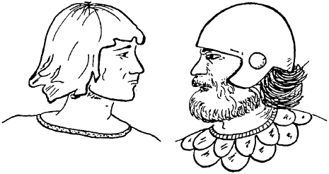
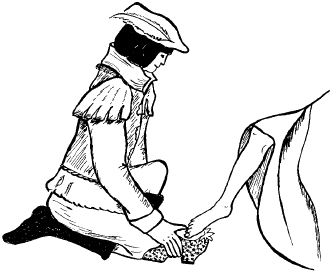
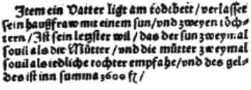
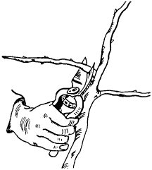
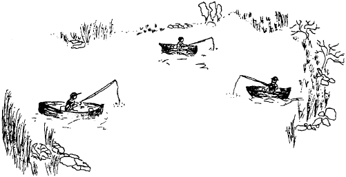
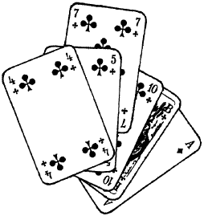
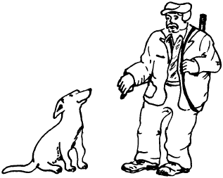
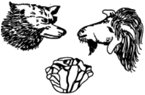
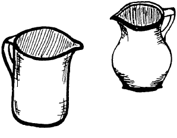

<!--
link:     https://fonts.googleapis.com/css2?family=Courier+Prime:ital,wght@0,400;0,700;1,400;1,700&display=swap
author:   André Dietrich
email:    LiaScript@web.de
version:  1.1.0
language: de
narrator: Deutsch Female
logo:     img/logo.png

comment:  Dieses Buch soll in die Programmiersprache PROLOG und in die mit ihr verbundene
          'Logikprogrammierung' einführen. Die Idee, 'Logik als eine Programmiersprache'
          zu verwenden, führt zu einer völlig neuen Auffassung vom Programmieren: Das
          Programm ist nicht eine Folge von Handlungsanweisungen, sondern eine Sammlung
          von Fakten und Regeln. Das zu lösende Problem wird als eine Anfrage an diese
          Sammlung formuliert. Im Idealfall führt die logisch korrekte Formulierung der
          Regeln und der Anfrage zur Lösung des Problems.


import: https://raw.githubusercontent.com/LiaTemplates/Tau-Prolog/0.3.4/README.md

@onload
window.LIA.settings.theme = "custom";
@end

@stammbaum_db
```prolog @0
maennl(adam).
maennl(alfred).
maennl(anton).
maennl(arthur).
maennl(baldur).
maennl(bernd).
maennl(boris).
maennl(casanova).
maennl(clemens).
maennl(donald).

weibl(adele).
weibl(alwine).
weibl(anna).
weibl(ariadne).
weibl(barbara).
weibl(berta).
weibl(cleopatra).
weibl(cosima).
weibl(daisy).

verheiratet(adam,adele).
verheiratet(adele,adam).
verheiratet(alfred,alwine).
verheiratet(alwine,alfred).
verheiratet(anton,anna).
verheiratet(anna,anton).
verheiratet(arthur,ariadne).
verheiratet(ariadne,arthur).
verheiratet(baldur,barbara).
verheiratet(barbara,baldur).
verheiratet(bernd,berta).
verheiratet(berta,bernd).
verheiratet(clemens,cleopatra).
verheiratet(cleopatra,clemens).

/* elter(X,Y) heißt: Y ist Elternteil von X */

elter(baldur,adam).
elter(baldur,adele).
elter(barbara,alfred).
elter(barbara,alwine).
elter(bernd,anton).
elter(bernd,anna).
elter(berta,arthur).
elter(berta,ariadne).
elter(boris,arthur).
elter(boris,ariadne).
elter(casanova,baldur).
elter(casanova,barbara).
elter(clemens,baldur).
elter(clemens,barbara).
elter(cleopatra,bernd).
elter(cleopatra,berta).
elter(cosima,bernd).
elter(cosima,berta).
elter(donald,clemens).
elter(donald,cleopatra).
elter(daisy,clemens).
elter(daisy,cleopatra).
```
@end

@style
/* ==== liascript-theming:start ==== */
/* links: https://fonts.googleapis.com/css2?family=Courier+Prime:ital,wght@0,400;0,700;1,400;1,700&display=swap */
/* theme: Arbeitsbuch PROLOG — RFC & Schreibmaschine — generated by liascript-theming, edit theme.json and rebuild */
:root {
  --theme-font-body: 'Courier Prime', 'Courier New', Courier, monospace;
  --theme-font-heading: 'Courier Prime', 'Courier New', Courier, monospace;
  --theme-font-mono: 'LiaSourceCodePro', monospace;
  --theme-heading-weight: 700;
  --theme-heading-letter-spacing: 0;
  --theme-line-height: 1.6;
  --global-font-size: 1.7rem;
  --theme-radius: 0;
  --theme-radius-small: 0;
  --theme-radius-large: 0;
  --theme-shadow: none;
  --theme-shadow-popup: none;
}
/* surfaces & text: apply to every color theme */
:root.lia-variant-light {
  --color-background: 255,255,255;
  --color-text: 0,0,0;
  --color-border: 128,128,128;
  --lia-grey-lighter: 255,255,255;
  --lia-grey-light: 255,255,255;
}
:root.lia-variant-dark {
  --color-background: 0,0,0;
  --color-text: 255,255,255;
  --color-border: 128,128,128;
  --lia-grey-dark: 0,0,0;
  --lia-anthracite: 0,0,0;
}
/* accent: only the course theme (default) and the custom radio,
   so readers can still pick LiaScript's built-in color themes;
   --color-accent = accent as text and border: links, active
   TOC entry, form borders; LiaScript would brighten it x2.5 in dark mode */
:root:is(.lia-theme-default, .lia-theme-custom) {
  --color-highlight: 0,0,0;
  --color-highlight-dark: 0,0,0;
  --color-accent: rgb(0,0,0);
}
:root.lia-theme-default {
  --color-highlight-menu: 0,0,0;
}
:root:is(.lia-theme-default, .lia-theme-custom).lia-variant-dark {
  --color-highlight: 118,118,118;
  --color-highlight-dark: 255,255,255;
  --color-accent: rgb(255,255,255);
}
/* notes and TTS bar set their own --color-accent on surface_strong in dark mode */
:root:is(.lia-theme-default, .lia-theme-custom).lia-variant-dark :is(.lia-notes, .lia-responsive-voice) {
  --color-accent: rgb(255,255,255);
}
:root.lia-variant-light { --theme-heading-color: #000000; }
:root.lia-variant-dark { --theme-heading-color: #FFFFFF; }
/* ==== LiaScript theme adapter (liascript-theming) — keep verbatim ====
   Maps the --theme-* tokens onto LiaScript's CSS. Everything a theme
   changes lives in the token block above this one. */

/* -- fonts: body/mono via the global variables, headings & co. are
      compiled literals in LiaScript and need explicit selectors -- */
:root {
  --global-font-family: var(--theme-font-body);
  --global-font-mono: var(--theme-font-mono);
  --global-font-headline: var(--theme-font-heading);
}
body { line-height: var(--theme-line-height, 1.47); }
h1, h2, h3, .h1, .h2, .h3 {
  font-family: var(--theme-font-heading);
  font-weight: var(--theme-heading-weight, 600);
  letter-spacing: var(--theme-heading-letter-spacing, normal);
  text-transform: var(--theme-heading-transform, none);
  color: var(--theme-heading-color, inherit);
}
h4, h5, h6, .h4, .h5, summary, .lia-accordion__headline {
  font-family: var(--theme-font-subheading, var(--theme-font-body));
}
.lia-quote__text { font-family: var(--theme-font-quote, var(--theme-font-heading)); }
.lia-code, .lia-code--inline, code, kbd, samp, pre { font-family: var(--theme-font-mono); }
.lia-code .ace_editor { font-family: var(--theme-font-mono) !important; }

/* -- shape: radius for controls & surfaces (radio buttons, tags, circles stay) -- */
:is(button, .lia-btn, input, .lia-input, select, .lia-select, textarea, .lia-textarea, .lia-dropdown):not(.lia-radio, .lia-btn--tag, .lia-btn--small-tag),
.lia-code-terminal__input, .lia-pagination__content, .lia-script, .lia-support-menu__submenu {
  border-radius: var(--theme-radius);
}
.lia-checkbox[type='checkbox'], kbd, .lia-tooltip .lia-tooltiptext, .lia-code--inline {
  border-radius: var(--theme-radius-small);
}
details, .lia-quote, .lia-code__input, .lia-table-responsive, .lia-card {
  border-radius: var(--theme-radius-large);
  box-shadow: var(--theme-shadow);
}
.lia-quote, .lia-code__input { overflow: hidden; }
.lia-code__input .ace_editor { border-radius: inherit; }
.lia-support-menu__submenu { box-shadow: var(--theme-shadow-popup, 0 0 1rem rgba(128, 128, 128, 0.2)); }

/* -- dark mode: LiaScript brightens the accent by multiplying RGB
      (rgb(from … calc(r*2.5))), which turns a hand-picked accent into
      pastel/yellow. Links, inline code text, the active TOC entry and
      form borders read --color-accent, which the token block sets; the
      rules below cover what is still multiplied.
      Scoped to default/custom so the built-in color themes keep their
      behavior. -- */
:root:is(.lia-theme-default, .lia-theme-custom).lia-variant-dark :is(.lia-link, .lia-btn--outline, .lia-code--inline) {
  color: rgb(var(--color-highlight-dark));
  border-color: rgb(var(--color-highlight-dark));
}
:root:is(.lia-theme-default, .lia-theme-custom).lia-variant-dark :is(summary, summary:after, .lia-label, .lia-skip-nav, .lia-support-menu__item, .lia-quote__text),
:root:is(.lia-theme-default, .lia-theme-custom).lia-variant-dark :is(.lia-list--unordered, .lia-list--ordered) > li::marker {
  color: rgb(var(--color-highlight-dark));
}
/* .lia-btn--transparent: brightness filter */
:root:is(.lia-theme-default, .lia-theme-custom).lia-variant-dark .lia-btn--transparent {
  filter: none;
}
/* hidden navigation: icon buttons float on the page; without the
   brightness filter above they need the accent as text */
:root:is(.lia-theme-default, .lia-theme-custom).lia-variant-dark .lia-navigation--hidden :is(#lia-btn-toc, #lia-btn-prev, #lia-btn-next, #lia-btn-sound, .lia-support-menu__item > button, .lia-support-menu__item > a.lia-btn) {
  color: rgb(var(--color-highlight-dark));
}
/* TOC separators use the light palette grey in every mode (glaring in dark mode);
   follow the theme border instead */
:root .lia-toc__content a.lia-toc__link--is-lvl-2::after,
:root .lia-toc__bottom::after {
  background-color: rgb(var(--color-border));
}
/* alternating table rows: LiaScript uses a neutral grey in dark mode;
   survey matrices render the row statements as th */
:root.lia-variant-dark .lia-table.is-alternating .lia-table__row:nth-child(2n) :is(td, th) {
  background-color: rgb(var(--lia-grey-dark));
}
/* sticky first/last column: a gradient on top, hence the shorthand */
:root.lia-variant-dark .lia-table-responsive.has-thead-sticky.has-first-col-sticky .is-alternating .lia-table__row:nth-child(2n) :is(td, th):first-child:before,
:root.lia-variant-dark .lia-table-responsive.has-thead-sticky.has-last-col-sticky .is-alternating .lia-table__row:nth-child(2n) :is(td, th):last-child:before {
  background: rgb(var(--lia-grey-dark));
}
/* -- layout / density / motion features -- */
.lia-canvas.lia-mode--textbook .lia-slide__content { max-width: 78ch; margin-inline: auto; }
/* -- theme extras -- */
.lia-slide__content { font-variant-ligatures: none; font-kerning: none; letter-spacing: 0; }
.lia-slide__content .h1 { font-size: 2.4rem; border: 0; padding-bottom: 0; margin-bottom: 1.2em; line-height: 1.4; letter-spacing: 0; }
.lia-slide__content h1.h1 { font-size: 2.7rem; }
.lia-slide__content .h1::after { content: '------------------------------------------------------------------------'; display: block; width: 100%; overflow: hidden; white-space: nowrap; font-size: 1.7rem; font-weight: 400; line-height: 1; margin-top: .75em; }
.lia-slide__content :is(a, .lia-link) { text-decoration: underline; text-underline-offset: .2em; }
.lia-slide__content blockquote { background: transparent; border-left: 1px dashed currentColor; padding: 1.2rem 2rem; font-style: normal; }
.lia-slide__content table { font-size: .94em; }
.lia-slide__content img { max-width: 100%; height: auto; }
.lia-slide__content img[alt^="Logo Arbeitsbuch"] { max-width: min(100%, 36rem); }
.lia-slide__content .lia-code--inline { background: transparent; border: 0; color: inherit; padding: 0 .1em; }
.lia-slide__content .lia-divider { border: 0; border-top: 1px dashed currentColor; }
@media (max-width: 600px) { .lia-slide__content { overflow-wrap: break-word; } .lia-slide__content .h1, .lia-slide__content h1.h1 { font-size: 2.1rem; } }
@media print { :root.lia-variant-light, :root.lia-variant-dark { --color-background: 255,255,255; --color-text: 0,0,0; --theme-heading-color: #000; } }
/* Monochrome controls also when a reader previously selected a color theme. */
:root[class*="lia-theme-"].lia-variant-light {
  --color-highlight: 0,0,0;
  --color-highlight-dark: 0,0,0;
  --color-highlight-menu: 0,0,0;
  --color-accent: rgb(0,0,0);
}
:root[class*="lia-theme-"].lia-variant-dark {
  --color-highlight: 118,118,118;
  --color-highlight-dark: 255,255,255;
  --color-highlight-menu: 255,255,255;
  --color-accent: rgb(255,255,255);
}
:root[class*="lia-theme-"] .lia-toc {
  background: rgb(var(--color-background));
  color: rgb(var(--color-text));
}
:root[class*="lia-theme-"] .lia-toc :is(.lia-toc__link, .lia-toc__toggle, .lia-toc__bottom, .lia-toc__search) {
  color: rgb(var(--color-text));
}
:root[class*="lia-theme-"].lia-variant-dark :is(.lia-link, .lia-btn--outline, .lia-code--inline, summary, .lia-label) {
  color: rgb(255,255,255);
  border-color: rgb(255,255,255);
}

:root[class*="lia-theme-"] .lia-toc * { color: rgb(var(--color-text)) !important; }


/* Keep the current narration visible without depending on accent colors. */
.lia-notes__content { border-inline-start: .4rem solid transparent; }
.lia-notes__content.active { border-inline-start-color: rgb(var(--color-text)); outline: 1px solid rgb(var(--color-border)); outline-offset: -1px; }
:root.lia-variant-light .lia-notes__content.active { background-color: #e8e8e8; color: #000; }
:root.lia-variant-dark .lia-notes__content.active { background-color: #242424; color: #fff; }
.lia-notes__content.active .lia-notes__counter { color: inherit; font-weight: 700; border-bottom: 2px solid currentColor; }
/* ==== liascript-theming:end ==== */
@end

@custom
--color-highlight-menu: 255,255,255;
@end
-->

# Arbeitsbuch PROLOG


                            --{{0}}--
Willkommen beim Arbeitsbuch PROLOG! Hier lernen Sie Schritt für Schritt, mit Fakten, Regeln und Anfragen zu programmieren – Vorkenntnisse brauchen Sie keine. Danach können Sie eigene PROLOG-Programme schreiben und nachvollziehen, wie PROLOG nach Lösungen sucht. Probieren Sie alles gleich aus: Jeder Code-Block mit der Schaltfläche „Ausführen“ läuft direkt hier im Browser, und Sie dürfen ihn jederzeit verändern.

**Programmieren mit Fakten, Regeln und Anfragen – direkt im Browser.**
Klicken Sie bei jedem Code-Block auf „Ausführen“ und ändern Sie ihn nach Belieben.

## Originales Vorwort

Dieses Buch soll in die Programmiersprache PROLOG und in die mit ihr verbundene 'Logikprogrammierung' einführen.
Die Idee, 'Logik als eine Programmiersprache' zu verwenden, führt zu einer völlig neuen Auffassung vom Programmieren: Das Programm ist nicht eine Folge von Handlungsanweisungen, sondern eine Sammlung von Fakten und Regeln.
Das zu lösende Problem wird als eine Anfrage an diese Sammlung formuliert.
Im Idealfall führt die logisch korrekte Formulierung der Regeln und der Anfrage zur Lösung des Problems.

Dieser Ansatz ist faszinierend, und das allein schon wäre Grund genug, PROLOG als zweite Programmiersprache für die Schule in Betracht zu ziehen.
Hinzu kommen aber noch andere Vorteile:

* Die Beschäftigung mit einer Sprache, die sich völlig von den befehlsorientierten Sprachen wie PASCAL unterscheidet, weitet den Horizont; altbekannte Algorithmen erscheinen in einem neuen Licht und neuartige Probleme können behandelt werden.
* Die wesentlichen Grundelemente von PROLOG bilden eine kleine, überschaubare Menge.
  (Sie zu beherrschen ist allerdings nicht ganz einfach.)
* Der aktive Umgang mit logischen, deklarativen Programmen fördert (so hoffen wir) das logische Denken.

Den letzten Punkt halten wir für entscheidend; daher haben wir uns in diesem Buch sehr stark auf den logischen Kern der Sprache – auf 'pures' PROLOG – beschränkt (und nehmen eine etwas spartanische 'Oberfläche' in Kauf).
Es geht uns nicht um die möglichst umfassende Vermittlung der Programmiersprache, sondern um das Bekanntmachen eines neuen, mächtigen und schönen Programmierkonzeptes.
Zum Vertrautwerden mit diesem neuen Konzept bedarf es vieler sinnvoller Beispiele und Aufgaben; wir hoffen, hier genügend bereitgestellt zu haben.

Das Buch besteht im wesentlichen aus zwei Teilen.
Der erste Teil gibt eine Einführung in die Arbeitsweise von PROLOG, das grundlegende Verfahren der Rekursion und den Datentyp der Liste.
Der zweite Teil besteht aus elf Vertiefungen; diese sind weitgehend unabhängig voneinander und nach steigender Komplexität geordnet.
Für einen Kurs schlagen wir vor, zuerst den ersten Teil (evtl. ohne [Kapitel 7](#7.-not-und-cut)) und dann mindestens eine Vertiefung durchzuarbeiten.
Ein 'Schnupperkurs' von wenigen Stunden (vielleicht schon in Sekundarstufe I) könnte aus [Kapitel 1](#1.-grundlagen) und [2](#2.-regeln), dem Anfang von [Kapitel 3](#3.-so-arbeitet-prolog) und der [Vertiefung B](#b-datenbasis-programmierung), der Datenbasisprogrammierung, bestehen.
Bei Bedarf könnte dies noch mit einigen Rätseln aus [Vertiefung A](#a-rätsel) gewürzt werden.

Wir verwenden PROLOG nach dem sogenannten Edinburgh-Standard, der durch das Buch von CLOCKSIN und MELLISH definiert wurde und sich inzwischen weitgehend durchgesetzt hat.
In Versionen, die sich nach diesem Standard richten, laufen die Programme des Buches problemlos.
Für einige gängige Versionen sind gezielte Hinweise im Anhang gegeben.
Dort findet man auch Hinweise auf die Bezugsquellen.

Wir bedanken uns bei dem Herausgeber, Herrn StD Dietrich Pohlmann, für zahlreiche Anregungen und Verbesserungsvorschläge und beim Verlag Ferd. Dümmler für die freundliche Betreuung.
Wir danken weiterhin Ingrid Hafenbrak für die Illustrationen, Frau Sylvia Platz und Herrn Martin Kammerer für die Hilfe bei der Gestaltung des Manuskriptes und Herrn Dr. Klaus Scheler für das sorgfältige Korrekturlesen.
Schließlich gilt unser Dank den Mannheimer Schülern und Lehrern vom Elisabeth Gymnasium und vom Gymnasium Feudenheim, die uns ermöglichten, unsere Ideen in der Schulpraxis zu erproben.

Es freut uns, dass nach recht kurzer Zeit eine Neuauflage erforderlich wurde.
Dabei wurden nur einige Druckfehler und Unstimmigkeiten berichtigt; die beiden Auflagen sind also uneingeschränkt nebeneinander im Unterricht einsetzbar.

Heidelberg und Weingarten

Hartmut Göhner, Bernd Hafenbrak

Wir bedanken uns bei den beiden Autoren, die dem Landesinstitut für Schule und Ausbildung Mecklenburg-Vorpommern (L.I.S.A.) die Texte und Programme zur Verfügung stellten, damit wir das – leider vergriffene – Arbeitsbuch PROLOG in den Landesbildungsserver einstellen konnten.

Schwerin

Gabriele Lehmann

## 1. Grundlagen

                            --{{0}}--
Zur Begrüßung ein kleiner Blumenstrauß.

<!-- style="max-width: 100%;" -->

                            --{{1}}--
Da das Buch nicht im Vierfarbendruck erscheinen konnte, wollen wir den Willkommensstrauß kurz beschreiben (vielleicht kolorieren Sie noch selbst):

                              {{1}}
* Die Rose ist rot.
* Die Tulpe ist gelb.
* Die Nelke ist weiß.
* Das Vergißmeinnicht ist blau.
* Das Veilchen ist blau.

                            --{{2}}--
Diese **Fakten** (Tatsachen) werden in PROLOG so festgehalten:

    {{2}}
```prolog
rot(rose).
gelb(tulpe).
weiss(nelke).
blau(vergissmeinnicht).
blau(veilchen).
```

                            --{{2}}--
Die **Prädikate** (Eigenschaften) _rot_, _gelb_, _weiss_ und _blau_ treffen auf gewisse **Konstanten** wie z. B. _rose_ zu, dies schreiben wir in der obigen Form.
Sowohl Prädikate als auch Konstanten werden mit kleinem Anfangsbuchstaben geschrieben, deutsche Sonderzeichen vermeiden wir.
Jedes Faktum wird mit einem Punkt und dem Drücken der <kbd>RETURN</kbd>-Taste abgeschlossen.

    {{2}}
> **Im Browser:** Entscheidend ist der Punkt am Ende jedes Faktums. Die <kbd>RETURN</kbd>-Taste beginnt im Programmfeld nur eine neue Zeile.

### PROLOG-Programme

                            --{{0}}--
Geben Sie die obigen Fakten mit Hilfe des Editors in eine Datei _strauss.pro_ ein (siehe Anhang S. 111).
Laden Sie dann PROLOG. Als Promptzeichen (Bereit-Zeichen) erscheint `?-`.
Holen Sie jetzt die Datenbasis, indem Sie hinter dem Promptzeichen `?- consult(strauss).` eingeben.
(Die Zeichen '?-' sollen Sie nicht tippen, sie sind die Aufforderung des Systems, eine Eingabe zu tätigen.)
Die Eingabe schließen Sie mit Punkt und RETURN ab.
PROLOG versucht, die Datei _strauss.pro_ zu laden, also in den Arbeitsspeicher zu übernehmen.
Gelingt dies, so antwortet PROLOG mit _yes_ und zeigt wieder das Promptzeichen.

**Aufgabe 1:** Geben Sie die Fakten in eine Datei _strauss.pro_ ein und laden Sie die Datei.

> **Im Browser:** Editor, Promptzeichen und `consult` brauchen Sie hier nicht.
> Das Programmfeld unten ist Ihre Datei (sie heißt hier `blumenstrauss.pro`), ein Klick auf „Ausführen“ lädt sie.
> Statt _yes_ meldet Tau-Prolog, dass die Datenbasis geladen wurde.

                            --{{1}}--
Die hier genutzte PROLOG-Umgebung besteht immer aus zwei Teilen. Der erste ist die Eingabe für das Programm.
Wenn Sie hier auf „Ausführen“ klicken, wird dieses Programm geladen.
Da dieses Programm jedoch einen syntaktischen Fehler hat, erhalten Sie zunächst eine Fehlermeldung, die auf ein Syntax-Problem hinweist.

```prolog blumenstrauss.pro
rot(rose).
gelb(tulpe).
weiss(nelke).
blau(vergissmeinnicht).
blau(veilchen)
```
@Tau.program(blumenstrauss.pro)

                            --{{1}}--
Falls die Antwort _no_ erscheint, konnte das System die Datei nicht laden, sei es, weil in der Datei noch ein Fehler ist, sei es, weil die Datei im falschen Verzeichnis gesucht wurde.
Überzeugen Sie sich zunächst, dass Ihre Datei mit der obigen übereinstimmt und lesen Sie im Anhang oder in Ihrem PROLOG-Handbuch nach, wie eine Datei zu laden ist, die in einem anderen Verzeichnis liegt.
Auf jeden Fall sollten Sie sich im Anhang dieses Buches und in Ihrem Handbuch über den Umgang mit Ihrer PROLOG-Version kundig machen.

                            --{{1}}--
Sie können den Code direkt im Feld ändern: Setzen Sie den fehlenden Punkt ans Ende der letzten Zeile.
Wenn Sie dann wieder auf „Ausführen“ klicken, wird angezeigt, dass Ihre Datenbasis erfolgreich geladen wurde.
Und falls Sie sich später bei einer Änderung nicht sicher sind, können Sie jede frühere Version wiederherstellen: Klicken Sie einfach auf die Pfeil-Schaltflächen neben der aktuellen Versionsnummer.

                            --{{2}}--
Ist die Datenbasis geladen, so kann man Anfragen stellen. Geben Sie ein: `?- rot(rose).`
Für Anfragen gibt es hier ein zweites Eingabefeld unter dem Programm:

    {{2-4}}
```prolog
rot(rose).
```
@Tau.query(blumenstrauss.pro)

                            --{{3}}--
Dies wird als Frage aufgefasst.
Umgangssprachlich formuliert heißt das: "Ist die Rose rot?".
Als Antwort erscheint _yes_.

    {{3-4}}
> **Im Browser:** Tau-Prolog antwortet mit `true` statt _yes_ und mit `false` statt _no_.

                            --{{4}}--
Auf die Frage `?- gelb(veilchen).` erhalten wir _no_.

    {{4}}
```prolog
gelb(veilchen).
```
@Tau.query(blumenstrauss.pro)

                            --{{5}}--
Geben Sie einige derartige Fragen ein. Versuchen Sie es auch mal mit "sinnlosen" Fragen wie `?- gelb(primel).` oder `?- lila(veilchen).`
Sie sehen: Kommt die Frage buchstabengetreu als Faktum in der Datenbasis vor, so antwortet PROLOG mit _yes_, andernfalls mit _no_.

    {{5}}
*******************************************************************************
```prolog
gelb(primel).
```
@Tau.query(blumenstrauss.pro)

```prolog
lila(veilchen).
```
@Tau.query(blumenstrauss.pro)

> **Im Browser:** Bei `lila(veilchen).` meldet Tau-Prolog `Error: existence_error` statt _no_: Das Prädikat `lila` kommt in der Datenbasis überhaupt nicht vor.
*******************************************************************************

### Variablen

                            --{{0}}--
Wir können mit Hilfe von **Variablen** auch etwas anspruchsvoller fragen: `?- rot(X).`
Das heißt übersetzt: Was ist rot? Wir erhalten die Antwort `X=rose`.

```prolog
rot(X).
```
@Tau.query(blumenstrauss.pro)

                            --{{1}}--
Variablen werden mit einem großen Anfangsbuchstaben geschrieben.
Dieselbe Frage können wir auch mit einer anderen Variablen stellen, etwa `?- rot(Blume).`
Jetzt lautet die Antwort `Blume=rose`.

    {{1}}
```prolog
rot(Blume).
```
@Tau.query(blumenstrauss.pro)

                            --{{2}}--
Bei manchen PROLOG-Versionen müssen Sie die Antwort mit einem Punkt bestätigen oder mit einem Strichpunkt weitere Antworten anfordern.

    {{2}}
> **Im Browser:** Weitere Antworten fordern Sie an, indem Sie noch einmal auf „Ausführen“ klicken.
> Gibt es keine weitere Lösung mehr, erscheint `false.`

                            --{{3}}--
Aufgabe 2: Sie wollen wissen, welche Blume unseres Straußes gelb ist. Stellen Sie die entsprechende Anfrage.
Fragen Sie nach violetten Blumen. Fragen Sie nach blauen Blumen.
Verwenden Sie dabei die Variable `Blume`, dann kann der Kurs Ihre Antwort automatisch prüfen.

      {{3}}
*******************************************************************************
**Aufgabe 2:** Stellen Sie die Anfragen. Verwenden Sie die Variable `Blume`.

1. Welche Blume unseres Straußes ist gelb?

       [[gelb(Blume).]]
       @Tau.check(blumenstrauss.pro,`setof(Blume, @'input, [tulpe])`)

2. Fragen Sie nach violetten Blumen.

       [[!]]
   *************************************
   ```prolog
   violett(Blume).
   ```
   @Tau.query(blumenstrauss.pro)

   Im Buch antwortet PROLOG mit _no_. Tau-Prolog meldet hier `Error: existence_error`, weil es das Prädikat `violett` gar nicht kennt.
   *************************************

3. Fragen Sie nach blauen Blumen.

       [[blau(Blume).]]
       @Tau.check(blumenstrauss.pro,`setof(Blume, @'input, [veilchen, vergissmeinnicht])`)

*******************************************************************************

                            --{{4}}--
Wie Sie sehen, wird mit _no_ geantwortet, wenn keine Lösung der Anfrage möglich ist.
Gibt es mehrere Lösungen, so wird Ihnen zunächst eine angeboten und Sie können weitere anfordern.
Gibt es schließlich keine weitere Lösung mehr, so erscheint _no_.

### Zweistellige Prädikate

                            --{{0}}--
Dies ist die Urlaubsplanung für die nächsten Ferien:

```prolog urlaubsplanung.pro
faehrt_nach(axel,england).
faehrt_nach(beate,griechenland).
faehrt_nach(beate,tuerkei).
faehrt_nach(clemens,frankreich).
faehrt_nach(dagmar,italien).
faehrt_nach(elmar,frankreich).
faehrt_nach(frederike,frankreich).
```
@Tau.program(urlaubsplanung.pro)

                            --{{0}}--
Umgangssprachlich heißt das:

* Axel fährt nach England,
* Beate fährt nach Griechenland und in die Türkei,
* Clemens, Elmar und Frederike fahren nach Frankreich,
* Dagmar fährt nach Italien.

                            --{{1}}--
In dieser **Datenbasis** gibt es nur ein Prädikat, das zweistellige Prädikat _faehrt\_nach_.
Geben Sie die obigen Zeilen in eine Datei _urlaub.pro_ ein und laden Sie diese Datei in PROLOG.
Die Frage "Wer fährt nach England?" heißt in PROLOG:

    {{1}}
```prolog Anfrage:
faehrt_nach(X,england).
```
@Tau.query(urlaubsplanung.pro)

    {{1}}
> **Im Browser:** Die Datei heißt hier `urlaubsplanung.pro`. Klicken Sie beim Programm auf „Ausführen“, dann ist sie geladen.

                            --{{2}}--
Aufgabe 3: Übersetzen Sie die folgenden Fragen und überprüfen Sie die Antworten.
Kreuzen Sie an, was Sie erwarten, und vergleichen Sie Ihre Anfrage dann mit der Auflösung.

    {{2}}
*******************************************************************************
**Aufgabe 3:** Übersetzen Sie die folgenden Fragen und überprüfen Sie die Antworten:

1. Fährt Axel nach Griechenland?

       [( )] Ja
       [(X)] Nein
   *************************************
   ```prolog
   faehrt_nach(axel,griechenland).
   ```
   @Tau.query(urlaubsplanung.pro)
   *************************************

2. Wohin fährt Beate?

       [[ ]] england
       [[ ]] frankreich
       [[X]] griechenland
       [[ ]] italien
       [[X]] tuerkei
   *************************************
   ```prolog
   faehrt_nach(beate,X).
   ```
   @Tau.query(urlaubsplanung.pro)
   *************************************

3. Wohin fährt Xaver?

       [[ ]] england
       [[ ]] frankreich
       [[ ]] griechenland
       [[ ]] italien
       [[ ]] tuerkei
   *************************************
   Xaver fährt nirgends hin, er ist nicht in der Datenbasis enthalten.

   ```prolog
   faehrt_nach(xaver,X).
   ```
   @Tau.query(urlaubsplanung.pro)
   *************************************

4. Wer fährt nach Frankreich?

       [[ ]] Axel
       [[ ]] Beate
       [[X]] Clemens
       [[ ]] Dagmar
       [[X]] Elmar
       [[X]] Frederike
   *************************************
   ```prolog
   faehrt_nach(X,frankreich).
   ```
   @Tau.query(urlaubsplanung.pro)
   *************************************

5. Wer fährt wohin?

       [[!]]
   <script>true;</script>
   *************************************
   ```prolog
   faehrt_nach(Person,Land).
   ```
   @Tau.query(urlaubsplanung.pro)
   *************************************

*******************************************************************************

### _und_ & _oder_ Operatoren

    {{0-1}}
<!-- style="max-width: 100%" -->

                            --{{0}}--
Die Vorlieben und Abneigungen am Frühstückstisch seien in einer PROLOG-Datenbasis mit dem Namen _fruehst.pro_ festgehalten:

```prolog fruehstueck.pro
mag(papa,muesli).
mag(papa,brot).
mag(mami,kuchen).
mag(mami,brot).
mag(oma,brot).
mag(baby,muesli).
mag(baby,kuchen).

hasst(papa,kuchen).
hasst(mami,muesli).
hasst(oma,muesli).
hasst(oma,kuchen).
hasst(baby,brot).
```
@Tau.program(fruehstueck.pro)

> **Im Browser:** Die Datei heißt hier `fruehstueck.pro`.

```prolog Anfrage:
mag(papa,brot).
```
@Tau.query(fruehstueck.pro)

                            --{{1}}--
Bis jetzt können wir vier Arten von Fragen stellen. Beispiele:

      {{1-2}}
*******************************************************************************
1. Mag Papa Kuchen?
2. Wer haßt Müsli?
3. Was mag Oma?
4. Wer mag was?

Testen Sie sich selbst: Bringen Sie PROLOG dazu, diese Fragen zu beantworten.

    [[!]]
*************************************
*Lösungsvorschlag (nicht aus dem Buch)*

```prolog
mag(papa,kuchen).
```
@Tau.query(fruehstueck.pro)

```prolog
hasst(X,muesli).
```
@Tau.query(fruehstueck.pro)

```prolog
mag(oma,X).
```
@Tau.query(fruehstueck.pro)

```prolog
mag(X,Y).
```
@Tau.query(fruehstueck.pro)
*************************************
*******************************************************************************

                            --{{2}}--
Für die Frühstücksplanung sind aber auch zusammengesetzte Fragen wichtig, wie

    {{2-4}}
*******************************************************************************
* Wer haßt Kuchen _und_ mag Müsli?

      {{3}}
  ***********************************
  ```prolog
  hasst(X,kuchen), mag(X,muesli).
  ```
  @Tau.query(fruehstueck.pro)
  ***********************************
* Wer mag Kuchen _und_ Brot?

      {{3}}
  ***********************************
  ```prolog
  mag(X,brot), mag(X,kuchen).
  ```
  @Tau.query(fruehstueck.pro)
  ***********************************
* Wer mag Brot _oder_ Kuchen?

      {{3}}
  ***********************************
  ```prolog
  mag(X,brot); mag(X,kuchen).
  ```
  @Tau.query(fruehstueck.pro)
  ***********************************
*******************************************************************************

                            --{{3}}--
Das Zeichen in PROLOG für _und_ ist ein Komma, für _oder_ schreibt man einen Strichpunkt.
Die obigen Anfragen lauten also wie angezeigt.

                            --{{4}}--
Aufgabe 4: Testen Sie diese Anfragen. Übersetzen Sie die folgenden Fragen nach PROLOG.
Kreuzen Sie an, was Sie erwarten, und vergleichen Sie Ihre Anfrage mit der Auflösung.

          {{4}}
*******************************************************************************
**Aufgabe 4:** Testen Sie diese Anfragen. Übersetzen Sie die folgenden Fragen nach PROLOG:

1. Wer mag Kuchen und Müsli?

       [[ ]] Mami
       [[X]] Baby
       [[ ]] Papa
       [[ ]] Oma
   **************************
   ```prolog
   mag(X,kuchen), mag(X,muesli).
   ```
   @Tau.query(fruehstueck.pro)
   **************************

2. Was mögen sowohl Papa als auch Mami?

       [[ ]] Kuchen
       [[X]] Brot
       [[ ]] Müsli
   *********************************
   ```prolog
   mag(papa,X), mag(mami,X).
   ```
   @Tau.query(fruehstueck.pro)
   *********************************

3. Wer mag Kuchen und haßt Müsli?

       [[ ]] Baby
       [[X]] Mami
       [[ ]] Papa
       [[ ]] Oma
   **************************
   ```prolog
   mag(X,kuchen), hasst(X,muesli).
   ```
   @Tau.query(fruehstueck.pro)
   **************************

*******************************************************************************

### Aufgaben

                            --{{0}}--
Die folgenden Abschnitte dienen dazu, das bereits Gelernte zu wiederholen und zu festigen, bevor wir lernen, wie man komplexere Sachverhalte mit Regeln abbildet.

#### Blumenstrauß #2

**Aufgabe 5:** Stellen Sie die Gegebenheiten des Willkommensstraußes von Aufgabe 1 mit Hilfe eines zweistelligen Prädikates _farbe_ dar.

> **Im Browser:** Schreiben Sie die Fakten im Feld unten um und klicken Sie auf „Ausführen“. Darunter können Sie Anfragen stellen.

```prolog blumenstrauss2.pro
rot(rose).
gelb(tulpe).
weiss(nelke).
blau(vergissmeinnicht).
blau(veilchen).
```
@Tau.program(blumenstrauss2.pro)

```prolog Anfrage:
% Ihre Anfrage, z. B. nach der Farbe der Rose
```
@Tau.query(blumenstrauss2.pro)

Welchen Vorteil hat diese Darstellung?

    [[!]]
**************************************

**Vorteil:** Man kann auch Fragen stellen wie: "_Welche Farbe hat die Rose?_"

*Lösungsvorschlag (nicht aus dem Buch)* für die Fakten:

```prolog
farbe(rose,rot).
farbe(tulpe,gelb).
farbe(nelke,weiss).
farbe(vergissmeinnicht,blau).
farbe(veilchen,blau).
```

Die Frage nach der Farbe der Rose lautet dann `farbe(rose,X).`

**************************************

#### Beziehungen

                            --{{0}}--
Aufgabe 6: Übersetzen Sie die folgenden Sätze in eine PROLOG-Datenbasis.

    {{0-1}}
<!-- style="max-width: 100%;" -->

**Aufgabe 6:** Übersetzen Sie die folgenden Sätze in eine PROLOG-Datenbasis.

* Peter liebt Susi.
* Hans liebt Susi und Sabine.
* Sabine liebt Peter und haßt Hans.
* Susi liebt Peter und Felix.
* Susi haßt Sabine.
* Peter haßt Felix.
* Felix liebt sich selbst.

```prolog @Tau(beziehungen.pro,`% Und hier Ihre Anfragen`)
% Geben Sie hier die Beziehungen ein
```

    {{0-1}}
> **Im Browser:** Schreiben Sie die Fakten ins obere Feld und klicken Sie auf „Ausführen“; im unteren Feld stellen Sie die Anfragen.

                            --{{1}}--
Stellen Sie die Anfragen. Versuchen Sie es zuerst selbst, bevor Sie mit den Auflösungen vergleichen.

    {{1}}
*******************************************************************************
**Stellen Sie die Anfragen:**

* Wen liebt Sabine?

      [[!]]
  *************************
  ```prolog
  liebt(sabine,X).
  ```
  *************************
* Wer liebt Sabine?

      [[!]]
  *************************
  ```prolog
  liebt(X,sabine).
  ```
  *************************
* Wer liebt wen?

      [[!]]
  *************************
  ```prolog
  liebt(Wer,Wen).
  ```
  *************************
* Wer liebt jemanden, der ihn auch liebt?

      [[!]]
  *************************
  ```prolog
  liebt(X,Y), liebt(Y,X).
  ```
  *************************
* Wessen Liebe wird mit Haß vergolten?

      [[!]]
  *************************
  ```prolog
  liebt(X,Y), hasst(Y,X).
  ```
  *************************

Und die Datenbasis selbst?

    [[!]]
*************************
*Lösungsvorschlag (nicht aus dem Buch)*

```prolog
liebt(peter,susi).
liebt(hans,susi).
liebt(hans,sabine).
liebt(sabine,peter).
liebt(susi,peter).
liebt(susi,felix).
liebt(felix,felix).

hasst(sabine,hans).
hasst(susi,sabine).
hasst(peter,felix).
```

Damit antwortet PROLOG z. B. auf `liebt(X,Y), liebt(Y,X).` mit Peter und Susi (in beiden Reihenfolgen) sowie mit Felix, der sich selbst liebt.
*************************
*******************************************************************************

#### Stammbaum

                            --{{0}}--
Der folgende Stammbaum von Donald und Daisy läßt eine gewisse Systematik bei der Namensgebung erkennen, die den Überblick erleichtert:

<!-- style="display: block; margin-left: auto; margin-right: auto; max-width: 600px;" -->
``````````
♂ Adam ━━━━━┓
            ┣━━━━ ♂ Baldur ━━━━━┓
♀ Adele ━━━━┛                   ┣━━━━ ♂ Casanova
♂ Alfred ━━━┓                   ┣━━━━ ♂ Clemens ━━━━┓
            ┣━━━━ ♀ Barbara ━━━━┛                   ┃
♀ Alwine ━━━┛                                       ┣━━━━ ♂ Donald
♂ Anton ━━━━┓                                       ┣━━━━ ♀ Daisy
            ┣━━━━ ♂ Bernd ━━━━━━┓                   ┃
♀ Anna ━━━━━┛                   ┣━━━━ ♀ Cleopatra ━━┛
♂ Arthur ━━━┓                   ┣━━━━ ♀ Cosima
            ┣━━━━ ♀ Berta ━━━━━━┛
            ┣━━━━ ♂ Boris
♀ Ariadne ━━┛
``````````

                            --{{1}}--
Es gibt verschiedene Möglichkeiten, die Informationen dieses Stammbaumes in einer Datenbasis festzuhalten.
Wir wählen dazu die Prädikate _maennl_, _weibl_, _verheiratet_ und _elter_.
Die Datenbasis wird schon recht groß und ist deshalb hier im Buch zweispaltig gedruckt.
In Ihrer Datei erscheint sie einspaltig, da jedes Faktum mit Punkt und RETURN abgeschlossen wird.

                              {{1}}
*******************************************************************************
```prolog stammbaum.pro
maennl(adam).
maennl(alfred).
maennl(anton).
maennl(arthur).
maennl(baldur).
maennl(bernd).
maennl(boris).
maennl(casanova).
maennl(clemens).
maennl(donald).

weibl(adele).
weibl(alwine).
weibl(anna).
weibl(ariadne).
weibl(barbara).
weibl(berta).
weibl(cleopatra).
weibl(cosima).
weibl(daisy).

verheiratet(adam,adele).
verheiratet(adele,adam).
verheiratet(alfred,alwine).
verheiratet(alwine,alfred).
verheiratet(anton,anna).
verheiratet(anna,anton).
verheiratet(arthur,ariadne).
verheiratet(ariadne,arthur).
verheiratet(baldur,barbara).
verheiratet(barbara,baldur).
verheiratet(bernd,berta).
verheiratet(berta,bernd).
verheiratet(clemens,cleopatra).
verheiratet(cleopatra,clemens).

/* elter(X,Y) heißt: Y ist Elternteil von X */

elter(baldur,adam).
elter(baldur,adele).
elter(barbara,alfred).
elter(barbara,alwine).
elter(bernd,anton).
elter(bernd,anna).
elter(berta,arthur).
elter(berta,ariadne).
elter(boris,arthur).
elter(boris,ariadne).
elter(casanova,baldur).
elter(casanova,barbara).
elter(clemens,baldur).
elter(clemens,barbara).
elter(cleopatra,bernd).
elter(cleopatra,berta).
elter(cosima,bernd).
elter(cosima,berta).
elter(donald,clemens).
elter(donald,cleopatra).
elter(daisy,clemens).
elter(daisy,cleopatra).
```
@Tau.program(stammbaum.pro)

```prolog Anfrage:
% Anfragen hier eingeben.
```
@Tau.query(stammbaum.pro)
*******************************************************************************

                            --{{2}}--
Beachten Sie, wie sich die Symmetrie des Prädikats _verheiratet_ in der Datenbasis ausdrückt.
Das Prädikat _elter_ bedarf einer Erläuterung. Wir fügen in die Datei noch einen Kommentar ein:

                             {{2-3}}
**Kommentar:** `/* elter(X,Y) heißt: Y ist Elternteil von X */`

                            --{{2}}--
Alles was zwischen den Kommentarzeichen `/*` und `*/` steht, wird von PROLOG ignoriert (es kann sein, dass Ihre PROLOG-Version andere Kommentarzeichen verwendet).
Für den Benutzer ist im obigen Fall ein solcher Kommentar notwendig, da die Reihenfolge von X und Y von uns willkürlich (in Anlehnung an Gepflogenheiten der Mathematiker) festgelegt wurde.

                            --{{3}}--
Aufgabe 7: Geben Sie die obige Datenbasis unter dem Namen _stammb.pro_ ein, falls sie sich nicht schon auf Ihrer Diskette befindet.
Laden Sie diese Datei nach PROLOG und stellen Sie Fragen.
Verwenden Sie in Ihren Anfragen `X` als Variable, dann kann der Kurs Ihre Antwort automatisch prüfen.

                             {{3-4}}
*******************************************************************************
**Aufgabe 7:** Geben Sie die obige Datenbasis unter dem Namen _stammb.pro_ ein, falls sie sich nicht schon auf Ihrer Diskette befindet.
Laden Sie diese Datei nach PROLOG und stellen Sie Fragen:

> **Im Browser:** Die Datenbasis steht schon oben im Feld `stammbaum.pro`. Ein Klick auf „Ausführen“ lädt sie – das ist auch für die Prüfung hier nötig.
> Verwenden Sie `X` als Variable.

* Wer sind die Eltern von Daisy?

      [[elter(daisy,X).]]
      @Tau.check(stammbaum.pro,`setof(X, @'input, [clemens, cleopatra])`)

* Mit wem ist Baldur verheiratet?

      [[verheiratet(baldur,X).]]
      @Tau.check(stammbaum.pro,`setof(X, @'input, [barbara])`)

* Wie heißen die Kinder von Adam?

      [[elter(X,adam).]]
      @Tau.check(stammbaum.pro,`setof(X, @'input, [baldur])`)

* Und wie heißen die Kinder von Arthur?

      [[elter(X,arthur).]]
      @Tau.check(stammbaum.pro,`setof(X, @'input, [berta, boris])`)

*******************************************************************************

                            --{{4}}--
Wenn wir die Mutter von Cosima suchen, müssen wir eine zusammengesetzte Frage stellen: "Welchen weiblichen Elternteil hat Cosima?".
In PROLOG lautet das wie unten angezeigt.
Beide Fragen sind logisch gleichwertig und erzielen dieselbe Antwort.
Auf Unterschiede bei der Abarbeitung der beiden Anfragen wollen wir erst in Kapitel 3 eingehen.

                             {{4-5}}
********************************************************************************
Wer ist die Mutter von Cosima?

```prolog
elter(cosima,X), weibl(X).
```
@Tau.query(stammbaum.pro)

oder

```prolog
weibl(X), elter(cosima,X).
```
@Tau.query(stammbaum.pro)
********************************************************************************

                            --{{5}}--
Aufgabe 8: Fragen Sie auf jeweils zwei verschiedene Arten nach dem Vater von Daisy, nach den Söhnen von Barbara und nach den Töchtern von Anton.

                              {{5}}
********************************************************************************
**Aufgabe 8:** Fragen Sie auf jeweils zwei verschiedene Arten nach dem Vater von Daisy, nach den Söhnen von Barbara und nach den Töchtern von Anton.

    [[!]]
*******************************
*Lösungsvorschlag (nicht aus dem Buch)*

Vater von Daisy:

```prolog
elter(daisy,X), maennl(X).
```
@Tau.query(stammbaum.pro)

```prolog
maennl(X), elter(daisy,X).
```
@Tau.query(stammbaum.pro)

Söhne von Barbara:

```prolog
elter(X,barbara), maennl(X).
```
@Tau.query(stammbaum.pro)

```prolog
maennl(X), elter(X,barbara).
```
@Tau.query(stammbaum.pro)

Töchter von Anton – hier lautet die Antwort _no_ (`false`), denn Anton hat nur einen Sohn, Bernd:

```prolog
elter(X,anton), weibl(X).
```
@Tau.query(stammbaum.pro)

```prolog
weibl(X), elter(X,anton).
```
@Tau.query(stammbaum.pro)
*******************************
********************************************************************************

                            --{{6}}--
Wir suchen die Großeltern von Donald. Dies erreichen wir durch die folgende Anfrage.
In Worten: Gesucht sind _E_ und _G_, so dass _E_ Elternteil von Donald und _G_ Elternteil von _E_ ist.

    {{6-7}}
```prolog
elter(donald,E), elter(E,G).
```
@Tau.query(stammbaum.pro)

                            --{{7}}--
Aufgabe 9: Suchen Sie die Großmütter von Clemens, die Urgroßeltern von Daisy, die Schwiegermutter von Bernd.

    {{7-8}}
********************************************************************************
**Aufgabe 9:** Suchen Sie

* die Großmütter von Clemens,

      [[!]]
  *******************************
  ```prolog
  elter(clemens,X), elter(X,Oma), weibl(Oma).
  ```
  @Tau.query(stammbaum.pro)
  *******************************
* die Urgroßeltern von Daisy,

      [[!]]
  *******************************
  ```prolog
  elter(daisy,X), elter(X,Y), elter(Y,Urgross).
  ```
  @Tau.query(stammbaum.pro)
  *******************************
* die Schwiegermutter von Bernd.

      [[!]]
  *******************************
  ```prolog
  verheiratet(bernd,X), elter(X,S_mutter), weibl(S_mutter).
  ```
  @Tau.query(stammbaum.pro)
  *******************************
********************************************************************************

                            --{{8}}--
Eine besondere Schwierigkeit tritt auf, wenn wir den Bruder von Clemens suchen.
Der Bruder ist das Kind der beiden Eltern von Clemens, das ergibt die folgende Anfrage.
(Die Frage läßt sich nicht mehr in einer Zeile unterbringen. Sie gelangen mit der RETURN-Taste in die nächste Zeile. Erst durch Punkt und RETURN wird die Anfrage abgeschlossen.)

    {{8-9}}
********************************************************************************
```prolog
elter(clemens,V), maennl(V), elter(clemens,M), weibl(M),
elter(X,V), elter(X,M), maennl(X).
```
@Tau.query(stammbaum.pro)

> **Im Browser:** Auch im Anfragefeld dürfen Sie mehrere Zeilen schreiben. Die Anfrage endet mit dem Punkt; abgeschickt wird sie mit „Ausführen“.
********************************************************************************

                            --{{9}}--
Diese Anfrage ist noch fehlerhaft.
Außer der richtigen Lösung Casanova erscheint auch Clemens selbst als Antwort.
Wir benötigen hier ein Prädikat für die Ungleichheit, dies wird in PROLOG geschrieben als `\=`.
Unsere Frage nach dem Bruder von Clemens lautet damit:

    {{9}}
```prolog
elter(clemens,V), maennl(V), elter(clemens,M), weibl(M),
elter(X,V), elter(X,M), maennl(X), X\=clemens.
```
@Tau.query(stammbaum.pro)

                           --{{10}}--
Aufgabe 10: Lassen Sie nach den Schwestern von Cosima suchen.

                             {{10}}
********************************************************************************
**Aufgabe 10:** Lassen Sie nach den Schwestern von Cosima suchen.

```prolog
% Ihre Anfrage
```
@Tau.query(stammbaum.pro)

    [[!]]
*******************************
*Lösungsvorschlag (nicht aus dem Buch)*

```prolog
elter(cosima,V), maennl(V), elter(cosima,M), weibl(M),
elter(X,V), elter(X,M), weibl(X), X\=cosima.
```
@Tau.query(stammbaum.pro)

Die einzige Schwester von Cosima ist Cleopatra.
*******************************
********************************************************************************

## 2. Regeln

                            --{{0}}--
Im vorigen Beispiel waren einige Grundbegriffe wie Elternteil, männlich, weiblich durch die Datenbasis erklärt, andere Begriffe wie Vater, Schwiegermutter oder Bruder mussten wir bei Anfragen in diese Grundbegriffe übersetzen.
Dieses umständliche Verfahren können wir vereinfachen, indem wir zu den Fakten unserer Datenbasis noch **Regeln** hinzufügen.
Im Beispiel wären das die Regeln am Anfang des folgenden Programms:

```prolog stammbaum+regeln.pro
mutter(X,Y):- elter(X,Y), weibl(Y).
vater(X,Y):- elter(X,Y), maennl(Y).
kind(X,Y):- elter(Y,X).
schwiegermutter(X,Y):-
              verheiratet(X,Z), mutter(Z,Y).
bruder(X,Y):- vater(X,V), mutter(X,M),
              vater(Y,V), mutter(Y,M), maennl(Y), Y\=X.

maennl(adam).
maennl(alfred).
maennl(anton).
maennl(arthur).
maennl(baldur).
maennl(bernd).
maennl(boris).
maennl(casanova).
maennl(clemens).
maennl(donald).

weibl(adele).
weibl(alwine).
weibl(anna).
weibl(ariadne).
weibl(barbara).
weibl(berta).
weibl(cleopatra).
weibl(cosima).
weibl(daisy).

verheiratet(adam,adele).
verheiratet(adele,adam).
verheiratet(alfred,alwine).
verheiratet(alwine,alfred).
verheiratet(anton,anna).
verheiratet(anna,anton).
verheiratet(arthur,ariadne).
verheiratet(ariadne,arthur).
verheiratet(baldur,barbara).
verheiratet(barbara,baldur).
verheiratet(bernd,berta).
verheiratet(berta,bernd).
verheiratet(clemens,cleopatra).
verheiratet(cleopatra,clemens).

/* elter(X,Y) heißt: Y ist Elternteil von X */

elter(baldur,adam).
elter(baldur,adele).
elter(barbara,alfred).
elter(barbara,alwine).
elter(bernd,anton).
elter(bernd,anna).
elter(berta,arthur).
elter(berta,ariadne).
elter(boris,arthur).
elter(boris,ariadne).
elter(casanova,baldur).
elter(casanova,barbara).
elter(clemens,baldur).
elter(clemens,barbara).
elter(cleopatra,bernd).
elter(cleopatra,berta).
elter(cosima,bernd).
elter(cosima,berta).
elter(donald,clemens).
elter(donald,cleopatra).
elter(daisy,clemens).
elter(daisy,cleopatra).
```
@Tau.program(stammbaum+regeln.pro)

```prolog
mutter(X,Y).
```
@Tau.query(stammbaum+regeln.pro)

{{1-5}} **Neues Zeichen:** `:-` ==> falls

                            --{{1}}--
Dabei wird das Zeichen `:-` gelesen als 'falls' oder 'wenn'.
Umgangssprachlich lesen wir die Regel für _mutter_ als:
_Y ist Mutter von X, wenn Y Elternteil von X ist und Y weiblich ist._

                            --{{1}}--
Die Regel für _schwiegermutter_ heißt:
_Y ist Schwiegermutter von X, falls eine Person Z mit X verheiratet ist und Y Mutter von Z ist._

                            --{{2}}--
Manche Prädikate werden durch mehrere Regeln beschrieben:

                             {{2-3}}
*******************************************************************************
```prolog
schwager(X,Y):- verheiratet(X,Z), bruder(Z,Y).
schwager(X,Y):- schwester(X,Z), verheiratet(Z,Y).
```

**In Worten:** Y ist Schwager von X, falls X mit einer Person Z verheiratet ist und Y Bruder von Z ist oder falls X eine Schwester Z hat, die mit Y verheiratet ist.

*******************************************************************************

                            --{{3}}--
Der Regelteil vor dem Zeichen `:-` heißt **Kopf der Regel**, der Rest heißt **Rumpf der Regel**.
Sowohl Fakten als auch Regeln bezeichnen wir als **Klauseln**.
Die Gesamtheit aller Klauseln bildet ein PROLOG-**Programm**.
Dieses wird mit Hilfe des Editors als Datei angelegt. Mit _consult_ wird das Programm geladen.

    {{3}}
> **Im Browser:** Das Programmfeld oben ersetzt Editor und Datei; „Ausführen“ ersetzt _consult_.

                            --{{4}}--
Aufgabe 1: Lesen Sie die Regel für das Prädikat _bruder_ umgangssprachlich.
Ergänzen Sie (mit Hilfe des Editors) die Datei _stammb.pro_ um Regeln für die Verwandtschaftsbeziehungen Vater, Mutter, Kind, Sohn, Tochter, Bruder, Schwester, Großeltern.
Schreiben Sie vor jedes Prädikat einen Kommentar zur Erläuterung, z. B. `/* vater(X,Y) heißt: Y ist Vater von X */`

    {{4-5}}
********************************************************************************
**Aufgabe 1:** Lesen Sie die Regel für das Prädikat _bruder_ umgangssprachlich.
Ergänzen Sie (mit Hilfe des Editors) die Datei _stammb.pro_ um Regeln für die Verwandtschaftsbeziehungen Vater, Mutter, Kind, Sohn, Tochter, Bruder, Schwester, Großeltern.
Schreiben Sie vor jedes Prädikat einen Kommentar zur Erläuterung, z. B.

```prolog
/* vater(X,Y) heißt: Y ist Vater von X */
```

> **Im Browser:** Vater, Mutter, Kind und Bruder stehen schon im Programm `stammbaum+regeln.pro` oben.
> Schreiben Sie die übrigen Regeln ins Feld unten; „Ausführen“ fügt sie dem Programm hinzu.

```prolog
/* sohn(X,Y) heißt: Y ist Sohn von X */
% Ihre Regeln hier
```
@Tau.program_append(stammbaum+regeln.pro)

Wie lautet die Regel für das Prädikat _bruder_ in Worten?

    [[!]]
************************
*Lösungsvorschlag (nicht aus dem Buch)*

_Y ist Bruder von X, falls V der Vater und M die Mutter von X ist, V auch der Vater und M auch die Mutter von Y ist, Y männlich ist und Y verschieden von X ist._
************************

1. Sohn

       [[!]]
   ************************
   *Lösungsvorschlag (nicht aus dem Buch)*

   ```prolog
   /* sohn(X,Y) heißt: Y ist Kind von X und Y ist männlich */
   sohn(X,Y):- kind(X,Y), maennl(Y).
   ```
   ************************

2. Tochter

       [[!]]
   ************************
   *Lösungsvorschlag (nicht aus dem Buch)*

   ```prolog
   /* tochter(X,Y) heißt: Y ist Kind von X und Y ist weiblich */
   tochter(X,Y):- kind(X,Y), weibl(Y).
   ```
   ************************

3. Schwester

       [[!]]
   ************************
   *Lösungsvorschlag (nicht aus dem Buch)*

   ```prolog
   /* schwester(X,Y) heißt: Y ist die Schwester von X, wenn beide den gleichen
   Vater und die gleiche Mutter haben und Y ist weiblich und X und Y nicht die
   gleiche Person sind. */
   schwester(X,Y):- vater(X,V), mutter(X,M),
                    vater(Y,V), mutter(Y,M), weibl(Y), Y\=X.
   ```
   ************************

4. Großeltern

       [[!]]
   ************************
   *Lösungsvorschlag (nicht aus dem Buch)*

   ```prolog
   /* grosselter(X,Y) heißt: Y ist Großelternteil von X */
   grosselter(X,Y):- elter(X,Z), elter(Z,Y).
   ```
   ************************
********************************************************************************

                            --{{5}}--
Laden Sie dann das Programm und fragen Sie mit Hilfe der neuen Prädikate nach den Großeltern von Donald, dem Bruder von Clemens usw.
Überprüfen Sie, ob PROLOG die Antworten gibt, die Sie aufgrund des Stammbaums erwarten.

                              {{5}}
******************************************************
Laden Sie dann das Programm und fragen Sie mit Hilfe der neuen Prädikate nach den Großeltern von Donald, dem Bruder von Clemens usw.
Überprüfen Sie, ob PROLOG die Antworten gibt, die Sie aufgrund des Stammbaums erwarten.

```prolog
% Ihre Anfrage
```
@Tau.query(stammbaum+regeln.pro)

    [[!]]
************************
*Lösungsvorschlag (nicht aus dem Buch)* – mit den Regeln von oben:

```prolog
grosselter(donald,G).
```
@Tau.query(stammbaum+regeln.pro)

```prolog
bruder(clemens,B).
```
@Tau.query(stammbaum+regeln.pro)

Erwartet: Großeltern von Donald sind Baldur, Barbara, Bernd und Berta; der Bruder von Clemens ist Casanova.
************************
******************************************************

### Geltungsbereiche

                            --{{0}}--
Bis jetzt haben wir Regeln verwendet, um neue Prädikate mit Hilfe der schon bekannten zu definieren.
Man kann Regeln auch dazu benutzen, den Geltungsbereich von schon bekannten Prädikaten zu erweitern; z. B. haben wir in der Datei _fruehst.pro_ die Prädikate _mag_ und _hasst_ vorliegen, die Vorlieben und Abneigungen beim Frühstück beschreiben.
Nun sei bekannt, dass der Opa dieser Familie alles mag, was Oma haßt.
Diese Regel lautet dann in PROLOG:

```prolog
mag(opa,X):- hasst(oma,X).
```

                            --{{1}}--
Aufgabe 2: Nehmen Sie diese Regel in das PROLOG-Programm auf. Welche Antworten erwarten Sie bei den Fragen unten?
Überlegen Sie zuerst, kreuzen Sie an, und prüfen Sie dann mit PROLOG nach.

    {{1}}
*******************************************************************************
**Aufgabe 2:** Nehmen Sie diese Regel in das PROLOG-Programm auf.

> **Im Browser:** Unten steht das Programm aus `fruehstueck.pro` mit der neuen Regel am Ende. Klicken Sie auf „Ausführen“.
> (Würde man nur die Regel allein nachladen, ersetzte Tau-Prolog dabei alle bisherigen _mag_-Fakten.)

```prolog k2_fruehstueck.pro
mag(papa,muesli).
mag(papa,brot).
mag(mami,kuchen).
mag(mami,brot).
mag(oma,brot).
mag(baby,muesli).
mag(baby,kuchen).
mag(opa,X):- hasst(oma,X).

hasst(papa,kuchen).
hasst(mami,muesli).
hasst(oma,muesli).
hasst(oma,kuchen).
hasst(baby,brot).
```
@Tau.program(k2_fruehstueck.pro)

Welche Antworten erwarten Sie bei den Fragen

1. `?- mag(opa,X).`

       [[X]] muesli
       [[X]] kuchen
       [[ ]] brot
   *************************************
   ```prolog
   mag(opa,X).
   ```
   @Tau.query(k2_fruehstueck.pro)
   *************************************

2. `?- mag(X,kuchen).`

       [[ ]] papa
       [[X]] mami
       [[ ]] oma
       [[X]] baby
       [[X]] opa
   *************************************
   ```prolog
   mag(X,kuchen).
   ```
   @Tau.query(k2_fruehstueck.pro)
   *************************************

3. `?- mag(opa,muesli).`

       [(X)] _yes_ (`true`)
       [( )] _no_ (`false`)
   *************************************
   ```prolog
   mag(opa,muesli).
   ```
   @Tau.query(k2_fruehstueck.pro)
   *************************************

4. `?- hasst(opa,X).`

       [( )] X = muesli
       [( )] X = kuchen
       [(X)] keine Lösung, also _no_ (`false`)
   *************************************
   Die Regel sagt nur etwas darüber, was Opa _mag_. Über _hasst_ ist für Opa nichts bekannt.

   ```prolog
   hasst(opa,X).
   ```
   @Tau.query(k2_fruehstueck.pro)
   *************************************

*******************************************************************************

### Aufgaben

#### Urlaub #2

**Aufgabe 3:** Zur Gruppe aus der Datei _urlaub.pro_ stößt Romeo. Er fährt überall hin, wo Beate hinfährt.
Wie lautet diese Regel in PROLOG? Ergänzen Sie die Datei _urlaub.pro_.

> **Im Browser:** Die Datei _urlaub.pro_ heißt in diesem Kurs `urlaubsplanung.pro`. Unten steht eine Kopie davon (`k2_urlaub.pro`).
> Ergänzen Sie dort die Regel, klicken Sie auf „Ausführen“ und lassen Sie Ihre Lösung dann prüfen.

```prolog k2_urlaub.pro
faehrt_nach(axel,england).
faehrt_nach(beate,griechenland).
faehrt_nach(beate,tuerkei).
faehrt_nach(clemens,frankreich).
faehrt_nach(dagmar,italien).
faehrt_nach(elmar,frankreich).
faehrt_nach(frederike,frankreich).

% Hier die Regel für Romeo ergänzen
```
@Tau.program(k2_urlaub.pro)

```prolog Anfrage:
faehrt_nach(romeo,X).
```
@Tau.query(k2_urlaub.pro)

Prüfen Sie Ihre Regel (vorher beim Programm auf „Ausführen“ klicken):

    [[!]]
@Tau.check(k2_urlaub.pro,`setof(X, faehrt_nach(romeo,X), [griechenland, tuerkei])`)
*************************
```prolog
faehrt_nach(romeo,X):- faehrt_nach(beate,X).
```
*************************

#### Nibelungen

Der Nibelungen Not:

<!-- style="max-width: 100%;" -->

* Siegfried liebt Krimhild und mag Gunther.
* Krimhild liebt Siegfried und haßt Brunhild.
* Gunther liebt Brunhild und mag Krimhild und Hagen.
* Brunhild haßt Siegfried, Gunther und Krimhild.
* Hagen haßt Siegfried und alle, die Siegfried lieben.
* Brunhild mag alle, die Siegfried hassen.
* Alberich haßt alle, mit Ausnahme von sich selbst.

                            --{{0}}--
Aufgabe 4: Schreiben Sie die obigen Aussagen als PROLOG-Programm in eine Datei _nibel.pro_.

**Aufgabe 4:** Schreiben Sie die obigen Aussagen als PROLOG-Programm in eine Datei _nibel.pro_.

> **Im Browser:** Die Datei heißt hier `nibelungen.pro`. Schreiben Sie das Programm ins obere Feld und klicken Sie auf „Ausführen“; im unteren Feld stellen Sie die Fragen.

```prolog @Tau(nibelungen.pro,`% Ihre Fragen hier`)
% Schreiben Sie hier die Aussagen als PROLOG-Programm
```

                            --{{1}}--
Stellen Sie Fragen:

    {{1-2}}
*******************************************************************************
**Stellen Sie Fragen:**

1. Wer haßt Siegfried?
2. Wen mag Brunhild?
3. Wer haßt wen?
4. Wer liebt wen?

    [[!]]
************************
Teile der Lösung aus dem Buch, ergänzt zu einem vollständigen *Lösungsvorschlag (nicht aus dem Buch)*:

```prolog
liebt(siegfried,krimhild).
liebt(krimhild,siegfried).
liebt(gunther,brunhild).

mag(siegfried,gunther).
mag(gunther,krimhild).
mag(gunther,hagen).
mag(brunhild,X):- hasst(X,siegfried).

hasst(krimhild,brunhild).
hasst(brunhild,siegfried).
hasst(brunhild,gunther).
hasst(brunhild,krimhild).
hasst(hagen,siegfried).
hasst(hagen,X):- liebt(X,siegfried).
hasst(alberich,X):- X\=alberich.
```

Vorsicht: Die letzte Regel dient nur zum Prüfen. Auf die Frage `?- hasst(alberich,X).` kommt die Antwort _no_.

Die Fragen lauten:

```prolog
hasst(X,siegfried).
mag(brunhild,X).
hasst(X,Y).
liebt(X,Y).
```

Mit diesem Programm hassen Brunhild, Hagen und Alberich den Siegfried, und Brunhild mag Brunhild, Hagen und Alberich – sich selbst eingeschlossen, denn auch sie haßt Siegfried.
Bei `hasst(X,Y).` fehlt Alberich, aus dem eben genannten Grund.
************************
*******************************************************************************

                            --{{2}}--
Definieren Sie ein Prädikat _ideales\_paar_, das auf _(X,Y)_ zutrifft, falls _X_ von _Y_ und _Y_ von _X_ geliebt wird.

                              {{2}}
*******************************************************************************
Definieren Sie ein Prädikat _ideales\_paar_, das auf _(X,Y)_ zutrifft, falls _X_ von _Y_ und _Y_ von _X_ geliebt wird.
Ergänzen Sie es im Programm oben, klicken Sie auf „Ausführen“ und lassen Sie es dann prüfen:

    [[!]]
@Tau.check(nibelungen.pro,`setof(X-Y, ideales_paar(X,Y), [krimhild-siegfried, siegfried-krimhild])`)
************************
*Lösungsvorschlag (nicht aus dem Buch)*

```prolog
/* ideales_paar(X,Y) heißt: X liebt Y und Y liebt X */
ideales_paar(X,Y):- liebt(X,Y), liebt(Y,X).
```

Das ideale Paar sind Siegfried und Krimhild.
************************
*******************************************************************************

#### Grammatiken

                            --{{0}}--
Regeln kennen wir auch aus der Grammatik. An einem sehr einfachen Beispiel wollen wir einen Zusammenhang mit PROLOG aufzeigen.

* Der Hund bellt.
* Der Hase flieht.
* Der Fuchs flieht.
* Der Jäger schießt.

                            --{{1}}--
Diese Sätze sind alle nach demselben Schema gebildet, das wir als PROLOG-Regel schreiben können:

                              {{1}}
```prolog grammatik.pro
artikel(der).

nomen(hund).
nomen(hase).
nomen(fuchs).
nomen(jaeger).

verb(bellt).
verb(flieht).
verb(schiesst).

satz(X,Y,Z):- artikel(X), nomen(Y), verb(Z).
```
@Tau.program(grammatik.pro)

                            --{{1}}--
Damit haben wir eine kleine Sprache definiert, die über einen sehr begrenzten Wortschatz und über eine einzige grammatikalische Regel verfügt und natürlich nur einen ganz engen Bereich unserer Umgangssprache abdeckt.

                            --{{2}}--
Aufgabe 5: Verwenden Sie das Prädikat _satz_, um zu **überprüfen**, ob drei Worte einen Satz unserer Sprache bilden. Beispiele:

                             {{2-3}}
********************************************************************************
**Aufgabe 5:** Verwenden Sie das Prädikat _satz_, um zu **überprüfen**, ob drei Worte einen Satz unserer Sprache bilden. **Beispiele:**

```prolog
satz(der,jaeger,bellt).
```
@Tau.query(grammatik.pro)

```prolog
satz(flieht,der,hund).
```
@Tau.query(grammatik.pro)
********************************************************************************

                            --{{3}}--
Verwenden Sie das Prädikat _satz_ auch, um alle möglichen Sätze dieser Sprache zu **erzeugen**.
Wieviele verschiedene Sätze erwarten Sie?

                              {{3}}
********************************************************************************
Verwenden Sie das Prädikat _satz_ auch, um alle möglichen Sätze dieser Sprache zu **erzeugen**:

```prolog
satz(A,B,C).
```
@Tau.query(grammatik.pro)

Wieviele verschiedene Sätze erwarten Sie? (Bitte als Zahl eingeben.)

    [[12]]
************************
Es gibt einen Artikel, vier Nomen und drei Verben, also $1 \cdot 4 \cdot 3 = 12$ Sätze. Klicken Sie oben so lange auf „Ausführen“, bis `false.` erscheint, und zählen Sie nach.
************************
********************************************************************************

#### Menü

**Aufgabe 6:** In einer Gaststätte gibt es

* __Vorspeisen:__ Tomatensuppe, Lauchsuppe, Fleischbrühe mit Backerbsen.
* __Hauptgerichte:__ Sauerbraten mit Spätzle, Leberkäse mit Kartoffeln, Hackbraten mit Reis.
* __Nachspeisen:__ Eis, Obstsalat, Bienenstich.

Ein Menü besteht aus Vorspeise, Hauptgericht und Nachspeise.

Schreiben Sie ein Programm, das ein dreistelliges Prädikat _menue_ enthält. Dieses Prädikat soll Menüvorschläge **überprüfen** und **erzeugen** können.

```prolog k2_menue.pro
% Ihr Programm
```
@Tau.program(k2_menue.pro)

```prolog Anfrage:
% z. B. alle Menüs erzeugen
```
@Tau.query(k2_menue.pro)

    [[!]]
************************
Lösung aus dem Buch, ergänzt zu einem vollständigen *Lösungsvorschlag (nicht aus dem Buch)*:

```prolog
menue(X,Y,Z):- vorspeise(X), hauptgericht(Y), nachspeise(Z).

vorspeise(tomatensuppe).
vorspeise(lauchsuppe).
vorspeise(fleischbruehe_mit_backerbsen).

hauptgericht(sauerbraten_mit_spaetzle).
hauptgericht(leberkaese_mit_kartoffeln).
hauptgericht(hackbraten_mit_reis).

nachspeise(eis).
nachspeise(obstsalat).
nachspeise(bienenstich).
```

**Überprüfen:** `menue(lauchsuppe,hackbraten_mit_reis,eis).` ergibt _yes_.

**Erzeugen:** `menue(X,Y,Z).` liefert nacheinander alle $3 \cdot 3 \cdot 3 = 27$ Menüs.
************************

#### 4-Farbenproblem

                            --{{0}}--
Das nebenstehende Rechteck besteht aus 4 Gebieten, die mit den drei Farben _rot_, _gelb_ und _blau_ so eingefärbt werden sollen, dass keine gleichfarbigen Gebiete längs einer Linie aneinandergrenzen.

<!-- style="display: block; margin-left: auto; margin-right: auto; max-width: 315px;" -->
``````````
 ┏━━━━━━━━━━━━━┳━━━━━━━━━━━━━━━━━━━┓
 ┃             ┃                   ┃
 ┃      1      ┃         2         ┃
 ┃             ┃                   ┃
 ┣━━━━━━━━━━━━━┻━━━━━┳━━━━━━━━━━━━━┫
 ┃                   ┃             ┃
 ┃         4         ┃      3      ┃
 ┃                   ┃             ┃
 ┗━━━━━━━━━━━━━━━━━━━┻━━━━━━━━━━━━━┛
``````````

                            --{{1}}--
Wir lassen ein Programm nach den Lösungen suchen. Die Farbe des Gebietes 1 bezeichnen wir mit der Variablen `F1`, usw.

    {{1}}
```prolog vier_farben.pro
farbe(rot).
farbe(gelb).
farbe(blau).

einfaerbung(F1,F2,F3,F4):-
   farbe(F1), farbe(F2), farbe(F3), farbe(F4),
   F1\=F2, F1\=F4, F2\=F3, F2\=F4, F3\=F4.

% Platz für Aufgabe 8: einfaerbung2(F1,F2,F3,F4,F5)
```
@Tau.program(vier_farben.pro)

                            --{{1}}--
Dabei bedeutet `einfaerbung(F1,F2,F3,F4)`, dass die Farben `F1`, `F2`, `F3`, `F4` eine erlaubte Einfärbung des Rechtecks liefern.

                            --{{2}}--
Wir bekommen die Lösungen durch die Anfrage:

    {{2}}
```prolog Anfrage:
einfaerbung(F1,F2,F3,F4).
```
@Tau.query(vier_farben.pro)

                            --{{3}}--
Aufgabe 7: Geben Sie das Programm für das Einfärbungsproblem ein und fragen Sie nach den Lösungen. Wieviele Lösungen erwarten Sie?

                              {{3}}
*******************************************************************************
**Aufgabe 7:** Geben Sie das Programm für das Einfärbungsproblem ein und fragen Sie nach den Lösungen. Wieviele Lösungen erwarten Sie? (Bitte als Zahl eingeben.)

    [[6]]
************************
Gebiet 2 grenzt an alle anderen Gebiete. Für `F2` gibt es 3 Farben, für `F1` bleiben dann 2, und `F3` und `F4` sind danach festgelegt: $3 \cdot 2 = 6$ Lösungen.
Klicken Sie bei der Anfrage oben so lange auf „Ausführen“, bis `false.` erscheint.
************************
*******************************************************************************

                            --{{4}}--
Aufgabe 8: Das nebenstehende Rechteck besteht aus 5 Gebieten. Lassen sich diese mit drei Farben so einfärben, dass keine gleichfarbigen Gebiete aneinandergrenzen?

                              {{4}}
***********************************************************************
**Aufgabe 8:** Das nebenstehende Rechteck besteht aus 5 Gebieten. Lassen sich diese mit drei Farben so einfärben, dass keine gleichfarbigen Gebiete aneinandergrenzen?

<!-- style="display: block; margin-left: auto; margin-right: auto; max-width: 315px;" -->
``````````
 ┏━━━━━━━━━━━━━━━━┳━━━━━━━━━━━━━━━━┓
 ┃                ┃                ┃
 ┃     1     ┏━━━━┻━━━━┓     2     ┃
 ┃           ┃         ┃           ┃
 ┣━━━━━━━━━━━┫    3    ┣━━━━━━━━━━━┫
 ┃           ┃         ┃           ┃
 ┃     5     ┗━━━━┳━━━━┛     4     ┃
 ┃                ┃                ┃
 ┗━━━━━━━━━━━━━━━━┻━━━━━━━━━━━━━━━━┛
``````````

Schreiben Sie dazu eine Regel `einfaerbung2(F1,F2,F3,F4,F5)` in das Programm `vier_farben.pro` oben.
Klicken Sie dort auf „Ausführen“ und prüfen Sie dann Ihre Regel:

    [[!]]
```prolog @Tau.check(vier_farben.pro)
setof([A,B,C,D,E], einfaerbung2(A,B,C,D,E),
     [[blau, gelb, rot, blau, gelb],
      [blau, rot, gelb, blau, rot],
      [gelb, blau, rot, gelb, blau],
      [gelb, rot, blau, gelb, rot],
      [rot, blau, gelb, rot, blau],
      [rot, gelb, blau, rot, gelb]]).
```
****************************************
*Lösungsvorschlag (nicht aus dem Buch)*

Ja, es gibt sogar 6 Möglichkeiten. Die Regel kann so aussehen:

```prolog
einfaerbung2(F1,F2,F3,F4,F5):-
   farbe(F1), farbe(F2), farbe(F3), farbe(F4), farbe(F5),
   F1\=F2, F1\=F3, F1\=F5,
   F2\=F3, F2\=F4,
   F3\=F4, F3\=F5,
   F4\=F5.
```

Mit der Regel im Programm liefert diese Anfrage alle Lösungen:

```prolog
einfaerbung2(F1,F2,F3,F4,F5).
```
@Tau.query(vier_farben.pro)
****************************************

***********************************************************************

## 3. So arbeitet Prolog

                            --{{0}}--
Der junge Prinz sucht die schöne Tänzerin der vergangenen Nacht. Auf der Flucht hat sie ihren goldenen Schuh verloren.
Mit diesem besucht er nun die Töchter des Landes, um nachzuschauen, bei welcher der Fuß in den Schuh passt.

<!-- style="max-width: 100%;" -->

                            --{{1}}--
Die Suche wäre weniger mühsam, wenn die Daten der Untertanen schon auf dem Computer verfügbar wären.
Es sei etwa auf dem königlichen Hofcomputer eine PROLOG-Datenbasis abgelegt:

    {{1}}
```prolog aschenputtel.pro
schuhgroesse(adelheid,34).
schuhgroesse(agnes,28).
schuhgroesse(aschenputtel,26).
schuhgroesse(brunhilde,44).
schuhgroesse(kunigunde,28).
schuhgroesse(walburga,38).
```
@Tau.program(aschenputtel.pro)

                            --{{2}}--
Es werde die Anfrage gestellt:

    {{2-6}}
```prolog
schuhgroesse(aschenputtel,26).
```
@Tau.query(aschenputtel.pro)

                            --{{3}}--
PROLOG vergleicht diese Anfrage der Reihe nach mit den Fakten der Datenbasis.
Beim dritten Faktum erreicht es eine Deckung, die Anfrage und dieses Faktum **matchen** (sprich: mätschen, vom englischen **to match**, zusammenpassen).

                            --{{4}}--
PROLOG arbeitet hier also genau wie unser Prinz.
Die Anfrage (der Schuh) wird mit einem Faktum (einem Fuß) verglichen.
Passen beide nicht zusammen, so geht PROLOG zum nächsten Faktum; passen sie, wird das dem Benutzer mit _yes_ mitgeteilt.
Wurde die ganze Datenbasis durchlaufen, ohne dass ein zur Frage passendes Faktum gefunden wurde, so gibt PROLOG die Meldung _no_ aus.

    {{4-6}}
> **Im Browser:** Wie schon in Kapitel 1: Tau-Prolog schreibt `true` statt _yes_ und `false` statt _no_.

                            --{{5}}--
Es ist einleuchtend, dass diese schematische Suche von einer Maschine verrichtet werden kann; und Sie haben schon oft beobachtet, dass PROLOG diese Fertigkeit fehlerfrei beherrscht.
Als Modell können wir uns vorstellen, dass die Maschine eine Schablone mit der Anfrage über die Datenbasis zieht, bis eine Deckung erreicht ist.

    {{5-6}}
*******************************************************************************
**Schablone:**

```prolog
schuhgroesse(aschenputtel,26).
```
*******************************************************************************

                            --{{6}}--
Nehmen wir an, der Prinz mit dem Schuh in der Hand stelle die Anfrage:

    {{6-10}}
```prolog
schuhgroesse(X,26).
```
@Tau.query(aschenputtel.pro)

                            --{{7}}--
Wieder macht sich PROLOG ans Suchen, ob zu dieser Anfrage ein Faktum passt.
Hierbei befolgt es den Grundsatz:

{{7-8}} **Eine Variable kann mit jeder Konstanten matchen.**

                            --{{8}}--
Die Anfrage matcht mit dem dritten Faktum der Datenbasis, dabei matcht `X` mit `aschenputtel`.
Das Ergebnis der erfolgreichen Suche wird ausgegeben als `X=aschenputtel`,
das heißt, die Anfrage ist erfüllbar, wenn die Variable `X` an die Konstante `aschenputtel` gebunden wird.

    {{8-10}}
```prolog
X=aschenputtel
```

                            --{{9}}--
Verlangen wir vom System weitere Antworten auf die Frage, so löst PROLOG die Variable `X` von der Konstanten `aschenputtel` und setzt die Suche fort.
Da es in der Datenbasis keine weitere Möglichkeit des Matchens findet, gibt es die Antwort _no_ aus.

                            --{{10}}--
Betrachten wir die Abarbeitung einer Frage, die mehrere Antworten zuläßt:

    {{10}}
```prolog
schuhgroesse(X,28).
```
@Tau.query(aschenputtel.pro)

                            --{{11}}--
PROLOG vergleicht Faktum für Faktum mit der Frage und kann beim zweiten Faktum matchen, indem es `X` mit `agnes` belegt.
Die Antwort lautet also `X=agnes.`

    {{11}}
```prolog
X=agnes.
```

                            --{{12}}--
Fordern wir PROLOG auf, weiter zu suchen, so wird `X` wieder von `agnes` gelöst und die Frage mit dem dritten, vierten und fünften Faktum verglichen.
Erst beim fünften ist wieder das Matchen möglich, also `X=kunigunde.`

    {{12}}
```prolog
X=kunigunde.
```

                            --{{13}}--
Lassen wir nochmals weitersuchen, so wird `X` wieder von `kunigunde` gelöst und die Frage mit dem sechsten Faktum verglichen.
Dort ist Matchen nicht möglich, und damit ist die Datenbasis erschöpft, also erhalten wir die Antwort _no_.

### Logging der Teilschritte mit `write`

                            --{{0}}--
Damit verlassen wir das schlichte Aschenputtel und wenden uns einem reichhaltigeren Beispiel zu, dem Stammbaum von Donald und Daisy aus Kapitel 1 (Datei _stammb.pro_).
Dort hatten Sie in Aufgabe 8 nach dem Vater von Daisy gesucht:

      {{0}}
@stammbaum_db(stammbaum2.pro)
@Tau.program(stammbaum2.pro)

    {{0}}
> **Im Browser:** `stammbaum2.pro` enthält dieselbe Datenbasis wie [`stammbaum.pro`](#stammbaum) aus Kapitel 1. Klicken Sie zuerst auf „Ausführen“, um sie zu laden.

      {{0}}
```prolog Anfrage
elter(daisy,X), maennl(X).
```
@Tau.query(stammbaum2.pro)

                            --{{1}}--
Das Ziel von PROLOG ist es, die zwei Forderungen an `X` zu erfüllen.
Dies macht es, indem es nacheinander zwei **Teilziele** anstrebt.
Zunächst versucht es, das erste Teilziel `elter(daisy,X)` zu erreichen und findet auch nach etlichen Vergleichen eine Möglichkeit zu matchen mit `X=clemens`.
Die Variable `X` ist damit **instantiiert** (belegt) mit `clemens`.
Das zweite Teilziel lautet damit `maennl(clemens)`, diese Forderung kann beim Durchsuchen der Datenbasis bestätigt werden.
Erst wenn beide Teilziele erreicht sind, wird die Antwort ausgegeben:

      {{1}}
```prolog
X=clemens.
```

                            --{{2}}--
Wir fragen nochmals nach dem Vater von Daisy, diesmal mit der Anfrage `maennl(X), elter(daisy,X).`
In den Kommentarzeilen darunter sehen Sie, welche Schritte PROLOG dabei macht.

      {{2}}
```prolog
maennl(X), elter(daisy,X).

% 1: maennl(X)
%    1: X = adam
%    2: elter(daisy, adam) = false
% 2: maennl(X)
%    1: X = alfred
%    2: elter(daisy, alfred) = false
% .: ...
%
% 9: maennl(X)
%    1: X = clemens
%    2: elter(daisy, clemens) = true
```
@Tau.query(stammbaum2.pro)

                            --{{3}}--
PROLOG versucht das erste Teilziel `maennl(X)` zu erreichen, und dies gelingt auch sofort mit `X=adam`.
Mit dieser Instantiierung von `X` wird das zweite Teilziel angegangen, also `elter(daisy,adam)`.
Sie haben wahrscheinlich genug Überblick über den [Stammbaum](#stammbaum), um zu sehen, dass dies nicht stimmt; PROLOG muss Faktum für Faktum mit der Frage vergleichen und geht die ganze Datenbasis durch, bis es zum gleichen Ergebnis kommt.
Die Instantiierung von `X` mit `adam` führt also nicht zum Ziel und wird deshalb rückgängig gemacht.
PROLOG gibt die Variable `X` wieder frei und versucht `maennl(X)` mit einem anderen Faktum zu matchen.
Schon beim nächsten Faktum ist dies möglich und ergibt `X=alfred`.
Aber auch damit scheitert es am zweiten Teilziel, und so probiert PROLOG nacheinander `adam`, `alfred`, `anton` usw. aus, bis es schließlich mit `X=clemens` beide Teilforderungen erfüllen kann.

                            --{{4}}--
Die beiden Anfragen sind vom **deklarativen** (beschreibenden) Standpunkt aus gleichwertig; sie sind aber verschieden, wenn man sie unter **prozeduralen** Gesichtspunkten betrachtet, das heißt, ihre Abarbeitung verfolgt.
Fragen an das System können vom prozeduralen Standpunkt aus als Anweisungen gesehen werden.
Die erste der beiden Anfragen können wir deklarativ übersetzen mit "Wer ist Elternteil von Daisy und männlich?" oder prozedural mit "Suche ein Elternteil X von Daisy, suche solange, bis du ein männliches X mit dieser Eigenschaft findest".

      {{4}}
*******************************************************************************
Die beiden Anfragen

```prolog
elter(daisy,X), maennl(X).
```
@Tau.query(stammbaum2.pro)

```prolog
maennl(X), elter(daisy,X).
```
@Tau.query(stammbaum2.pro)
*******************************************************************************

                            --{{5}}--
Mit einer Anfrage geben wir PROLOG ein Ziel für eine Suche.
Dieses Ziel besteht meist aus mehreren Teilzielen, die PROLOG nacheinander anstrebt.
Ein Teilziel ist erreicht, wenn PROLOG geeignete Variablenbelegungen gefunden hat, welche die Forderung des Teilziels erfüllen.
Man sagt dann kurz (und sprachlich unsauber): "Das Teilziel ist erfüllt".

                            --{{6}}--
Aufgabe 1: Es werde die Frage nach der Mutter von Daisy gestellt.
Beschreiben Sie das Vorgehen von PROLOG, insbesondere, mit welchen Konstanten X instantiiert wird.
Begründen Sie, warum die zweite Anfrage vom prozeduralen Standpunkt aus ungünstiger ist.

      {{6}}
*******************************************************************************
**Aufgabe 1:** Es werde die Frage nach der Mutter von Daisy gestellt:

```prolog
elter(daisy,X), weibl(X).
```
@Tau.query(stammbaum2.pro)

Beschreiben Sie das Vorgehen von PROLOG, insbesondere, mit welchen Konstanten `X` instantiiert wird.
Begründen Sie, warum die Anfrage

```prolog
weibl(X), elter(daisy,X).
```
@Tau.query(stammbaum2.pro)

vom prozeduralen Standpunkt aus ungünstiger ist.

    [[!]]
************************
*Lösungsvorschlag (nicht aus dem Buch)*

Bei `elter(daisy,X), weibl(X)` findet PROLOG zuerst das Faktum `elter(daisy,clemens)` und instantiiert `X` mit `clemens`.
Das Teilziel `weibl(clemens)` scheitert, also wird `X` wieder freigegeben.
Das nächste Faktum liefert `X=cleopatra`, und `weibl(cleopatra)` ist erfüllt. `X` wird also nur zweimal instantiiert.

Bei `weibl(X), elter(daisy,X)` probiert PROLOG der Reihe nach `adele`, `alwine`, `anna`, `ariadne`, `barbara`, `berta` und erst dann `cleopatra` aus – sieben Instantiierungen, und für jede muss es die ganze _elter_-Datenbasis durchsuchen.
Deshalb ist diese Anfrage ungünstiger.
************************
*******************************************************************************

                            --{{7}}--
Es gibt eine Möglichkeit, PROLOG bei seiner Arbeit Protokoll führen zu lassen, und zwar mit Hilfe des Prädikats `write`.
Dieses Prädikat ist vom deklarativen Standpunkt nicht beschreibbar; man kann höchstens die Eigenschaft festhalten, dass es immer wahr ist.
Es hat aber den 'Seiteneffekt', dass `write(X)` die jeweilige Belegung der Variablen `X` auf den Bildschirm bringt.
Durch Einfügen dieses Prädikats können wir also Zwischenergebnisse sichtbar machen.

                            --{{8}}--
Aufgabe 2: Überprüfen Sie Ihre Überlegungen von Aufgabe 1 durch Einfügen von write(X) in die obigen Abfragen.
Das Prädikat nl bedeutet 'new line' und bewirkt einen Zeilenvorschub.

      {{8}}
*******************************************************************************
**Aufgabe 2:** Überprüfen Sie Ihre Überlegungen von Aufgabe 1 durch Einfügen von `write(X)` in die obigen Abfragen:

```prolog
elter(daisy,X), write(X), nl, weibl(X).
```
@Tau.query(stammbaum2.pro)

```prolog
weibl(X), write(X), nl, elter(daisy,X).
```
@Tau.query(stammbaum2.pro)

(Das Prädikat `nl` bedeutet 'new line' und bewirkt einen Zeilenvorschub.)

> **Im Browser:** Was `write` ausgibt, erscheint im Ausgabefeld direkt über der Antwort.
*******************************************************************************

#### Regeln prozedural betrachtet

                            --{{0}}--
In [Kapitel 2](#2.-regeln) haben wir mit Regeln gearbeitet. Auch sie wollen wir noch kurz prozedural betrachten.
Zur Datenbasis des Stammbaums wurde z. B. die Regel hinzugefügt:

      {{0}}
```prolog
vater(X,Y):- elter(X,Y), maennl(Y).
```
@Tau.program_append(stammbaum2.pro)

    {{0}}
> **Im Browser:** „Ausführen“ fügt die Regel dem geladenen Programm `stammbaum2.pro` hinzu.

                            --{{1}}--
Die deklarative Lesart dieser Regel kennen wir schon: "Y ist Vater von X, falls Y Elternteil von X und männlich ist."
Prozedural gesehen ist diese Regel eine Anweisung für den Computer, wie er bei der Suche nach dem Vater vorzugehen hat: "Ist der Vater Y von X gesucht, so suche zunächst ein Elternteil Y und versuche auch noch die Bedingung zu erfüllen, dass dieses männlich ist."

                            --{{2}}--
Also wird z. B. die Anfrage `vater(daisy,V).`

      {{2}}
```prolog
vater(daisy,V).
```
@Tau.query(stammbaum2.pro)

                            --{{3}}--
intern ersetzt durch die Frage `elter(daisy,V), maennl(V).`
Die Abarbeitung dieser Frage haben wir schon oben betrachtet.

      {{3}}
```prolog
elter(daisy,V), maennl(V).
```
@Tau.query(stammbaum2.pro)

                            --{{4}}--
Manche Prädikate werden durch mehrere Regeln festgelegt; z. B. brauchen wir für den Begriff 'Schwager' zwei Regeln:

      {{4}}
```prolog
/* schwager(X,Y) heißt: Y ist Schwager von X */
schwager(X,Y):- verheiratet(X,Z), bruder(Z,Y).
schwager(X,Y):- schwester(X,Z), verheiratet(Z,Y).

% Hilfsregeln aus Kapitel 2, damit schwager hier funktioniert:
mutter(X,Y):- elter(X,Y), weibl(Y).
vater(X,Y):- elter(X,Y), maennl(Y).
bruder(X,Y):- vater(X,V), mutter(X,M),
              vater(Y,V), mutter(Y,M), maennl(Y), Y\=X.
schwester(X,Y):- vater(X,V), mutter(X,M),
                 vater(Y,V), mutter(Y,M), weibl(Y), Y\=X.
```
@Tau.program_append(stammbaum2.pro)

    {{4}}
> **Im Browser:** Die Regeln für _bruder_ und _schwester_ stehen nicht in `stammbaum2.pro`. Deshalb fügt dieser Block sie zusammen mit _schwager_ hinzu.

                            --{{5}}--
Es werde jetzt die Frage gestellt:

      {{5}}
```prolog
schwager(cosima,S).
```
@Tau.query(stammbaum2.pro)

                            --{{6}}--
Nach der ersten Regel versucht PROLOG zunächst die Teilziele `verheiratet(cosima,Z)` und `bruder(Z,S)` zu erfüllen. Dies gelingt nicht.
Deshalb wird diese Regel verlassen und der Schwager von Cosima wird nach der zweiten Regel gesucht.
Dazu versucht PROLOG die beiden Teilziele `schwester(cosima,Z)` und `verheiratet(Z,S)` zu erfüllen, was schließlich auch gelingt.

                            --{{7}}--
Wie Sie gesehen haben, verfügt PROLOG bei der Suche nach Lösungen über einen recht leistungsfähigen Grundalgorithmus.
Entscheidungen, die in eine Sackgasse führen, werden wieder rückgängig gemacht und es wird die nächste Möglichkeit ausprobiert.
Ein solches Vorgehen wird von den Informatikern **Backtracking** (Rücksetzen) genannt.

    {{7}}
**Backtracking** (Rücksetzen): Entscheidungen, die in eine Sackgasse führen, werden rückgängig gemacht, und die nächste Möglichkeit wird ausprobiert.

### Vier-Farben-Problem

                            --{{0}}--
Dieses Backtracking wollen wir zum Schluß noch am letzten Beispiel des vorigen Kapitels erläutern.
Es ging dort um die Einfärbung eines Gebietes mit drei Farben und wir hatten folgendes Programm angegeben:

      {{0}}
```prolog k3_vier_farben.pro
farbe(rot).
farbe(gelb).
farbe(blau).

einfaerbung(F1,F2,F3,F4):-
   farbe(F1), farbe(F2), farbe(F3), farbe(F4),
   F1\=F2, F1\=F4, F2\=F3, F2\=F4, F3\=F4.
```
@Tau.program(k3_vier_farben.pro)

<!-- style="display: block; margin-left: auto; margin-right: auto; max-width: 250px;" -->
``````````
 ┏━━━━━━━━┳━━━━━━━━━━━┓
 ┃   1    ┃     2     ┃
 ┣━━━━━━━━┻━━┳━━━━━━━━┫
 ┃     4     ┃   3    ┃
 ┗━━━━━━━━━━━┻━━━━━━━━┛
``````````

                            --{{1}}--
Wir fragen jetzt nach der Lösung des Problems:

      {{1}}
```prolog
einfaerbung(F1,F2,F3,F4).
```
@Tau.query(k3_vier_farben.pro)

                            --{{2}}--
PROLOG will diese Anfrage mit Hilfe der Regel lösen.
Dazu versucht es nacheinander die Teilziele auf der rechten Seite zu erfüllen.
Die ersten Teilziele `farbe(F1)`, `farbe(F2)`, `farbe(F3)`, `farbe(F4)` sind schnell erfüllbar, indem alle Variablen `F1` bis `F4` mit `rot` belegt werden: `F1=rot, F2=rot, F3=rot, F4=rot`.
Damit sind alle Variablen, die in der obigen Regel vorkommen, belegt; es ist eine vollständige Belegung der Variablenmenge **erzeugt**.
Die nächsten Teilziele `F1\=F2, F1\=F4,` ... **überprüfen** nun, ob diese Variablenbelegungen das Einfärbeproblem lösen.
Schon die erste Überprüfung `F1\=F2` scheitert, damit setzt das Backtracking ein.

                            --{{3}}--
Als erstes wird die letzte Entscheidung (`F4=rot`) rückgängig gemacht; `F4` wird wieder freigegeben und versuchsweise mit `gelb` bzw. `blau` belegt.
Da dies auch nicht zum Ziel führt, wird dann die vorletzte Entscheidung (`F3=rot`) aufgehoben; die Variable `F3` ist nun frei und es werden die Belegungen probiert:

      {{3}}
```prolog
F3=gelb, F4=rot
F3=gelb, F4=gelb
F3=gelb, F4=blau
F3=blau, F4=rot
F3=blau, F4=gelb
F3=blau, F4=blau
```

                            --{{4}}--
Sicher haben Sie schon bemerkt, dass diese Versuche für die Erfüllung des Teilziels `F1\=F2` alle zwecklos sind; PROLOG kommt durch braves Ausprobieren zum selben Schluß und hebt nun auch die drittletzte Entscheidung (`F2=rot`) auf.
Es versucht die nächste Möglichkeit `F2=gelb, F3=rot, F4=rot`, und damit sind die ersten fünf Teilziele der rechten Seite erfüllt.
PROLOG wendet sich nun dem sechsten Teilziel zu: `F1\=F4`.
Mit der derzeitigen Variablenbelegung ist dieses Teilziel nicht erfüllt, also beginnt wieder das Backtracking.
Die letzte Entscheidung `F4=rot` wird aufgehoben und die nächste Möglichkeit, die die Datenbasis anbietet, wird versucht: `F4=gelb`.
Wir haben jetzt also die Belegung `F1=rot, F2=gelb, F3=rot, F4=gelb`, die die ersten sechs Teilziele erfüllt.
Diese Belegung erfüllt allerdings noch nicht die beiden letzten Teilziele `F2\=F4` und `F3\=F4`.
Durch nochmaliges Backtracking landen wir aber schließlich bei der Belegung `F1=rot, F2=gelb, F3=rot, F4=blau`, die sämtliche Bedingungen erfüllt.

                            --{{5}}--
Wir veranschaulichen uns das Backtracking in einem Diagramm.
Es sind 4 Entscheidungen zu treffen, die Belegungen der Variablen `F1`, `F2`, `F3`, `F4`.
Bei jeder Entscheidung gibt es 3 Möglichkeiten, damit gibt es insgesamt $3^4 = 81$ Möglichkeiten, die in einem Baum (der hier von links nach rechts wächst) dargestellt werden können.
Hier ist nur ein Teil des Baumes gezeichnet.

      {{5}}
<!-- style="display: block; margin-left: auto; margin-right: auto; max-width: 520px;" -->
``````````
                                        / rrrr
                                 .-----*-- rrrg
                                /       \ rrrb
                             r /
                              /    g    / rrgr
                             *---------*-- rrgg
                            / \         \ rrgb
                           / b \
                          /     \       / rrbr
                         /       '-----*-- rrbg
                        /               \ rrbb
                    r  /
                      /
                     /                  / rgrr
                    /            .-----*-- rgrg
                   /            /       \ rgrb ◀ erste Lösung
                  /          r /
                 /    g       /
                *------------*
               /
              /
             /
            /
           /
        r /
         /
        /
       /
      /
     /
    *
   F1          F2           F3        F4
``````````

                            --{{6}}--
Wir durchlaufen den Entscheidungsbaum von links nach rechts, die Entscheidung für _rot_ wird symbolisiert durch einen Weg nach schräg oben, _gelb_ entspricht waagrecht nach rechts, _blau_ wird dargestellt durch schräg nach unten.
Nach vier Entscheidungen landet man ganz rechts bei einer Belegung der vier Variablen.
Der Rücknahme einer Entscheidung entspricht das Zurückgehen nach links bis zum vorigen Knoten, wo dann eine neue Entscheidung getroffen werden kann.
Wir waren zunächst beim Endpunkt 'rrrr' angelangt, durch Überprüfen, Zurückgehen und nochmaliges Versuchen kamen wir zu den Zuständen 'rrrg' und 'rrrb'; da diese auch nicht die Bedingungen erfüllten, mussten wir noch eine Entscheidungsebene zurückgehen usw.
So können Sie im Baumdiagramm die Entscheidungen und das Backtracking verfolgen, die uns schließlich zum Zustand 'rgrb' geführt haben.
Sie sehen, dass PROLOG zwölf Belegungen der vier Variablen ausprobieren musste, bis es fündig wurde.

                            --{{7}}--
Das Programm arbeitet nach dem Prinzip '**Erzeuge und Überprüfe**' (generate and test).
Die ersten vier Teilziele `farbe(F1)`, ..., `farbe(F4)` erzeugen die Belegung sämtlicher Variablen, diese Belegungen werden durch die folgenden Teilziele `F1\=F2`, ..., `F3\=F4` überprüft.

    {{7}}
**Erzeuge und Überprüfe** (generate and test): `farbe(F1)`, ..., `farbe(F4)` erzeugen, `F1\=F2`, ..., `F3\=F4` überprüfen.

                            --{{8}}--
Aufgabe 3: Der Benutzer erfragt bei obigem Programm weitere Lösungen.
Ergänzen Sie das obige Baumdiagramm und verfolgen Sie das Backtracking bis zur nächsten Lösung.

      {{8}}
*******************************************************************************
**Aufgabe 3:** Der Benutzer erfragt bei obigem Programm weitere Lösungen.
Ergänzen Sie das obige Baumdiagramm und verfolgen Sie das Backtracking bis zur nächsten Lösung.

    [[!]]
************************
*Lösungsvorschlag (nicht aus dem Buch)*

Nach 'rgrb' sind bei `F3=r` alle Farben für `F4` verbraucht. PROLOG geht zurück zu `F3` und probiert:

```
rggr  rggg  rggb      (F3 = gelb)
rgbr  rgbg  rgbb      (F3 = blau)
```

Keine davon erfüllt alle Bedingungen. Jetzt wird `F2=gelb` aufgehoben, und mit `F2=blau` geht es weiter:

```
rbrr  rbrg            (F2 = blau, F3 = rot)
```

'rbrg' ist die nächste Lösung: `F1=rot, F2=blau, F3=rot, F4=gelb`. Dafür musste PROLOG acht weitere Belegungen ausprobieren.
************************
*******************************************************************************

                            --{{9}}--
Aufgabe 4: Ergänzen Sie das Programm durch vier write-Befehle für die Variablen F1 bis F4, die nach den ersten vier Teilzielen gesetzt werden.
Damit lassen Sie die Belegung der Variablen protokollieren. Vergleichen Sie mit dem Baumdiagramm.

      {{9}}
*******************************************************************************
**Aufgabe 4:** Ergänzen Sie das Programm durch vier `write`-Befehle für die Variablen `F1` bis `F4`, die nach den ersten vier Teilzielen gesetzt werden.
Damit lassen Sie die Belegung der Variablen protokollieren. Vergleichen Sie mit dem Baumdiagramm.

> **Im Browser:** Ändern Sie die Regel im Feld unten und klicken Sie auf „Ausführen“. Diese Fassung von `einfaerbung` ersetzt dann die bisherige.
> Mit „Ausführen“ beim Programm `k3_vier_farben.pro` oben bekommen Sie die ursprüngliche Fassung zurück.

```prolog
einfaerbung(F1,F2,F3,F4):-
   farbe(F1), farbe(F2), farbe(F3), farbe(F4),
   F1\=F2, F1\=F4, F2\=F3, F2\=F4, F3\=F4.
```
@Tau.program_append(k3_vier_farben.pro)

```prolog
einfaerbung(F1,F2,F3,F4).
```
@Tau.query(k3_vier_farben.pro)

    [[!]]
************************
Lösung aus dem Buch:

```prolog
einfaerbung(F1,F2,F3,F4):-
   farbe(F1), farbe(F2), farbe(F3), farbe(F4),
   write(F1), tab(2), write(F2), tab(2), write(F3),
   tab(2), write(F4), tab(2), nl,
   F1\=F2, F1\=F4, F2\=F3, F2\=F4, F3\=F4.

tab(0).
tab(N):- N > 0, write(' '), M is N - 1, tab(M).
```

> **Im Browser:** `tab(N)` (N Leerzeichen ausgeben) kennt Tau-Prolog nicht. Die beiden letzten Zeilen definieren es selbst; sie stehen nicht im Buch.

Vor der ersten Lösung erscheinen genau die zwölf Belegungen von 'rrrr' bis 'rgrb' aus dem Baumdiagramm.
************************
*******************************************************************************

                            --{{10}}--
Aufgabe 5: Machen Sie das obige Programm schneller, indem Sie die Reihenfolge der Teilziele verändern.
Das Überprüfen sollte nicht erst am Schluß, sondern so bald wie möglich geschehen.

      {{10}}
*******************************************************************************
**Aufgabe 5:** Machen Sie das obige Programm schneller, indem Sie die Reihenfolge der Teilziele verändern.
Das Überprüfen sollte nicht erst am Schluß, sondern so bald wie möglich geschehen.

```prolog
einfaerbung(F1,F2,F3,F4):-
   farbe(F1), farbe(F2), farbe(F3), farbe(F4),
   F1\=F2, F1\=F4, F2\=F3, F2\=F4, F3\=F4.
```
@Tau.program_append(k3_vier_farben.pro)

```prolog
einfaerbung(F1,F2,F3,F4).
```
@Tau.query(k3_vier_farben.pro)

    [[!]]
************************
Lösung aus dem Buch:

```prolog
einfaerbung(F1,F2,F3,F4):-
   farbe(F1), farbe(F2), F1\=F2, farbe(F3), F2\=F3,
   farbe(F4),
   F1\=F4, F2\=F4, F3\=F4.
```
************************
*******************************************************************************

                            --{{11}}--
Wenn Sie PROLOG bei seiner Suche zuschauen wollen, können Sie das im Trace-Modus tun (siehe Anhang).
Das Schöne bei PROLOG ist aber, dass sich der Programmierer um die Organisation der Suche nicht kümmern muss.
Für viele Probleme reicht daher eine deklarative Beschreibung des Problems aus, die vielleicht durch eine grobe Vorstellung des Suchvorgangs abgerundet wird.
Keinesfalls ist es nötig, sich bei jeder Anfrage Gedanken darüber zu machen, welche Instantiierungen und Vergleiche bei der Bearbeitung vorgenommen werden.

      {{11}}
*******************************************************************************
> **Im Browser:** Den Trace-Modus gibt es auch hier. Diese Anfrage zeigt jeden Suchschritt in der Konsole unter dem Feld:

```prolog
einfaerbung(F1,F2,F3,F4).
```
@Tau.trace(k3_vier_farben.pro)
*******************************************************************************


## 4. Rekursion

    --{{0}}--
Hier sehen Sie ein Bild von Donald, dessen Stammbaum uns schon in den Kapiteln 1 und 2 beschäftigt hat. Donald hat sich vor dem Bild seines Vaters (Clemens) fotografieren lassen. Als dieses Bild von Clemens vor etwa 25 Jahren aufgenommen wurde, hat sich Clemens vor das Bild seines Vaters (Baldur) gestellt, der sich vor 50 Jahren vor dem Bild seines Vaters (Adam) aufgestellt hatte. Auf diese Weise ist in einem Bild eine ganze Galerie von Vorfahren eingefangen.

      {{0}}
<!-- style="max-width: 100%;" -->

    --{{1}}--
Um den Begriff 'Vorfahr' geht es in diesem Abschnitt. Schon einem kleinen Kind können wir diesen Begriff schnell erklären: Vorfahren sind die Eltern, Großeltern, Urgroßeltern, Ururgroßeltern, Urururgroßeltern usw.

    --{{2}}--
Wir erklären PROLOG zunächst diese Begriffe:

      {{2}}
> **Im Browser:** Diese Regeln werden mit „Ausführen“ an den Stammbaum `stammbaum2.pro` aus [Kapitel 3](#3.-so-arbeitet-prolog) angehängt. Meldet der Browser, dass `stammbaum2.pro` noch nicht geladen ist, so klicken Sie zuerst in Kapitel 3 (Abschnitt „Logging der Teilschritte mit write“) beim Stammbaum auf „Ausführen“.

      {{2}}
```prolog Großeltern
      grosselter(X,Y):- elter(X,Z), elter(Z,Y).
    urgrosselter(X,Y):- elter(X,Z), grosselter(Z,Y).
  ururgrosselter(X,Y):- elter(X,Z), urgrosselter(Z,Y).
urururgrosselter(X,Y):- elter(X,Z), ururgrosselter(Z,Y).
```
@Tau.program_append(stammbaum2.pro)

    --{{3}}--
Schwierig ist nur die Verallgemeinerung, der Begriff 'Vorfahr', da PROLOG im Gegensatz zu uns mit dem 'usw.' nichts anzufangen weiß. Dieses 'usw.' dient uns dazu, die unendlich vielen Möglichkeiten einzufangen. In PROLOG benötigen wir hierfür die **Rekursion**. Die rekursive Definition von 'Vorfahr' lautet:

      {{3}}
```prolog Vorfahr
vorfahr(X,Y):- elter(X,Y).
vorfahr(X,Y):- elter(X,Z), vorfahr(Z,Y).
```
@Tau.program_append(stammbaum2.pro)

    --{{4}}--
Das heißt: Vorfahren von X sind die Eltern von X und die Vorfahren der Eltern von X. Der Begriff 'Vorfahr' wird also teilweise durch sich selbst erklärt. Dass dies trotzdem keine unsinnige, in sich kreisende Definition ist, sieht man am besten, wenn man sie prozedural betrachtet. Dann sind die obigen Regeln eine Anweisung an PROLOG:

      {{4}}
* Wenn du einen Vorfahr von X suchen sollst, so suche zunächst die Eltern von X.
* Wenn du noch weiter nach Vorfahren suchen sollst, so suche ein Elternteil Z
  und von diesem einen Vorfahr.

    --{{5}}--
Dieses Vorgehen wollen wir für eine spezielle Anfrage nachvollziehen. Es sei gefragt:

      {{5}}
```prolog
vorfahr(donald,V).
```
@Tau.query(stammbaum2.pro)

    --{{6}}--
Den Vorfahr `V` wird das System zunächst nach der ersten Regel suchen, es wird also mit dem Ziel `elter(donald,V)` weitersuchen. Das ergibt die Antworten `V = clemens` und `V = cleopatra`. Fordern wir nun das System auf, noch weitere Lösungen zu finden, so ist das nach der ersten Regel nicht mehr möglich, PROLOG geht also zur zweiten Regel über. Die Anfrage

      {{6}}
> **Im Original:** `X = clemens` und `X = cleopatra` – korrigiert, weil in der Anfrage nach der Variablen `V` gefragt wird.

      {{6}}
```prolog
vorfahr(donald,V).
```
@Tau.query(stammbaum2.pro)

    --{{7}}--
wird dazu intern ersetzt durch die Anfrage

      {{7}}
```prolog
elter(donald,Z), vorfahr(Z,V).
```
@Tau.query(stammbaum2.pro)

    --{{8}}--
Das erste Teilziel hiervon wird zuerst mit `Z = clemens` erfüllt. Das zweite Teilziel lautet damit `vorfahr(clemens,V)`. Um die Vorfahren von Clemens zu finden, wird PROLOG zunächst wieder nach der ersten Regel die Eltern aufspüren, das heißt: die Antworten ausgeben:

      {{8}}
```
V=baldur
V=barbara
```

    --{{9}}--
Dieses sind Großeltern von Donald. Wird das System noch weiter zum Suchen angehalten, so wird es die zweite Regel anwenden, um die Vorfahren von Clemens zu finden, und dabei Urgroßeltern von Donald finden usw. Sind irgendwann alle Vorfahren von Clemens gefunden, wird die Variable `Z` wieder von `clemens` gelöst und mit `cleopatra` belegt, und damit werden dann alle Vorfahren von Cleopatra als Lösungen der Anfrage ausgegeben.

    --{{10}}--
Wenn Sie PROLOG dabei zuschauen möchten: Bei der folgenden Anfrage zeigt „Ausführen“ zusätzlich jeden Suchschritt an. Jeder weitere Klick liefert die nächste Antwort und die Schritte dorthin.

      {{10}}
```prolog
vorfahr(donald,V).
```
@Tau.trace(stammbaum2.pro)


### Aufgaben

    --{{0}}--
Auf den folgenden Seiten finden Sie die Aufgaben zu diesem Kapitel. Die Programme sind jeweils schon vorbereitet: Ein Klick auf „Ausführen“ lädt ein Programm, darunter können Sie Ihre Anfragen stellen. Wo Sie selbst Regeln schreiben sollen, gibt es ein Feld dafür und eine Lösung zum Aufdecken.

1. Vorfahren & Nachfahren: Aufgaben 1 bis 3
2. Türme: Aufgabe 4
3. Weisungsbefugnisse: Aufgaben 5 und 6
4. Eine Abwandlung von vorfahr: Aufgabe 7
5. Die Teile eines Autos: Aufgabe 8
6. Zyklisch vertauscht: Aufgabe 9
7. Das Haus der Vierecke: Aufgabe 10
8. Rekursionsausstieg: Zusammenfassung


#### Vorfahren & Nachfahren

**Aufgabe 1:**

Nehmen Sie die Regeln für _vorfahr_ in die Datei _stammb.pro_ auf und suchen Sie die Vorfahren von Donald.

> **Im Browser:** Die Datei ist hier schon vorbereitet: `k4_stammbaum.pro` enthält den Stammbaum, die Regel für `kind` aus Kapitel 2 und die beiden Regeln für `vorfahr`. Ein Klick auf „Ausführen“ lädt sie.

```prolog k4_stammbaum.pro
maennl(adam).
maennl(alfred).
maennl(anton).
maennl(arthur).
maennl(baldur).
maennl(bernd).
maennl(boris).
maennl(casanova).
maennl(clemens).
maennl(donald).

weibl(adele).
weibl(alwine).
weibl(anna).
weibl(ariadne).
weibl(barbara).
weibl(berta).
weibl(cleopatra).
weibl(cosima).
weibl(daisy).

verheiratet(adam,adele).
verheiratet(adele,adam).
verheiratet(alfred,alwine).
verheiratet(alwine,alfred).
verheiratet(anton,anna).
verheiratet(anna,anton).
verheiratet(arthur,ariadne).
verheiratet(ariadne,arthur).
verheiratet(baldur,barbara).
verheiratet(barbara,baldur).
verheiratet(bernd,berta).
verheiratet(berta,bernd).
verheiratet(clemens,cleopatra).
verheiratet(cleopatra,clemens).

/* elter(X,Y) heißt: Y ist Elternteil von X */

elter(baldur,adam).
elter(baldur,adele).
elter(barbara,alfred).
elter(barbara,alwine).
elter(bernd,anton).
elter(bernd,anna).
elter(berta,arthur).
elter(berta,ariadne).
elter(boris,arthur).
elter(boris,ariadne).
elter(casanova,baldur).
elter(casanova,barbara).
elter(clemens,baldur).
elter(clemens,barbara).
elter(cleopatra,bernd).
elter(cleopatra,berta).
elter(cosima,bernd).
elter(cosima,berta).
elter(donald,clemens).
elter(donald,cleopatra).
elter(daisy,clemens).
elter(daisy,cleopatra).

/* kind(X,Y) heißt: Y ist Kind von X (aus Kapitel 2) */

kind(X,Y):- elter(Y,X).

vorfahr(X,Y):- elter(X,Y).
vorfahr(X,Y):- elter(X,Z), vorfahr(Z,Y).
```
@Tau.program(k4_stammbaum.pro)

```prolog
vorfahr(donald,V).
```
@Tau.query(k4_stammbaum.pro)

Welche Antworten erwarten Sie auf die Fragen

1. `?- vorfahr(daisy,cosima).`

       [( )] `true`
       [(X)] `false`
   **************************************
   Cosima ist die Tante von Daisy, aber keine Vorfahrin.

   ```prolog
   vorfahr(daisy,cosima).
   ```
   @Tau.query(k4_stammbaum.pro)
   **************************************
2. `?- vorfahr(clemens,anna).`

       [( )] `true`
       [(X)] `false`
   **************************************
   Anna ist eine Großmutter von Cleopatra und damit eine Vorfahrin von Donald und Daisy, aber nicht von Clemens.

   ```prolog
   vorfahr(clemens,anna).
   ```
   @Tau.query(k4_stammbaum.pro)
   **************************************
3. `?- vorfahr(cosima,X).`

       [[X]] anna
       [[X]] anton
       [[X]] ariadne
       [[X]] arthur
       [[ ]] baldur
       [[X]] bernd
       [[X]] berta
       [[ ]] boris
       [[ ]] cleopatra
   **************************************
   ```prolog
   vorfahr(cosima,X).
   ```
   @Tau.query(k4_stammbaum.pro)
   **************************************
4. `?- vorfahr(X,bernd).`

       [[ ]] anton
       [[ ]] boris
       [[X]] cleopatra
       [[ ]] clemens
       [[X]] cosima
       [[X]] daisy
       [[X]] donald
   **************************************
   ```prolog
   vorfahr(X,bernd).
   ```
   @Tau.query(k4_stammbaum.pro)
   **************************************

Prüfen Sie Ihre Vermutungen nach.

**Aufgabe 2:**

Suchen Sie mit Hilfe des Prädikats _vorfahr_ die Nachfahren von Anna.

```prolog
% Ersetzen Sie diese Zeile durch Ihre Anfrage.
```
@Tau.query(k4_stammbaum.pro)

Tragen Sie Ihre Anfrage hier ein, mit `X` als Variable für die Nachfahren. Geprüft wird sie mit dem Programm `k4_stammbaum.pro` – klicken Sie dort vorher auf „Ausführen“:

    [[vorfahr(X, anna).]]
    @Tau.check(k4_stammbaum.pro,`setof(X, @'input, [bernd, cleopatra, cosima, daisy, donald])`)

**Aufgabe 3:**

Wie Sie gesehen haben, ist es möglich, mit Hilfe von _vorfahr_ die Nachfahren zu suchen. Besser ist es, ein eigenes Prädikat _nachfahr_ zu benutzen. Definieren Sie dieses Prädikat. Verwenden Sie dazu das Prädikat _kind_.

> **Im Browser:** Schreiben Sie Ihre Regeln in das Feld und klicken Sie auf „Ausführen“; sie werden an `k4_stammbaum.pro` angehängt. Ein erneuter Klick ersetzt Ihre alten Regeln für `nachfahr`.

```prolog
/* nachfahr(X,Y) heißt: Y ist Nachfahr von X */

% Ihre Regeln für nachfahr
```
@Tau.program_append(k4_stammbaum.pro)

```prolog
nachfahr(anna,X).
```
@Tau.query(k4_stammbaum.pro)

    [[!]]
**************************************

*Lösungsvorschlag (nicht aus dem Buch)*

```prolog
nachfahr(X,Y):- kind(X,Y).
nachfahr(X,Y):- kind(X,Z), nachfahr(Z,Y).
```
@Tau.program_append(k4_stammbaum.pro)

```prolog
nachfahr(anna,X).
```
@Tau.query(k4_stammbaum.pro)

Die Nachfahren von Anna sind Bernd, Cleopatra, Cosima, Donald und Daisy.

**************************************


#### Türme

**Aufgabe 4:**

Auf den Plätzen a, b und c liegen die Blöcke 1, 2, 3, 4, 5, 6, 7 in der unten gezeichneten Anordnung.

<!-- style="max-width: 320px;" -->
```ascii
                          +---+
                          | 7 |
                          +---+
                          | 6 |
      +---+               +---+
      | 2 |               | 5 |
      +---+     +---+     +---+
      | 1 |     | 3 |     | 4 |
  ----+---+-----+---+-----+---+----
        a         b         c
```

```prolog k4_tuerme.pro
/* auf(X,Y) heißt: Y liegt auf X */

auf(a,1).
auf(1,2).
auf(b,3).
auf(c,4).
auf(4,5).
auf(5,6).
auf(6,7).
```
@Tau.program(k4_tuerme.pro)

Für Anordnungen dieser Art soll ein Prädikat _ueber_ definiert werden. Dabei soll _ueber(X,Y)_ heißen, dass _Y_ über _X_ liegt. Hinweis: Ein Block Y liegt über X, falls er auf X liegt, oder falls er über einem Block Z liegt, der auf X liegt.

> **Im Browser:** Laden Sie zuerst `k4_tuerme.pro`, dann hängen Sie Ihre Regeln mit „Ausführen“ an.

```prolog
/* ueber(X,Y) heißt: Y liegt über X */

% Ihre Regeln für ueber
```
@Tau.program_append(k4_tuerme.pro)

```prolog
ueber(c,X).
```
@Tau.query(k4_tuerme.pro)

    [[!]]
**************************************

```prolog
ueber(X,Y):- auf(X,Y).
ueber(X,Y):- auf(X,Z), ueber(Z,Y).
```
@Tau.program_append(k4_tuerme.pro)

```prolog
ueber(c,X).
```
@Tau.query(k4_tuerme.pro)

**************************************


#### Weisungsbefugnisse

    --{{0}}--
Gegeben ist die folgende Hierarchie von Weisungsbefugnissen in einer Firma.

<!-- style="max-width: 480px;" -->
```ascii
                 Argmann
                    |
          +---------+----------+
          |                    |
          v                    v
        Blau                 Banaus
          |                    |
   +------+------+             |
   |      |      |             v
   v      v      v          Calauer
  Clar   Clon  Clauer          |
   |      |              +-----+-----+
   +--+---+              |           |
      |                  v           v
      v                Darb      Dreggler
    Dorkel
```

    --{{1}}--
In der Firma gilt die Regel: Der Weisungsbefugte eines Weisungsbefugten ist weisungsbefugt.

      {{1}}
> Der Weisungsbefugte eines Weisungsbefugten ist weisungsbefugt.

    --{{2}}--
Die Fakten und die Firmenregel wollen wir in PROLOG niederschreiben. Eine allzu wörtliche Übersetzung wäre:

      {{2}}
```prolog k4_weisung1.pro
/*weisungsbefugt(X,Y) heißt: Y ist Weisungsbefugter von X*/
weisungsbefugt(blau,argmann).
weisungsbefugt(banaus,argmann).
weisungsbefugt(clar,blau).
weisungsbefugt(clon,blau).
weisungsbefugt(clauer,blau).
weisungsbefugt(calauer,banaus).
weisungsbefugt(dorkel,clar).
weisungsbefugt(dorkel,clon).
weisungsbefugt(darb,calauer).
weisungsbefugt(dreggler,calauer).
weisungsbefugt(X,Y):-
         weisungsbefugt(X,Z), weisungsbefugt(Z,Y).
```
@Tau.program(k4_weisung1.pro)

    --{{3}}--
Das Programm ist noch fehlerhaft. Manche Anfragen werden zwar richtig beantwortet:

      {{3}}
> **Im Browser:** Wenn Sie bei diesen beiden Anfragen eine weitere Antwort anfordern, gerät das Programm in die Endlosschleife, die unten erklärt wird. Nach zwei Sekunden ohne Antwort bricht der Browser die Suche ab und meldet `Limit exceeded.`

      {{3}}
```prolog
weisungsbefugt(banaus,argmann).
```
@Tau.query(k4_weisung1.pro)

      {{3}}
```prolog
weisungsbefugt(darb,banaus).
```
@Tau.query(k4_weisung1.pro)

    --{{4}}--
Bei der folgenden Anfrage (und bei vielen ähnlichen) aber versagt das Programm:

      {{4}}
> **Im Browser:** Diese Anfrage kommt wirklich zu keinem Ende. Nach zwei Sekunden ohne Antwort bricht der Browser die Suche ab und meldet `Limit exceeded.`

      {{4}}
```prolog
weisungsbefugt(argmann,Y).
```
@Tau.query(k4_weisung1.pro)

    --{{5}}--
Wir erwarten die Antwort _no_. Stattdessen kommt der Computer bei seiner Suche zu keinem Ende. Um das fehlerhafte Verhalten zu verstehen, müssen wir die Abarbeitung der Anfrage verfolgen. Zunächst versucht das System, die Anfrage mit einem Faktum zu matchen; das gelingt nicht. Es bleibt also nur noch die Regel, und hier ist das System insofern erfolgreich, als die linke Seite mit der Anfrage matcht (mit der Bindung `X=argmann`). Das System versucht deshalb, die Teilziele auf der rechten Seite zu erfüllen; diese sind `weisungsbefugt(argmann,Z)` und `weisungsbefugt(Z,Y)`. Das erste dieser Teilziele ist aber nichts anderes als die ursprüngliche Anfrage, lediglich der Variablenname hat sich geändert. Daher beginnt das Spiel von vorn und kommt nie zu einem Ende, wir befinden uns in einer 'Endlosschleife'.

      {{5}}
> **Im Browser:** Wo das Buch die Antwort _no_ (bzw. _yes_) nennt, antwortet Tau-Prolog mit `false.` (bzw. `true.`).
>
> **Im Original:** `weisungsbefugt(Z,X)` – korrigiert zu `weisungsbefugt(Z,Y)`, weil das zweite Teilziel der Regel `weisungsbefugt(Z,Y)` lautet; `X` ist ja schon an `argmann` gebunden.

    --{{6}}--
Um dies zu beheben, lernen wir von der Definition des Prädikates _vorfahr_. Dort wurde zwischen den direkten Vorfahren (den Eltern) und den allgemeinen Vorfahren unterschieden. Beim jetzigen Beispiel müssen wir zwischen direkten Weisungsbefugten und Weisungsbefugten unterscheiden. Haben wir die direkten Weisungsbefugten in der Datenbasis abgelegt, so können wir die rekursive Regel für die Weisungsbefugten formulieren.

      {{6}}
```prolog k4_weisung.pro
/*dir_weisungsbefugt(X,Y) heißt: Y ist direkter Weisungsbefugter von X*/

dir_weisungsbefugt(blau,argmann).
dir_weisungsbefugt(banaus,argmann).
dir_weisungsbefugt(clar,blau).
dir_weisungsbefugt(clon,blau).
dir_weisungsbefugt(clauer,blau).
dir_weisungsbefugt(calauer,banaus).
dir_weisungsbefugt(dorkel,clar).
dir_weisungsbefugt(dorkel,clon).
dir_weisungsbefugt(darb,calauer).
dir_weisungsbefugt(dreggler,calauer).
weisungsbefugt(X,Y):- dir_weisungsbefugt(X,Y).
weisungsbefugt(X,Y):-
         dir_weisungsbefugt(X,Z), weisungsbefugt(Z,Y).
```
@Tau.program(k4_weisung.pro)

      {{6}}
> **Im Browser:** Im Buch sind die mittleren Fakten durch `. . .` abgekürzt; hier stehen sie vollständig, damit das Programm läuft.

      {{7}}
*******************************************************************************

**Aufgabe 5:**

Begründen Sie, warum bei diesem Programm bei der Frage nach den Weisungsbefugten von Argmann keine Endlosschleife entsteht. Erstellen Sie das korrekte Programm und überprüfen Sie die Antworten auf die Anfragen:

```prolog
weisungsbefugt(argmann,Y).
```
@Tau.query(k4_weisung.pro)

```prolog
dir_weisungsbefugt(clauer,argmann).
```
@Tau.query(k4_weisung.pro)

```prolog
weisungsbefugt(clauer,argmann).
```
@Tau.query(k4_weisung.pro)

```prolog
weisungsbefugt(dorkel,X).
```
@Tau.query(k4_weisung.pro)

    [[!]]
**************************************

Die zweite Regel für _weisungsbefugt_ enthält an der ersten Stelle im Regelrumpf das Teilziel _dir\_weisungsbefugt(X,Z)_. Dieses Teilziel sorgt irgendwann für einen Abbruch, da man bei jedem Durchlaufen der Regel um eine Etage in der Hierarchie nach oben steigt und nur endlich viele Etagen zur Verfügung stehen. Scheitert das erste Teilziel, so wird die Suche beendet.

**************************************

*******************************************************************************

      {{8}}
*******************************************************************************

**Aufgabe 6:**

Bei der letzten Regel kommt es auf die Reihenfolge der Teilziele auf der rechten Seite an. Die Regel

```prolog
weisungsbefugt(X,Y):-
         weisungsbefugt(Z,Y), dir_weisungsbefugt(X,Z).
```

ist zwar logisch gleichwertig, wäre aber (prozedural gesehen) falsch. Geben Sie Beispiele von Anfragen, die zu Endlosschleifen führen würden.

> **Im Browser:** Hier ist das Programm mit der vertauschten Regel zum Ausprobieren. Die Anfrage unten liefert zunächst richtig `true`; schon die Suche nach einer weiteren Antwort führt in eine Endlosschleife. Nach zwei Sekunden ohne Antwort bricht der Browser die Suche ab und meldet `Limit exceeded.`

```prolog k4_weisung6.pro
dir_weisungsbefugt(blau,argmann).
dir_weisungsbefugt(banaus,argmann).
dir_weisungsbefugt(clar,blau).
dir_weisungsbefugt(clon,blau).
dir_weisungsbefugt(clauer,blau).
dir_weisungsbefugt(calauer,banaus).
dir_weisungsbefugt(dorkel,clar).
dir_weisungsbefugt(dorkel,clon).
dir_weisungsbefugt(darb,calauer).
dir_weisungsbefugt(dreggler,calauer).
weisungsbefugt(X,Y):- dir_weisungsbefugt(X,Y).
weisungsbefugt(X,Y):-
         weisungsbefugt(Z,Y), dir_weisungsbefugt(X,Z).
```
@Tau.program(k4_weisung6.pro)

```prolog
weisungsbefugt(clauer,argmann).
```
@Tau.query(k4_weisung6.pro)

    [[!]]
**************************************

Alle Anfragen, die als korrekte Antwort _no_ erhalten müssten, führen in eine Endlosschleife, z. B.

```prolog
?- weisungsbefugt(argmann,X).
?- weisungsbefugt(X,darb).
?- weisungsbefugt(clar,banaus).
```

**************************************

*******************************************************************************


#### Eine Abwandlung von vorfahr

**Aufgabe 7:**

Das folgende Prädikat _vorfahr1_ ist eine leichte Abwandlung von _vorfahr_. Untersuchen Sie die deklarativen und prozeduralen Unterschiede, insbesondere die Reihenfolge, in der die Vorfahren einer Person gefunden werden.

> **Im Browser:** Die Regeln werden an `k4_stammbaum.pro` aus Aufgabe 1 (Abschnitt „Vorfahren & Nachfahren“) angehängt; laden Sie dort zuerst den Stammbaum, falls noch nicht geschehen.

```prolog
vorfahr1(X,X).
vorfahr1(X,Y):- elter(X,Z), vorfahr1(Z,Y).
```
@Tau.program_append(k4_stammbaum.pro)

```prolog
vorfahr1(donald,V).
```
@Tau.query(k4_stammbaum.pro)

```prolog
vorfahr(donald,V).
```
@Tau.query(k4_stammbaum.pro)

    [[!]]
**************************************

Deklarativ: Eine Person gilt jetzt als ihr eigener Vorfahr, sonst gibt es keine Unterschiede.

Prozedural: Die Vorfahren werden systematischer gesucht; der Stammbaum wird zunächst nach links oben bis zum Ende abgearbeitet, dann werden Lösungen weiter rechts gesucht.

**************************************


#### Die Teile eines Autos

**Aufgabe 8:**

Das Diagramm soll einen Überblick über die Teile eines Autos geben:

<!-- style="max-width: 640px;" -->
```ascii
                                Auto
                                 |
           +---------------------+----------------------+
           |                     |                      |
         Motor               Getriebe              Karosserie
           |                     |                      |
     +-----+-----+         +-----+------+        +------+------+
     |           |         |            |        |      |      |
  Vergaser   Zylinder  Kardanwelle  Schaltung  Boden   Tür  Kotflügel
                 |                      |               |
           Zylinderkopf            Schalthebel       Türgriff
```

Legen Sie den Inhalt des Diagramms in einer PROLOG-Datenbasis ab und definieren Sie ein Prädikat _teil_. Dabei soll _teil(X,Y)_ heißen, dass _Y_ Teil von _X_ ist.

Es soll gelten: Ist A Teil von B und B Teil von C, so ist A Teil von C. Unterscheiden Sie bei der Programmierung zwischen 'direktem Teil' und 'Teil'.

```prolog k4_auto.pro
/* teil(X,Y) heißt: Y ist Teil von X */

% Ihre Datenbasis und Ihre Regeln
```
@Tau.program(k4_auto.pro)

```prolog
teil(motor,X).
```
@Tau.query(k4_auto.pro)

    [[!]]
**************************************

*Lösungsvorschlag (nicht aus dem Buch)*

```prolog k4_auto_loesung.pro
/* dir_teil(X,Y) heißt: Y ist direkter Teil von X */
dir_teil(auto,motor).
dir_teil(auto,getriebe).
dir_teil(auto,karosserie).
dir_teil(motor,vergaser).
dir_teil(motor,zylinder).
dir_teil(zylinder,zylinderkopf).
dir_teil(getriebe,kardanwelle).
dir_teil(getriebe,schaltung).
dir_teil(schaltung,schalthebel).
dir_teil(karosserie,boden).
dir_teil(karosserie,tuer).
dir_teil(karosserie,kotfluegel).
dir_teil(tuer,tuergriff).

/* teil(X,Y) heißt: Y ist Teil von X */
teil(X,Y):- dir_teil(X,Y).
teil(X,Y):- dir_teil(X,Z), teil(Z,Y).
```
@Tau.program(k4_auto_loesung.pro)

```prolog
teil(X,tuergriff).
```
@Tau.query(k4_auto_loesung.pro)

**************************************


#### Zyklisch vertauscht

**Aufgabe 9:**

Schreiben Sie ein achtstelliges Prädikat _zyklisch\_vertauscht_. Dabei soll _zyklisch\_vertauscht(A,B,C,D,W,X,Y,Z)_ bedeuten, dass die Symbole W, X, Y, Z durch zyklische Vertauschung aus A, B, C, D hervorgehen. Das System soll z. B. auf die Anfrage

```prolog
?- zyklisch_vertauscht(1,2,3,4,W,X,Y,Z).
```

die Antworten geben:

```
W=2, X=3, Y=4, Z=1
W=3, X=4, Y=1, Z=2
W=4, X=1, Y=2, Z=3
```

usw.

```prolog k4_zyklisch.pro
% Ihre Regeln für zyklisch_vertauscht
```
@Tau.program(k4_zyklisch.pro)

```prolog
zyklisch_vertauscht(1,2,3,4,W,X,Y,Z).
```
@Tau.query(k4_zyklisch.pro)

    [[!]]
**************************************

*Lösungsvorschlag (nicht aus dem Buch)*

Einmal zyklisch vertauschen ist ein Fakt; jede weitere Vertauschung führt die Frage rekursiv auf die schon einmal vertauschten Symbole zurück.

```prolog k4_zyklisch_loesung.pro
zyklisch_vertauscht(A,B,C,D,B,C,D,A).
zyklisch_vertauscht(A,B,C,D,W,X,Y,Z):-
   zyklisch_vertauscht(B,C,D,A,W,X,Y,Z).
```
@Tau.program(k4_zyklisch_loesung.pro)

```prolog
zyklisch_vertauscht(1,2,3,4,W,X,Y,Z).
```
@Tau.query(k4_zyklisch_loesung.pro)

Nach den drei Antworten oben kommt `W = 1, X = 2, Y = 3, Z = 4`, danach wiederholen sich die Antworten immer wieder – daher das „usw.“. Vorsicht: Eine Anfrage, die keine zyklische Vertauschung ist, z. B. `zyklisch_vertauscht(1,2,3,4,2,1,3,4)`, führt bei dieser Lösung in eine Endlosschleife.

**************************************


#### Das Haus der Vierecke

**Aufgabe 10:**

Das Haus der Vierecke

<!-- style="max-width: 600px;" -->
```ascii
                          Viereck
                         /       \
                        /         \
          schiefer Drachen         Trapez
            /          \          /      \
           /            \        /        \
     Drachen         Parallelogramm     symmetrisches Trapez
           \            /       \           /
            \          /         \         /
               Raute               Rechteck
                    \             /
                     \           /
                        Quadrat
```

Ein Quadrat ist ein Spezialfall eines Rechtecks und damit auch Spezialfall eines Parallelogramms, usw.

Definieren Sie mit Hilfe einer rekursiven Prozedur ein Prädikat _spezialfall_, so dass z. B. gilt _spezialfall(parallelogramm,quadrat)_.

```prolog k4_vierecke.pro
% Ihre Datenbasis und Ihre Regeln für spezialfall
```
@Tau.program(k4_vierecke.pro)

```prolog
spezialfall(parallelogramm,quadrat).
```
@Tau.query(k4_vierecke.pro)

    [[!]]
**************************************

*Lösungsvorschlag (nicht aus dem Buch)*

```prolog k4_vierecke_loesung.pro
/* dir_spezialfall(X,Y) heißt: Y ist direkter Spezialfall von X */
dir_spezialfall(viereck,schiefer_drachen).
dir_spezialfall(viereck,trapez).
dir_spezialfall(schiefer_drachen,drachen).
dir_spezialfall(schiefer_drachen,parallelogramm).
dir_spezialfall(trapez,parallelogramm).
dir_spezialfall(trapez,symmetrisches_trapez).
dir_spezialfall(drachen,raute).
dir_spezialfall(parallelogramm,raute).
dir_spezialfall(parallelogramm,rechteck).
dir_spezialfall(symmetrisches_trapez,rechteck).
dir_spezialfall(raute,quadrat).
dir_spezialfall(rechteck,quadrat).

/* spezialfall(X,Y) heißt: Y ist Spezialfall von X */
spezialfall(X,Y):- dir_spezialfall(X,Y).
spezialfall(X,Y):- dir_spezialfall(X,Z), spezialfall(Z,Y).
```
@Tau.program(k4_vierecke_loesung.pro)

```prolog
spezialfall(parallelogramm,quadrat).
```
@Tau.query(k4_vierecke_loesung.pro)

```prolog
spezialfall(X,quadrat).
```
@Tau.query(k4_vierecke_loesung.pro)

Bei der zweiten Anfrage erscheinen manche Vierecke mehrfach, weil es im Haus der Vierecke mehrere Wege vom Viereck zum Quadrat gibt.

**************************************


#### Rekursionsausstieg

    --{{0}}--
Bei allen Aufgaben dieses Abschnitts wurden Prädikate **rekursiv** definiert, und zwar nach dem Muster des Prädikats _vorfahr_:

```prolog
vorfahr(X,Y):- elter(X,Y).
vorfahr(X,Y):- elter(X,Z), vorfahr(Z,Y).
```

    --{{1}}--
Betrachten wir diese beiden Regeln zunächst deklarativ. Die erste Regel schildert den einfachsten Fall. Die zweite Regel umfasst alle Regeln für die Prädikate _grosselter_, _urgrosselter_, _ururgrosselter_, usw., die zu Beginn dieses Abschnitts angegeben sind.

    --{{2}}--
Mit dieser deklarativen Betrachtung können Sie sich durchaus zufriedengeben. Sie zeigt, dass die Definition von _vorfahr_ logisch richtig ist. Dass sie auch die richtigen Ergebnisse liefert, haben Sie (hoffentlich) durch viele verschiedenartige Anfragen überprüft.

    --{{3}}--
Die meisten Menschen haben allerdings bei der Rekursion ein ungutes Gefühl, solange sie nicht die beiden Regeln (wenigstens in Ansätzen) prozedural verstanden haben. Der Grundgedanke der prozeduralen Betrachtung ist dieser: die zweite, die **rekursive Regel** löst nie eine Anfrage direkt, sondern **dient dazu, eine Suche auf eine einfachere, gleichartige Suche zurückzuführen**.

      {{3}}
> Die **rekursive Regel** löst nie eine Anfrage direkt, sondern **dient dazu, eine Suche auf eine einfachere, gleichartige Suche zurückzuführen**.

    --{{4}}--
Es werde z. B. die Lösung der 'schwierigen' Anfrage

      {{4}}
> **Im Browser:** Die Anfragen auf dieser Seite verwenden den Stammbaum `k4_stammbaum.pro` aus Aufgabe 1 (Abschnitt „Vorfahren & Nachfahren“). Laden Sie ihn dort, falls noch nicht geschehen.

      {{4}}
```prolog
vorfahr(donald,baldur).
```
@Tau.query(k4_stammbaum.pro)

    --{{5}}--
gesucht. Die Anfrage ist insofern schwierig, als die Suche mit Hilfe der ersten Regel nicht zum Ziel führt. Deshalb versucht PROLOG die zweite Regel, kann mit `Z=clemens` das erste Teilziel der rechten Seite erfüllen und muss jetzt die Frage untersuchen

      {{5}}
```prolog
vorfahr(clemens,baldur).
```
@Tau.query(k4_stammbaum.pro)

    --{{6}}--
Diese Frage ist zwar sehr ähnlich zur ursprünglichen Frage, läßt sich aber mit Hilfe der ersten Regel beantworten.

    --{{7}}--
Betrachten wir eine Anfrage, die noch schwieriger ist:

      {{7}}
```prolog
vorfahr(donald,adam).
```
@Tau.query(k4_stammbaum.pro)

    --{{8}}--
Wieder führt die erste Regel nicht zum Ziel. Die zweite Regel führt mit `Z=clemens` zum Teilziel

      {{8}}
```prolog
vorfahr(clemens,adam).
```
@Tau.query(k4_stammbaum.pro)

    --{{9}}--
Diese Frage ist zwar schon einfacher als die ursprüngliche (der Generationenabstand ist vermindert), aber immer noch nicht mit der ersten Regel lösbar. Die rekursive Regel muss also ein zweites Mal angewandt werden, das ergibt das Teilziel

      {{9}}
```prolog
vorfahr(baldur,adam).
```
@Tau.query(k4_stammbaum.pro)

    --{{10}}--
Diese Frage kann mit Hilfe der ersten Regel beantwortet werden.

    --{{11}}--
Am Schluß der erfolgreichen Beantwortung einer Frage der obigen Form wird stets die erste Regel angewandt. Deshalb bezeichnet man sie als **Rekursionsausstieg**.

      {{11}}
> Die erste Regel heißt **Rekursionsausstieg**.

    --{{12}}--
Hier können Sie den ganzen Weg von `vorfahr(donald,adam)` über `vorfahr(clemens,adam)` bis zu `vorfahr(baldur,adam)` Schritt für Schritt verfolgen. Und zum Schluss eine kleine Frage zum Rekursionsausstieg.

      {{12}}
*******************************************************************************

```prolog
vorfahr(donald,adam).
```
@Tau.trace(k4_stammbaum.pro)

Welche Regel für _vorfahr_ ist der Rekursionsausstieg?

    [(X)] `vorfahr(X,Y):- elter(X,Y).`
    [( )] `vorfahr(X,Y):- elter(X,Z), vorfahr(Z,Y).`

*******************************************************************************


## 5. Listen

    --{{0}}--
Beim nebenstehenden Labyrinth gibt es zwei Wege von Raum a nach Raum f. Wir geben sie an als Listen:

<!-- style="max-width: 480px;" -->
```ascii
+-----------+-----------+-------------+---------------+
|           |           |             |               |
|                                     |
|     f                       d       |       g
|                                     |
|           |           |             |               |
+-----------+           +----     ----+-----     -----+
|                       |             |               |
|                       |             |               |
|           e                 c       |       h       |
|                                     |               |
|                       |             |               |
+-----------------------+----     ----+-----     -----+
|                       |             |               |
|                                     |               |
|           a                 b       |       i       |
|                                     |               |
|                       |             |               |
+-+     +---------------+-------------+---------------+
```

```prolog
[a,b,c,e,f]
[a,b,c,d,e,f]
```

    --{{1}}--
Hierbei haben wir schon die PROLOG-Schreibweise von Listen verwendet: Die Elemente stehen zwischen zwei eckigen Klammern und sind durch Kommas getrennt. Die Elemente können Konstante, Variable oder selbst wieder Listen sein.

    --{{2}}--
Um mit Listen umgehen zu können, gibt es eine Schreibweise, die eine Liste in **Kopf** und **Schwanz** aufteilt. Das erste Element einer Liste heißt Kopf, der übrige Rest heißt Restliste oder Schwanz. Dies wird mit Hilfe des Zeichens '|' (lies: Strich, bei MS-DOS-Geräten ASCII-Code 124) ausgedrückt. Geben Sie hinter dem Promptzeichen ein:

      {{2}}
> **Im Browser:** Den Strich `|` erhalten Sie auf einer deutschen Tastatur mit <kbd>AltGr</kbd> + <kbd>&lt;</kbd>. Statt hinter dem Promptzeichen `?-` tippen Sie die Anfrage in das untere Feld. Für Anfragen mit `=` braucht PROLOG kein Programm; klicken Sie trotzdem zuerst einmal beim (leeren) Programm `k5_listen.pro` auf „Ausführen“, dann bei der Anfrage.

      {{2}}
```prolog k5_listen.pro
% Für Anfragen mit = genügt eine leere Datenbasis.
```
@Tau.program(k5_listen.pro)

      {{2}}
```prolog
[Kopf|Restliste] = [a,b,c,d,e,f].
```
@Tau.query(k5_listen.pro)

    --{{3}}--
Als Antwort erhalten Sie

      {{3}}
```
Kopf = a
Restliste = [b,c,d,e,f]
```

    --{{4}}--
Das Gleichheitszeichen bei der Anfrage können wir im deklarativen Sinn ganz naiv auffassen als die Frage nach der Gleichheit. Prozedural bedeutet diese Frage eine Aufforderung an das System, die linke und die rechte Seite zu matchen. Im obigen Fall ist dies gelungen und die Variable `Kopf` ist nun an die Konstante `a`, die Variable `Restliste` an die Liste `[b,c,d,e,f]` gebunden.

    --{{5}}--
Als nächstes versuchen wir die Aufteilung in Kopf und Schwanz bei einer Liste von Listen:

      {{5}}
```prolog
[Kopf|Restliste] = [[a,b],[c,d],[e,f]].
```
@Tau.query(k5_listen.pro)

    --{{6}}--
Hier ergibt sich die Antwort

      {{6}}
```
Kopf = [a,b]
Restliste = [[c,d],[e,f]]
```

    --{{7}}--
Was geschieht, wenn die Liste nur ein Element besitzt?

      {{7}}
```prolog
[X|Rs] = [13].
```
@Tau.query(k5_listen.pro)

    --{{8}}--
Die Antwort lautet:

      {{8}}
```
X = 13
Rs = []
```

    --{{9}}--
Damit haben Sie die leere Liste `[]` kennengelernt, die im folgenden noch eine große Rolle spielen wird. Außer der leeren Liste kann jede Liste in Kopf und Schwanz zerlegt werden.

    --{{10}}--
Meist kennzeichnen wir Variablen, die für Listen stehen mit einem 's' am Ende des Variablennamens (vom Plural-'s' im Englischen).

      {{9-10}}
> Außer der leeren Liste `[]` kann jede Liste in Kopf und Schwanz zerlegt werden: `[Kopf|Schwanz]`.


#### Kopf und Schwanz

```prolog k5_kopf.pro
% leere Datenbasis für die Anfragen dieser Seite
```
@Tau.program(k5_kopf.pro)

> **Im Browser:** Klicken Sie zuerst einmal beim leeren Programm `k5_kopf.pro` auf „Ausführen“.

**Aufgabe 1:**

Versuchen Sie das Ergebnis der folgenden Anfragen vorauszusagen, bevor Sie die RETURN-Taste drücken:

> **Im Browser:** Statt RETURN zu drücken, wählen Sie Ihre Vorhersage und prüfen sie; danach erscheint die Anfrage zum Ausführen.

1. `?- [Z|Rs] = [1,2,3,4,5].`

       [( )] `Z = [1], Rs = [2,3,4,5]`
       [(X)] `Z = 1, Rs = [2,3,4,5]`
       [( )] `Z = 1, Rs = 5`
       [( )] `false`
   **************************************
   ```prolog
   [Z|Rs] = [1,2,3,4,5].
   ```
   @Tau.query(k5_kopf.pro)
   **************************************
2. `?- [3,4,5] = [X|Rs].`

       [(X)] `X = 3, Rs = [4,5]`
       [( )] `X = [3], Rs = [4,5]`
       [( )] `X = 5, Rs = [3,4]`
       [( )] `false`
   **************************************
   ```prolog
   [3,4,5] = [X|Rs].
   ```
   @Tau.query(k5_kopf.pro)
   **************************************
3. `?- [Kopf|Rs] = [a].`

       [( )] `Kopf = a, Rs = a`
       [( )] `Kopf = [a], Rs = []`
       [(X)] `Kopf = a, Rs = []`
       [( )] `false`
   **************************************
   ```prolog
   [Kopf|Rs] = [a].
   ```
   @Tau.query(k5_kopf.pro)
   **************************************
4. `?- [Y|Rs] = [].`

       [( )] `Y = [], Rs = []`
       [( )] `Y = [], Rs = [[]]`
       [(X)] `false`
   **************************************
   Die leere Liste hat weder Kopf noch Schwanz.

   ```prolog
   [Y|Rs] = [].
   ```
   @Tau.query(k5_kopf.pro)
   **************************************
5. `?- [Erstes|Schwanz] = [[1,2,3]].`

       [( )] `Erstes = 1, Schwanz = [2,3]`
       [(X)] `Erstes = [1,2,3], Schwanz = []`
       [( )] `Erstes = [1], Schwanz = [2,3]`
       [( )] `false`
   **************************************
   Die Liste hat nur ein Element, nämlich die Liste `[1,2,3]`.

   ```prolog
   [Erstes|Schwanz] = [[1,2,3]].
   ```
   @Tau.query(k5_kopf.pro)
   **************************************
6. `?- [X|Rs] = [[]].`

       [( )] `false`
       [( )] `X = [[]], Rs = []`
       [(X)] `X = [], Rs = []`
   **************************************
   Die Liste `[[]]` ist nicht leer: Ihr einziges Element ist die leere Liste.

   ```prolog
   [X|Rs] = [[]].
   ```
   @Tau.query(k5_kopf.pro)
   **************************************

**Aufgabe 2:**

Vor dem senkrechten Strich kann nicht nur der Kopf der Liste stehen, wir können auch mehrere Elemente vor dieses Zeichen schreiben. Machen Sie sich mit dieser Schreibweise durch die folgenden Anfragen vertraut.

```prolog
[X,Y|Rs] = [a,b,c,d,e].
```
@Tau.query(k5_kopf.pro)

```prolog
[X,Y,Z|Rs] = [a,b,c,d,e].
```
@Tau.query(k5_kopf.pro)

```prolog
[1,2,3,4,5] = [1,2|Rs].
```
@Tau.query(k5_kopf.pro)

```prolog
[1,2,3,4,5] = [2,1|Rs].
```
@Tau.query(k5_kopf.pro)

```prolog
[X,Y|Rs] = [a].
```
@Tau.query(k5_kopf.pro)


#### Das erste Element

    --{{0}}--
Wir wollen ein Prädikat _erstes\_element_ definieren, so dass _erstes\_element(X,Ls)_ bedeutet: X ist das erste Element von Liste Ls. Mit Hilfe der eben gelernten Schreibweise lautet die Definition überraschend knapp:

```prolog k5_erstes.pro
erstes_element(X,[X|Rs]).
```
@Tau.program(k5_erstes.pro)

**Aufgabe 3:**

Geben Sie diese eine Zeile als Programm in eine Datei _list.pro_ ein und richten Sie Anfragen an das Programm, z. B.:

> **Im Browser:** Die Zeile steht schon oben im Programm `k5_erstes.pro`; ein Klick auf „Ausführen“ lädt es. Statt einer Datei _list.pro_, die nach und nach wächst, hat in diesem Kapitel jeder Abschnitt sein eigenes kleines Programm.

```prolog
erstes_element(E,[x,y,z]).
```
@Tau.query(k5_erstes.pro)

```prolog
erstes_element(Erstes,[[1,2],[3,4]]).
```
@Tau.query(k5_erstes.pro)

```prolog
erstes_element(X,[]).
```
@Tau.query(k5_erstes.pro)

```prolog
erstes_element(a,[X|[1,2,3]]).
```
@Tau.query(k5_erstes.pro)

```prolog
erstes_element(a,Ls).
```
@Tau.query(k5_erstes.pro)

Bei der letzten Frage gibt es keine eindeutige Lösung. PROLOG gibt auch hier die richtige Antwort: Die gesuchte Liste _Ls_ hat den Kopf _a_, für den Schwanz wird eine Variable gesetzt.

> **Im Browser:** Tau-Prolog schreibt eine solche Variable als Unterstrich mit einer Nummer, z. B. `Ls = [a|_2]`.


#### Das letzte Element

    --{{0}}--
Als nächstes wollen wir ein Prädikat _letztes\_element_ definieren. Da wir nicht wissen, wie lang die Liste ist, verwenden wir die Rekursion. Als Rekursionsausstieg notieren wir zunächst den einfachsten Fall, die einelementigen Listen. Alle mehrelementigen Listen werden durch Rekursion hierauf zurückgeführt: Das letzte Element einer mehrelementigen Liste ist das letzte Element des Schwanzes.

```prolog k5_letztes.pro
letztes_element(X,[X]).
letztes_element(X,[K|Rs]):- letztes_element(X,Rs).
```
@Tau.program(k5_letztes.pro)

    --{{1}}--
Es lohnt sich, die rekursive Regel prozedural zu betrachten. Sie führt die Frage nach dem letzten Element einer Liste der Form `[K|Rs]` auf die entsprechende Frage für die Liste `Rs` zurück. Die Frage wird also nicht gelöst, sondern auf eine kürzere Liste zurückgegeben. Nach endlich vielen Anwendungen der rekursiven Regel landet man zwangsläufig bei einer Liste der Länge 1, wo dann der Rekursionsausstieg stattfindet.

      {{1}}
*******************************************************************************

**Aufgabe 4:**

Geben Sie die beiden Regeln für das Prädikat _letztes\_element_ in die Datei _list.pro_ ein und stellen Sie die Fragen:

> **Im Browser:** Die beiden Regeln stehen schon oben im Programm `k5_letztes.pro`; ein Klick auf „Ausführen“ lädt es. Bei der letzten Frage liefert jeder weitere Klick eine neue, längere Liste.

```prolog
letztes_element(Letztes,[1,2,3]).
```
@Tau.query(k5_letztes.pro)

```prolog
letztes_element(L,[[1,2],[3,4],[5,6]]).
```
@Tau.query(k5_letztes.pro)

```prolog
letztes_element(Le,[1]).
```
@Tau.query(k5_letztes.pro)

```prolog
letztes_element(X,[]).
```
@Tau.query(k5_letztes.pro)

```prolog
letztes_element(a,Ls).
```
@Tau.query(k5_letztes.pro)

**Aufgabe 5:**

Definieren Sie ein Prädikat _vorletztes\_element_. Es soll _vorletztes\_element(X,Ls)_ bedeuten, dass X das vorletzte Element von Ls ist, falls ein solches existiert.

```prolog k5_vorletztes.pro
% Ihre Regeln für vorletztes_element
```
@Tau.program(k5_vorletztes.pro)

```prolog
vorletztes_element(X,[1,2,3]).
```
@Tau.query(k5_vorletztes.pro)

    [[!]]
**************************************

*Lösungsvorschlag (nicht aus dem Buch)*

Rekursionsausstieg sind die zweielementigen Listen; längere Listen werden wie bei _letztes\_element_ auf ihren Schwanz zurückgeführt.

```prolog k5_vorletztes_loesung.pro
vorletztes_element(X,[X,Y]).
vorletztes_element(X,[K|Rs]):- vorletztes_element(X,Rs).
```
@Tau.program(k5_vorletztes_loesung.pro)

```prolog
vorletztes_element(X,[1,2,3]).
```
@Tau.query(k5_vorletztes_loesung.pro)

```prolog
vorletztes_element(X,[1]).
```
@Tau.query(k5_vorletztes_loesung.pro)

**************************************

*******************************************************************************


#### Element einer Liste

    --{{0}}--
Nach diesen Vorübungen soll nun die grundlegende Beziehung _element_ definiert werden. Dabei heißt _element(X,Ls)_, dass _X_ ein Element der Liste _Ls_ ist. Als Rekursionsausstieg nehmen wir den einfachen Fall, dass _X_ das erste Element der Liste _Ls_ ist. Alle anderen Fälle führen wir auf diesen rekursiv zurück, indem wir _X_ in der Restliste suchen.

```prolog k5_element.pro
element(X,[X|Rs]).
element(X,[Y|Rs]):- element(X,Rs).
```
@Tau.program(k5_element.pro)

    --{{1}}--
X ist Element einer Liste, wenn es das erste Element ist oder in der Restliste vorkommt.

      {{1}}
> X ist Element einer Liste, wenn es das erste Element ist oder in der Restliste vorkommt.

      {{2}}
*******************************************************************************

**Aufgabe 6:**

Nehmen Sie diese Regeln für _element_ in die Datei _list.pro_ auf und stellen Sie folgende Anfragen an das Programm. Lassen Sie nach weiteren Lösungen suchen, falls dies möglich ist. Versuchen Sie, die Abarbeitung prozedural zu verstehen.

> **Im Browser:** Die Regeln stehen schon oben im Programm `k5_element.pro`. Weitere Lösungen erhalten Sie, indem Sie bei einer Anfrage noch einmal auf „Ausführen“ klicken.

```prolog
element(1,[1,2,3,2]).
```
@Tau.query(k5_element.pro)

```prolog
element(2,[1,2,3,2]).
```
@Tau.query(k5_element.pro)

```prolog
element(X,[1,2,3,2]).
```
@Tau.query(k5_element.pro)

```prolog
element(X,[[1,2],[3,2]]).
```
@Tau.query(k5_element.pro)

```prolog
element(1,Ls).
```
@Tau.query(k5_element.pro)

*******************************************************************************

    --{{3}}--
Bei der letzten Frage erzeugt PROLOG mit Hilfe von Variablen 'allgemeine' Listen, die 1 als Element enthalten.

    --{{4}}--
Das Prädikat _element_ kommt in den meisten PROLOG-Versionen als Systemprädikat _member_ vor, da es beim Umgang mit Listen unentbehrlich ist.

      {{4}}
> _element_ heißt in den meisten PROLOG-Versionen _member_.


#### Element löschen

    --{{0}}--
Es soll _geloescht(X,Ls,Ms)_ bedeuten, dass die Liste _Ms_ aus _Ls_ dadurch entsteht, dass _X_ aus _Ls_ gelöscht wird. Falls _X_ nicht in _Ls_ vorkommt, soll _Ms=Ls_ sein; falls _X_ mehrfach in _Ls_ vorkommt, soll es vollständig gelöscht werden.

    --{{1}}--
Als Rekursionsausstieg nehmen wir den einfachsten Fall für _Ls_, die leere Liste `[]`. Jede andere Liste denken wir uns in Kopf und Schwanz zerlegt. Ist _X_ gleich dem Kopf der Liste _Ls_, so ist _Ms_ die Liste, die entsteht, wenn man aus dem Schwanz das Element _X_ tilgt (Rekursion); ist _X_ ungleich dem Kopf, so muss dieser beibehalten werden und aus dem Schwanz müssen alle möglicherweise vorkommenden Elemente _X_ gelöscht werden.

      {{1}}
```prolog k5_geloescht.pro
geloescht(X,[],[]).
geloescht(X,[X|Rs],Qs):- geloescht(X,Rs,Qs).
geloescht(X,[Y|Rs],[Y|Qs]):- X\=Y, geloescht(X,Rs,Qs).
```
@Tau.program(k5_geloescht.pro)

      {{2}}
*******************************************************************************

**Aufgabe 7:**

Nehmen Sie die Definition dieses Prädikats in die Datei _list.pro_ auf und fragen Sie:

> **Im Browser:** Die Definition steht schon oben im Programm `k5_geloescht.pro`. Bei der letzten Frage liefert jeder weitere Klick eine neue Antwort.

```prolog
geloescht(a,[a,b,a,c,1,2,3],Zs).
```
@Tau.query(k5_geloescht.pro)

```prolog
geloescht(2,[a,b,a,c,1,2,3],Zs).
```
@Tau.query(k5_geloescht.pro)

```prolog
geloescht(4,[a,b,a,c,1,2,3],Ls).
```
@Tau.query(k5_geloescht.pro)

```prolog
geloescht(a,[],Xs).
```
@Tau.query(k5_geloescht.pro)

```prolog
geloescht(b,Xs,[]).
```
@Tau.query(k5_geloescht.pro)

**Aufgabe 8:**

Definieren Sie _geloescht1(X,Ls,Rs)_, das die selben Eigenschaften wie _geloescht_ haben soll, nur dass ein mehrfach vorkommendes Element _X_ nur einmal, und zwar an der vordersten Stelle, gelöscht wird.

```prolog k5_geloescht1.pro
% Ihre Regeln für geloescht1
```
@Tau.program(k5_geloescht1.pro)

```prolog
geloescht1(a,[a,b,a,c,1,2,3],Zs).
```
@Tau.query(k5_geloescht1.pro)

    [[!]]
**************************************

```prolog k5_geloescht1_loesung.pro
geloescht1(X,[],[]).
geloescht1(X,[X|Rs],Rs).
geloescht1(X,[Y|Rs],[Y|Qs]):- X\=Y, geloescht1(X,Rs,Qs).
```
@Tau.program(k5_geloescht1_loesung.pro)

```prolog
geloescht1(a,[a,b,a,c,1,2,3],Zs).
```
@Tau.query(k5_geloescht1_loesung.pro)

**************************************

**Aufgabe 9:**

Definieren Sie das Prädikat _kein\_element(X,Ls)_, das wahr ist, wenn _X_ kein Element von _Ls_ ist. Verwenden Sie dazu das Systemprädikat `\=`.

```prolog k5_kein_element.pro
% Ihre Regeln für kein_element
```
@Tau.program(k5_kein_element.pro)

```prolog
kein_element(4,[1,2,3]).
```
@Tau.query(k5_kein_element.pro)

    [[!]]
**************************************

```prolog k5_kein_element_loesung.pro
kein_element(X,[]).
kein_element(X,[Y|Rs]):- X\=Y, kein_element(X,Rs).
```
@Tau.program(k5_kein_element_loesung.pro)

```prolog
kein_element(4,[1,2,3]).
```
@Tau.query(k5_kein_element_loesung.pro)

```prolog
kein_element(2,[1,2,3]).
```
@Tau.query(k5_kein_element_loesung.pro)

**************************************

*******************************************************************************


#### Listen aneinanderhängen

    --{{0}}--
Ein häufig gebrauchtes Prädikat ist _append_. Es bedeutet _append(As,Bs,Cs)_, dass die Liste _Cs_ durch Anhängen von _Bs_ an _As_ entsteht. Folgende Anfragen sollen also mit _yes_ beantwortet werden:

```prolog
?-append([1,2,3],[4,5],[1,2,3,4,5]).
?-append([a,b],[],[a,b]).
?-append([],[a,b],[a,b]).
```

    --{{1}}--
In vielen PROLOG-Versionen ist dieses Prädikat im System enthalten, wir wollen es zur Sicherheit hier definieren.

      {{1}}
> **Im Browser:** Tau-Prolog antwortet mit `true.` statt _yes_ und mit `false.` statt _no_.

      {{1}}
```prolog k5_append.pro
append([],Ls,Ls).
append([X|As],Bs,[X|Cs]):- append(As,Bs,Cs).
```
@Tau.program(k5_append.pro)

      {{1}}
```prolog
append([1,2,3],[4,5],[1,2,3,4,5]).
% Probieren Sie auch die beiden anderen Anfragen von oben aus.
```
@Tau.query(k5_append.pro)

    --{{2}}--
Als Rekursionsausstieg wurde der einfache Fall gewählt, dass die erste Liste leer ist. Ist dies nicht der Fall, so ist der Kopf der ersten Liste sicher auch der Kopf der Liste, die durch das Aneinanderhängen entsteht. Der Schwanz _Cs_ dieser Liste wird gebildet durch das Anhängen der zweiten Liste _Bs_ an den Schwanz _As_ der ersten Liste. Die rekursive Regel führt damit die Anfrage zurück auf eine gleichlautende Frage mit einer kürzeren Liste. Nach endlich vielen Durchgängen durch die rekursive Regel landet man sicher beim Rekursionsausstieg.

      {{3}}
*******************************************************************************

**Aufgabe 10:**

Das Prädikat _append_ dient nicht nur zum Aneinanderhängen von Listen (wie der Name nahelegt), sondern auch zum Zerlegen einer Liste. Stellen Sie die Anfragen:

```prolog
append([a,b,c],[a,b],Ls).
```
@Tau.query(k5_append.pro)

```prolog
append(Xs,Ys,[1,2,3,4,5]).
```
@Tau.query(k5_append.pro)

```prolog
append([1,2],Xs,[1,2,3,4,5]).
```
@Tau.query(k5_append.pro)

```prolog
append([1,2],Zs,[2,1,3,4,5]).
```
@Tau.query(k5_append.pro)

Wie viele Antworten liefert die Anfrage `append(Xs,Ys,[1,2,3,4,5])`, bis `false` erscheint?

    [[6]]
**************************************

Die Liste `[1,2,3,4,5]` lässt sich auf sechs Arten in zwei Teile zerlegen: von `Xs = [], Ys = [1,2,3,4,5]` bis `Xs = [1,2,3,4,5], Ys = []`.

**************************************

**Aufgabe 11:**

Das Prädikat _revers(Ls,Ms)_ soll gelten, falls die Listen _Ls_ und _Ms_ spiegelsymmetrisch zueinander sind, also z. B. _Ls = [1,2,3]_ und _Ms = [3,2,1]_. Verwenden Sie bei der Definition von _revers_ das Prädikat _append_.

```prolog k5_revers.pro
append([],Ls,Ls).
append([X|As],Bs,[X|Cs]):- append(As,Bs,Cs).

% Ihre Regeln für revers
```
@Tau.program(k5_revers.pro)

```prolog
revers([1,2,3],Ms).
```
@Tau.query(k5_revers.pro)

    [[!]]
**************************************

*Lösungsvorschlag (nicht aus dem Buch)*

Die leere Liste ist zu sich selbst spiegelsymmetrisch. Bei jeder anderen Liste spiegelt man den Schwanz und hängt den Kopf hinten an.

```prolog k5_revers_loesung.pro
append([],Ls,Ls).
append([X|As],Bs,[X|Cs]):- append(As,Bs,Cs).

revers([],[]).
revers([K|Rs],Ms):- revers(Rs,Ns), append(Ns,[K],Ms).
```
@Tau.program(k5_revers_loesung.pro)

```prolog
revers([1,2,3],Ms).
```
@Tau.query(k5_revers_loesung.pro)

**************************************

*******************************************************************************


## 6. Arithmetik

    --{{0}}--
Sie werden sich wundern, dass in einem Buch über eine Programmiersprache bis jetzt kein Wort über Zahlen und das Rechnen mit ihnen gefallen ist. Nun ist PROLOG zwar nicht zur Durchführung numerischer Berechnungen geschaffen worden, aber als eine viel benutzte Programmiersprache kann es auf Zahlen und arithmetische Operationen nicht verzichten. Wir haben die Behandlung der Arithmetik vor allem deswegen zurückgestellt, weil aus Effektivitätsgründen die arithmetischen Operationen durchaus 'PROLOG-untypisch' implementiert sind.

      {{0}}
<!-- style="max-width: 100%;" -->

#### Wer war wann Kanzler?

**Aufgabe 1:** Laden Sie die Datei _brd.pro_ der Kanzler der Bundesrepublik Deutschland bis 1990 oder geben Sie ein:

```prolog k6_brd.pro
kanzler(adenauer, 1949,1963).
kanzler(erhard, 1963,1966).
kanzler(kiesinger, 1966,1969).
kanzler(brandt, 1969,1974).
kanzler(schmidt, 1974,1982).
kanzler(kohl, 1982,1990).
```
@Tau.program(k6_brd.pro)

> **Im Browser:** Hier heißt die Datei `k6_brd.pro`. Ein Klick auf „Ausführen“ lädt sie; eintippen müssen Sie nichts.

    --{{1}}--
Wir möchten wissen, wer in einem bestimmten Jahr Kanzler war. Dazu definieren wir ein Prädikat `regiert(K,J)`, das wahr ist, wenn Kanzler `K` im Jahr `J` regiert:

      {{1}}
```prolog
regiert(K,J):- kanzler(K,A,E), A =< J, E >= J.
```
@Tau.program_append(k6_brd.pro)

> **Im Browser:** Klicken Sie auch hier auf „Ausführen“. Damit wird die Regel zur geladenen Datei `k6_brd.pro` hinzugefügt.

    --{{2}}--
Beachten Sie die Notation `=<` für 'kleiner oder gleich' (bzw. `>=` für 'größer oder gleich'). Die 'umgekehrte' Notation `<=` bzw. `=>` ist für Vergleiche nicht erlaubt, da für PROLOG die 'Pfeile' eine andere Bedeutung haben, die uns aber hier nicht interessiert.

      {{2}}
| PROLOG | Bedeutung           |
| :----: | ------------------- |
|  `<`   | kleiner             |
|  `=<`  | kleiner oder gleich |
|  `>`   | größer              |
|  `>=`  | größer oder gleich  |

**Aufgabe 2:** Versuchen Sie das Ergebnis der Anfragen vorauszusagen:

> **Im Browser:** Das `?-` vor den Anfragen ist die Eingabeaufforderung von PROLOG. In die Anfragefelder dieses Kurses schreiben Sie es nicht mit hinein. Statt _yes_ und _no_ antwortet Tau-Prolog mit `true` und `false`. Wählen Sie zuerst Ihre Vorhersage und prüfen Sie dann mit der Anfrage in der Auflösung nach.

1. `?- regiert(K, 1960).`

       [(X)] `K = adenauer`
       [( )] `K = erhard`
       [( )] keine Antwort (`false`)
   ******************************
   ```prolog
   regiert(K, 1960).
   ```
   @Tau.query(k6_brd.pro)
   ******************************

2. `?- regiert(K, 1974).`

       [( )] nur `K = brandt`
       [( )] nur `K = schmidt`
       [(X)] zuerst `K = brandt`, auf Nachfrage `K = schmidt`
   ******************************
   1974 endete die Regierungszeit von Brandt und begann die von Schmidt; beide erfüllen die Bedingungen. Klicken Sie mehrmals auf „Ausführen“, um alle Antworten zu sehen.

   ```prolog
   regiert(K, 1974).
   ```
   @Tau.query(k6_brd.pro)
   ******************************

3. `?- regiert(K, 1900).`

       [( )] `K = adenauer`
       [(X)] keine Antwort (`false`)
   ******************************
   ```prolog
   regiert(K, 1900).
   ```
   @Tau.query(k6_brd.pro)
   ******************************

4. `?- regiert(kohl,1980).`

       [( )] `true`
       [(X)] `false`
   ******************************
   ```prolog
   regiert(kohl,1980).
   ```
   @Tau.query(k6_brd.pro)
   ******************************

5. `?- regiert(kohl,1988).`

       [(X)] `true`
       [( )] `false`
   ******************************
   ```prolog
   regiert(kohl,1988).
   ```
   @Tau.query(k6_brd.pro)
   ******************************

6. `?- regiert(kohl,J).`

       [( )] PROLOG zählt die Jahre 1982 bis 1990 auf.
       [(X)] PROLOG liefert keine Jahreszahl.
   ******************************
   ```prolog
   regiert(kohl,J).
   ```
   @Tau.query(k6_brd.pro)
   ******************************

    --{{3}}--
Beachten Sie: Die letzte Anfrage wird mit _no_ beantwortet, PROLOG erzeugt nicht die Jahre von 1982 bis 1990!

> **Im Browser:** Statt _no_ meldet Tau-Prolog hier `Error: instantiation_error`: Der Vergleich `1982 =< J` lässt sich mit der freien Variablen `J` nicht ausführen. Eine Jahreszahl wird auch hier nicht erzeugt.

#### Vergleiche

**Aufgabe 3:** Stellen Sie die Anfragen:

```prolog
2 < 3.
```
@Tau.query(k6_brd.pro)

```prolog
2 > 3.
```
@Tau.query(k6_brd.pro)

```prolog
X < 3.
```
@Tau.query(k6_brd.pro)

```prolog
X =< 3.
```
@Tau.query(k6_brd.pro)

```prolog
X < Y.
```
@Tau.query(k6_brd.pro)

```prolog
X=2, Y=3, X < Y.
```
@Tau.query(k6_brd.pro)

> **Im Browser:** Die Anfragen auf dieser und den nächsten Seiten laufen über die Datei `k6_brd.pro`. Falls eine Meldung kommt, dass sie nicht geladen ist, klicken Sie auf der vorigen Seite bei der Kanzler-Datei auf „Ausführen“. Wo eine Variable nicht belegt ist, antwortet Tau-Prolog mit `Error: instantiation_error`.

    --{{0}}--
Wir halten fest: Bei einem Vergleich `X < Y`, `X =< Y` usw. müssen beide Variable `X` und `Y` mit Zahlen belegt (instantiiert) sein.

#### Rechnen mit `is`

    --{{0}}--
Wir wollen die Regierungsdauer der einzelnen Kanzler wissen:

      {{0}}
```prolog
reg_dauer(K,D):- kanzler(K,A,E), D is E-A.
```
@Tau.program_append(k6_brd.pro)

    --{{1}}--
In dieser Regel tritt der `is`-Operator neu auf: Rechts vom `is`-Operator steht ein arithmetischer Ausdruck, links eine Variable. Der Ausdruck im rechten Argument von `is` wird ausgewertet, die Variable im linken Argument mit dem berechneten Wert belegt **(instantiiert)**. `is` kann also mit dem Wertezuweisungsoperator `:=` in PASCAL oder COMAL verglichen werden.

> **Im Browser:** Klicken Sie bei der Regel für `reg_dauer` auf „Ausführen“, damit sie zu `k6_brd.pro` hinzukommt.

**Aufgabe 4:** Stellen Sie die Anfragen:

```prolog
X is 4+2.
```
@Tau.query(k6_brd.pro)

```prolog
4+2 is X.
```
@Tau.query(k6_brd.pro)

```prolog
6 is 4+2.
```
@Tau.query(k6_brd.pro)

```prolog
4+2 is 6.
```
@Tau.query(k6_brd.pro)

```prolog
X is 2-5.
```
@Tau.query(k6_brd.pro)

```prolog
X is 3*4.
```
@Tau.query(k6_brd.pro)

```prolog
Y is 17/3.
```
@Tau.query(k6_brd.pro)

```prolog
Y is 17 mod 3.
```
@Tau.query(k6_brd.pro)

```prolog
4+X is 6.
```
@Tau.query(k6_brd.pro)

```prolog
6 is 4+X.
```
@Tau.query(k6_brd.pro)

```prolog
Y is 4+X.
```
@Tau.query(k6_brd.pro)

```prolog
X = 3, X is X+2.
```
@Tau.query(k6_brd.pro)

Was antwortet PROLOG auf `?- X = 3, X is X+2.`?

    [( )] `X = 5`
    [(X)] `false`
******************************
`X` ist schon mit 3 belegt, also wird `3 is 3+2` geprüft, d. h. ob 3 gleich 5 ist. Anders als `:=` in PASCAL kann `is` den Wert einer schon belegten Variablen nicht ändern.
******************************

    --{{2}}--
Viele PROLOG-Versionen erlauben nur ganze Zahlen, die Division ist dann die ganzzahlige Division. Durch `X mod Y` wird der Rest von `X` bei Division durch `Y` berechnet. **Der arithmetische Term im rechten Argument von 'is' darf nur instantiierte Variable enthalten.**

> **Im Browser:** Tau-Prolog kennt auch Dezimalzahlen: `17/3` ergibt hier `5.666666666666667`. Die ganzzahlige Division schreibt man `17//3` (Ergebnis `5`). Auch `28/7` liefert eine Dezimalzahl, nämlich `4.0`, und `4.0` ist für PROLOG nicht dasselbe wie `4`.

    --{{3}}--
Anmerkung: PROLOG-typischer wäre die Realisierung etwa von Addition/Subtraktion durch ein dreistelliges Prädikat `plus(X,Y,Z)`. Das Prädikat `plus` müßte sowohl zum Testen geeignet sein, wie `plus(3,5,7)`, als auch zur Berechnung von Summe und Differenz, wie `plus(3,5,S)` bzw. `plus(3,D,8)`. Aus Effektivitätsgründen wurden die Grundrechenarten in PROLOG aber ähnlich implementiert wie in einer anweisungsorientierten Sprache wie PASCAL.

**Aufgabe 5:** Versuchen Sie die Antworten von **PROLOG** vorherzusagen:

1. `?- reg_dauer(adenauer,J).` Welchen Wert hat `J`?

       [[14]]
   ******************************
   ```prolog
   reg_dauer(adenauer,J).
   ```
   @Tau.query(k6_brd.pro)
   ******************************

2. `?- reg_dauer(brandt,10).`

       [( )] `true`
       [(X)] `false`
   ******************************
   Brandt regierte von 1969 bis 1974, also 5 Jahre.

   ```prolog
   reg_dauer(brandt,10).
   ```
   @Tau.query(k6_brd.pro)
   ******************************

3. `?- reg_dauer(K,3).` Welche Kanzler erscheinen als Antwort?

       [[ ]] adenauer
       [[X]] erhard
       [[X]] kiesinger
       [[ ]] brandt
       [[ ]] schmidt
       [[ ]] kohl
   ******************************
   ```prolog
   reg_dauer(K,3).
   ```
   @Tau.query(k6_brd.pro)
   ******************************

#### `is` und `=`

**Aufgabe 6:** Stellen Sie die Anfragen

```prolog
3*4 < 10.
```
@Tau.query(k6_brd.pro)

```prolog
3*4 > 10.
```
@Tau.query(k6_brd.pro)

```prolog
3*4 =< 10+2.
```
@Tau.query(k6_brd.pro)

```prolog
3*4 = 12.
```
@Tau.query(k6_brd.pro)

```prolog
12 = 3*4.
```
@Tau.query(k6_brd.pro)

```prolog
3*4 is 12.
```
@Tau.query(k6_brd.pro)

```prolog
12 is 3*4.
```
@Tau.query(k6_brd.pro)

    --{{0}}--
Wir stellen fest: Links und rechts von den **Vergleichsoperatoren** `<`, `=<`, `>`, `>=` können Terme stehen (die aber keine freien Variablen enthalten dürfen). Der Operator `=` ist in PROLOG **kein** Vergleichsoperator. Wenn Sie arithmetische Terme auf Gleichheit prüfen wollen, verwenden Sie den `is`-Operator, wobei aber der linke Term eine Zahl oder eine Variable sein muß.

> **Ergänzung:** Heutige PROLOG-Versionen, auch Tau-Prolog, haben für die Gleichheit von Zahlenwerten zusätzlich den Vergleichsoperator `=:=`, z. B. `3*4 =:= 10+2`. Er rechnet beide Seiten aus.

    --{{1}}--
Es ist notwendig, die Operatoren `is` und `=` voneinander abzugrenzen. Wenn die Anfrage

      {{1}}
```prolog
X = Y.
```
@Tau.query(k6_brd.pro)

    --{{1}}--
erfüllt werden soll, versucht PROLOG `X` und `Y` zu matchen. Daher kann eine Anfrage wie

      {{1}}
```prolog
5 = 2 + 3.
```
@Tau.query(k6_brd.pro)

    --{{2}}--
nicht gelingen, da die Konstante 5 nur mit sich selbst matcht. Die Anfrage gelingt jedoch stets, wenn `X` 'frei' (nicht instantiiert) ist, egal wofür `Y` steht, und in diesem Fall wird `X` mit `Y` instantiiert:

      {{2}}
```prolog
X = 2 + 3.
```
@Tau.query(k6_brd.pro)

      {{2}}
```prolog
X = hallo.
```
@Tau.query(k6_brd.pro)

      {{2}}
```prolog
X = mag(oma,muesli).
```
@Tau.query(k6_brd.pro)

      {{2}}
```prolog
X = Y.
```
@Tau.query(k6_brd.pro)

    --{{3}}--
Die Anfrage `?- X is Y.` gelingt nur, wenn `Y` ein auswertbarer arithmetischer Term und `X` gerade der Wert von `Y` ist (wie etwa in `?- 6 is 4 + 2.`), oder wenn `X` eine 'freie' Variable ist; `X` wird dann mit dem Wert von `Y` instantiiert.

      {{3}}
| Anfrage         | Antwort      | Grund                                       |
| --------------- | ------------ | ------------------------------------------- |
| `X = 2 + 3.`    | `X = 2+3`    | `=` matcht nur, es wird nichts ausgerechnet |
| `X is 2 + 3.`   | `X = 5`      | `is` rechnet die rechte Seite aus           |
| `5 = 2 + 3.`    | `false`      | die Zahl 5 matcht nicht mit dem Term `2+3`  |
| `5 is 2 + 3.`   | `true`       | der Wert von `2+3` ist 5                    |

#### Länder der EG

**Aufgabe 7:** Die Datei _eg.pro_ enthält eine Sammlung von Fakten über die Länder der Europäischen Gemeinschaft:

```prolog k6_eg.pro
/* land (Land, Fläche_in_1000_qkm,Einwohner_in_100000) */
land(belgien,31,98).
land(daenemark,43,51).
land(deutschland,357,785).
land(frankreich,547,541).
land(irland,70,34).
% ...
```
@Tau.program(k6_eg.pro)

> **Im Browser:** Im Buch geht die Liste mit weiteren Ländern weiter („...“). Hier stehen nur die fünf abgedruckten Länder; die Datei heißt `k6_eg.pro`.

Ein Land soll groß heißen, wenn es mehr als 20 Millionen Einwohner oder eine Fläche von mehr als 100.000 qkm besitzt. Definieren Sie ein entsprechendes Prädikat `grossesLand(Land)`.

Definieren Sie ein Prädikat `dichte(L,D)`, wobei `D` die Anzahl der Einwohner des Landes `L` pro qkm ist.

```prolog @Tau(k6_eg_test.pro,`grossesLand(L).`)
land(belgien,31,98).
land(daenemark,43,51).
land(deutschland,357,785).
land(frankreich,547,541).
land(irland,70,34).

% Ihre Regeln für grossesLand und dichte:

```

Welche der fünf Länder sind groß?

    [[ ]] belgien
    [[ ]] daenemark
    [[X]] deutschland
    [[X]] frankreich
    [[ ]] irland
******************************
*Lösungsvorschlag (nicht aus dem Buch)*

Die Einwohnerzahl ist in Einheiten von 100000 angegeben, 20 Millionen entsprechen also dem Wert 200; die Fläche ist in 1000 qkm angegeben, 100.000 qkm entsprechen dem Wert 100. Ein Einwohner pro qkm ergibt sich aus $\frac{E \cdot 100000}{F \cdot 1000} = \frac{E \cdot 100}{F}$.

```prolog k6_eg_loesung.pro
land(belgien,31,98).
land(daenemark,43,51).
land(deutschland,357,785).
land(frankreich,547,541).
land(irland,70,34).

grossesLand(Land):- land(Land,F,E), E > 200.
grossesLand(Land):- land(Land,F,E), F > 100.

dichte(L,D):- land(L,F,E), D is E*100 // F.
```
@Tau.program(k6_eg_loesung.pro)

```prolog
grossesLand(L).
```
@Tau.query(k6_eg_loesung.pro)

Deutschland und Frankreich erscheinen je zweimal, weil bei beiden sowohl die Einwohnerzahl als auch die Fläche groß genug ist.

```prolog
dichte(L,D).
```
@Tau.query(k6_eg_loesung.pro)

`//` ist die ganzzahlige Division; mit `/` erhalten Sie Dezimalzahlen.
******************************

#### Maximum zweier Zahlen

    --{{0}}--
Wir definieren ein Prädikat `max(X,Y,M)`, das zutrifft, wenn `M` die größere der beiden Zahlen `X` und `Y` ist. In Worten können wir die gewünschte Definition so fassen: Das Maximum von `X` und `Y` ist `X`, falls `X` größer als `Y` ist, im anderen Fall ist es `Y`.

      {{0}}
```prolog k6_max.pro
max(X,Y,X):- X > Y.
max(X,Y,Y):- X =< Y.
```
@Tau.program(k6_max.pro)

      {{0}}
```prolog
max(3,7,M).
```
@Tau.query(k6_max.pro)

**Aufgabe 8:** Definieren Sie entsprechend ein Prädikat `min(X,Y,M)`. Testen Sie die beiden Prädikate `max` und `min` mit verschiedenen Anfragen.

    [[!]]
******************************
*Lösungsvorschlag (nicht aus dem Buch)*

```prolog k6_min_loesung.pro
max(X,Y,X):- X > Y.
max(X,Y,Y):- X =< Y.

min(X,Y,X):- X < Y.
min(X,Y,Y):- X >= Y.
```
@Tau.program(k6_min_loesung.pro)

```prolog
min(7,3,M).
```
@Tau.query(k6_min_loesung.pro)

Probieren Sie auch Anfragen wie `max(3,7,7).`, `max(3,7,3).` oder `min(4,4,M).`
******************************

**Aufgabe 9:** Definieren Sie ein vierstelliges Prädikat `max`, so dass `max(X,Y,Z,M)` bedeutet, dass `M` das Maximum der drei Zahlen `X`, `Y` und `Z` ist.

    [[!]]
******************************
*Lösungsvorschlag (nicht aus dem Buch)*

Das Maximum von drei Zahlen ist das Maximum aus dem Maximum der ersten beiden und der dritten Zahl:

```prolog k6_max4_loesung.pro
max(X,Y,X):- X > Y.
max(X,Y,Y):- X =< Y.

max(X,Y,Z,M):- max(X,Y,M1), max(M1,Z,M).
```
@Tau.program(k6_max4_loesung.pro)

```prolog
max(3,9,5,M).
```
@Tau.query(k6_max4_loesung.pro)
******************************

#### Fakultät

    --{{0}}--
Die Mathematiker verwenden den Begriff der _Fakultät_. So ist z.B. $4! = 1 \cdot 2 \cdot 3 \cdot 4 = 24$ (das Zeichen 4! wird gelesen als '4 Fakultät'.) Die allgemeine Definition dieses Begriffs benötigt die Rekursion:

      {{0}}
$$
\begin{aligned}
0! &= 1 \\
n! &= n \cdot (n-1)! \quad \text{für } n > 0
\end{aligned}
$$

    --{{1}}--
Auch hier erkennen wir den Grundgedanken der Rekursion: Der 'schwierige' Fall n! wird durch die Rekursionsgleichung auf den 'leichteren' Fall (n-1)! zurückgeführt. Nach endlich vielen Anwendungen der Rekursionsgleichungen sind wir bei 0! angekommen, wo dann der Rekursionsausstieg stattfindet.

    --{{2}}--
Zur Berechnung von n! durch ein PROLOG-Programm definieren wir eine Relation `fak(N,F)`, die zutrifft, wenn `F` die Fakultät von `N` ist. Die rekursive Definition der Fakultät spiegelt sich wieder in zwei Klauseln für `fak`:

      {{2}}
```prolog k6_fak.pro
fak(0,1).
fak(N,F):- N > 0, N1 is N-1, fak(N1,F1), F is N*F1.
```
@Tau.program(k6_fak.pro)

    --{{3}}--
Die Bedingung `N>0` in der zweiten Klausel ist notwendig, um nicht terminierende Berechnungen bei Anfragen wie `fak(-2,F)` oder beim backtracking von z.B. `fak(4,F)` bei der Suche nach weiteren Lösungen zu verhindern.

**Aufgabe 10:** Testen Sie das Programm mit den Anfragen

```prolog
fak(4,F).
```
@Tau.query(k6_fak.pro)

```prolog
fak(3,6).
```
@Tau.query(k6_fak.pro)

```prolog
fak(N,24).
```
@Tau.query(k6_fak.pro)

    --{{4}}--
Die letzte Anfrage scheitert. Ursache hierfür ist, dass die arithmetischen Operationen `N>0`, `N1 is N-1` mit Variablen nicht ausführbar sind.

> **Im Browser:** Tau-Prolog meldet hier `Error: instantiation_error` – das ist die Fehlermeldung für eine Rechnung mit einer nicht belegten Variablen.

Stellen Sie selbst die Anfrage, die 6! berechnet. Verwenden Sie die Variable `F`. (Die Prüfung nutzt das Programm `k6_fak.pro` – klicken Sie dort vorher auf „Ausführen“.)

    [[fak(6,F).]]
    @Tau.check(k6_fak.pro,`setof(F, (@'input), [720])`)

**Aufgabe 11:** Schreiben Sie ein PROLOG-Programm für `summe(N,S)`, wobei `N>0` und `S` die Summe der natürlichen Zahlen von 1 bis `N` ist.

```prolog @Tau(k6_summe.pro,`summe(100,S).`)
% Ihr Programm für summe(N,S):

```

Welchen Wert hat `S` bei der Anfrage `?- summe(100,S).`?

    [[5050]]
******************************
*Lösungsvorschlag (nicht aus dem Buch)*

Die Summe von 1 bis 1 ist 1 (Rekursionsausstieg); die Summe von 1 bis N ist um N größer als die Summe von 1 bis N-1:

```prolog k6_summe_loesung.pro
summe(1,1).
summe(N,S):- N > 1, N1 is N-1, summe(N1,S1), S is S1+N.
```
@Tau.program(k6_summe_loesung.pro)

```prolog
summe(100,S).
```
@Tau.query(k6_summe_loesung.pro)
******************************

#### Länge einer Liste

    --{{0}}--
Eine wichtige Eigenschaft einer Liste ist ihre _Länge_, d. h. die Zahl ihrer Elemente. Das Prädikat `laenge(Ls,N)` trifft zu, wenn die Liste `Ls` aus `N` Elementen besteht. Die rekursive Definition dieses Prädikats liegt auf der Hand: Die leere Liste hat die Länge 0 (Rekursionsabbruch), die Liste `[X|Ls]` hat eine um 1 größere Länge als die Liste `Ls`. Die Übersetzung in PROLOG-Klauseln liest sich so:

      {{0}}
```prolog k6_laenge.pro
laenge([],0).
laenge([X|Ls],N):- laenge(Ls,N1), N is N1+1.
```
@Tau.program(k6_laenge.pro)

**Aufgabe 12:** Nehmen Sie das Prädikat `laenge` in die Datei _list.pro_ mit auf. Testen Sie es mit geeigneten Anfragen.

> **Im Browser:** Hier steht `laenge` in der eigenen Datei `k6_laenge.pro`; ein Klick auf „Ausführen“ lädt sie.

```prolog
laenge([a,b,c],N).
```
@Tau.query(k6_laenge.pro)

Welche Antwort gibt `?- laenge([[1,2],[3]],N).`?

    [( )] `N = 3`
    [(X)] `N = 2`
    [( )] `N = 1`
******************************
Die Liste hat zwei Elemente, nämlich die Listen `[1,2]` und `[3]`.

```prolog
laenge([[1,2],[3]],N).
```
@Tau.query(k6_laenge.pro)
******************************

#### Maximum einer Liste

    --{{0}}--
Ein rekursives Programm zur Bestimmung des Maximums `M` einer Liste `Zs` ganzer Zahlen:

      {{0}}
```prolog k6_maxliste.pro
/* max(Zs,M) heißt: M ist das Maximum in der Liste Zs ganzer Zahlen */
max([X],X).
max([X|Rs],N):- max(Rs,N), N > X.
max([X|Rs],X):- max(Rs,N), N =< X.
```
@Tau.program(k6_maxliste.pro)

**Aufgabe 13:** Stellen Sie die Anfragen:

```prolog
max([2,1,4,3],M).
```
@Tau.query(k6_maxliste.pro)

```prolog
max([c,a,b],M).
```
@Tau.query(k6_maxliste.pro)

```prolog
max(Zs,4).
```
@Tau.query(k6_maxliste.pro)

```prolog
max([a],M).
```
@Tau.query(k6_maxliste.pro)

> **Im Browser:** Bei `max([c,a,b],M)` meldet Tau-Prolog `Error: type_error`, weil `>` nur Zahlen vergleichen kann. `max(Zs,4)` liefert zuerst `Zs = [4]`; fragen Sie weiter, kommt `Error: instantiation_error`.

    --{{1}}--
Die letzte (sinnlose) Anfrage gelingt mit `M=a`. Um dieses fehlerhafte Verhalten unseres Programms zu korrigieren, ändern wir die erste Klausel:

      {{1}}
```prolog k6_maxliste2.pro
max([X],X):- integer(X).
max([X|Rs],N):- max(Rs,N), N > X.
max([X|Rs],X):- max(Rs,N), N =< X.
```
@Tau.program(k6_maxliste2.pro)

**Aufgabe 14:** Testen Sie das geänderte Programm mit den Anfragen der vorigen Aufgabe. Vergleichen Sie beide Versionen des Prädikats `max`.

```prolog
max([a],M).
```
@Tau.query(k6_maxliste2.pro)

    [[!]]
******************************
*Lösungsvorschlag (nicht aus dem Buch)*

| Anfrage            | erste Version                  | geänderte Version              |
| ------------------ | ------------------------------ | ------------------------------ |
| `max([2,1,4,3],M)` | `M = 4`                        | `M = 4`                        |
| `max([c,a,b],M)`   | Fehler (`type_error`)          | `false`                        |
| `max(Zs,4)`        | `Zs = [4]`, dann Fehler        | `Zs = [4]`, dann Fehler        |
| `max([a],M)`       | `M = a`                        | `false`                        |

Für Listen ganzer Zahlen arbeiten beide gleich. Die geänderte Version weist Listen zurück, deren letztes Element keine ganze Zahl ist.
******************************

**Aufgabe 15:** Stellen Sie die Anfragen

```prolog
integer(5).
```
@Tau.query(k6_maxliste2.pro)

```prolog
integer(-13).
```
@Tau.query(k6_maxliste2.pro)

```prolog
integer(a).
```
@Tau.query(k6_maxliste2.pro)

```prolog
integer(X).
```
@Tau.query(k6_maxliste2.pro)

    --{{2}}--
Das Systemprädikat `integer` kann nur zur **Überprüfung** auf Ganzzahligkeit verwendet werden, nicht jedoch zur **Erzeugung** ganzer Zahlen. Wir halten fest: Die mehrfache Verwendbarkeit von PROLOG-Prädikaten, eine der Besonderheiten des logischen Programmierens, ist bei arithmetischen Prädikaten und aus diesen abgeleiteten Prädikaten nicht möglich.

**Aufgabe 16:** Definieren Sie ein Prädikat `min(Zs,Min)`, das zutrifft, wenn `Min` das kleinste Element der Liste `Zs` ganzer Zahlen ist.

```prolog @Tau(k6_minliste.pro,`min([2,4,5,1,3],M).`)
% Ihr Programm für min(Zs,Min):

```

    [[!]]
******************************
Sie können natürlich das Programm 'Maximum einer Liste' (oben) übertragen. Es gibt aber eine elegantere Lösung, die nur **eine** rekursive Regel benötigt, und daher wesentlich effizienter ist:

```prolog k6_minliste_loesung.pro
min([X],X).
min([K|Rs],M):- min(Rs,M1), min(K,M1,M).

min(X,Y,X):- X<Y.
min(X,Y,Y):- Y=<X.
```
@Tau.program(k6_minliste_loesung.pro)

```prolog
min([2,4,5,1,3],M).
```
@Tau.query(k6_minliste_loesung.pro)

> **Im Original:** `(S. 39)` – ersetzt durch „(oben)“, weil das Programm 'Maximum einer Liste' auf S. 34 steht und der Kurs keine Seitenzahlen hat.
******************************

#### Natürliche Zahlen erzeugen

    --{{0}}--
Wir definieren uns selbst ein Prädikat `zahl`, welches geeignet ist, natürliche Zahlen zu **erzeugen**. Die Idee ist folgende: Sicher ist 1 eine natürliche Zahl; vergrößern wir eine natürliche Zahl um 1, so erhalten wir wieder eine natürliche Zahl:

      {{0}}
```prolog k6_zahl.pro
zahl(1).
zahl(X):- zahl(Y), X is Y+1.
```
@Tau.program(k6_zahl.pro)

**Aufgabe 17:** Testen Sie das Prädikat `zahl` durch geeignete Anfragen.

```prolog
zahl(X).
```
@Tau.query(k6_zahl.pro)

> **Im Browser:** Jeder weitere Klick auf „Ausführen“ liefert die nächste Zahl. Bei Anfragen, auf die PROLOG keine (weitere) Antwort findet, etwa `zahl(-3)` oder ein zweiter Klick bei `zahl(5)`, sucht PROLOG endlos weiter; nach zwei Sekunden bricht der Browser die Suche ab und meldet `Limit exceeded.`

    [[!]]
******************************
```prolog
zahl(X).  % Es werden der Reihe nach die natürlichen Zahlen erzeugt.
zahl(5).  % Es wird richtig festgestellt, dass 5 eine Zahl ist.
zahl(-3). % PROLOG gerät offenbar in eine Endlosschleife.
```
******************************

#### Rätsel von Adam Ries

    --{{0}}--
Dies ist eine Aufgabe von Adam Ries:

      {{0}}
<!-- style="max-width: 100%;" -->

      {{0}}
> Item ein Vatter ligt am todtbett, verlasset sein haußfraw mit einem sun und zweyen töchtern. Ist sein letzter wil, das der sun zweymal sovil als die Mutter und die Mutter zweymal sovil als iedliche tochter empfahe, und des geldes ist inn summa 360 gülden.

    --{{1}}--
Setzen wir für das Erbe einer Tochter x Gulden an, erhalten wir die Gleichung

      {{1}}
$$
x + x + 2x + 2 \cdot 2x = 360.
$$

    --{{2}}--
PROLOG löst das Rätsel mit diesem Programm:

      {{2}}
```prolog k6_ries.pro
loesung(X):- zahl(X), 360 is X + X + 2*X + 2*2*X.
zahl(1).
zahl(X):- zahl(Y), X is Y+1.
```
@Tau.program(k6_ries.pro)

      {{2}}
```prolog
loesung(X).
```
@Tau.query(k6_ries.pro)

    --{{3}}--
Die Lösung der Aufgabe von Adam Ries geschieht nach dem Prinzip 'Erzeuge und Überprüfe': Das Prädikat `zahl` erzeugt der Reihe nach die natürlichen Zahlen, die anschließend überprüft werden, ob sie die Bedingungen des Rätsels erfüllen. Nachdem das Programm die Lösung gefunden hat, dürfen Sie es nicht noch nach weiteren Lösungen suchen lassen. Können Sie das prozedural begründen?

> **Im Browser:** Klicken Sie nach der ersten Antwort also nicht noch einmal auf „Ausführen“ – sonst sucht PROLOG endlos weiter (siehe Aufgabe 17).

Wie viele Gulden erbt eine Tochter?

    [[45]]
******************************
*Lösungsvorschlag (nicht aus dem Buch)*

Jede Tochter erhält 45 Gulden, die Mutter 90, der Sohn 180. Prozedural: Nach der Lösung `X = 45` erzeugt `zahl(X)` beim backtracking die Zahlen 46, 47, … ohne Ende; keine davon besteht den Test, und es gibt keine Bedingung, die die Suche abbricht.
******************************

**Aufgabe 18:** Ein anderes Rätsel von Adam Ries: Item drei Gesellen haben gewunnen eine anzal geldes, der erste numet 1/7, der andere 1/4 und der dritte numet das übrig, das sind 17 gülden. Nun frage, wievil geldes ist, das sie gewunnen.

Wenn Sie PROLOG das Rätsel mit einem analogen Programm lösen lassen, erhalten Sie zuerst die 'falsche Lösung' `X=26`. Woran liegt das?

```prolog @Tau(k6_ries2.pro,`loesung(X).`)
zahl(1).
zahl(X):- zahl(Y), X is Y+1.

% Ihre Regel für loesung(X):

```

> **Im Browser:** Schreiben Sie hier für die Division `//` statt `/`. Nur `//` ist in Tau-Prolog die ganzzahlige Division, mit der das Buch rechnet; mit `/` entstehen Dezimalzahlen, der Test schlägt dann immer fehl und PROLOG sucht endlos.

    [[!]]
******************************
```prolog k6_ries2_loesung.pro
loesung(X):- zahl(X), 17 is X - X//7 - X//4.
zahl(1).
zahl(X):- zahl(Y), X is Y+1.
```
@Tau.program(k6_ries2_loesung.pro)

```prolog
loesung(X).
```
@Tau.query(k6_ries2_loesung.pro)

Kennt PROLOG nur die ganzzahlige Division, so gilt tatsächlich 17 = 26 - 26/7 - 26/4. Die zweite ausgegebene Lösung `X=28` ist korrekt, weitere Lösungen dürfen Sie nicht suchen lassen, da das Prädikat `zahl(X)` nun der Reihe nach die natürlichen Zahlen `X` größer als 28 erzeugt, die alle vom Ziel `17 is X - X/7 - X/4` verworfen werden.

> **Im Browser:** Im Buch steht in der Lösung `X/7` und `X/4`. Hier ist es `X//7` und `X//4`, siehe den Hinweis oben.
******************************

**Aufgabe 19:** Vergleichen Sie `zahl` mit dem nachstehenden Prädikat:

```prolog k6_n_zahl.pro
n_zahl(X):- integer(X), X > 0.
```
@Tau.program(k6_n_zahl.pro)

```prolog
n_zahl(X).
```
@Tau.query(k6_n_zahl.pro)

    [[!]]
******************************
*Lösungsvorschlag (nicht aus dem Buch)*

`n_zahl` kann nur **prüfen**: `n_zahl(5)` gelingt, `n_zahl(-3)` und `n_zahl(a)` scheitern sofort (ohne Endlosschleife). Aber `n_zahl(X)` mit freiem `X` scheitert, weil `integer(X)` keine Zahlen erzeugt. `zahl` dagegen kann Zahlen **erzeugen**, gerät aber bei `zahl(-3)` in eine Endlosschleife.
******************************

#### Zahlen zwischen zwei Grenzen

    --{{0}}--
Das Prädikat `zwischen(I,J,K)` erzeugt ganze Zahlen `K` zwischen den Grenzen `I` und `J`:

      {{0}}
```prolog k6_zwischen.pro
zwischen(I,J,I):- I =< J.
zwischen(I,J,K):- I < J, I1 is I+1, zwischen(I1,J,K).
```
@Tau.program(k6_zwischen.pro)

**Aufgabe 20:** Testen Sie dieses Prädikat. Verwenden Sie es zur Lösung des Rätsels von Adam Ries.

> **Im Original:** `zur Lösung des Rätsels auf Seite 39 von Adam Ries` – korrigiert, weil die Rätsel von Adam Ries auf S. 34/35 stehen (oben, Aufgaben 17 und 18) und der Kurs keine Seitenzahlen hat.

```prolog
zwischen(3,6,K).
```
@Tau.query(k6_zwischen.pro)

    [[!]]
******************************
*Lösungsvorschlag (nicht aus dem Buch)*

Statt `zahl` nimmt man `zwischen` mit einer oberen Grenze als Erzeuger. Weil `zwischen` nur endlich viele Zahlen liefert, endet die Suche nach weiteren Lösungen jetzt mit `false` statt in einer Endlosschleife:

```prolog k6_zwischen_loesung.pro
zwischen(I,J,I):- I =< J.
zwischen(I,J,K):- I < J, I1 is I+1, zwischen(I1,J,K).

loesung1(X):- zwischen(1,360,X), 360 is X + X + 2*X + 2*2*X.
loesung2(X):- zwischen(1,100,X), 17 is X - X//7 - X//4.
```
@Tau.program(k6_zwischen_loesung.pro)

```prolog
loesung1(X).
```
@Tau.query(k6_zwischen_loesung.pro)

```prolog
loesung2(X).
```
@Tau.query(k6_zwischen_loesung.pro)
******************************

    --{{1}}--
Wir erzeugen eine Liste der Zahlen zwischen zwei Grenzen:

      {{1}}
```prolog k6_abschnitt.pro
/* abschnitt(I,J,Zs) heißt: Zs ist die Liste der ganzen Zahlen zwischen I und J */
abschnitt(I,I,[I]).
abschnitt(I,J,[I|Zs]):- I < J, I1 is I+1, abschnitt(I1,J,Zs).
```
@Tau.program(k6_abschnitt.pro)

      {{1}}
```prolog
abschnitt(3,7,Zs).
```
@Tau.query(k6_abschnitt.pro)

**Aufgabe 21:** Schreiben Sie ein Programm, das die geraden Zahlen zwischen zwei Grenzen erzeugt.

```prolog @Tau(k6_gerade.pro,`gerade(3,12,K).`)
zwischen(I,J,I):- I =< J.
zwischen(I,J,K):- I < J, I1 is I+1, zwischen(I1,J,K).

% Ihr Programm für gerade(I,J,K):

```

    [[!]]
******************************
*Lösungsvorschlag (nicht aus dem Buch)*

Wieder nach dem Prinzip 'Erzeuge und Überprüfe': `zwischen` erzeugt, der Test `0 is K mod 2` lässt nur gerade Zahlen durch.

```prolog k6_gerade_loesung.pro
zwischen(I,J,I):- I =< J.
zwischen(I,J,K):- I < J, I1 is I+1, zwischen(I1,J,K).

gerade(I,J,K):- zwischen(I,J,K), 0 is K mod 2.
```
@Tau.program(k6_gerade_loesung.pro)

```prolog
gerade(3,12,K).
```
@Tau.query(k6_gerade_loesung.pro)
******************************

**Aufgabe 22:** Schreiben Sie ein Programm für die Relation `summe_liste(Zs,S)`, wobei `S` die Summe der Elemente der Liste `Zs` ist. `Zs` sei eine Liste ganzer Zahlen.

```prolog @Tau(k6_summe_liste.pro,`summe_liste([1,2,3,4],S).`)
% Ihr Programm für summe_liste(Zs,S):

```

Welchen Wert hat `S` bei `?- summe_liste([1,2,3,4],S).`?

    [[10]]
******************************
*Lösungsvorschlag (nicht aus dem Buch)*

Die leere Liste hat die Summe 0 (Rekursionsausstieg); die Summe von `[Z|Zs]` ist um `Z` größer als die Summe von `Zs`:

```prolog k6_summe_liste_loesung.pro
summe_liste([],0).
summe_liste([Z|Zs],S):- summe_liste(Zs,S1), S is S1+Z.
```
@Tau.program(k6_summe_liste_loesung.pro)

```prolog
summe_liste([1,2,3,4],S).
```
@Tau.query(k6_summe_liste_loesung.pro)
******************************

## 7. NOT und CUT

    --{{0}}--
In diesem Kapitel lernen Sie zwei Systemprädikate kennen: die Verneinung `not` und den Cut `!`, mit dem man in den Ablauf von PROLOG eingreifen kann.

### Verneinung

    --{{0}}--
In Kapitel 5 haben Sie das Prädikat `kein_element(X,Ls)` mit Verwendung von Rekursion und `\=` definiert:

      {{0}}
```prolog k7_menge.pro
/* aus Kapitel 5 */
element(X,[X|Rs]).
element(X,[Y|Rs]):- element(X,Rs).

/* kein_element(X,Ls) heißt: X ist nicht in der Liste Ls enthalten */
kein_element(X,[]).
kein_element(X,[K|Rs]):- X\=K, kein_element(X,Rs).
```
@Tau.program(k7_menge.pro)

    --{{1}}--
Eine andere Lösung liegt näher: Nachdem wir schon das wichtige Prädikat `element` kennen, ist `kein_element` doch nur die Verneinung von `element`. PROLOG besitzt das Systemprädikat `not` mit dem Verneinungen möglich sind.

      {{1}}
```prolog
not element(d,[a,b,c]).
```
@Tau.query(k7_menge.pro)

**Aufgabe 1:** Vergleichen Sie die beiden Prädikate `kein_element` und `not element`.

```prolog
kein_element(a,Ls).
```
@Tau.query(k7_menge.pro)

```prolog
not element(a,Ls).
```
@Tau.query(k7_menge.pro)

    [[!]]
******************************
*Lösungsvorschlag (nicht aus dem Buch)*

Ist die Liste bekannt und `X` belegt, antworten beide gleich, z. B. bei `kein_element(d,[a,b,c])` und `not element(d,[a,b,c])` jeweils `true`, bei `b` statt `d` jeweils `false`.

Unterschiede gibt es bei freien Variablen: `kein_element(a,Ls)` liefert `Ls = []`, während `not element(a,Ls)` scheitert, denn `element(a,Ls)` gelingt (mit `Ls = [a|_]`). `not` kann keine Variablen belegen; es prüft nur, ob sein Ziel scheitert.
******************************

#### Mengen

    --{{0}}--
Das Prädikat `not` ist sehr nützlich. Als Beispiel verwenden wir es bei der Definition des Prädikats `ist_menge(Ls)`.

      {{0}}
```prolog
/* ist_menge(Ls) gilt genau dann, wenn die Liste Ls eine Menge darstellt,
   d. h. kein Element mehrfach in Ls vorkommt */
ist_menge([]).
ist_menge([K|Rs]):- not element(K,Rs), ist_menge(Rs).
```
@Tau.program_append(k7_menge.pro)

> **Im Browser:** Klicken Sie hier auf „Ausführen“; die Regeln kommen dann zur Datei `k7_menge.pro` von der vorigen Seite hinzu. Ist diese noch nicht geladen, klicken Sie zuerst dort.

**Aufgabe 2:** Testen Sie das Prädikat `ist_menge(Ls)` mit verschiedenen Anfragen.

```prolog
ist_menge([a,b,c]).
```
@Tau.query(k7_menge.pro)

Welche dieser Listen stellen eine Menge dar?

    [[X]] `[a,b,c]`
    [[ ]] `[a,b,a]`
    [[X]] `[]`
    [[ ]] `[x,y,z,x]`
******************************
In `[a,b,a]` kommt `a` doppelt vor, in `[x,y,z,x]` das `x`. Prüfen Sie es nach, z. B. mit:

```prolog
ist_menge([x,y,z,x]).
```
@Tau.query(k7_menge.pro)
******************************

**Aufgabe 3:** Definieren Sie das Prädikat `disjunkt(Ls,Ms)`, welches wahr ist, wenn die Listen `Ls` und `Ms` kein gemeinsames Element haben.

    [[!]]
******************************
```prolog k7_disjunkt.pro
element(X,[X|Rs]).
element(X,[Y|Rs]):- element(X,Rs).

/* disjunkt(Ls,Ms) heißt: Die Listen Ls und Ms
   enthalten kein gemeinsames Element */
disjunkt(Ls,Ms):- not ( element(X,Ls), element(X,Ms) ).
```
@Tau.program(k7_disjunkt.pro)

```prolog
disjunkt([a,b],[c,d]).
```
@Tau.query(k7_disjunkt.pro)
******************************

**Aufgabe 4:** Definieren Sie das Prädikat `liste_zu_menge(Ls,Ms)`, welches wahr ist, wenn `Ms` die Elemente von `Ls` ohne mehrfaches Vorkommen enthält.

    [[!]]
******************************
```prolog k7_liste_zu_menge.pro
element(X,[X|Rs]).
element(X,[Y|Rs]):- element(X,Rs).

liste_zu_menge([],[]).
liste_zu_menge([K|Rs],Ms):- element(K,Rs), liste_zu_menge(Rs,Ms).
liste_zu_menge([K|Rs],[K|Ms]):- not element(K,Rs), liste_zu_menge(Rs,Ms).
```
@Tau.program(k7_liste_zu_menge.pro)

```prolog
liste_zu_menge([a,b,a,c,b],Ms).
```
@Tau.query(k7_liste_zu_menge.pro)

Kommt ein Element mehr als zweimal vor, z. B. bei `liste_zu_menge([1,1,1],Ms)`, erscheint dieselbe Antwort mehrmals, weil `element` dann mehrfach gelingt.
******************************

#### Vorsicht bei freien Variablen

    --{{0}}--
Der Gebrauch der Verneinung kann zu Komplikationen führen, wenn `not` auf ein Prädikat angewendet wird, in dem noch 'freie' Variablen vorkommen:

**Aufgabe 5:** Ersetzen Sie im Stammbaum von Aufgabe 7 in Kapitel 1 die einzelnen Fakten

```prolog
weibl(adele).
...
weibl(daisy).
```

alle durch die eine Regel

```prolog
weibl(X):- not maennl(X).
```

Stellen Sie nun die Anfragen:

```prolog
?- weibl(ariadne).
?- weibl(adam).
?- weibl(abraham).
?- weibl(X).
?- not weibl(X).
?- elter(baldur,X), weibl(X).
?- weibl(X), elter(baldur,X).
```

> **Im Browser:** Den geänderten Stammbaum finden Sie unten als Datei `k7_stammbaum.pro` (statt `stammbaum.pro` aus Kapitel 1) – einmal auf „Ausführen“ klicken genügt.

```prolog k7_stammbaum.pro
maennl(adam).
maennl(alfred).
maennl(anton).
maennl(arthur).
maennl(baldur).
maennl(bernd).
maennl(boris).
maennl(casanova).
maennl(clemens).
maennl(donald).

weibl(X):- not maennl(X).

verheiratet(adam,adele).
verheiratet(adele,adam).
verheiratet(alfred,alwine).
verheiratet(alwine,alfred).
verheiratet(anton,anna).
verheiratet(anna,anton).
verheiratet(arthur,ariadne).
verheiratet(ariadne,arthur).
verheiratet(baldur,barbara).
verheiratet(barbara,baldur).
verheiratet(bernd,berta).
verheiratet(berta,bernd).
verheiratet(clemens,cleopatra).
verheiratet(cleopatra,clemens).

/* elter(X,Y) heißt: Y ist Elternteil von X */

elter(baldur,adam).
elter(baldur,adele).
elter(barbara,alfred).
elter(barbara,alwine).
elter(bernd,anton).
elter(bernd,anna).
elter(berta,arthur).
elter(berta,ariadne).
elter(boris,arthur).
elter(boris,ariadne).
elter(casanova,baldur).
elter(casanova,barbara).
elter(clemens,baldur).
elter(clemens,barbara).
elter(cleopatra,bernd).
elter(cleopatra,berta).
elter(cosima,bernd).
elter(cosima,berta).
elter(donald,clemens).
elter(donald,cleopatra).
elter(daisy,clemens).
elter(daisy,cleopatra).
```
@Tau.program(k7_stammbaum.pro)

```prolog
weibl(ariadne).
```
@Tau.query(k7_stammbaum.pro)

```prolog
weibl(adam).
```
@Tau.query(k7_stammbaum.pro)

```prolog
weibl(abraham).
```
@Tau.query(k7_stammbaum.pro)

```prolog
weibl(X).
```
@Tau.query(k7_stammbaum.pro)

```prolog
not weibl(X).
```
@Tau.query(k7_stammbaum.pro)

```prolog
elter(baldur,X), weibl(X).
```
@Tau.query(k7_stammbaum.pro)

```prolog
weibl(X), elter(baldur,X).
```
@Tau.query(k7_stammbaum.pro)

Fragen Sie selbst nach der Mutter von Baldur: Stellen Sie eine Anfrage mit `elter` und `weibl` und der Variablen `X`, die `X = adele` liefert. (Die Prüfung nutzt das Programm `k7_stammbaum.pro` – klicken Sie dort vorher auf „Ausführen“.)

    [[elter(baldur,X), weibl(X).]]
    @Tau.check(k7_stammbaum.pro,`setof(X, (@'input), [adele])`)

Was bedeuten die Antworten auf die sieben Anfragen von Aufgabe 5?

    [[!]]
******************************
Die ersten beiden Anfragen ergeben die erwarteten Antworten. Die dritte Anfrage weist Abraham dem weiblichen Geschlecht zu, das war zu erwarten: Da Abraham nicht unter den Personen des Stammbaums vorkommt, scheitert die Anfrage `maennl(abraham)`, also gelingt `not maennl(abraham)`. (Folge der 'closed world assumption'.)

Die Antworten auf die vierte und fünfte Anfrage fallen in den einzelnen PROLOG-Versionen etwas unterschiedlich aus, je nachdem wie `not` implementiert ist. `not weibl(X)` ist ja die doppelte Verneinung `not not maennl(X)`. Nach den Gesetzen der Logik, müsste sich PROLOG jetzt also so verhalten, wie bei der Anfrage `maennl(X)`, d. h. alle männlichen Mitglieder des Stammbaums ausgeben. In fix-PROLOG wird auch `adam` ausgegeben, im anderen PROLOG-Versionen bleibt `X` uninstantiiert:

Die Anfrage `?- not weibl(X).` wird auf `not not maennl(X)` zurückgeführt:

1. Das Ziel `maennl(X)` ist erfüllt mit der Bindung von `X` an `adam`.
2. Das Ziel `not maennl(X)` schlägt damit fehl; die Bindung von `X` an `adam` wird aufgehoben, wie bei jedem Fehlschlag. (Hier verhält sich fix-PROLOG offenbar anders.)
3. Das Ziel `not not maennl(X)` schließlich gelingt, `X` ist aber nicht neu instantiiert worden.

Die sechste Anfrage ist problemlos: PROLOG erfüllt das Ziel `elter(baldur,X)`, indem `X` mit bestimmten Konstanten instantiiert wird und mit diesen mißlingt bzw. gelingt dann das Ziel `weibl(X)`. Die letzte Anfrage ist zwar zu der vorigen, erfolgreichen Anfrage logisch gleichwertig, nicht aber prozedural: Das Ziel `weibl(X)`, also `not maennl(X)` kann mit einer 'freien' Variablen nicht erfüllt werden.

> **Im Browser:** Tau-Prolog verhält sich wie die „anderen PROLOG-Versionen“: `not weibl(X)` antwortet `true`, ohne `X` zu belegen.
******************************

    --{{1}}--
Eine gewisse Vorsicht bei der Verwendung von `not` ist also geboten. Vergewissern Sie sich, dass `not` nur auf Prädikate mit instantiierten Variablen angewendet wird, das heißt, dass Sie `not` nur zum **Prüfen**, **nicht aber zum Erzeugen** verwenden.

      {{1}}
| Anfrage                       | Antwort    | `not` wird angewendet auf …          |
| ----------------------------- | ---------- | ------------------------------------ |
| `elter(baldur,X), weibl(X).`  | `X = adele` | `maennl(adam)`, `maennl(adele)` – belegt |
| `weibl(X), elter(baldur,X).`  | `false`    | `maennl(X)` – `X` ist frei           |

### Der Cut

    --{{0}}--
Ein ineffizientes aber gut lesbares Programm zur Lösung der Gleichung $x = 2x - 4$ ist folgendes:

      {{0}}
<!-- style="max-width: 100%;" -->

      {{0}}
```prolog k7_gleichung.pro
loesung(X):- zahl(X), X is 2*X - 4.

zahl(1).
zahl(N):- zahl(M), N is M+1.
```
@Tau.program(k7_gleichung.pro)

> **Im Browser:** Die beiden Klauseln für `zahl` stehen hier schon mit im Programm.

    --{{1}}--
Das Prädikat `zahl` ist definiert wie in Kapitel 6. In Worten sagt unser Programm: `X` ist Lösung, wenn `X` eine Zahl ist, welche die Bedingung `X is 2*X - 4` erfüllt.

      {{1}}
```prolog
loesung(X).
```
@Tau.query(k7_gleichung.pro)

> **Im Browser:** Wenn Sie nach der Antwort `X = 4` ein zweites Mal auf „Ausführen“ klicken, läuft das Programm ins Leere, wie es gleich beschrieben wird; nach zwei Sekunden bricht der Browser die Suche ab und meldet `Limit exceeded.`

    --{{2}}--
Das Programm beruht auf der Idee des 'Erzeuge und Überprüfe'. Das Prädikat `zahl` dient hierbei als Erzeuger. Anfänglich erzeugt es die Zahl 1, d. h. die Variable `X` wird mit 1 instantiiert. Anschließend wird versucht, das Ziel `X is 2*X - 4` zu erfüllen, was misslingt. Nun findet backtracking statt, d. h. die Bindung von `X` an 1 wird aufgehoben und PROLOG versucht das vorhergehende Ziel `zahl(X)` neu zu erfüllen, was mit 2 gelingt, `X = 2` wird aber vom folgenden Test wieder verworfen, neues backtracking zum Ziel `zahl(X)` erfolgt, usw. Schließlich wird mit `X=4` die Lösung gefunden, aber PROLOG bietet die Suche nach weiteren Lösungen an. Wenn Sie darauf eingehen, findet wieder backtracking statt: Die Bindung von `X` an die Lösung 4 wird aufgehoben, PROLOG versucht das Ziel `zahl(X)` neu zu erfüllen, was mit `X=5` gelingt; dieser Vorschlag wird aber vom anschließenden Test verworfen, usw., das Programm läuft ins Leere.

      {{2}}
| `zahl(X)` erzeugt | Test `X is 2*X - 4` | Ergebnis                              |
| ----------------- | ------------------- | ------------------------------------- |
| `X = 1`           | `1 is -2`           | misslingt, backtracking zu `zahl(X)`  |
| `X = 2`           | `2 is 0`            | misslingt, backtracking zu `zahl(X)`  |
| `X = 3`           | `3 is 2`            | misslingt, backtracking zu `zahl(X)`  |
| `X = 4`           | `4 is 4`            | gelingt: Lösung `X = 4`               |
| `X = 5`           | `5 is 6`            | misslingt (Suche nach weiteren Lösungen) |
| `X = 6`           | `6 is 8`            | misslingt                             |
| …                 | …                   | … ohne Ende                           |

    --{{3}}--
Der Programmierer müsste hier die Möglichkeit haben, in den Arbeitsablauf von PROLOG einzugreifen, um unerwünschtes backtracking zu vermeiden. Tatsächlich stellen alle PROLOG-Versionen hierfür ein Systemprädikat zur Verfügung, den sog. **Cut** (Schnitt), bezeichnet mit **!**. Der Cut soll verhindern, dass PROLOG überflüssige Suchversuche durchführt. Wir verzichten auf eine exakte Definition seiner Wirkung und begnügen uns damit, an Beispielen seine Verwendung zu zeigen. Da der Cut vorwiegend zur Steigerung der Effizienz von PROLOG-Programmen gebraucht wird, ist er im Rahmen dieses Buchs auch zweitrangig.

    --{{4}}--
Das unerwünschte Verhalten unseres Programms wird durch einen Cut behoben:

      {{4}}
```prolog k7_gleichung_cut.pro
loesung(X):- zahl(X), X is 2*X - 4, !.

zahl(1).
zahl(N):- zahl(M), N is M+1.
```
@Tau.program(k7_gleichung_cut.pro)

      {{4}}
```prolog
loesung(X).
```
@Tau.query(k7_gleichung_cut.pro)

    --{{5}}--
Auch der Cut ist ein Ziel, aber eines, das immer gelingt. Das Besondere an ihm ist, dass kein backtracking zurück über den Cut möglich ist. Insofern wirkt der Cut wie ein Gitter, das für den Programmfluß problemlos von links nach rechts durchlässig ist, das aber kein Backtracking zu einem Ziel links vom Cut zuläßt.

      {{5}}
```prolog
loesung(X).
```
@Tau.trace(k7_gleichung_cut.pro)

> **Im Browser:** Dieses Anfragefeld zeigt zusätzlich die einzelnen Schritte von PROLOG an (Ablaufverfolgung). Sie sehen, wie `zahl(X)` die Zahlen 1, 2, 3, 4 erzeugt und der Test dreimal misslingt; nach dem Cut ist Schluss.

**Aufgabe 6:** Überzeugen Sie sich, dass das geänderte Programm nun das gewünschte Verhalten hat. Schreiben Sie ein Programm, das die Gleichung $3x - 5 = x + 7$ auf analoge Weise löst.

```prolog @Tau(k7_gleichung2.pro,`loesung(X).`)
zahl(1).
zahl(N):- zahl(M), N is M+1.

% Ihre Regel für loesung(X):

```

Welche Lösung hat die Gleichung $3x - 5 = x + 7$?

    [[6]]
******************************
```prolog k7_gleichung2_loesung.pro
loesung(X):- zahl(X), Links is 3*X - 5, Rechts is X + 7,
             Links is Rechts, !.

zahl(1).
zahl(N):- zahl(M), N is M+1.
```
@Tau.program(k7_gleichung2_loesung.pro)

```prolog
loesung(X).
```
@Tau.query(k7_gleichung2_loesung.pro)

Wegen des Cuts antwortet PROLOG beim zweiten Klick auf „Ausführen“ sofort mit `false`.
******************************

#### Teiler finden

    --{{0}}--
Das Prädikat `zerlegbar(N)` soll wahr sein, wenn `N` einen Teiler hat. Mit Hilfe des Prädikats `zwischen` aus Kapitel 6 erhalten wir eine einfache Beschreibung:

      {{0}}
```prolog
zerlegbar(N):- N1 is N - 1, zwischen(2,N1,T), 0 is N mod T.
```

    --{{1}}--
In Worten: `N` ist zerlegbar, wenn es eine Zahl `T` zwischen 2 und `N-1` gibt, so dass `N` bei Division durch `T` den Rest 0 läßt.

**Aufgabe 7:** Geben Sie dieses Programm ein, ergänzen Sie die Definition von `zwischen`. Stellen Sie Anfragen:

```prolog k7_zerlegbar.pro
zerlegbar(N):- N1 is N - 1, zwischen(2,N1,T), 0 is N mod T.

zwischen(I,J,I):- I =< J.
zwischen(I,J,K):- I < J, I1 is I+1, zwischen(I1,J,K).
```
@Tau.program(k7_zerlegbar.pro)

> **Im Browser:** Hier ist das Programm schon eingetragen, samt `zwischen` aus Kapitel 6 – ein Klick auf „Ausführen“ genügt. Sie können es direkt im Feld ändern.

```prolog
zerlegbar(5).
```
@Tau.query(k7_zerlegbar.pro)

```prolog
zerlegbar(18).
```
@Tau.query(k7_zerlegbar.pro)

Bei der letzten Frage bietet das Programm noch mehr Antworten an. Wie kommt das? Verhindern Sie überflüssige Alternativen durch einen Cut.

    [[!]]
******************************
*Lösungsvorschlag (nicht aus dem Buch) zur Frage „Wie kommt das?“:* 18 hat mehrere Teiler zwischen 2 und 17, nämlich 2, 3, 6 und 9. Beim backtracking erzeugt `zwischen` jeden davon, und jedes Mal gelingt der Test erneut; deshalb kommt `true` viermal.

Das Programm mit Cut (aus den Lösungen des Buches):

```prolog k7_zerlegbar_cut.pro
zerlegbar(N):- N1 is N - 1, zwischen(2,N1,T),
               0 is N mod T, !.

zwischen(I,J,I):- I =< J.
zwischen(I,J,K):- I < J, I1 is I+1, zwischen(I1,J,K).
```
@Tau.program(k7_zerlegbar_cut.pro)

```prolog
zerlegbar(18).
```
@Tau.query(k7_zerlegbar_cut.pro)
******************************

#### Addition in alle Richtungen

    --{{0}}--
In Kapitel 6 haben wir bemängelt, dass PROLOG die Addition nicht als mehrfach verwendbares Prädikat `plus(X,Y,S)` anbietet. Ein solches Prädikat können wir selbst schreiben:

      {{0}}
```prolog k7_plus.pro
plus(X,Y,S):- integer(X), integer(Y), S is X+Y.
plus(X,Y,S):- integer(X), integer(S), Y is S - X.
plus(X,Y,S):- integer(Y), integer(S), X is S - Y.
```
@Tau.program(k7_plus.pro)

**Aufgabe 8:** Geben Sie das Programm ein und stellen Sie die Anfragen

```prolog
plus(3,5,8).
```
@Tau.query(k7_plus.pro)

```prolog
plus(3,5,7).
```
@Tau.query(k7_plus.pro)

    --{{1}}--
Die Anfrage `plus(3,5,8)` gelingt mit der ersten Klausel für `plus`, es sind aber noch ungetestete Klauseln in der Datenbasis. Also fragt PROLOG nach, ob weitere Lösungen der Anfrage gewünscht sind, insgesamt gelingt die Anfrage also dreimal. Die Anfrage `plus(3,5,7)` misslingt mit der ersten Klausel von `plus`, PROLOG versucht daher sofort einen weiteren Beweis mit der noch nicht benutzten zweiten Klausel. Dieser schlägt wieder fehl, ebenso der dritte mögliche Beweisversuch. Obwohl bereits der Erfolg bzw. Fehlschlag der ersten Klausel gereicht hätte, verwendet PROLOG auch noch die anderen Klauseln des Prädikats `plus`. Wir können nun mit dem **Cut** verhindern, dass überflüssige Alternativen untersucht werden:

      {{1}}
```prolog k7_plus_cut.pro
plus(X,Y,S):- integer(X), integer(Y), !, S is X+Y.
plus(X,Y,S):- integer(X), integer(S), !, Y is S - X.
plus(X,Y,S):- integer(Y), integer(S), X is S - Y.
```
@Tau.program(k7_plus_cut.pro)

    --{{2}}--
Die Cuts in den Klauseln für `plus` stehen hinter den Überprüfungen. Sie bewirken, dass die erste Klausel, die PROLOG für geeignet zum Beweis eines `plus`-Ziels (wie z. B. `plus(3,5,8)`) findet, beibehalten wird und alternative Klauseln ausgeschlossen werden.

**Aufgabe 9:** Geben Sie das geänderte `plus`-Programm ein und testen Sie es.

> **Im Browser:** Ein Klick auf „Ausführen“ beim Programm `k7_plus_cut.pro` genügt.

```prolog
plus(3,5,8).
```
@Tau.query(k7_plus_cut.pro)

Berechnen Sie mit `plus` die Differenz 8 − 3. Verwenden Sie die Variable `Y` für das Ergebnis. (Die Prüfung nutzt das Programm `k7_plus_cut.pro` – klicken Sie dort vorher auf „Ausführen“.)

    [[plus(3,Y,8).]]
    @Tau.check(k7_plus_cut.pro,`setof(Y, (@'input), [5])`)

#### Maximum mit Cut

    --{{0}}--
Ein weiteres **Beispiel**: Cuts können auch dem Programm aus Kapitel 6 zur Berechnung des Maximums zweier Zahlen hinzugefügt werden. Gelingt **ein** arithmetischer Test, gibt es keine Möglichkeit, dass der andere Test gelingt:

      {{0}}
```prolog k7_maximum.pro
maximum(X,Y,X):- X > Y, !.
maximum(X,Y,Y):- X =< Y.
```
@Tau.program(k7_maximum.pro)

**Aufgabe 10:** Schreiben Sie entsprechend das Programm für die Berechnung des Minimums zweier Zahlen um.

    [[!]]
******************************
*Lösungsvorschlag (nicht aus dem Buch)*

```prolog k7_minimum.pro
minimum(X,Y,X):- X < Y, !.
minimum(X,Y,Y):- X >= Y.
```
@Tau.program(k7_minimum.pro)

```prolog
minimum(5,2,M).
```
@Tau.query(k7_minimum.pro)
******************************

    --{{1}}--
Das Wissen um die Wirkung des Cuts kann in obigem Beispiel den Programmierer verleiten, den zweiten Test wegzulassen, mit der Begründung, dass die zweite Klausel ja nur gewählt wird, wenn die erste nicht zutrifft, also `X =< Y` ist.

**Aufgabe 11:** Geben Sie das Programm `maximum1` ein:

```prolog k7_maximum1.pro
maximum1(X,Y,X):- X > Y, !.
maximum1(X,Y,Y).
```
@Tau.program(k7_maximum1.pro)

Vergleichen Sie beide Programme mit den Aufrufen:

```prolog
maximum(5,2,M).
```
@Tau.query(k7_maximum.pro)

```prolog
maximum1(5,2,M).
```
@Tau.query(k7_maximum1.pro)

```prolog
maximum(5,2,5).
```
@Tau.query(k7_maximum.pro)

```prolog
maximum1(5,2,5).
```
@Tau.query(k7_maximum1.pro)

```prolog
maximum(5,2,2).
```
@Tau.query(k7_maximum.pro)

```prolog
maximum1(5,2,2).
```
@Tau.query(k7_maximum1.pro)

Bei welchem Aufruf erhalten Sie eine falsche Antwort?

    [( )] `maximum(5,2,2)`
    [(X)] `maximum1(5,2,2)`
    [( )] `maximum1(5,2,M)`
******************************
`maximum1(5,2,2)` antwortet `true`, obwohl 2 nicht das Maximum von 5 und 2 ist: Der Kopf der ersten Klausel passt nicht (5 und 2 matchen nicht), also wird die zweite Klausel ohne jede Bedingung benutzt; der Cut kommt gar nicht zum Zug.
******************************

    --{{2}}--
Das Programm `maximum1` ist also nicht nur vom deklarativen Standpunkt aus unleserlich, es ist auch nur noch zur Bestimmung des Maximums zu verwenden, als Testprädikat würde es falsche Ergebnisse liefern. Durch das Weglassen der Bedingung in der zweiten Klausel für `maximum` hat sich die Bedeutung des Prädikats geändert. Solche Verwendungen des Cuts sind abzulehnen.

#### Minimum und Maximum einer Liste

**Aufgabe 12:** In Kapitel 6 haben Sie das Prädikat `min(Ls,Min)` definiert, das wahr ist, wenn `Min` das kleinste Element in der Liste `Ls` ganzer Zahlen ist. Stellen Sie geeignete Anfragen, um folgende drei Fassungen für dieses Prädikat zu vergleichen.

```prolog k7_min.pro
min1([X],X).
min1([K|Rs],M):- min1(Rs,M), M < K.
min1([K|Rs],K):- min1(Rs,M), M >= K.

min2([X],X):- !.
min2([K|Rs],M):- min2(Rs,M), M < K, !.
min2([K|Rs],K):- min2(Rs,M), M >= K.

min3([X],X):- !.
min3([K|Rs],M):- min3(Rs,M), M < K, !.
min3([K|Rs],K).
```
@Tau.program(k7_min.pro)

> **Im Browser:** Alle drei Fassungen stehen hier in einer Datei, `k7_min.pro`.

```prolog
min1([2,4,5,1,3],M).
```
@Tau.query(k7_min.pro)

    [[!]]
******************************
Geeignete Anfragen sind z. B.:

```prolog
min1([2,4,5,1,3],M).
```
@Tau.query(k7_min.pro)

```prolog
min1([2,4,5,1,3],2).
```
@Tau.query(k7_min.pro)

*Ergebnis (nicht aus dem Buch):* Ersetzen Sie `min1` jeweils durch `min2` und `min3`. Zur Bestimmung des Minimums liefern alle drei Fassungen `M = 1`. Als Test mit `2` antworten `min1` und `min2` richtig mit `false`, `min3` dagegen falsch mit `true` – wie bei `maximum1` fehlt die Bedingung in der letzten Klausel.

```prolog
min3([2,4,5,1,3],2).
```
@Tau.query(k7_min.pro)
******************************

**Aufgabe 13:** Schreiben Sie ein gutes Programm für das Prädikat `max(Ls,Max)`, das wahr ist, wenn `Max` das größte Element der Liste `Ls` ist.

```prolog @Tau(k7_max.pro,`max([2,1,4,3],M).`)
% Ihr Programm für max(Ls,Max):

```

    [[!]]
******************************
```prolog k7_max_loesung.pro
max([X],X).
max([K|Rs],M):- max(Rs,M), M>K, !.
max([K|Rs],K):- max(Rs,M), M=<K.
```
@Tau.program(k7_max_loesung.pro)

```prolog
max([2,1,4,3],M).
```
@Tau.query(k7_max_loesung.pro)

Wird das Prädikat `max(Ls,M)` nur zur Bestimmung des Maximums `M` einer Liste `Ls` verwendet, bringt folgende Fassung einen erheblichen Effizienzgewinn: (Die durch den Cut ersparte Bedingung ist der besseren Lesbarkeit wegen als Kommentar angefügt.)

```prolog k7_max_loesung2.pro
max([X],X).
max([K|Rs],M):- max(Rs,M), M>K, !.
max([K|Rs],K). /* :- max(Rs,M), M=<K */
```
@Tau.program(k7_max_loesung2.pro)

```prolog
max([2,1,4,3],M).
```
@Tau.query(k7_max_loesung2.pro)

Ein effizientes Programm für das Maximum einer Liste, das keinen Cut benötigt, erhalten Sie durch Übertragung der Lösungsidee von Aufgabe 16, Kapitel 6.
******************************

    --{{0}}--
Weitere Beispiele für die Verwendung des Cuts finden Sie insbesondere im Kapitel über Primzahlen und über das Sortieren von Listen.


# Vertiefungen

Hier beginnt der zweite Teil des Buches: elf Vertiefungen, die weitgehend unabhängig voneinander und nach steigender Komplexität geordnet sind. Suchen Sie sich aus, was Sie interessiert – jede Vertiefung nennt zu Beginn, welche Kapitel Sie dafür kennen sollten.

## A Rätsel

> **Voraussetzungen:** Kapitel 1–3 (Fakten, Regeln, Backtracking); für die Ziffernrätsel auch Kapitel 6 (Rechnen mit `is` und `mod`). Einige Lösungen benutzen außerdem Listen (Kapitel 5) und `not` (Kapitel 7).

<!-- style="max-width: 100%;" -->

Die drei Jungen Fritz, Hans und Karl rudern mit ihren Booten auf einem See. Die Boote haben die Farben rot, grün und blau. Der Junge im roten Boot ist der Bruder von Fritz, Hans sitzt nicht im grünen Boot, der Junge im grünen Boot hat Streit mit Fritz. Wir suchen jeweils den Namen des Jungen im roten, grünen bzw. blauen Boot.
<!-- --{{0}}-- Die drei Jungen Fritz, Hans und Karl rudern mit ihren Booten auf einem See. Die Boote haben die Farben rot, grün und blau. Der Junge im roten Boot ist der Bruder von Fritz, Hans sitzt nicht im grünen Boot, der Junge im grünen Boot hat Streit mit Fritz. Wir suchen jeweils den Namen des Jungen im roten, grünen bzw. blauen Boot. Lösen Sie das Rätsel zuerst selbst. -->

**Lösen Sie das Rätsel zuerst selbst:** Wer sitzt in welchem Boot?

- [[Fritz] [Hans] [Karl]]
- [( )     (X)    ( )   ]  im roten Boot
- [( )     ( )    (X)   ]  im grünen Boot
- [(X)     ( )    ( )   ]  im blauen Boot

    --{{1}}--
Dazu schreiben wir die obigen Aussagen in PROLOG auf, wobei wir für die drei unbekannten Namen die Variablen `J_rot`, `J_gruen` und `J_blau` (als Abkürzung für 'Junge im roten Boot', usw.) einführen.

      {{1}}
```prolog a_boote.pro
junge(fritz).
junge(hans).
junge(karl).

loesung(J_rot,J_gruen,J_blau):-
    junge(J_rot), junge(J_gruen), junge(J_blau),
    J_rot\=J_gruen, J_rot\=J_blau, J_gruen\=J_blau,
    J_rot\=fritz, hans\=J_gruen, J_gruen\=fritz.
```
@Tau.program(a_boote.pro)

    --{{2}}--
In Worten: Eine Lösung ist gefunden, wenn die drei unbekannten Variablen mit den Namen der Jungen so belegt sind, dass alle drei Variablen verschiedenen Jungennamen zugeordnet sind und die Bedingungen des Rätsels erfüllt sind. Dabei haben wir verwendet, dass der Bruder von Fritz (der Junge im roten Boot) sicher ungleich Fritz ist und dass der Junge im grünen Boot auch ungleich Fritz ist, da er ja Streit mit Fritz hat. Eine Lösung des Rätsels wird angefordert durch die Anfrage

      {{2}}
************************************************************
`?- loesung(J_rot,J_gruen,J_blau).`

```prolog
loesung(J_rot,J_gruen,J_blau).
```
@Tau.query(a_boote.pro)

> **Im Browser:** Das `?-` ist die Eingabeaufforderung von PROLOG; in die Anfragefelder schreiben Sie es nicht mit hinein. Klicken Sie erst beim Programm und dann bei der Anfrage auf „Ausführen“.
************************************************************

    --{{3}}--
Das Programm arbeitet nach dem Prinzip 'Erzeuge und Überprüfe'. Auf der rechten Seite der Regel für `loesung` erzeugen die ersten drei Teilziele eine Belegung der drei Variablen `J_rot`, `J_gruen` und `J_blau`; alle folgenden Teilziele überprüfen, ob diese Belegung mit den Bedingungen des Rätsels vereinbar ist. Ist dies nicht der Fall, dann werden durch Backtracking andere Belegungen erzeugt. Erst wenn alle Teilziele erfüllt sind, ist eine richtige Lösung gewährleistet.

#### Aufgabe 1: Früher überprüfen

**Aufgabe 1:**

Beim obigen Programm treten zunächst die Teilziele zum Erzeugen auf, anschließend die Teilziele zum Überprüfen. Dies ist sehr übersichtlich, führt aber dazu, dass viele 'offensichtlich falsche' Belegungen erzeugt werden, wie z. B. `J_rot=fritz`, `J_gruen=fritz`, `J_blau=fritz`. Dies kann man verhindern, indem man das Überprüfen soweit wie möglich in das Erzeugen hineinzieht. Ändern Sie die Reihenfolge der Teilziele so ab, dass die überprüfenden Teilziele möglichst früh aufgerufen werden.

    --{{0}}--
Ändern Sie das Programm direkt hier im Feld und laden Sie es mit „Ausführen“. Die Anfrage darunter zeigt, ob Ihre Fassung noch dieselbe Lösung findet.

```prolog a_boote1.pro
junge(fritz).
junge(hans).
junge(karl).

loesung(J_rot,J_gruen,J_blau):-
    junge(J_rot), junge(J_gruen), junge(J_blau),
    J_rot\=J_gruen, J_rot\=J_blau, J_gruen\=J_blau,
    J_rot\=fritz, hans\=J_gruen, J_gruen\=fritz.
```
@Tau.program(a_boote1.pro)

```prolog
loesung(J_rot,J_gruen,J_blau).
```
@Tau.query(a_boote1.pro)

Vergleichen Sie Ihre Fassung mit dem Lösungsvorschlag:

[[!]]
************************************************************
*Lösungsvorschlag (nicht aus dem Buch):* Jede Bedingung wird geprüft, sobald ihre Variablen belegt sind.

```prolog
loesung(J_rot,J_gruen,J_blau):-
    junge(J_rot), J_rot\=fritz,
    junge(J_gruen), J_gruen\=fritz, hans\=J_gruen, J_gruen\=J_rot,
    junge(J_blau), J_blau\=J_rot, J_blau\=J_gruen.
```

Die Antwort bleibt dieselbe: `J_rot = hans, J_gruen = karl, J_blau = fritz`.
************************************************************

#### Aufgabe 2: Lieblingsfächer und Hobbies

**Aufgabe 2:**

Alice, Beate, Clementine und Dagmar haben 4 verschiedene Lieblingsfächer (Mathematik, Physik, Chemie, Sport) und 4 verschiedene Hobbies (Tennis, Surfen, Rommee, Schach):

Alice liebt Physik, die Chemikerin spielt gern Tennis, Beate spielt Schach. Dagmar haßt Sport sowohl in der Schule als auch in der Freizeit.

Lösen Sie diese Denksportaufgabe zunächst selbst.

- [[Mathematik] [Physik] [Chemie] [Sport]]
- [   ( )         (X)      ( )     ( )  ]  Alice
- [   ( )         ( )      ( )     (X)  ]  Beate
- [   ( )         ( )      (X)     ( )  ]  Clementine
- [   (X)         ( )      ( )     ( )  ]  Dagmar

- [[Tennis] [Surfen] [Rommee] [Schach]]
- [  ( )      (X)      ( )      ( )  ]  Alice
- [  ( )      ( )      ( )      (X)  ]  Beate
- [  (X)      ( )      ( )      ( )  ]  Clementine
- [  ( )      ( )      (X)      ( )  ]  Dagmar

Lassen Sie dann den Computer die Lösung finden, indem Sie die vier Namen als Konstanten, die Schulfächer und Hobbies als Variablen eines PROLOG-Programms einführen. Die Variable `Ph` bezeichne etwa das Mädchen, das Physik als Lieblingsfach hat. Die erste Bedingung des Rätsels lautet dann

`alice = Ph.`

Definieren Sie ein Prädikat `loesung(Ph,Ch,Ma,Sp,Te,Su,Ro,Sc)`, das obiges Rätsel löst. Verwenden Sie die Methode 'Erzeuge und Überprüfe'.

```prolog a_faecher.pro
maedchen(alice).
maedchen(beate).
maedchen(clementine).
maedchen(dagmar).

% Ergänzen Sie hier die Regel für loesung(Ph,Ch,Ma,Sp,Te,Su,Ro,Sc).
```
@Tau.program(a_faecher.pro)

```prolog
loesung(Ph,Ch,Ma,Sp,Te,Su,Ro,Sc).
```
@Tau.query(a_faecher.pro)

[[!]]
************************************************************
*Lösungsvorschlag (nicht aus dem Buch):* 'Sport in der Freizeit' sind hier Tennis und Surfen; Dagmar spielt also weder Tennis, noch surft sie. Das Hilfsprädikat `verschieden` prüft, dass vier Variablen verschieden belegt sind.

```prolog a_faecher_loesung.pro
maedchen(alice).
maedchen(beate).
maedchen(clementine).
maedchen(dagmar).

verschieden(A,B,C,D):-
    A\=B, A\=C, A\=D, B\=C, B\=D, C\=D.

loesung(Ph,Ch,Ma,Sp,Te,Su,Ro,Sc):-
    maedchen(Ph), maedchen(Ch), maedchen(Ma), maedchen(Sp),
    verschieden(Ph,Ch,Ma,Sp),
    maedchen(Te), maedchen(Su), maedchen(Ro), maedchen(Sc),
    verschieden(Te,Su,Ro,Sc),
    alice = Ph, Ch = Te, beate = Sc,
    dagmar \= Sp, dagmar \= Te, dagmar \= Su.
```
@Tau.program(a_faecher_loesung.pro)

```prolog
loesung(Ph,Ch,Ma,Sp,Te,Su,Ro,Sc).
```
@Tau.query(a_faecher_loesung.pro)

Es gibt genau eine Lösung: Alice liebt Physik und surft, Beate liebt Sport und spielt Schach, Clementine liebt Chemie und spielt Tennis, Dagmar liebt Mathematik und spielt Rommee.
************************************************************

#### Aufgabe 3: Vier Paare

**Aufgabe 3:**

Alice, Beate, Clementine und Dagmar treffen sich mit Emil, Fritz, Gustav und Hans. Nachdem sie sich nicht auf eine gemeinsame Unternehmung einigen können, gehen vier Paare (jeweils ein Mädchen und ein Junge) getrennte Wege.

Alice will in einer Diskothek tanzen, Beate tut sich mit Gustav zusammen, Clementine will Fritz nicht mehr sehen, Hans geht ins Kino, Fritz besucht ein Orgelkonzert, ein Paar geht im Park spazieren.

Welche Konstanten und welche Variablen wählt man hier? Sind die Namen der Mädchen konstant oder die der Jungen oder die Namen der Unternehmungen? Sie können alle drei Möglichkeiten versuchen. Wenn Sie die erste wählen, haben Sie die Konstanten `alice`, `beate`, `clementine`, `dagmar` und z. B. die Variablen `Ha` und `Or`. Dabei ist dann `Ha` die Variable für das Mädchen, das sich mit Hans zusammentut, `Or` die Variable für das Mädchen, das ein Orgelkonzert besucht.

Auch diese Aufgabe (wie die folgenden) sollten Sie erst selbst lösen, bevor Sie ein PROLOG-Programm schreiben.

- [[Emil] [Fritz] [Gustav] [Hans]]
- [ (X)    ( )     ( )     ( ) ]  Alice
- [ ( )    ( )     (X)     ( ) ]  Beate
- [ ( )    ( )     ( )     (X) ]  Clementine
- [ ( )    (X)     ( )     ( ) ]  Dagmar

- [[Diskothek] [Kino] [Orgelkonzert] [Park]]
- [   (X)        ( )       ( )        ( ) ]  Alice
- [   ( )        ( )       ( )        (X) ]  Beate
- [   ( )        (X)       ( )        ( ) ]  Clementine
- [   ( )        ( )       (X)        ( ) ]  Dagmar

```prolog a_paare.pro
maedchen(alice).
maedchen(beate).
maedchen(clementine).
maedchen(dagmar).

% Ergänzen Sie hier die Regel für loesung.
```
@Tau.program(a_paare.pro)

```prolog
% Ihre Anfrage, z. B. loesung(Em,Fr,Gu,Ha,Di,Ki,Or,Pa).
```
@Tau.query(a_paare.pro)

[[!]]
************************************************************
*Lösungsvorschlag (nicht aus dem Buch):* Die Mädchen sind Konstanten. `Em`, `Fr`, `Gu`, `Ha` stehen für das Mädchen, das mit Emil, Fritz, Gustav bzw. Hans geht, `Di`, `Ki`, `Or`, `Pa` für das Mädchen, das in die Diskothek, ins Kino, ins Orgelkonzert bzw. in den Park geht.

```prolog a_paare_loesung.pro
maedchen(alice).
maedchen(beate).
maedchen(clementine).
maedchen(dagmar).

verschieden(A,B,C,D):-
    A\=B, A\=C, A\=D, B\=C, B\=D, C\=D.

loesung(Em,Fr,Gu,Ha,Di,Ki,Or,Pa):-
    maedchen(Em), maedchen(Fr), maedchen(Gu), maedchen(Ha),
    verschieden(Em,Fr,Gu,Ha),
    maedchen(Di), maedchen(Ki), maedchen(Or), maedchen(Pa),
    verschieden(Di,Ki,Or,Pa),
    Di = alice, Gu = beate, Fr \= clementine,
    Ha = Ki, Fr = Or.
```
@Tau.program(a_paare_loesung.pro)

```prolog
loesung(Em,Fr,Gu,Ha,Di,Ki,Or,Pa).
```
@Tau.query(a_paare_loesung.pro)

Es gibt genau eine Lösung: Alice und Emil gehen in die Diskothek, Beate und Gustav gehen im Park spazieren, Clementine und Hans gehen ins Kino, Dagmar und Fritz besuchen das Orgelkonzert.
************************************************************

#### Aufgabe 4: An der Bar

**Aufgabe 4:**

An einer Bar sitzen (von links nach rechts) Andy, Bernd, Claus und Dan.

Der Mann im blauen Hemd ist Fußgänger, Dan ist Radfahrer, Bernd sitzt neben dem Autofahrer, der Mann im weißen Hemd sitzt neben dem Radfahrer, der Motorradfahrer sitzt nicht neben dem Radfahrer. Wie heißt der Autofahrer?

- [( )] Andy
- [( )] Bernd
- [(X)] Claus
- [( )] Dan

Legen Sie die Angaben, wer neben wem sitzt, als Fakten ab (beachten Sie dabei die Kommutativität), bevor Sie das Prädikat `loesung` formulieren.

```prolog a_bar.pro
% Ihre Fakten und Ihre Regel für loesung
```
@Tau.program(a_bar.pro)

```prolog
% Ihre Anfrage
```
@Tau.query(a_bar.pro)

[[!]]
************************************************************
*Lösungsvorschlag (nicht aus dem Buch):* Wir nehmen an, dass die Männer im blauen und im weißen Hemd zwei verschiedene Personen sind.

```prolog a_bar_loesung.pro
mann(andy).
mann(bernd).
mann(claus).
mann(dan).

neben(andy,bernd).
neben(bernd,andy).
neben(bernd,claus).
neben(claus,bernd).
neben(claus,dan).
neben(dan,claus).

verschieden(A,B,C,D):-
    A\=B, A\=C, A\=D, B\=C, B\=D, C\=D.

loesung(Fuss,Rad,Auto,Motorrad):-
    mann(Fuss), mann(Rad), mann(Auto), mann(Motorrad),
    verschieden(Fuss,Rad,Auto,Motorrad),
    Rad = dan,
    neben(bernd,Auto), not neben(Motorrad,Rad),
    mann(Blau), mann(Weiss), Blau \= Weiss,
    Blau = Fuss,
    neben(Weiss,Rad).
```
@Tau.program(a_bar_loesung.pro)

```prolog
loesung(Fuss,Rad,Auto,Motorrad).
```
@Tau.query(a_bar_loesung.pro)

PROLOG findet zwei Lösungen (Andy oder Bernd ist der Fußgänger), in beiden ist aber **Claus** der Autofahrer.
************************************************************

#### Aufgabe 5: Die Filialen

**Aufgabe 5:**

Die drei Geschäftsleute Maier, Schmidt und Weber von der MSW KG Berlin müssen einmal pro Woche ihre Filialen in Hamburg, Leipzig und Mannheim besuchen. Da mindestens zwei von ihnen in der Zentrale benötigt werden, vereinbaren sie, dass jeweils einer am Montag, Dienstag bzw. Mittwoch eine der drei Filialen besucht. Keiner will zwei mal pro Woche fahren, so dass also jeder genau einmal fahren muss. Nun haben die Herren noch einige Sonderwünsche:

- Niemand will montags nach Hamburg.
- Maier will nicht dienstags fahren und will nicht nach Mannheim.
- Schmidt will nicht montags fahren und will nicht nach Leipzig; außerdem will er mittwochs nicht nach Hamburg.
- Weber will nicht mittwochs fahren und will nicht nach Hamburg.

Kann man alle diese Sonderwünsche erfüllen?

- [(X)] Ja
- [( )] Nein
************************************************************
*Lösung aus dem Anhang des Buches:* `Mo`, `Di`, `Mi` stehen für den, der am Montag, Dienstag bzw. Mittwoch fährt, `HH`, `L`, `MA` für den, der nach Hamburg, Leipzig bzw. Mannheim fährt.

```prolog a_filialen.pro
person(maier).
person(schmidt).
person(weber).
loesung(Mo,Di,Mi,HH,L,MA):-
    person(Mo), Mo\=schmidt,
    person(Di), Di\=maier, Di\=Mo,
    person(Mi), Mi\=weber, Mi\=Mo, Mi\=Di,
    person(HH), HH\=weber, HH\=Mo,
    person(L), L\=schmidt, L\=HH,
    person(MA), MA\=maier, MA\=HH, MA\=L, not ( Mi=schmidt, HH=schmidt ).
```
@Tau.program(a_filialen.pro)

```prolog
loesung(Mo,Di,Mi,HH,L,MA).
```
@Tau.query(a_filialen.pro)

Es gibt sogar zwei Möglichkeiten: Weber fährt montags, Schmidt dienstags, Maier mittwochs – entweder Maier nach Hamburg, Weber nach Leipzig und Schmidt nach Mannheim, oder Schmidt nach Hamburg, Maier nach Leipzig und Weber nach Mannheim.
************************************************************

#### Ziffernrätsel

    --{{0}}--
Auch folgende Ziffernrätsel können wir nach der Methode 'Erzeuge und Überprüfe' lösen. Machen wir ein Beispiel:

```
  AAL
+ AAL
-----
 FANG
```

    --{{0}}--
Die Buchstaben sollen durch Ziffern ersetzt werden, wobei verschiedenen Buchstaben verschiedene Ziffern entsprechen sollen; und zwar so, dass die Rechnung stimmt.

Probieren Sie es zuerst selbst: Wie lautet die Zahl FANG?

[[1984]]
<script>
  let antwort = `@input`.trim();
  antwort === "1984" || antwort === "1986"
</script>
************************************************************
Es gibt zwei Lösungen: `992 + 992 = 1984` und `993 + 993 = 1986`.
************************************************************

    --{{1}}--
Das Programm für dieses Rätsel kann etwa so aussehen:

      {{1}}
************************************************************
```prolog a_aal.pro
ziffer(0).
ziffer(1).
ziffer(2).
ziffer(3).
ziffer(4).
ziffer(5).
ziffer(6).
ziffer(7).
ziffer(8).
ziffer(9).

loesung(A,F,G,L,N):-
    ziffer(A),
    ziffer(F), F\=A,
    ziffer(G), G\=A, G\=F,
    ziffer(L), L\=A, L\=F, L\=G,
    ziffer(N), N\=A, N\=F, N\=G, N\=L,
    G is (L+L) mod 10, U1 is (L+L)//10,
    N is (A+A+U1) mod 10, U2 is (A+A+U1)//10,
    A is (A+A+U2) mod 10, U3 is (A+A+U2)//10,
    F is U3.
```
@Tau.program(a_aal.pro)

```prolog
loesung(A,F,G,L,N).
```
@Tau.query(a_aal.pro)

> **Im Browser:** Im Buch steht für die Überträge `U1 is (L+L)/10` usw. Damals rechneten viele PROLOG-Versionen nur mit ganzen Zahlen, `/` war die ganzzahlige Division. In Tau-Prolog liefert `/` eine Kommazahl (`7/10` ergibt `0.7`); die ganzzahlige Division schreibt man `//`. Deshalb steht hier überall `//` statt `/`.
************************************************************

    --{{2}}--
Das Programm erzeugt zunächst eine Belegung aller Variablen mit verschiedenen Ziffern, dann wird überprüft, ob die Bedingungen der Rechnung erfüllt sind. Dazu haben wir noch die Variablen `U1` (Übertrag der Einerstelle), `U2` (Übertrag der Zehnerstelle) und `U3` eingeführt. Es wird solange Backtracking durchgeführt, bis eine Lösung gefunden ist. Das dauert allerdings lange, so dass Sie wahrscheinlich die Geduld verlieren.

      {{2}}
> **Im Browser:** Auf heutigen Rechnern ist Tau-Prolog mit diesem Programm meist schon nach etwa einer Sekunde fertig – zu der Zeit, als das Buch entstand, dauerte es viel länger. Der Unterschied zum effizienteren Programm unten ist trotzdem groß.

    --{{3}}--
Auch hier ist es sinnvoll, die Aufgabe nicht nur dem Computer zu überlassen, sondern auch selbst zu lösen. Auch Sie werden verschiedene Möglichkeiten ausprobieren müssen, nur werden Sie hoffentlich etwas gezielter vorgehen und z. B. ausnützen, dass G durch L eindeutig bestimmt ist. Das obige Programm ist also sehr umständlich, indem es z. B. alle möglichen Belegungen von G und L unabhängig voneinander ausprobiert. Der folgende Vorschlag für `loesung` macht das Programm wesentlich effizienter:

      {{3}}
```prolog
loesung(A,F,G,L,N):-
    ziffer(L), G is (L+L) mod 10, G\=L, U1 is (L+L)//10,
    ziffer(A), A\=L, A\=G,
    N is (A+A+U1) mod 10, N\=L, N\=G, N\=A,
    U2 is (A+A+U1)//10,
    A is (A+A+U2) mod 10,
    F is (A+A+U2)//10, F\=L, F\=G, F\=A, F\=N.
```

**Aufgabe 6:**

Geben Sie die effizientere Fassung des Programms ein und lösen Sie das Zahlenrätsel.

> **Im Browser:** Eintippen müssen Sie nichts: Unten steht das ganze Programm mit der neuen Regel für `loesung` und den Fakten für `ziffer` unter dem eigenen Namen `a_aal2.pro`. Laden Sie es mit „Ausführen“ und stellen Sie dann die Anfrage.

```prolog a_aal2.pro
loesung(A,F,G,L,N):-
    ziffer(L), G is (L+L) mod 10, G\=L, U1 is (L+L)//10,
    ziffer(A), A\=L, A\=G,
    N is (A+A+U1) mod 10, N\=L, N\=G, N\=A,
    U2 is (A+A+U1)//10,
    A is (A+A+U2) mod 10,
    F is (A+A+U2)//10, F\=L, F\=G, F\=A, F\=N.

ziffer(0).
ziffer(1).
ziffer(2).
ziffer(3).
ziffer(4).
ziffer(5).
ziffer(6).
ziffer(7).
ziffer(8).
ziffer(9).
```
@Tau.program(a_aal2.pro)

```prolog
loesung(A,F,G,L,N).
```
@Tau.query(a_aal2.pro)

#### Aufgaben 7–10: Weitere Zahlenrätsel

Lösen Sie auch die folgenden Zahlenrätsel

**Aufgabe 7-10:**

```
7)  BILL       8)  SEND       9)   GAUSS      10)  ABCDEF
  + IRMA         + MORE           + RIESE          + CDEFAB
  ──────         ──────           ────────         ────────
   Liebe          MONEY            EUKLID           BCDEFA
```

    --{{0}}--
Schreiben Sie Ihre Programme in das folgende Feld; die Fakten für `ziffer` stehen schon darin. Danach können Sie Ihre Programme mit den Lösungsvorschlägen vergleichen. Diese gehen Spalte für Spalte von rechts nach links vor, wie das effizientere Programm für AAL + AAL = FANG, und prüfen mit `kein_element` aus Kapitel 5, dass eine neue Ziffer noch nicht vergeben ist.

```prolog a_zahlenraetsel.pro
ziffer(0). ziffer(1). ziffer(2). ziffer(3). ziffer(4).
ziffer(5). ziffer(6). ziffer(7). ziffer(8). ziffer(9).

% Ihr Programm
```
@Tau.program(a_zahlenraetsel.pro)

```prolog
% Ihre Anfrage
```
@Tau.query(a_zahlenraetsel.pro)

**7) BILL + IRMA = Liebe**

[[!]]
************************************************************
*Lösungsvorschlag (nicht aus dem Buch):*

```prolog a_bill.pro
ziffer(0). ziffer(1). ziffer(2). ziffer(3). ziffer(4).
ziffer(5). ziffer(6). ziffer(7). ziffer(8). ziffer(9).

kein_element(X,[]).
kein_element(X,[Y|Rs]):- X\=Y, kein_element(X,Rs).

/*    B I L L
    + I R M A
    ---------
    L I E B E   */
loesung(B,I,L,R,M,A,E):-
    ziffer(L), L\=0, ziffer(A), kein_element(A,[L]),
    E is (L+A) mod 10, kein_element(E,[L,A]), U1 is (L+A)//10,
    ziffer(M), kein_element(M,[L,A,E]),
    B is (L+M+U1) mod 10, B\=0, kein_element(B,[L,A,E,M]),
    U2 is (L+M+U1)//10,
    ziffer(I), I\=0, kein_element(I,[L,A,E,M,B]),
    ziffer(R), kein_element(R,[L,A,E,M,B,I]),
    E is (I+R+U2) mod 10, U3 is (I+R+U2)//10,
    I is (B+I+U3) mod 10, U4 is (B+I+U3)//10,
    L is U4.
```
@Tau.program(a_bill.pro)

```prolog
loesung(B,I,L,R,M,A,E).
```
@Tau.query(a_bill.pro)

Zwei Lösungen: `9611 + 6782 = 16393` und `9711 + 7682 = 17393`. Die Suche dauert im Browser ein paar Sekunden.
************************************************************

**8) SEND + MORE = MONEY**

[[!]]
************************************************************
*Lösungsvorschlag (nicht aus dem Buch):*

```prolog a_send.pro
ziffer(0). ziffer(1). ziffer(2). ziffer(3). ziffer(4).
ziffer(5). ziffer(6). ziffer(7). ziffer(8). ziffer(9).

kein_element(X,[]).
kein_element(X,[Y|Rs]):- X\=Y, kein_element(X,Rs).

/*    S E N D
    + M O R E
    ---------
    M O N E Y   */
loesung(S,E,N,D,M,O,R,Y):-
    ziffer(D), ziffer(E), kein_element(E,[D]),
    Y is (D+E) mod 10, kein_element(Y,[D,E]), U1 is (D+E)//10,
    ziffer(N), kein_element(N,[D,E,Y]),
    ziffer(R), kein_element(R,[D,E,Y,N]),
    E is (N+R+U1) mod 10, U2 is (N+R+U1)//10,
    ziffer(O), kein_element(O,[D,E,Y,N,R]),
    N is (E+O+U2) mod 10, U3 is (E+O+U2)//10,
    ziffer(S), S\=0, kein_element(S,[D,E,Y,N,R,O]),
    ziffer(M), M\=0, kein_element(M,[D,E,Y,N,R,O,S]),
    O is (S+M+U3) mod 10, U4 is (S+M+U3)//10,
    M is U4.
```
@Tau.program(a_send.pro)

```prolog
loesung(S,E,N,D,M,O,R,Y).
```
@Tau.query(a_send.pro)

Genau eine Lösung: `9567 + 1085 = 10652`. Die Suche dauert im Browser ein paar Sekunden.
************************************************************

**9) GAUSS + RIESE = EUKLID**

[[!]]
************************************************************
*Lösungsvorschlag (nicht aus dem Buch):*

```prolog a_gauss.pro
ziffer(0). ziffer(1). ziffer(2). ziffer(3). ziffer(4).
ziffer(5). ziffer(6). ziffer(7). ziffer(8). ziffer(9).

kein_element(X,[]).
kein_element(X,[Y|Rs]):- X\=Y, kein_element(X,Rs).

/*    G A U S S
    + R I E S E
    -----------
    E U K L I D   */
loesung(G,A,U,S,R,I,E,K,L,D):-
    ziffer(S), ziffer(E), kein_element(E,[S]),
    D is (S+E) mod 10, kein_element(D,[S,E]), U1 is (S+E)//10,
    I is (S+S+U1) mod 10, kein_element(I,[S,E,D]), U2 is (S+S+U1)//10,
    ziffer(U), kein_element(U,[S,E,D,I]),
    L is (U+E+U2) mod 10, kein_element(L,[S,E,D,I,U]), U3 is (U+E+U2)//10,
    ziffer(A), kein_element(A,[S,E,D,I,U,L]),
    K is (A+I+U3) mod 10, kein_element(K,[S,E,D,I,U,L,A]), U4 is (A+I+U3)//10,
    ziffer(G), G\=0, kein_element(G,[S,E,D,I,U,L,A,K]),
    ziffer(R), R\=0, kein_element(R,[S,E,D,I,U,L,A,K,G]),
    U is (G+R+U4) mod 10, U5 is (G+R+U4)//10,
    E is U5.
```
@Tau.program(a_gauss.pro)

```prolog
loesung(G,A,U,S,R,I,E,K,L,D).
```
@Tau.query(a_gauss.pro)

Zwei Lösungen: `47088 + 56181 = 103269` und `57088 + 46181 = 103269`. Die Suche dauert im Browser ein paar Sekunden.
************************************************************

**10) ABCDEF + CDEFAB = BCDEFA**

[[!]]
************************************************************
*Lösungsvorschlag (nicht aus dem Buch):*

```prolog a_abcdef.pro
ziffer(0). ziffer(1). ziffer(2). ziffer(3). ziffer(4).
ziffer(5). ziffer(6). ziffer(7). ziffer(8). ziffer(9).

kein_element(X,[]).
kein_element(X,[Y|Rs]):- X\=Y, kein_element(X,Rs).

/*    A B C D E F
    + C D E F A B
    -------------
      B C D E F A   */
loesung(A,B,C,D,E,F):-
    ziffer(F), ziffer(B), kein_element(B,[F]),
    A is (F+B) mod 10, kein_element(A,[F,B]), U1 is (F+B)//10,
    ziffer(E), kein_element(E,[F,B,A]),
    F is (E+A+U1) mod 10, U2 is (E+A+U1)//10,
    ziffer(D), kein_element(D,[F,B,A,E]),
    E is (D+F+U2) mod 10, U3 is (D+F+U2)//10,
    ziffer(C), kein_element(C,[F,B,A,E,D]),
    D is (C+E+U3) mod 10, U4 is (C+E+U3)//10,
    C is (B+D+U4) mod 10, U5 is (B+D+U4)//10,
    B is (A+C+U5) mod 10, 0 is (A+C+U5)//10,
    A\=0, B\=0, C\=0.
```
@Tau.program(a_abcdef.pro)

```prolog
loesung(A,B,C,D,E,F).
```
@Tau.query(a_abcdef.pro)

Hier gibt es 18 Lösungen; klicken Sie mehrmals auf „Ausführen“. Die erste ist `197802 + 780219 = 978021`, eine besonders hübsche ist `142857 + 285714 = 428571`.
************************************************************

## B Datenbasis-Programmierung

> **Voraussetzungen:** Kapitel 1 und 2 (Fakten, Anfragen, Regeln). Für die Altersberechnung (ab Aufgabe 11) und die Mahnungen (ab Aufgabe 21) auch Kapitel 6 (Rechnen mit `is`, Vergleiche).

### Eine Schülerliste

    --{{0}}--
Wir wollen eine Schülerliste mit folgenden Daten erstellen:

> Name, Vorname, Geschlecht, Geburtsjahr, Adresse.

    --{{0}}--
Wir verteilen außerdem eine Schülernummer, anhand derer wir die einzelnen Schüler bequem identifizieren können.

**Beispiel:**

Die Schülerin Vera Kettner hat die Schülernummer 473, ist weiblich, 1975 geboren und ihre Anschrift ist 69 Heidelberg, Hauptstraße 29.

**Aufgabe 1:**

Folgende Darstellung für diesen Datensatz enthält Fehler:

```prolog b_fehler.pro
schueler(473,Kettner,Vera,w,1975,69,Heidelberg,Hauptstr. 29).
```
@Tau.program(b_fehler.pro)

> **Im Browser:** Klicken Sie ruhig auf „Ausführen“: PROLOG meldet einen Syntaxfehler.

Welche Fehler enthält diese Darstellung?

- [[X]] `Kettner`, `Vera` und `Heidelberg` beginnen mit einem Großbuchstaben; PROLOG liest sie als Variablen.
- [[X]] Der Punkt in `Hauptstr.` beendet die Klausel mitten im Prädikat.
- [[ ]] In einem Faktum dürfen keine Zahlen vorkommen.
- [[ ]] Ein Prädikat darf höchstens fünf Argumente haben.
************************************************************
*Lösung aus dem Anhang des Buches:* Beginnen Wörter mit Großbuchstaben bezeichnen Sie in PROLOG eine Variable, keine Konstante. Ein Punkt '.' beendet eine Klausel, darf also nicht mitten in einem Prädikat vorkommen. In Hochkomma können Umlaute, Sonderzeichen usw. vorkommen (amerikanische oder englische PROLOG-Versionen geben diese Zeichen dann falsch wieder).
************************************************************

Diese Darstellung ist korrekt, aber unschön:

```prolog
schueler(473,kettner,vera,w,1975,69,heidelberg,hauptstr_29).
```

**Merke:**

Wollen Sie Großschreibung verwenden, müssen Sie Wörter, die mit Großbuchstaben beginnen, in Hochkomma einschließen (PROLOG liest sie dann als Konstanten):

```prolog
schueler(473,'Kettner','Vera',w,1975,69,'Heidelberg','Hauptstr.',29).
```

    --{{1}}--
Die Darstellung der Adresse stört noch. Eigentlich ist die Adresse ein eigenes Prädikat:

      {{1}}
```prolog
adresse(6900,'Heidelberg','Hauptstrasse',29).
```

    --{{2}}--
Dieses Prädikat kann nun in das `schueler`-Prädikat 'geschachtelt' werden (man spricht von **strukturierten** Daten):

      {{2}}
```prolog
schueler(Schuelernr,Name,Vorname,Geschlecht,Geburtsjahr,
         adresse(PLZ,Ort,Strasse,Nr)).
```

#### Aufgaben 2–4: Strukturierte Daten

**Aufgabe 2:**

Schreiben Sie in dieser Form die PROLOG-Datensätze für

- Vera Kettner (s. oben)
- Bernd Heuse, Schülernummer 513, männlich, 1977 geboren, wohnhaft in 6909 Walldorf, Kiefernweg 34.
- Ute Winkel, Schülernr. 367, weiblich, geboren 1973, mit Wohnung in 6100 Darmstadt, Ludwigstraße 47.

> **Im Browser:** Der Datensatz von Vera Kettner steht schon im Feld. Ergänzen Sie die beiden anderen und laden Sie das Programm mit „Ausführen“.

```prolog b_schueler1.pro
schueler(473,'Kettner','Vera',w,1975,adresse(6900,'Heidelberg','Hauptstr.',29)).
% Ergänzen Sie hier Bernd Heuse und Ute Winkel.
```
@Tau.program(b_schueler1.pro)

[[!]]
************************************************************
*Lösungsvorschlag (nicht aus dem Buch):*

```prolog
schueler(473,'Kettner','Vera',w,1975,adresse(6900,'Heidelberg','Hauptstr.',29)).
schueler(513,'Heuse','Bernd',m,1977,adresse(6909,'Walldorf','Kiefernweg',34)).
schueler(367,'Winkel','Ute',w,1973,adresse(6100,'Darmstadt','Ludwigstr.',47)).
```
************************************************************

**Aufgabe 3:**

Welche Antworten gibt PROLOG nun auf diese Anfragen?

```prolog
?- schueler(S,Name,Vor,w,Geb,adresse(PLZ,Ort,Strasse,Nr)).
?- schueler(S,Name,Vor,m,Geb,Adresse).
```

> **Im Browser:** Das `?-` ist die Eingabeaufforderung von PROLOG; in den Anfragefeldern fehlt es. Die Anfragen arbeiten mit Ihren Datensätzen aus Aufgabe 2.

```prolog
schueler(S,Name,Vor,w,Geb,adresse(PLZ,Ort,Strasse,Nr)).
```
@Tau.query(b_schueler1.pro)

```prolog
schueler(S,Name,Vor,m,Geb,Adresse).
```
@Tau.query(b_schueler1.pro)

[[!]]
************************************************************
*Lösungsvorschlag (nicht aus dem Buch):* Mit den drei Datensätzen aus dem Lösungsvorschlag zu Aufgabe 2 antwortet PROLOG auf die erste Anfrage zweimal (Vera Kettner und Ute Winkel), z. B.

`S = 473, Name = 'Kettner', Vor = 'Vera', Geb = 1975, PLZ = 6900, Ort = 'Heidelberg', Strasse = 'Hauptstr.', Nr = 29`

und auf die zweite Anfrage einmal:

`S = 513, Name = 'Heuse', Vor = 'Bernd', Geb = 1977, Adresse = adresse(6909,'Walldorf','Kiefernweg',34)`
************************************************************

    --{{0}}--
Sie stellen fest: Eine Variable kann auch mit einer ganzen **Struktur**, nämlich dem Prädikat `adresse`, instantiiert werden.

    --{{1}}--
Wir nutzen die Möglichkeit, Daten zu strukturieren, noch weiter aus und legen die endgültige Form unseres `schueler`-Prädikats so fest:

      {{1}}
```prolog
schueler(Schuelernr,
         name(Name,Vorname),
         geschlecht(G),
         geboren(Jahr),
         adresse(PLZ,Ort,Strasse,Nr)).
```

    --{{2}}--
Unser erstes Beispiel hat dann diese Form:

      {{2}}
```prolog
schueler(473,name('Kettner','Vera'),geschlecht(w),
         geboren(1975),adresse(6900,'Heidelberg','Hauptstr.',29)).
```

**Aufgabe 4:**

Erstellen Sie die Datensätze für die Schüler aus Aufgabe 2. Welche Antworten erhalten Sie auf die Anfragen:

```prolog
?- schueler(Nr,Name,geschlecht(w),GebJahr,Adresse).
?- schueler(Nr,name('Heuse',V),G,J,A).
?- schueler(Nr,Name,G,geboren(1973),A).
```

```prolog b_schueler2.pro
schueler(473,name('Kettner','Vera'),geschlecht(w),
         geboren(1975),adresse(6900,'Heidelberg','Hauptstr.',29)).
% Ergänzen Sie hier Bernd Heuse und Ute Winkel.
```
@Tau.program(b_schueler2.pro)

```prolog
schueler(Nr,Name,geschlecht(w),GebJahr,Adresse).
```
@Tau.query(b_schueler2.pro)

```prolog
schueler(Nr,name('Heuse',V),G,J,A).
```
@Tau.query(b_schueler2.pro)

```prolog
schueler(Nr,Name,G,geboren(1973),A).
```
@Tau.query(b_schueler2.pro)

[[!]]
************************************************************
*Lösungsvorschlag (nicht aus dem Buch):*

```prolog
schueler(473,name('Kettner','Vera'),geschlecht(w),
         geboren(1975),adresse(6900,'Heidelberg','Hauptstr.',29)).
schueler(513,name('Heuse','Bernd'),geschlecht(m),
         geboren(1977),adresse(6909,'Walldorf','Kiefernweg',34)).
schueler(367,name('Winkel','Ute'),geschlecht(w),
         geboren(1973),adresse(6100,'Darmstadt','Ludwigstr.',47)).
```

1. Zwei Antworten: Vera Kettner (`Nr = 473, Name = name('Kettner','Vera'), GebJahr = geboren(1975), Adresse = adresse(6900,'Heidelberg','Hauptstr.',29)`) und Ute Winkel (`Nr = 367`).
2. `Nr = 513, V = 'Bernd', G = geschlecht(m), J = geboren(1977), A = adresse(6909,'Walldorf','Kiefernweg',34)`
3. `Nr = 367, Name = name('Winkel','Ute'), G = geschlecht(w), A = adresse(6100,'Darmstadt','Ludwigstr.',47)`
************************************************************

    --{{0}}--
Häufig interessiert nicht die volle Information des Datensatzes. Bei folgender Anfrage wollen wir nur die Namen der Schüler aus Heidelberg wissen:

`?- schueler(_,Name,_,_,adresse(_,'Heidelberg',_,_)).`

```prolog
schueler(_,Name,_,_,adresse(_,'Heidelberg',_,_)).
```
@Tau.query(b_schueler2.pro)

    --{{1}}--
Der Unterstrich ist eine sog. 'anonyme' Variable, er gibt dem System nur Mitteilung über die Stelligkeit der Prädikate `schueler` und `adresse`, beim matchen der Anfrage mit den Datensätzen in der Datenbasis werden anonyme Variable nicht an Konstante gebunden.

#### Aufgaben 5–13: Die Datenbasis schuldat.pro

**Aufgabe 5:**

Geben Sie nachfolgende Datensätze ein oder laden Sie die Datenbasis _schuldat.pro_.

```prolog b_schuldat.pro
schueler(473,name('Kettner','Vera'),geschlecht(w),
         geboren(1975),adresse(6900,'Heidelberg','Hauptstr.',29)).
schueler(513,name('Heuse','Bernd'),geschlecht(m),
         geboren(1977),adresse(6909,'Walldorf','Kiefernweg',34)).
schueler(367,name('Winkel','Ute'),geschlecht(w),
         geboren(1973),adresse(6100,'Darmstadt','Ludwigstr.',47)).
schueler(211,name('Friedrichs','Ariane'),geschlecht(w),
         geboren(1972),adresse(6900,'Heidelberg','Ebertplatz',57)).
schueler(512,name('Lenhardt','Thomas'),geschlecht(m),
         geboren(1977),adresse(6903,'Leimen','St-Ilgener-Str.',18)).
schueler(405,name('Ritter','Juergen'),geschlecht(m),
         geboren(1972),adresse(6909,'Walldorf','Tannenweg',28)).
schueler(509,name('Moog','Ariane'),geschlecht(w),
         geboren(1976),adresse(6909,'Walldorf','Tannenweg',13)).
schueler(489,name('Wieden','Bernd'),geschlecht(m),
         geboren(1976),adresse(6100,'Darmstadt','Mathildenhoehe',56)).
schueler(389,name('Lotz','Tanja'),geschlecht(w),
         geboren(1974),adresse(6800,'Mannheim','Benz-Str.',143)).
schueler(409,name('Bauer','Daniela'),geschlecht(w),
         geboren(1975),adresse(6800,'Mannheim','Casterfeldstr.',342)).
schueler(501,name('Frey','Dirk'),geschlecht(m),
         geboren(1975),adresse(6700,'Ludwigshafen','Haardtstr.',46)).
schueler(519,name('Schindler','Heike'),geschlecht(w),
         geboren(1976),adresse(6800,'Mannheim','Ebert-Str.',79)).
```
@Tau.program(b_schuldat.pro)

> **Im Original:** `adresse(6800,'Mannheim',Casterfeldstr.',342)` – korrigiert, weil vor `Casterfeldstr.` das öffnende Hochkomma fehlt; so ließe sich die Datei nicht laden.

> **Im Browser:** Hier heißt die Datei `b_schuldat.pro`. Ein Klick auf „Ausführen“ lädt sie; eintippen müssen Sie nichts.

**Aufgabe 6:**

Welche Mädchen (Name,Vorname) sind in der Liste?

```prolog
schueler(_,Name,geschlecht(w),_,_).
```
@Tau.query(b_schuldat.pro)

**Aufgabe 7:**

Welche Schüler/innen wohnen nicht in Heidelberg?

```prolog
schueler(_,Name,_,_,adresse(_,Ort,_,_)), Ort\='Heidelberg'.
```
@Tau.query(b_schuldat.pro)

**Aufgabe 8:**

Formulieren Sie Anfragen:

> **Im Browser:** Die ersten beiden Anfragen werden automatisch gegen `b_schuldat.pro` geprüft. Laden Sie die Datei dazu vorher mit „Ausführen“ und nennen Sie das Gesuchte in Ihrer Anfrage `X`.

- Welche Schülernummer hat Bernd Wieden?

      [[schueler(X,name('Wieden','Bernd'),_,_,_).]]
      @Tau.check(b_schuldat.pro,`findall(t, (findall(X, (@'input), L), sort(L, [489])), [t])`)

- In welcher Stadt wohnt Ute Winkel?

      [[schueler(_,name('Winkel','Ute'),_,_,adresse(_,X,_,_)).]]
      @Tau.check(b_schuldat.pro,`findall(t, (findall(X, (@'input), L), sort(L, ['Darmstadt'])), [t])`)

- Welche Anschriften haben die Schülerinnen in der Liste?

      [[!]]
  ************************************************************
  *Lösung aus dem Anhang des Buches:*

  ```prolog
  schueler(_,Name,geschlecht(w),_,Adresse).
  ```
  @Tau.query(b_schuldat.pro)
  ************************************************************

    --{{0}}--
In der Schülerliste fehlt die Klasse, welche der/die jeweilige Schüler/in besucht. Das ist auch sinnvoll, diese Information ändert sich schließlich jedes Jahr, während die anderen Daten zumeist über die ganze Schulzeit festbleiben. Wir führen daher ein Prädikat `geht_in` ein:

```prolog
/* geht_in(473,klasse('10a')) heißt: SchülerIn
   mit der Nummer 473 geht in Klasse 10a. */
```

**Aufgabe 9:**

Ergänzen Sie Ihre Datei:

```prolog
geht_in(473,klasse('10a')).
geht_in(513,klasse('8b')).
geht_in(367,klasse('12b')).
geht_in(211,klasse('12a')).
geht_in(512,klasse('8b')).
geht_in(509,klasse('8a')).
geht_in(489,klasse('8a')).
geht_in(405,klasse('12a')).
geht_in(389,klasse('12a')).
geht_in(409,klasse('10a')).
geht_in(501,klasse('10a')).
geht_in(519,klasse('8b')).
```
@Tau.program_append(b_schuldat.pro)

> **Im Browser:** Ein Klick auf „Ausführen“ fügt diese Fakten zur geladenen Datei `b_schuldat.pro` hinzu.

**Aufgabe 10:**

> **Im Browser:** Die ersten beiden Antworten werden automatisch geprüft. Laden Sie dazu vorher `b_schuldat.pro` und die Fakten aus Aufgabe 9 mit „Ausführen“ und nennen Sie das Gesuchte `X`.

- In welche Klasse geht Vera Kettner?

      [[schueler(Nr,name('Kettner','Vera'),_,_,_), geht_in(Nr,X).]]
      @Tau.check(b_schuldat.pro,`findall(t, (findall(X, (@'input), L), sort(L, [klasse('10a')])), [t])`)

- Welche Schüler besuchen die 8a (Name, Vorname)?

      [[geht_in(Nr,klasse('8a')), schueler(Nr,X,_,_,_).]]
      @Tau.check(b_schuldat.pro,`findall(t, (findall(X, (@'input), L), sort(L, [name('Moog','Ariane'), name('Wieden','Bernd')])), [t])`)

- Suchen Sie die Adressen aller Schülerinnen der 8. Klassen.

      [[!]]
  ************************************************************
  *Lösung aus dem Anhang des Buches:*

  ```prolog
  (geht_in(Nr,klasse('8a')); geht_in(Nr,klasse('8b'))),
  schueler(Nr,Name,geschlecht(w),_,Adresse).
  ```
  @Tau.query(b_schuldat.pro)
  ************************************************************

**Aufgabe 11:**

Welche Schüler sind älter als 15 Jahre (bezogen auf das Jahr 1991)?

Wir definieren ein Prädikat

```prolog
alter(Nr,Alter):-schueler(Nr,_,_,geboren(J),_),Alter is 1991-J.
```
@Tau.program_append(b_schuldat.pro)

> **Im Browser:** Auch diese Regel fügen Sie mit „Ausführen“ zur Datei `b_schuldat.pro` hinzu.

**Aufgabe 12:**

Formulieren Sie nun die Anfrage zur Lösung von Aufgabe 11 unter Verwendung des Prädikats `alter`.

```prolog
% Ihre Anfrage
```
@Tau.query(b_schuldat.pro)

[[!]]
************************************************************
*Lösung aus dem Anhang des Buches:*

```prolog
schueler(Nr,Name,_,_,_), alter(Nr,Alter), Alter > 15.
```
@Tau.query(b_schuldat.pro)

PROLOG nennt sieben Schülerinnen und Schüler: Kettner, Winkel, Friedrichs, Ritter, Lotz, Bauer und Frey.
************************************************************

**Aufgabe 13:**

Wie alt sind die Schüler der Klasse 8a?

[[!]]
************************************************************
*Lösungsvorschlag (nicht aus dem Buch):*

```prolog
geht_in(Nr,klasse('8a')), schueler(Nr,Name,_,_,_), alter(Nr,Alter).
```
@Tau.query(b_schuldat.pro)

Ariane Moog und Bernd Wieden sind (1991) beide 15 Jahre alt.
************************************************************

### Eine Bibliotheksdatei

    --{{0}}--
Die Schülerbücherei wird auf EDV umgestellt. Der Bestand muss in einer Datei festgehalten werden. Um jedes Buch zu beschreiben wählen wir ein Prädikat

```prolog
buch(Inventarnummer,autor(Name,Vorname),Titel)
```

**Aufgabe 14:**

Wir geben folgende Datenbasis ein oder laden die Datei _buecher.pro_.

```prolog b_buecher.pro
buch(637,autor('Bradley','Marion Zimmer'),'Die Nebel von Avalon').
buch(645,autor('Dahl','Roald'),'Küßchen, Küßchen !').
buch(712,autor('Eco','Umberto'),'Der Name der Rose').
buch(789,autor('Ende','Michael'),'Momo').
buch(812,autor('Wolf','Christa'),'Der geteilte Himmel').
buch(867,autor('Lessing','Doris'),'Das goldene Notizbuch').
buch(880,autor('Mann','Thomas'),'Doktor Faustus').
buch(889,autor('Mann','Heinrich'),'Der Untertan').
buch(912,autor('Pausewang','Gudrun'),'Die Wolke').
buch(1015,autor('Hofstadter','Douglas R.'),'Gödel,Escher,Bach').
buch(1120,autor('Göhner/Hafenbrak','Hartmut, Bernd'),'Arbeitsbuch PROLOG').
buch(1217,autor('Huxley','Aldous'),'Brave New World').
buch(1226,autor('Lem','Stanislaw'),'Solaris').
buch(1227,autor('Lem','Stanislaw'),'Der Unbesiegbare').
buch(1338,autor('Engelmann','Bernt'),'Einig gegen Recht und Freiheit').
buch(1436,autor('Gerstäcker','Friedrich'),'Unter dem Äquator').
buch(1478,autor('London','Jack'),'König Alkohol').
buch(1567,autor('Christie','Agatha'),'Tod auf dem Nil').
buch(1587,autor('Highsmith','Patricia'),'Ripley underground').
buch(1572,autor('Dürrenmatt','Friedrich'),'Der Richter und sein Henker').
```
@Tau.program(b_buecher.pro)

> **Im Browser:** Hier heißt die Datei `b_buecher.pro`; ein Klick auf „Ausführen“ lädt sie. Die Sachgebiete und Ausleihdaten, die im Buch schon in _buecher.pro_ stehen, fügen Sie weiter unten mit „Ausführen“ hinzu.

**Aufgabe 15:**

Stellen Sie Anfragen:

> **Im Browser:** Laden Sie vorher `b_buecher.pro` mit „Ausführen“ und nennen Sie das Gesuchte `X`.

- Welche Bücher von Thomas Mann sind in der Bibliothek?

      [[buch(_,autor('Mann','Thomas'),X).]]
      @Tau.check(b_buecher.pro,`findall(t, (findall(X, (@'input), L), sort(L, ['Doktor Faustus'])), [t])`)

- Sind Bücher von Günter Grass in der Bücherei?

      [( )] Ja
      [(X)] Nein
  ************************************************************
  *Lösung aus dem Anhang des Buches:*

  ```prolog
  buch(_,autor('Grass','Günter'),Titel).
  ```
  @Tau.query(b_buecher.pro)
  ************************************************************

- Wie heißt der Autor von 'Solaris'?

      [[buch(_,X,'Solaris').]]
      @Tau.check(b_buecher.pro,`findall(t, (findall(X, (@'input), L), sort(L, [autor('Lem','Stanislaw')])), [t])`)

**Aufgabe 16:**

Wir teilen den Buchbestand nach Sachgebieten ein: Belletristik, Science Fiction, Fantasy, Jugendbuch, Abenteuer, Kriminalroman, Gesellschaftskritik. Wir verwenden ein Prädikat `gebiet(Inventarnummer,Gebiet)`. Nachstehende Daten wurden bereits mit der Datei _buecher.pro_ geladen. Listen Sie mit `?- listing(gebiet).` bzw. geben Sie die Daten ein.

```prolog
gebiet(637,'Fantasy').
gebiet(789,'Fantasy').
gebiet(645,'Belletristik').
gebiet(712,'Belletristik').
gebiet(812,'Belletristik').
gebiet(867,'Belletristik').
gebiet(880,'Belletristik').
gebiet(889,'Belletristik').
gebiet(912,'Jugendbuch').
gebiet(1015,'Sach/Lehrbuch').
gebiet(1120,'Sach/Lehrbuch').
gebiet(1226,'Science Fiction').
gebiet(1227,'Science Fiction').
gebiet(1217,'Gesellschaftskritik').
gebiet(1338,'Gesellschaftskritik').
gebiet(1436,'Abenteuer').
gebiet(1478,'Abenteuer').
gebiet(1567,'Kriminalroman').
gebiet(1572,'Kriminalroman').
gebiet(1587,'Kriminalroman').
```
@Tau.program_append(b_buecher.pro)

> **Im Browser:** Ein Klick auf „Ausführen“ fügt die Sachgebiete zu `b_buecher.pro` hinzu. Tau-Prolog möchte bei `listing` auch die Stelligkeit wissen: `listing(gebiet/2).`

```prolog
listing(gebiet/2).
```
@Tau.query(b_buecher.pro)

**Aufgabe 17:**

Stellen Sie Anfragen:

- Welche Abenteuerbücher sind im Buchbestand?

      [[!]]
  ************************************************************
  *Lösung aus dem Anhang des Buches:*

  ```prolog
  gebiet(Nr,'Abenteuer'), buch(Nr,Autor,Titel).
  ```
  @Tau.query(b_buecher.pro)
  ************************************************************

- Welche Autoren schreiben gesellschaftskritische Bücher?

      [[!]]
  ************************************************************
  *Lösung aus dem Anhang des Buches:*

  ```prolog
  gebiet(Nr,'Gesellschaftskritik'), buch(Nr,Autor,_).
  ```
  @Tau.query(b_buecher.pro)
  ************************************************************

#### Ausleihe

    --{{0}}--
Die Verwaltung einer Bibliothek interessieren solche Fragen:

- Welches Buch ist entliehen?
- Wer hat ein bestimmtes Buch entliehen?
- Müssen Bücher wegen Überschreitung der Leihfrist gemahnt werden?

    --{{0}}--
Die Daten, die zur Beantwortung solcher Fragen notwendig sind, halten wir in einem Prädikat `ausgeliehen` fest:

```prolog
ausgeliehen(Inventarnummer,
            Schuelernummer,
            Ausleihdatum,
            Rueckgabedatum).
```

    --{{1}}--
Da das Rechnen mit Datumsangaben mühselig ist, halten wir Ausleih- und Rückgabedatum als natürliche Zahlen fest: So steht etwa 42 für den 42. Tag des Jahres, also den 11. Februar. Eine 0 im Rückgabedatum bedeutet, dass das Buch noch entliehen ist.

Die Datei _buecher.pro_ enthält bereits Ausleihedaten:

```prolog
ausgeliehen(637,367,109,0).
ausgeliehen(880,211,72,101).
ausgeliehen(812,473,34,56).
ausgeliehen(889,409,69,0).
ausgeliehen(712,489,62,89).
ausgeliehen(912,519,83,0).
ausgeliehen(1478,512,60,0).
ausgeliehen(1567,501,91,0).
ausgeliehen(1436,512,60,0).
ausgeliehen(1572,501,91,0).
ausgeliehen(645,509,78,101).
ausgeliehen(789,519,68,0).
```
@Tau.program_append(b_buecher.pro)

> **Im Browser:** Fügen Sie auch die Ausleihdaten mit „Ausführen“ zu `b_buecher.pro` hinzu.

**Aufgabe 18:**

Wie kann man herausbekommen, ob 'Momo' gerade entliehen ist?

- [(X)] 'Momo' ist entliehen.
- [( )] 'Momo' ist nicht entliehen.
************************************************************
*Lösung aus dem Anhang des Buches:*

```prolog
buch(Nr,_,'Momo'), ausgeliehen(Nr,_,_,0).
```
@Tau.query(b_buecher.pro)
************************************************************

**Aufgabe 19:**

Sind die Bücher von Stanislaw Lem entliehen?

- [( )] Ja, beide.
- [( )] Nur 'Solaris'.
- [(X)] Nein, keines.
************************************************************
*Lösungsvorschlag (nicht aus dem Buch):*

```prolog
buch(Nr,autor('Lem','Stanislaw'),Titel), ausgeliehen(Nr,_,_,0).
```
@Tau.query(b_buecher.pro)

PROLOG antwortet `false`: Keines der beiden Bücher ist zur Zeit entliehen.
************************************************************

    --{{0}}--
Alle diese Anfragen lassen sich leichter beantworten, wenn wir eine Regel für `entliehen(Autor,Titel)` formulieren.

```prolog
entliehen(Autor,Titel):-
    ausgeliehen(Inventarnr,_,_,0),
    buch(Inventarnr,Autor,Titel).
```
@Tau.program_append(b_buecher.pro)

> **Im Browser:** Fügen Sie die Regel mit „Ausführen“ zu `b_buecher.pro` hinzu.

**Aufgabe 20:**

Wiederholen Sie die Anfragen von Aufgabe 18 und 19.

```prolog
% Ihre Anfragen mit entliehen
```
@Tau.query(b_buecher.pro)

[[!]]
************************************************************
*Lösungsvorschlag (nicht aus dem Buch):*

```prolog
entliehen(Autor,'Momo').
```
@Tau.query(b_buecher.pro)

```prolog
entliehen(autor('Lem','Stanislaw'),Titel).
```
@Tau.query(b_buecher.pro)
************************************************************

Welche Antworten erhält man auf die Anfragen

```prolog
?- entliehen(X,'Doktor Faustus').
?- entliehen(X,'Die Wolke').
?- entliehen(autor('Mann',Vorname),Titel).
?- entliehen(X,Y).
```

Überlegen Sie zuerst, dann prüfen Sie nach:

```prolog
entliehen(X,'Doktor Faustus').
```
@Tau.query(b_buecher.pro)

```prolog
entliehen(X,'Die Wolke').
```
@Tau.query(b_buecher.pro)

```prolog
entliehen(autor('Mann',Vorname),Titel).
```
@Tau.query(b_buecher.pro)

```prolog
entliehen(X,Y).
```
@Tau.query(b_buecher.pro)

**Aufgabe 21:**

Sie möchten wissen, welche Abenteuerbücher entliehen sind.

```prolog
% Ihre Anfrage
```
@Tau.query(b_buecher.pro)

[[!]]
************************************************************
*Lösungsvorschlag (nicht aus dem Buch):*

```prolog
gebiet(Nr,'Abenteuer'), buch(Nr,Autor,Titel), entliehen(Autor,Titel).
```
@Tau.query(b_buecher.pro)

Beide Abenteuerbücher sind entliehen: 'Unter dem Äquator' und 'König Alkohol'.
************************************************************

#### Mahnungen

    --{{0}}--
Überfällige Bücher sollen gemahnt werden. Das Prädikat `wird_gemahnt` muss das Mahndatum (_Heute_), den Entleiher und das zu mahnende Buch enthalten. Gemahnt werden nur Bücher, die noch entliehen sind (also eine 0 im Rückgabedatum tragen) und deren Ausleihdatum mehr als 30 Tage gegen _Heute_ zurückliegt.

    --{{1}}--
Über das Prädikat `ausgeliehen` sind die Schülerdatei und die Buchdatei verknüpft. Wir müssen dafür sorgen, dass PROLOG auch auf die Schülerdatei zugreifen kann. Falls diese nicht mehr im Arbeitsspeicher ist, laden wir sie dazu mit `consult(schuldat)`.

> **Im Browser:** Jedes Programm in diesem Kurs hat seinen eigenen Arbeitsspeicher, `consult` brauchen Sie nicht. Ein Klick auf „Ausführen“ beim folgenden (zugeklappten) Block fügt die Schülerdaten aus Aufgabe 5 zu `b_buecher.pro` hinzu.

```prolog -schuldat.pro
schueler(473,name('Kettner','Vera'),geschlecht(w),
         geboren(1975),adresse(6900,'Heidelberg','Hauptstr.',29)).
schueler(513,name('Heuse','Bernd'),geschlecht(m),
         geboren(1977),adresse(6909,'Walldorf','Kiefernweg',34)).
schueler(367,name('Winkel','Ute'),geschlecht(w),
         geboren(1973),adresse(6100,'Darmstadt','Ludwigstr.',47)).
schueler(211,name('Friedrichs','Ariane'),geschlecht(w),
         geboren(1972),adresse(6900,'Heidelberg','Ebertplatz',57)).
schueler(512,name('Lenhardt','Thomas'),geschlecht(m),
         geboren(1977),adresse(6903,'Leimen','St-Ilgener-Str.',18)).
schueler(405,name('Ritter','Juergen'),geschlecht(m),
         geboren(1972),adresse(6909,'Walldorf','Tannenweg',28)).
schueler(509,name('Moog','Ariane'),geschlecht(w),
         geboren(1976),adresse(6909,'Walldorf','Tannenweg',13)).
schueler(489,name('Wieden','Bernd'),geschlecht(m),
         geboren(1976),adresse(6100,'Darmstadt','Mathildenhoehe',56)).
schueler(389,name('Lotz','Tanja'),geschlecht(w),
         geboren(1974),adresse(6800,'Mannheim','Benz-Str.',143)).
schueler(409,name('Bauer','Daniela'),geschlecht(w),
         geboren(1975),adresse(6800,'Mannheim','Casterfeldstr.',342)).
schueler(501,name('Frey','Dirk'),geschlecht(m),
         geboren(1975),adresse(6700,'Ludwigshafen','Haardtstr.',46)).
schueler(519,name('Schindler','Heike'),geschlecht(w),
         geboren(1976),adresse(6800,'Mannheim','Ebert-Str.',79)).
```
@Tau.program_append(b_buecher.pro)

```prolog
wird_gemahnt(Heute,Name,Autor,Titel):-
    ausgeliehen(Inventarnr,Schuelernr,Ausleihdatum,0),
    Heute > Ausleihdatum + 30,
    schueler(Schuelernr,Name,_,_,_),
    buch(Inventarnr,Autor,Titel).
```
@Tau.program_append(b_buecher.pro)

    --{{2}}--
Bei Aufruf von `wird_gemahnt` muss _Heute_ gebunden sein. **Beispiel:** `?- wird_gemahnt(112,N,A,T).` liefert alle Mahnungen, die am 112. Tag des Jahres fällig sind.

```prolog
wird_gemahnt(112,N,A,T).
```
@Tau.query(b_buecher.pro)

**Aufgabe 22:**

Wir wollen auch die Adresse der säumigen Schüler wissen. Ändern Sie das Prädikat `wird_gemahnt` entsprechend ab.

```prolog
% Ihr geändertes Prädikat wird_gemahnt
```
@Tau.program_append(b_buecher.pro)

```prolog
% Ihre Anfrage
```
@Tau.query(b_buecher.pro)

[[!]]
************************************************************
*Lösungsvorschlag (nicht aus dem Buch):* Ein zusätzliches Argument nimmt die Adresse auf. Da das neue Prädikat fünf statt vier Argumente hat, bleibt das alte `wird_gemahnt` daneben erhalten.

```prolog
wird_gemahnt(Heute,Name,Adresse,Autor,Titel):-
    ausgeliehen(Inventarnr,Schuelernr,Ausleihdatum,0),
    Heute > Ausleihdatum + 30,
    schueler(Schuelernr,Name,_,_,Adresse),
    buch(Inventarnr,Autor,Titel).
```
@Tau.program_append(b_buecher.pro)

```prolog
wird_gemahnt(112,N,Adresse,A,T).
```
@Tau.query(b_buecher.pro)
************************************************************

**Aufgabe 23:**

Definieren Sie ein Prädikat `hat_entliehen(Schuelername,Autor,Titel)`.

```prolog
% Ihr Prädikat hat_entliehen
```
@Tau.program_append(b_buecher.pro)

[[!]]
************************************************************
*Lösung aus dem Anhang des Buches:* Mit „Ausführen“ fügen Sie diese Fassung zu `b_buecher.pro` hinzu.

```prolog
hat_entliehen(Schuelername,Autor,Titel):-
    schueler(Schuelernr,Schuelername,_,_,_),
    ausgeliehen(Nr,Schuelernr,_,_),
    buch(Nr,Autor,Titel).
```
@Tau.program_append(b_buecher.pro)
************************************************************

**Aufgabe 24:**

- Welche Bücher hat Thomas Lenhardt entliehen?
- Wer hat 'Die Wolke' entliehen?
- Wer hat Bücher von Jack London entliehen?
- Wer hat Kriminalromane entliehen?

```prolog
% Ihre Anfrage
```
@Tau.query(b_buecher.pro)

[[!]]
************************************************************
*Lösungsvorschlag (nicht aus dem Buch):*

```prolog
hat_entliehen(name('Lenhardt','Thomas'),Autor,Titel).
```
@Tau.query(b_buecher.pro)

```prolog
hat_entliehen(Name,_,'Die Wolke').
```
@Tau.query(b_buecher.pro)

```prolog
hat_entliehen(Name,autor('London','Jack'),_).
```
@Tau.query(b_buecher.pro)

```prolog
gebiet(Nr,'Kriminalroman'), buch(Nr,Autor,Titel), hat_entliehen(Name,Autor,Titel).
```
@Tau.query(b_buecher.pro)

Thomas Lenhardt hat 'König Alkohol' und 'Unter dem Äquator' entliehen, Heike Schindler 'Die Wolke', Thomas Lenhardt auch das Buch von Jack London; Dirk Frey hat die beiden Kriminalromane 'Tod auf dem Nil' und 'Der Richter und sein Henker' entliehen.
************************************************************

#### Interessengebiete

    --{{0}}--
Anhand der Einteilung der Bücher in Sachgebiete und der Ausleihdatei können wir nun die Interessengebiete der Schüler finden:

```prolog
interessiert_fuer(Name,Gebiet):-
    schueler(Schuelernr,Name,_,_,_),
    ausgeliehen(Buchnr,Schuelernr,_,_),
    gebiet(Buchnr,Gebiet).
```
@Tau.program_append(b_buecher.pro)

> **Im Browser:** Fügen Sie die Regel mit „Ausführen“ zu `b_buecher.pro` hinzu.

**Aufgabe 25:**

- Welches sind die Interessen von Vera Kettner?
- Wer interessiert sich alles für Gesellschaftskritik?

```prolog
% Ihre Anfrage
```
@Tau.query(b_buecher.pro)

[[!]]
************************************************************
*Lösungsvorschlag (nicht aus dem Buch):*

```prolog
interessiert_fuer(name('Kettner','Vera'),Gebiet).
```
@Tau.query(b_buecher.pro)

```prolog
interessiert_fuer(Name,'Gesellschaftskritik').
```
@Tau.query(b_buecher.pro)

Vera Kettner hat ein Buch aus dem Gebiet Belletristik ausgeliehen. Für Gesellschaftskritik interessiert sich – nach den Ausleihdaten – niemand: PROLOG antwortet `false`.
************************************************************

**Aufgabe 26:**

Schreiben Sie Prädikate `weibliche_interessen(Gebiet)` und `maennliche_interessen(Gebiet)`.

```prolog
% Ihre Prädikate
```
@Tau.program_append(b_buecher.pro)

```prolog
% Ihre Anfrage
```
@Tau.query(b_buecher.pro)

[[!]]
************************************************************
*Lösungsvorschlag (nicht aus dem Buch):*

```prolog
weibliche_interessen(Gebiet):-
    schueler(Schuelernr,_,geschlecht(w),_,_),
    ausgeliehen(Buchnr,Schuelernr,_,_),
    gebiet(Buchnr,Gebiet).

maennliche_interessen(Gebiet):-
    schueler(Schuelernr,_,geschlecht(m),_,_),
    ausgeliehen(Buchnr,Schuelernr,_,_),
    gebiet(Buchnr,Gebiet).
```
@Tau.program_append(b_buecher.pro)

```prolog
weibliche_interessen(Gebiet).
```
@Tau.query(b_buecher.pro)

```prolog
maennliche_interessen(Gebiet).
```
@Tau.query(b_buecher.pro)

Gebiete, aus denen mehrere Bücher ausgeliehen wurden, erscheinen mehrfach.
************************************************************

Sie erkennen: Die Verknüpfung von Dateien, die einzeln ganz harmlose und auch notwendige Daten enthalten, kann missbraucht werden, etwa um 'Persönlichkeitsprofile' zu erstellen. Die Datenschutzgesetzgebung soll dies verhindern. So dürfen Bibliotheken ihre Ausleihdaten nicht über den Rückgabezeitpunkt der Bücher hinaus speichern bzw. müssen die Daten danach anonymisieren. Der Rektor einer Schule darf seine Schülerdatei nur für Zwecke der Verwaltung verwenden usw.


## C Logische Grundlagen der Arithmetik

> **Voraussetzungen:** Kapitel 1–5 (vor allem Rekursion und Listen).

    --{{0}}--
Was sind eigentlich (natürliche) Zahlen und wie kommt man zum Rechnen mit diesen? Sicher nicht zufällig haben das Wort 'Zahl' und der Vorgang des 'Zählens' dieselbe sprachliche Gestalt. Zählen aber heißt einfach eine Reihe bilden: eins, zwei, drei, ...

    --{{0}}--
Die bekannte römische Zahlenschreibweise erinnert an eine sehr ursprüngliche Auffassung: Zahlen sind Namen für besonders einfache Reihen, nämlich für Strichlisten!

| Strichliste | römisches Zahlsymbol |
| :---------: | :------------------: |
|      │      |          I           |
|     ││      |          II          |
|     │││     |         III          |

    --{{1}}--
Für längere Strichlisten führt man zur besseren Lesbarkeit neue Symbole ein. Wahrscheinlich ist das römische Zahlsymbol V nur ein Stenogramm für ~││││~.

    --{{2}}--
Ein so einfacher wie grundlegender Gedanke ist nun dieser: Fügen wir zu einer Strichliste Ls einen weiteren Strich hinzu, erhalten wir wieder eine Strichliste, die Nachfolgeliste von Ls. Unsere intuitive Vorstellung von Strichlisten sagt uns: Jede Strichliste erhalten wir aus der einfachsten Strichliste, nämlich │, durch wiederholtes Anwenden dieser 'Nachfolgebeziehung'.

    --{{3}}--
Die geschilderte Auffassung des Begriffs 'natürliche Zahl' lässt sich nun in PROLOG einfach realisieren: Wir notieren Strichlisten als wirkliche Listen, wobei wir als Grundelement den Buchstaben i verwenden, der etwas an einen Strich erinnert. Damit haben wir die Definition:

      {{3}}
```prolog c_zahl.pro
zahl([i]).
zahl([i|X]):- zahl(X).
```
@Tau.program(c_zahl.pro)

    --{{4}}--
Das Faktum unseres kleinen Programms besagt, dass die Liste mit nur einem Strich eine Strichliste (natürliche Zahl) ist. Die rekursive Klausel drückt genau aus, dass durch Anhängen eines Strichs an eine Strichliste wieder eine Strichliste entsteht.

      {{4}}
************************************************************
**Aufgabe 1:**

Was leistet unser Programm? Stellen Sie Anfragen:

```prolog
?- zahl([i,i,i]).
?- zahl(X).
?- zahl(4).
```

> **Im Browser:** Das `?-` ist die Eingabeaufforderung von PROLOG; in den Anfragefeldern fehlt es. Laden Sie zuerst das Programm `c_zahl.pro` mit „Ausführen“. Jeder weitere Klick auf „Ausführen“ bei `zahl(X)` liefert die nächste Strichliste.

```prolog
zahl([i,i,i]).
```
@Tau.query(c_zahl.pro)

```prolog
zahl(X).
```
@Tau.query(c_zahl.pro)

```prolog
zahl(4).
```
@Tau.query(c_zahl.pro)
************************************************************

#### Die Ordnung der Zahlen

    --{{0}}--
Die natürlichen Zahlen haben eine 'natürliche' Ordnung: │ ist 'kleiner als' ││││ auf eine sehr naheliegende Art. Wir führen entsprechend eine Relation `kleiner(X,Y)` ein, die gelten soll, wenn die Strichliste X weniger Striche hat als die Strichliste Y:

```prolog
kleiner([i],[i|X]):- zahl(X).
kleiner([i|X],[i|Y]):- kleiner(X,Y).
```
@Tau.program_append(c_zahl.pro)

> **Im Browser:** Ein Klick auf „Ausführen“ fügt `kleiner` zum Programm `c_zahl.pro` hinzu. Laden Sie vorher `c_zahl.pro` (oben).

**Aufgabe 2:**

Stellen Sie Anfragen:

```prolog
kleiner([i,i],[i,i,i,i]).
```
@Tau.query(c_zahl.pro)

```prolog
kleiner([i,i],[i,i]).
```
@Tau.query(c_zahl.pro)

```prolog
kleiner(X,[i,i,i]).
```
@Tau.query(c_zahl.pro)

```prolog
kleiner([i,i,i],X).
```
@Tau.query(c_zahl.pro)

```prolog
kleiner(X,Y).
```
@Tau.query(c_zahl.pro)

**Aufgabe 3:**

Wieviel Schritte braucht der Beweis für `kleiner([i,i],[i,i,i,i])`, wieviel Schritte der Beweis für `kleiner([i,i,i,i,i,i],[i,i,i,i,i,i,i,i])`?

[[!]]
************************************************************
*Lösung aus dem Anhang des Buches:* `kleiner([i,i],[i,i,i,i])` benötigt einen Aufruf der rekursiven Regel, `kleiner([i,i,i,i,i,i],[i,i,i,i,i,i,i,i])` benötigt fünf Aufrufe der rekursiven Regel. Ein effizientes Prädikat `kleiner(X,Y)` darf natürlich nicht von der Größe der Zahlen X und Y abhängen.

> **Im Original:** `kleiner([i,i,i,i,i,i],[i,i,i,i,i,i,i])` – korrigiert, weil die Aufgabe nach der Strichliste mit acht Strichen fragt; an der Zahl der Aufrufe (fünf) ändert das nichts.

Mit der Ablaufverfolgung können Sie die Schritte nachzählen:

```prolog
kleiner([i,i,i,i,i,i],[i,i,i,i,i,i,i,i]).
```
@Tau.trace(c_zahl.pro)
************************************************************

**Aufgabe 4:**

Definieren Sie eine Relation `kleinergleich(X,Y)`.

Definieren Sie die Relation `groesser(X,Y)`.

```prolog
% Ihre Prädikate kleinergleich und groesser
```
@Tau.program_append(c_zahl.pro)

```prolog
% Ihre Anfrage
```
@Tau.query(c_zahl.pro)

[[!]]
************************************************************
*Lösungsvorschlag (nicht aus dem Buch):*

```prolog
kleinergleich(X,X):- zahl(X).
kleinergleich(X,Y):- kleiner(X,Y).

groesser(X,Y):- kleiner(Y,X).
```
@Tau.program_append(c_zahl.pro)

```prolog
kleinergleich(X,[i,i,i]).
```
@Tau.query(c_zahl.pro)
************************************************************

#### Addition

    --{{0}}--
Wie kann man nun mit unseren Zahlen rechnen? Als erstes wollen wir die Addition zweier natürlicher Zahlen erklären:

```prolog
plus(X,[i],[i|X]):- zahl(X).
plus(X,[i|Y],[i|Z]):- plus(X,Y,Z).
```
@Tau.program_append(c_zahl.pro)

> **Im Browser:** Ein Klick auf „Ausführen“ fügt `plus` zum Programm `c_zahl.pro` hinzu.

    --{{1}}--
Die erste Regel besagt, dass das Addieren der Liste mit nur einem Strich (der 'Eins') jede Strichliste in ihre Nachfolgeliste überführt. Die zweite Regel drückt aus, dass die Summe einer Zahl X und des Nachfolgers einer Zahl Y gerade der Nachfolger der Summe von X und Y ist. In Listensprechweise: die Nachfolgeliste einer Liste Y an eine Liste X gehängt, gibt gerade die Nachfolgeliste der Aneinanderreihung der Strichlisten X und Y.

**Aufgabe 5:**

Lösen Sie 'von Hand' die Aufgabe `plus([i,i,i],[i,i],S)`.

[[!]]
************************************************************
*Lösungsvorschlag (nicht aus dem Buch):*

1. `plus([i,i,i],[i,i],S)` passt nur zur zweiten Regel mit `Y = [i]` und `S = [i|Z]`; neues Ziel: `plus([i,i,i],[i],Z)`.
2. Dieses Ziel passt zur ersten Regel mit `Z = [i,i,i,i]`; das Teilziel `zahl([i,i,i])` ist erfüllt.
3. Also ist `S = [i|Z] = [i,i,i,i,i]`.

```prolog
plus([i,i,i],[i,i],S).
```
@Tau.trace(c_zahl.pro)
************************************************************

    --{{0}}--
Wir haben die Addition als Relation erklärt, der Vorteil ist, dass wir dasselbe Programm für verschiedene Anfragen verwenden können. Die Anfrage `?- plus([i,i],[i,i],S)` berechnet die Summe von 2 und 2. Das Programm kann aber ebenso zur Subtraktion verwendet werden.

**Aufgabe 6:**

Welche Antworten erhalten Sie auf die Anfragen:

```prolog
?- plus([i,i],[i,i,i],S).
?- plus(X,[i,i],[i,i,i,i,i]).
?- plus([i],X,[i,i,i]).
?- plus([i,i],[i,i,i],[i,i,i]).
?- plus([i,i],[i,i,i],[i,i,i,i,i]).
?- plus(X,Y,[i,i,i,i]).
?- plus(X,X,[i,i,i,i,i,i]).
?- plus(X,Y,Z).
```

> **Im Original:** `?- plus([i],X,[i,i,i].` – korrigiert, weil die schließende Klammer fehlt.

Überlegen Sie zuerst, dann prüfen Sie nach:

```prolog
plus([i,i],[i,i,i],S).
```
@Tau.query(c_zahl.pro)

```prolog
plus(X,[i,i],[i,i,i,i,i]).
```
@Tau.query(c_zahl.pro)

```prolog
plus([i],X,[i,i,i]).
```
@Tau.query(c_zahl.pro)

```prolog
plus([i,i],[i,i,i],[i,i,i]).
```
@Tau.query(c_zahl.pro)

```prolog
plus([i,i],[i,i,i],[i,i,i,i,i]).
```
@Tau.query(c_zahl.pro)

```prolog
plus(X,Y,[i,i,i,i]).
```
@Tau.query(c_zahl.pro)

```prolog
plus(X,X,[i,i,i,i,i,i]).
```
@Tau.query(c_zahl.pro)

```prolog
plus(X,Y,Z).
```
@Tau.query(c_zahl.pro)

**Aufgabe 7:**

Formulieren Sie die zur Subtraktionsaufgabe '6 - 2' passende Anfrage mit Strichlisten.

> **Im Browser:** Die Anfrage wird automatisch geprüft. Laden Sie dazu vorher `c_zahl.pro` und `plus` mit „Ausführen“ und nennen Sie die gesuchte Differenz `X`.

[[plus(X,\[i,i\],\[i,i,i,i,i,i\]).]]
@Tau.check(c_zahl.pro,`findall(t, (findall(X, (@'input), L), sort(L, [ [i,i,i,i] ])), [t])`)

**Aufgabe 8:**

Definieren Sie Prädikate `gerade(X)` und `ungerade(X)` zur Bestimmung, ob eine natürliche Zahl gerade oder ungerade ist.

```prolog
% Ihre Prädikate gerade und ungerade
```
@Tau.program_append(c_zahl.pro)

[[!]]
************************************************************
*Lösung aus dem Anhang des Buches:* Mit „Ausführen“ fügen Sie diese Fassung zu `c_zahl.pro` hinzu.

```prolog
gerade([i,i]).
gerade([i,i|X]):- gerade(X).
ungerade([i]).
ungerade([i,i|X]):- ungerade(X).
```
@Tau.program_append(c_zahl.pro)
************************************************************

**Aufgabe 9:**

Welche Antworten erhalten Sie auf die Anfragen:

```prolog
plus(X,Y,[i,i,i,i,i,i]), gerade(X), gerade(Y).
```
@Tau.query(c_zahl.pro)

```prolog
plus(X,Y,[i,i,i,i,i,i]), ungerade(X), ungerade(Y).
```
@Tau.query(c_zahl.pro)

**Aufgabe 10:**

Sie können den Strichlisten die üblichen Namen geben. Fügen Sie Ihren Programmen eine Reihe solcher Fakten hinzu:

```prolog
zeichen([i],1).
zeichen([i,i],2).
zeichen([i,i,i],3).
...
```

Definieren Sie nun eine Relation `plusz(X,Y,Z)`, wobei X, Y und Z jetzt Variable für die gewöhnlichen Zahlnamen sein sollen. Sie können nun Anfragen stellen wie `?- plusz(2,3,X).`

```prolog
% Ihre Fakten für zeichen und Ihr Prädikat plusz
```
@Tau.program_append(c_zahl.pro)

```prolog
plusz(2,3,X).
```
@Tau.query(c_zahl.pro)

[[!]]
************************************************************
*Lösungsvorschlag (nicht aus dem Buch):* Die Fakten reichen hier bis 10; größere Summen findet `plusz` deshalb nicht.

```prolog
zeichen([i],1).
zeichen([i,i],2).
zeichen([i,i,i],3).
zeichen([i,i,i,i],4).
zeichen([i,i,i,i,i],5).
zeichen([i,i,i,i,i,i],6).
zeichen([i,i,i,i,i,i,i],7).
zeichen([i,i,i,i,i,i,i,i],8).
zeichen([i,i,i,i,i,i,i,i,i],9).
zeichen([i,i,i,i,i,i,i,i,i,i],10).

plusz(X,Y,Z):- zeichen(Xs,X), zeichen(Ys,Y), plus(Xs,Ys,Zs), zeichen(Zs,Z).
```
@Tau.program_append(c_zahl.pro)

```prolog
plusz(X,4,9).
```
@Tau.query(c_zahl.pro)
************************************************************

**Aufgabe 11:**

Statt mit Strichlisten können wir den Begriff 'natürliche Zahl' auch folgendermaßen fundieren: Wir haben das Symbol 1 und die Nachfolgefunktion _n_. Alle natürlichen Zahlen sind dann rekursiv gegeben durch `1, n(1), n(n(1)), n(n(n(1))), ...` . Formulieren Sie die Programme dieses Abschnitts für diese Notation.

```prolog c_n.pro
% Ihre Programme in der Notation mit n
```
@Tau.program(c_n.pro)

```prolog
% Ihre Anfrage
```
@Tau.query(c_n.pro)

[[!]]
************************************************************
*Lösungsvorschlag (nicht aus dem Buch):* Es genügt, `[i]` durch `1` und `[i|X]` durch `n(X)` zu ersetzen.

```prolog c_n_loesung.pro
zahl(1).
zahl(n(X)):- zahl(X).

kleiner(1,n(X)):- zahl(X).
kleiner(n(X),n(Y)):- kleiner(X,Y).

plus(X,1,n(X)):- zahl(X).
plus(X,n(Y),n(Z)):- plus(X,Y,Z).
```
@Tau.program(c_n_loesung.pro)

```prolog
plus(n(1),n(n(1)),S).
```
@Tau.query(c_n_loesung.pro)
************************************************************

#### Multiplikation

    --{{0}}--
Für das vertraute Rechnen mit natürlichen Zahlen fehlt noch die Multiplikation. Diese ist ja bekanntlich als wiederholte Addition erklärt. Wie können wir diese Definition exakt fassen? Wieder hilft die Rekursion, wie wir uns an einem einfachen Beispiel klarmachen:

    --{{0}}--
Wie berechnen wir `3*7`? Nun, wenn wir wissen was `2*7` ist, addieren wir zu diesem Ergebnis einfach 7 hinzu. Und was ist `2*7`? Nun, eben `1*7 + 7` und `1*7` setzen wir gleich 7. Allgemein: Wenn wir wissen, was `X*Y` ist, so setzen wir `(X+1)*Y = X*Y + Y`, als Rekursionsausstieg dient die Beziehung `1*Y = Y` für jede Zahl Y. In unserer Relationsschreibweise:

```prolog
mal([i],Y,Y):- zahl(Y).
mal([i|X],Y,Z):- mal(X,Y,W), plus(W,Y,Z).
```
@Tau.program_append(c_zahl.pro)

> **Im Browser:** Ein Klick auf „Ausführen“ fügt `mal` zum Programm `c_zahl.pro` hinzu; `zahl` und `plus` müssen schon geladen sein.

**Aufgabe 12:**

Testen Sie unser Programm mit den Anfragen:

> **Im Browser:** Bei den letzten beiden Anfragen findet PROLOG eine Antwort. Fordern Sie eine weitere an, sucht PROLOG endlos weiter; nach zwei Sekunden bricht der Browser die Suche ab und meldet `Limit exceeded.`

```prolog
mal([i,i],[i,i,i],P).
```
@Tau.query(c_zahl.pro)

```prolog
mal([i,i,i,i],[i,i,i],P).
```
@Tau.query(c_zahl.pro)

```prolog
mal(X,[i,i],[i,i,i,i,i,i]).
```
@Tau.query(c_zahl.pro)

```prolog
mal([i,i,i],Y,[i,i,i,i,i,i]).
```
@Tau.query(c_zahl.pro)

Unser Programm scheint also wieder mehrfach verwendbar zu sein: Neben der Berechnung des Produkts auch zu der des Quotienten.

**Aufgabe 13:**

Auf die Anfrage `?- mal(X,Y,Z).` erhalten Sie der Reihe nach die Antworten:

```
X=[i], Y=[i], Z=[i]
X=[i], Y=[i,i], Z=[i,i]
X=[i], Y=[i,i,i], Z=[i,i,i] usw.
```

Begründen Sie dies.

```prolog
mal(X,Y,Z).
```
@Tau.query(c_zahl.pro)

[[!]]
************************************************************
*Lösungsvorschlag (nicht aus dem Buch):* PROLOG versucht zuerst das Faktum `mal([i],Y,Y):- zahl(Y).` Damit ist `X = [i]` festgelegt, und `zahl(Y)` erzeugt der Reihe nach unendlich viele Strichlisten für `Y = Z`. Weil diese Möglichkeiten nie erschöpft sind, kommt PROLOG nie zur zweiten Klausel – Lösungen mit einem anderen X erscheinen nicht.
************************************************************

**Aufgabe 14:**

Suchen Sie die multiplikativen Zerlegungen einer Zahl, z. B.:

```prolog
mal(X,Y,[i,i,i,i,i,i]).
```
@Tau.query(c_zahl.pro)

> **Im Browser:** Beim dritten Klick sucht PROLOG hier endlos (siehe unten); nach zwei Sekunden bricht der Browser die Suche ab und meldet `Limit exceeded.`

    --{{0}}--
Wir haben uns inzwischen an die mehrfache Verwendbarkeit unserer PROLOG-Prädikate schon so gewöhnt, dass die Antworten auf die letzte Anfrage (nach allen multiplikativen Zerlegungen von 6) uns sehr enttäuschen. Es werden nur die Zerlegungen `1*6` und `2*3` gefunden und anschließend gerät das System offenbar in eine Endlosschleife. Die Analyse dieses 'Versagens' ist sehr aufschlussreich, weist sie doch auf die Unterschiede zwischen der 'reinen' Logik und PROLOG hin. Als sequentiell arbeitende Sprache unterliegt PROLOG eben gewissen Beschränkungen. Verfolgen wir also den Aufruf `?- mal(X,Y,[i,i,i,i,i,i]).`

    --{{1}}--
Als erstes wird der Aufruf mit dem Faktum unseres Multiplikationsprogramms gematcht. Lösung: `X=[i], Y=[i,i,i,i,i,i]`.

    --{{2}}--
Bei der Suche nach alternativen Lösungen benutzt PROLOG jetzt die 2. Klausel, setzt also `X=[i|X1]`, und versucht nun das Ziel `mal(X1,Y,W)` zu beweisen. Beachten Sie, dass alle drei Variable nun frei sind, denn die logisch gegebene Anforderung an W und Y im nächsten Ziel (nämlich W + Y = 6), 'weiß' PROLOG ja im Moment gar nicht. Bei Aufgabe 13 haben Sie festgestellt, dass PROLOG für den Aufruf `mal(X1,Y,W)` nur die Lösungen

      {{2}}
```
X1=[i], Y = W = [i], [i,i], [i,i,i], [i,i,i,i], ..
```

    --{{3}}--
usw. findet. Das anschließende Ziel `plus(W,Y,[i,i,i,i,i,i])` wird für `W = Y = [i,i,i]` erfüllt, was die Ausgabe

      {{3}}
```
X = [i|X1] = [i,i], Y = [i,i,i]
```

    --{{4}}--
ergibt. Soll das System noch weitere Lösungen suchen, kehrt es wieder zum Ziel `mal(X1,Y,W)` zurück, für die es nun die Lösung `X1=[i], Y = W = [i,i,i,i]` , `X1= [i], Y = W = [i,i,i,i,i]` usw. erbringt, die aber alle vom anschließenden `plus`-Ziel verworfen werden. PROLOG hängt nun in einer Endlosschleife.

**Aufgabe 15:**

Bestätigen Sie die Analyse, indem Sie der zweiten `mal`-Klausel folgende Ausgabeanweisungen hinzufügen:

```prolog
mal([i|X],Y,Z):- mal(X,Y,W),
    write(X), tab(2), write(Y),
    tab(2), write(W), nl,
    plus(W,Y,Z).
```

(Das Prädikat `write(X)` schreibt die Belegung von X auf den Bildschirm, das Prädikat `tab(N)` rückt den Schreibkopf um N Positionen nach rechts.)

> **Im Browser:** Damit `mal` dabei nicht verloren geht, steht hier das ganze Programm unter dem eigenen Namen `c_mal_write.pro`. Tau-Prolog kennt `tab/1` nicht; die letzten beiden Zeilen definieren es. Die Ausgaben von `write` erscheinen erst zusammen mit der nächsten Antwort. Fordern Sie deshalb nur zwei Antworten an: Schon vor der zweiten Antwort sehen Sie die Zeilen `[i]  [i]  [i]`, `[i]  [i,i]  [i,i]`, `[i]  [i,i,i]  [i,i,i]` – genau die Folge aus der Analyse. Beim dritten Klick rechnet PROLOG endlos; laden Sie die Seite dann neu.

```prolog c_mal_write.pro
zahl([i]).
zahl([i|X]):- zahl(X).

plus(X,[i],[i|X]):- zahl(X).
plus(X,[i|Y],[i|Z]):- plus(X,Y,Z).

mal([i],Y,Y):- zahl(Y).
mal([i|X],Y,Z):- mal(X,Y,W),
    write(X), tab(2), write(Y),
    tab(2), write(W), nl,
    plus(W,Y,Z).

tab(N):- N > 0, put_char(' '), N1 is N-1, tab(N1).
tab(0).
```
@Tau.program(c_mal_write.pro)

```prolog
mal(X,Y,[i,i,i,i,i,i]).
```
@Tau.query(c_mal_write.pro)

#### Ein verbessertes Multiplikationsprogramm

    --{{0}}--
Die Ursache für das Versagen ist leicht zu beheben; wir vertauschen in der zweiten Klausel das `mal`-Ziel und das `plus`-Ziel:

```prolog
mal([i|X],Y,Z):- plus(W,Y,Z), mal(X,Y,W).
```

> **Im Browser:** Das geänderte Programm steht vollständig unter dem eigenen Namen `c_mal_neu.pro`. So bleibt das alte Programm `c_zahl.pro` zum Vergleich erhalten.

```prolog c_mal_neu.pro
zahl([i]).
zahl([i|X]):- zahl(X).

plus(X,[i],[i|X]):- zahl(X).
plus(X,[i|Y],[i|Z]):- plus(X,Y,Z).

mal([i],Y,Y):- zahl(Y).
mal([i|X],Y,Z):- plus(W,Y,Z), mal(X,Y,W).
```
@Tau.program(c_mal_neu.pro)

    --{{1}}--
Beim Aufruf `mal(X,Y,[i,i,i,i,i,i])` werden jetzt zuerst alle additiven Zerlegungen von 6 gesucht, W und Y damit an bestimmte Werte gebunden und dann geprüft, ob sich mit diesen Werten das `mal`-Ziel erfüllen lässt. Das geänderte Programm ist nun gut für die Division geeignet, weniger aber für die Multiplikation.

**Aufgabe 16:**

Bestätigen Sie die mehrfache Verwendbarkeit des neuen `mal`-Programms. Wie reagiert das alte Programm, wie das neue, wenn eine Division nicht aufgeht, z. B. in der Anfrage `?- mal(X,[i,i],[i,i,i]).`

Das neue Programm:

```prolog
mal(X,Y,[i,i,i,i,i,i]).
```
@Tau.query(c_mal_neu.pro)

```prolog
mal(X,[i,i],[i,i,i]).
```
@Tau.query(c_mal_neu.pro)

```prolog
mal([i,i],[i,i,i],P).
```
@Tau.query(c_mal_neu.pro)

Das alte Programm:

> **Im Browser:** Diese Anfrage an das alte Programm führt sofort in eine Endlosschleife; nach zwei Sekunden bricht der Browser die Suche ab und meldet `Limit exceeded.`

```prolog
mal(X,[i,i],[i,i,i]).
```
@Tau.query(c_zahl.pro)

[[!]]
************************************************************
*Lösungsvorschlag (nicht aus dem Buch):* Das neue Programm findet alle vier Zerlegungen von 6 (`1*6`, `6*1`, `3*2`, `2*3`) und antwortet danach mit `false`. Geht die Division nicht auf, antwortet es mit `false`; das alte Programm gerät dagegen in eine Endlosschleife. Beim Multiplizieren findet das neue Programm zwar das Produkt, sucht danach aber endlos weiter – deshalb ist es 'weniger für die Multiplikation' geeignet.
************************************************************

**Aufgabe 17:**

Schreiben Sie alle Programme dieses Abschnitts neu, indem Sie die natürlichen Zahlen mit der Null, der leeren Strichliste, beginnen lassen.

```prolog c_null.pro
% Ihre Programme, beginnend mit zahl([]).
```
@Tau.program(c_null.pro)

```prolog
% Ihre Anfrage
```
@Tau.query(c_null.pro)

[[!]]
************************************************************
*Lösungsvorschlag (nicht aus dem Buch):* Die Rekursionsausstiege beziehen sich jetzt auf die Null `[]`.

```prolog c_null_loesung.pro
zahl([]).
zahl([i|X]):- zahl(X).

kleiner([],[i|X]):- zahl(X).
kleiner([i|X],[i|Y]):- kleiner(X,Y).

plus(X,[],X):- zahl(X).
plus(X,[i|Y],[i|Z]):- plus(X,Y,Z).

mal([],Y,[]):- zahl(Y).
mal([i|X],Y,Z):- mal(X,Y,W), plus(W,Y,Z).
```
@Tau.program(c_null_loesung.pro)

```prolog
mal([i,i],[],P).
```
@Tau.query(c_null_loesung.pro)
************************************************************

**Aufgabe 18:**

Definieren Sie eine Relation `exp(Basis, Exponent, Potenz)`, es soll also z. B. gelten `exp([i,i],[i,i,i],[i,i,i,i,i,i,i,i])`.

Hinweis: Das Potenzieren ist ein wiederholtes Multiplizieren. Das Programm ist also dem Programm für die Multiplikation analog, wobei nur `plus` durch `mal` zu ersetzen ist. Der grundlegende Fakt ist die Beziehung $X^1 = X$ für alle Zahlen X.

```prolog
% Ihr Prädikat exp
```
@Tau.program_append(c_zahl.pro)

```prolog
exp([i,i],[i,i,i],P).
```
@Tau.query(c_zahl.pro)

[[!]]
************************************************************
*Lösungsvorschlag (nicht aus dem Buch):* Mit „Ausführen“ fügen Sie `exp` zum Programm `c_zahl.pro` hinzu (dort müssen `zahl`, `plus` und `mal` geladen sein).

```prolog
exp(X,[i],X):- zahl(X).
exp(X,[i|Y],Z):- exp(X,Y,W), mal(W,X,Z).
```
@Tau.program_append(c_zahl.pro)

```prolog
exp([i,i],[i,i,i],[i,i,i,i,i,i,i,i]).
```
@Tau.query(c_zahl.pro)
************************************************************


## D Primzahlen

> **Voraussetzungen:** Kapitel 1–7 (Rekursion, Rechnen mit `is`, das Prädikat `zwischen` aus Kapitel 6, `not` und Cut aus Kapitel 7).

    --{{0}}--
PROLOG wurde nicht entworfen, um numerische Probleme zu lösen. Wir behandeln trotzdem Beispiele aus der elementaren Zahlentheorie, weil an diesen bekannten Themen einige Besonderheiten von PROLOG schön gezeigt werden können.

### Prüfung auf Primzahleigenschaft

    --{{0}}--
Eine natürliche Zahl ist eine Primzahl, wenn sie nicht zerlegbar ist. Diese Definition führt sofort zu einem PROLOG-Programm:

```prolog
prim(N):- zahl(N), N>1, not zerlegbar(N).
```

    --{{1}}--
Um das Ziel *prim(N)* zu erfüllen, muss PROLOG nun die drei Ziele im Rumpf der Klausel erfüllen.

    --{{2}}--
Um zu erklären, was eine Zahl ist, stellen wir uns einfach eine Liste von Fakten vor:

```prolog
zahl(1).
zahl(2).
...
zahl(11).
zahl(12).
```

    --{{3}}--
Eine Zahl N heißt zerlegbar, wenn es eine Zahl Z zwischen 1 und N (jeweils ausgeschlossen) gibt, die N teilt. Diese Definition lässt sich sofort in ein Programm umsetzen:

```prolog
zerlegbar(N):- zahl(Z), Z>1, Z<N, 0 is N mod Z.
```

#### Das erste Programm testen

**Aufgabe 1:**

Geben Sie obiges Programm ein oder laden Sie es von der Diskette. Welche Antworten erhalten Sie auf die folgenden Anfragen:

```prolog
?- prim(2).
?- prim(7).
?- prim(4).
?- prim(N).
```

> **Im Browser:** Eintippen und Laden von der Diskette entfallen. Das Programm steht unten vollständig, mit allen zwölf `zahl`-Fakten; ein Klick auf „Ausführen“ lädt es.

```prolog d_prim1.pro
prim(N):- zahl(N), N>1, not zerlegbar(N).

zahl(1).
zahl(2).
zahl(3).
zahl(4).
zahl(5).
zahl(6).
zahl(7).
zahl(8).
zahl(9).
zahl(10).
zahl(11).
zahl(12).

zerlegbar(N):- zahl(Z), Z>1, Z<N, 0 is N mod Z.
```
@Tau.program(d_prim1.pro)

Überlegen Sie zuerst selbst und prüfen Sie dann nach:

1. `?- prim(2).`

       [(X)] true
       [( )] false
   *************************************
   ```prolog
   prim(2).
   ```
   @Tau.query(d_prim1.pro)
   *************************************
2. `?- prim(7).`

       [(X)] true
       [( )] false
   *************************************
   ```prolog
   prim(7).
   ```
   @Tau.query(d_prim1.pro)
   *************************************
3. `?- prim(4).`

       [( )] true
       [(X)] false
   *************************************
   ```prolog
   prim(4).
   ```
   @Tau.query(d_prim1.pro)
   *************************************
4. `?- prim(N).` – Welche Werte für N erhalten Sie, wenn Sie immer weiter nach Antworten fragen?

       [[ ]] 1
       [[X]] 2
       [[X]] 3
       [[X]] 5
       [[X]] 7
       [[ ]] 9
       [[X]] 11
       [[ ]] 13
   *************************************
   Klicken Sie mehrmals auf „Ausführen“, um alle Antworten zu sehen. Die 13 kann nicht vorkommen: Das Programm kennt nur die Zahlen 1 bis 12.

   ```prolog
   prim(N).
   ```
   @Tau.query(d_prim1.pro)
   *************************************

**Anmerkung**: A.D.A.-PROLOG gibt bei der letzten Anfrage nur *yes* aus, nicht aber die Belegung von *N*. Durch Hinzufügen des Ziels *N=N* erzwingen Sie diese Ausgabe.

> **Im Browser:** Hier wird die Belegung von N immer angezeigt.

#### Natürliche Zahlen ohne Grenze

    --{{0}}--
Der Mangel unseres Programms ist offensichtlich; es kann nur im Bereich von 1 bis 12 Zahlen auf Primzahleigenschaft testen bzw. Primzahlen erzeugen. Um von dieser Beschränkung loszukommen, müssen wir überlegen, wie wir sagen wollen, was eine natürliche Zahl ist. Es ist doch so: Die natürlichen Zahlen beginnen mit der 1 und folgen dann wie Perlen auf einer Schnur: 1, 1+1, 1+1+1, ... , wobei eine nachfolgende 'Perle' aus der vorhergehenden durch Addition von 1 hervorgeht:

```prolog d_zahl.pro
zahl(1).
zahl(N):- zahl(M), N is M+1.
```
@Tau.program(d_zahl.pro)

**Aufgabe 2:**

Testen Sie dieses Programm mit:

```prolog
?- zahl(3).
?- zahl(4).
?- zahl(N).
```

> **Im Browser:** Bei `zahl(N)` liefert jeder weitere Klick auf „Ausführen“ die nächste Zahl. Fordern Sie bei `zahl(3)` und `zahl(4)` nach der Antwort `true` weitere Antworten an, sucht PROLOG ohne Ende weiter; nach zwei Sekunden bricht der Browser die Suche ab und meldet `Limit exceeded.` Warum das so ist, klärt sich weiter unten.

```prolog
zahl(3).
```
@Tau.query(d_zahl.pro)

```prolog
zahl(4).
```
@Tau.query(d_zahl.pro)

```prolog
zahl(N).
```
@Tau.query(d_zahl.pro)

**Aufgabe 3:**

Mathematisch korrekt ist auch diese Überlegung:

1 ist eine natürliche Zahl und N>1 ist eine natürliche Zahl, sofern N-1 eine natürliche Zahl ist. Schreiben Sie das entsprechende PROLOG-Programm und testen Sie es. Ist es zu obigem Programm gleichwertig?

```prolog d_zahl3.pro
% Schreiben Sie hier Ihr Programm.
```
@Tau.program(d_zahl3.pro)

```prolog
zahl(N).
```
@Tau.query(d_zahl3.pro)

    [[!]]
**************************************

**Lösung aus dem Buch:**

```prolog
zahl(1).
zahl(N):- zahl(M), M is N-1.
```

Mit dem Aufruf `?- zahl(N).` werden - außer der 1 - keine natürlichen Zahlen erzeugt. Ursache ist das Ziel `M is N - 1`. Bei der ersten Anwendung der rekursiven Regel ist M mit 1 belegt und das Ziel `1 is N - 1` scheitert, wie wir aus Kapitel 6 wissen.

> **Im Browser:** Tau-Prolog lässt das Ziel `1 is N - 1` mit ungebundenem N nicht einfach scheitern, sondern meldet einen Fehler (`instantiation_error`). Nach der Antwort `N = 1` erscheint also diese Fehlermeldung. Das Ergebnis ist dasselbe: Weitere Zahlen werden nicht erzeugt.

*Lösungsvorschlag (nicht aus dem Buch):* Näher an der Formulierung der Aufgabe ist

```prolog
zahl(1).
zahl(N):- N>1, M is N-1, zahl(M).
```

Dieses Programm *prüft* richtig (`zahl(3)` ergibt `true`, `zahl(0)` ergibt `false`), kann aber keine Zahlen *erzeugen*: Bei `zahl(N)` kommt nach `N = 1` ebenfalls eine Fehlermeldung, weil `N>1` mit ungebundenem N nicht ausgewertet werden kann. Gleichwertig zum obigen Programm ist es also nicht.

**************************************

#### Zerlegbar mit `zwischen`

    --{{0}}--
Mit dem neuen Prädikat *zahl* haben wir potentiell die unendlich vielen natürlichen Zahlen zur Verfügung. Wir passen auch das Prädikat *zerlegbar* dieser Situation an, indem wir nicht zuerst beliebige Zahlen erzeugen und dann nachträglich schauen, ob sie zwischen 2 und N-1 liegen. In Kapitel 6 haben wir das Prädikat *zwischen(A,B,C)* definiert, welches beim Aufruf mit gebundenen Variablen A und B alle Zahlen C zwischen A und B erzeugt.

```prolog
zerlegbar(N):- N1 is N - 1,zwischen(2,N1,Z),0 is N mod Z.
```

Das vollständige Programm zum Ausprobieren, mit `zwischen` aus Kapitel 6:

```prolog d_prim2.pro
prim(N):- zahl(N), N>1, not zerlegbar(N).

zahl(1).
zahl(N):- zahl(M), N is M+1.

zerlegbar(N):- N1 is N - 1,zwischen(2,N1,Z),0 is N mod Z.

/* aus Kapitel 6 */
zwischen(A,B,A):- A =< B.
zwischen(A,B,C):- A < B, A1 is A + 1, zwischen(A1,B,C).
```
@Tau.program(d_prim2.pro)

**Aufgabe 4:**

Testen Sie das Programm mit den Anfragen:

```prolog
a) ?- prim(2).
b) ?- prim(7).
c) ?- prim(N).
d) ?- prim(4).
```

```prolog
prim(2).
```
@Tau.query(d_prim2.pro)

```prolog
prim(7).
```
@Tau.query(d_prim2.pro)

```prolog
prim(N).
```
@Tau.query(d_prim2.pro)

> **Im Browser:** Die Anfrage d) kommt zu keinem Ende; nach zwei Sekunden bricht der Browser die Suche ab und meldet `Limit exceeded.`

```prolog
prim(4).
```
@Tau.query(d_prim2.pro)

    --{{1}}--
Zu Ihrer Überraschung stellen Sie fest, dass zwar 2, 3, 5, usw. richtig als Primzahlen erkannt werden, dass das Prädikat *prim* auch zur Erzeugung von Primzahlen verwendet werden kann, dass es aber offensichtlich versagt, wenn es auf zusammengesetzte Zahlen angewendet wird. Woran liegt das?

    --{{2}}--
Um z. B. *prim(4)* zu beweisen, wird zuerst das Ziel *zahl(4)* erfolgreich bewiesen, dann scheitert das Ziel *not zerlegbar(4)*. Es findet Backtracking statt, das System versucht noch einmal das Ziel *zahl(4)* zu beweisen: `zahl(4):- zahl(M), 4 is M+1.` Die beim ersten Beweis für *zahl(4)* gefundene Bindung von M an 3 wird aufgehoben und das System versucht weitere Beweise für *zahl(4)* zu suchen, d. h. jetzt 4 als Nachfolger von 4, von 5, von 6 usw. nachzuweisen und läuft so ins Leere.

> **Im Original:** `not teilbar(4)` – korrigiert, weil das Prädikat in diesem Programm *zerlegbar* heißt.

**Aufgabe 5:**

Bestätigen Sie diese Analyse, indem Sie *write*-Anweisungen in das Programm aufnehmen und dann die Anfrage `?- prim(4).` stellen.

    [[!]]
**************************************

*Lösungsvorschlag (nicht aus dem Buch):* Wir lassen in der rekursiven Regel für *zahl* jedes gefundene M ausgeben:

```prolog d_prim_write.pro
prim(N):- zahl(N), N>1, not zerlegbar(N).

zahl(1).
zahl(N):- zahl(M), write(M), write(' '), N is M+1.

zerlegbar(N):- N1 is N - 1,zwischen(2,N1,Z),0 is N mod Z.

zwischen(A,B,A):- A =< B.
zwischen(A,B,C):- A < B, A1 is A + 1, zwischen(A1,B,C).
```
@Tau.program(d_prim_write.pro)

> **Im Browser:** Die Ausgaben von *write* erscheinen erst, wenn eine Anfrage beendet ist. Bei `prim(4)` ist das nie der Fall; probieren Sie darum zuerst `zahl(4)`:

```prolog
zahl(4).
```
@Tau.query(d_prim_write.pro)

Die Ausgabe `1 1 2 1 2 3` zeigt: Um 4 zu erreichen, erzeugt PROLOG nacheinander die Kandidaten 1, 2 und 3 für M (für jeden neuen Kandidaten beginnt die Rekursion wieder bei 1). Bei `prim(4)` geht es nach dem Scheitern von *not zerlegbar(4)* genauso weiter: `1 2 3 4`, `1 2 3 4 5`, … – PROLOG sucht 4 als Nachfolger von 4, von 5, von 6 usw. und kommt nie zu einem Ende.

**************************************

#### Cut gegen unerwünschtes Backtracking

    --{{0}}--
Das unerwünschte Backtracking nach Scheitern von *not zerlegbar(N)* verhindern wir durch einen Cut. (Wir erinnern uns: Ziele vor dem Cut stehen für das Backtracking nicht mehr zur Verfügung.)

```prolog
prim(N):-zahl(N), N>1, !, not zerlegbar(N).
```

> **Im Browser:** Zum Ausprobieren steht die geänderte Klausel hier im vollständigen Programm `d_prim_cut.pro`.

```prolog d_prim_cut.pro
prim(N):-zahl(N), N>1, !, not zerlegbar(N).

zahl(1).
zahl(N):- zahl(M), N is M+1.

zerlegbar(N):- N1 is N - 1,zwischen(2,N1,Z),0 is N mod Z.

zwischen(A,B,A):- A =< B.
zwischen(A,B,C):- A < B, A1 is A + 1, zwischen(A1,B,C).
```
@Tau.program(d_prim_cut.pro)

**Aufgabe 6:**

Testen Sie die so geänderte Klausel *prim*.

```prolog
prim(7).
```
@Tau.query(d_prim_cut.pro)

```prolog
prim(4).
```
@Tau.query(d_prim_cut.pro)

**Aufgabe 7:**

Stellen Sie die Anfragen:

```prolog
?- zerlegbar(7).
?- zerlegbar(36).
```

```prolog
zerlegbar(7).
```
@Tau.query(d_prim_cut.pro)

```prolog
zerlegbar(36).
```
@Tau.query(d_prim_cut.pro)

    --{{1}}--
Bei der ersten Anfrage (`?- zerlegbar(7).`) antwortet das System mit *no*, bei der zweiten Anfrage (`?- zerlegbar(36).`) mit *yes*, fragt dann aber überflüssigerweise, ob Sie noch weitere Lösungen wünschen. Jeder (echte) Teiler von 36 gibt eine weitere Antwort, die uns aber überhaupt nicht mehr interessiert. Wieder sorgt ein Cut, jetzt am Ende der Klausel von *zerlegbar*, dafür, dass keine weitere Lösung gesucht wird.

> **Im Browser:** Statt *no* und *yes* erscheinen hier `false` und `true`; weitere Lösungen holen Sie mit einem weiteren Klick auf „Ausführen“.

```prolog
zerlegbar(N):- N1 is N - 1, zwischen(2,N1,Z),
      0 is N mod Z, !.
```

> **Im Browser:** Auch diese Klausel steht zum Ausprobieren im vollständigen Programm, jetzt `d_prim_cut2.pro`.

```prolog d_prim_cut2.pro
prim(N):-zahl(N), N>1, !, not zerlegbar(N).

zahl(1).
zahl(N):- zahl(M), N is M+1.

zerlegbar(N):- N1 is N - 1, zwischen(2,N1,Z),
      0 is N mod Z, !.

zwischen(A,B,A):- A =< B.
zwischen(A,B,C):- A < B, A1 is A + 1, zwischen(A1,B,C).
```
@Tau.program(d_prim_cut2.pro)

```prolog
zerlegbar(36).
```
@Tau.query(d_prim_cut2.pro)

**Aufgabe 8:**

Vergleichen Sie die beiden Programme für *zerlegbar*.

    [[!]]
**************************************

*Lösungsvorschlag (nicht aus dem Buch):* Beide Fassungen treffen auf genau dieselben Zahlen zu. Ohne Cut liefert `zerlegbar(36)` für jeden echten Teiler von 36 eine weitere Antwort `true`; mit Cut bricht die Suche nach dem ersten gefundenen Teiler ab, und es gibt nur noch eine Antwort. Der Cut ändert also nur das Verhalten beim Backtracking, nicht die Bedeutung.

**************************************

### Effiziente Prüfprädikate auf Primzahleigenschaft

    --{{0}}--
Unser Programm ist sehr ineffizient, wenn wir damit größere Zahlen auf Primzahleigenschaft überprüfen. Wir verzichten daher auf die Möglichkeit der Erzeugung von Primzahlen und begnügen uns mit der Testfunktion. Dann reicht dieses einfache Programm:

```prolog d_prim3.pro
prim(N):- not zerlegbar(N).
zerlegbar(N):-N1 is N - 1,zwischen(2,N1,Z),0 is N mod Z.
zwischen(A,B,A):- A =< B.
zwischen(A,B,C):- A < B, A1 is A + 1, zwischen(A1,B,C).
```
@Tau.program(d_prim3.pro)

**Aufgabe 9:**

Vergleichen Sie die beiden Programme mit der Anfrage

```prolog
?- prim(31).
```

```prolog
prim(31).
```
@Tau.query(d_prim_cut2.pro)

```prolog
prim(31).
```
@Tau.query(d_prim3.pro)

    [[!]]
**************************************

*Lösungsvorschlag (nicht aus dem Buch):* Beide Programme antworten mit `true`. Das bisherige Programm (`d_prim_cut2.pro`) muss aber zuerst *zahl(31)* beweisen. Wie die Ausgabe in Aufgabe 5 zeigt, beginnt die Rekursion dabei für jeden neuen Kandidaten wieder bei 1 – das sind für 31 schon 1 + 2 + … + 30 = 465 Additionen, bevor die eigentliche Prüfung beginnt. Das neue Programm prüft dagegen sofort, ob es einen Teiler gibt.

**************************************

#### Nur Teiler bis zur Wurzel

    --{{0}}--
Nun brauchen wir uns gar nicht vergewissern, dass **alle** Zahlen zwischen 2 und N-1 keine Teiler von N sind, es genügt, wenn wir diese Prüfung für alle Zahlen von 2 bis zur ersten Zahl W durchführen, deren Quadrat größer als N ist. Wir verwenden das Prädikat `keine_teiler(A,B)` das zutrifft, wenn B keine Teiler zwischen A und $\sqrt{B}$ besitzt. Die erste Klausel dieses Prädikats prüft, ob A einer der möglichen Teilerkandidaten ist (also `A*A=<B`) und ob A kein Teiler von B ist. Anschließend ruft sich dieses Prädikat rekursiv selbst auf mit A+1 anstelle von A. Der rekursive Aufruf endet, wenn `A*A > B`. Somit ist `keine_teiler(2,N)` wahr, wenn N keine Teiler zwischen 2 und der ersten Zahl A mit `A*A>N` hat, d. h. wenn N prim ist.

> **Im Original:** `sqr(B)` – korrigiert zu $\sqrt{B}$, weil die Quadratwurzel gemeint ist (`sqr` bezeichnet z. B. in PASCAL das Quadrat).

    --{{1}}--
Hier nun das vollständige Programm:

```prolog d_prim4.pro
prim(2).
prim(N):- N > 2, keine_teiler(2,N).
keine_teiler(A,B):- A*A =< B, 0 < B mod A, A1 is A+1,
                    keine_teiler(A1,B).
keine_teiler(A,B):- A*A > B.
```
@Tau.program(d_prim4.pro)

```prolog
prim(31).
```
@Tau.query(d_prim4.pro)

**Aufgabe 10:**

Warum benötigen wir in diesem Programm das Faktum *prim(2).* ?

    [[!]]
**************************************

*Lösungsvorschlag (nicht aus dem Buch):* Die Regel verlangt `N > 2`. Sie gilt also nicht für die 2, die deshalb als Faktum dazukommen muss. Ohne die Bedingung `N > 2` würde die Regel auch 1, 0 und negative Zahlen als Primzahlen ausgeben, denn für sie ist `2*2 > N` und damit `keine_teiler(2,N)` sofort wahr.

```prolog
prim(2).
```
@Tau.query(d_prim4.pro)

**************************************

**Aufgabe 11:**

Wann scheitert das Ziel `keine_teiler(A,B)` ?

    [[!]]
**************************************

*Lösungsvorschlag (nicht aus dem Buch):* Genau dann, wenn B einen Teiler T besitzt mit `A =< T` und `T*T =< B`. Denn die erste Klausel scheitert, sobald ein Kandidat B teilt, und die zweite Klausel greift erst, wenn das Quadrat des Kandidaten größer als B ist.

**************************************

**Aufgabe 12:**

Stellen Sie fest, ob 101, 103, 107, 109, 111 Primzahlen sind.

    [[X]] 101
    [[X]] 103
    [[X]] 107
    [[X]] 109
    [[ ]] 111
**************************************

Die Zahl 111 ist keine Primzahl, denn 111 = 3 · 37.

```prolog
prim(101), prim(103), prim(107), prim(109).
```
@Tau.query(d_prim4.pro)

```prolog
prim(111).
```
@Tau.query(d_prim4.pro)

**************************************

**Aufgabe 13:**

Für welche Zahlen N trifft das Prädikat `keine_teiler(3,N)` zu?

    [[!]]
**************************************

*Lösungsvorschlag (nicht aus dem Buch):* Für alle N, die keinen Teiler zwischen 3 und $\sqrt{N}$ haben. Das sind alle N kleiner als 9 (dort ist schon `3*3 > N`), alle Primzahlen und alle Zahlen der Form 2·p mit einer Primzahl p (z. B. 10, 14, 22). Diese Anfrage sammelt alle solchen N bis 40:

```prolog
findall(N, (between(1,40,N), keine_teiler(3,N)), L).
```
@Tau.query(d_prim4.pro)

**************************************

**Aufgabe 14:**

Das Programm läßt sich noch optimieren: Wir testen die Teilbarkeit von N durch 2 getrennt und danach nur die ungeraden Zahlen ab 3. Ändern Sie das Programm entsprechend.

```prolog d_prim5.pro
% Schreiben Sie hier Ihr geändertes Programm.
```
@Tau.program(d_prim5.pro)

```prolog
prim(109).
```
@Tau.query(d_prim5.pro)

    [[!]]
**************************************

**Lösung aus dem Buch:**

```prolog d_prim5_loesung.pro
prim(2).
prim(N):- N>2, 0<N mod 2, keine_teiler(3,N).
keine_teiler(A,B):- A*A=<B, 0<B mod A, A1 is A+2,
                    keine_teiler(A1,B).
keine_teiler(A,B):- A*A>B.
```
@Tau.program(d_prim5_loesung.pro)

```prolog
findall(N, (between(1,60,N), prim(N)), L).
```
@Tau.query(d_prim5_loesung.pro)

**************************************

### Primzahlen zwischen zwei Grenzen

    --{{0}}--
Wir schreiben eine Prozedur *primzahlen(L,R)*, die uns alle Primzahlen zwischen zwei Grenzen L und R ausgibt. Dabei verwenden wir das in Aufgabe 14 gewonnene effiziente Prüfprädikat *prim*. Einfachheitshalber setzen wir voraus, dass die Prozedur nur mit ungeradem Wert für L aufgerufen wird.

    --{{1}}--
Folgende Fälle sind zu unterscheiden:

(1) Es ist L kleinergleich R und L prim. Dann drucken wir L aus und die Prozedur wird für L+2 und R rekursiv aufgerufen.

(2) Es ist L kleinergleich R aber keine Primzahl. Dann wird die Prozedur für L+2 und R aufgerufen.

(3) Es ist L größer als R. Dann brechen wir ab.

```prolog
primzahlen(L,R):- L =< R, prim(L), write(L), tab(1),
                  L1 is L+2, primzahlen(L1,R).
primzahlen(L,R):- L =< R, not prim(L), L1 is L+2,
                  primzahlen(L1,R).
primzahlen(L,R):- L > R.
```

    --{{2}}--
Zur Erinnerung: Das Prädikat *write(X)* schreibt den Term X auf den Bildschirm, das Prädikat *tab(N)* rückt den Schreibkopf um *N* Positionen nach rechts.

> **Im Browser:** Tau-Prolog kennt *tab* nicht. Das ausführbare Programm unten enthält deshalb am Ende eine eigene Definition von *tab*; außerdem das Prüfprädikat *prim* aus Aufgabe 14. Die Ausgabe von *write* erscheint vor der Antwort `true`.

```prolog d_primzahlen.pro
primzahlen(L,R):- L =< R, prim(L), write(L), tab(1),
                  L1 is L+2, primzahlen(L1,R).
primzahlen(L,R):- L =< R, not prim(L), L1 is L+2,
                  primzahlen(L1,R).
primzahlen(L,R):- L > R.

/* prim aus Aufgabe 14 */
prim(2).
prim(N):- N>2, 0<N mod 2, keine_teiler(3,N).
keine_teiler(A,B):- A*A=<B, 0<B mod A, A1 is A+2,
                    keine_teiler(A1,B).
keine_teiler(A,B):- A*A>B.

/* tab(N): N Leerzeichen ausgeben */
tab(0).
tab(N):- N > 0, write(' '), N1 is N-1, tab(N1).
```
@Tau.program(d_primzahlen.pro)

**Aufgabe 15:**

Testen Sie die Prozedur mit einer geeigneten Anfrage.

```prolog
primzahlen(1,100).
```
@Tau.query(d_primzahlen.pro)

**Aufgabe 16:**

Ist die erste Klausel von *primzahlen(L,R)* fehlgeschlagen, wissen wir, dass L keine Primzahl ist. Die nächste Klausel wird vom System gewählt und der Test auf Primzahleigenschaft (nur in der verneinten Form) noch einmal durchgeführt. Dies ist für große Zahlen ineffizient. Ersetzen Sie die explizite Bedingung *not prim(L)* in der zweiten Klausel durch geeignete Cuts, die dafür sorgen, dass bei jedem Prozeduraufruf genau eine der drei Klauseln gewählt wird. Was spricht gegen das so geänderte Programm?

    [[!]]
**************************************

**Lösung aus dem Buch:** Um die Lesbarkeit zu erhöhen, sollte die durch den Cut in der zweiten Klausel für *primzahlen(L,R)* ersparte Bedingung als Kommentar beibehalten werden. Im Gegensatz zum ursprünglichen Programm ist jetzt die Reihenfolge der drei Klauseln für das Prädikat *primzahlen(L,R)* wesentlich. (Für das Programm vgl. mit Aufgabe 17)

**************************************

**Aufgabe 17:**

Ändern und ergänzen Sie die Prozedur *primzahlen(L,R)* so, dass die Beschränkung auf ungerades *L* beim Aufruf entfällt.

    [[!]]
**************************************

**Lösung aus dem Buch** (mit einer Ergänzung, siehe unten):

```prolog d_primzahlen2.pro
primzahlen(L,R):- L=<2, 2=<R, !, write(2), tab(1),
                  primzahlen(3,R).
primzahlen(L,R):- L<R, 0 is L mod 2, !, L1 is L+1,
                  primzahlen(L1,R).
primzahlen(L,R):- L=<R, prim(L), !, write(L),tab(1),
                  L1 is L+2, primzahlen(L1,R).
primzahlen(L,R):- L=<R, !, /* not prim(L) */
                  L1 is L+2, primzahlen(L1,R).
primzahlen(L,R):- L>R.

/* prim aus Aufgabe 14 */
prim(2).
prim(N):- N>2, 0<N mod 2, keine_teiler(3,N).
keine_teiler(A,B):- A*A=<B, 0<B mod A, A1 is A+2,
                    keine_teiler(A1,B).
keine_teiler(A,B):- A*A>B.

/* tab(N): N Leerzeichen ausgeben */
tab(0).
tab(N):- N > 0, write(' '), N1 is N-1, tab(N1).
```
@Tau.program(d_primzahlen2.pro)

> **Im Original:** Die erste Klausel (`primzahlen(L,R):- L=<2, 2=<R, !, …`) fehlt – ergänzt, weil die Lösung sonst die Primzahl 2 nie ausgibt: Eine gerade Grenze L wird auf L+1 erhöht, und von 1 aus geht es gleich mit 3 weiter.

```prolog
primzahlen(2,50).
```
@Tau.query(d_primzahlen2.pro)

```prolog
primzahlen(10,30).
```
@Tau.query(d_primzahlen2.pro)

**************************************

### Das Sieb des Eratosthenes

    --{{0}}--
Nach dem griechischen Philosophen und Mathematiker Eratosthenes (3. Jh. v. Chr.) ist das folgende Verfahren benannt, das die Primzahlen zwischen 1 und einer beliebigen Zahl N bestimmt:

1. Schreibe alle Zahlen von 2 bis N auf.
2. Markiere die 2 und streiche alle echten Vielfachen von 2 aus.
3. Solange das Quadrat der ersten nicht markierten Zahl kleiner oder gleich N ist, markiere diese Zahl und streiche alle ihre echten Vielfachen aus.

> **Im Original:** „kleiner als N“ – korrigiert, weil sonst z. B. für N = 25 die Zahl 25 (= 5 · 5) nicht gestrichen würde und als Primzahl übrig bliebe.

Es bleiben die Primzahlen zwischen 2 und N stehen.

**Beispiel** für N = 30 (markiert: unterstrichen, gestrichen: durchgestrichen):

~~2~~ 3 ~4~ 5 ~6~ 7 ~8~ 9 ~10~ 11 ~12~ 13 ~14~ 15 ~16~ 17 ~18~ 19 ~20~ 21 ~22~ 23 ~24~ 25 ~26~ 27 ~28~ 29 ~30~

2 ~~3~~ 5 7 ~9~ 11 13 ~15~ 17 19 ~21~ 23 25 ~27~ 29

2 3 ~~5~~ 7 11 13 17 19 23 ~25~ 29

2 3 5 7 11 13 17 19 23 29

    --{{1}}--
Das Verfahren als PROLOG-Programm:

```prolog d_sieb.pro
/* primsieb(N,Ps) heißt:  Ps ist die Liste der Primzahlen
   zwischen 2 und N */
primsieb(N,Ps):- abschnitt(2,N,Zs), gesiebt(N,Zs,Ps).

/* abschnitt(2,N,Zs) heißt:  Zs ist die Liste der ganzen
   Zahlen zwischen 2 und N  */
abschnitt(A,A,[A]).
abschnitt(A,B,[A|Zs]):- A < B, A1 is A+1,
                        abschnitt(A1,B,Zs).

/* gesiebt(N,Zs,Ps) heißt:  Ps ist die nach dem
   Eratosthenes-Verfahren aus Zs ausgesiebte Liste */
gesiebt(N,[X|Xs],[X|Zs]):- X*X =< N,
                           ohne_vielfache(X,Xs,Ys),
                           gesiebt(N,Ys,Zs).
gesiebt(N,[X|Xs],[X|Xs]):- X*X > N.

/* ohne_vielfache(X,Xs,Ys) heißt:  Ys geht aus der Liste Xs
   durch Streichen der Vielfachen von X hervor */
ohne_vielfache(X,[],[]).
ohne_vielfache(X,[Y|Ys],Zs):- 0 is Y mod X,
                              ohne_vielfache(X,Ys,Zs).
ohne_vielfache(X,[Y|Ys],[Y|Zs]):- 0 < Y mod X,
                                  ohne_vielfache(X,Ys,Zs).
```
@Tau.program(d_sieb.pro)

> **Im Original:** `gesiebt(N,[X|Xs],[X|Zs]):- X*X < N, …` und `gesiebt(N,[X|Xs],[X|Xs]):- X*X >= N.` – korrigiert zu `X*X =< N` bzw. `X*X > N`, weil sonst `primsieb(25,Ps)` die 25, `primsieb(49,Ps)` die 49 und `primsieb(4,Ps)` die 4 als Primzahl liefert.

**Aufgabe 18:**

Geben Sie das Programm ein oder laden Sie es von der Diskette. Testen Sie die einzelnen Prozeduren:

```prolog
?- abschnitt(5,30,Zs).
?- ohne_vielfache(2,[3,4,5,6,7,8,9,10],Ls).
?- gesiebt(15,[3,4,5,6,7,8,9,10,11,12,13,14,15],Ls).
?- primsieb(100,Ps).
```

> **Im Browser:** Das Programm steht schon oben; ein Klick auf „Ausführen“ lädt es.

```prolog
abschnitt(5,30,Zs).
```
@Tau.query(d_sieb.pro)

```prolog
ohne_vielfache(2,[3,4,5,6,7,8,9,10],Ls).
```
@Tau.query(d_sieb.pro)

```prolog
gesiebt(15,[3,4,5,6,7,8,9,10,11,12,13,14,15],Ls).
```
@Tau.query(d_sieb.pro)

```prolog
primsieb(100,Ps).
```
@Tau.query(d_sieb.pro)

**Aufgabe 19:**

Verbessern Sie das Siebverfahren:

```prolog
primsieb(N,[2|Ps]):- abschnittu(3,N,Us), gesiebt(N,Us,Ps).

/* abschnittu(3,N,Us) heißt:  Us ist die Liste der ungeraden
   Zahlen zwischen 3 und N */
```

Definieren Sie ein geeignetes Prädikat *abschnittu(A,B,Ls)*.

    [[!]]
**************************************

**Lösung aus dem Buch:**

```prolog
abschnittu(A,B,Us):- 0 is A mod 2, A<B, A1 is A+1,
                     abschnittu(A1,B,Us).
abschnittu(A,B,[A]):- 1 is A mod 2, (B is A; B is A+1).
abschnittu(A,B,[A|Us]):- 1 is A mod 2, A<B+1, A1 is A+2,
                         abschnittu(A1,B,Us).
```

> **Im Browser:** Zum Ausprobieren steht die Lösung im vollständigen Programm `d_sieb2.pro`, zusammen mit *gesiebt* und *ohne_vielfache* von oben.

```prolog d_sieb2.pro
primsieb(N,[2|Ps]):- abschnittu(3,N,Us), gesiebt(N,Us,Ps).

/* abschnittu(3,N,Us) heißt:  Us ist die Liste der ungeraden
   Zahlen zwischen 3 und N */
abschnittu(A,B,Us):- 0 is A mod 2, A<B, A1 is A+1,
                     abschnittu(A1,B,Us).
abschnittu(A,B,[A]):- 1 is A mod 2, (B is A; B is A+1).
abschnittu(A,B,[A|Us]):- 1 is A mod 2, A<B+1, A1 is A+2,
                         abschnittu(A1,B,Us).

gesiebt(N,[X|Xs],[X|Zs]):- X*X =< N,
                           ohne_vielfache(X,Xs,Ys),
                           gesiebt(N,Ys,Zs).
gesiebt(N,[X|Xs],[X|Xs]):- X*X > N.

ohne_vielfache(X,[],[]).
ohne_vielfache(X,[Y|Ys],Zs):- 0 is Y mod X,
                              ohne_vielfache(X,Ys,Zs).
ohne_vielfache(X,[Y|Ys],[Y|Zs]):- 0 < Y mod X,
                                  ohne_vielfache(X,Ys,Zs).
```
@Tau.program(d_sieb2.pro)

```prolog
abschnittu(3,20,Us).
```
@Tau.query(d_sieb2.pro)

```prolog
primsieb(100,Ps).
```
@Tau.query(d_sieb2.pro)

**************************************

## E Sortierverfahren

> **Voraussetzungen:** Kapitel 1–7 (vor allem Listen aus Kapitel 5 mit `append` und `geloescht1`, Rechnen und `min` aus Kapitel 6, der Cut aus Kapitel 7).

    --{{0}}--
Sortierverfahren gehören zum klassischen Bestand der Informatik. Die Grundideen einiger Verfahren lassen sich in PROLOG elegant ausdrücken. Einfachheitshalber beschränken wir uns auf das Sortieren von Zahlenlisten. Wir werden die Programme von oben nach unten (top down) entwickeln und dabei den Aufbau komplexerer PROLOG-Programme üben.

### Permutationssortieren

    --{{0}}--
Ein PROLOG-Programm zur Lösung eines Problems ist (im Idealfall) einfach die Spezifikation (die genaue Beschreibung) des Problems. Was heißt es aber, eine Liste Xs zu sortieren? Doch nur, eine geordnete Permutation Ys von Xs zu suchen:

```prolog
p_sortiert(Xs,Ys):- permutiert(Xs,Ys), geordnet(Ys).
```

**Aufgabe 1:**

Suchen Sie (von Hand) alle Permutationen der Liste [5,3,4,2] und markieren Sie die geordnete Permutation.

    [[!]]
**************************************

*Lösungsvorschlag (nicht aus dem Buch):* Es gibt 4 · 3 · 2 · 1 = 24 Permutationen:

| beginnt mit 5 | beginnt mit 3 | beginnt mit 4 | beginnt mit 2       |
| ------------- | ------------- | ------------- | ------------------- |
| [5,3,4,2]     | [3,5,4,2]     | [4,5,3,2]     | [2,5,3,4]           |
| [5,3,2,4]     | [3,5,2,4]     | [4,5,2,3]     | [2,5,4,3]           |
| [5,4,3,2]     | [3,4,5,2]     | [4,3,5,2]     | [2,3,5,4]           |
| [5,4,2,3]     | [3,4,2,5]     | [4,3,2,5]     | **[2,3,4,5]** ✓     |
| [5,2,3,4]     | [3,2,5,4]     | [4,2,5,3]     | [2,4,5,3]           |
| [5,2,4,3]     | [3,2,4,5]     | [4,2,3,5]     | [2,4,3,5]           |

Geordnet ist nur [2,3,4,5]. Weiter unten können Sie die Permutationen auch von PROLOG erzeugen lassen.

**************************************

**Aufgabe 2:**

Versuchen Sie umgangssprachlich zu formulieren, dass die Liste `[X|Xs]` geordnet ist.

    [[!]]
**************************************

*Lösungsvorschlag (nicht aus dem Buch):* Die Liste `[X|Xs]` ist geordnet, wenn X kleiner oder gleich dem ersten Element von Xs ist und Xs selbst geordnet ist. Eine Liste mit nur einem Element ist immer geordnet.

**************************************

#### Geordnet und permutiert

    --{{0}}--
Um für die Lösung von Aufgabe 2 die Macht der Rekursion zu nutzen, beginnen wir so: Es muss X kleinergleich dem Kopf der Restliste Xs sein und Xs muss eine geordnete Liste sein. Als Rekursionsausstieg dient die Tatsache, dass eine einelementige Liste sicher geordnet ist. Damit ist auch schon das Testprädikat *geordnet* gefunden:

```prolog
geordnet([X]).
geordnet([X,Y|Ys]):- X =< Y, geordnet([Y|Ys]).
```

    --{{1}}--
Schwieriger ist es, ein Programm für *permutiert* zu entwickeln. Bei der Lösung von Aufgabe 1 sind Sie sicher systematisch vorgegangen. Eine naheliegender Weg, der wieder die Macht der Rekursion ausnutzt, ist dabei dieser:

(1) Zuerst halten wir das erste Element (die 5) der Liste fest und permutieren die Restliste.

(2) Dann wählen wir das nächste Element aus der Liste heraus, schreiben das ausgewählte Element an den Anfang und permutieren die Restliste usw.. Dieses Vorgehen wird ausgedrückt durch:

```prolog
permutiert(Xs,[Z|Zs]):- ausgewaehlt(Z,Xs,Ys),
                        permutiert(Ys,Zs).
permutiert([],[]).
```

    --{{2}}--
Wir dürfen natürlich nicht den Rekursionsabbruch vergessen, den wir so ausdrücken können, dass die leere Liste ihre eigene eindeutige Permutation ist.

**Aufgabe 3:**

Formulieren Sie einen anderen Rekursionsabbruch für das Prädikat *permutiert*.

    [[!]]
**************************************

*Lösungsvorschlag (nicht aus dem Buch):* Eine einelementige Liste ist ihre eigene eindeutige Permutation:

```prolog
permutiert([X],[X]).
```

Mit diesem Abbruch (statt `permutiert([],[]).`) liefert das Programm für jede nichtleere Liste wieder alle Permutationen, jede genau einmal. Nur die leere Liste hat dann keine Permutation mehr.

**************************************

#### Herauswählen

    --{{0}}--
Das Herauswählen der einzelnen Elemente einer Liste `[X|Xs]` läßt sich intuitiv so beschreiben:

    --{{1}}--
Zuerst wird X aus `[X|Xs]` gewählt mit Xs als Ergebnis. Dann wird der Kopf beibehalten und der Vorgang des Herauswählens wird auf die Restliste angewendet:

```prolog
ausgewaehlt(X,[X|Xs],Xs).
ausgewaehlt(Y,[X|Xs],[X|Zs]):- ausgewaehlt(Y,Xs,Zs).
```

    --{{2}}--
Permutationssortieren ist ein Beispiel des Prinzips 'Erzeuge und überprüfe': Zunächst wird eine Permutation der Ausgangsliste erzeugt und anschließend getestet, ob eine geordnete Permutation vorliegt.

Das ganze Programm zum Ausprobieren:

```prolog e_permutation.pro
p_sortiert(Xs,Ys):- permutiert(Xs,Ys), geordnet(Ys).

geordnet([X]).
geordnet([X,Y|Ys]):- X =< Y, geordnet([Y|Ys]).

permutiert(Xs,[Z|Zs]):- ausgewaehlt(Z,Xs,Ys),
                        permutiert(Ys,Zs).
permutiert([],[]).

ausgewaehlt(X,[X|Xs],Xs).
ausgewaehlt(Y,[X|Xs],[X|Zs]):- ausgewaehlt(Y,Xs,Zs).
```
@Tau.program(e_permutation.pro)

```prolog
p_sortiert([5,3,4,2],Ys).
```
@Tau.query(e_permutation.pro)

Mit jedem weiteren Klick auf „Ausführen“ zeigt diese Anfrage die nächste Permutation:

```prolog
permutiert([5,3,4,2],P).
```
@Tau.query(e_permutation.pro)

### Listen von Zufallszahlen

    --{{0}}--
Beim Testen der in diesem Abschnitt entwickelten Sortierverfahren ist es sehr mühselig, die zu ordnenden Listen immer explizit einzugeben. Wir stellen daher auf der Diskette in der Datei *zufall.pro* ein Prädikat

```prolog
random(Grenze,Zufallszahl)
```

    --{{1}}--
zur Verfügung, das *Zufallzahl* mit einer 'zufällig' gewählten ganzen Zahl zwischen 1 und *Grenze* instantiiert. (s. Anhang.)

**Aufgabe 4:**

Testen Sie dieses Prädikat:

```prolog
?- consult(zufall).
?- random(10,Z).
```

> **Im Browser:** Die Diskette mit *zufall.pro* gibt es hier nicht, und `consult` entfällt. Tau-Prolog bringt aber eine Bibliothek für Zufallszahlen mit. Das Programm `e_zufall.pro` lädt sie und definiert damit *random(Grenze,Zufallszahl)*; ein Klick auf „Ausführen“ ersetzt `?- consult(zufall).`

```prolog e_zufall.pro
:- use_module(library(random)).

/* random(G,Z) heißt: Z ist eine 'zufällig' gewählte Zahl
   zwischen 1 und G */
random(G,Z):- random_between(1,G,Z).
```
@Tau.program(e_zufall.pro)

```prolog
random(10,Z).
```
@Tau.query(e_zufall.pro)

Lassen Sie PROLOG Zufallszahlen zwischen 1 und 100 ausgeben.

    [[!]]
**************************************

```prolog
random(100,Z).
```
@Tau.query(e_zufall.pro)

**************************************

#### Listen von Zufallszahlen erzeugen

    --{{0}}--
Wir wollen nun ein Prädikat, dass uns Listen von Zufallszahlen liefert:

```prolog zliste
/* zliste(N,G,Zs) heißt:  Zs ist eine Liste von N Zufalls-
   zahlen zwischen 1 und G.   */

zliste(0,G,[]).
zliste(N,G,[Z|Zs]):- N > 0, N1 is N - 1, random(G,Z),
                     zliste(N1,G,Zs).
```
@Tau.program_append(e_zufall.pro)

> **Im Browser:** Laden Sie zuerst oben `e_zufall.pro`. Ein Klick auf „Ausführen“ hier fügt *zliste* zum geladenen Programm hinzu.

```prolog
zliste(5,100,Zs).
```
@Tau.query(e_zufall.pro)

**Aufgabe 5:**

Erzeugen Sie eine Liste von 5 Zufallszahlen zwischen 1 und 100 und sortieren Sie diese.

    [[!]]
**************************************

*Lösungsvorschlag (nicht aus dem Buch):* Laden Sie das Programm `e_permutation.pro` (Abschnitt „Herauswählen“) und fügen Sie ihm mit diesem Block die Zufallszahlen hinzu:

```prolog Zufallszahlen
:- use_module(library(random)).
random(G,Z):- random_between(1,G,Z).

zliste(0,G,[]).
zliste(N,G,[Z|Zs]):- N > 0, N1 is N - 1, random(G,Z),
                     zliste(N1,G,Zs).
```
@Tau.program_append(e_permutation.pro)

```prolog
zliste(5,100,Zs), p_sortiert(Zs,Ys).
```
@Tau.query(e_permutation.pro)

**************************************

### Sortieren durch Einfügen

    --{{0}}--
Permutationssortieren ist kein gutes Verfahren zum Sortieren von Listen. Es ist natürlich nicht sehr sinnvoll, die Ausgangsliste 'blind' zu permutieren und dabei zu hoffen, eine geordnete Permutation zu erwischen. Wir müssen den rein deklarativen Standpunkt modifizieren und den Vorgang des Sortierens beschreiben. Vorbild ist uns das Verfahren, nach dem die meisten Leute ihre Karten ordnen. Dabei versuchen wir die Macht der Rekursion auszunutzen. Da uns Listen in der Form [Kopf|Schwanz] vorliegen, liegt folgende Überlegung nahe:

<!-- style="max-width: 100%;" -->

    --{{1}}--
Um die ganze Liste `[X|Xs]` zu sortieren, sortieren wir rekursiv die Restliste Xs und fügen X an der richtigen Stelle in die sortierte Liste ein. Als Rekursionsausstieg nutzen wir die Tatsache, dass die leere Liste sicher geordnet ist.

```prolog
e_sortiert([],[]).
e_sortiert([X|Xs],Ys):- e_sortiert(Xs,Zs),
                        eingefuegt(X,Zs,Ys).
```

    --{{2}}--
Auch das Einfügen eines Elements in eine schon geordnete Liste [Kopf|Schwanz] vollzieht sich rekursiv:

(1) Das Einfügen in die leere Liste ist klar.

(2) Ist das einzufügende Element kleiner als der Kopf der Liste, kommt es an den Anfang, andernfalls wird es in den Schwanz der Liste eingefügt.

```prolog
eingefuegt(X,[],[X]).
eingefuegt(X,[Y|Ys],[X,Y|Ys]):- X =< Y.
eingefuegt(X,[Y|Ys],[Y|Zs]):- X > Y,eingefuegt(X,Ys,Zs).
```

Das ganze Programm zum Ausprobieren:

```prolog e_einfuegen.pro
e_sortiert([],[]).
e_sortiert([X|Xs],Ys):- e_sortiert(Xs,Zs),
                        eingefuegt(X,Zs,Ys).

eingefuegt(X,[],[X]).
eingefuegt(X,[Y|Ys],[X,Y|Ys]):- X =< Y.
eingefuegt(X,[Y|Ys],[Y|Zs]):- X > Y,eingefuegt(X,Ys,Zs).
```
@Tau.program(e_einfuegen.pro)

```prolog
e_sortiert([5,3,4,2],Ys).
```
@Tau.query(e_einfuegen.pro)

**Aufgabe 6:**

Testen Sie das Programm mit einer Liste von 10 Zufallszahlen.

    [[!]]
**************************************

*Lösungsvorschlag (nicht aus dem Buch):* Laden Sie oben `e_einfuegen.pro` und fügen Sie die Zufallszahlen hinzu:

```prolog Zufallszahlen
:- use_module(library(random)).
random(G,Z):- random_between(1,G,Z).

zliste(0,G,[]).
zliste(N,G,[Z|Zs]):- N > 0, N1 is N - 1, random(G,Z),
                     zliste(N1,G,Zs).
```
@Tau.program_append(e_einfuegen.pro)

```prolog
zliste(10,100,Zs), e_sortiert(Zs,Ys).
```
@Tau.query(e_einfuegen.pro)

**************************************

### Sortieren durch Auswahl

    --{{0}}--
Ein unmittelbar einsichtiges Sortierverfahren beruht auf folgender Überlegung: Wir erhalten aus der Liste Xs die geordnete Liste `[X|Ys]`, wenn X das kleinste Element von Xs ist und Ys die rekursiv geordnete Restliste Rs der Elemente von Xs ohne X ist. Als Rekursionsausstieg wählen wir den Fall der einelementigen Liste:

```prolog
a_sortiert([X],[X]).
a_sortiert(Xs,[X|Ys]):-  kleinstes(Xs,X,Rs),
     a_sortiert(Rs,Ys).
/* kleinstes(Xs,X,Rs) heißt: X ist kleinstes Element von
   Xs und Rs die Liste der restlichen Elemente von Xs.*/
```

    --{{1}}--
Das Prädikat *kleinstes* definieren wir wieder rekursiv. Als Rekursionsausstieg dient der einfache Fall der einelementigen Liste:

```prolog
kleinstes([X],X,[]).
```

    --{{2}}--
Für die rekursive Regel unterscheiden wir den Fall, wo das kleinste Element im Schwanz der Liste steckt bzw. wo der Kopf der Liste bereits das kleinste Element ist:

```prolog
kleinstes([K|Rs],M,[K|Zs]):- kleinstes(Rs,M,Zs), M<K.
kleinstes([K|Rs],K,Rs):- kleinstes(Rs,M,Zs), M>=K.
```

Das ganze Programm zum Ausprobieren:

```prolog e_auswahl.pro
a_sortiert([X],[X]).
a_sortiert(Xs,[X|Ys]):-  kleinstes(Xs,X,Rs),
     a_sortiert(Rs,Ys).
/* kleinstes(Xs,X,Rs) heißt: X ist kleinstes Element von
   Xs und Rs die Liste der restlichen Elemente von Xs.*/

kleinstes([X],X,[]).
kleinstes([K|Rs],M,[K|Zs]):- kleinstes(Rs,M,Zs), M<K.
kleinstes([K|Rs],K,Rs):- kleinstes(Rs,M,Zs), M>=K.
```
@Tau.program(e_auswahl.pro)

```prolog
a_sortiert([44,55,12,42,94,44,6,67],Ys).
```
@Tau.query(e_auswahl.pro)

#### Kleinstes Element mit Cut

    --{{0}}--
Schlägt die erste Klausel der rekursiven Regel von *kleinstes* fehl, muss die zweite gelingen, der aufwendige Test braucht nicht ein zweites Mal durchgeführt werden. Durch Hinzunahme eines Cuts erhalten wir so eine erhebliche Effizienzsteigerung. Damit das Prädikat noch deklarativ lesbar ist, fügen wir die 'unterschlagene' Bedingung als Kommentar hinzu.

```prolog
kleinstes([X],X,[]).
kleinstes([K|Rs],M,[K|Zs]):- kleinstes(Rs,M,Zs), M<K, !.
kleinstes([K|Rs],K,Rs). /* kleinstes(Rs,M,Zs), M>=K.  */
```

> **Im Browser:** Zum Ausprobieren steht die Fassung mit Cut im vollständigen Programm `e_auswahl_cut.pro`.

```prolog e_auswahl_cut.pro
a_sortiert([X],[X]).
a_sortiert(Xs,[X|Ys]):-  kleinstes(Xs,X,Rs),
     a_sortiert(Rs,Ys).

kleinstes([X],X,[]).
kleinstes([K|Rs],M,[K|Zs]):- kleinstes(Rs,M,Zs), M<K, !.
kleinstes([K|Rs],K,Rs). /* kleinstes(Rs,M,Zs), M>=K.  */
```
@Tau.program(e_auswahl_cut.pro)

**Aufgabe 7:**

Testen Sie obiges Programm für das Prädikat *kleinstes* mit folgenden Anfragen:

```prolog
?- kleinstes([2,3,1,5],X,Ls).
?- kleinstes([2,3,1,5],1,[2,3,5]).
?- kleinstes([2,3,1,5],2,[3,1,5]).
```

```prolog
kleinstes([2,3,1,5],X,Ls).
```
@Tau.query(e_auswahl_cut.pro)

```prolog
kleinstes([2,3,1,5],1,[2,3,5]).
```
@Tau.query(e_auswahl_cut.pro)

```prolog
kleinstes([2,3,1,5],2,[3,1,5]).
```
@Tau.query(e_auswahl_cut.pro)

    --{{1}}--
Offenbar ist unser neues Prädikat `kleinstes(Xs,X,Ls)` nur geeignet von einer gegebenen Liste das kleinste Element und die Restliste zu **erzeugen**, nicht aber, solche Zerlegungen zu **testen**.

    --{{2}}--
Wir haben hier wieder ein Beispiel, wo ein Prädikat, in dem ein Cut eine Bedingung ersetzt, sich nur richtig verhält, wenn es für den beabsichtigten Zweck verwendet wird, nicht aber bei anderer Verwendung des Prädikats. Solange wir das Prädikat *kleinstes* aber nur im Rahmen des Auswahlsortierverfahrens verwenden, ist die Fassung mit Cut gerechtfertigt.

**Aufgabe 8:**

Schreiben Sie ein anderes Programm für das Sortieren durch Auswahl, bei dem Sie die Prädikate *min(Ls,X)* aus Kapitel 6 und *geloescht1(X,Ls,Rs)* aus Kapitel 5 verwenden. Es wird dadurch leichter lesbar, da Sie das 'schwierige' Prädikat *kleinstes* vermeiden.

```prolog e_auswahl2.pro
% Schreiben Sie hier Ihr Programm.
```
@Tau.program(e_auswahl2.pro)

```prolog
a_sortiert([44,55,12,42,94,44,6,67],Ys).
```
@Tau.query(e_auswahl2.pro)

    [[!]]
**************************************

*Lösungsvorschlag (nicht aus dem Buch),* mit *min* und *geloescht1* aus den Lösungen zu Kapitel 6 und 5:

```prolog e_auswahl2_loesung.pro
a_sortiert([],[]).
a_sortiert(Xs,[X|Ys]):- min(Xs,X), geloescht1(X,Xs,Rs),
                        a_sortiert(Rs,Ys).

/* aus Kapitel 6 */
min([X],X).
min([K|Rs],M):- min(Rs,M1), min(K,M1,M).
min(X,Y,X):- X<Y.
min(X,Y,Y):- Y=<X.

/* aus Kapitel 5 */
geloescht1(X,[],[]).
geloescht1(X,[X|Rs],Rs).
geloescht1(X,[Y|Rs],[Y|Qs]):- X\=Y, geloescht1(X,Rs,Qs).
```
@Tau.program(e_auswahl2_loesung.pro)

```prolog
a_sortiert([44,55,12,42,94,44,6,67],Ys).
```
@Tau.query(e_auswahl2_loesung.pro)

**************************************

### Sortieren durch Austausch (Bubblesort)

    --{{0}}--
Unter dem Namen Bubblesort ist dieses Sortierverfahren bekannt: Man sucht in der Liste ein Paar benachbarter Elemente, die nicht angeordnet sind, vertauscht die beiden und wiederholt das Verfahren, bis die Liste geordnet ist. Wenn wir zur Abwechslung die Liste einmal vertikal statt horizontal betrachten und die Elemente als Blasen (bubbles) ansehen, so sinkt bei jedem Durchgang durch die Liste eine Blase auf die ihrem Gewicht entsprechende Tiefe ab, während leichtere Blasen hochsprudeln.

**Aufgabe 9:**

Wende das Verfahren von Hand an auf: [44, 55, 12, 42, 94, 44, 6, 67]

    [[!]]
**************************************

*Lösungsvorschlag (nicht aus dem Buch):* Vertauscht man jeweils das **erste** Paar von links, das nicht geordnet ist (so arbeitet auch das Programm unten), ergeben sich diese Zwischenschritte:

```
[44,55,12,42,94,44,6,67]
[44,12,55,42,94,44,6,67]
[12,44,55,42,94,44,6,67]
[12,44,42,55,94,44,6,67]
[12,42,44,55,94,44,6,67]
[12,42,44,55,44,94,6,67]
[12,42,44,44,55,94,6,67]
[12,42,44,44,55,6,94,67]
[12,42,44,44,6,55,94,67]
[12,42,44,6,44,55,94,67]
[12,42,6,44,44,55,94,67]
[12,6,42,44,44,55,94,67]
[6,12,42,44,44,55,94,67]
[6,12,42,44,44,55,67,94]
```

Wählt man die Paare in anderer Reihenfolge, sehen die Zwischenschritte anders aus; das Ergebnis ist immer dasselbe.

**************************************

#### Bubblesort mit `append`

    --{{0}}--
Die Suche nach einem Paar benachbarter Elemente, die nicht geordnet sind, führt das Prädikat *append* durch:

```prolog e_bubble.pro
b_sortiert(Xs,Xs):- geordnet(Xs).
b_sortiert(Xs,Ys):-
      append(As,[X,Y|Rs],Xs),
      X>Y,
      append(As,[Y,X|Rs],Xs1),
      b_sortiert(Xs1,Ys).

/* aus dem Abschnitt Permutationssortieren */
geordnet([X]).
geordnet([X,Y|Ys]):- X =< Y, geordnet([Y|Ys]).
```
@Tau.program(e_bubble.pro)

> **Im Browser:** Das Programm braucht noch das Prädikat *geordnet* vom Permutationssortieren; es steht deshalb am Ende mit dabei. *append* ist in Tau-Prolog schon vorhanden.

```prolog
b_sortiert([44,55,12,42,94,44,6,67],Ys).
```
@Tau.query(e_bubble.pro)

**Aufgabe 10:**

Geben Sie das Programm ein. Ergänzen Sie nach dem zweiten *append*-Prädikat:

```prolog
write(Xs1), nl,
```

Das Systemprädikat *write(X)* schreibt den Term X auf den Bildschirm, das Systemprädikat *nl* (new line) bewirkt, dass die nächste Ausgabe in einer neuen Zeile erfolgt. Überprüfen Sie nun die in Aufgabe 9 gefundenen Zwischenschritte.

> **Im Browser:** Ergänzen Sie die Zeile direkt im Programm `e_bubble.pro` oben und klicken Sie erneut auf „Ausführen“. Die Ausgabe von *write* erscheint vor der Antwort.

    [[!]]
**************************************

```prolog e_bubble_write.pro
b_sortiert(Xs,Xs):- geordnet(Xs).
b_sortiert(Xs,Ys):-
      append(As,[X,Y|Rs],Xs),
      X>Y,
      append(As,[Y,X|Rs],Xs1),
      write(Xs1), nl,
      b_sortiert(Xs1,Ys).

geordnet([X]).
geordnet([X,Y|Ys]):- X =< Y, geordnet([Y|Ys]).
```
@Tau.program(e_bubble_write.pro)

```prolog
b_sortiert([44,55,12,42,94,44,6,67],Ys).
```
@Tau.query(e_bubble_write.pro)

**************************************

#### Alternative Lösungen abschneiden

    --{{0}}--
Betrachten wir das Ziel `?- b_sortiert([3,2,1],Ys).` Dieses wird durch Vertauschen von 3 mit 2, dann von 3 mit 1 und schließlich von 1 mit 2 erreicht. Es könnte auch sortiert werden durch Vertauschen von 2 mit 1, dann 3 mit 1 und schließlich 3 mit 2. Da es nur eine sortierte Liste gibt, interessieren uns alternative Lösungen, die unser Programm ebenfalls finden würde, nicht. Die Suche nach alternativen Lösungen verhindern wir durch einen Cut nach dem Vergleich X > Y. Dies ist die früheste Stelle, wo bekannt ist, dass ein Tausch notwendig ist; ein Backtracking zum vorhergehenden *append*-Ziel, um weitere Fehlstände zu finden, wird durch diesen Cut verhindert.

**Aufgabe 11:**

Bestätigen Sie diese Analyse mit dem Programm von Aufg. 10. Stellen Sie die Anfrage:

```prolog
?- b_sortiert([3,2,1],Ys).
```

Lassen Sie sich auch die alternative Lösung ausgeben.

> **Im Browser:** Die Anfrage läuft mit dem Programm `e_bubble_write.pro` aus der Lösung zu Aufgabe 10 (vorher dort „Ausführen“ klicken). Die alternative Lösung erhalten Sie mit einem zweiten Klick auf „Ausführen“.

```prolog
b_sortiert([3,2,1],Ys).
```
@Tau.query(e_bubble_write.pro)

    --{{1}}--
Das Austausch-Sortierprogramm mit Cut:

```prolog e_bubble_cut.pro
b_sortiert(Xs,Xs):-geordnet(Xs).
b_sortiert(Xs,Ys):-
      append(As,[X,Y|Rs],Xs),
      X>Y, !,
      append(As,[Y,X|Rs],Xs1),
      b_sortiert(Xs1,Ys).

geordnet([X]).
geordnet([X,Y|Ys]):- X =< Y, geordnet([Y|Ys]).
```
@Tau.program(e_bubble_cut.pro)

**Aufgabe 12:**

Bestätigen Sie, dass dieses Programm nun keine alternativen Lösungen für den Sortiervorgang mehr sucht.

```prolog
b_sortiert([3,2,1],Ys).
```
@Tau.query(e_bubble_cut.pro)

> **Im Browser:** Ein zweiter Klick auf „Ausführen“ bringt jetzt keine weitere Lösung mehr. Wenn Sie die Zwischenschritte sehen wollen, ergänzen Sie auch hier `write(Xs1), nl,`.

### Quicksort

    --{{0}}--
Quicksort wendet eine 'Teile-und-herrsche'-Strategie auf das Problem des Sortierens an: Die zu sortierende Liste wird in zwei Teile aufgeteilt, diese Teile werden rekursiv sortiert und zu einer sortierten Liste zusammengeführt. Dabei verfährt Quicksort nach diesem Algorithmus:

(1) Zerlege den Schwanz *Xs* der Liste `[X|Xs]` in zwei Listen *Kleine* und *Grosse*: *Kleine* enthält alle Elemente die kleinergleich *X* sind, *Grosse* alle Elemente die größer als *X* sind.

(2) Ordne (rekursiv) die Listen *Kleine* und *Grosse* und erhalte die Listen *Ks* und *Gs*.

(3) Füge *Ks* und `[X|Gs]` zur gesuchten Liste zusammen.

**Beispiel**:

```
                    [44,55,12,42,94,44,6,67]
(1)   [12,42,44,6]             44             [55,94,67]
(2)   [6,12,42,44]             44             [55,67,94]
(3)                 [6,12,42,44,44,55,67,94]
```

```prolog
q_sortiert([],[]).

q_sortiert([X|Xs],Ys):-
      zerlegt(Xs,X,Kleine,Grosse),
      q_sortiert(Kleine,Ks),
      q_sortiert(Grosse,Gs),
      append(Ks,[X|Gs],Ys).
```

    --{{1}}--
Beim Aufteilen einer Liste `[Z|Zs]` mit Hilfe eines Elements *X* sind zwei Fälle zu betrachten: Wenn der Kopf *Z* kleinergleich *X* ist und wenn der Kopf größer als *X* ist:

```prolog
zerlegt([Z|Zs],X,[Z|Ks],Gs):- Z=<X, zerlegt(Zs,X,Ks,Gs).
zerlegt([Z|Zs],X,Ks,[Z|Gs]):- Z>X,  zerlegt(Zs,X,Ks,Gs).
zerlegt([],X,[],[]).
```

Das ganze Programm zum Ausprobieren:

```prolog e_quick.pro
q_sortiert([],[]).

q_sortiert([X|Xs],Ys):-
      zerlegt(Xs,X,Kleine,Grosse),
      q_sortiert(Kleine,Ks),
      q_sortiert(Grosse,Gs),
      append(Ks,[X|Gs],Ys).

zerlegt([Z|Zs],X,[Z|Ks],Gs):- Z=<X, zerlegt(Zs,X,Ks,Gs).
zerlegt([Z|Zs],X,Ks,[Z|Gs]):- Z>X,  zerlegt(Zs,X,Ks,Gs).
zerlegt([],X,[],[]).
```
@Tau.program(e_quick.pro)

```prolog
q_sortiert([44,55,12,42,94,44,6,67],Ys).
```
@Tau.query(e_quick.pro)

**Aufgabe 13:**

Vervollständigen Sie obiges Beispiel, indem Sie die rekursive Sortierung der Teillisten 'von Hand' durchführen. Bestätigen Sie ihr Ergebnis, indem Sie in den Quicksort-Algorithmus geeignete Ausgabeprädikate aufnehmen, die die Zwischenergebnisse ausgeben.

    [[!]]
**************************************

**Lösung aus dem Buch:**

```prolog
q_sortiert([X|Xs],Ys):-
      zerlegt(Xs,X,Kleine,Grosse),
      write(Kleine), tab(5), write(Grosse), nl,
      q_sortiert(Kleine,Ks),
      q_sortiert(Grosse,Gs),
      append(Ks,[X|Gs],Ys).
```

> **Im Browser:** Zum Ausprobieren steht die Klausel hier im vollständigen Programm. Tau-Prolog kennt *tab* nicht; eine eigene Definition steht deshalb am Ende.

```prolog e_quick_write.pro
q_sortiert([],[]).

q_sortiert([X|Xs],Ys):-
      zerlegt(Xs,X,Kleine,Grosse),
      write(Kleine), tab(5), write(Grosse), nl,
      q_sortiert(Kleine,Ks),
      q_sortiert(Grosse,Gs),
      append(Ks,[X|Gs],Ys).

zerlegt([Z|Zs],X,[Z|Ks],Gs):- Z=<X, zerlegt(Zs,X,Ks,Gs).
zerlegt([Z|Zs],X,Ks,[Z|Gs]):- Z>X,  zerlegt(Zs,X,Ks,Gs).
zerlegt([],X,[],[]).

/* tab(N): N Leerzeichen ausgeben */
tab(0).
tab(N):- N > 0, write(' '), N1 is N-1, tab(N1).
```
@Tau.program(e_quick_write.pro)

```prolog
q_sortiert([44,55,12,42,94,44,6,67],Ys).
```
@Tau.query(e_quick_write.pro)

**************************************

## F Bäume

> **Voraussetzungen:** Kapitel 1–7 (Listen, Rekursion, `append`) und Vertiefung E (Sortierverfahren; Quicksort und `zliste` werden aufgegriffen).

    --{{0}}--
Eine wichtige Datenstrukturart in der Informatik sind **Bäume**. Die Abbildung zeigt einen Baum: (in der Informatik wachsen die Bäume nach unten!)

<!-- style="max-width: 600px; display: block; margin: auto" -->
``` ascii
                               Satz
                 .--------------+--------------.
                 |              |              |
           Nominalphrase      Verb       Nominalphrase
         .-------+-------.      |      .-------+-------.
         |       |       |      |      |       |       |
      Artikel Adjektiv Nomen    |   Artikel Adjektiv Nomen
         |       |       |      |      |       |       |
        der    starke   Jim   liebt   die    schöne   Vera
```

    --{{1}}--
Die Daten in einem Baum werden durch Knoten dargestellt, die hierarchisch angeordnet sind. Die Zweige stehen für die Beziehungen zwischen einem Datenelement in einer Ebene und mehreren Datenelementen in der untergeordneten Ebene. Der Knoten der höchsten Ebene heißt absurderweise die **Wurzel** des Baums.

#### Binärbäume

    --{{0}}--
Wir begnügen uns mit **Binärbäumen**, die so heißen, weil von jedem Knoten höchstens zwei Zweige ausgehen. Binärbäume stellen wir in PROLOG durch ein dreistelliges Prädikat *baum(Element,Links,Rechts)* dar. Dabei ist *Element* das Element im Knoten, *Links* und *Rechts* sind der linke und der rechte Unterbaum. Den leeren Baum stellen wir durch das Atom *nil* dar; z. B. können wir den rechts abgebildeten Baum aufbauen als *baum(a,Links,Rechts)* mit

<!-- style="max-width: 200px; display: block; margin: auto" -->
``` ascii
         a
       /   \
     b       c
   /   \
  d     e
```

    --{{1}}--
`Links = baum(b,baum(d,nil,nil),baum(e,nil,nil))` und `Rechts = baum(c,nil,nil)`, also insgesamt `baum(a,baum(b,baum(d,nil,nil),baum(e,nil,nil)),baum(c,nil,nil))`.

    --{{2}}--
Binärbäume eignen sich gut zum Sortieren, da die zwei Zweige eines jeden Knoten verwendet werden können, um 'vor'- und 'nach'-Beziehungen darzustellen. Ein Binärbaum heißt **geordnet**, wenn in jeder Ebene für jeden Knoten gilt, dass die Daten in den Knoten des linken Teilbaums vor dem Datum im Knoten und dieses vor den Daten der Knoten des rechten Teilbaums liegt; z. B. ist der abgebildete Baum geordnet. Beachten Sie, dass nicht jeder Knoten zwei Zweige benötigt, anstelle 'fehlender' Zweige denken wir uns den leeren Baum.

<!-- style="max-width: 200px; display: block; margin: auto" -->
``` ascii
         8
       /   \
     5       12
   /        /
  3        9
```

**Aufgabe 1:**

Beschreiben Sie den abgebildeten Baum durch das Prädikat *baum*.

Geben Sie den Term ein (ohne Punkt am Ende); Leerzeichen spielen keine Rolle:

    [[baum(8,baum(5,baum(3,nil,nil),nil),baum(12,baum(9,nil,nil),nil))]]
    <script>`@input`.replace(/\s+/g, "").replace(/\.$/, "") === "baum(8,baum(5,baum(3,nil,nil),nil),baum(12,baum(9,nil,nil),nil))"</script>

#### Sortieren mit Binärbäumen

    --{{0}}--
Der Algorithmus für das Sortieren mit Hilfe von Binärbäumen ist einfach: Wir verwandeln die ungeordnete Ausgangsliste in einen geordneten Binärbaum und überführen dann diesen in eine geordnete Liste.

```prolog
sortiert(Xs,Ys):- liste_zu_baum(Xs,Baum),
                  baum_zu_liste(Baum,Ys).
```

    --{{1}}--
**Beispiel**: Die Liste [3,1,5,2,4] soll in einen geordneten Binärbaum überführt werden. Wir beginnen mit dem Kopf der Liste und setzen ihn in die Wurzel des Baums, Bild (a): *baum(3,Links,Rechts)*.

    --{{2}}--
Das nächste Element, die 1 ist kleiner als die Wurzel, muss also in den linken Teilbaum *Links* eingeordnet werden, Bild (b): *baum(3,baum(1,Links1,Rechts1),Rechts)*.

    --{{3}}--
Anschließend muss die 5 eingeordnet werden. Der Vergleich mit der Wurzel zeigt, dass 5 in den Teilbaum Rechts einzuordnen ist, Bild (c): *baum(3,baum(1,Links1,Rechts1),baum(5,Links2,Rechts2))* .

<!-- style="max-width: 560px; display: block; margin: auto" -->
``` ascii
 (a)       (b)         (c)           (d)           (e)
   3           3           3             3             3
             /           /   \         /   \         /   \
           1           1       5     1       5     1       5
                                       \             \   /
                                         2             2 4
```

**Aufgabe 2:**

Die Abbildungen (a) bis (e) zeigen, wie aus der Liste [3,1,5,2,4] ein geordneter Binärbaum entsteht. Führen Sie die begonnene Beschreibung dieses Baums durch das Prädikat *baum* zu Ende.

    [[!]]
**************************************

*Lösungsvorschlag (nicht aus dem Buch):*

Bild (d): `baum(3,baum(1,Links1,baum(2,Links3,Rechts3)),baum(5,Links2,Rechts2))`

Bild (e): `baum(3,baum(1,Links1,baum(2,Links3,Rechts3)),baum(5,baum(4,Links4,Rechts4),Rechts2))`

Setzt man für die noch offenen Teilbäume den leeren Baum ein, ergibt sich der fertige Baum

`baum(3,baum(1,nil,baum(2,nil,nil)),baum(5,baum(4,nil,nil),nil))`

**************************************

#### Die Liste rekursiv in einen Baum überführen

    --{{0}}--
Wir beschreiben unser (iteratives) Vorgehen jetzt rekursiv: Aus der Liste `[X|Xs]` entsteht der geordnete Binärbaum *baum(W,L,R)*, indem wir rekursiv die Restliste Xs in einen *baum(W1,L1,R1)* überführen und den Kopf X in diesen Baum einfügen. Der Rekursionsabbruch formuliert den Fall, dass eine einelementige Liste in einen Baum überführt wird.

```prolog
liste_zu_baum([X],baum(X,nil,nil)).
liste_zu_baum([X|Xs],baum(W,L,R)):-
      liste_zu_baum(Xs,baum(W1,L1,R1)),
      in_baum_einfuegen(X,baum(W1,L1,R1),baum(W,L,R)).
```

    --{{1}}--
Auch das Einfügen eines Elements X in einen geordneten Binärbaum *baum(W,L,R)* vollzieht sich rekursiv: Ist das einzuordnende Element X kleinergleich als die Wurzel W, so muss X in den linken Teilbaum L eingefügt werden, was den Baum L1 ergibt. Eine analoge Klausel formuliert den anderen Fall. Der Rekursionsabbruch ist das Einordnen in den leeren Baum.

```prolog
in_baum_einfuegen(X,nil,baum(X,nil,nil)).
in_baum_einfuegen(X,baum(W,L,R),baum(W,L1,R)):-
      X=<W, in_baum_einfuegen(X,L,L1).
in_baum_einfuegen(X,baum(W,L,R),baum(W,L,R1)):-
      X>W, in_baum_einfuegen(X,R,R1).
```

**Aufgabe 3:**

Wenden Sie den Algorithmus auf unsere Beispielliste an, so erhalten Sie nicht den Baum von Aufgabe 2, sondern den nebenan abgebildeten Baum. Warum?

<!-- style="max-width: 200px; display: block; margin: auto" -->
``` ascii
         4
       /   \
     2       5
   /   \
  1     3
```

    [[!]]
**************************************

**Lösung aus dem Buch:** Die Liste wird von rechts her in einem Baum überführt, z. B. wird das Kopfelement 3 der Liste als letztes Element in den rekursiv aufgebauten Baum eingefügt.

Nachprüfen können Sie das mit dem Programm `f_baum.pro` im nächsten Abschnitt.

**************************************

#### Vom Baum zur geordneten Liste

    --{{0}}--
Wir müssen noch den geordneten Binärbaum *baum(W,L,R)* in eine geordnete Liste umwandeln. Auch hier gehen wir wieder rekursiv vor, wandeln den linken Teilbaum L in eine Liste Ls, den rechten Teilbaum R in eine Liste Rs um und vereinigen Ls und `[W|Rs]` zur gesuchten Liste. Der Rekursionsabbruch ist wieder trivial.

```prolog
baum_zu_liste(nil,[]).
baum_zu_liste(baum(W,L,R),Ys):-
      baum_zu_liste(L,Ls),
      baum_zu_liste(R,Rs),
      append(Ls,[W|Rs],Ys).
```

Das ganze Programm zum Ausprobieren:

```prolog f_baum.pro
sortiert(Xs,Ys):- liste_zu_baum(Xs,Baum),
                  baum_zu_liste(Baum,Ys).

liste_zu_baum([X],baum(X,nil,nil)).
liste_zu_baum([X|Xs],baum(W,L,R)):-
      liste_zu_baum(Xs,baum(W1,L1,R1)),
      in_baum_einfuegen(X,baum(W1,L1,R1),baum(W,L,R)).

in_baum_einfuegen(X,nil,baum(X,nil,nil)).
in_baum_einfuegen(X,baum(W,L,R),baum(W,L1,R)):-
      X=<W, in_baum_einfuegen(X,L,L1).
in_baum_einfuegen(X,baum(W,L,R),baum(W,L,R1)):-
      X>W, in_baum_einfuegen(X,R,R1).

baum_zu_liste(nil,[]).
baum_zu_liste(baum(W,L,R),Ys):-
      baum_zu_liste(L,Ls),
      baum_zu_liste(R,Rs),
      append(Ls,[W|Rs],Ys).
```
@Tau.program(f_baum.pro)

```prolog
sortiert([3,1,5,2,4],Ys).
```
@Tau.query(f_baum.pro)

Zu Aufgabe 3 – welchen Baum baut das Programm aus [3,1,5,2,4]?

```prolog
liste_zu_baum([3,1,5,2,4],B).
```
@Tau.query(f_baum.pro)

**Aufgabe 4:**

Es ist unvernünftig, einen geordneten Binärbaum in eine Liste zu verwandeln, vollzieht sich doch sowohl das Einfügen neuer Elemente wie auch das Suchen im Baum wesentlich rascher als in einer linearen Liste. Ersetzen Sie die Prozedur *baum_zu_liste* durch ein Prädikat *ausgabe(baum(W,L,R))* und vergleichen Sie dann Quicksort mit 'Baumsortieren'.

    [[!]]
**************************************

**Lösung aus dem Buch:**

```prolog
ausgabe(nil).
ausgabe(baum(W,L,R)):-ausgabe(L), write(W),
                      tab(1),ausgabe(R).
```

> **Im Browser:** Zum Ausprobieren steht *ausgabe* hier mit *liste_zu_baum* und *in_baum_einfuegen* in einem eigenen Programm. Tau-Prolog kennt *tab* nicht; eine eigene Definition steht deshalb am Ende.

```prolog f_ausgabe.pro
liste_zu_baum([X],baum(X,nil,nil)).
liste_zu_baum([X|Xs],baum(W,L,R)):-
      liste_zu_baum(Xs,baum(W1,L1,R1)),
      in_baum_einfuegen(X,baum(W1,L1,R1),baum(W,L,R)).

in_baum_einfuegen(X,nil,baum(X,nil,nil)).
in_baum_einfuegen(X,baum(W,L,R),baum(W,L1,R)):-
      X=<W, in_baum_einfuegen(X,L,L1).
in_baum_einfuegen(X,baum(W,L,R),baum(W,L,R1)):-
      X>W, in_baum_einfuegen(X,R,R1).

ausgabe(nil).
ausgabe(baum(W,L,R)):-ausgabe(L), write(W),
                      tab(1),ausgabe(R).

/* tab(N): N Leerzeichen ausgeben */
tab(0).
tab(N):- N > 0, write(' '), N1 is N-1, tab(N1).
```
@Tau.program(f_ausgabe.pro)

```prolog
liste_zu_baum([44,55,12,42,94,44,6,67],B), ausgabe(B).
```
@Tau.query(f_ausgabe.pro)

**************************************

**Aufgabe 5:**

Die Prozedur *zliste(N,S,Zs)*, erzeugt eine Liste Zs der Länge N von Zufallszahlen zwischen 1 und S. Schreiben Sie eine entsprechende Prozedur *zbaum(N,S,baum(W,L,R))*, die einen geordneten Binärbaum aus N Zufallszahlen zwischen 1 und S erzeugt.

    [[!]]
**************************************

*Lösungsvorschlag (nicht aus dem Buch):* Wir erzeugen mit *zliste* eine Liste von Zufallszahlen und überführen sie mit *liste_zu_baum* in einen Baum. Damit Sie den Baum ansehen können, sind auch *ausgabe* und *tab* aus Aufgabe 4 dabei; *random* und *zliste* stammen aus Vertiefung E.

```prolog f_zbaum.pro
zbaum(N,S,baum(W,L,R)):- zliste(N,S,Zs),
                         liste_zu_baum(Zs,baum(W,L,R)).

liste_zu_baum([X],baum(X,nil,nil)).
liste_zu_baum([X|Xs],baum(W,L,R)):-
      liste_zu_baum(Xs,baum(W1,L1,R1)),
      in_baum_einfuegen(X,baum(W1,L1,R1),baum(W,L,R)).

in_baum_einfuegen(X,nil,baum(X,nil,nil)).
in_baum_einfuegen(X,baum(W,L,R),baum(W,L1,R)):-
      X=<W, in_baum_einfuegen(X,L,L1).
in_baum_einfuegen(X,baum(W,L,R),baum(W,L,R1)):-
      X>W, in_baum_einfuegen(X,R,R1).

ausgabe(nil).
ausgabe(baum(W,L,R)):-ausgabe(L), write(W),
                      tab(1),ausgabe(R).

tab(0).
tab(N):- N > 0, write(' '), N1 is N-1, tab(N1).

:- use_module(library(random)).
random(G,Z):- random_between(1,G,Z).

zliste(0,G,[]).
zliste(N,G,[Z|Zs]):- N > 0, N1 is N - 1, random(G,Z),
                     zliste(N1,G,Zs).
```
@Tau.program(f_zbaum.pro)

```prolog
zbaum(10,20,B), ausgabe(B).
```
@Tau.query(f_zbaum.pro)

**************************************

#### Suchen im Baum

    --{{0}}--
Eine Grundaufgabe beim Einsatz von Bäumen ist das Suchen in einem Baum. Offensichtlich gilt: X ist Element eines Baums, wenn es die Wurzel des Baums ist (Fakt) oder wenn es ein Element des linken oder des rechten Unterbaums ist (zwei rekursive Regeln):

```prolog f_element.pro
baum_element(X,baum(X,Links,Rechts)).
baum_element(X,baum(Y,Links,Rechts)):-
      baum_element(X,Links).
baum_element(X,baum(Y,Links,Rechts)):-
      baum_element(X,Rechts).
```
@Tau.program(f_element.pro)

**Aufgabe 6:**

Testen Sie die Anfragen

```prolog
?- baum_element(7,baum(4,baum(3,nil,nil),baum(7,nil,nil))).
?- baum_element(X,baum(4,baum(3,nil,nil),baum(7,nil,nil))).
?- baum_element(5,B).
?- baum_element(5,baum(3,Links,Rechts)).
```

```prolog
baum_element(7,baum(4,baum(3,nil,nil),baum(7,nil,nil))).
```
@Tau.query(f_element.pro)

```prolog
baum_element(X,baum(4,baum(3,nil,nil),baum(7,nil,nil))).
```
@Tau.query(f_element.pro)

```prolog
baum_element(5,B).
```
@Tau.query(f_element.pro)

```prolog
baum_element(5,baum(3,Links,Rechts)).
```
@Tau.query(f_element.pro)

> **Im Browser:** Weitere Antworten holen Sie mit weiteren Klicks auf „Ausführen“. Bei den letzten beiden Anfragen nimmt das kein Ende: Es gibt unendlich viele Bäume, in denen die 5 vorkommt. Namen wie `_5` in den Antworten stehen für Variablen, die nicht gebunden sind.

Vergleichen Sie die Prozedur *baum_element(X,Baum)* mit der Prozedur *element(X,Liste)*.

    [[!]]
**************************************

*Lösungsvorschlag (nicht aus dem Buch):* Beide Prozeduren sind gleich aufgebaut: Ein Fakt sagt, dass der Kopf der Liste bzw. die Wurzel des Baums ein Element ist; die Rekursion sucht im Rest weiter. Eine Liste hat nur einen Rest (den Schwanz), ein Binärbaum hat zwei (den linken und den rechten Unterbaum) – deshalb braucht *baum_element* zwei rekursive Regeln.

```prolog
element(X,[X|Rs]).
element(X,[Y|Rs]):- element(X,Rs).
```

**************************************

**Aufgabe 7:**

Zum effizienten Suchen in einem geordneten Binärbaum ist die Prozedur *baum_element* nicht sehr geeignet, da sie die Ordnungsstruktur des Baums nicht ausnützt. Verbessern Sie also *baum_element* zu einer Relation *vorhanden(X,baum(W,L,R))*, die zutrifft, wenn X ein Element im geordneten Binärbaum *baum(W,L,R)* ist.

    [[!]]
**************************************

*Lösungsvorschlag (nicht aus dem Buch):* Ist X kleiner als die Wurzel, kann es nur im linken Teilbaum stecken, ist es größer, nur im rechten:

```prolog vorhanden
vorhanden(X,baum(X,L,R)).
vorhanden(X,baum(W,L,R)):- X<W, vorhanden(X,L).
vorhanden(X,baum(W,L,R)):- X>W, vorhanden(X,R).
```
@Tau.program_append(f_zbaum.pro)

> **Im Browser:** Laden Sie zuerst das Programm `f_zbaum.pro` aus der Lösung zu Aufgabe 5 („Ausführen“). Ein Klick auf „Ausführen“ hier fügt *vorhanden* hinzu.

**************************************

**Aufgabe 8:**

Testen Sie Ihre Prozedur *vorhanden* mit

```prolog
?-zbaum(10,20,B),ausgabe(B),vorhanden(5,B).
```

> **Im Browser:** Die Anfrage läuft mit dem Programm `f_zbaum.pro`, nachdem Sie dort *zbaum* (Lösung zu Aufgabe 5) und *vorhanden* (Lösung zu Aufgabe 7) geladen haben. Je nach Zufallszahlen lautet die Antwort `true` oder `false`; an der Ausgabe sehen Sie, ob die 5 im Baum vorkommt.

```prolog
zbaum(10,20,B),ausgabe(B),vorhanden(5,B).
```
@Tau.query(f_zbaum.pro)

**Aufgabe 9:**

Definieren Sie eine Relation *summe_von(Baum,Summe)*, die gilt, wenn *Baum* ein Baum von Zahlen und *Summe* die Summe der Zahlen in den Knoten von *Baum* ist.

```prolog f_summe.pro
% Schreiben Sie hier Ihr Programm.
```
@Tau.program(f_summe.pro)

```prolog
summe_von(baum(8,baum(5,baum(3,nil,nil),nil),baum(12,baum(9,nil,nil),nil)),S).
```
@Tau.query(f_summe.pro)

    [[!]]
**************************************

*Lösungsvorschlag (nicht aus dem Buch):* Der leere Baum hat die Summe 0; sonst addieren wir die Wurzel und die Summen der beiden Teilbäume.

```prolog f_summe_loesung.pro
summe_von(nil,0).
summe_von(baum(W,L,R),S):- summe_von(L,SL), summe_von(R,SR),
                           S is W+SL+SR.
```
@Tau.program(f_summe_loesung.pro)

Für den Baum aus Aufgabe 1 ergibt sich 8 + 5 + 3 + 12 + 9 = 37:

```prolog
summe_von(baum(8,baum(5,baum(3,nil,nil),nil),baum(12,baum(9,nil,nil),nil)),S).
```
@Tau.query(f_summe_loesung.pro)

**************************************


## G Manipulation symbolischer Ausdrücke

> **Voraussetzungen:** Kapitel 1–6 (Regeln, Rekursion, Arithmetik mit `is`) und [Kapitel 7](#7.-not-und-cut) (Cut); zum Operator `^` der Anhang [Definition von Operatoren in PROLOG](#definition-von-operatoren-in-prolog).

### Symbolisches Differenzieren

                            --{{0}}--
In der Mathematik spielt das Differenzieren von Funktionen eine wichtige Rolle. Ist f(x) eine Funktion der Variablen x, so bezeichnet man mit f'(x) die Ableitung von f(x) nach x. Statt f'(x) schreiben die Mathematiker auch df/dx. Die Ableitung der Standardfunktionen ist gegeben durch:

$$
\begin{array}{rcll}
\dfrac{dx}{dx} & = & 1 & \\[12pt]
\dfrac{dc}{dx} & = & 0 \qquad \text{für jede Konstante } c & \\[12pt]
\dfrac{d\,x^n}{dx} & = & n\,x^{n-1} & \\[12pt]
\dfrac{d\,\sin(x)}{dx} & = & \cos(x) & \qquad (1) \\[12pt]
\dfrac{d\,\cos(x)}{dx} & = & -\sin(x) & \\[12pt]
\dfrac{d\,\exp(x)}{dx} & = & \exp(x) & \\[12pt]
\dfrac{d\,\log(x)}{dx} & = & \dfrac{1}{x} &
\end{array}
$$

                            --{{1}}--
Weiter gelten die bekannten Ableitungsregeln:

$$
\begin{array}{rcll}
\dfrac{d(f + g)}{dx} & = & \dfrac{df}{dx} + \dfrac{dg}{dx} & \\[14pt]
\dfrac{d(f \cdot g)}{dx} & = & f \cdot \dfrac{dg}{dx} + g \cdot \dfrac{df}{dx} & \qquad (2) \\[14pt]
\dfrac{d(f / g)}{dx} & = & \dfrac{g \cdot \frac{df}{dx} - f \cdot \frac{dg}{dx}}{g^2} &
\end{array}
$$

> **Im Original:** `d(f + g)dx = df/dx + dg/dx.` – korrigiert zu `d(f + g)/dx`, weil der Bruchstrich fehlt.

                            --{{1}}--
Damit ist die Ableitung jedes rationalen Ausdrucks in den Standardfunktionen formal bestimmbar.

                            --{{2}}--
Diese Regeln lassen sich nun in PROLOG übersetzen. Wir können rationale Ausdrücke auch in PROLOG bilden, die Funktionen repräsentieren wir durch einstellige Prädikate. Bequemlichkeitshalber verwenden wir für diese die mathematische Notation; z. B. soll das einstellige Prädikat `exp(x)` die Exponentialfunktion darstellen. Unser Programm soll eine Relation *d(F,X,DF)* erklären, welche besagt: *DF* ist die Ableitung von *F* nach *X*. Das Faktum

    {{2}}
```prolog
d(X,X,1).
```

                            --{{3}}--
ist also einfach die Übersetzung der Aussage der Analysis, dass die Funktion f(x) = x die Ableitung dx/dx = 1 besitzt. Entsprechend liest sich das Faktum

    {{3}}
```prolog
d(sin(X),X,cos(X)).
```

                            --{{3}}--
als "die Ableitung von sin(x) nach x ist cos(x)".

                            --{{4}}--
Etwas Mühe machen die Potenzfunktionen $f(x) = x^n$, denn die wenigsten PROLOG-Versionen haben einen eingebauten Potenzierungsoperator `^`. Wir benutzen daher ein zweistelliges Prädikat *pot(X,N)*, das die Funktion $x^n$ repräsentieren soll. Damit übersetzt sich (1) und (2) in nachstehendes PROLOG-Programm:

    {{4}}
```prolog g_ableitung.pro
d(X,X,1).
d(C,X,0):- atomic(C), C\=X.
d(pot(X,N),X,N*pot(X,N1)):- N>1, N1 is N - 1.
d(sin(X),X,cos(X)).
d(cos(X),X,0 - sin(X)).
d(exp(X),X,exp(X)).
d(log(X),X,1/X).
d(F+G,X,DF+DG):- d(F,X,DF), d(G,X,DG).
d(F-G,X,DF-DG):- d(F,X,DF), d(G,X,DG).
d(F*G,X,DF*G+F*DG):- d(F,X,DF), d(G,X,DG).
d(F/G,X,(G*DF-F*DG)/(G*G)):- d(F,X,DF), d(G,X,DG).
```
@Tau.program(g_ableitung.pro)

    {{5}}
<section>

Anmerkungen:

a) Hier tritt zum ersten Mal das Systemprädikat *atomic* auf. Das Prüfprädikat *atomic(X)* ist wahr, wenn X eine Konstante oder eine Zahl ist.

b) Die etwas merkwürdige Formulierung für die Ableitung der Cosinusfunktion kommt daher, dass manche PROLOG-Versionen das Minuszeichen ' - ' nur als zweistellige Operation implementiert haben. Solche PROLOG-Versionen akzeptieren Ausdrücke wie -5 (als ganze Zahl), nicht aber Ausdrücke wie -X mit ungebundener Variablen X, wo also ' - ' als einstelliger Operator auftritt.

</section>

#### Aufgaben 1–4

**1)** Geben Sie das Programm ein bzw. laden Sie die Datei. Das Programm soll die Ableitung der Funktion f(x) = `2*x + 5` berechnen. Stellen Sie die Anfrage:

```prolog
?- d(2*x+5,x,F).
```

> **Im Browser:** Das Programm `g_ableitung.pro` steht schon oben; ein Klick auf „Ausführen“ lädt es. Anfragen schreiben Sie ohne den Prompt `?-` in das Anfragefeld:

```prolog
d(2*x+5,x,F).
```
@Tau.query(g_ableitung.pro)

Sie stellen fest, dass unser Programm die Regeln richtig anwendet, aber die 'selbstverständliche' Vereinfachung des Ausdrucks `F = (0*x+2*1) + 0` zu `F = 2` nicht durchführt. Es wird die Aufgabe des übernächsten Abschnitts sein, das schwierige Problem algebraischer Termumformungen wenigstens teilweise anzugehen.

**2)** Bestimmen Sie die Ableitungen folgender Funktionen: $5*x^3 + 2*x + 4$, $x^2*\sin(x)$, $\sin(x)/\cos(x)$

Schreiben Sie die Potenzen mit *pot* und nennen Sie die gesuchte Ableitung `F`. Tragen Sie in jedes Feld die Anfrage für eine der drei Funktionen ein (in der angegebenen Reihenfolge). Klicken Sie vorher beim Programm `g_ableitung.pro` einmal auf „Ausführen“.

[[d(5*pot(x,3)+2*x+4,x,F).]]
@Tau.check(g_ableitung.pro,`setof(F, @'input, [0*pot(x,3)+5*(3*pot(x,2))+(0*x+2*1)+0])`)

[[d(pot(x,2)*sin(x),x,F).]]
@Tau.check(g_ableitung.pro,`setof(F, @'input, [2*pot(x,1)*sin(x)+pot(x,2)*cos(x)])`)

[[d(sin(x)/cos(x),x,F).]]
@Tau.check(g_ableitung.pro,`setof(F, @'input, [(cos(x)*cos(x)-sin(x)*(0-sin(x)))/(cos(x)*cos(x))])`)

```prolog
d(5*pot(x,3)+2*x+4,x,F).
```
@Tau.query(g_ableitung.pro)

**3)** Wir sind nicht an den Namen x für die Variable der Funktion gebunden: In der Physik spielt die Funktion $s = at^2 + vt + s0$ eine Rolle. Wir leiten diese Funktion nach t ab:

```prolog
?- d(a*pot(t,2)+v*t+s0,t,V).
```

```prolog
d(a*pot(t,2)+v*t+s0,t,V).
```
@Tau.query(g_ableitung.pro)

Bestimmen Sie entsprechend die Ableitung nach t von: $n*t*e^t$, die Ableitung nach r von: $pi*r^2 + a*r$

Schreiben Sie $e^t$ als `exp(t)` und nennen Sie die Ableitung wieder `F` (das Programm `g_ableitung.pro` muss geladen sein):

[[d(n*t*exp(t),t,F).]]
@Tau.check(g_ableitung.pro,`setof(F, @'input, [(0*t+n*1)*exp(t)+n*t*exp(t)])`)

[[d(pi*pot(r,2)+a*r,r,F).]]
@Tau.check(g_ableitung.pro,`setof(F, @'input, [0*pot(r,2)+pi*(2*pot(r,1))+(0*r+a*1)])`)

**4)** Bestimmen Sie 'per Hand' die Ableitung von f(x) = $\sin x^2$. Stellen Sie dann die Anfrage

```prolog
?- d(sin(pot(x,2)),x,F).
```

[[!]]
*****
*Lösungsvorschlag (nicht aus dem Buch):* Per Hand (mit der Kettenregel): $f'(x) = \cos(x^2) \cdot 2x$.

```prolog
d(sin(pot(x,2)),x,F).
```
@Tau.query(g_ableitung.pro)
*****

Es ist nicht verwunderlich, wenn unser Programm hier schlicht mit '*no*' reagiert, schließlich haben Sie bei der Berechnung der Ableitung von $\sin(x^2)$ die Kettenregel verwendet, welche wir PROLOG ja noch gar nicht mitgeteilt haben.

> **Im Browser:** Tau-Prolog meldet statt *no* ein `false` (und statt *yes* ein `true`).

#### Die Kettenregel

                            --{{0}}--
Die Kettenregel erlaubt es, die Ableitung von zusammengesetzten Funktionen f(g(x)) zu bestimmen: Die Ableitung von f(g(x)) nach x ist die Ableitung von f(g(x)) nach g(x) multipliziert mit der Ableitung von g(x) nach x, in den Symbolen der Mathematik:

$$
d(f(g))/dx = df/dg*dg/dx
$$

                            --{{1}}--
Da wir keine Möglichkeit kennen, wie PROLOG auf die Argumente von Prädikaten (hier auf den Funktionsnamen g, der Argument der Funktion f ist) zugreift, nehmen wir die Kettenregel nicht als allgemeine zusätzliche Regel in unser Programm auf, sondern formulieren sie für jede einzelne Standardfunktion:

                            --{{2}}--
Statt $d(\sin(x))/dx = \cos(x)$ formulieren wir also $d(\sin(g))/dx = \cos(g)*dg/dx$, statt $d(x^n)/dx = n*x^{n-1}$ also $d(g^n)/dx = n*g^{n-1}*dg/dx$ usw.

                            --{{3}}--
In unserem PROLOG-Programm müssen entsprechend die Ableitungsfakten für die einzelnen Funktionen ersetzt werden:

    {{3}}
```prolog
d(sin(U),X,cos(U)*DU):-d(U,X,DU).
d(pot(U,N),X,N*pot(U,N1)*DU):-N>1,N1 is N - 1,d(U,X,DU).
```

**5)** Ersetzen Sie die übrigen Fakten des Programms entsprechend bzw. laden Sie das Programm. Bestimmen Sie die Ableitungen:

a) $\sin x^2$ nach x.

b) $(\sin(x))^2$ nach x.

c) $n*\exp(at^2)$ nach t.

d) $a*\sin(x^2) + b*\cos(x)$ nach x.

e) $(\sin(x))^2 + (\cos(x))^2$ nach x.

> **Im Browser:** Eine Diskette gibt es hier nicht. Versuchen Sie zuerst selbst, die übrigen Fakten zu ersetzen. Danach können Sie das folgende Programm laden.

*Lösungsvorschlag (nicht aus dem Buch):*

```prolog g_kette.pro
d(X,X,1).
d(C,X,0):- atomic(C), C\=X.
d(pot(U,N),X,N*pot(U,N1)*DU):- N>1, N1 is N - 1, d(U,X,DU).
d(sin(U),X,cos(U)*DU):- d(U,X,DU).
d(cos(U),X,(0 - sin(U))*DU):- d(U,X,DU).
d(exp(U),X,exp(U)*DU):- d(U,X,DU).
d(log(U),X,DU/U):- d(U,X,DU).
d(F+G,X,DF+DG):- d(F,X,DF), d(G,X,DG).
d(F-G,X,DF-DG):- d(F,X,DF), d(G,X,DG).
d(F*G,X,DF*G+F*DG):- d(F,X,DF), d(G,X,DG).
d(F/G,X,(G*DF-F*DG)/(G*G)):- d(F,X,DF), d(G,X,DG).
```
@Tau.program(g_kette.pro)

Klicken Sie beim Programm `g_kette.pro` einmal auf „Ausführen“. Schreiben Sie dann zu a) bis e) jeweils die Anfrage (Potenzen mit *pot*, Ableitung `F`):

**a)**

[[d(sin(pot(x,2)),x,F).]]
@Tau.check(g_kette.pro,`setof(F, @'input, [cos(pot(x,2))*(2*pot(x,1)*1)])`)

**b)**

[[d(pot(sin(x),2),x,F).]]
@Tau.check(g_kette.pro,`setof(F, @'input, [2*pot(sin(x),1)*(cos(x)*1)])`)

**c)**

[[d(n*exp(a*pot(t,2)),t,F).]]
@Tau.check(g_kette.pro,`setof(F, @'input, [0*exp(a*pot(t,2))+n*(exp(a*pot(t,2))*(0*pot(t,2)+a*(2*pot(t,1)*1)))])`)

**d)**

[[d(a*sin(pot(x,2))+b*cos(x),x,F).]]
@Tau.check(g_kette.pro,`setof(F, @'input, [0*sin(pot(x,2))+a*(cos(pot(x,2))*(2*pot(x,1)*1))+(0*cos(x)+b*((0-sin(x))*1))])`)

**e)**

[[d(pot(sin(x),2)+pot(cos(x),2),x,F).]]
@Tau.check(g_kette.pro,`setof(F, @'input, [2*pot(sin(x),1)*(cos(x)*1)+2*pot(cos(x),1)*((0-sin(x))*1)])`)

```prolog
d(sin(pot(x,2)),x,F).
```
@Tau.query(g_kette.pro)

#### Ein Operator für Potenzen

Die Übersetzung der Potenzen in das Prädikat *pot(X,N)* ist schwerfällig und schlecht lesbar. PROLOG bietet nun die Möglichkeit, Operatoren selbst zu definieren. Sinnvollerweise definieren wir daher einen Operator `^`, wobei `X^Y` für die Potenz $X^Y$ steht. Einzelheiten lesen Sie bitte im [Anhang](#definition-von-operatoren-in-prolog) nach.

**6)** Formulieren Sie das Faktum für das Differenzieren der Potenzfunktionen unter Verwendung des Operators `^`.

```prolog
?- op(10,yfx,^).
?- reconsult(g_6).
```

Die Ableitung von $\sin x^2$ erhalten Sie dann mit der Anfrage:

```prolog
?- d(sin(x^2),x,F).
```

Stellen Sie nun Anfragen zum Differenzieren der übrigen Funktionen aus Aufgabe 5.

> **Im Browser:** Die Operator-Definition steht hier als Direktive `:- op(10,yfx,^).` in der ersten Zeile des Programms; „Ausführen“ lädt das Programm neu (statt `reconsult`). Tau-Prolog kennt `^` schon (Priorität 200, `xfy`), die Direktive ändert Priorität und Typ wie im Buch. Damit wird z. B. `x^2^3` als `(x^2)^3` gelesen.

[[!]]
*****
*Lösungsvorschlag (nicht aus dem Buch):*

```prolog g_potenz.pro
:- op(10,yfx,^).
d(X,X,1).
d(C,X,0):- atomic(C), C\=X.
d(U^N,X,N*U^N1*DU):- N>1, N1 is N - 1, d(U,X,DU).
d(sin(U),X,cos(U)*DU):- d(U,X,DU).
d(cos(U),X,(0 - sin(U))*DU):- d(U,X,DU).
d(exp(U),X,exp(U)*DU):- d(U,X,DU).
d(log(U),X,DU/U):- d(U,X,DU).
d(F+G,X,DF+DG):- d(F,X,DF), d(G,X,DG).
d(F-G,X,DF-DG):- d(F,X,DF), d(G,X,DG).
d(F*G,X,DF*G+F*DG):- d(F,X,DF), d(G,X,DG).
d(F/G,X,(G*DF-F*DG)/(G*G)):- d(F,X,DF), d(G,X,DG).
```
@Tau.program(g_potenz.pro)

```prolog
d(sin(x^2),x,F).
```
@Tau.query(g_potenz.pro)

```prolog
d(a*sin(x^2)+b*cos(x),x,F).
```
@Tau.query(g_potenz.pro)
*****

Verfügt Ihre PROLOG-Version über keinen einstelligen Operator -, so definieren Sie einen Operator `~`. Es soll `~X` bedeuten 'minus X'. (Fehlt das Zeichen `~` auf Ihrer Tastatur, erhalten Sie es, wenn Sie bei gedrückter Alt-Taste auf dem numerischen Tastenblock die Zahl 126 eingeben.) Mit `?- op(9,fx,~).` ist der gewünschte Operator definiert.

> **Im Browser:** Tau-Prolog kennt das einstellige Minus. Wir bleiben trotzdem beim Buch und definieren `~` mit der Direktive `:- op(9,fx,~).` am Programmanfang. Auf einer deutschen Tastatur tippen Sie `~` mit <kbd>AltGr</kbd> + <kbd>+</kbd>.

**7)** Für das Differenzieren gilt das Gesetz d(-f)/dx = -df/dx. Nehmen Sie die entsprechende Klausel in Ihr Programm auf.

Erweitern Sie die Gültigkeit für das Differenzieren von Potenzen auch auf negative Hochzahlen.

[[!]]
*****
*Lösungsvorschlag (nicht aus dem Buch):* Neu sind die Klausel für `~U` und die zweite Klausel für Potenzen mit `N<0`.

```prolog g_minus.pro
:- op(10,yfx,^).
:- op(9,fx,~).
d(X,X,1).
d(C,X,0):- atomic(C), C\=X.
d(~U,X,~DU):- d(U,X,DU).
d(U^N,X,N*U^N1*DU):- N>1, N1 is N - 1, d(U,X,DU).
d(U^N,X,N*U^N1*DU):- N<0, N1 is N - 1, d(U,X,DU).
d(sin(U),X,cos(U)*DU):- d(U,X,DU).
d(cos(U),X,(0 - sin(U))*DU):- d(U,X,DU).
d(exp(U),X,exp(U)*DU):- d(U,X,DU).
d(log(U),X,DU/U):- d(U,X,DU).
d(F+G,X,DF+DG):- d(F,X,DF), d(G,X,DG).
d(F-G,X,DF-DG):- d(F,X,DF), d(G,X,DG).
d(F*G,X,DF*G+F*DG):- d(F,X,DF), d(G,X,DG).
d(F/G,X,(G*DF-F*DG)/(G*G)):- d(F,X,DF), d(G,X,DG).
```
@Tau.program(g_minus.pro)

```prolog
d(~(x^3),x,F).
```
@Tau.query(g_minus.pro)

> **Im Browser:** Eine negative Hochzahl schreiben Sie in Klammern, also `x^(-2)`; `x^ -2` versteht Tau-Prolog mit dieser Operator-Priorität nicht.

```prolog
d(x^(-2),x,F).
```
@Tau.query(g_minus.pro)
*****

#### Konstanten

Unser Programm bestimmt die Ableitung von `x+5` oder `sin(x)+2` usw. nach der Summenregel, von `3*x` oder `5*sin(x)` usw. nach der Produktregel. Da das Programm keine algebraischen Vereinfachungen durchführt, sind die berechneten Ableitungsfunktionen entsprechend kompliziert zusammengesetzt. Wir können unserem Ableitungsprogramm zusätzliches Wissen über das Umgehen mit Konstanten mitteilen:

```prolog
d(X,X,1).
d(C,X,0):- atomic(C), C\=X.
d(~U,X,~DU):- d(U,X,DU).
d(U+C,X,DU):- atomic(C), C\=X, d(U,X,DU),!.
d(C+U,X,DU):- atomic(C), C\=X, d(U,X,DU),!.
d(F+G,X,DF+DG):- d(F,X,DF), d(G,X,DG).
d(U-C,X,DU):- atomic(C), C\=X, d(U,X,DU),!.
d(C-U,X,~DU):- atomic(C), C\=X, d(U,X,DU),!.
d(F-G,X,DF-DG):- d(F,X,DF), d(G,X,DG).
```

Zur Berechnung der Ableitung von z. B. `x+5` sind jetzt zwei Klauseln anwendbar, eine für den Spezialfall 'Addition einer Konstanten' und die allgemeine Summenformel. Damit nur die gewünschte Klausel gewählt wird, muss zuerst der Spezialfall aufgeführt sein und mit einem Cut verhindert werden, dass nach der Entscheidung für den Spezialfall noch die allgemeine Klausel angewendet wird. Im Gegensatz zum ursprünglichen Programm ist jetzt also die Reihenfolge der Klauseln wichtig.

> **Im Browser:** Zum Ausprobieren folgt das ganze Programm: die Klauseln von oben, ergänzt um die übrigen Klauseln aus Aufgabe 6 (Produkt, Quotient, Potenz, Standardfunktionen).

```prolog g_konstanten.pro
:- op(10,yfx,^).
:- op(9,fx,~).
d(X,X,1).
d(C,X,0):- atomic(C), C\=X.
d(~U,X,~DU):- d(U,X,DU).
d(U+C,X,DU):- atomic(C), C\=X, d(U,X,DU),!.
d(C+U,X,DU):- atomic(C), C\=X, d(U,X,DU),!.
d(F+G,X,DF+DG):- d(F,X,DF), d(G,X,DG).
d(U-C,X,DU):- atomic(C), C\=X, d(U,X,DU),!.
d(C-U,X,~DU):- atomic(C), C\=X, d(U,X,DU),!.
d(F-G,X,DF-DG):- d(F,X,DF), d(G,X,DG).
d(F*G,X,DF*G+F*DG):- d(F,X,DF), d(G,X,DG).
d(F/G,X,(G*DF-F*DG)/(G*G)):- d(F,X,DF), d(G,X,DG).
d(U^N,X,N*U^N1*DU):- N>1, N1 is N - 1, d(U,X,DU).
d(sin(U),X,cos(U)*DU):- d(U,X,DU).
d(cos(U),X,(0 - sin(U))*DU):- d(U,X,DU).
d(exp(U),X,exp(U)*DU):- d(U,X,DU).
d(log(U),X,DU/U):- d(U,X,DU).
```
@Tau.program(g_konstanten.pro)

```prolog
d(x+5,x,F).
```
@Tau.query(g_konstanten.pro)

**8)** Ergänzen Sie entsprechende Klauseln für die Multiplikation mit Konstanten.

[[!]]
*****
*Lösungsvorschlag (nicht aus dem Buch):* Die zwei neuen Klauseln stehen vor der allgemeinen Produktregel.

```prolog g_konstanten2.pro
:- op(10,yfx,^).
:- op(9,fx,~).
d(X,X,1).
d(C,X,0):- atomic(C), C\=X.
d(~U,X,~DU):- d(U,X,DU).
d(U+C,X,DU):- atomic(C), C\=X, d(U,X,DU),!.
d(C+U,X,DU):- atomic(C), C\=X, d(U,X,DU),!.
d(F+G,X,DF+DG):- d(F,X,DF), d(G,X,DG).
d(U-C,X,DU):- atomic(C), C\=X, d(U,X,DU),!.
d(C-U,X,~DU):- atomic(C), C\=X, d(U,X,DU),!.
d(F-G,X,DF-DG):- d(F,X,DF), d(G,X,DG).
d(C*U,X,C*DU):- atomic(C), C\=X, d(U,X,DU),!.
d(U*C,X,C*DU):- atomic(C), C\=X, d(U,X,DU),!.
d(F*G,X,DF*G+F*DG):- d(F,X,DF), d(G,X,DG).
d(F/G,X,(G*DF-F*DG)/(G*G)):- d(F,X,DF), d(G,X,DG).
d(U^N,X,N*U^N1*DU):- N>1, N1 is N - 1, d(U,X,DU).
d(sin(U),X,cos(U)*DU):- d(U,X,DU).
d(cos(U),X,(0 - sin(U))*DU):- d(U,X,DU).
d(exp(U),X,exp(U)*DU):- d(U,X,DU).
d(log(U),X,DU/U):- d(U,X,DU).
```
@Tau.program(g_konstanten2.pro)
*****

**9)** Berechnen Sie mit dem geänderten Programm die Ableitung von:

`3*x - 4`,    `3*x*exp(~x+1)`,    `sin(2*x)/cos(2*x)`

Vergleichen Sie mit den Ergebnissen nach dem alten Programm.

```prolog
d(3*x-4,x,F).
```
@Tau.query(g_konstanten.pro)

[[!]]
*****
*Lösungsvorschlag (nicht aus dem Buch):* Mit dem Programm aus Aufgabe 8 (`g_konstanten2.pro`) erhalten Sie `F = 3*1`, `F = 3*1*exp(~ x+1)+3*x*(exp(~ x+1)*~ 1)` und `F = (cos(2*x)*(cos(2*x)*(2*1))-sin(2*x)*((0-sin(2*x))*(2*1)))/(cos(2*x)*cos(2*x))`. Das alte Programm aus Aufgabe 6 (`g_potenz.pro`) liefert dagegen z. B. für die erste Funktion `F = (0*x+3*1)-0`. (Den Operator `~` kennt erst das Programm aus Aufgabe 7.)

```prolog
d(3*x*exp(~x+1),x,F).
```
@Tau.query(g_konstanten2.pro)

```prolog
d(sin(2*x)/cos(2*x),x,F).
```
@Tau.query(g_konstanten2.pro)

```prolog
d(3*x-4,x,F).
```
@Tau.query(g_potenz.pro)
*****

Das Problem des Vereinfachens von Termen wird am Schluß des Kapitels noch einmal aufgenommen.

### Ein Wortspiel

                            --{{0}}--
Ein 'Wort' ist die Verknüpfung von zwei Buchstaben a und b mit dem Zeichen `*`, z. B. `a*a*b*b*b*a`. Dies ist ein PROLOG-Programm, das die für unser Spiel zulässigen Wörter erkennt:

```prolog g_wort.pro
wort(a).
wort(b).
wort(W*a):- wort(W).
wort(W*b):- wort(W).
```
@Tau.program(g_wort.pro)

                            --{{1}}--
Die zwei Fakten besagen, dass die Symbole a und b allein Wörter sind; die rekursiven Regeln besagen, dass durch Anhängen eines Buchstaben a oder b an ein Wort W wieder ein Wort entsteht.

**10)** Welche der Ausdrücke sind Wörter? Stellen Sie Anfragen.

`a*a`, `b*a*b*a`, `a*b`, `a+b+a`, `w*a*w`, `x*y`.

```prolog
wort(a*a).
```
@Tau.query(g_wort.pro)

- [[X]] `a*a`
- [[X]] `b*a*b*a`
- [[X]] `a*b`
- [[ ]] `a+b+a`
- [[ ]] `w*a*w`
- [[ ]] `x*y`
*****
`a+b+a` ist mit `+` verknüpft, `w*a*w` und `x*y` enthalten andere Buchstaben als a und b.

```prolog
wort(a+b+a).
```
@Tau.query(g_wort.pro)
*****

Lassen Sie das Programm Wörter erzeugen.

```prolog
wort(W).
```
@Tau.query(g_wort.pro)

> **Im Browser:** Jeder weitere Klick auf „Ausführen“ erzeugt das nächste Wort.

#### Eine 'Grammatik'

                            --{{0}}--
Nun wird eine 'Grammatik' eingeführt: Zwei Wörter unserer 'Sprache' heißen gleich, wenn man sie nach folgenden Regeln ineinander umformen kann:

(1) Drei aufeinanderfolgende Buchstaben a können weggelassen werden.

(2) Zwei aufeinanderfolgende Buchstaben b können weggelassen werden.

(3) Die Buchstabenkombination `b*a` kann durch die Kombination `a*a*b` ersetzt werden (und umgekehrt).

**Beispiel**:

`b*a*a*b*a*b = (b*a)*a*b*a*b = (a*a*b)*a*b*a*b = a*a*(b*a)*b*a*b = a*a*(a*a*b)*b*a*b = a*a*b`. (Die Klammern sind nur zur besseren Lesbarkeit gesetzt, unsere Sprache benötigt sie nicht.)

                            --{{1}}--
Die Regel (1) bis (3) lassen sich als Zuordnungsvorschrift lesen:

Gewissen Wörtern lassen sich andere (in der Regel einfachere) Wörter zuordnen. Dies drücken wir durch eine Reihe von Fakten für das Zuordnungsprädikat *v* aus:

```prolog
v(b*a,a*a*b).
v(X*b*a,X*a*a*b).
v(X*a*a*a,X).
v(X*b*b,X).
```

Ausführlich: Dem Wort `b*a` ist das Wort `a*a*b` zugeordnet. Einem Wort `X*b*a` (wobei X ein beliebiges Wort ist), ist das Wort `X*a*a*b` zugeordnet. Die Lesart der letzten beiden Fakten ist wohl offensichtlich.

                            --{{2}}--
Unser Ziel ist ein Prädikat *vereinfacht(W,V)*, das zutrifft, wenn das Wort *V* eine Vereinfachung des Worts *W* gemäß der Regeln (1) bis (3) ist. Dabei gehen wir wie im obigen Beispiel vor: W wird von links her auf Anwendungen der Regeln, also der Fakten *v*, durchmustert. Dazu müssen wir das Wort W in seine Bestandteile zerlegen.

**11)** Geben Sie zum Test ein:

```prolog
?- X*Y=2*3*4*5.
```

```prolog
X*Y=2*3*4*5.
```
@Tau.query(g_wort.pro)

PROLOG antwortet mit `X=2*3*4, Y=5`

Geben Sie nun ein:

```prolog
?- a*X=a*a*b*a.
```

```prolog
a*X=a*a*b*a.
```
@Tau.query(g_wort.pro)

PROLOG antwortet mit *no*, matcht also **nicht** X mit `a*b*a`! Der Term `a*a*b*a` wird als `(a*a*b)*a` aufgefasst, kann nur von rechts her zerlegt werden. Bestätigen Sie dies durch die Anfrage

```prolog
?- X*a=a*a*b*a.
```

```prolog
X*a=a*a*b*a.
```
@Tau.query(g_wort.pro)

Um ein beliebiges Wort W zu vereinfachen, spalten wir den rechten Buchstaben R und das linke Teilwort L ab, vereinfachen das linke Teilwort L zu L1 (rekursiver Aufruf des Prädikats!) und schauen nach, ob ein Faktum *v(L1\*R,V)* existiert. Ein Wort, das ein Atom ist, kann nicht weiter vereinfacht werden (Rekursionsabbruch!)

```prolog
vereinfacht(W,W):- atomic(W).
vereinfacht(W,V):- W=L*R, vereinfacht(L,L1), v(L1*R,V).
```

Dabei bedeutet *atomic(W)*, dass *W* ein Atom (d. h. kein Term) ist.

**12)** Stellen Sie mit dem bisher entwickelten Programm die Anfragen:

```prolog
?- vereinfacht(b*a*b,V).
?- vereinfacht(a*b,V).
?- vereinfacht(b*a*a*b*a*b,V).
```

> **Im Browser:** Das bisher entwickelte Programm (die Fakten *v* und das Prädikat *vereinfacht*) steht hier zusammen in einer Datei:

```prolog g_vereinfacht.pro
v(b*a,a*a*b).
v(X*b*a,X*a*a*b).
v(X*a*a*a,X).
v(X*b*b,X).
vereinfacht(W,W):- atomic(W).
vereinfacht(W,V):- W=L*R, vereinfacht(L,L1), v(L1*R,V).
```
@Tau.program(g_vereinfacht.pro)

```prolog
vereinfacht(b*a*b,V).
```
@Tau.query(g_vereinfacht.pro)

```prolog
vereinfacht(a*b,V).
```
@Tau.query(g_vereinfacht.pro)

```prolog
vereinfacht(b*a*a*b*a*b,V).
```
@Tau.query(g_vereinfacht.pro)

Die erste Anfrage gibt erwartungsgemäß die Antwort `V = a*a`, die zweite scheitert. Die Ursache ist auch klar, der Aufruf *v(a\*b,V)* scheitert, weil es keine passende Klausel *v* gibt. Wir nehmen daher noch eine letzte Klausel für die Zuordnung *v* auf:

```prolog
v(X*Y,X*Y).
```

Diese Klausel deckt alle die Fälle ab, welche durch die vorhergehenden Klauseln nicht erfasst wurden (sog. default-Klausel). Damit ist nun durch *v* jedem Wort ein anderes zugeordnet.

> **Im Browser:** Hier das Programm mit der default-Klausel am Ende der Fakten *v*. (Weitere Klauseln für ein schon vorhandenes Prädikat lassen sich nicht nachträglich anhängen; Tau-Prolog würde die alten Klauseln von *v* dabei ersetzen.)

```prolog g_vereinfacht2.pro
v(b*a,a*a*b).
v(X*b*a,X*a*a*b).
v(X*a*a*a,X).
v(X*b*b,X).
v(X*Y,X*Y).
vereinfacht(W,W):- atomic(W).
vereinfacht(W,V):- W=L*R, vereinfacht(L,L1), v(L1*R,V).
```
@Tau.program(g_vereinfacht2.pro)

```prolog
vereinfacht(b*a*a*b*a*b,V).
```
@Tau.query(g_vereinfacht2.pro)

Wir wollen uns am Beispiel der letzten Anfrage von Aufgabe 12 die Arbeitsweise des Prädikats *vereinfacht* ausführlich klarmachen. Das Wort `b*a*a*b*a*b` wird zuerst schrittweise bis auf die Atome zerlegt, anschließend werden in umgekehrter Reihenfolge die Fakten *v* aufgerufen:

<!-- style="max-width: 620px;" -->
``` ascii
                   b*a*a*b*a*b
                    /       \
                   /         \
            b*a*a*b*a         b       v(a*a*b,V), V = a*a*b
              /     \
             /       \
        b*a*a*b       a               v(a*a*a*a*a,V), V = a*a
          /   \
         /     \
     b*a*a      b                     v(a*a*a*a*b*b,V),V = a*a*a*a
      /  \
     /    \
   b*a     a                          v(a*a*b*a,V), V = a*a*a*a*b
   / \
  /   \
 b     a                              v(b*a,V), V = a*a*b
```

**13)** Bestätigen Sie diese Analyse, indem Sie folgende Ausgabeanweisungen in das Prädikat *vereinfacht* aufnehmen:

```prolog
write(L), tab(3), write(R), nl.
```

> **Im Browser:** Tau-Prolog kennt das Systemprädikat `tab/1` nicht. Im folgenden Programm ist es deshalb selbst definiert (zwei Zeilen am Ende). Die Ausgaben von `write` erscheinen über der Antwort.

[[!]]
*****
*Lösungsvorschlag (nicht aus dem Buch):*

```prolog g_vereinfacht3.pro
v(b*a,a*a*b).
v(X*b*a,X*a*a*b).
v(X*a*a*a,X).
v(X*b*b,X).
v(X*Y,X*Y).
vereinfacht(W,W):- atomic(W).
vereinfacht(W,V):- W=L*R, write(L), tab(3), write(R), nl,
                   vereinfacht(L,L1), v(L1*R,V).

tab(0):- !.
tab(N):- N > 0, write(' '), N1 is N - 1, tab(N1).
```
@Tau.program(g_vereinfacht3.pro)

```prolog
vereinfacht(b*a*a*b*a*b,V).
```
@Tau.query(g_vereinfacht3.pro)
*****

**14)** Vereinfachen Sie folgende Wörter: `b*a*b*a*a`, `a*b*a*b*a*b`, `b*a*b*a`, `a*b*a*b`, `b*b*b*b`.

```prolog
vereinfacht(b*a*b*a*a,V).
```
@Tau.query(g_vereinfacht2.pro)

[[!]]
*****
*Lösungsvorschlag (nicht aus dem Buch):* Die jeweils erste Antwort lautet `a`, `a*b`, `a*a*a`, `a*a*a` und `b*b`. (Fordern Sie weitere Antworten an, liefert die default-Klausel auch weniger vereinfachte Wörter.)
*****

                            --{{0}}--
Die letzten Wörter werden zu `a*a*a` bzw. `b*b` vereinfacht. Nach unseren Regeln sind beide Wörter aber 'leer', stimmen also überein. Es ist daher sinnvoll, den Begriff des 'leeren Worts' einzuführen. Das leere Wort enthält keinen Buchstaben und kann an jedes Wort W angefügt werden. Verwenden wir als Symbol für das leere Wort den Buchstaben e, so können wir schreiben: `W*e = e*W = W` für jedes Wort W. (Weil diese Gleichungen an die Eigenschaft der Eins bei der Multiplikation erinnert, wurde für das leere Wort das Symbol e - von Eins - gewählt.) Die Regeln (1) und (2) lassen sich nun kurz schreiben: `a*a*a = e` und `b*b = e`.

**15)** Ergänzen Sie das Prädikat *wort* um weitere Klauseln, so dass auch das leere Wort und Wörter, die das Symbol e enthalten, richtig erkannt werden.

[[!]]
*****
*Lösungsvorschlag (nicht aus dem Buch):*

```prolog g_wort2.pro
wort(e).
wort(a).
wort(b).
wort(W*a):- wort(W).
wort(W*b):- wort(W).
wort(W*e):- wort(W).
```
@Tau.program(g_wort2.pro)

```prolog
wort(a*e*b).
```
@Tau.query(g_wort2.pro)
*****

Unser Zuordnungsprädikat v muss noch um Fakten ergänzt werden, die den Umgang mit dem leeren Wort regeln. Nachstehend die endgültige Version dieses Prädikats:

```prolog g_wortspiel.pro
v(a*a*a,e).
v(b*b,e).
v(X*e,X).
v(e*X,X).
v(b*a,a*a*b).
v(X*b*a,X*a*a*b).
v(X*b*b,X).
v(X*a*a*a,X).
v(X*Y,X*Y).       /* Die default-Klausel    */

vereinfacht(W,W):- atomic(W).
vereinfacht(W,V):- W=L*R, vereinfacht(L,L1), v(L1*R,V).
```
@Tau.program(g_wortspiel.pro)

> **Im Browser:** Damit Sie gleich weiterarbeiten können, steht das Prädikat *vereinfacht* mit in der Datei.

**16)** Zeichnen Sie den Zerlegungsbaum für den Aufruf

```prolog
?- vereinfacht(a*a*b*a*a*b*a*a*b*a*a*b,V).
```

und notieren Sie das Zustandekommen von V.

```prolog
vereinfacht(a*a*b*a*a*b*a*a*b*a*a*b,V).
```
@Tau.query(g_wortspiel.pro)

[[!]]
*****
*Lösungsvorschlag (nicht aus dem Buch):* Der Baum wird wie oben von rechts her zerlegt, bis links nur noch das Atom `a` steht. Danach werden von unten nach oben diese Fakten aufgerufen (erste Lösung):

| Aufruf                       | Ergebnis              |
| ---------------------------- | --------------------- |
| `v(a*a,V)`                   | `V = a*a`             |
| `v(a*a*b,V)`                 | `V = a*a*b`           |
| `v(a*a*b*a,V)`               | `V = a*a*a*a*b`       |
| `v(a*a*a*a*b*a,V)`           | `V = a*a*a*a*a*a*b`   |
| `v(a*a*a*a*a*a*b*b,V)`       | `V = a*a*a*a*a*a`     |
| `v(a*a*a*a*a*a*a,V)`         | `V = a*a*a*a`         |
| `v(a*a*a*a*a,V)`             | `V = a*a`             |
| `v(a*a*b,V)`                 | `V = a*a*b`           |
| `v(a*a*b*a,V)`               | `V = a*a*a*a*b`       |
| `v(a*a*a*a*b*a,V)`           | `V = a*a*a*a*a*a*b`   |
| `v(a*a*a*a*a*a*b*b,V)`       | `V = a*a*a*a*a*a`     |

Ergebnis: `V = a*a*a*a*a*a` – das Wort ist also noch nicht ganz vereinfacht (es ist ja `a*a*a*a*a*a = e`).
*****

Um jedes Wort sicher zu vereinfachen, rufen wir das Prädikat *vereinfacht* zweimal auf:

```prolog
ver(W,V):- vereinfacht(W,X), vereinfacht(X,V).
```
@Tau.program_append(g_wortspiel.pro)

> **Im Browser:** Ein Klick auf „Ausführen“ hängt die Regel für *ver* an das Programm `g_wortspiel.pro` an.

```prolog
ver(a*a*b*a*a*b*a*a*b*a*a*b,V).
```
@Tau.query(g_wortspiel.pro)

**17)** Zeigen Sie, dass sich jedes Wort unserer 'Sprache' in genau eines der Wörter e, a, `a*a`, b, `a*b`, `a*a*b` vereinfachen läßt.

[[!]]
*****
*Lösungsvorschlag (nicht aus dem Buch):* Mit Regel (3) läßt sich jedes b nach rechts an den a vorbeischieben (aus `b*a` wird `a*a*b`). Am Ende stehen alle a links und alle b rechts. Nach Regel (1) bleiben davon 0, 1 oder 2 Buchstaben a übrig, nach Regel (2) 0 oder 1 Buchstabe b. Das ergibt genau die 6 Wörter e, a, `a*a`, b, `a*b`, `a*a*b`. Mit *ver* können Sie das an Beispielen nachprüfen.
*****

Wir **verknüpfen** zwei Wörter, indem wir sie nebeneinanderschreiben und das Ergebnis nach den Regeln (1) bis (3) vereinfachen.

**Beispiel**: `b*(a*b) = (b*a)*b = a*a*b*b = a*a*e = a*a` (im zweiten Schritt mit Regel (3), im dritten mit Regel (2)).

**18)** Tragen Sie in einer solchen 'Verknüpfungstafel' die möglichen Verknüpfungen unserer 'Sprache' und ihre Ergebnisse ein. Benutzen Sie dazu das Prädikat *ver*.

**Beispiel**:

```prolog
?- ver(b*a*b,W).
```

| `*`     | e   | a   | `a*a` | b   | `a*b` | `a*a*b` |
| ------- | --- | --- | ----- | --- | ----- | ------- |
| e       |     |     |       |     |       |         |
| a       |     |     |       |     |       |         |
| `a*a`   |     |     |       |     |       |         |
| b       |     |     |       |     | `a*a` |         |
| `a*b`   |     |     |       |     |       |         |
| `a*a*b` |     |     |       |     |       |         |

```prolog
ver(b*a*b,W).
```
@Tau.query(g_wortspiel.pro)

> **Im Browser:** Schreiben Sie die beiden Wörter einfach hintereinander (ohne Klammern), z. B. für b verknüpft mit `a*b` die Anfrage `ver(b*a*b,W).`

[[!]]
*****
*Lösungsvorschlag (nicht aus dem Buch), mit ver berechnet:* Zeile mal Spalte, z. B. Zeile b, Spalte `a*b` ergibt `ver(b*a*b,W)`, also `a*a`.

| `*`     | e       | a       | `a*a`   | b       | `a*b`   | `a*a*b` |
| ------- | ------- | ------- | ------- | ------- | ------- | ------- |
| e       | e       | a       | `a*a`   | b       | `a*b`   | `a*a*b` |
| a       | a       | `a*a`   | e       | `a*b`   | `a*a*b` | b       |
| `a*a`   | `a*a`   | e       | a       | `a*a*b` | b       | `a*b`   |
| b       | b       | `a*a*b` | `a*b`   | e       | `a*a`   | a       |
| `a*b`   | `a*b`   | b       | `a*a*b` | a       | e       | `a*a`   |
| `a*a*b` | `a*a*b` | `a*b`   | b       | `a*a`   | a       | e       |
*****

**19)** Wir ersetzen die Regel (3): `b*a = a*a*b` durch `b*a = a*b`. Ändern Sie die entsprechenden Klauseln für v und berechnen Sie die zugehörige Verknüpfungstafel. Zeigen Sie, dass alle 6 Elemente unserer neuen 'Sprache' als wiederholte Verknüpfung von `a*b` mit sich selbst entstehen (algebraisch gesehen beschreiben unsere 'Wortspiele' die beiden Gruppen der Ordnung sechs).

[[!]]
*****
*Lösungsvorschlag (nicht aus dem Buch):* Geändert sind nur die Fakten `v(b*a,a*b)` und `v(X*b*a,X*a*b)`.

```prolog g_wortspiel2.pro
v(a*a*a,e).
v(b*b,e).
v(X*e,X).
v(e*X,X).
v(b*a,a*b).
v(X*b*a,X*a*b).
v(X*b*b,X).
v(X*a*a*a,X).
v(X*Y,X*Y).       /* Die default-Klausel    */

vereinfacht(W,W):- atomic(W).
vereinfacht(W,V):- W=L*R, vereinfacht(L,L1), v(L1*R,V).
ver(W,V):- vereinfacht(W,X), vereinfacht(X,V).
```
@Tau.program(g_wortspiel2.pro)

| `*`     | e       | a       | `a*a`   | b       | `a*b`   | `a*a*b` |
| ------- | ------- | ------- | ------- | ------- | ------- | ------- |
| e       | e       | a       | `a*a`   | b       | `a*b`   | `a*a*b` |
| a       | a       | `a*a`   | e       | `a*b`   | `a*a*b` | b       |
| `a*a`   | `a*a`   | e       | a       | `a*a*b` | b       | `a*b`   |
| b       | b       | `a*b`   | `a*a*b` | e       | a       | `a*a`   |
| `a*b`   | `a*b`   | `a*a*b` | b       | a       | `a*a`   | e       |
| `a*a*b` | `a*a*b` | b       | `a*b`   | `a*a`   | e       | a       |

Die Potenzen von `a*b` sind der Reihe nach `a*b`, `a*a`, b, a, `a*a*b`, e – also alle 6 Elemente. Zum Nachprüfen der zweiten Potenz:

```prolog
ver(a*b*a*b,W).
```
@Tau.query(g_wortspiel2.pro)
*****

### Vereinfachen algebraischer Terme

                            --{{0}}--
Die Ableitungsprogramme vom Anfang des Kapitels geben die Ergebnisse nicht in vereinfachter Form aus:

```prolog
?- d(x+1,x,F).
Ausgabe: F = 1 + 0
?- d(x*x+2*x+5,x,F).
Ausgabe: F = 1*x + x*1 + 0*x + 2*1 + 0
```

```prolog
d(x*x+2*x+5,x,F).
```
@Tau.query(g_ableitung.pro)

> **Im Browser:** Tau-Prolog setzt in der Ausgabe Klammern, wo die Zerlegung des Terms es verlangt: `F = 1*x+x*1+(0*x+2*1)+0`.

                            --{{1}}--
Wollen wir solche Terme vereinfachen, benötigen wir eine Tabelle der Eigenschaften der Grundrechenoperationen. Das Verhalten der 0 bezüglich der Addition zum Beispiel wird durch die Gleichungen X + 0 = X und 0 + X = X ausgedrückt. Ähnlich wie bei unserem Wortspiel formulieren wir entsprechende Klauseln:

```prolog
a(X+0,X).
a(0+X,X).
```

                            --{{2}}--
Die Relation *a(L+R,V)* drückt aus, dass ein Ausdruck *L+R* dem (einfacheren) Term V zugeordnet ist. Wir können eine analoge Liste solcher Zuordnungsfakten für die Multiplikation festhalten:

```prolog
m(0*X,0).
m(X*0,0).
m(1*X,X).
m(X*1,X).
m(X*Y,V):- integer(X), integer(Y), V is X*Y.
```

**20)** Vervollständigen Sie entsprechend die Fakten a für die Addition.

Formulieren Sie entsprechende Fakten s für die Subtraktion.

                            --{{0}}--
Um einen Term T mit Hilfe einer solchen Tabelle von Vereinfachungsregeln für die Grundrechenoperationen umzuformen, stellen wir zuerst die Operation Op in T fest, isolieren den linken Teilterm L und den rechten Teilterm R, vereinfachen (rekursiver Aufruf!) L zu L1 und R zu R1 und schauen dann in der Tabelle nach, ob ein Faktum für die Vereinfachung von L1 verknüpft durch Op mit R1 vorliegt. Ein Term, der ein Atom ist, kann nicht weiter vereinfacht werden (Abbruchbedingung der Rekursion).

```prolog
vereinfacht(T,T):- atomic(T).
vereinfacht(T,V):- T=L*R,
     vereinfacht(L,L1),
     vereinfacht(R,R1),
     m(L1*R1,V).
vereinfacht(T,V):- T=L+R,
     vereinfacht(L,L1),
     vereinfacht(R,R1),
     a(L1+R1,V).
```

**21)** Ergänzen Sie die entsprechende Klausel für die Subtraktion.

**22)** Stellen Sie mit dem bisher entwickelten Programm die Anfragen

```prolog
?- vereinfacht(x*0,V).
?- vereinfacht(2*x,V).
```

> **Im Browser:** Hier das bisher entwickelte Programm aus dem Buch (Fakten *a* und *m*, Prädikat *vereinfacht*) in einer Datei:

```prolog g_terme.pro
a(X+0,X).
a(0+X,X).
m(0*X,0).
m(X*0,0).
m(1*X,X).
m(X*1,X).
m(X*Y,V):- integer(X), integer(Y), V is X*Y.
vereinfacht(T,T):- atomic(T).
vereinfacht(T,V):- T=L*R,
     vereinfacht(L,L1),
     vereinfacht(R,R1),
     m(L1*R1,V).
vereinfacht(T,V):- T=L+R,
     vereinfacht(L,L1),
     vereinfacht(R,R1),
     a(L1+R1,V).
```
@Tau.program(g_terme.pro)

```prolog
vereinfacht(x*0,V).
```
@Tau.query(g_terme.pro)

```prolog
vereinfacht(2*x,V).
```
@Tau.query(g_terme.pro)

Die erste Anfrage gibt erwartungsgemäß die Antwort V = 0, die zweite Anfrage scheitert. Die Ursache ist auch klar, der Aufruf von *m(2\*x,V)* scheitert, weil in der Tabelle für *m* kein passendes Faktum zu finden ist. Wir benötigen noch eine 'default-Klausel':

```prolog
m(X*Y,X*Y).
```

Die default-Klausel soll alle Fälle abfangen, die durch die aufgezählten Sonderfälle nicht erfasst werden. Sie muss also in der Reihenfolge der Klauseln am Ende stehen. (Sollen keine alternativen Lösungen gesucht werden, müssen alle Fakten *m* mit einem Cut beendet werden.)

**23)** Ergänzen Sie die Relationen *a* und *s* um die default-Klauseln. Vergleichen Sie mit dem Programm auf der Diskette.

> **Im Browser:** Statt der Diskette folgt hier ein Programm, das die Aufgaben 20, 21 und 23 löst. Versuchen Sie es zuerst selbst; die nächsten Abschnitte arbeiten mit diesem Programm weiter.

*Lösungsvorschlag (nicht aus dem Buch):* Alle Fakten sind mit einem Cut beendet, die default-Klauseln stehen jeweils am Ende.

```prolog g_terme2.pro
a(X+0,X):- !.
a(0+X,X):- !.
a(X+Y,V):- integer(X), integer(Y), !, V is X+Y.
a(X+Y,X+Y).
s(X-0,X):- !.
s(X-X,0):- !.
s(X-Y,V):- integer(X), integer(Y), !, V is X-Y.
s(X-Y,X-Y).
m(0*X,0):- !.
m(X*0,0):- !.
m(1*X,X):- !.
m(X*1,X):- !.
m(X*Y,V):- integer(X), integer(Y), !, V is X*Y.
m(X*Y,X*Y).
vereinfacht(T,T):- atomic(T), !.
vereinfacht(T,V):- T=L*R, !,
     vereinfacht(L,L1),
     vereinfacht(R,R1),
     m(L1*R1,V).
vereinfacht(T,V):- T=L+R, !,
     vereinfacht(L,L1),
     vereinfacht(R,R1),
     a(L1+R1,V).
vereinfacht(T,V):- T=L-R, !,
     vereinfacht(L,L1),
     vereinfacht(R,R1),
     s(L1-R1,V).
```
@Tau.program(g_terme2.pro)

```prolog
vereinfacht(2*x,V).
```
@Tau.query(g_terme2.pro)

Wir wollen uns am Beispiel des Terms `x*1+1*x - 0` die Arbeitsweise des Prädikats *vereinfacht* klarmachen. Der Term wird gemäß den Prioritäten der Rechenarten (vgl. [Anhang](#definition-von-operatoren-in-prolog)) folgendermaßen zerlegt:

<!-- style="max-width: 400px;" -->
``` ascii
                x*1 + 1*x - 0

                 /         \
                /           \

        x*1 + 1*x            0

         /      \
        /        \

      x*1        1*x

      / \        / \
     /   \      /   \

    x     1    1     x
```

Der Reihe nach werden dann folgende Fakten aufgerufen:

    m(x*1,V), also V=x
    m(1*x,V), also V=x
    a(x+x,V), also V=x+x
    s(x+x-0,V), also V=x+x, die endgültige Ausgabe.

```prolog
vereinfacht(x*1+1*x-0,V).
```
@Tau.query(g_terme2.pro)

**24)** Bestätigen Sie diese Analyse, indem Sie in die Klauseln des Prädikats *vereinfacht* noch die Ausgabeanweisungen *write(L)*, *tab(5)*, *write(R)*, *nl* aufnehmen.

> **Im Browser:** `tab/1` fehlt in Tau-Prolog; das Programm im Lösungsvorschlag definiert es selbst.

[[!]]
*****
*Lösungsvorschlag (nicht aus dem Buch):*

```prolog g_terme_ausgabe.pro
a(X+0,X):- !.
a(0+X,X):- !.
a(X+Y,V):- integer(X), integer(Y), !, V is X+Y.
a(X+Y,X+Y).
s(X-0,X):- !.
s(X-X,0):- !.
s(X-Y,V):- integer(X), integer(Y), !, V is X-Y.
s(X-Y,X-Y).
m(0*X,0):- !.
m(X*0,0):- !.
m(1*X,X):- !.
m(X*1,X):- !.
m(X*Y,V):- integer(X), integer(Y), !, V is X*Y.
m(X*Y,X*Y).
vereinfacht(T,T):- atomic(T), !.
vereinfacht(T,V):- T=L*R, !, write(L), tab(5), write(R), nl,
     vereinfacht(L,L1),
     vereinfacht(R,R1),
     m(L1*R1,V).
vereinfacht(T,V):- T=L+R, !, write(L), tab(5), write(R), nl,
     vereinfacht(L,L1),
     vereinfacht(R,R1),
     a(L1+R1,V).
vereinfacht(T,V):- T=L-R, !, write(L), tab(5), write(R), nl,
     vereinfacht(L,L1),
     vereinfacht(R,R1),
     s(L1-R1,V).

tab(0):- !.
tab(N):- N > 0, write(' '), N1 is N - 1, tab(N1).
```
@Tau.program(g_terme_ausgabe.pro)

```prolog
vereinfacht(x*1+1*x-0,V).
```
@Tau.query(g_terme_ausgabe.pro)
*****

**25)** Stellen Sie die Anfragen:

```prolog
?- vereinfacht(2+3+x,V).
?- vereinfacht(2+x+3,V).
?- vereinfacht(2*3*x,V).
?- vereinfacht(2*x*3,V).
```

```prolog
vereinfacht(2+3+x,V).
```
@Tau.query(g_terme2.pro)

```prolog
vereinfacht(2+x+3,V).
```
@Tau.query(g_terme2.pro)

```prolog
vereinfacht(2*3*x,V).
```
@Tau.query(g_terme2.pro)

```prolog
vereinfacht(2*x*3,V).
```
@Tau.query(g_terme2.pro)

Sie stellen fest, dass Terme, die algebraisch gleichwertig sind, von unserem Programm unterschiedlich behandelt werden. Wenn wir uns jeweils den Termzerlegungsbaum aufzeichnen, wird der Grund auch klar:

<!-- style="max-width: 460px;" -->
``` ascii
          2 + 3 + x                    2 + x + 3

           /     \                      /     \
          /       \                    /       \

       2 + 3       x                2 + x       3

        / \                          / \
       /   \                        /   \

      2     3                      2     x
```

Beim ersten Baum werden diese Fakten aufgerufen: *a(2+3,V)*, also V=5, anschließend *a(5+x,V)*, also V=5+x, die gewünschte Vereinfachung. Dagegen ruft die zweite Zerlegung folgende Fakten nacheinander auf: *a(2+x,V)*, also V=2+x und *a(2+x+3,V)*, also V=2+x+3.

**26)** Bestätigen Sie diese Analyse, indem Sie zum Prädikat *vereinfacht* geeignete Ausgabeanweisungen aufnehmen.

Zeichnen Sie entsprechende Bäume für die Zerlegung von `2*3*x` und `2*x*3`.

[[!]]
*****
*Lösungsvorschlag (nicht aus dem Buch):* Das Programm `g_terme_ausgabe.pro` aus Aufgabe 24 zeigt die Zerlegung.

```prolog
vereinfacht(2+x+3,V).
```
@Tau.query(g_terme_ausgabe.pro)

Die Bäume für die Multiplikation sehen genauso aus wie die für die Addition:

<!-- style="max-width: 460px;" -->
``` ascii
          2 * 3 * x                    2 * x * 3

           /     \                      /     \
          /       \                    /       \

       2 * 3       x                2 * x       3

        / \                          / \
       /   \                        /   \

      2     3                      2     x
```

Beim ersten Baum ergibt *m(2\*3,V)* den Wert 6 und *m(6\*x,V)* dann `6*x`; beim zweiten bleibt es bei *m(2\*x,V)*, also `2*x`, und *m(2\*x\*3,V)*, also `2*x*3`.
*****

Um unser Programm leistungsfähiger zu machen, fügen wir weitere Klauseln für die Zuordnungen *a*, *s* und *m* hinzu. Die Fälle von Aufgabe 25 übernehmen diese Klauseln:

```prolog
a(Y+X+Z,V):- integer(Y), integer(Z), a(Y+Z,W), a(W+X,V).
m(Y*X*Z,V):- integer(Y), integer(Z), m(Y*Z,W), m(W*X,V).
```

> **Im Original:** `m(Y*X*Z,V):- integer(Y), integer(Z), v(Y*Z,W), v(W*X,V).` – korrigiert zu `m(…)`, weil *v* das Zuordnungsprädikat des Wortspiels ist; für die Multiplikation ist *m* zuständig.

**27)** Ergänzen Sie die entsprechenden Klauseln, um auch Terme wie `x+2+3` und `x*2*3` zu vereinfachen.

Wir wollen auch 'gleichnamige' Terme zusammenfassen wie `2*x + 3*x`, aber natürlich auch `x*2 + 3*x` oder `x + x`, `3*x + x` usw. Alle diese Terme werden erfasst durch folgende Regeln:

```prolog
a(X+X,V):- m(2*X,V).
a(Z*X+X,V):- a(Z+1,W), m(W*X,V).
a(X+Z*X,V):- a(Z+1,W), m(W*X,V).
a(Y*X+Z*X,V):- a(Y+Z,W), m(W*X,V).
m(X*Z,Z*X):- integer(Z).
```

Wegen der aufgenommenen Klausel für die Multiplikation *m*, brauchen wir für die Vereinfachung von Termen wie `x*2 + 3*x` keine eigenen weiteren Regeln *a*.

**28)** Ergänzen Sie entsprechende Fakten für die Subtraktion, so dass auch Terme wie `x - x`, `5*x - x*2` usw. vereinfacht werden.

[[!]]
*****
*Lösungsvorschlag (nicht aus dem Buch) zu den Aufgaben 27 und 28:* Alle Klauseln aus diesem Abschnitt in einem Programm. Die Reihenfolge ist wichtig: Die Sonderfälle stehen vor den default-Klauseln, die Regel für `Y*X+Z*X` vor der Regel für `X+X` (sonst würde `2*x+2*x` nicht zusammengefasst).

```prolog g_vereinf.pro
a(X+0,X):- !.
a(0+X,X):- !.
a(X+Y,V):- integer(X), integer(Y), !, V is X+Y.
a(Y*X+Z*X,V):- !, a(Y+Z,W), m(W*X,V).
a(Z*X+X,V):- !, a(Z+1,W), m(W*X,V).
a(X+Z*X,V):- !, a(Z+1,W), m(W*X,V).
a(X+X,V):- !, m(2*X,V).
a(Y+X+Z,V):- integer(Y), integer(Z), !, a(Y+Z,W), a(W+X,V).
a(X+Y+Z,V):- integer(Y), integer(Z), !, a(Y+Z,W), a(X+W,V).
a(X+Y,X+Y).
s(X-0,X):- !.
s(X-X,0):- !.
s(X-Y,V):- integer(X), integer(Y), !, V is X-Y.
s(Y*X-Z*X,V):- !, s(Y-Z,W), m(W*X,V).
s(Z*X-X,V):- !, s(Z-1,W), m(W*X,V).
s(X-Z*X,V):- !, s(1-Z,W), m(W*X,V).
s(X-Y,X-Y).
m(0*X,0):- !.
m(X*0,0):- !.
m(1*X,X):- !.
m(X*1,X):- !.
m(X*Y,V):- integer(X), integer(Y), !, V is X*Y.
m(Y*X*Z,V):- integer(Y), integer(Z), !, m(Y*Z,W), m(W*X,V).
m(X*Y*Z,V):- integer(Y), integer(Z), !, m(Y*Z,W), m(W*X,V).
m(X*Z,Z*X):- integer(Z), !.
m(X*Y,X*Y).
vereinfacht(T,T):- atomic(T), !.
vereinfacht(T,V):- T=L*R, !,
     vereinfacht(L,L1),
     vereinfacht(R,R1),
     m(L1*R1,V).
vereinfacht(T,V):- T=L+R, !,
     vereinfacht(L,L1),
     vereinfacht(R,R1),
     a(L1+R1,V).
vereinfacht(T,V):- T=L-R, !,
     vereinfacht(L,L1),
     vereinfacht(R,R1),
     s(L1-R1,V).
```
@Tau.program(g_vereinf.pro)

```prolog
vereinfacht(x*2+3*x,V).
```
@Tau.query(g_vereinf.pro)

```prolog
vereinfacht(5*x-x*2,V).
```
@Tau.query(g_vereinf.pro)

```prolog
vereinfacht(1*x+x*1+0*x+2*1+0,V).
```
@Tau.query(g_vereinf.pro)
*****

Das Programm *vereinf.pro* auf der Diskette enthält alle bisher besprochenen Vereinfachungsregeln, es ist aber noch weit von einem generellen algebraischen Termvereinfacher entfernt, fehlen doch noch der Umgang mit Potenzen und Brüchen. (Die vielen Cuts im Programm haben nur eine Wirkung: es wird jeweils die erste passende Klausel gewählt, sie schneiden also nur alternative 'Lösungen' ab.) Die bisherige Diskussion macht sicher deutlich, wie viele Überlegungen in so simplen und meist geringgeschätzten Tätigkeiten wie den Termumformungen der Mittelstufenalgebra stecken.

> **Im Browser:** Die Diskette mit *vereinf.pro* liegt hier nicht vor; das Programm `g_vereinf.pro` im Lösungsvorschlag zu Aufgabe 28 enthält die besprochenen Regeln.


## H Parser und Interpreter

> **Voraussetzungen:** Kapitel 1–6, besonders [Kapitel 5](#5.-listen) (Listen, `append`) und Kapitel 6 (Arithmetik mit `is`).

`.--. .-. --- .-.. --- --.`

                            --{{0}}--
Nehmen wir an, Sie erhalten obige Botschaft. Sie vermuten, dass es sich um einen Morse-Text handelt, und kennen vielleicht die Morse-Regel, dass Buchstaben durch eine Pause (bzw. Lücke) getrennt werden. Nach dieser Regel zerlegen Sie den Text in einzelne Zeichenketten und mit Hilfe des Lexikons können Sie dann prüfen, ob es sich wirklich um reguläre Morse-Zeichen handelt. Bei dieser Gelegenheit werden Sie auch die Bedeutung der Zeichen notieren, so dass Sie die Botschaft interpretieren können.

                            --{{1}}--
An diesem einfachen Beispiel können wir die beiden grundlegenden Tätigkeiten beobachten, die uns in diesem Kapitel beschäftigen. Wir versuchen, Zeichenketten nach bestimmten Regeln in einfachere zu **zerlegen**, um die Korrektheit innerhalb eines formalen Systems zu überprüfen. Ist diese Korrektheit gesichert, so ist es oft nicht mehr schwierig, die Zeichenkette zu **interpretieren**.

                            --{{2}}--
Ein Programm, das eine Zeichenkette (z. B. ein PASCAL-Programm) zerlegt und auf ihre formale Korrektheit überprüft, wird von den Informatikern **Parser** genannt (engl.: to parse = nach grammatikalischen Regeln zerlegen). Ein **Interpreter** im engeren Sinn (der Informatik) ist ein Programm, das eine Zeichenkette (ein Programm) Anweisung für Anweisung übersetzt und sofort ausführt; wir verwenden das Wort hier im weiteren Sinn für Übersetzer von Zeichenketten in eine andere (vertrautere) Sprache.

> **Im Original:** „…ist ein Programm, das eine Zeichenkette in ein Maschinenprogramm übersetzt“ – korrigiert, weil ein Programm, das ein ganzes Maschinenprogramm erzeugt, ein Compiler ist; ein Interpreter führt die Anweisungen direkt aus.

                            --{{3}}--
Kehren wir zu unserem Beispiel zurück. Zeichenketten stellen wir am einfachsten (wenn auch nicht am bequemsten) durch Listen dar. Punkt und Strich müssten allerdings immer in Apostroph eingeschlossen werden, da sie in PROLOG Sonderzeichen sind; deshalb vereinbaren wir zu unserer Bequemlichkeit, dass die Morse-Texte als Listen mit den Elementen k, l, p (für kurz, lang, pause) vorgegeben seien; die obige Botschaft hieße also

    {{3}}
```prolog
[k,l,l,k,p,k,l,k,p,l,l,l,p,k,l,k,k,p,l,l,l,p,l,l,k].
```

                            --{{4}}--
Ein Parser ist in diesem Falle ein Prädikat *morsetext*, das eine Liste daraufhin überprüft, ob sie einen Morsetext darstellt. Der Aufruf

    {{4}}
```prolog
?-
morsetext([k,l,l,k,p,k,l,k,p,l,l,l,p,k,l,k,k,p,l,l,l,p,l,l,k]).
```

                            --{{5}}--
soll also die Antwort *yes* ergeben. Als Interpreter definieren wir ein zweistelliges Prädikat *uebersetzung*, das zu einer Liste *Ms* von Morsezeichen die entsprechende Liste *Bs* von Buchstaben erzeugt. Dazu muss dem System zunächst mitgeteilt werden, welches die korrekten Morsebuchstaben sind und wie ihre Übersetzung lautet. Beides geht aus einer Datenbasis hervor, die eine Tabelle des Morsecodes darstellt:

    {{5}}
```prolog
morsecode([k,l],a).
morsecode([l,k,k,k],b).
morsecode([l,k,l,k],c).
morsecode([l,k,k],d).
morsecode([k],e).
. . .
morsecode([l,l,k,k],z).
morsecode([p],' ').
```

> **Im Original:** `morsecode([k],d).` – korrigiert zu `morsecode([k],e).`, weil ein kurzes Signal (·) im Morsealphabet das E ist; das D (−··) steht schon in der Zeile davor.

                            --{{6}}--
Die beiden gesuchten Prädikate müssen anhand der Pausen einen Text zerlegen; das geschieht rekursiv: Die Liste wird zerlegt in die Teilliste vor der ersten Pause und die Restliste, die wir uns als zerlegt vorstellen.

    {{6}}
```prolog
morsetext(Ms):- morsecode(Ms,A).
morsetext(Ms):- append(M1s,[p|Rs],Ms), morsecode(M1s,A),
                morsetext(Rs).
uebersetzung(Ms,[A]):- morsecode(Ms,A).
uebersetzung(Ms,Bs):- append(M1s,[p|Rs],Ms),
        morsecode(M1s,A), Bs=[A|BRs], uebersetzung(Rs,BRs).
```

                            --{{7}}--
Wie Sie sehen arbeiten Parser und Interpreter ganz entsprechend, insbesondere wird bei der Übersetzung die Korrektheit gleich mitüberprüft; ein unkorrekter Ausdruck ergibt die Ausgabe *no*.

> **Im Browser:** Damit das Programm läuft, ist die Morsetabelle hier für alle Buchstaben a bis z vollständig ausgeschrieben (**Ergänzung**: das Buch zeigt nur einen Ausschnitt mit `. . .`). Statt *yes* und *no* meldet Tau-Prolog `true` und `false`.

```prolog h_morse.pro
morsecode([k,l],a).
morsecode([l,k,k,k],b).
morsecode([l,k,l,k],c).
morsecode([l,k,k],d).
morsecode([k],e).
morsecode([k,k,l,k],f).
morsecode([l,l,k],g).
morsecode([k,k,k,k],h).
morsecode([k,k],i).
morsecode([k,l,l,l],j).
morsecode([l,k,l],k).
morsecode([k,l,k,k],l).
morsecode([l,l],m).
morsecode([l,k],n).
morsecode([l,l,l],o).
morsecode([k,l,l,k],p).
morsecode([l,l,k,l],q).
morsecode([k,l,k],r).
morsecode([k,k,k],s).
morsecode([l],t).
morsecode([k,k,l],u).
morsecode([k,k,k,l],v).
morsecode([k,l,l],w).
morsecode([l,k,k,l],x).
morsecode([l,k,l,l],y).
morsecode([l,l,k,k],z).
morsecode([p],' ').

morsetext(Ms):- morsecode(Ms,A).
morsetext(Ms):- append(M1s,[p|Rs],Ms), morsecode(M1s,A),
                morsetext(Rs).
uebersetzung(Ms,[A]):- morsecode(Ms,A).
uebersetzung(Ms,Bs):- append(M1s,[p|Rs],Ms),
        morsecode(M1s,A), Bs=[A|BRs], uebersetzung(Rs,BRs).
```
@Tau.program(h_morse.pro)

```prolog
morsetext([k,l,l,k,p,k,l,k,p,l,l,l,p,k,l,k,k,p,l,l,l,p,l,l,k]).
```
@Tau.query(h_morse.pro)

Übersetzen Sie zur Übung den Morsetext vom Anfang des Kapitels.

Schreiben Sie die Anfrage mit *uebersetzung* und nennen Sie die Buchstabenliste `Bs` (vorher beim Programm `h_morse.pro` auf „Ausführen“ klicken):

[[uebersetzung([k,l,l,k,p,k,l,k,p,l,l,l,p,k,l,k,k,p,l,l,l,p,l,l,k],Bs).]]
@Tau.check(h_morse.pro,`setof(Bs, @'input, [[p,r,o,l,o,g]])`)

```prolog
uebersetzung([k,k,k,p,l,l,l,p,k,k,k],Bs).
```
@Tau.query(h_morse.pro)

#### Syntaxdiagramme

Formale Sprachen werden häufig durch **Syntaxdiagramme** beschrieben (Syntax = Gesamtheit der formalen Regeln). In unserem Beispiel gibt es nicht viele Regeln, deshalb ist auch das Syntaxdiagramm sehr übersichtlich:

<!-- style="max-width: 560px;" -->
``` ascii
┌─────────┐
│morsetext│:
└─────────┘    ┌───────────────┐
       ────────┤morsebuchstaben├──┬─────────────────────────┬────
               └───────────────┘  ▲                         ▼
                                  │  ┌───────────────┐ ╭───╮ │
                                  └──┤morsebuchstaben├─┤ p ├─┘
                                     └───────────────┘ ╰───╯
┌───────────────┐
│morsebuchstaben│:
└───────────────┘      ╭────╮
           ────┬───────┤ ·− ├───────┬────
               │       ╰────╯       │
               │       ╭──────╮     │
               ├───────┤ −··· ├─────┤
               │       ╰──────╯     │
               │       ╭──────╮     │
               └───────┤ −·−· ├─────┘
                       ╰──────╯
```

Da das Diagramm sehr einfach aber umfangreich ist, verzichten wir auf seine vollständige Wiedergabe. Das Leerzeichen haben wir durch den Buchstaben p symbolisiert. Terminalsymbole, das heißt Symbole, die letztendlich den Morsetext bilden, sind rund umrandet; Nichtterminalsymbole (sozusagen grammatikalische Begriffe) sind rechteckig umrandet. Die Einzeldiagramme werden in Pfeilrichtung durchlaufen, so dass ein Morsetext aus beliebig vielen Buchstaben bestehen kann, während ein Buchstabe nur aus einem der Terminalsymbole besteht.

**1)** Es werde vereinbart, dass jeder korrekte Morsetext mit dem Schlußzeichen `·−·−·` enden muss (siehe Syntaxdiagramm). Ändern Sie die Prädikate *morsetext* und *uebersetzung* entsprechend ab.

<!-- style="max-width: 640px;" -->
``` ascii
┌─────────┐
│morsetext│:
└─────────┘    ┌───────────────┐                                 ╭───────╮
       ────────┤morsebuchstaben├──┬─────────────────────────┬────┤ ·−·−· ├────
               └───────────────┘  ▲                         ▼    ╰───────╯
                                  │  ┌───────────────┐ ╭───╮ │
                                  └──┤morsebuchstaben├─┤ p ├─┘
                                     └───────────────┘ ╰───╯
```

[[!]]
*****
*Lösungsvorschlag (nicht aus dem Buch):* Wie im Diagramm folgt das Schlußzeichen `[k,l,k,l,k]` direkt auf den letzten Buchstaben. Die neuen Prädikate trennen es ab und verwenden für den Rest die alten Prädikate. (Damit die alten Prädikate erhalten bleiben, tragen die neuen eigene Namen.)

```prolog
morsetext_ende(Ms):- append(Ts,[k,l,k,l,k],Ms), morsetext(Ts).
uebersetzung_ende(Ms,Bs):- append(Ts,[k,l,k,l,k],Ms),
                           uebersetzung(Ts,Bs).
```
@Tau.program_append(h_morse.pro)

```prolog
uebersetzung_ende([k,l,l,k,p,k,l,k,p,l,l,l,p,k,l,k,k,p,l,l,l,p,l,l,k,k,l,k,l,k],Bs).
```
@Tau.query(h_morse.pro)
*****

#### Strichlisten und römische Zahlen

                            --{{0}}--
Natürliche Zahlen können durch Strichlisten dargestellt werden:

`|, ||, |||, ||||, |||||, ||||||, |||||||, ||||||||, |||||||||, ||||||||||, . . .`

Die einfache Bildungsregel wird im Syntaxdiagramm beschrieben:

<!-- style="max-width: 320px;" -->
``` ascii
┌───────────┐
│strichliste│:
└───────────┘
       ─────────┬───────────────┬─────────
                ▲     ╭───╮     ▼
                └─────┤ | ├─────┘
                      ╰───╯
```

                            --{{1}}--
In Worten: Eine Strichliste ist leer oder besteht aus einem Strich, oder aus zwei Strichen, usw. Diese iterative Formulierung müssen wir in PROLOG rekursiv formulieren (für den Strich wählen wir ab jetzt das Symbol 'i'):

```prolog h_strichliste.pro
strichliste([]).
strichliste([i|Rs]):- strichliste(Rs).

wert([],0).
wert([i|Rs],W):- wert(Rs,W1), W is W1+1.
```
@Tau.program(h_strichliste.pro)

                            --{{2}}--
Als Interpreter wollen wir ein Prädikat *wert* bezeichnen, das den Zahlenwert einer Strichliste in der gewohnten Darstellung im Dezimalsystem ausweist. (Im Programm oben stehen die beiden letzten Zeilen schon dabei.)

```prolog
wert([i,i,i,i,i,i,i],W).
```
@Tau.query(h_strichliste.pro)

**2)** Die Strichlistendarstellung einer Zahl wird übersichtlicher, wenn man Fünferblöcke zusammenfasst. Die Syntax lautet in Worten: Eine Strichliste besteht aus beliebig vielen Fünferblöcken gefolgt von 0, 1, 2, 3 oder 4 Strichen. Beschreiben Sie diese Syntax in einem Diagramm und schreiben Sie in PROLOG einen Parser und einen Interpreter. Verwenden Sie als Symbol für den Fünferblock ein 'v'.

[[!]]
*****
Lösung aus dem Buch (Parser):

```prolog
strichliste(Ls):- append(Fs,Es,Ls), fuenferliste(Fs),
                  einerliste(Es).
fuenferliste([]).
fuenferliste([v|Fs]):- fuenferliste(Fs).
einerliste([]).
einerliste([i]).
einerliste([i,i]).
einerliste([i,i,i]).
einerliste([i,i,i,i]).
```

*Lösungsvorschlag (nicht aus dem Buch)* für das Syntaxdiagramm und den Interpreter *wert*:

<!-- style="max-width: 560px;" -->
``` ascii
┌───────────┐
│strichliste│:
└───────────┘                         ┌──────────┐
       ────┬──────────────┬───────────┤einerliste├────
           ▲    ╭───╮     ▼           └──────────┘
           └────┤ v ├─────┘
                ╰───╯
┌──────────┐
│einerliste│:
└──────────┘
       ───┬──────────────────────────────┬───
          │  ╭───╮                       │
          ├──┤ i ├───────────────────────┤
          │  ╰───╯                       │
          │  ╭───╮ ╭───╮                 │
          ├──┤ i ├─┤ i ├─────────────────┤
          │  ╰───╯ ╰───╯                 │
          │  ╭───╮ ╭───╮ ╭───╮           │
          ├──┤ i ├─┤ i ├─┤ i ├───────────┤
          │  ╰───╯ ╰───╯ ╰───╯           │
          │  ╭───╮ ╭───╮ ╭───╮ ╭───╮     │
          └──┤ i ├─┤ i ├─┤ i ├─┤ i ├─────┘
             ╰───╯ ╰───╯ ╰───╯ ╰───╯
```

```prolog h_fuenfer.pro
strichliste(Ls):- append(Fs,Es,Ls), fuenferliste(Fs),
                  einerliste(Es).
fuenferliste([]).
fuenferliste([v|Fs]):- fuenferliste(Fs).
einerliste([]).
einerliste([i]).
einerliste([i,i]).
einerliste([i,i,i]).
einerliste([i,i,i,i]).

wert(Ls,W):- append(Fs,Es,Ls), fuenferwert(Fs,W1),
             einerwert(Es,W2), W is W1 + W2.
fuenferwert([],0).
fuenferwert([v|Fs],W):- fuenferwert(Fs,W1), W is W1 + 5.
einerwert([],0).
einerwert([i],1).
einerwert([i,i],2).
einerwert([i,i,i],3).
einerwert([i,i,i,i],4).
```
@Tau.program(h_fuenfer.pro)

```prolog
wert([v,v,i,i,i],W).
```
@Tau.query(h_fuenfer.pro)
*****

Lange Zeit wurden Zahlen (wohl ausgehend von der obigen Strichlistendarstellung) mit römischen Ziffern dargestellt, z. B.

<center>M C M X C I</center>

(im folgenden werden wir mit Rücksicht auf PROLOG kleine Buchstaben verwenden). Die Syntax ist um einiges verzwickter als bei den Strichlisten. Beruhigend ist, dass der Aufbau wie bei den Dezimalzahlen erfolgt: Ganz links die Tausender, dann die Hunderter, dann die Zehner, dann die Einer.

<!-- style="max-width: 600px;" -->
``` ascii
┌──────┐
│r_zahl│:
└──────┘   ┌─────────┐   ┌─────────┐   ┌──────┐   ┌─────┐
      ─────┤tausender├───┤hunderter├───┤zehner├───┤einer├────
           └─────────┘   └─────────┘   └──────┘   └─────┘

┌─────┐                                 ┌───────────┐
│einer│:                                │rechtseiner│:
└─────┘     ┌───────────┐               └───────────┘
      ──┬───┤rechtseiner├──────┬──            ──┬────────────────────┬──
        │   └───────────┘      │                │  ╭───╮             │
        │  ╭───╮   ╭───╮       │                ├──┤ i ├─────────────┤
        ├──┤ i ├───┤ v ├───────┤                │  ╰───╯             │
        │  ╰───╯   ╰───╯       │                │  ╭───╮ ╭───╮       │
        │  ╭───╮ ┌───────────┐ │                ├──┤ i ├─┤ i ├───────┤
        ├──┤ v ├─┤rechtseiner├─┤                │  ╰───╯ ╰───╯       │
        │  ╰───╯ └───────────┘ │                │  ╭───╮ ╭───╮ ╭───╮ │
        │  ╭───╮   ╭───╮       │                └──┤ i ├─┤ i ├─┤ i ├─┘
        └──┤ i ├───┤ x ├───────┘                   ╰───╯ ╰───╯ ╰───╯
           ╰───╯   ╰───╯
```

Mit 'rechtseiner' wurden Strichlisten bezeichnet, die rechts von einem größeren Zahlsymbol stehen dürfen. Die Regeln für Zehner, Hunderter, Tausender sind ganz entsprechend und wurden aus Platzgründen nicht aufgeführt.

**3)** Schreiben Sie einen Parser und einen Interpreter für die römischen Zahlen bis 999.

[[!]]
*****
*Lösungsvorschlag (nicht aus dem Buch):* Einer, Zehner und Hunderter sind nach demselben Diagramm gebaut, nur mit anderen Zeichen: für die Einer i, v, x, für die Zehner x, l, c, für die Hunderter c, d, m. Das Prädikat *stelle(Eins,Fuenf,Zehn,Liste)* beschreibt das Diagramm 'einer' für alle drei Stellen. Die leere Liste wird nicht als Zahl anerkannt.

```prolog h_roemisch.pro
% Parser
r_zahl(Rs):- append(Hs,R1s,Rs), append(Zs,Es,R1s),
             hunderter(Hs), zehner(Zs), einer(Es), Rs \= [].
einer(Es):-     stelle(i,v,x,Es).
zehner(Zs):-    stelle(x,l,c,Zs).
hunderter(Hs):- stelle(c,d,m,Hs).
stelle(E,F,Z,Ls):- rechts(E,Ls).
stelle(E,F,Z,[E,F]).
stelle(E,F,Z,[F|Rs]):- rechts(E,Rs).
stelle(E,F,Z,[E,Z]).
rechts(E,[]).
rechts(E,[E]).
rechts(E,[E,E]).
rechts(E,[E,E,E]).

% Interpreter
r_wert(Rs,W):- append(Hs,R1s,Rs), append(Zs,Es,R1s),
               stellenwert(c,d,m,Hs,H), stellenwert(x,l,c,Zs,Z),
               stellenwert(i,v,x,Es,E), Rs \= [],
               W is 100*H + 10*Z + E.
stellenwert(E,F,Z,Ls,W):- rechtswert(E,Ls,W).
stellenwert(E,F,Z,[E,F],4).
stellenwert(E,F,Z,[F|Rs],W):- rechtswert(E,Rs,W1), W is 5 + W1.
stellenwert(E,F,Z,[E,Z],9).
rechtswert(E,[],0).
rechtswert(E,[E],1).
rechtswert(E,[E,E],2).
rechtswert(E,[E,E,E],3).
```
@Tau.program(h_roemisch.pro)

```prolog
r_wert([c,m,x,c,i],W).
```
@Tau.query(h_roemisch.pro)

```prolog
r_zahl([i,i,i,i]).
```
@Tau.query(h_roemisch.pro)
*****

#### Dualzahlen

Nach dieser schwierigen Zahldarstellung wollen wir die einfachste betrachten: Das Dualzahlensystem. Die Einfachheit zeigt sich schon im Syntaxdiagramm:

``` ascii
┌────────┐                                     ┌──────────┐
│dualzahl│:                                    │dualziffer│:
└────────┘    ┌──────────┐                     └──────────┘
      ────────┤dualziffer├┬────────────┬────          ─────┬─ 0 ─┬─────
              └──────────┘│            │                   │     │
                          │┌──────────┐│                   └─ 1 ─┘
                          └┤dualziffer├┘
                           └──────────┘
```

Der Parser in PROLOG lautet entsprechend

```prolog h_dual.pro
dualzahl([X]):- dualziffer(X).
dualzahl([X|Rs]):- dualziffer(X), dualzahl(Rs).
dualziffer(0).
dualziffer(1).

dual_dezimal([X],X):- dualziffer(X).
dual_dezimal(Ds,W):- append(Ls,[X],Ds), dualziffer(X),
                     dual_dezimal(Ls,W1), W is X + 2*W1.
```
@Tau.program(h_dual.pro)

```prolog
dualzahl([1,0,1,1]).
```
@Tau.query(h_dual.pro)

Als Interpreter bezeichnen wir ein Prädikat `dual_dezimal`, das uns den Wert der Zahl im Dezimalsystem angibt. Während der Parser eine Dualzahl von links nach rechts überprüft, ist bei der Berechnung des Wertes die Abarbeitung von rechts nach links angebracht (die beiden letzten Klauseln im Programm oben).

```prolog
dual_dezimal([1,0,1,1],W).
```
@Tau.query(h_dual.pro)

**4)** Der Interpreter ist vom prozeduralen Standpunkt aus umständlich, da das Prädikat *append* bei der Zerlegung in Teilmengen von links nach rechts arbeitet. Verwenden Sie das Prädikat *revers*, um den Interpreter effizienter zu machen.

[[!]]
*****
*Lösungsvorschlag (nicht aus dem Buch):* Die Liste wird einmal umgedreht; danach steht die niedrigste Stelle vorn und kann direkt abgespalten werden. *revers* ist hier mit einer Hilfsliste definiert (vgl. Kapitel 5).

```prolog h_dual2.pro
dualziffer(0).
dualziffer(1).

dual_dezimal(Ds,W):- revers(Ds,Rs), wert_von_rechts(Rs,W).
wert_von_rechts([X],X):- dualziffer(X).
wert_von_rechts([X|Rs],W):- dualziffer(X), Rs \= [],
                            wert_von_rechts(Rs,W1), W is X + 2*W1.

revers(Xs,Ys):- revers(Xs,[],Ys).
revers([],Ys,Ys).
revers([X|Xs],As,Ys):- revers(Xs,[X|As],Ys).
```
@Tau.program(h_dual2.pro)

```prolog
dual_dezimal([1,1,1,1,1,1,1,1],W).
```
@Tau.query(h_dual2.pro)
*****

**5)** Schreiben Sie Parser und Interpreter für das Hexadezimalsystem. Dieses System hat die Basis 16 und mithin 16 Ziffern, die mit 0, 1, . . ., 9, a, b, c, d, e, f bezeichnet werden.

[[!]]
*****
*Lösungsvorschlag (nicht aus dem Buch):* *hexziffer(Z,W)* gibt zu jeder Ziffer gleich ihren Wert an.

```prolog h_hex.pro
hexzahl([X]):- hexziffer(X,W).
hexzahl([X|Rs]):- hexziffer(X,W), hexzahl(Rs).
hexziffer(0,0).  hexziffer(1,1).  hexziffer(2,2).  hexziffer(3,3).
hexziffer(4,4).  hexziffer(5,5).  hexziffer(6,6).  hexziffer(7,7).
hexziffer(8,8).  hexziffer(9,9).  hexziffer(a,10). hexziffer(b,11).
hexziffer(c,12). hexziffer(d,13). hexziffer(e,14). hexziffer(f,15).

hex_dezimal(Hs,W):- revers(Hs,Rs), hexwert(Rs,W).
hexwert([X],W):- hexziffer(X,W).
hexwert([X|Rs],W):- hexziffer(X,WX), Rs \= [],
                    hexwert(Rs,W1), W is WX + 16*W1.

revers(Xs,Ys):- revers(Xs,[],Ys).
revers([],Ys,Ys).
revers([X|Xs],As,Ys):- revers(Xs,[X|As],Ys).
```
@Tau.program(h_hex.pro)

```prolog
hex_dezimal([f,f],W).
```
@Tau.query(h_hex.pro)
*****

#### Mathematische Terme

                            --{{0}}--
Eine formale 'Sprache', die Sie schon lange kennen und gut beherrschen ist die Sprache der mathematischen **Terme**. Zwar entscheiden wir (ähnlich wie bei der Rechtschreibung) eher gefühlsmäßig, ob ein Term korrekt gebildet ist oder nicht, aber es ist uns klar, dass es für die Bildung dieser Ausdrücke auch formale Regeln gibt.

                            --{{1}}--
Welches Bildungsgesetz können wir etwa für mathematische Terme formulieren, die nur natürliche Zahlen und Pluszeichen enthalten? Einige **Beispiele**

    3 + 4
    3 + 4 + 7
    1 + 2 + 1 + 5

legen es nahe: Solche Terme bestehen abwechselnd aus Zahlen und Pluszeichen, wobei das erste und das letzte Zeichen Zahlen sind. Auch eine einzelne Zahl bezeichnen wir als Term.

``` ascii
┌────┐
│term│:             ┌──────┐
└────┘            ──┤n_zahl├────┬─────────────────┬────
                    └──────┘    │                 │
                                │  ┌──────┐       │
                                └──┤n_zahl├── + ──┘
                                   └──────┘
```

Der Begriff der natürlichen Zahl werde hierbei als (dem Rechner) bekannt vorausgesetzt.

**6)** Schreiben Sie als Parser ein Prädikat *term* und als Interpreter ein Prädikat *termwert* zu diesem Syntaxdiagramm. Verwenden Sie dabei das Prüfprädikat

```prolog
n_zahl(X):- integer(X), X>0.
```

Der Interpreter soll den Zahlwert des Terms berechnen. Repräsentieren Sie hierbei den Term als eine Liste von Zeichen, also z. B. 3+4 als `[3,+,4]`.

[[!]]
*****
Lösung aus dem Buch (Parser):

```prolog
term([X]):- n_zahl(X).
term([X,+|Rs]):- n_zahl(X), term(Rs).
```

*Lösungsvorschlag (nicht aus dem Buch)* für den Interpreter *termwert*:

```prolog h_plusterm.pro
n_zahl(X):- integer(X), X>0.

term([X]):- n_zahl(X).
term([X,+|Rs]):- n_zahl(X), term(Rs).

termwert([X],X):- n_zahl(X).
termwert([X,+|Rs],W):- n_zahl(X), termwert(Rs,W1), W is X + W1.
```
@Tau.program(h_plusterm.pro)

```prolog
termwert([1,+,2,+,1,+,5],W).
```
@Tau.query(h_plusterm.pro)
*****

Als nächstes wollen wir noch das Minuszeichen und die Klammern zulassen. Die möglichen Ausdrücke werden schon etwas reichhaltiger, z. B.

`( 7 - 3 ) - 2` oder `(3 - 1) + ( 4 - 1 )` oder `3 - ( 4 - ( 2 + 1 ))`.

In Listenschreibweise:

```prolog
['(',7,-,3,')',-,2], ['(',3,-,1,')',+,'(',4,-,1,')'],...
```

Die Beschreibung der Bildungsgesetze kann auf verschiedene Arten erfolgen; wir geben hier ein Syntaxdiagramm an, das auch schon den Interpreter im Blick hat, d. h. die Regeln so formuliert, dass sie später für die Termwerte übernommen werden können.

``` ascii
┌────┐                                     ┌──────────┐
│term│:                                    │subtrahend│:
└────┘   ┌──────────┐                      └──────────┘ ┌──────┐
      ──┬┤subtrahend├───────────┬──            ───┬─────┤n_zahl├───┬──
        │└──────────┘           │                 │     └──────┘   │
        │┌────┐     ┌──────────┐│                 │     ┌────┐     │
        ├┤term├─ + ─┤subtrahend├┤                 └─ ( ─┤term├─ ) ─┘
        │└────┘     └──────────┘│                       └────┘
        │┌────┐     ┌──────────┐│
        └┤term├─ - ─┤subtrahend├┘
         └────┘     └──────────┘
```

Als Subtrahend bezeichnen wir einen Term, der von einem anderen subtrahiert werden kann (aber auch für sich allein stehen kann). Die obige Formulierung ist rekursiv, da die Begriffe 'term' und 'subtrahend' sich gegenseitig aufrufen. Den Parser bezeichnen wir wieder mit *term*, den Interpreter mit *termwert*. Die Prädikate sind direkte Übertragungen des Diagramms.

```prolog h_term.pro
n_zahl(X):- integer(X), X>0.

term(Ts):- subtrahend(Ts).
term(Ts):- append(T1s,[+|Ss],Ts), term(T1s), subtrahend(Ss).
term(Ts):- append(T1s,[-|Ss],Ts), term(T1s), subtrahend(Ss).
subtrahend([Z]):- n_zahl(Z).
subtrahend(['('|Ls]):- append(Ts,[')'],Ls), term(Ts).
termwert(Ts,W):- subtrahendwert(Ts,W).
termwert(Ts,W):- append(T1s,[+|Ss],Ts), termwert(T1s,W1),
                 subtrahendwert(Ss,W2), W is W1 + W2.
termwert(Ts,W):- append(T1s,[-|Ss],Ts), termwert(T1s,W1),
                 subtrahendwert(Ss,W2), W is W1 - W2.
subtrahendwert([Z],Z):- n_zahl(Z).
subtrahendwert(['('|Ls],W):- append(Ts,[')'],Ls),
                             termwert(Ts,W).
```
@Tau.program(h_term.pro)

> **Im Original:** `termwert(Ts,W):- subtrahendwert(Ts,W)` – korrigiert, weil am Ende der Klausel der Punkt fehlt. Die erste Zeile mit `n_zahl` stammt aus Aufgabe 6.

```prolog
termwert(['(',7,-,3,')',-,2],W).
```
@Tau.query(h_term.pro)

```prolog
termwert([3,-,'(',4,-,'(',2,+,1,')',')'],W).
```
@Tau.query(h_term.pro)

Überzeugen Sie sich, dass der Interpreter *termwert* die Arbeit von *term* gleichsam nebenbei erledigt. Es werden also nur Werte für korrekt gebildete Terme ausgegeben.

```prolog
termwert([3,+,'(',4],W).
```
@Tau.query(h_term.pro)

Das Hinzufügen des Multiplikationszeichens macht nicht viel Mühe, wenn man sich überlegt, dass ein Subtrahend, also eine Zahl oder ein Term in Klammern, immer auch als Faktor dienen kann. Ein Term kann das Produkt von zwei Faktoren sein. Wir ersetzen den Begriff 'Subtrahend' durch 'Faktor' und wandeln das Syntaxdiagramm entsprechend ab:

```ascii
┌────┐                             ┌──────┐
│term│:                            │faktor│:
└────┘         ┌──────┐            └──────┘┌──────┐
      ──┬──────┤faktor├───────┬───┬────────┤n_zahl├────────┐
        │      └──────┘       │   │        └──────┘        │
        │  ┌────┐     ┌──────┐│   │         ┌────┐         │
        ├──┤term├─ + ─┤faktor├┤   ├──── ( ──┤term├── ) ────┤
        │  └────┘     └──────┘│   │         └────┘         │
        │  ┌────┐     ┌──────┐│   │ ┌──────┐       ┌──────┐│
        └──┤term├─ - ─┤faktor├┘   └─┤faktor├── * ──┤faktor├┘
           └────┘     └──────┘      └──────┘       └──────┘
```

**7)** Schreiben Sie Parser und Interpreter zu diesem Syntaxdiagramm.

[[!]]
*****
*Lösungsvorschlag (nicht aus dem Buch):* Weil `faktor * faktor * faktor` auf zwei Arten zerlegt werden kann, erhalten Sie bei solchen Termen dieselbe Antwort zweimal.

```prolog h_faktor.pro
n_zahl(X):- integer(X), X>0.

term(Ts):- faktor(Ts).
term(Ts):- append(T1s,[+|Fs],Ts), term(T1s), faktor(Fs).
term(Ts):- append(T1s,[-|Fs],Ts), term(T1s), faktor(Fs).
faktor([Z]):- n_zahl(Z).
faktor(['('|Ls]):- append(Ts,[')'],Ls), term(Ts).
faktor(Fs):- append(F1s,[*|F2s],Fs), faktor(F1s), faktor(F2s).

termwert(Ts,W):- faktorwert(Ts,W).
termwert(Ts,W):- append(T1s,[+|Fs],Ts), termwert(T1s,W1),
                 faktorwert(Fs,W2), W is W1 + W2.
termwert(Ts,W):- append(T1s,[-|Fs],Ts), termwert(T1s,W1),
                 faktorwert(Fs,W2), W is W1 - W2.
faktorwert([Z],Z):- n_zahl(Z).
faktorwert(['('|Ls],W):- append(Ts,[')'],Ls), termwert(Ts,W).
faktorwert(Fs,W):- append(F1s,[*|F2s],Fs), faktorwert(F1s,W1),
                   faktorwert(F2s,W2), W is W1 * W2.
```
@Tau.program(h_faktor.pro)

```prolog
termwert([2,+,3,*,4],W).
```
@Tau.query(h_faktor.pro)

```prolog
termwert(['(',2,+,3,')',*,4],W).
```
@Tau.query(h_faktor.pro)
*****

**8)** Wir wollen bei unseren Termen nicht nur Zahlen sondern auch die Buchstaben 'a', 'b', 'c' zulassen. Außerdem soll auch die Division (dargestellt durch '/') möglich sein. Ändern Sie das Syntaxdiagramm und den Parser entsprechend ab.

**9)** Ändern Sie den Parser so ab, dass als Grundelemente die 4 Rechenzeichen der Grundrechenarten und die Buchstaben 'a', 'b' und 'c' auftreten. Sie können dann den Parser auch als erzeugendes Prädikat verwenden. Wollen Sie z. B. alle Terme der Länge 5 erzeugen lassen, so fragen Sie

```prolog
?- Ts=[A,B,C,D,E], term(Ts).
```

[[!]]
*****
*Lösungsvorschlag (nicht aus dem Buch) zu Aufgabe 9:* Im Diagramm 'faktor' kommt ein Zweig `faktor / faktor` hinzu, und statt `n_zahl` steht ein neues Diagramm `grundelement` mit den Zweigen a, b, c. (Für Aufgabe 8 nehmen Sie zusätzlich die Klausel `faktor([Z]):- n_zahl(Z).` aus Aufgabe 7 auf; zum Erzeugen taugt sie nicht, weil `integer` eine ungebundene Variable ablehnt.)

```prolog h_buchstaben.pro
term(Ts):- faktor(Ts).
term(Ts):- append(T1s,[+|Fs],Ts), term(T1s), faktor(Fs).
term(Ts):- append(T1s,[-|Fs],Ts), term(T1s), faktor(Fs).
faktor([X]):- grundelement(X).
faktor(['('|Ls]):- append(Ts,[')'],Ls), term(Ts).
faktor(Fs):- append(F1s,[*|F2s],Fs), faktor(F1s), faktor(F2s).
faktor(Fs):- append(F1s,[/|F2s],Fs), faktor(F1s), faktor(F2s).
grundelement(a).
grundelement(b).
grundelement(c).
```
@Tau.program(h_buchstaben.pro)

```prolog
Ts=[A,B,C,D,E], term(Ts).
```
@Tau.query(h_buchstaben.pro)

> **Im Browser:** Tau-Prolog schreibt die Klammern in der Antwort ohne Apostroph, also `(` statt `'('`.
*****

**10)** Im obigen Diagramm steht (links unten) die Regel: 'Ein Term minus ein Faktor ist ein Term'. Wäre es nicht bequemer zu sagen: 'Ein Term minus ein Term ist ein Term'?

[[!]]
*****
Lösung aus dem Buch: Dies scheint zunächst einfacher und wäre für PROLOG auch schneller abzuarbeiten, und der Parser würde mit dieser Regel genau dieselben Terme als korrekt erkennen. Allerdings entspräche die Zerlegung nicht immer der mathematisch sinnvollen Zerlegung, z. B. würde der Term '5 - 3 - 2' zerlegt in die Differenz der Terme '5' und '3 - 2'. Für die Berechnung ist diese Zerlegung aber sinnlos, wir rechnen den Term als '(5 - 3) - 2', müssen also beim Interpreter zerlegen in '5 - 3' und '2'. Diese Zerlegung erzwingen wir, wenn wir den obigen Term als Term minus Faktor darstellen lassen. Da wir den Parser als Vorstufe des Interpreters auffassen, haben wir die Zerlegungen so gewählt, dass sie beim Interpreter übernommen werden können.

```prolog
termwert([5,-,3,-,2],W).
```
@Tau.query(h_term.pro)
*****

**11)** Entfernt man aus einem korrekten Term alle Zeichen mit Ausnahme der Klammern, so entsteht ein Ausdruck, den wir hier K-term nennen wollen. Beschreiben Sie umgangssprachlich und durch ein Syntaxdiagramm die Bildungsregeln für K-Terme. Schreiben Sie einen Parser `k_term`.

[[!]]
*****
*Lösungsvorschlag (nicht aus dem Buch):* Ein K-Term ist leer, oder er besteht aus einer öffnenden Klammer, einem K-Term, einer schließenden Klammer und einem weiteren K-Term.

``` ascii
┌──────┐
│k_term│:
└──────┘
     ──┬─────────────────────────────────────────────┬──
       │         ┌──────┐         ┌──────┐           │
       └─── ( ───┤k_term├─── ) ───┤k_term├───────────┘
                 └──────┘         └──────┘
```

```prolog h_kterm.pro
k_term([]).
k_term(Ks):- append(['('|Is],[')'|Rs],Ks), k_term(Is), k_term(Rs).
```
@Tau.program(h_kterm.pro)

```prolog
k_term(['(','(',')',')','(',')']).
```
@Tau.query(h_kterm.pro)
*****

#### Turtle-Grafik

                            --{{0}}--
Wahrscheinlich sind Sie in LOGO, COMAL oder PASCAL schon der **Turtle** (bzw. bei deutschen Versionen dem Igel) begegnet, einem kleinen Tier, das durch ein geometrisches Symbol auf dem Bildschirm angedeutet wird.

                            --{{1}}--
Wir wollen hier eine kleine Programmiersprache zum Steuern der Turtle entwerfen und lassen uns dabei natürlich von den oben genannten Sprachen leiten. Die Turtle soll zwei Befehle verstehen: **fd** (lies: forward) und **rt** (lies: right). Dabei heißt z. B.

<!-- style="max-width: 100%;" -->

| Befehl   | Bedeutung                                         |
| -------- | ------------------------------------------------- |
| `fd(20)` | gehe 20 Schritte nach vorn (d. h. deiner Nase nach) |
| `rt(45)` | drehe dich um 45° nach rechts.                    |

                            --{{2}}--
Wir wollen, dass die Turtle Folgen solcher Befehle versteht. Außerdem sollen Befehle (und Folgen von Befehlen) wiederholt werden können. Die Sprache, die wir uns vorstellen, beschreiben wir durch ein Syntaxdiagramm:

<!-- style="max-width: 600px;" -->
``` ascii
┌──────┐                                    ┌─────┐
│befehl│:                                   │folge│:
└──────┘         ┌──────┐                   └─────┘
      ──┬── fd ──┤n_zahl├───────────┬──          ──┬──────────────┬──
        │        └──────┘           │              │   ┌──────┐   │
        │        ┌──────┐           │              └───┤befehl├───┘
        ├── rt ──┤n_zahl├───────────┤                  └──────┘
        │        └──────┘           │
        │           ┌─────┐         │
        ├── begin ──┤folge├── end ──┤
        │           └─────┘         │
        │       ┌────────┐          │
        └───────┤schleife├──────────┘
                └────────┘

┌────────┐                                  ┌────────┐
│schleife│:                                 │programm│:
└────────┘            ┌──────┐   ┌──────┐   └────────┘   ┌─────┐
      ──── repeat ────┤n_zahl├───┤befehl├───      ───────┤folge├───────
                      └──────┘   └──────┘                └─────┘
```

Der Begriff 'n_zahl' (natürliche Zahl) wird wieder als bekannt vorausgesetzt.

**12)** Schreiben Sie einen Parser zu diesem Syntaxdiagramm.

[[!]]
*****
*Lösungsvorschlag (nicht aus dem Buch):* Ein Turtle-Programm ist eine Liste, z. B. `[repeat,4,begin,fd,20,rt,90,end]` für ein Quadrat.

```prolog h_turtle.pro
n_zahl(X):- integer(X), X>0.

programm(Fs):- folge(Fs).
folge([]).
folge(Fs):- append(Bs,F1s,Fs), befehl(Bs), folge(F1s).
befehl([fd,Z]):- n_zahl(Z).
befehl([rt,Z]):- n_zahl(Z).
befehl([begin|Rs]):- append(Fs,[end],Rs), folge(Fs).
befehl(Ss):- schleife(Ss).
schleife([repeat,Z|Rs]):- n_zahl(Z), befehl(Rs).
```
@Tau.program(h_turtle.pro)

```prolog
programm([repeat,4,begin,fd,20,rt,90,end]).
```
@Tau.query(h_turtle.pro)

```prolog
programm([begin,fd,10]).
```
@Tau.query(h_turtle.pro)
*****

Schön wäre ein Interpreter zu dieser Sprache, der dafür sorgt, dass der Weg der Turtle auf den Bildschirm gezeichnet wird, so wie ihn das Programm vorschreibt. Wenn ihre PROLOG-Version über Turtle-Grafik verfügt, ist das einfach. Nehmen wir an, die entsprechenden Befehle hießen *forward* und *right*, so wäre der Interpreter *tue_programm* definiert durch:

```prolog
tue_befehl([fd,Z]):- n_zahl(Z), forward(Z).
tue_befehl([rt,Z]):- n_zahl(Z), right(Z).
tue_befehl([begin|Rs]):- append(Fs,[end],Rs), folge(Fs),
                         tue_folge(Fs).
tue_befehl(Ss):- schleife(Ss), tue_schleife(Ss).
tue_folge([]).
tue_folge(Fs):- append(Bs,F1s,Fs), befehl(Bs), folge(F1s),
                tue_befehl(Bs), tue_folge(F1s).
tue_schleife([repeat,1|Rs]):- tue_befehl(Rs).
tue_schleife([repeat,Z|Rs]):- n_zahl(Z), Z>1,
                              tue_befehl(Rs), Z1 is Z - 1,
tue_schleife([repeat,Z1|Rs]).
tue_programm(Fs):- tue_folge(Fs).
```

Das Programm setzt die Prädikate *befehl*, *folge*, *schleife*, *n_zahl* voraus, die im Parser definiert worden sind.

> **Im Browser:** Tau-Prolog hat keine Turtle-Grafik. Im folgenden Programm schreiben *forward* und *right* deshalb nur auf, was die Turtle tun soll. Damit es allein läuft, stehen die Parser-Prädikate aus dem Lösungsvorschlag zu Aufgabe 12 (nicht aus dem Buch) mit in der Datei.

```prolog h_turtle_tue.pro
tue_befehl([fd,Z]):- n_zahl(Z), forward(Z).
tue_befehl([rt,Z]):- n_zahl(Z), right(Z).
tue_befehl([begin|Rs]):- append(Fs,[end],Rs), folge(Fs),
                         tue_folge(Fs).
tue_befehl(Ss):- schleife(Ss), tue_schleife(Ss).
tue_folge([]).
tue_folge(Fs):- append(Bs,F1s,Fs), befehl(Bs), folge(F1s),
                tue_befehl(Bs), tue_folge(F1s).
tue_schleife([repeat,1|Rs]):- tue_befehl(Rs).
tue_schleife([repeat,Z|Rs]):- n_zahl(Z), Z>1,
                              tue_befehl(Rs), Z1 is Z - 1,
                              tue_schleife([repeat,Z1|Rs]).
tue_programm(Fs):- tue_folge(Fs).

% Ersatz für die Turtle-Grafik: Ausgabe als Text
forward(Z):- write('vorwaerts '), write(Z), nl.
right(Z):- write('rechts '), write(Z), nl.

% Parser aus Aufgabe 12 (Lösungsvorschlag, nicht aus dem Buch)
n_zahl(X):- integer(X), X>0.
folge([]).
folge(Fs):- append(Bs,F1s,Fs), befehl(Bs), folge(F1s).
befehl([fd,Z]):- n_zahl(Z).
befehl([rt,Z]):- n_zahl(Z).
befehl([begin|Rs]):- append(Fs,[end],Rs), folge(Fs).
befehl(Ss):- schleife(Ss).
schleife([repeat,Z|Rs]):- n_zahl(Z), befehl(Rs).
```
@Tau.program(h_turtle_tue.pro)

```prolog
tue_programm([repeat,4,begin,fd,20,rt,90,end]).
```
@Tau.query(h_turtle_tue.pro)

**13)** Falls Sie eine PROLOG-Version mit Turtle-Grafik haben, geben Sie das Programm (ggf. abgeändert) ein. Falls ihre Version nur Koordinatengrafik erlaubt, müssen Sie die obigen Befehle auf diese Grafik umrechnen. Das geht allerdings über den Rahmen dieses Buches hinaus. Falls ihre Version überhaupt keine Grafik besitzt, können Sie einen Plotter über den Druckerport steuern; aber auch dabei haben Sie das Problem, dass Sie die Turtle-Grafik in Koordinatengrafik umwandeln müssen. Auf der Diskette finden Sie die Lösungen für diese Aufgaben. Die angemessenste Form des Interpreters ist ein Programm, das eine Turtle über ein Interface steuert.

> **Im Browser:** Grafik, Plotter und Diskette stehen hier nicht zur Verfügung. Mit dem Textersatz oben können Sie aber jedes Turtle-Programm „ausführen“ und die Befehlsfolge nachlesen.

**14)** Das untenstehende Diagramm soll die Syntax einer kleinen PASCAL-ähnlichen Programmiersprache darstellen. Schreiben Sie einen Parser in PROLOG.

<!-- style="max-width: 600px;" -->
``` ascii
┌────────┐
│programm│:                ┌─────┐
└────────┘       ──────────┤folge├──────────
                           └─────┘
┌─────┐
│folge│:
└─────┘          ──┬──────────────────┬──
                   │     ┌──────┐     │
                   └─────┤befehl├─────┘
                         └──────┘
┌──────┐
│befehl│:                ┌─────────┐
└──────┘         ──┬─────┤zuweisung├─────────┬──
                   │     └─────────┘         │
                   │     ┌────────┐          │
                   ├─────┤schleife├──────────┤
                   │     └────────┘          │
                   │     ┌───────────┐       │
                   ├─────┤verzweigung├───────┤
                   │     └───────────┘       │
                   │           ┌─────┐       │
                   └── begin ──┤folge├── end ┘
                               └─────┘
┌─────────┐
│zuweisung│:      ┌────────┐        ┌────┐
└─────────┘   ────┤variable├── := ──┤term├────
                  └────────┘        └────┘
┌────────┐
│schleife│:               ┌─────────┐        ┌──────┐
└────────┘   ──── while ──┤bedingung├── do ──┤befehl├────
                          └─────────┘        └──────┘
┌───────────┐
│verzweigung│:       ┌─────────┐          ┌──────┐          ┌──────┐
└───────────┘  ── if ┤bedingung├── then ──┤befehl├── else ──┤befehl├──
                     └─────────┘          └──────┘          └──────┘
┌─────────┐                                         ┌────────┐
│bedingung│:      ┌────┐       ┌────┐               │variable│:
└─────────┘  ──┬──┤term├── < ──┤term├──┬──          └────────┘
               │  └────┘       └────┘  │              ──┬── a ──┬──
               │  ┌────┐       ┌────┐  │                │       │
               └──┤term├── = ──┤term├──┘                └── b ──┘
                  └────┘       └────┘
┌────┐
│term│:
└────┘        ┌────────┐                  ┌────────┐
         ──┬──┤  zahl  ├───┬──┬─ + ─┬──┬──┤  zahl  ├───┬──
           │  └────────┘   │  │     │  │  └────────┘   │
           │  ┌────────┐   │  └─ − ─┘  │  ┌────────┐   │
           └──┤variable├───┘           └──┤variable├───┘
              └────────┘                  └────────┘
```

[[!]]
*****
*Lösungsvorschlag (nicht aus dem Buch):* Das Programm wird als Liste von Wörtern und Zeichen geschrieben. Nach dem Diagramm besteht ein Term immer aus zwei Zahlen oder Variablen mit + oder − dazwischen; `a := 1` ist also nicht erlaubt, wohl aber `a := 1 + 0`.

```prolog h_pascal.pro
programm(Ts):- folge(Ts).
folge([]).
folge(Ts):- append(Bs,Rs,Ts), Bs \= [], befehl(Bs), folge(Rs).
befehl(Ts):- zuweisung(Ts).
befehl(Ts):- schleife(Ts).
befehl(Ts):- verzweigung(Ts).
befehl([begin|Rs]):- append(Fs,[end],Rs), folge(Fs).
zuweisung([V,:=|Ts]):- variable(V), term(Ts).
schleife([while|Rs]):- append(Bs,[do|Cs],Rs), bedingung(Bs),
                       befehl(Cs).
verzweigung([if|Rs]):- append(Bs,[then|R1s],Rs), bedingung(Bs),
                       append(C1s,[else|C2s],R1s),
                       befehl(C1s), befehl(C2s).
bedingung(Ts):- append(T1s,[<|T2s],Ts), term(T1s), term(T2s).
bedingung(Ts):- append(T1s,[=|T2s],Ts), term(T1s), term(T2s).
variable(a).
variable(b).
term([X,Op,Y]):- operand(X), rechenzeichen(Op), operand(Y).
operand(X):- zahl(X).
operand(X):- variable(X).
rechenzeichen(+).
rechenzeichen(-).
zahl(X):- integer(X), X >= 0.
```
@Tau.program(h_pascal.pro)

```prolog
programm([a,:=,0,+,0, b,:=,a,+,1, while,a,+,0,<,9,+,1,do,begin,a,:=,a,+,1,b,:=,b,+,a,end]).
```
@Tau.query(h_pascal.pro)

```prolog
programm([if,a,+,0,=,b,+,0,then,a,:=,1,+,1,else,b,:=,a,-,1]).
```
@Tau.query(h_pascal.pro)
*****


## I Sprachverarbeitung

> **Voraussetzungen:** Kapitel 1–5 (vor allem Listen und `append`); hilfreich ist die kleine Grammatik aus Kapitel 2.

    --{{0}}--
Schon in Kapitel 2 hatten wir die Grammatik einer kleinen Teilmenge unserer Umgangssprache formuliert, die einfache Sätze erlaubt wie z. B. Der Hund bellt. Der Hase flieht. Der Fuchs flieht. Der Jäger schießt.

<!-- style="max-width: 100%;" -->

      {{0}}
* Der Hund bellt.
* Der Hase flieht.
* Der Fuchs flieht.
* Der Jäger schießt.

    --{{1}}--
Wir wollen versuchen, auch größere Teilmengen unserer Umgangssprache zu erfassen. Da es dabei ganz verschieden lange Sätze gibt, geben wir den Ansatz aus Kapitel 2 wieder auf und fassen einen Satz nun als eine Liste von Wörtern auf. Unsere Beispiele schreiben wir also so:

      {{1}}
```prolog
[der,hund,bellt]
[der,hase,flieht]
[der,fuchs,flieht]
[der,jaeger,schiesst]
```

    --{{2}}--
Wie stellen wir fest, ob diese Listen von Wörtern einen korrekten Satz bilden? Die Linguisten geben uns dazu Regeln an, einige davon wollen wir in PROLOG formulieren.

    --{{3}}--
Eine grundlegende Regel besagt, dass ein Satz aus Nominalphrase und Verbalphrase besteht. In unseren einfachen Beispielen besteht die Nominalphrase aus Artikel und Nomen, die Verbalphrase aus dem Verb. Ersetzt man die grammatikalischen Begriffe Artikel, Nomen, Verb durch entsprechende konkrete Wörter (die Terminalsymbole), so erhält man einen korrekten Satz.

      {{3}}
<!-- style="max-width: 320px; display: block; margin: auto" -->
``` ascii
                  Satz
                   |
        +----------+----------+
        |                     |
  Nominalphrase          Verbalphrase
        |                     |
    +---+----+                |
    |        |                |
 Artikel   Nomen             Verb
    |        |                |
   Der      Hund            bellt
```

    --{{4}}--
Nach PROLOG übersetzt lauten diese Regeln:

      {{4}}
```prolog i_grammatik.pro
satz(S):- append(NP,VP,S), nominalphrase(NP),
          verbalphrase(VP).
nominalphrase([A,N]):- artikel(A), nomen(N).
verbalphrase([V]):- verb(V).
artikel(der).
nomen(hund).
nomen(hase).
nomen(fuchs).
nomen(jaeger).
verb(bellt).
verb(flieht).
verb(schiesst).
```
@Tau.program(i_grammatik.pro)

#### Aufgaben 1 und 2

**Aufgabe 1:** Geben Sie das Programm ein oder laden Sie es von der Diskette. Überprüfen Sie Beispielsätze, ob sie den obigen Regeln genügen und erzeugen Sie erlaubte Sätze durch entsprechende Anfragen:

> **Im Browser:** Hier genügt ein Klick auf „Ausführen“ unter dem Programm `i_grammatik.pro`; danach können Sie die Anfragen stellen (ohne `?-`).

```prolog
satz([der,jaeger,bellt]).
```
@Tau.query(i_grammatik.pro)

```prolog
satz([flieht,der,hase]).
```
@Tau.query(i_grammatik.pro)

```prolog
satz(Ls).
```
@Tau.query(i_grammatik.pro)

> **Im Browser:** Bei `satz(Ls)` liefert jeder weitere Klick einen neuen Satz. Nach dem zwölften Satz gibt es keinen mehr, PROLOG sucht aber endlos weiter (`append` zerlegt immer längere Listen); nach zwei Sekunden bricht der Browser die Suche ab und meldet `Limit exceeded.`

Ist _Der Jäger bellt_ nach diesen Regeln ein korrekter Satz?

    [(X)] ja
    [( )] nein

Und _Flieht der Hase_?

    [( )] ja
    [(X)] nein

Mit welcher Anfrage erzeugen Sie alle Sätze über den Jäger? Verwenden Sie für das Verb die Variable `V`. (Vorher das Programm mit „Ausführen“ laden.)

    [[satz([der,jaeger,V]).]]
    @Tau.check(i_grammatik.pro,`setof(V, @'input, [bellt,flieht,schiesst])`)

**Aufgabe 2:** Es sollen zusätzlich auch die kurzen Sätze mit einem Personalpronomen erlaubt sein:

* Er bellt.
* Er flieht.
* Er schießt.

Formulieren Sie dazu eine zusätzliche Klausel für die Nominalphrase.

    [[!]]
******************************************************
*Lösung aus dem Buch:*

```prolog
nominalphrase([Pn]):- pronomen(Pn).
pronomen(er).
```

Das ergänzte Programm finden Sie gleich unten als `i_pronomen.pro`.
******************************************************

Für die folgenden Abschnitte verwenden wir das um diese Klausel ergänzte Programm:

```prolog i_pronomen.pro
satz(S):- append(NP,VP,S), nominalphrase(NP),
          verbalphrase(VP).
nominalphrase([A,N]):- artikel(A), nomen(N).
nominalphrase([Pn]):- pronomen(Pn).
verbalphrase([V]):- verb(V).
artikel(der).
nomen(hund).
nomen(hase).
nomen(fuchs).
nomen(jaeger).
pronomen(er).
verb(bellt).
verb(flieht).
verb(schiesst).
```
@Tau.program(i_pronomen.pro)

```prolog
satz([er,flieht]).
```
@Tau.query(i_pronomen.pro)

#### Aussagesatz und Fragesatz

    --{{0}}--
Bei unseren einfachen Sätzen ist es leicht, aus dem Aussagesatz einen Fragesatz zu machen; wir müssen nur die Reihenfolge von Nominalphrase und Verbalphrase vertauschen und ein Fragezeichen hinten anhängen: Aus "Der Jäger schießt" wird "Schießt der Jäger?", aus "Er flieht" wird "Flieht er?".

    --{{1}}--
Dies wollen wir nun in PROLOG mit einem Prädikat aussage_frage(As,Fs) nachvollziehen, wobei Fs die zu As gehörende Frageform sein soll. Wir fügen dieses Prädikat zu obigem Programm hinzu.

      {{1}}
```prolog
aussage_frage(As,Fs):-append(NP,VP,As),
                      nominalphrase(NP),verbalphrase(VP),
                      append(VP,NP,F1s),
                      append(F1s,['?'],Fs).
```
@Tau.program_append(i_pronomen.pro)

> **Im Browser:** Ein Klick auf „Ausführen“ hängt das Prädikat an das Programm `i_pronomen.pro` an. Laden Sie vorher `i_pronomen.pro` (oben), sonst fehlt der Rest des Programms.

    --{{2}}--
Das Prädikat wurde geschrieben, um einen Aussagesatz in einen Fragesatz umzuwandeln, es kann aber auch für die umgekehrte Aufgabe dienen.

**Aufgabe 3:** Übernehmen Sie das Prädikat in das Programm und stellen Sie Anfragen:

```prolog
aussage_frage([der,hund,bellt],Fs).
```
@Tau.query(i_pronomen.pro)

```prolog
aussage_frage([er,flieht],Fs).
```
@Tau.query(i_pronomen.pro)

```prolog
aussage_frage([das,geht,nicht],Fs).
```
@Tau.query(i_pronomen.pro)

```prolog
aussage_frage(As,[flieht,der,jaeger,'?']).
```
@Tau.query(i_pronomen.pro)

```prolog
aussage_frage(As,Fs).
```
@Tau.query(i_pronomen.pro)

> **Im Browser:** Bei `aussage_frage(As,[flieht,der,jaeger,'?'])` kommt die richtige Antwort sofort. Fordern Sie danach eine weitere Antwort an, probiert PROLOG immer längere Aussagesätze aus und kommt nicht mehr zum Ende; nach zwei Sekunden bricht der Browser die Suche ab und meldet `Limit exceeded.` Genau darum geht es in Aufgabe 4.

**Aufgabe 4:** Wie Sie gesehen haben, schafft das Prädikat _aussage_frage_ auch die Umwandlung einer Frage in die entsprechende Aussage. Wenn Sie sich allerdings die Abarbeitung einer solchen Anforderung überlegen, sehen Sie, dass dies sehr ineffektiv geschieht. Besser wäre in solch einem Fall ein Prädikat _frage_aussage_, das einen Fragesatz in den entsprechenden Aussagesatz umwandelt. Schreiben Sie dieses Prädikat.

```prolog
% Ihr Prädikat frage_aussage(Fs,As) hier eingeben
```
@Tau.program_append(i_pronomen.pro)

```prolog
frage_aussage([flieht,der,jaeger,'?'],As).
```
@Tau.query(i_pronomen.pro)

    [[!]]
******************************************************
*Lösungsvorschlag (nicht aus dem Buch):* Erst wird das Fragezeichen abgetrennt, dann wird der Rest in Verbalphrase und Nominalphrase zerlegt.

```prolog
frage_aussage(Fs,As):- append(F1s,['?'],Fs),
                       append(VP,NP,F1s),
                       verbalphrase(VP), nominalphrase(NP),
                       append(NP,VP,As).
```
@Tau.program_append(i_pronomen.pro)

```prolog
frage_aussage([flieht,der,jaeger,'?'],As).
```
@Tau.query(i_pronomen.pro)
******************************************************

**Aufgabe 5:** Schreiben Sie ein Prädikat _aussage_nachfrage(As,Fs)_, das zu einer Aussage die entsprechende Nachfrage konstruiert. **Beispiele**:

* "Der Jäger schießt.", "Wer schießt?"
* "Er flieht.", "Wer flieht?"

```prolog
% Ihr Prädikat aussage_nachfrage(As,Fs) hier eingeben
```
@Tau.program_append(i_pronomen.pro)

```prolog
aussage_nachfrage([der,jaeger,schiesst],Fs).
```
@Tau.query(i_pronomen.pro)

    [[!]]
******************************************************
*Lösungsvorschlag (nicht aus dem Buch):* Die Nominalphrase wird durch _wer_ ersetzt.

```prolog
aussage_nachfrage(As,Fs):- append(NP,VP,As),
                           nominalphrase(NP), verbalphrase(VP),
                           append([wer|VP],['?'],Fs).
```
@Tau.program_append(i_pronomen.pro)

```prolog
aussage_nachfrage([er,flieht],Fs).
```
@Tau.query(i_pronomen.pro)
******************************************************

**Aufgabe 6:** Schreiben Sie ein Prädikat _uebersetzung_d_e(Ds,Es)_, das einen deutschen Satz _Ds_ in den entsprechenden englischen Satz _Es_ übersetzt. Fügen Sie dazu zunächst die benötigten Vokabeln der Datenbasis hinzu:

```prolog
deutsch_engl(der,the).
deutsch_engl(hund,dog).
deutsch_engl(fuchs,fox).
deutsch_engl(jaeger,hunter).
deutsch_engl(bellt,barks).
```
@Tau.program_append(i_pronomen.pro)

usw.

Es sollen nur deutsche Sätze, die nach den obigen Regeln gebildet sind, übersetzt werden. Da bei allen diesen Sätzen die Reihenfolge der Wörter erhalten bleibt, können wir die Übersetzung rekursiv definieren: Die Übersetzung einer Liste _Ds_ ist die Liste _Es_, die als erstes Element das übersetzte erste Element von _Ds_ und als Restliste die Übersetzung der Restliste besitzt.

> **Im Browser:** Ein Block, der mit „Ausführen“ angehängt wird, ersetzt alle Klauseln der Prädikate, die in ihm vorkommen. Wenn Sie weitere Vokabeln ergänzen, schreiben Sie deshalb alle `deutsch_engl`-Fakten in denselben Block.

```prolog
% Ihr Prädikat uebersetzung_d_e(Ds,Es) hier eingeben
```
@Tau.program_append(i_pronomen.pro)

```prolog
uebersetzung_d_e([der,jaeger,bellt],Es).
```
@Tau.query(i_pronomen.pro)

    [[!]]
******************************************************
*Lösungsvorschlag (nicht aus dem Buch):* Zuerst wird Wort für Wort übersetzt (`uebersetzt`), dann wird geprüft, ob der deutsche Satz nach unseren Regeln gebildet ist. In dieser Reihenfolge funktioniert das Prädikat auch rückwärts, vom Englischen ins Deutsche.

```prolog
uebersetzung_d_e(Ds,Es):- uebersetzt(Ds,Es), satz(Ds).
uebersetzt([],[]).
uebersetzt([D|Ds],[E|Es]):- deutsch_engl(D,E), uebersetzt(Ds,Es).
```
@Tau.program_append(i_pronomen.pro)

Die ergänzten Vokabeln (alle in einem Block, siehe oben):

```prolog
deutsch_engl(der,the).
deutsch_engl(hund,dog).
deutsch_engl(fuchs,fox).
deutsch_engl(jaeger,hunter).
deutsch_engl(bellt,barks).
deutsch_engl(hase,hare).
deutsch_engl(flieht,flees).
deutsch_engl(schiesst,shoots).
deutsch_engl(er,he).
```
@Tau.program_append(i_pronomen.pro)

```prolog
uebersetzung_d_e([der,jaeger,schiesst],Es).
```
@Tau.query(i_pronomen.pro)

```prolog
uebersetzung_d_e(Ds,[the,fox,flees]).
```
@Tau.query(i_pronomen.pro)
******************************************************

#### Adjektive

    --{{0}}--
Bis jetzt haben wir uns nur mit sehr kurzen Sätzen beschäftigt, wir wollen sie etwas ausschmücken und auch Sätze zulassen wie: Der große Hund bellt. Der große, dicke Jäger schießt. Der große, große, dicke Fuchs flieht.

* Der große Hund bellt.
* Der große, dicke Jäger schießt.
* Der große, große, dicke Fuchs flieht.

    --{{1}}--
Dazu müssen wir zwischen Artikel und Nomen eine Adjektivliste einfügen. Damit die bisherigen Sätze weiterhin in unserer Sprache enthalten sind, vereinbaren wir, dass diese Liste auch leer sein darf. Andererseits wollen wir, dass diese Liste beliebig viele Adjektive enthalten kann. Das führt zu der rekursiven Definition

      {{1}}
```prolog
adjektivliste([]).
adjektivliste([X|Rs]):- adjektiv(X), adjektivliste(Rs).
```
@Tau.program_append(i_grammatik.pro)

    --{{2}}--
Natürlich müssen jetzt einige Adjektive in der Datenbasis abgelegt sein und die Regel für die Nominalphrase muss abgeändert werden:

      {{2}}
```prolog
adjektiv(gross).
adjektiv(dick).
adjektiv(schoen).
nominalphrase([A|Rs]):- artikel(A), append(AL,[N],Rs),
                        adjektivliste(AL), nomen(N).
```
@Tau.program_append(i_grammatik.pro)

> **Im Browser:** Laden Sie zuerst das Programm `i_grammatik.pro` (ganz oben in diesem Kapitel) mit „Ausführen“ und hängen Sie dann die beiden Blöcke mit „Ausführen“ an. Der zweite Block ersetzt dabei die alte Regel für `nominalphrase` – genau das ist hier gewollt.

**Aufgabe 7:** Nehmen Sie die obigen Regeln in das Programm auf. Stellen Sie Anfragen, um Sätze auf ihre Korrektheit zu überprüfen.

```prolog
satz([der,gross,dick,jaeger,schiesst]).
```
@Tau.query(i_grammatik.pro)

Da die obigen Regeln unendlich viele Sätze zulassen, gelingt es nicht mehr, alle Sätze der Sprache zu erzeugen. Versuchen Sie vorauszusagen, was bei den folgenden Anfragen geschieht:

```prolog
satz(Ls).
```
@Tau.query(i_grammatik.pro)

```prolog
satz([X1,X2,X3,X4,X5]).
```
@Tau.query(i_grammatik.pro)

    [[!]]
******************************************************
*Lösungsvorschlag (nicht aus dem Buch):*

* `satz(Ls)` liefert Satz für Satz, und zwar zuerst die zwölf Sätze ohne Adjektiv, dann die Sätze mit einem Adjektiv, dann die mit zwei Adjektiven usw. – ohne Ende. Alle Sätze kommen also irgendwann an die Reihe, aber nie alle.
* `satz([X1,X2,X3,X4,X5])` liefert alle Sätze aus fünf Wörtern: Artikel, zwei Adjektive, Nomen und Verb. Das sind $3 \cdot 3 \cdot 4 \cdot 3 = 108$ Sätze, danach antwortet PROLOG mit `false`.
******************************************************

#### Artikel und Geschlecht

    --{{0}}--
Sie haben sicher schon bemerkt, dass unsere Regeln nur deshalb stimmen, weil der Wortschatz nur männliche Artikel und Nomen enthält. Diesen aus feministischer und linguistischer Sicht erheblichen Mangel wollen wir nun beheben. Wir lassen auch die Artikel 'die' und 'das' und Nomen wie 'Frau' und 'Kind' zu. Dann stimmt die obige Regel für die Nominalphrase nicht mehr, denn nicht jeder Artikel ergibt mit einem Nomen eine Nominalphrase. Es liegt nur dann eine korrekte Nominalphrase vor, wenn Artikel und Nomen im Geschlecht übereinstimmen. Um dies in PROLOG auszudrücken, führen wir folgende Änderungen durch:

```prolog
nominalphrase([A,N]):- artikel(A,G), nomen(N,G).
artikel(der,m).
artikel(die,w).
artikel(das,s).
nomen(hund,m).
nomen(frau,w).
nomen(kind,s).
```
@Tau.program_append(i_grammatik.pro)

    --{{1}}--
Die Nominalphrase besteht aus Artikel und Nomen, die im Geschlecht übereinstimmen müssen, die Prädikate artikel und nomen sind jetzt zweistellig, wobei die zweite Stelle das Geschlecht bezeichnet.

> **Im Browser:** Auch dieser Block wird an `i_grammatik.pro` angehängt und ersetzt dabei die Regel für `nominalphrase`. Probieren Sie es aus:

```prolog
satz([die,frau,flieht]).
```
@Tau.query(i_grammatik.pro)

```prolog
satz([der,frau,flieht]).
```
@Tau.query(i_grammatik.pro)

**Aufgabe 8:** Schreiben Sie nach obiger Anleitung ein Programm, das eine kleine 'Sprache' beschreibt mit den Artikeln 'der', 'die', 'das', 'ein', 'eine' und 'ein', mit den Nomen 'Jäger', 'Hund', 'Frau', 'Kind', 'Katze', mit den Personalpronomen 'er', 'sie', 'es' und mit den Verben 'schießt', 'bellt' und 'flieht'.

```prolog @Tau(i_meine_sprache.pro,`satz([eine,katze,flieht]).`)
% Ihr Programm hier eingeben
```

    [[!]]
******************************************************
*Lösungsvorschlag (nicht aus dem Buch):* Das Geschlecht steht jeweils an der zweiten Stelle; 'ein' passt zu männlichen und zu sächlichen Nomen. Ein Pronomen bildet allein eine Nominalphrase.

```prolog i_sprache.pro
satz(S):- append(NP,VP,S), nominalphrase(NP),
          verbalphrase(VP).
nominalphrase([A,N]):- artikel(A,G), nomen(N,G).
nominalphrase([P]):- pronomen(P).
verbalphrase([V]):- verb(V).

artikel(der,m).
artikel(die,w).
artikel(das,s).
artikel(ein,m).
artikel(eine,w).
artikel(ein,s).

nomen(jaeger,m).
nomen(hund,m).
nomen(frau,w).
nomen(kind,s).
nomen(katze,w).

pronomen(er).
pronomen(sie).
pronomen(es).

verb(schiesst).
verb(bellt).
verb(flieht).
```
@Tau.program(i_sprache.pro)

```prolog
satz([eine,X,flieht]).
```
@Tau.query(i_sprache.pro)
******************************************************

#### Objekte und Fälle

    --{{0}}--
Wir wollen jetzt die Regeln der vorigen Aufgabe so erweitern, dass außer den bisherigen Sätzen auch die folgenden enthalten sind: Der Jäger schlägt den Hund. Die Frau begegnet dem Jäger. Das Kind widerspricht der Frau.

* Der Jäger schlägt den Hund.
* Die Frau begegnet dem Jäger.
* Das Kind widerspricht der Frau.

    --{{1}}--
Die Verbalphrase kann also jetzt auch aus Verb und anschließender Nominalphrase bestehen, wie das Diagramm andeutet:

      {{1}}
<!-- style="max-width: 600px; display: block; margin: auto" -->
``` ascii
                              Satz
                               |
          +--------------------+--------------------+
          |                                         |
    Nominalphrase                              Verbalphrase
          |                                         |
     +----+-----+                       +-----------+-----------+
     |          |                       |                       |
  Artikel     Nomen                    Verb               Nominalphrase
     |          |                       |                       |
     |          |                       |                  +----+-----+
     |          |                       |                  |          |
     |          |                       |               Artikel     Nomen
     |          |                       |                  |          |
    Der        Mann                   schlägt             den        Hund
```

    --{{2}}--
Das Diagramm beschreibt allerdings die Grammatik nur unvollständig, da in ihm die Deklination des Objekts noch nicht ausgedrückt ist. Dazu muss man wissen, dass nach 'schlägt' der Akkusativ folgt, nach 'begegnet' der Dativ, dass nach 'bellt' kein Objekt kommen kann usw. Dies müssen wir in unserer Datenbasis vermerken, indem wir das Prädikat verb zweistellig machen und in der zweiten Stelle den Fall vermerken. Die grammatikalischen Fälle müssen in den Regeln berücksichtigt werden: Die vordere Nominalphrase steht im Nominativ, der Fall der hinteren Nominalphrase richtet sich nach dem Verb. Da der Fall der Nominalphrase sich vor allem im Artikel äußert, wird jetzt das Prädikat artikel dreistellig, die dritte Stelle notiert den Fall. Insgesamt ergibt sich folgendes Programm:

```prolog i_faelle.pro
satz(S):- append(NP,VP,S), nominalphrase(NP,n),
          verbalphrase(VP).
nominalphrase([A,N],F):- artikel(A,G,F), nomen(N,G).
nominalphrase([P],F):- pronomen(P,F).
verbalphrase([V]):- verb(V,o).
verbalphrase([V|NP]):- verb(V,F), F\=o,
                       nominalphrase(NP,F).
artikel(der,m,n).
artikel(die,w,n).
artikel(das,s,n).
artikel(dem,m,d).
artikel(der,w,d).
artikel(dem,s,d).
artikel(den,m,a).
% . . .
verb(bellt,o).
verb(begegnet,d).
verb(schlaegt,a).
% . . .
pronomen(er,n).
pronomen(ihm,d).
pronomen(ihn,a).
% . . .
nomen(jaeger,m).   % die nomen-Fakten aus Aufgabe 8,
nomen(hund,m).     % damit das Programm läuft
nomen(frau,w).
nomen(kind,s).
```
@Tau.program(i_faelle.pro)

> **Im Original:** `satz(S):- append(NP,VP,Ls), …` – korrigiert zu `append(NP,VP,S)`, weil sonst die zu prüfende Liste `S` gar nicht zerlegt wird: Jede beliebige Liste, z. B. `[das,geht,nicht]`, würde dann als Satz anerkannt.

> **Im Browser:** Die Pünktchen `. . .` des Buches stehen hier als Kommentar (`%`), damit das Programm läuft. Die `nomen`-Fakten sind aus Aufgabe 8 ergänzt.

```prolog
satz([der,jaeger,schlaegt,den,hund]).
```
@Tau.query(i_faelle.pro)

```prolog
satz([der,jaeger,schlaegt,dem,hund]).
```
@Tau.query(i_faelle.pro)

**Aufgabe 9:** Vervollständigen Sie das oben angedeutete Programm. Ändern Sie die Regeln so ab, dass Adjektive möglich sind:

* "Der große, dicke Jäger begegnet der schönen Frau."
* "Das Kind schlägt den großen, großen Hund."
* "Die schöne, große Katze flieht."

Erfragen Sie alle Sätze dieser Sprache, die fünf Wörter enthalten.

    [[!]]
******************************************************
*Lösung aus dem Buch* (nur zur letzten Frage): Nach Sätzen mit 5 Wörtern fragen Sie mit

```prolog
satz([X1,X2,X3,X4,X5]).
```

Eine andere Möglichkeit, die eine angenehmere Ausgabe erzeugt, ist:

```prolog
Ls=[X1,X2,X3,X4,X5], satz(Ls).
```

> **Im Original:** `?- satz(X1,X2,X3,X4,X5).` – korrigiert zu `satz([X1,X2,X3,X4,X5])`, weil `satz` einstellig ist und eine Liste erwartet.

*Lösungsvorschlag (nicht aus dem Buch)* für das vollständige Programm: Die Adjektive bekommen eine Endung, die von Geschlecht und Fall abhängt (nach dem bestimmten Artikel: _der große Hund_, _dem großen Hund_, _den großen Hund_, _die große Frau_). Das Systemprädikat `atom_concat` hängt die Endung an den Wortstamm.

```prolog i_faelle2.pro
satz(S):- append(NP,VP,S), nominalphrase(NP,n),
          verbalphrase(VP).
nominalphrase([A|Rs],F):- artikel(A,G,F), append(AL,[N],Rs),
                          adjektivliste(AL,G,F), nomen(N,G).
nominalphrase([P],F):- pronomen(P,F).
verbalphrase([V]):- verb(V,o).
verbalphrase([V|NP]):- verb(V,F), F\=o,
                       nominalphrase(NP,F).

adjektivliste([],G,F).
adjektivliste([X|Rs],G,F):- adjektivform(X,G,F),
                            adjektivliste(Rs,G,F).
/* adjektivform: Stamm mit passender Endung */
adjektivform(X,G,F):- adjektiv(St), endung(G,F,E),
                      atom_concat(St,E,X).
adjektiv(gross).
adjektiv(dick).
adjektiv(schoen).
endung(G,n,e).
endung(G,d,en).
endung(m,a,en).
endung(w,a,e).
endung(s,a,e).

artikel(der,m,n).
artikel(die,w,n).
artikel(das,s,n).
artikel(dem,m,d).
artikel(der,w,d).
artikel(dem,s,d).
artikel(den,m,a).
artikel(die,w,a).
artikel(das,s,a).

nomen(jaeger,m).
nomen(hund,m).
nomen(frau,w).
nomen(kind,s).
nomen(katze,w).

pronomen(er,n).
pronomen(sie,n).
pronomen(es,n).
pronomen(ihm,d).
pronomen(ihr,d).
pronomen(ihn,a).
pronomen(sie,a).
pronomen(es,a).

verb(bellt,o).
verb(flieht,o).
verb(schiesst,o).
verb(begegnet,d).
verb(widerspricht,d).
verb(schlaegt,a).
```
@Tau.program(i_faelle2.pro)

```prolog
satz([der,grosse,dicke,jaeger,begegnet,der,schoenen,frau]).
```
@Tau.query(i_faelle2.pro)

```prolog
Ls=[X1,X2,X3,X4,X5], satz(Ls).
```
@Tau.query(i_faelle2.pro)

Mit diesem Wortschatz gibt es 450 Sätze aus fünf Wörtern.
******************************************************

    --{{3}}--
Weitere Aufgaben können Sie sich jetzt selbst ausdenken, da Sie sicher sehen, was dieser kleinen Sprache noch am dringendsten fehlt. Als nächstes müsste man wohl den Plural und die verschiedenen Zeiten berücksichtigen, vielleicht können Sie auch noch Relativsätze zulassen. So können Sie versuchen, eine etwas größere Teilmenge der deutschen Sprache über formale Regeln zu erfassen.

## J Suchen

> **Voraussetzungen:** Kapitel 1–7 (Rekursion, Listen mit `element` und `revers`, Arithmetik, `not`).

    --{{0}}--
Der nebenstehende Plan zeigt den Grundriß eines Hauses. Wir legen in einer Datenbasis nieder, welche Zimmer durch eine Tür verbunden sind:

<!-- style="max-width: 420px; display: block; margin: auto" -->
``` ascii
+-------+-------+-------------+-----------------+
|       |       |             |                 |
|       |       |             |                 |
|   f                   d     |         g
|                             |
|       |       |             |                 |
|       |       |             |                 |
+-------+       +---   -------+----    ---------+
|               |             |                 |
|                             |                 |
|       e               c     |         h       |
|               |             |                 |
|               |             |                 |
+---------------+--    -------+----    ---------+
|               |             |                 |
|                             |                 |
|      a                b     |         i       |
|               |             |                 |
|               |             |                 |
+---  ----------+-------------+-----------------+
```

      {{0}}
```prolog j_haus.pro
tuer(a,b).   tuer(d,e).
tuer(b,c).   tuer(e,f).
tuer(c,d).   tuer(g,h).
tuer(c,e).   tuer(h,i).

benachbart(X,Y):- tuer(X,Y).
benachbart(X,Y):- tuer(Y,X).

verbunden(X,X).
verbunden(X,Y):- benachbart(X,Z), verbunden(Z,Y).
```
@Tau.program(j_haus.pro)

    --{{1}}--
Wenn eine Tür vom Raum X in Raum Y führt, so natürlich auch umgekehrt von Raum Y in Raum X. Um diese Symmetrie von tuer auszudrücken, müssen wir für jeden tuer-Fakt einen zweiten, mit vertauschtem Argument ergänzen:

      {{1}}
```prolog
tuer(b,a).   tuer(e,d).
...          ...
```

    --{{2}}--
Eine andere Möglichkeit ist, ein neues Prädikat benachbart(X,Y) einzuführen, das zutrifft, wenn Raum X mit Raum Y durch eine Tür verbunden ist:

      {{2}}
```prolog
benachbart(X,Y):- tuer(X,Y).
benachbart(X,Y):- tuer(Y,X).
```

    --{{3}}--
In unserem Haus können wir von Zimmer a nach Zimmer f gelangen, nicht aber nach Zimmer h. Wir wollen ein Prädikat verbunden(X,Y) definieren, mit dem wir abfragen können, ob Raum X mit Raum Y verbunden ist. Naheliegend ist diese rekursive Idee: Sicher ist X mit sich selbst verbunden. Außerdem ist X mit Y verbunden, wenn ein Nachbarzimmer Z von X mit Y verbunden ist.

      {{3}}
```prolog
verbunden(X,X).
verbunden(X,Y):- benachbart(X,Z), verbunden(Z,Y).
```

> **Im Browser:** Das Programm `j_haus.pro` oben enthält schon alle drei Teile. Ein Klick auf „Ausführen“ lädt es.

Welche Zimmer haben eine Tür zum Zimmer c? Geben Sie die Anfrage mit der Variablen `X` ein (vorher das Programm mit „Ausführen“ laden).

    [[benachbart(c,X).]]
    @Tau.check(j_haus.pro,`setof(X, @'input, [b,d,e])`)

#### Aufgaben 1 und 2

**Aufgabe 1:** Testen Sie das Programm mit den Anfragen

```prolog
verbunden(a,f).
```
@Tau.query(j_haus.pro)

```prolog
verbunden(a,X).
```
@Tau.query(j_haus.pro)

```prolog
verbunden(a,h).
```
@Tau.query(j_haus.pro)

> **Im Browser:** Die letzte Anfrage gerät absichtlich in eine Endlosschleife; nach zwei Sekunden bricht der Browser die Suche ab und meldet `Limit exceeded.`

Bei der ersten Anfrage scheint das Programm befriedigend zu arbeiten, stutzig macht allerdings, dass endlos Alternativen angeboten werden. Die zweite Anfrage liefert alle von a aus erreichbaren Zimmer, allerdings wiederholt. Die letzte Anfrage führt zum 'Absturz', das Programm verheddert sich in einer Endlosschleife: PROLOG sucht immer weiter Zimmer, die von a aus erreichbar sind, in der Hoffnung einmal nach h zu kommen und merkt nicht, dass es im Labyrinth der linken Haushälfte im Kreise herumirrt.

**Aufgabe 2:** Das Prädikat _verbunden(X,Y)_ ist völlig analog definiert wie das Prädikat _vorfahr1(X,Y)_ in Kapitel 4. Woran liegt es, dass das _vorfahr1_-Programm einwandfrei arbeitet, das _verbunden_-Programm nicht?

    [[!]]
******************************************************
*Lösung aus dem Buch:* Das _elter_-Prädikat ist unsymmetrisch und die Kette der _elter_-Klauseln bricht einmal ab. Die _benachbart_-Klauseln sind dagegen symmetrisch, daher können Zyklen auftreten. (Ein Stammbaum ist ein endlicher gerichteter azyklischer Graph.)
******************************************************

#### Der Ariadnefaden

    --{{0}}--
Der klassische Fall einer erfolgreichen Labyrinthsuche ist uns aus grauer Vorzeit bekannt: Ariadne gab damals Theseus einen Faden, an dem er erkennen konnte, ob er einen Raum des minoischen Labyrinths bereits betreten hatte oder nicht. Einen solchen Ariadnefaden verwenden auch wir: In einer Liste notieren wir jeden Raum, den wir besuchen und bevor wir einen Raum betreten, schauen wir auf der Liste nach, ob er dort schon verzeichnet ist. Wir betreten den Raum nur, wenn er in unserer Liste besuchter Räume nicht schon aufgeführt ist. Zu Beginn besteht die Liste aus dem Startzimmer, sind wir am Ziel angekommen, enthält unsere Liste in der Folge der besuchten Zimmer den Weg, der vom Start zum Ziel führt. Für diese 'Buchführung' braucht unser Prädikat verbunden eine dritte Variable:

      {{0}}
```prolog
/* verbunden(X,Y,Ws) heißt, Ws ist die Liste der Zimmer,
   die Raum X mit Raum Y verbinden.  */
```

    --{{1}}--
Im gezeichneten Beispiel wäre [a,b,c,e,f] ein Weg, der Raum a mit Raum f verbindet, [a,b,c,d,e,f] ein anderer solcher Weg. Die gesuchte Wegliste entsteht dadurch, dass wir zur einelementigen Liste [a] (a war der Start), geeignete Elemente hinzufügen. Da dieses Hinzufügen am Kopf einer Liste einfacher geschieht als hinten, vereinbaren wir, die Wegliste Ws gerade umgekehrt zu schreiben, also den Start a ganz hinten, das Ziel f ganz vorne. Diese Idee der Wegerweiterung wird in nachstehenden Klauseln festgehalten:

      {{1}}
```prolog
verbunden(X,Y,Ws):- erweitert([X],Ws), endet(Ws,Y).
endet([K|Rs],K).
erweitert(Ls,Ls).
erweitert(Ls,Ms):-dir_erweitert(Ls,Ns),erweitert(Ns,Ms).
dir_erweitert(Ls,[Z|Ls]):- endet(Ls,K),
              benachbart(K,Z), not element(Z,Ls).
```
@Tau.program_append(j_haus.pro)

    --{{2}}--
Also: Ws ist ein Weg der X mit Y verbindet, wenn Ws den Weg [X] erweitert und in Y endet. Die Wegerweiterung definieren wir rekursiv: Ein Weg Ms erweitert den Weg Ls, wenn Ms die direkte Erweiterung [Z|Ls] von Ls erweitert. Dabei ist Z ein Nachbarzimmer des Kopfelements K von Ls, das nicht schon besucht wurde, d. h. das in der Wegliste Ls nicht aufgeführt ist. Der Rekursionsabbruch ist trivial. Das Prädikat erweitert ist ganz analog definiert wie das Prädikat vorfahr1 in Kapitel 4. Um Zyklen zu vermeiden (siehe Aufgabe 2) beziehen wir uns nicht auf Zimmer, sondern auf Listen von Zimmern.

    --{{3}}--
Für das vollständige Programm müssen wir noch das Prädikat element aus Kapitel 5 hinzufügen. Die Lösung unseres Problems erfolgt nun durch den Aufruf verbunden von a, f, Ws.

      {{3}}
```prolog
element(X,[X|Rs]).
element(X,[Y|Rs]):- element(X,Rs).
```
@Tau.program_append(j_haus.pro)

      {{3}}
```prolog
verbunden(a,f,Ws).
```
@Tau.query(j_haus.pro)

> **Im Browser:** Laden Sie zuerst `j_haus.pro` (ganz oben) und hängen Sie dann die beiden Blöcke dieses Abschnitts mit „Ausführen“ an.

**Aufgabe 3:** Testen Sie das neue Prädikat _verbunden_ durch die Aufrufe:

```prolog
verbunden(a,f,Ws).
```
@Tau.query(j_haus.pro)

```prolog
verbunden(f,a,Ws).
```
@Tau.query(j_haus.pro)

```prolog
verbunden(a,h,Ws).
```
@Tau.query(j_haus.pro)

```prolog
verbunden(X,Y,[c,d,e]).
```
@Tau.query(j_haus.pro)

```prolog
verbunden(a,X,Ws).
```
@Tau.query(j_haus.pro)

```prolog
verbunden(X,Y,Ws).
```
@Tau.query(j_haus.pro)

Wie viele verschiedene Wege von a nach f findet PROLOG?

    [[2]]

**Aufgabe 4:** Unser Prädikat _verbunden(X,Y,Ws)_ liefert den Weg _Ws_ von _X_ nach _Y_ in umgekehrter Reihenfolge. Ändern und ergänzen Sie das Programm derart, dass _Ws_ die besuchten Räume in korrekter Reihenfolge enthält. Verwenden Sie hierfür das Prädikat _revers_ aus Kapitel 5.

```prolog
% Ihre Ergänzung hier eingeben
```
@Tau.program_append(j_haus.pro)

    [[!]]
******************************************************
*Lösung aus dem Buch:*

```prolog
verbunden1(X,Y,Ws):- verbunden(X,Y,Wu) ,revers(Wu,Ws).
```

Dazu das Prädikat _revers_ aus Kapitel 5, z. B. so (*nicht aus dem Buch*):

```prolog
verbunden1(X,Y,Ws):- verbunden(X,Y,Wu) ,revers(Wu,Ws).
revers([],[]).
revers([X|Rs],Ys):- revers(Rs,Zs), append(Zs,[X],Ys).
```
@Tau.program_append(j_haus.pro)

```prolog
verbunden1(a,f,Ws).
```
@Tau.query(j_haus.pro)
******************************************************

#### Labyrinthe

**Aufgabe 5:** Lassen Sie das Programm einen Weg durch das nebenstehende Labyrinth von Zelle a nach Zelle p suchen.

<!-- style="max-width: 300px; display: block; margin: auto" -->
``` ascii
+-----+-----------------+-----+
|  p  |  q     r     s  |  t  |
|     |                 |     |
|     +------     +-----+     |
|  k  |  l     m  |  n     o  |
|     |           |           |
|     |     |     |     |     |
|  f     g  |  h  |  i  |  j  |
|           |     |     |     |
+-----------+     |     |     |
|  a     b     c     d     e  |
|                             |
+-----------------------------+
```

Um PROLOG bei der Arbeit zuschauen zu können, fügen wir in die Regel für _verbunden_ ein _write_-Prädikat ein:

```prolog
verbunden(X,Y,Ws):-
     erweitert([X],Ws),
     write(Ws), nl,
     endet(Ws,Y).
```

Jetzt wird jeder Weg _Ws_, den PROLOG für die Lösung in Erwägung zieht, aufgeschrieben. Dadurch können wir beim Backtracking zusehen.

Tragen Sie die Türen des Labyrinths in das folgende Programm ein:

```prolog @Tau(j_labyrinth.pro,`verbunden(a,p,Ws).`)
% Türen des Labyrinths hier eintragen, z. B. tuer(a,b).

benachbart(X,Y):- tuer(X,Y).
benachbart(X,Y):- tuer(Y,X).

verbunden(X,Y,Ws):-
     erweitert([X],Ws),
     write(Ws), nl,
     endet(Ws,Y).
endet([K|Rs],K).
erweitert(Ls,Ls).
erweitert(Ls,Ms):-dir_erweitert(Ls,Ns),erweitert(Ns,Ms).
dir_erweitert(Ls,[Z|Ls]):- endet(Ls,K),
              benachbart(K,Z), not element(Z,Ls).
element(X,[X|Rs]).
element(X,[Y|Rs]):- element(X,Rs).
```

    [[!]]
******************************************************
*Lösungsvorschlag (nicht aus dem Buch):* Die Türen, abgelesen aus dem Plan:

```prolog j_labyrinth_loesung.pro
tuer(p,k). tuer(k,f). tuer(f,g). tuer(g,l). tuer(l,m).
tuer(q,r). tuer(r,s). tuer(r,m). tuer(m,h). tuer(h,c).
tuer(a,b). tuer(b,c). tuer(c,d). tuer(d,e). tuer(d,i).
tuer(i,n). tuer(n,o). tuer(t,o). tuer(o,j). tuer(j,e).

benachbart(X,Y):- tuer(X,Y).
benachbart(X,Y):- tuer(Y,X).

verbunden(X,Y,Ws):-
     erweitert([X],Ws),
     write(Ws), nl,
     endet(Ws,Y).
endet([K|Rs],K).
erweitert(Ls,Ls).
erweitert(Ls,Ms):-dir_erweitert(Ls,Ns),erweitert(Ns,Ms).
dir_erweitert(Ls,[Z|Ls]):- endet(Ls,K),
              benachbart(K,Z), not element(Z,Ls).
element(X,[X|Rs]).
element(X,[Y|Rs]):- element(X,Rs).
```
@Tau.program(j_labyrinth_loesung.pro)

```prolog
verbunden(a,p,Ws).
```
@Tau.query(j_labyrinth_loesung.pro)

PROLOG schreibt 23 Wege auf; der letzte ist der gesuchte Weg `[p,k,f,g,l,m,h,c,b,a]`.
******************************************************

**Aufgabe 6:** Jede Zelle des unteren Labyrinths ist in naheliegender Weise durch ein Zahlenpaar, (seine Koordinaten) gekennzeichnet. Wir beschreiben die Zellen durch z(1,1), z(1,2), usw. Dabei ist z(1,1) die Zelle links unten, z(9,5) die Zelle rechts oben. Schreiben Sie ein Programm, das den Weg von z(1,1) nach z(5,4) sucht.

<!-- style="max-width: 360px; display: block; margin: auto" -->
``` ascii
   +-----------+-----------+-----------+
 5 |           |           |           |
   |       +---+   +---+   +---+       |
 4 |       |       | Z |       |       |
   |   ----+----   |   |   ----+----   |
 3 |                                   |
   +----   +-------+   +-------+   ----+
 2 |       |       |   |       |       |
   |   ----+   |   |   |   |   +----   |
 1 |           |           |           |
   |   --------+-----------+-----------+
     1   2   3   4   5   6   7   8   9
```

> **Im Browser:** Im Buch ist in diesem Labyrinth auch der Weg eingezeichnet, den das Programm findet. Hier sehen Sie ihn in der Lösung. Die Zahlen am Rand geben die Koordinaten an; der Eingang liegt unten bei z(1,1).

Falls ihre Version Grafikmöglichkeiten besitzt, können Sie das Labyrinth und den gefundenen Weg zeichnen lassen. Vielleicht schaffen Sie es sogar, das Backtracking grafisch darzustellen. Falls Sie keine Grafikmöglichkeit haben, können Sie dasselbe mit einem Plotter erreichen. Auf der Diskette sind zu diesen Möglichkeiten Vorschläge gemacht.

> **Im Browser:** Eine Grafikausgabe und die Diskette gibt es hier nicht. Lassen Sie sich die Wege stattdessen wie in Aufgabe 5 mit `write` ausgeben.

```prolog @Tau(j_irrgarten.pro,`verbunden(z(1,1),z(5,4),Ws).`)
% Durchgänge zwischen den Zellen hier eintragen,
% z. B. tuer(z(1,1),z(2,1)).
```

    [[!]]
******************************************************
*Lösungsvorschlag (nicht aus dem Buch):* Alle Durchgänge zwischen benachbarten Zellen, zeilenweise von oben nach unten abgelesen, dazu das bekannte Suchprogramm:

```prolog j_irrgarten_loesung.pro
tuer(z(1,5),z(2,5)). tuer(z(1,5),z(1,4)). tuer(z(2,5),z(3,5)).
tuer(z(2,5),z(2,4)). tuer(z(4,5),z(5,5)). tuer(z(4,5),z(4,4)).
tuer(z(5,5),z(6,5)). tuer(z(6,5),z(6,4)). tuer(z(7,5),z(8,5)).
tuer(z(8,5),z(9,5)). tuer(z(8,5),z(8,4)). tuer(z(9,5),z(9,4)).
tuer(z(1,4),z(2,4)). tuer(z(1,4),z(1,3)). tuer(z(3,4),z(4,4)).
tuer(z(4,4),z(4,3)). tuer(z(5,4),z(5,3)). tuer(z(6,4),z(7,4)).
tuer(z(6,4),z(6,3)). tuer(z(8,4),z(9,4)). tuer(z(9,4),z(9,3)).
tuer(z(1,3),z(2,3)). tuer(z(2,3),z(3,3)). tuer(z(2,3),z(2,2)).
tuer(z(3,3),z(4,3)). tuer(z(4,3),z(5,3)). tuer(z(5,3),z(6,3)).
tuer(z(5,3),z(5,2)). tuer(z(6,3),z(7,3)). tuer(z(7,3),z(8,3)).
tuer(z(8,3),z(9,3)). tuer(z(8,3),z(8,2)). tuer(z(1,2),z(2,2)).
tuer(z(1,2),z(1,1)). tuer(z(3,2),z(4,2)). tuer(z(3,2),z(3,1)).
tuer(z(4,2),z(4,1)). tuer(z(5,2),z(5,1)). tuer(z(6,2),z(7,2)).
tuer(z(6,2),z(6,1)). tuer(z(7,2),z(7,1)). tuer(z(8,2),z(9,2)).
tuer(z(9,2),z(9,1)). tuer(z(1,1),z(2,1)). tuer(z(2,1),z(3,1)).
tuer(z(4,1),z(5,1)). tuer(z(5,1),z(6,1)). tuer(z(7,1),z(8,1)).
tuer(z(8,1),z(9,1)).

benachbart(X,Y):- tuer(X,Y).
benachbart(X,Y):- tuer(Y,X).

verbunden(X,Y,Ws):- erweitert([X],Ws), endet(Ws,Y).
endet([K|Rs],K).
erweitert(Ls,Ls).
erweitert(Ls,Ms):-dir_erweitert(Ls,Ns),erweitert(Ns,Ms).
dir_erweitert(Ls,[Z|Ls]):- endet(Ls,K),
              benachbart(K,Z), not element(Z,Ls).
element(X,[X|Rs]).
element(X,[Y|Rs]):- element(X,Rs).
```
@Tau.program(j_irrgarten_loesung.pro)

```prolog
verbunden(z(1,1),z(5,4),Ws).
```
@Tau.query(j_irrgarten_loesung.pro)

Der erste gefundene Weg ist genau der im Buch eingezeichnete. Er ist nicht der kürzeste: Über z(5,1), z(5,2) und z(5,3) käme man viel schneller ans Ziel. Die Tiefensuche nimmt eben den ersten Weg, den sie findet.
******************************************************

#### Das Problem der Überfahrten

    --{{0}}--
Die Lösung vieler Probleme läßt sich als Suche eines 'Weges' von einem vorgegebenen Anfangszustand zu einem gewünschten Endzustand auffassen, wobei eine Menge möglicher Zustände zu durchlaufen ist, zwischen denen Übergänge nach den Regeln des Problems stattfinden können. Als Beispiel betrachten wir das berühmte Problem der Überfahrten:

    --{{1}}--
Ein Bauer steht mit einem Wolf, einer Ziege und einem Kohlkopf am Nordufer eines Flusses. Es gibt ein Boot zum Übersetzen, doch kann es außer dem Bauer nur einen weiteren Passagier befördern. Wolf und Ziege sowie Ziege und Kohlkopf dürfen nicht allein an einem Ufer zurückgelassen werden. Wie kann der Bauer alle heil zum Südufer befördern?

<!-- style="max-width: 100%;" -->

    --{{2}}--
Wir müssen zuerst eine geeignete Datenstruktur zur Beschreibung der Zustände unseres Problems wählen. Eine Möglichkeit sind Viertupel z(Bauer,Wolf,Ziege,Kohlkopf), die angeben, auf welcher Seite des Flusses sich jeder der Akteure gerade befindet. Beispielsweise beschreibt z(n,s,n,s) den Zustand, dass sich Bauer und Ziege auf der Nordseite, Wolf und Kohlkopf auf der Südseite des Flusses befinden. Der Anfangszustand ist also z(n,n,n,n), der gewünschte Endzustand z(s,s,s,s). Es ist nicht schwer, die erlaubten Zwischenzustände alle einzeln aufzuführen, wir können sie aber auch durch geeignete Klauseln beschreiben:

      {{2}}
```prolog j_bauer.pro
erlaubt(z(B,W,Z,K)):- not illegal(z(B,W,Z,K)).
illegal(z(B,W,Z,K)):- W=Z, gegenueber(B,Z).
     /* Wolf frißt Ziege */
illegal(z(B,W,Z,K)):- Z=K, gegenueber(B,Z).
     /* Ziege frißt Kohl */
gegenueber(n,s).
gegenueber(s,n).
```
@Tau.program(j_bauer.pro)

    --{{3}}--
Zustände sind benachbart, wenn sie durch mögliche Überfahrten ineinander übergehen. So sind z(n,n,n,n) und z(s,n,s,n) benachbart, da sie durch die Überfahrt 'Bauer mit Ziege' auseinander hervorgehen. Es gibt vier verschiedene Arten von Übergängen zwischen zwei Zuständen: Bauer rudert allein, Bauer rudert mit Wolf, Bauer rudert mit Ziege und Bauer rudert mit Kohlkopf. Jeder Übergang führt zu einer Klausel, die ausdrückt, dass zwei Zustände 'benachbart' sind:

      {{3}}
```prolog
/* Bauer rudert allein:  */
benachbart(z(B1,W,Z,K),z(B2,W,Z,K)):- gegenueber(B1,B2),
     erlaubt(z(B1,W,Z,K)), erlaubt(z(B2,W,Z,K)).
/* Bauer rudert mit Wolf:  */
benachbart(z(B1,B1,Z,K),z(B2,B2,Z,K)):- gegenueber(B1,B2),
     erlaubt(z(B1,B1,Z,K)), erlaubt(z(B2,B2,Z,K)).
/* Bauer rudert mit Ziege:  */
benachbart(z(B1,W,B1,K),z(B2,W,B2,K)):- gegenueber(B1,B2),
     erlaubt(z(B1,W,B1,K)), erlaubt(z(B2,W,B2,K)).
/* Bauer rudert mit Kohlkopf:  */
benachbart(z(B1,W,Z,B1),z(B2,W,Z,B2)):- gegenueber(B1,B2),
     erlaubt(z(B1,W,Z,B1)), erlaubt(z(B2,W,Z,B2)).
```
@Tau.program_append(j_bauer.pro)

**Aufgabe 7:** Geben Sie das Programm ein und ergänzen Sie die Klauseln für das Prädikat _verbunden_ oder laden Sie die Programme _bauer.pro_ und _wegsuche.pro_. Lassen Sie PROLOG das Problem lösen mit dem Aufruf

> **Im Browser:** Laden Sie `j_bauer.pro` mit „Ausführen“, hängen Sie den Block mit den `benachbart`-Klauseln an und dann den folgenden Block – er entspricht der Datei _wegsuche.pro_ und enthält das Prädikat `verbunden` aus dem Abschnitt „Der Ariadnefaden“.

```prolog
/* wegsuche.pro */
verbunden(X,Y,Ws):- erweitert([X],Ws), endet(Ws,Y).
endet([K|Rs],K).
erweitert(Ls,Ls).
erweitert(Ls,Ms):-dir_erweitert(Ls,Ns),erweitert(Ns,Ms).
dir_erweitert(Ls,[Z|Ls]):- endet(Ls,K),
              benachbart(K,Z), not element(Z,Ls).
element(X,[X|Rs]).
element(X,[Y|Rs]):- element(X,Rs).
```
@Tau.program_append(j_bauer.pro)

```prolog
verbunden(z(n,n,n,n),z(s,s,s,s),Ws).
```
@Tau.query(j_bauer.pro)

Geben Sie explizit die einzelnen möglichen Zustände des Problems und ihre Verbindungen ein und lassen Sie PROLOG den Weg vom Anfangszustand zum Endzustand suchen.

```prolog @Tau(j_bauer_explizit.pro,`verbunden(z(n,n,n,n),z(s,s,s,s),Ws).`)
% Zustände und Übergänge hier eintragen

benachbart(X,Y):- ueberfahrt(X,Y).
benachbart(X,Y):- ueberfahrt(Y,X).

verbunden(X,Y,Ws):- erweitert([X],Ws), endet(Ws,Y).
endet([K|Rs],K).
erweitert(Ls,Ls).
erweitert(Ls,Ms):-dir_erweitert(Ls,Ns),erweitert(Ns,Ms).
dir_erweitert(Ls,[Z|Ls]):- endet(Ls,K),
              benachbart(K,Z), not element(Z,Ls).
element(X,[X|Rs]).
element(X,[Y|Rs]):- element(X,Rs).
```

    [[!]]
******************************************************
*Lösungsvorschlag (nicht aus dem Buch):* Es gibt zehn erlaubte Zustände und zehn Überfahrten zwischen ihnen.

```prolog j_bauer_loesung.pro
ueberfahrt(z(n,n,n,n),z(s,n,s,n)).   /* mit Ziege    */
ueberfahrt(z(s,n,s,n),z(n,n,s,n)).   /* allein       */
ueberfahrt(z(n,n,s,n),z(s,s,s,n)).   /* mit Wolf     */
ueberfahrt(z(n,n,s,n),z(s,n,s,s)).   /* mit Kohlkopf */
ueberfahrt(z(s,s,s,n),z(n,s,n,n)).   /* mit Ziege    */
ueberfahrt(z(s,n,s,s),z(n,n,n,s)).   /* mit Ziege    */
ueberfahrt(z(n,s,n,n),z(s,s,n,s)).   /* mit Kohlkopf */
ueberfahrt(z(n,n,n,s),z(s,s,n,s)).   /* mit Wolf     */
ueberfahrt(z(s,s,n,s),z(n,s,n,s)).   /* allein       */
ueberfahrt(z(n,s,n,s),z(s,s,s,s)).   /* mit Ziege    */

benachbart(X,Y):- ueberfahrt(X,Y).
benachbart(X,Y):- ueberfahrt(Y,X).

verbunden(X,Y,Ws):- erweitert([X],Ws), endet(Ws,Y).
endet([K|Rs],K).
erweitert(Ls,Ls).
erweitert(Ls,Ms):-dir_erweitert(Ls,Ns),erweitert(Ns,Ms).
dir_erweitert(Ls,[Z|Ls]):- endet(Ls,K),
              benachbart(K,Z), not element(Z,Ls).
element(X,[X|Rs]).
element(X,[Y|Rs]):- element(X,Rs).
```
@Tau.program(j_bauer_loesung.pro)

```prolog
verbunden(z(n,n,n,n),z(s,s,s,s),Ws).
```
@Tau.query(j_bauer_loesung.pro)

Beide Programme finden dieselben zwei Lösungen mit je sieben Überfahrten.
******************************************************

#### Missionare und Kannibalen

**Aufgabe 8:** Drei Missionare stehen mit drei Kannibalen am Nordufer eines Flusses. Um ihn zu überqueren können sie ein Boot benutzen, das aber höchstens drei Personen zugleich trägt. Bei der Überquerung dürfen niemals Kannibalen in der Überzahl sein, weder im Boot, noch am einen oder anderen Ufer, da sonst die Gefahr besteht, dass sie ihren alten Sitten folgen und ein Festmahl bereiten. Wie kommen die Missionare mit ihren Gästen heil ans andere Ufer?

Hinweis: Eine geeignete Datenstruktur zur Beschreibung der möglichen Zustände sind Tripel _z(M,K,B)_, wobei _M_ bzw. _K_ die Anzahl der Missionare bzw. Kannibalen am Nordufer und _B_ der Ort des Boots ist. Die Codierung des Ortes des Boots mit 1 (für Nordufer) und -1 (für das gegenüberliegende Ufer) läßt eine bequeme Formulierung der möglichen Übergänge zu. Der Startzustand ist also _z(3,3,1)_, der Zielzustand _z(0,0,-1)_. Formulieren Sie Regeln für erlaubte Zustände und Regeln für den Übergang zwischen zwei Zuständen. Benutzen Sie dann das _wegsuche_-Programm, um die Aufgabe zu lösen.

```prolog @Tau(j_missionare.pro,`verbunden(z(3,3,1),z(0,0,-1),Ws).`)
% erlaubte Zustände und Übergänge (benachbart) hier eintragen

/* wegsuche.pro */
verbunden(X,Y,Ws):- erweitert([X],Ws), endet(Ws,Y).
endet([K|Rs],K).
erweitert(Ls,Ls).
erweitert(Ls,Ms):-dir_erweitert(Ls,Ns),erweitert(Ns,Ms).
dir_erweitert(Ls,[Z|Ls]):- endet(Ls,K),
              benachbart(K,Z), not element(Z,Ls).
element(X,[X|Rs]).
element(X,[Y|Rs]):- element(X,Rs).
```

    [[!]]
******************************************************
*Lösungsvorschlag (nicht aus dem Buch):* Gezählt wird nur, wenn am selben Ort auch Missionare sind: Ein Ufer ohne Missionare ist ungefährlich. Ist das Boot am Nordufer (_B_ = 1), so werden die Personen im Boot vom Nordufer abgezogen, sonst hinzugezählt – daher `M1 is M - B*BM`.

```prolog j_missionare_loesung.pro
personen(3).         /* je 3 Missionare und Kannibalen */
kapazitaet(3).       /* das Boot trägt höchstens 3 Personen */

anzahl(0). anzahl(1). anzahl(2). anzahl(3). anzahl(4).

/* sicher(M,K): Bei M Missionaren und K Kannibalen
   sind die Kannibalen nicht in der Überzahl */
sicher(0,K).
sicher(M,K):- M > 0, M >= K.

erlaubt(z(M,K,B)):- personen(N),
     M >= 0, K >= 0, M =< N, K =< N,
     sicher(M,K),
     MS is N-M, KS is N-K, sicher(MS,KS).

/* Bootsladung: BM Missionare und BK Kannibalen */
ladung(BM,BK):- kapazitaet(C), anzahl(BM), anzahl(BK),
     S is BM+BK, S >= 1, S =< C, sicher(BM,BK).

/* B = 1: Boot am Nordufer, B = -1: Boot am Südufer */
benachbart(z(M,K,B),z(M1,K1,B1)):- ladung(BM,BK),
     M1 is M - B*BM, K1 is K - B*BK, B1 is -B,
     erlaubt(z(M1,K1,B1)).

/* wegsuche.pro */
verbunden(X,Y,Ws):- erweitert([X],Ws), endet(Ws,Y).
endet([K|Rs],K).
erweitert(Ls,Ls).
erweitert(Ls,Ms):-dir_erweitert(Ls,Ns),erweitert(Ns,Ms).
dir_erweitert(Ls,[Z|Ls]):- endet(Ls,K),
              benachbart(K,Z), not element(Z,Ls).
element(X,[X|Rs]).
element(X,[Y|Rs]):- element(X,Rs).
```
@Tau.program(j_missionare_loesung.pro)

```prolog
verbunden(z(3,3,1),z(0,0,-1),Ws).
```
@Tau.query(j_missionare_loesung.pro)

Der erste gefundene Weg braucht elf Überfahrten. (Es geht auch kürzer, siehe Kapitel K.)
******************************************************

**Aufgabe 9:** Das Boot fasst höchstens 2 Personen. Kommen die Missionare jetzt auch noch heil auf die andere Seite?

    [(X)] ja
    [( )] nein
******************************************************
*Lösungsvorschlag (nicht aus dem Buch):* Ja. Ändern Sie in der Lösung von Aufgabe 8 die Zeile `kapazitaet(3).` in `kapazitaet(2).` – PROLOG findet wieder einen Weg mit elf Überfahrten.
******************************************************

**Aufgabe 10:** Ist das Missionar-Kannibalen-Problem für je 4 Missionare und Kannibalen lösbar? Das Boot fasst höchstens 4 (3, 2) Personen.

    [[!]]
******************************************************
*Lösungsvorschlag (nicht aus dem Buch):* Mit `personen(4).` und der Anfrage `verbunden(z(4,4,1),z(0,0,-1),Ws).` ergibt sich:

| Boot fasst | lösbar? |
|:----------:|:-------:|
| 4 Personen | ja      |
| 3 Personen | ja      |
| 2 Personen | nein, PROLOG antwortet `false` |
******************************************************

#### Das Wasserkrugproblem

    --{{0}}--
Wir wollen unser Wegsuche-Programm noch zur Lösung eines klassischen Such-Problems der Unterhaltungsmathematik, des Wasserkrugproblems, verwenden. Es gibt zwei Krüge, die 8 bzw. 5 Liter fassen und keine Markierungen haben. Das Problem ist, mit diesen zwei Krügen 4 Liter abzufüllen.

<!-- style="max-width: 100%;" -->

    --{{1}}--
Die möglichen Zustände unseres Problems beschreiben wir in der Form z(K1,K2), wobei K1 der Inhalt des ersten, K2 der Inhalt des zweiten Krugs ist. Der Anfangszustand ist z(0,0), der gewünschte Endzustand z(4,0) oder z(0,4). Vereinbaren wir, dass der erste Krug größer ist, brauchen wir nur den Endzustand z(4,0) spezifizieren, da es einfach ist, die entsprechende Menge aus dem zweiten in den ersten Krug umzuschütten.

    --{{2}}--
Die möglichen Tätigkeiten sind das Leeren eines Krugs, das Füllen eines Krugs und das Umschütten von einem Krug in den anderen, bis der erste leer oder der zweite voll ist. Benachbart sind zwei Zustände, wenn sie durch eine der möglichen Tätigkeiten ineinander überführt werden können:

      {{2}}
```prolog j_kruege.pro
benachbart(z(K1,K2),z(0,K2)):- K1 > 0.  /* Krug 1 leeren */
benachbart(z(K1,K2),z(K1,0)):- K2 > 0.  /* Krug 2 leeren */
benachbart(z(K1,K2),z(8,K2)):- K1 < 8.  /* Krug 1 füllen */
benachbart(z(K1,K2),z(K1,5)):- K2 < 5.  /* Krug 2 füllen */
/* Krug 2 in Krug 1 leeren, 2 Fälle  */
benachbart(z(K1,K2),z(I,0)):- I is K1 + K2, I =< 8.
benachbart(z(K1,K2),z(8,Rest)):-
                         I is K1 + K2, I>8, Rest is I - 8.
/* Krug 1 in Krug 2 leeren, 2 Fälle  */
benachbart(z(K1,K2),z(0,I)):- I is K1 + K2, I =< 5.
benachbart(z(K1,K2),z(Rest,5)):-
                         I is K1 + K2, I > 5, Rest is I - 5.

/* wegsuche.pro */
verbunden(X,Y,Ws):- erweitert([X],Ws), endet(Ws,Y).
endet([K|Rs],K).
erweitert(Ls,Ls).
erweitert(Ls,Ms):-dir_erweitert(Ls,Ns),erweitert(Ns,Ms).
dir_erweitert(Ls,[Z|Ls]):- endet(Ls,K),
              benachbart(K,Z), not element(Z,Ls).
element(X,[X|Rs]).
element(X,[Y|Rs]):- element(X,Rs).
```
@Tau.program(j_kruege.pro)

    --{{3}}--
Auf die Spezifizierung erlaubter Zustände kann verzichtet werden, da alle von einem erlaubten Zustand aus erreichbaren Zustände erlaubt sind.

> **Im Browser:** Die Klauseln des _wegsuche_-Programms sind unten im Programm schon angefügt.

**Aufgabe 11:** Wenden Sie das _wegsuche_-Programm auf diese Datenbasis an und lösen Sie das Wasserkrugproblem.

```prolog
verbunden(z(0,0),z(4,0),Ws).
```
@Tau.query(j_kruege.pro)

Können mit den beiden Krügen auch 6 Liter abgemessen werden?

    [(X)] ja
    [( )] nein
******************************************************
```prolog
verbunden(z(0,0),z(6,0),Ws).
```
@Tau.query(j_kruege.pro)

Der erste gefundene Weg ist allerdings sehr lang (20 Schritte).
******************************************************

    --{{4}}--
Der erste Weg, der ausgegeben wird, ist viel länger als nötig. Offensichtlich geschieht das Umfüllen der Krüge zwar systematisch aber in Hinsicht auf das Ziel planlos, bis mehr oder weniger zufällig der gewünschte Endzustand erreicht ist. Die meisten interessanten Probleme haben auch einen viel zu großen Suchraum, um ihn mittels unseres Wegsucheprogramms erschöpfend durchsuchen zu können. Eine Möglichkeit zur Verbesserung ist, mehr Wissen in die erlaubten Operationen zu stecken. Im Fall des Wasserkrugproblems können wir etwa mit einer einzigen (aber komplexeren) Umfülloperation auskommen: Fülle den kleineren Krug und schütte ihn in den größeren. Ist dieser voll, wird er geleert und der Rest aus dem kleineren in den größeren Krug geschüttet. Anstelle von 6 Operationen haben wir jetzt nur eine einzige erlaubte Operation:

      {{4}}
```prolog j_kruege2.pro
benachbart(z(K1,K2),z(Rest,0)):- Rest is (K1 + 5) mod 8.

/* wegsuche.pro */
verbunden(X,Y,Ws):- erweitert([X],Ws), endet(Ws,Y).
endet([K|Rs],K).
erweitert(Ls,Ls).
erweitert(Ls,Ms):-dir_erweitert(Ls,Ns),erweitert(Ns,Ms).
dir_erweitert(Ls,[Z|Ls]):- endet(Ls,K),
              benachbart(K,Z), not element(Z,Ls).
element(X,[X|Rs]).
element(X,[Y|Rs]):- element(X,Rs).
```
@Tau.program(j_kruege2.pro)

**Aufgabe 12:** Lösen Sie das Wasserkrugproblem mit der geänderten _benachbart_-Regel. Finden Sie auch eine Lösung für das Abfüllen von 6 Litern.

```prolog
verbunden(z(0,0),z(4,0),Ws).
```
@Tau.query(j_kruege2.pro)

```prolog
verbunden(z(0,0),z(6,0),Ws).
```
@Tau.query(j_kruege2.pro)

    [[!]]
******************************************************
*Lösungsvorschlag (nicht aus dem Buch):* PROLOG findet `[z(4,0),z(7,0),z(2,0),z(5,0),z(0,0)]` (4 Liter) und `[z(6,0),z(1,0),z(4,0),z(7,0),z(2,0),z(5,0),z(0,0)]` (6 Liter). Von hinten gelesen: Der Inhalt des großen Krugs ist nacheinander 0, 5, 2, 7, 4 (, 1, 6) Liter.
******************************************************

#### Die Blockwelt

    --{{0}}--
In Kapitel 4 ist uns kurz die 'Blockwelt' begegnet, die wir jetzt genauer betrachten wollen. Auf drei Plätzen a, b und c liegen mehrere (in unserem Beispiel drei) Blöcke. Es sei erlaubt, den obersten Block eines Stapels auf einen anderen Stapel zu legen. Gefragt ist, mit welchen Zügen aus einem Anfangszustand ein vorgegebener Endzustand erzeugt wird.

<!-- style="max-width: 480px; display: block; margin: auto" -->
``` ascii
   Anfangszustand                  Endzustand
                                                 +---+
                                                 | 3 |
   +---+                                         +---+
   | 3 |                                         | 2 |
   +---+         +---+                           +---+
   | 1 |         | 2 |                           | 1 |
---+---+---------+---+--        -----------------+---+--
     a      b      c                 a      b      c
```

    --{{1}}--
Wir repräsentieren die 3 Stapel durch drei Listen La, Lb, Lc. Ein Prädikat z dient zur Beschreibung der Zustände. Im Beispiel: Anfangszustand z([3,1],[],[2]), Endzustand z([],[],[3,2,1]).

      {{1}}
Anfangszustand: `z([3,1],[],[2])`<br>
Endzustand: `z([],[],[3,2,1])`.

    --{{2}}--
Wir orientieren uns wieder an unserem Beispiel der Labyrinthsuche. Welche Zustände sind hier benachbart? Diese Frage wird durch die obigen Spielregeln geklärt: Benachbart sind die Zustände, die durch Umsetzen eines Blockes auf einen anderen Stapel entstehen. Es gibt höchstens 6 Möglichkeiten, einen Block umzusetzen; diese führen wir auf:

      {{2}}
```prolog j_bloecke.pro
benachbart(z([X|Ra],Lb,Lc),z(Ra,[X|Lb],Lc)).
benachbart(z([X|Ra],Lb,Lc),z(Ra,Lb,[X|Lc])).
benachbart(z(La,[X|Rb],Lc),z([X|La],Rb,Lc)).
benachbart(z(La,[X|Rb],Lc),z(La,Rb,[X|Lc])).
benachbart(z(La,Lb,[X|Rc]),z([X|La],Lb,Rc)).
benachbart(z(La,Lb,[X|Rc]),z(La,[X|Lb],Rc)).
```
@Tau.program(j_bloecke.pro)

**Aufgabe 13:** Ergänzen Sie die notwendigen Prozeduren, um einen Weg vom Anfangszustand zum Endzustand zu finden (nicht ungeduldig werden, es dauert einige Zeit).

```prolog
% Ihre Ergänzung hier eingeben
```
@Tau.program_append(j_bloecke.pro)

```prolog
verbunden(z([3,1],[],[2]),z([],[],[3,2,1]),Ws).
```
@Tau.query(j_bloecke.pro)

    [[!]]
******************************************************
*Lösungsvorschlag (nicht aus dem Buch):* Es fehlt nur das _wegsuche_-Programm:

```prolog
/* wegsuche.pro */
verbunden(X,Y,Ws):- erweitert([X],Ws), endet(Ws,Y).
endet([K|Rs],K).
erweitert(Ls,Ls).
erweitert(Ls,Ms):-dir_erweitert(Ls,Ns),erweitert(Ns,Ms).
dir_erweitert(Ls,[Z|Ls]):- endet(Ls,K),
              benachbart(K,Z), not element(Z,Ls).
element(X,[X|Rs]).
element(X,[Y|Rs]):- element(X,Rs).
```
@Tau.program_append(j_bloecke.pro)
******************************************************

Sie schaffen mit Nachdenken diese Aufgabe in 5 Zügen, wieviele braucht das Programm?

    [[27]]
******************************************************
Der gefundene Weg `Ws` enthält 28 Zustände, also 27 Züge. (Im Browser geht das übrigens schnell.)
******************************************************

Testen Sie das Programm mit anderen Anfangs- und Endzuständen; bleiben Sie aber bei 3 Blöcken. Bei 4 Blöcken spielt Ihr Rechner wahrscheinlich nicht mehr mit.

> **Im Browser:** Das gilt auch hier: Mit 4 Blöcken rechnet der Browser sehr lange; nach zwei Sekunden bricht der Browser die Suche ab und meldet `Limit exceeded.` Ein weiterer Klick auf „Ausführen“ sucht zwei Sekunden weiter.

## K Suchstrategien

> **Voraussetzungen:** Vertiefung J (Wegsuche mit `verbunden`), Kapitel 1–7 (Listen, Arithmetik, `not` und Cut); für das Prädikat _bester_ hilft Vertiefung E (Sortieren durch Auswahl).

    --{{0}}--
Ein Graph besteht aus Knoten und Kanten, die bestimmte Knotenpaare verbinden. Wir vereinbaren, dass wir Kanten in beiden Richtungen durchlaufen können. Der nebenstehende Graph wird durch diese Datenbasis beschrieben:

<!-- style="max-width: 420px; display: block; margin: auto" -->
``` ascii
                      a                           s
                      |                           |
      +-----------+---+-------+-----------+       |
      |           |           |           |       |
      b           c           d           e       t
      |           |           |           |       |
    +-+-+       +-+-+       +-+-+       +-+-+     |
    |   |       |   |       |   |       |   |     |
    f   g       h   i       k   l       m   n     u
    |   |       |
    ο   p       q
        |
        r
```

```prolog k_graph1.pro
k(a,b).   k(c,h).
          k(f,o).
k(a,c).   k(c,i).
          k(g,p).
k(a,d).   k(d,k).
          k(h,q).
k(a,e).   k(d,l).
          k(p,r).
k(b,f).   k(e,m).
          k(s,t).
k(b,g).   k(e,n).     k(t,u).
benachbart(X,Y):- k(X,Y).
benachbart(X,Y):- k(Y,X).
```
@Tau.program(k_graph1.pro)

    --{{1}}--
Unser Prädikat verbunden(X,Y,Ws) prüft, ob Ws ein Weg ist, der den Knoten X mit dem Knoten Y verbindet, dabei wird als Weg wieder die Folge der besuchten Knoten aufgefasst.

**Aufgabe 1:** Geben Sie die Datenbasis ein und ergänzen Sie die Klauseln für das Prädikat _verbunden_ oder laden Sie die Dateien _graph1.pro_ und _wegsuche.pro_.

> **Im Browser:** Laden Sie `k_graph1.pro` mit „Ausführen“ und hängen Sie dann diesen Block (_wegsuche.pro_ aus Vertiefung J) mit „Ausführen“ an.

```prolog
/* wegsuche.pro */
verbunden(X,Y,Ws):- erweitert([X],Ws), endet(Ws,Y).
endet([K|Rs],K).
erweitert(Ls,Ls).
erweitert(Ls,Ms):-dir_erweitert(Ls,Ns),erweitert(Ns,Ms).
dir_erweitert(Ls,[Z|Ls]):- endet(Ls,K),
              benachbart(K,Z), not element(Z,Ls).
element(X,[X|Rs]).
element(X,[Y|Rs]):- element(X,Rs).
```
@Tau.program_append(k_graph1.pro)

Stellen Sie die Anfrage

```prolog
verbunden(a,Y,Ws).
```
@Tau.query(k_graph1.pro)

In welcher Reihenfolge werden die Knoten des Graphen ausgegeben?

    [[!]]
******************************************************
*Lösungsvorschlag (nicht aus dem Buch):* a, b, f, o, g, p, r, c, h, q, i, d, k, l, e, m, n. Jeder Ast wird bis zu seinem Ende verfolgt, bevor der nächste drankommt. Die Knoten s, t und u kommen nicht vor, sie sind von a aus nicht erreichbar.
******************************************************

    --{{2}}--
Suchen wir in unserem Graph z. B. einen Weg von a nach q, so organisiert unser verbunden-Programm eine sogenannte Tiefensuche, da es der Reihe nach jeden 'Ast' des Graphen bis zu seinem Ende verfolgt, dann zurücksetzt, die nächste mögliche Alternative wählt und auch hier bis zum Ende des begonnenen Astes sucht.

    --{{3}}--
Wir können unsere Probleme des vorigen Abschnitts als Suche in Graphen auffassen. Die Knoten sind die möglichen Zustände des Problems, Kanten verbinden zwei Zustände, wenn es eine Regel des Problems gibt, die einen Übergang zwischen den Zuständen erlaubt. Gewisse Knoten des Graphen sind als Ausgangszustände, andere als Zielzustände ausgezeichnet. Ziel ist es, einen Weg zwischen diesen Knoten zu finden.

**Aufgabe 2:** Nebenstehend ist der Graph zum Problem der Überfahrten begonnen. Vervollständigen Sie den Graphen.

<!-- style="max-width: 240px; display: block; margin: auto" -->
``` ascii
        z(n,n,n,n)
            |
        z(s,n,s,n)
            |
        z(n,n,s,n)
            |
      +-----+-----+
      |           |
  z(s,s,s,n)  z(s,n,s,s)
```

    [[!]]
******************************************************
*Lösungsvorschlag (nicht aus dem Buch):* Die beiden Äste laufen wieder zusammen; insgesamt gibt es zehn erlaubte Zustände.

<!-- style="max-width: 240px; display: block; margin: auto" -->
``` ascii
        z(n,n,n,n)
            |
        z(s,n,s,n)
            |
        z(n,n,s,n)
            |
      +-----+-----+
      |           |
  z(s,s,s,n)  z(s,n,s,s)
      |           |
  z(n,s,n,n)  z(n,n,n,s)
      |           |
      +-----+-----+
            |
        z(s,s,n,s)
            |
        z(n,s,n,s)
            |
        z(s,s,s,s)
```
******************************************************

**Aufgabe 3:** Das Missionar-Kannibalen-Problem besitzt schon einen recht umfangreichen Graphen. Dargestellt sind nur die ersten möglichen Überfahrten. Setzen Sie den Graphen um zwei Ebenen fort.

<!-- style="max-width: 460px; display: block; margin: auto" -->
``` ascii
                           z(3,3,1)
                              |
     +-----------+------------+-----------+------------+
     |           |            |           |            |
 z(0,3,−1)   z(2,2,−1)    z(3,2,−1)   z(3,1,−1)    z(3,0,−1)
```

    [[!]]
******************************************************
*Lösungsvorschlag (nicht aus dem Buch)*, berechnet mit dem Programm aus der Lösung von Aufgabe J 8 (Boot für 3 Personen). Rückfahrten zu einem schon vorhandenen Zustand, z. B. zurück nach z(3,3,1), sind weggelassen.

| Zustand             | neue Nachbarn                         |
|:--------------------|:--------------------------------------|
| z(0,3,-1)           | – (nur zurück nach z(3,3,1))          |
| z(2,2,-1)           | z(3,2,1)                              |
| z(3,2,-1)           | – (nur zurück nach z(3,3,1))          |
| z(3,1,-1)           | z(3,2,1)                              |
| z(3,0,-1)           | z(3,2,1), z(3,1,1)                    |
| **2. Ebene:** z(3,2,1) | z(1,1,-1), z(0,2,-1) (außerdem zurück nach z(2,2,-1), z(3,1,-1), z(3,0,-1)) |
| **2. Ebene:** z(3,1,1) | z(1,1,-1), z(0,1,-1) (außerdem zurück nach z(3,0,-1)) |

Die zweite Ebene besteht also aus z(3,2,1) und z(3,1,1), die dritte aus z(1,1,-1), z(0,2,-1) und z(0,1,-1).
******************************************************

#### Breitensuche

    --{{0}}--
Bei endlichen Graphen ist die Tiefensuche stets erfolgreich, d. h. sie findet einen möglichen Weg (nicht unbedingt den kürzesten) oder entscheidet, dass das Problem nicht lösbar ist. Bei unendlichen Graphen ist dies nicht der Fall: Stellen wir uns in unserem Beispielgraph vor, wir suchen einen Weg von a nach q, der Ast a-b-f-o... sei aber unbeschränkt fortsetzbar. Es gibt also einen Weg von a nach q, unser verbunden-Prädikat kann ihn aber nicht finden, da es im unendlichen Ast a-b-f-o-... hängenbleibt. In diesem Fall wäre eine andere Suchstrategie erfolgreich, die Breitensuche: Wir gehen nicht 'in die Tiefe' sondern 'in die Breite', besuchen von a aus zunächst alle mit a direkt verbundenen Knoten: b,c,d,e. Haben wir den Zielknoten noch nicht gefunden, untersuchen wir nun alle Knoten der nächsten Ebene, d. h. alle Nachfolger der zuletzt aufgesuchten Knoten usw. Wir sehen, dass die Breitensuche, wenn es einen Weg vom Startknoten zum Zielknoten gibt, diesen findet und, wenn es mehrere solcher Wege gibt, sogar den kürzesten zuerst entdeckt.

    --{{1}}--
Betrachten wir das Beispiel der Wegsuche von a nach q genauer. Die Breitensuche ermittelt zunächst die Knoten b, c, d, e mit den zugehörigen Wegen [b,a], [c,a], [d,a], [e,a]. Die Mitführung der Wege ist notwendig, um Zyklen zu vermeiden. Nun wird jeder dieser Wege fortgesetzt. Die Fortsetzungen von [b,a] sind [f,b,a] und [g,b,a]. Der Fortsetzungsprozeß muss auf die nächsten Wege angewendet werden und erst wenn alle Wege der Länge 2 fortgesetzt sind, werden die neu gefundenen Wege fortgesetzt und zwar in der Reihenfolge, wie sie gefunden wurden. Der Prozeß wird fortgeführt, bis der Zielknoten erreicht oder der Graph erschöpft ist.

    --{{2}}--
Zur Formulierung der Breitensuche müssen wir alle Fortsetzungen eines vorliegenden Weges finden. Dazu verwenden wir das Prädikat findealle(X,G(X),Ls), welches zutrifft, wenn Ls die Liste aller X ist, die das Prädikat G(X) erfüllen. Viele PROLOG-Versionen haben dieses (oder ein ähnliches) Prädikat als Systemprädikat, einfachere PROLOG-Versionen, wie auch die im Anhang beschriebenen, verfügen über kein solches Prädikat. Wir haben daher auf der Diskette unter der Datei finde.pro dieses Prädikat zur Verfügung gestellt. Das Listing dieses 'Dienstprogramms' finden Sie im Anhang.

      {{2}}
```prolog
/* Hilfsprädikat findealle(X,G(X),L)
   L ist die Liste der X, welche das Prädikat G(X) erfüllen */
findealle(X,G,_):- asserta(gefunden(marke)), call(G),
                   asserta(gefunden(X)), fail.
findealle(_,_,L):-gesammelt([],M),!,L=M.
gesammelt(S,L):-nehme(X),!,gesammelt([X|S],L).
gesammelt(L,L).
nehme(X):-retract(gefunden(X)),!,X\==marke.
```

> **Im Browser:** Tau-Prolog hat ein solches Systemprädikat, es heißt `findall(X,G,Ls)`. Wir verwenden trotzdem das Prädikat `findealle` aus dem Anhang (oben abgedruckt), damit die Programme genau wie im Buch lauten. Die Diskette gibt es nicht: Wo das Buch „Laden Sie die Datei …“ sagt, steht hier ein Programm mit „Ausführen“.

**Aufgabe 4:** Laden Sie die Datei _finde.pro_ und die Datei _stammb.pro_. Stellen Sie nun Anfragen wie:

@stammbaum_db(k_stammbaum.pro)
@Tau.program(k_stammbaum.pro)

```prolog
/* finde.pro */
findealle(X,G,_):- asserta(gefunden(marke)), call(G),
                   asserta(gefunden(X)), fail.
findealle(_,_,L):-gesammelt([],M),!,L=M.
gesammelt(S,L):-nehme(X),!,gesammelt([X|S],L).
gesammelt(L,L).
nehme(X):-retract(gefunden(X)),!,X\==marke.
```
@Tau.program_append(k_stammbaum.pro)

> **Im Browser:** Erst den Stammbaum (`k_stammbaum.pro`) mit „Ausführen“ laden, dann _finde.pro_ mit „Ausführen“ anhängen.

```prolog
findealle(X,maennl(X),Ls).
```
@Tau.query(k_stammbaum.pro)

```prolog
findealle(X,elter(donald,X),Ls).
```
@Tau.query(k_stammbaum.pro)

```prolog
findealle(X,elter(X,alfred),Ls).
```
@Tau.query(k_stammbaum.pro)

**Aufgabe 5:** Laden Sie die Dateien _graph1.pro_ und _breitens.pro_.

```prolog k_breitensuche.pro
/* graph1.pro */
k(a,b).   k(c,h).
          k(f,o).
k(a,c).   k(c,i).
          k(g,p).
k(a,d).   k(d,k).
          k(h,q).
k(a,e).   k(d,l).
          k(p,r).
k(b,f).   k(e,m).
          k(s,t).
k(b,g).   k(e,n).     k(t,u).
benachbart(X,Y):- k(X,Y).
benachbart(X,Y):- k(Y,X).

/* aus breitens.pro */
naechster(Z,Ls):- endet(Ls,K), benachbart(K,Z),
                  not element(Z,Ls).
endet([K|Rs],K).
element(X,[X|Rs]).
element(X,[Y|Rs]):- element(X,Rs).

/* finde.pro */
findealle(X,G,_):- asserta(gefunden(marke)), call(G),
                   asserta(gefunden(X)), fail.
findealle(_,_,L):-gesammelt([],M),!,L=M.
gesammelt(S,L):-nehme(X),!,gesammelt([X|S],L).
gesammelt(L,L).
nehme(X):-retract(gefunden(X)),!,X\==marke.
```
@Tau.program(k_breitensuche.pro)

Stellen Sie nun die Anfragen

```prolog
findealle(X,benachbart(X,b),Ls).
```
@Tau.query(k_breitensuche.pro)

```prolog
findealle(X,k(b,X),Ls).
```
@Tau.query(k_breitensuche.pro)

```prolog
findealle([Z|[b,a]],naechster(Z,[b,a]),Fortsetzungen).
```
@Tau.query(k_breitensuche.pro)

Dabei ist das Prädikat _naechster(Z,Ls)_ definiert als:

```prolog
naechster(Z,Ls):-   endet(Ls,K), benachbart(K,Z),
     not element(Z,Ls).
```

    --{{3}}--
Die Breitensuche wird durch das folgende Programm beschrieben:

      {{3}}
```prolog
bsuche(X,Y,Ws):- erweitert([[X]],[Ws|Andere]), endet(Ws,Y).
```
@Tau.program_append(k_breitensuche.pro)

    --{{4}}--
In Worten: Ws ist ein Weg von X nach Y, wenn Ws in Y endet und an der Spitze einer Wegliste steht, welche die einelementige Wegliste [[X]] erweitert. Der Prozeß der Erweiterung der Wegliste wird wie die Wegerweiterung im vorigen Abschnitt beschrieben, nur dass jetzt nicht ein einzelner Weg, sondern eine ganze Liste von Wegen zu erweitern ist:

      {{4}}
```prolog
erweitert(WLs,WLs).
erweitert(WLs,WMs):- dir_erweitert(WLs,WNs),
                     erweitert(WNs,WMs).
dir_erweitert([Erster|Restwege],Neue):-
                     fortgesetzt(Erster,Fortsetzungen),
                     append(Restwege,Fortsetzungen,Neue).
fortgesetzt(Erster,Fortsetzungen):-
   findealle([Z|Erster],naechster(Z,Erster),Fortsetzungen).
naechster(Z,Erster):- endet(Erster,K), benachbart(K,Z),
                      not element(Z,Erster).
```
@Tau.program_append(k_breitensuche.pro)

> **Im Browser:** Hängen Sie beide Blöcke mit „Ausführen“ an `k_breitensuche.pro` an.

    --{{5}}--
Wie im obigen Beispiel erläutert, erhalten wir die direkte Erweiterung einer Wegliste [Erster|Restwege], indem wir alle Fortsetzungen des Wegs Erster bestimmen und diese zu der Wegliste Restwege hinzunehmen: Das Prädikat fortgesetzt(Erster,Fortsetzungen) ist wahr, wenn Fortsetzungen alle möglichen Fortsetzungen des Wegs Erster sind: Erster endet in K, naechster(Z,Erster) trifft für einen Knoten Z zu, der K benachbart ist und noch nicht auf dem Weg Erster liegt (Zyklenprüfung!). Das Prädikat findealle bestimmt alle diese Z und gibt in Fortsetzungen alle verlängerten Wege [Z|Erster] zurück. Mit append fügen wir diese an die noch zu betrachtenden Restwege an und erhalten die Wegemenge Neue, mit der die Erweiterung rekursiv fortgeführt wird.

    --{{6}}--
Der Algorithmus für die Breitensuche ist aufwendig, da der Rechner für jeden Knoten des Graphen eine Liste der Knoten mitführt, die diesen mit dem Anfangsknoten verbindet.

**Aufgabe 6:** Geben Sie das vollständige Programm zur Breitensuche ein oder laden Sie die Dateien _graph1.pro_ und _breitens.pro_. Stellen Sie nun die Anfrage:

```prolog
bsuche(a,X,Ws).
```
@Tau.query(k_breitensuche.pro)

In welcher Reihenfolge werden die Knoten unseres Graphen besucht?

Suchen Sie Wege von m nach k, von c nach t.

```prolog
bsuche(m,k,Ws).
```
@Tau.query(k_breitensuche.pro)

```prolog
bsuche(c,t,Ws).
```
@Tau.query(k_breitensuche.pro)

    [[!]]
******************************************************
*Lösungsvorschlag (nicht aus dem Buch):* Ebene für Ebene: a, b, c, d, e, f, g, h, i, k, l, m, n, o, p, q, r. Von m nach k findet PROLOG den Weg `[k,d,a,e,m]`, also m – e – a – d – k. Von c nach t gibt es keinen Weg, die Antwort ist `false`.
******************************************************

**Aufgabe 7:** Was geschieht, wenn der Weg _Erster_ nicht fortsetzbar ist, d. h. der Endknoten _K_ von _Erster_ keine Nachfolgeknoten besitzt?

    [[!]]
******************************************************
*Lösungsvorschlag (nicht aus dem Buch):* Dann liefert `findealle` die leere Liste `Fortsetzungen = []`. Der Weg _Erster_ wird also einfach aus der Wegliste gestrichen (`Neue` = `Restwege`), und die Suche geht mit dem nächsten Weg weiter. Ist die Wegliste schließlich leer, scheitert `dir_erweitert` und die Suche ist beendet.
******************************************************

**Aufgabe 8:** Ändern Sie das Prädikat _dir_erweitert_, indem Sie im _append_-Prädikat die Argumente _Fortsetzungen_ und _Restwege_ vertauschen.

```prolog
dir_erweitert([Erster|Restwege],Neue):-
                     fortgesetzt(Erster,Fortsetzungen),
                     append(Fortsetzungen,Restwege,Neue).
```
@Tau.program_append(k_breitensuche.pro)

> **Im Browser:** Dieser Block ersetzt beim Anhängen das bisherige `dir_erweitert`. Um zur Breitensuche zurückzukehren, hängen Sie den Block mit `erweitert` … `naechster` von oben noch einmal an.

Stellen Sie dann die Anfrage

```prolog
bsuche(a,X,Ws).
```
@Tau.query(k_breitensuche.pro)

In welcher Reihenfolge wird jetzt der Graph durchlaufen? Welche Suche wird also durchgeführt? Worin liegt der Unterschied zum ursprünglichen _verbunden_-Prädikat?

    [[!]]
******************************************************
*Lösung aus dem Buch:* Es wird eine Tiefensuche ausgeführt: Der zuletzt verlängerte Weg wird an die Spitze der zur Erweiterung anstehenden Wegliste geschrieben. Im Gegensatz zum ursprünglichen _verbunden_-Prädikat führt das Programm jetzt eine ganze Liste von Wegen, die verlängert werden sollen, mit sich.

(Die Reihenfolge ist dieselbe wie in Aufgabe 1: a, b, f, o, g, p, r, c, h, q, i, d, k, l, e, m, n.)
******************************************************

#### Best-First-Suche

    --{{0}}--
Sowohl Breiten- wie Tiefensuche wählen die Knoten zur Verlängerung der Wege 'blind'. Eine Möglichkeit zur Verbesserung der Such-Effizienz ist die heuristische Führung. Dabei werden die einzelnen Knoten des Graphen bewertet. Die Bewertungsfunktion drückt dabei in irgendeiner Weise die 'Nähe' der Knoten zum Zielknoten aus. Wir verlängern jeweils denjenigen Weg, dessen Endknoten gerade die höchste Wertung erhält. Dieses Suchverfahren heißt Best-First-Suche.

    --{{1}}--
Von der Wahl einer guten Bewertungsfunktion hängt es ab, ob das Suchverfahren rasch zum Ziel kommt. Im Beispiel des Missionars-Problems könnte die Anzahl der Personen auf der Südseite des Flußes als Bewertung der einzelnen Zustände dienen. Für unseren Beispielgraphen wählen wir als Bewertungsfunktion den (negativen) Abstand der einzelnen Knoten vom Zielknoten q (die Bewertungsfunktion hängt natürlich vom Zielknoten ab). Wir fügen unserer Datenbasis noch die Informationen über den Wert der Knoten hinzu:

      {{1}}
```prolog k_bestfirst.pro
wert(a,-3).   wert(g,-5).   wert(r,-7).
wert(b,-4).   wert(h,-1).   wert(n,-5).
wert(c,-2).   wert(i,-3).   wert(o,-6).
wert(d,-4).   wert(k,-5).   wert(p,-6).
wert(e,-4).   wert(l,-5).   wert(q,0).
wert(f,-5).   wert(m,-5).

/* graph1.pro */
k(a,b).   k(c,h).
          k(f,o).
k(a,c).   k(c,i).
          k(g,p).
k(a,d).   k(d,k).
          k(h,q).
k(a,e).   k(d,l).
          k(p,r).
k(b,f).   k(e,m).
          k(s,t).
k(b,g).   k(e,n).     k(t,u).
benachbart(X,Y):- k(X,Y).
benachbart(X,Y):- k(Y,X).

/* wie bei der Breitensuche */
erweitert(WLs,WLs).
erweitert(WLs,WMs):- dir_erweitert(WLs,WNs),
                     erweitert(WNs,WMs).
naechster(Z,Erster):- endet(Erster,K), benachbart(K,Z),
                      not element(Z,Erster).
endet([K|Rs],K).
element(X,[X|Rs]).
element(X,[Y|Rs]):- element(X,Rs).

/* finde.pro */
findealle(X,G,_):- asserta(gefunden(marke)), call(G),
                   asserta(gefunden(X)), fail.
findealle(_,_,L):-gesammelt([],M),!,L=M.
gesammelt(S,L):-nehme(X),!,gesammelt([X|S],L).
gesammelt(L,L).
nehme(X):-retract(gefunden(X)),!,X\==marke.
```
@Tau.program(k_bestfirst.pro)

> **Im Browser:** Damit das Programm vollständig ist, stehen unter den Werten schon der Graph (_graph1.pro_) und die Hilfsprädikate der Breitensuche. Zusammen mit dem folgenden Block (_best.pro_) ergibt sich die Best-First-Suche.

    --{{2}}--
Die einzige Änderung gegenüber dem Breitensuch-Programm findet sich im Prädikat dir_erweitert(Wegliste,Neue_Wegliste). Wie dort werden zunächst alle Fortsetzungen des ersten Wegs Erster der Wegliste bestimmt und diese zu den übrigen Wegen der Wegliste hinzugefügt. In dieser erweiterten Wegliste Neue sucht das Prädikat bester nun den aussichtsreichsten Weg Bester heraus und dir_erweitert gibt die Neue_Wegliste mit diesem aussichtsreichsten Kandidaten an der Spitze zurück. Im rekursiven Aufruf von erweitert wird also immer der am besten bewertete Weg verlängert. (Vergleichen Sie die Definition des Prädikats bester mit dem Prädikat kleinstes zum Sortieren durch Auswahl in Kapitel E. Der Cut ist aus Effizienzgründen notwendig, im Kommentar ist die logisch korrekte Formulierung der Klausel ergänzt.)

      {{2}}
```prolog
bfsuche(X,Y,Ws):-   erweitert([[X]],[Ws|Andere]),
     endet(Ws,Y).
dir_erweitert([Erster|Restwege],[Bester|Andere]):-
   findealle([Z|Erster],naechster(Z,Erster),Fortsetzungen),
   append(Restwege,Fortsetzungen,Neue),
   bester(Neue,Bester,Andere).
bester([Weg|Wege],Bester,[Weg|Rest]):-
   bester(Wege,Bester,Rest), besser(Bester,Weg),!.
bester([Weg|Wege],Weg,Wege).
/* :- bester(Wege,Bester,Rest), not besser(Bester,Weg).*/
besser([K1|Rs1],[K2|Rs2]):-
     wert(K1,W1), wert(K2,W2), W1 > W2.
```
@Tau.program_append(k_bestfirst.pro)

**Aufgabe 9:** Vervollständigen Sie das Programm oder laden Sie die Dateien _graph2.pro_ und _best.pro_. Stellen Sie die Anfrage

```prolog
bfsuche(a,X,Ws).
```
@Tau.query(k_bestfirst.pro)

In welcher Reihenfolge werden die Knoten des Graphen ausgegeben?

    [[!]]
******************************************************
*Lösungsvorschlag (nicht aus dem Buch):* a, c, h, q, i, b, d, e, f, g, k, l, m, n, o, p, r. Schon der dritte Schritt führt zum Ziel q, weil die Wege über c und h am besten bewertet sind.
******************************************************

**Aufgabe 10:** Lösen Sie das Missionar-Kannibalen-Problem mit der Best-First-Suche. Wählen Sie als Bewertungsfunktion die Zahl der Personen auf der Südseite des Flusses.

    [[!]]
******************************************************
*Lösungsvorschlag (nicht aus dem Buch):* Die Zustände und Übergänge aus der Lösung von Aufgabe J 8, dazu die Bewertung und das Best-First-Programm.

```prolog k_missionare_best.pro
personen(3).
kapazitaet(3).
anzahl(0). anzahl(1). anzahl(2). anzahl(3). anzahl(4).
sicher(0,K).
sicher(M,K):- M > 0, M >= K.
erlaubt(z(M,K,B)):- personen(N),
     M >= 0, K >= 0, M =< N, K =< N,
     sicher(M,K),
     MS is N-M, KS is N-K, sicher(MS,KS).
ladung(BM,BK):- kapazitaet(C), anzahl(BM), anzahl(BK),
     S is BM+BK, S >= 1, S =< C, sicher(BM,BK).
benachbart(z(M,K,B),z(M1,K1,B1)):- ladung(BM,BK),
     M1 is M - B*BM, K1 is K - B*BK, B1 is -B,
     erlaubt(z(M1,K1,B1)).

/* Bewertung: Zahl der Personen auf der Südseite */
wert(z(M,K,B),W):- personen(N), W is 2*N - M - K.

bfsuche(X,Y,Ws):-   erweitert([[X]],[Ws|Andere]),
     endet(Ws,Y).
dir_erweitert([Erster|Restwege],[Bester|Andere]):-
   findealle([Z|Erster],naechster(Z,Erster),Fortsetzungen),
   append(Restwege,Fortsetzungen,Neue),
   bester(Neue,Bester,Andere).
bester([Weg|Wege],Bester,[Weg|Rest]):-
   bester(Wege,Bester,Rest), besser(Bester,Weg),!.
bester([Weg|Wege],Weg,Wege).
besser([K1|Rs1],[K2|Rs2]):-
     wert(K1,W1), wert(K2,W2), W1 > W2.

erweitert(WLs,WLs).
erweitert(WLs,WMs):- dir_erweitert(WLs,WNs),
                     erweitert(WNs,WMs).
naechster(Z,Erster):- endet(Erster,K), benachbart(K,Z),
                      not element(Z,Erster).
endet([K|Rs],K).
element(X,[X|Rs]).
element(X,[Y|Rs]):- element(X,Rs).
findealle(X,G,_):- asserta(gefunden(marke)), call(G),
                   asserta(gefunden(X)), fail.
findealle(_,_,L):-gesammelt([],M),!,L=M.
gesammelt(S,L):-nehme(X),!,gesammelt([X|S],L).
gesammelt(L,L).
nehme(X):-retract(gefunden(X)),!,X\==marke.
```
@Tau.program(k_missionare_best.pro)

```prolog
bfsuche(z(3,3,1),z(0,0,-1),Ws).
```
@Tau.query(k_missionare_best.pro)

Die Best-First-Suche findet einen Weg mit nur fünf Überfahrten: `[z(0,0,-1),z(0,2,1),z(0,1,-1),z(3,1,1),z(3,0,-1),z(3,3,1)]` (von hinten lesen). Die Tiefensuche aus Kapitel J brauchte elf.
******************************************************

    --{{3}}--
Die Best-First-Suche führt alle Wege zu den einzelnen Knoten des Graphen mit, entwickelt aber immer nur den momentan aussichtsreichsten. Ob sie rasch zum Ziel kommt, hängt wesentlich von einer 'guten' Bewertungsfunktion ab. Sonst wird der Vorteil einer gezielteren Suche durch die zusätzliche Arbeit des Heraussuchens des 'Besten' unter den zahlreichen mitgeführten Wegen aufgezehrt.

#### Eine Bewertungsfunktion für die Blockwelt

    --{{0}}--
Im letzten Kapitel hatten wir eine kleine Blockwelt betrachtet. Schon bei drei Blöcken brauchte das Programm recht lang, bis es einen Weg zum Endzustand gefunden hatte. Wir wollen sehen, ob sich die Zeit durch eine geeignete Bewertungsfunktion verkürzen läßt.

<!-- style="max-width: 480px; display: block; margin: auto" -->
``` ascii
   Anfangszustand                  Endzustand
                                                 +---+
                                                 | 3 |
   +---+                                         +---+
   | 3 |                                         | 2 |
   +---+         +---+                           +---+
   | 1 |         | 2 |                           | 1 |
---+---+---------+---+--        -----------------+---+--
     a      b      c                 a      b      c
```

    --{{1}}--
Liegt der unterste Block eines Stapels schon auf dem richtigen Platz, so gibt es keinen Grund, ihn wieder von diesem Platz zu entfernen. Genau dasselbe gilt, falls ein Block auf dem richtigen Platz liegt und alle Blöcke unter ihm gleichfalls schon ihren Zielplatz eingenommen haben. Mit unserer Bewertungsfunktion wollen wir verhindern, dass solche Blöcke wieder wegbewegt werden. Wir vergeben daher für jeden 'von unten her' richtigen Block 2 Punkte. Ist ein Zielstapel oder ein Ausgangsstapel leer, so ist dies günstiger, als wenn dort falsche Blöcke liegen. Deshalb geben wir diesen Zuständen die Bewertung 0. Für alle übrigen Zustände legen wir den 'default-Wert' -1 fest. Dies berechnen wir für jeden Stapel und addieren dann die 3 Beiträge:

      {{1}}
```prolog
/*wert(z(La,Lb,Lc),W) heißt: W ist der Wert eines Zustan-
  des z(La,Lb,Lc) gemessen am Zielzustand z(ZLa,ZLb,ZLc) */
wert(z(La,Lb,Lc),W):- beitrag(La,ZLa,Wa),
                      beitrag(Lb,ZLb,Wb),
                      beitrag(Lc,ZLc,Wc),
                      W is Wa + Wb + Wc.
beitrag([],ZLs,0):- !.
beitrag(Ls,[],0):- !.
beitrag(Ls,ZLs,W):- append(As,[X],Ls),append(Bs,[X],ZLs),
                    beitrag(As,Bs,W1), W is W1+2, !.
beitrag(Ls,ZLs,-1).
```

    --{{2}}--
Das Prädikat beitrag ist nur prozedural zu verstehen: Die letzte Klausel wird erst versucht, wenn die 3 ersten nicht mehr greifen. Dann wird der 'default-Wert' -1 vergeben.

**Aufgabe 11:** Das vorstehende Programm beschreibt die Bewertungsfunktion für einen 'allgemeinen' Endzustand _z(ZLa,ZLb,ZLc)_. Damit man ein lauffähiges Programm erhält, muss statt dessen der konkrete Zielzustand eingesetzt werden. Tun Sie das für den im Bild vorgegebenen Zielzustand (die Funktion vereinfacht sich dadurch erheblich). Versuchen Sie die Best-First-Suche mit dieser Bewertungsfunktion.

    [[!]]
******************************************************
*Lösungsvorschlag (nicht aus dem Buch):* Im Zielzustand `z([],[],[3,2,1])` sind die Zielstapel a und b leer, ihr Beitrag ist also immer 0. Es bleibt der Beitrag von Stapel c:

```prolog
wert(z(La,Lb,Lc),W):- beitrag(Lc,[3,2,1],W).
```

Das vollständige Programm mit der Best-First-Suche:

```prolog k_bloecke_best.pro
benachbart(z([X|Ra],Lb,Lc),z(Ra,[X|Lb],Lc)).
benachbart(z([X|Ra],Lb,Lc),z(Ra,Lb,[X|Lc])).
benachbart(z(La,[X|Rb],Lc),z([X|La],Rb,Lc)).
benachbart(z(La,[X|Rb],Lc),z(La,Rb,[X|Lc])).
benachbart(z(La,Lb,[X|Rc]),z([X|La],Lb,Rc)).
benachbart(z(La,Lb,[X|Rc]),z(La,[X|Lb],Rc)).

/* Zielzustand z([],[],[3,2,1]) */
wert(z(La,Lb,Lc),W):- beitrag(Lc,[3,2,1],W).
beitrag([],ZLs,0):- !.
beitrag(Ls,[],0):- !.
beitrag(Ls,ZLs,W):- append(As,[X],Ls),append(Bs,[X],ZLs),
                    beitrag(As,Bs,W1), W is W1+2, !.
beitrag(Ls,ZLs,-1).

bfsuche(X,Y,Ws):-   erweitert([[X]],[Ws|Andere]),
     endet(Ws,Y).
dir_erweitert([Erster|Restwege],[Bester|Andere]):-
   findealle([Z|Erster],naechster(Z,Erster),Fortsetzungen),
   append(Restwege,Fortsetzungen,Neue),
   bester(Neue,Bester,Andere).
bester([Weg|Wege],Bester,[Weg|Rest]):-
   bester(Wege,Bester,Rest), besser(Bester,Weg),!.
bester([Weg|Wege],Weg,Wege).
besser([K1|Rs1],[K2|Rs2]):-
     wert(K1,W1), wert(K2,W2), W1 > W2.

erweitert(WLs,WLs).
erweitert(WLs,WMs):- dir_erweitert(WLs,WNs),
                     erweitert(WNs,WMs).
naechster(Z,Erster):- endet(Erster,K), benachbart(K,Z),
                      not element(Z,Erster).
endet([K|Rs],K).
element(X,[X|Rs]).
element(X,[Y|Rs]):- element(X,Rs).
append([],Ls,Ls).
append([X|As],Bs,[X|Cs]):- append(As,Bs,Cs).
findealle(X,G,_):- asserta(gefunden(marke)), call(G),
                   asserta(gefunden(X)), fail.
findealle(_,_,L):-gesammelt([],M),!,L=M.
gesammelt(S,L):-nehme(X),!,gesammelt([X|S],L).
gesammelt(L,L).
nehme(X):-retract(gefunden(X)),!,X\==marke.
```
@Tau.program(k_bloecke_best.pro)

```prolog
bfsuche(z([3,1],[],[2]),z([],[],[3,2,1]),Ws).
```
@Tau.query(k_bloecke_best.pro)

Statt 27 Zügen (Tiefensuche, Aufgabe J 13) braucht die Best-First-Suche nur noch 6 Züge.
******************************************************

**Aufgabe 12:** Starten Sie die Best-First-Suche mit den Anfangszuständen _z([1],[2],[3])_ bzw. _z([3],[],[2,1])_. Vergleichen Sie mit der Tiefensuche des vorigen Kapitels.

    [[!]]
******************************************************
*Lösungsvorschlag (nicht aus dem Buch)* mit dem Programm aus der Lösung von Aufgabe 11:

```prolog
bfsuche(z([1],[2],[3]),z([],[],[3,2,1]),Ws).
```
@Tau.query(k_bloecke_best.pro)

```prolog
bfsuche(z([3],[],[2,1]),z([],[],[3,2,1]),Ws).
```
@Tau.query(k_bloecke_best.pro)

| Anfangszustand    | Tiefensuche (J 13) | Best-First-Suche |
|:------------------|:------------------:|:----------------:|
| `z([3,1],[],[2])` | 27 Züge            | 6 Züge           |
| `z([1],[2],[3])`  | 18 Züge            | 5 Züge           |
| `z([3],[],[2,1])` | 2 Züge             | 1 Zug            |
******************************************************

**Aufgabe 13:** Passen Sie die Bewertungsfunktion an den Zielzustand _z([1,2],[3,4],[])_ an. Starten Sie mit dem Anfangszustand _z([2],[4],[1,3])_. Versuchen Sie auch andere Anfangszustände mit 4 Blöcken.

    [[!]]
******************************************************
*Lösungsvorschlag (nicht aus dem Buch):* Ersetzen Sie im Programm aus der Lösung von Aufgabe 11 die Klausel für `wert` durch die folgende (Anhängen mit „Ausführen“ ersetzt `wert`; für Aufgabe 12 laden Sie das Programm danach neu):

```prolog
wert(z(La,Lb,Lc),W):- beitrag(La,[1,2],Wa),
                      beitrag(Lb,[3,4],Wb),
                      beitrag(Lc,[],Wc),
                      W is Wa + Wb + Wc.
```
@Tau.program_append(k_bloecke_best.pro)

```prolog
bfsuche(z([2],[4],[1,3]),z([1,2],[3,4],[]),Ws).
```
@Tau.query(k_bloecke_best.pro)

```prolog
bfsuche(z([4,3,2,1],[],[]),z([1,2],[3,4],[]),Ws).
```
@Tau.query(k_bloecke_best.pro)

Vom Anfangszustand `z([2],[4],[1,3])` sind es nur 2 Züge, von `z([4,3,2,1],[],[])` 6 Züge – mit 4 Blöcken, an denen die Tiefensuche scheiterte.

> **Im Browser:** Die Suche nach weiteren Wegen dauert mit 4 Blöcken sehr lange; nach zwei Sekunden bricht der Browser die Suche ab und meldet `Limit exceeded.` Ein weiterer Klick auf „Ausführen“ sucht zwei Sekunden weiter.
******************************************************

#### Gradientensuche

    --{{0}}--
Wir können auch unserem alten verbunden-Programm, das eine Tiefensuche veranlaßte, mittels der Bewertungsfunktion etwas mehr 'Intelligenz' bei der Auswahl des Knoten, der den anstehenden Weg verlängert, mitgeben. Das entsprechende Suchverfahren heißt Gradientensuche oder 'Bergsteigen'. Nur das Prädikat dir_erweitert ist anzupassen:

      {{0}}
```prolog
gsuche(X,Y,Ws):- erweitert([X],Ws), endet(Ws,Y).
dir_erweitert(Ws,[Z|Ws]):-
      findealle(T,naechster(T,Ws),Ls),
      sortiert(Ls,Gs),element(Z,Gs).
sortiert([],[]).
sortiert([X|Xs],Ys):-sortiert(Xs,Zs), eingefuegt(X,Zs,Ys).
eingefuegt(X,[],[X]).
eingefuegt(X,[Y|Ys],[Y|Zs]):- wert(X,WX), wert(Y,WY),
                              WY > WX, !, eingefuegt(X,Ys,Zs).
eingefuegt(X,[Y|Ys],[X,Y|Ys]). /* wert(X,WX), wert(Y,WY),
                                  WY =< WX.*/
```
@Tau.program_append(k_bestfirst.pro)

> **Im Browser:** Dieser Block (_grad.pro_) wird an `k_bestfirst.pro` (_graph2.pro_) angehängt und ersetzt dort `dir_erweitert`. Danach arbeitet `bfsuche` nicht mehr; laden Sie `k_bestfirst.pro` neu, um zur Best-First-Suche zurückzukehren.

**Aufgabe 14:** Wenden Sie die Gradientensuche auf unseren Beispielgraph an (Dateien _graph2.pro_ und _grad.pro_). Stellen Sie die Anfrage:

```prolog
gsuche(a,X,Ws).
```
@Tau.query(k_bestfirst.pro)

In welcher Reihenfolge wird der Graph vom Programm durchsucht?

    [[!]]
******************************************************
*Lösungsvorschlag (nicht aus dem Buch):* a, c, h, q, i, b, f, o, g, p, r, d, k, l, e, m, n. Wie bei der Tiefensuche wird jeder Ast bis zum Ende verfolgt, aber unter den Nachbarn wird immer der am besten bewertete zuerst gewählt.
******************************************************

**Aufgabe 15:** Welches sind die Vorteile, welches die Nachteile der Gradientensuche? Lösen Sie das Missionarsproblem (mit der Zahl der Personen auf der Südseite als Bewertungsfunktion) mit der Gradientensuche.

    [[!]]
******************************************************
*Lösung aus dem Buch:* Gradientensuche ist relativ schnell und benötigt wenig Speicherplatz, da nur ein Weg verfolgt wird. Die Wertefunktion kann aber nur die einzelnen Knoten bewerten, nicht aber den bisherigen Gesamtweg, wie dies bei der Best-First-Suche möglich wäre.

*Lösungsvorschlag (nicht aus dem Buch)* für das Missionarsproblem:

```prolog k_missionare_grad.pro
personen(3).
kapazitaet(3).
anzahl(0). anzahl(1). anzahl(2). anzahl(3). anzahl(4).
sicher(0,K).
sicher(M,K):- M > 0, M >= K.
erlaubt(z(M,K,B)):- personen(N),
     M >= 0, K >= 0, M =< N, K =< N,
     sicher(M,K),
     MS is N-M, KS is N-K, sicher(MS,KS).
ladung(BM,BK):- kapazitaet(C), anzahl(BM), anzahl(BK),
     S is BM+BK, S >= 1, S =< C, sicher(BM,BK).
benachbart(z(M,K,B),z(M1,K1,B1)):- ladung(BM,BK),
     M1 is M - B*BM, K1 is K - B*BK, B1 is -B,
     erlaubt(z(M1,K1,B1)).

/* Bewertung: Zahl der Personen auf der Südseite */
wert(z(M,K,B),W):- personen(N), W is 2*N - M - K.

gsuche(X,Y,Ws):- erweitert([X],Ws), endet(Ws,Y).
dir_erweitert(Ws,[Z|Ws]):-
      findealle(T,naechster(T,Ws),Ls),
      sortiert(Ls,Gs),element(Z,Gs).
sortiert([],[]).
sortiert([X|Xs],Ys):-sortiert(Xs,Zs), eingefuegt(X,Zs,Ys).
eingefuegt(X,[],[X]).
eingefuegt(X,[Y|Ys],[Y|Zs]):- wert(X,WX), wert(Y,WY),
                              WY > WX, !, eingefuegt(X,Ys,Zs).
eingefuegt(X,[Y|Ys],[X,Y|Ys]).

erweitert(Ls,Ls).
erweitert(Ls,Ms):- dir_erweitert(Ls,Ns), erweitert(Ns,Ms).
naechster(Z,Ls):- endet(Ls,K), benachbart(K,Z),
                  not element(Z,Ls).
endet([K|Rs],K).
element(X,[X|Rs]).
element(X,[Y|Rs]):- element(X,Rs).
findealle(X,G,_):- asserta(gefunden(marke)), call(G),
                   asserta(gefunden(X)), fail.
findealle(_,_,L):-gesammelt([],M),!,L=M.
gesammelt(S,L):-nehme(X),!,gesammelt([X|S],L).
gesammelt(L,L).
nehme(X):-retract(gefunden(X)),!,X\==marke.
```
@Tau.program(k_missionare_grad.pro)

```prolog
gsuche(z(3,3,1),z(0,0,-1),Ws).
```
@Tau.query(k_missionare_grad.pro)

Auch die Gradientensuche findet hier den Weg mit fünf Überfahrten.
******************************************************

**Aufgabe 16:** Lösen Sie das Problem der Blockwelt mit Gradientensuche. Verwenden Sie die Bewertungsfunktion von Seite 105. Versuchen Sie, eine bessere Bewertungsfunktion zu finden, um auch Probleme mit 'vielen' (5 bis 10) Blöcken lösen zu können.

> **Im Original:** „Seite 105“ – gemeint ist die Bewertungsfunktion `wert`/`beitrag` im Abschnitt „Eine Bewertungsfunktion für die Blockwelt“ (im Buch S. 101); die Seitenzahl stimmt in dieser Ausgabe nicht.

    [[!]]
******************************************************
*Lösung aus dem Buch:* Wir zeigen die Lösung am Beispiel einer Blockwelt mit 6 Blöcken. Der Zielzustand sei _z([1,2],[3,4],[5,6])_.

Zum allgemeinen Programm der Gradientensuche (S. 106) kommen folgende Klauseln hinzu:

> **Im Original:** „(S. 106)“ – gemeint ist das Programm der Gradientensuche oben (im Buch S. 101).

```prolog
benachbart(z([X|Ra],Lb,Lc),z(Ra,[X|Lb],Lc)).
benachbart(z([X|Ra],Lb,Lc),z(Ra,Lb,[X|Lc])).
benachbart(z(La,[X|Rb],Lc),z([X|La],Rb,Lc)).
benachbart(z(La,[X|Rb],Lc),z(La,Rb,[X|Lc])).
benachbart(z(La,Lb,[X|Rc]),z([X|La],Lb,Rc)).
benachbart(z(La,Lb,[X|Rc]),z(La,[X|Lb],Rc)).
/*  wert(z(La,Lb,Lc),W) heißt: W ist der Wert eines Zustands
    z(La,Lb,Lc) gemessen am Zielzustand z(ZLa,ZLb,ZLc)    */
wert(z(La,Lb,Lc),W):-  beitrag(La,[1,2],Wa),
                       beitrag(Lb,[3,4],Wb),
                       beitrag(Lc,[5,6],Wc), W is
   Wa+Wb+Wc.
beitrag(Ls,[],0):- !.
beitrag([],ZLs,0):-!.
beitrag(Ls,ZLs,W):- append(As,[X],Ls), append(Bs,[X],ZLs),
   !,
                    beitrag(As,Bs,W1), W is W1+10.
beitrag(Ls,ZLs,-1).
```

Natürlich brauchen Sie außerdem die Prädikate _element_ und _append_, die wir aus Platzgründen nicht mehr aufführen.

Eine Bewertungsfunktion, die in vielen Fällen günstiger ist, erhält man durch Abänderung der default-Klausel für _beitrag_. Die letzte Klausel wird ersetzt durch

```prolog
beitrag(Ls,ZLs,W):- laenge(Ls,LL), W is 0 - LL.
```

Dabei ist _laenge_ das Prädikat zur Bestimmung der Länge einer Liste (s. Kapitel 6).

Außerdem ist es günstig, den besten Stapel weiter zu verbessern, dies erreichen wir durch eine Gewichtung der 3 Stapel: Den besten Stapel zählen wir dreifach, den zweitbesten zweifach so stark wie den schlechtesten. Dazu verändern wir das Prädikat _wert_:

```prolog
wert(z(La,Lb,Lc),W):- beitrag(La,[1,2],Wa),
                      beitrag(Lb,[3,4],Wb),
                      beitrag(Lc,[5,6],Wc),
                      max3(Wa,Wb,Wc,Wmax),  min3(Wa,Wb,Wc,Wmin),
                      W is 2*Wa+2*Wb+2*Wc+Wmax - Wmin.
```

Das Prädikat _max3_ dient zur Bestimmung des Maximums dreier Zahlen; übernehmen Sie es aus Kapitel 6, Aufgabe 9. Formulieren Sie das Prädikat _min3_ für das Minimum entsprechend.

*Zum Ausprobieren (nicht aus dem Buch):* das vollständige Programm mit der ersten Bewertungsfunktion des Buches.

```prolog k_bloecke_grad.pro
benachbart(z([X|Ra],Lb,Lc),z(Ra,[X|Lb],Lc)).
benachbart(z([X|Ra],Lb,Lc),z(Ra,Lb,[X|Lc])).
benachbart(z(La,[X|Rb],Lc),z([X|La],Rb,Lc)).
benachbart(z(La,[X|Rb],Lc),z(La,Rb,[X|Lc])).
benachbart(z(La,Lb,[X|Rc]),z([X|La],Lb,Rc)).
benachbart(z(La,Lb,[X|Rc]),z(La,[X|Lb],Rc)).

wert(z(La,Lb,Lc),W):-  beitrag(La,[1,2],Wa),
                       beitrag(Lb,[3,4],Wb),
                       beitrag(Lc,[5,6],Wc), W is
   Wa+Wb+Wc.
beitrag(Ls,[],0):- !.
beitrag([],ZLs,0):-!.
beitrag(Ls,ZLs,W):- append(As,[X],Ls), append(Bs,[X],ZLs),
   !,
                    beitrag(As,Bs,W1), W is W1+10.
beitrag(Ls,ZLs,-1).

gsuche(X,Y,Ws):- erweitert([X],Ws), endet(Ws,Y).
dir_erweitert(Ws,[Z|Ws]):-
      findealle(T,naechster(T,Ws),Ls),
      sortiert(Ls,Gs),element(Z,Gs).
sortiert([],[]).
sortiert([X|Xs],Ys):-sortiert(Xs,Zs), eingefuegt(X,Zs,Ys).
eingefuegt(X,[],[X]).
eingefuegt(X,[Y|Ys],[Y|Zs]):- wert(X,WX), wert(Y,WY),
                              WY > WX, !, eingefuegt(X,Ys,Zs).
eingefuegt(X,[Y|Ys],[X,Y|Ys]).

erweitert(Ls,Ls).
erweitert(Ls,Ms):- dir_erweitert(Ls,Ns), erweitert(Ns,Ms).
naechster(Z,Ls):- endet(Ls,K), benachbart(K,Z),
                  not element(Z,Ls).
endet([K|Rs],K).
element(X,[X|Rs]).
element(X,[Y|Rs]):- element(X,Rs).
append([],Ls,Ls).
append([X|As],Bs,[X|Cs]):- append(As,Bs,Cs).
findealle(X,G,_):- asserta(gefunden(marke)), call(G),
                   asserta(gefunden(X)), fail.
findealle(_,_,L):-gesammelt([],M),!,L=M.
gesammelt(S,L):-nehme(X),!,gesammelt([X|S],L).
gesammelt(L,L).
nehme(X):-retract(gefunden(X)),!,X\==marke.
```
@Tau.program(k_bloecke_grad.pro)

```prolog
gsuche(z([6,5,4,3,2,1],[],[]),z([1,2],[3,4],[5,6]),Ws).
```
@Tau.query(k_bloecke_grad.pro)

Vom Turm `z([6,5,4,3,2,1],[],[])` aus braucht das Programm 9 Züge, von `z([1,3,5],[2,4,6],[])` aus 18 Züge. Fordern Sie auch hier keine weitere Antwort an – die Suche nach weiteren Wegen dauert mit 6 Blöcken sehr lange.

Die beiden Verbesserungen des Buches können Sie als Block anhängen (er ersetzt `wert` und `beitrag`):

```prolog
wert(z(La,Lb,Lc),W):- beitrag(La,[1,2],Wa),
                      beitrag(Lb,[3,4],Wb),
                      beitrag(Lc,[5,6],Wc),
                      max3(Wa,Wb,Wc,Wmax),  min3(Wa,Wb,Wc,Wmin),
                      W is 2*Wa+2*Wb+2*Wc+Wmax - Wmin.
beitrag(Ls,[],0):- !.
beitrag([],ZLs,0):-!.
beitrag(Ls,ZLs,W):- append(As,[X],Ls), append(Bs,[X],ZLs),
   !,
                    beitrag(As,Bs,W1), W is W1+10.
beitrag(Ls,ZLs,W):- laenge(Ls,LL), W is 0 - LL.
laenge([],0).
laenge([X|Ls],N):- laenge(Ls,N1), N is N1+1.
max(X,Y,X):- X > Y.
max(X,Y,Y):- X =< Y.
max3(X,Y,Z,M):- max(X,Y,M1), max(M1,Z,M).
min(X,Y,X):- X =< Y.
min(X,Y,Y):- X > Y.
min3(X,Y,Z,M):- min(X,Y,M1), min(M1,Z,M).
```
@Tau.program_append(k_bloecke_grad.pro)

Ob das besser ist, hängt vom Anfangszustand ab: Bei unseren Versuchen kam die geänderte Funktion nicht immer mit weniger Zügen aus.
******************************************************

#### Kürzeste Wege

    --{{0}}--
Nebenan sehen Sie eine fiktive Karte. Die Entfernungsangaben sind in der untenstehenden Datenbasis aufgeführt:

<!-- style="max-width: 360px; display: block; margin: auto" -->
``` ascii
    +----- 40 ------a----- 60 ------+
    |               |               |
    |               |               |
    |               | 40            |
    |               |               |
    |               |               |
    b----- 35 ------c               d
     \             / \             /|
      \           /   \           / |
       \         /     \         /  |
    50  \    50 /       \ 50 40 /   | 60
         \     /         \     /    |
          \   /           \   /     |
           \ /             \ /      |
            e----- 80 ------f--30---g
            |                       |
            +--------- 90 ----------+
```

> **Im Browser:** Im Buch sind auf der Karte nur die Orte eingetragen. Hier sind die Straßen mit den Entfernungen aus der Datenbasis eingezeichnet.

```prolog k_karte.pro
d(a,b,40).     d(c,f,50).
d(a,c,40).     d(d,f,40).
d(a,d,60).     d(d,g,60).
d(b,c,35).     d(e,f,80).
d(b,e,50).     d(e,g,90).
d(c,e,50).     d(f,g,30).
benachbart(X,Y,D):- d(X,Y,D).
benachbart(X,Y,D):- d(Y,X,D).
```
@Tau.program(k_karte.pro)

    --{{1}}--
Das Prädikat strecke(Start,Ziel,Weg,Laenge) trifft zu, wenn Weg ein Weg der Länge Laenge zwischen Start und Ziel ist. Dabei sollen zuerst die kürzesten Wege ermittelt werden. Der geeignete Rahmen für dieses Problem ist die Best-First-Suche. Als Bewertungsfunktion eines Wegs wählen wir dessen Länge (in Kilometern, gemäß dem Plan). Die Länge der Wege muss vom Programm jeweils berechnet werden. Wir repräsentieren einen Weg nun als Paar l(Weg,Laenge_des_Wegs). Mit dieser Struktur führen wir nun im wesentlichen die Best-First-Suche aus:

      {{1}}
```prolog
strecke(X,Y,Ws,Laenge):-
   erweitert([l([X],0)],[l(Ws,Laenge)|Andere]),endet(Ws,Y).
```
@Tau.program_append(k_karte.pro)

    --{{2}}--
Ws ist ein Weg der Länge Laenge welcher X mit Y verbindet, wenn l(Ws,Laenge) das erste Element in der Liste der Verlängerungen von [l([X],0)] ist, so dass Ws in Y endet.

    --{{3}}--
Das Prädikat erweitert ist definiert wie immer. Die wesentliche Idee steckt im Prädikat dir_erweitert(Wegliste,Neue_Wegliste). Es arbeitet genau wie das gleichnamige Prädikat der Best-First-Suche, nur ist es jetzt auf die Struktur l(Weg,Laenge) anzuwenden. Die Erweiterung bezieht sich also sowohl auf die Wegverlängerung, als auch auf die Berechnung der neuen Weglänge.

      {{3}}
```prolog
dir_erweitert([Erster|Wege],[Kuerzester|Rest]):-
     fortgesetzt(Erster,Fortsetzungen),
     append(Wege,Fortsetzungen,Neue),
     kuerzester(Neue,Kuerzester,Rest).
fortgesetzt(l(Weg,L),Wege):-
   findealle(l([Z|Weg],L1),naechster(l(Weg,L),Z,L1),Wege).
naechster(l(Weg,L),Z,L1):-
     endet(Weg,K),
     benachbart(K,Z,D), not element(Z,Weg),
     L1 is L+D.

kuerzer(l(W1,L1),l(W2,L2)):- L1<L2.
```
@Tau.program_append(k_karte.pro)

    --{{4}}--
Das Prädikat naechster(l(Weg,L),Z,L1) bestimmt die Nachbarknoten Z des Endknoten K von Weg und die Länge L1 des fortgesetzten Wegs [Z|Weg], findealle gibt in Wege die Liste dieser Fortsetzungen von l(Weg,L) zurück. Das Prädikat kuerzester gibt den kürzesten Weg einer Wegliste und die restlichen Pfade der Liste zurück. Es ist definiert wie das Prädikat bester in der Best-First-Suche, nur muss die kuerzer-Relation angepaßt werden. dir_erweitert gibt also die Liste der erweiterten Wege mit dem kürzesten Weg an der Spitze zurück. Damit ist erreicht, dass das Prädikat erweitert jeweils den kürzesten Weg (genauer das Paar l(Weg,L)) verlängert.

> **Im Browser:** Die Prädikate, die „wie immer“ definiert sind, hängen Sie mit diesem Block an:

```prolog
erweitert(WLs,WLs).
erweitert(WLs,WMs):- dir_erweitert(WLs,WNs),
                     erweitert(WNs,WMs).
endet([K|Rs],K).
element(X,[X|Rs]).
element(X,[Y|Rs]):- element(X,Rs).
/* finde.pro */
findealle(X,G,_):- asserta(gefunden(marke)), call(G),
                   asserta(gefunden(X)), fail.
findealle(_,_,L):-gesammelt([],M),!,L=M.
gesammelt(S,L):-nehme(X),!,gesammelt([X|S],L).
gesammelt(L,L).
nehme(X):-retract(gefunden(X)),!,X\==marke.
```
@Tau.program_append(k_karte.pro)

**Aufgabe 17:** Formulieren Sie das Prädikat kuerzester(Wege,Kuerzester,Wege_ohne_Kuerzester).

```prolog
% Ihr Prädikat kuerzester hier eingeben
```
@Tau.program_append(k_karte.pro)

    [[!]]
******************************************************
*Lösungsvorschlag (nicht aus dem Buch):* genau wie _bester_, nur mit _kuerzer_ statt _besser_.

```prolog
kuerzester([Weg|Wege],Kuerzester,[Weg|Rest]):-
     kuerzester(Wege,Kuerzester,Rest), kuerzer(Kuerzester,Weg),!.
kuerzester([Weg|Wege],Weg,Wege).
```
@Tau.program_append(k_karte.pro)
******************************************************

**Aufgabe 18:** Ergänzen Sie das Programm zur Streckensuche oder laden Sie die Datei _karte.pro_. Lassen Sie sich alle Wege von a nach d, von a nach f ausgeben.

> **Im Browser:** Laden Sie `k_karte.pro` und hängen Sie alle Blöcke dieses Abschnitts (einschließlich Ihrer Lösung von Aufgabe 17) mit „Ausführen“ an. Jeder weitere Klick auf „Ausführen“ bei der Anfrage liefert den nächstlängeren Weg.

```prolog
strecke(a,d,Ws,L).
```
@Tau.query(k_karte.pro)

```prolog
strecke(a,f,Ws,L).
```
@Tau.query(k_karte.pro)

    [[!]]
******************************************************
*Lösungsvorschlag (nicht aus dem Buch):* Die Wege werden nach ihrer Länge geordnet ausgegeben. Von a nach d: zuerst direkt `[d,a]` mit 60 km, dann `[d,f,c,a]` mit 130 km, `[d,f,c,b,a]` mit 165 km usw. Von a nach f: zuerst `[f,c,a]` mit 90 km, dann `[f,d,a]` mit 100 km, `[f,c,b,a]` mit 125 km usw. (Die Wege stehen wieder rückwärts, das Ziel vorne.)
******************************************************


# Anhang

                            --{{0}}--
Der Anhang ist ein Nachschlageteil. Sie finden hier die Definition eigener
Operatoren, Hinweise zum Arbeiten mit PROLOG und zur Fehlersuche, die Lösungen
ausgewählter Aufgaben, zwei Dienstprogramme und das Literaturverzeichnis. Auch
hier lassen sich die Programme direkt ausführen.

* Definition von Operatoren in PROLOG
* Hinweise zum Arbeiten mit PROLOG (mit Hinweisen zu A.D.A.-PD-PROLOG, Fix-PROLOG
  und Toy-PROLOG)
* Fehlersuche
* Lösungen ausgewählter Aufgaben
* Dienstprogramme
* Literaturverzeichnis

## Definition von Operatoren in PROLOG

                            --{{0}}--
Operatoren wie Plus und Mal sind für PROLOG nur eine bequemere Schreibweise für
Prädikate. Probieren Sie die Anfragen dieses Abschnitts direkt aus.

PROLOG kennt im Wesentlichen nur die Struktur der Prädikate (oder Relationen,
oder Funktoren), auch die Rechenoperationen sind solche Prädikate: der Term
3 + 4 müsste konsequenterweise als +(3,4) geschrieben werden, 3 + 4\*5 als
+(3,\*(4,5)). Die meisten PROLOG-Versionen akzeptieren diese Schreibweise. Da
diese Notationen für uns schwer lesbar sind, sieht PROLOG die uns vertraute
Schreibweise vor: in Termen wie 3+4 oder 5\*6 heißen die Rechenzeichen + und \*
Operatoren. Die Operatoren +,\* usw. bewirken keinerlei Rechnung, insofern sind
für PROLOG 3+4, 2+5, 7 völlig verschiedene Terme. Das Gleichheitszeichen =
bedeutet nicht die numerische Gleichheit, sondern 'kann gematcht werden mit'.

> **Im Browser:** Für die Anfragen dieses Abschnitts braucht es kein eigenes
> Programm. Der Block `anh_operatoren.pro` wird beim Öffnen der Seite geladen;
> klicken Sie bei Bedarf auf „Ausführen“, falls eine Anfrage meldet, dass noch
> nichts geladen ist.

```prolog anh_operatoren.pro
% Für die Anfragen zu den Operatoren ist kein Programm nötig.
```
@Tau.program(anh_operatoren.pro)

**1)** Stellen Sie Anfragen:

```prolog
3+4 = 7.
```
@Tau.query(anh_operatoren.pro)

```prolog
X = 3+4.
```
@Tau.query(anh_operatoren.pro)

```prolog
X+Y = 3+4.
```
@Tau.query(anh_operatoren.pro)

```prolog
X = +(3,4).
```
@Tau.query(anh_operatoren.pro)

**2)** Wir erinnern uns: Für die numerische Auswertung eines arithmetischen Terms
ist der Operator *is* zuständig. Stellen Sie die Anfragen:

```prolog
7 is 3+4.
```
@Tau.query(anh_operatoren.pro)

```prolog
X is 3+4.
```
@Tau.query(anh_operatoren.pro)

```prolog
X is +(3,4).
```
@Tau.query(anh_operatoren.pro)

Wir unterscheiden einstellige und zweistellige Operatoren. Ein einstelliger
Operator ist z. B. *not* oder der Minus-Operator. Steht der Operator (wie in
diesen Beispielen) **vor** dem Argument, so spricht man von einem
**Präfixoperator**, steht der Operator **nach** dem Argument, von einem
**Postfixoperator**. Ein bekanntes Beispiel eines Postfixoperators in der
Mathematik ist die Fakultät: x!.

Die in der Arithmetik üblichen Operatoren +,-,\*,/ beziehen sich auf zwei
Argumente – zweistellige Operatoren – und stehen zwischen den Argumenten: man
spricht von **Infixoperatoren**.

Um Ausdrücke wie 3 + 4\*5 richtig zu lesen, muss die **Priorität** der Operatoren
\+ und \* geregelt sein. Nach der bekannten 'Punkt-vor-Strich-Regel' ist hier
zuerst die Multiplikation, dann die Addition auszuführen. In PROLOG hat jeder
Operator eine eigene **Prioritätsklasse**. Die Prioritätsklasse ist eine ganze
Zahl (meist zwischen 1 und 255). Ein Operator mit kleinerer Priorität wird vor
dem Operator mit größerer Priorität ausgeführt. So hat die Multiplikation eine
kleinere Prioritätszahl als die Addition. In A.D.A-PROLOG haben
Addition/Subtraktion die Priorität 31, Multiplikation und Division die Priorität
21 (In Fix-PROLOG sind die entsprechenden Zahlen 500 bzw. 400.). Die konkreten
Zahlen sind in den einzelnen PROLOG-Versionen verschieden, aber die Ordnung der
Operatoren entspricht der üblichen Konvention.

> **Im Browser:** Tau-Prolog verwendet die Zahlen des ISO-Standards, die denen
> von Fix-PROLOG entsprechen: Addition/Subtraktion 500, Multiplikation/Division
> 400 (höchstens 1200).

**3)** Stellen Sie die Anfragen:

a)

```prolog
X+Y=3+4*5.
```
@Tau.query(anh_operatoren.pro)

b)

```prolog
X*Y=3+4*5.
```
@Tau.query(anh_operatoren.pro)

Warum beantwortet PROLOG die letzte Anfrage mit *no*?

> **Im Browser:** Tau-Prolog schreibt `false.` statt *no* und `true.` statt
> *yes*.

Als nächstes muss geregelt sein, wie ein Ausdruck zu lesen ist, in dem mehrere
gleiche Operatoren (oder mehrere Operatoren gleicher Priorität) vorkommen, wie
z. B. 8 - 5 - 3. Ist hier (8 - 5) - 3 oder 8 -(5 - 3) gemeint? Um beide Lesarten
zu unterscheiden, benutzt man die Begriffe **linksassoziativer** bzw.
**rechtsassoziativer** Operator. Die erste Lesart nennt man linksassoziativ, die
zweite rechtsassoziativ. Genauer: bei einem linksassoziativen Operator darf das
linke Argument Operatoren niedrigerer **und gleicher** Priorität enthalten, das
rechte Argument nur Operatoren niedrigerer Priorität (bei rechtsassoziativen
Operatoren gerade umgekehrt).

Die arithmetischen Operatoren sind alle linksassoziativ, es wird also

<center>8 - 5 - 3 gelesen als (8 - 5) - 3,</center>

denn bei der Zerlegung 8 - (5 - 3) hätte das erste Minuszeichen im rechten
Argument einen Operator gleicher Priorität. 3 + 4 - 5 - 2 wird gelesen als
((3 + 4) - 5) - 2, jedes Rechenzeichen hat so nur auf seiner linken Seite
Argumente mit Operatoren gleicher Priorität. Bei jeder anderen Zerlegung hätte
es auch im rechten Argument Operatoren gleicher Priorität.

**4)** Überprüfen Sie obige Aussagen mit den Anfragen:

```prolog
X - Y = 8 - 5 - 3.
```
@Tau.query(anh_operatoren.pro)

```prolog
X/Y = 8/4/2.
```
@Tau.query(anh_operatoren.pro)

```prolog
X - Y = 3 + 4 - 5 - 2.
```
@Tau.query(anh_operatoren.pro)

```prolog
X + Y = 3 + 4 - 5 - 2.
```
@Tau.query(anh_operatoren.pro)

Warum antwortet PROLOG auf die letzte Anfrage mit *no*?

#### Eigene Operatoren definieren

PROLOG erlaubt dem Benutzer, sich Operatoren zu definieren. Dazu muss der
Gebrauch des Operators in einem Muster spezifiziert werden:

* f bezeichnet den Operator, x,y die Argumente.
* fx, fy spezifizieren einen Präfixoperator,
* xf, yf spezifizieren einen Postfixoperator,
* xfx, xfy, yfx spezifizieren einen Infixoperator.

> **Im Original:** `xfx, xfy, yfx yfy spezifizieren einen Infixoperator` –
> korrigiert, weil es die Spezifikation yfy im Edinburgh- und ISO-Standard nicht
> gibt: Sie wäre mehrdeutig (8 - 5 - 3 könnte dann auf beide Arten gelesen
> werden). Tau-Prolog weist `op(200, yfy, foo)` mit einer Fehlermeldung zurück.

Die beiden Symbole x und y für die Argumente drücken nun genau die gewünschte
Assoziativität des Operators aus:

Das Symbol x wird gewählt, wenn im Argument nur Operatoren niedrigerer Priorität
vorkommen dürfen, das Symbol y, wenn das Argument auch Operatoren gleicher
Priorität enthalten darf.

**Beispiele**:

a) Würde *not* als Operator mit der Spezifikation fx definiert, ist ein Ausdruck
wie not not 2 < 3 syntaktisch falsch und wird von PROLOG dann zurückgewiesen. Das
übliche logische *not* ist also ein Operator mit der Spezifikation fy.

b) Die arithmetischen Operatoren haben die Spezifikation yfx, sie sind
linksassoziativ.

Um nun einen Operator zu definieren, verwendet man das Prädikat *op* und stellt
die Anfrage:

```
?- op(Priorität, Spezifikation, Name).
```

Dabei ist *Priorität* eine ganze Zahl, welche die gewünschte Priorität des
Operators angibt, *Spezifikation* das eben geschilderte Gebrauchsmuster und
*Name* das Symbol des Operators.

**Beispiel**:

Wir wollen einen Operator ^ für das Potenzieren definieren. Die übliche Lesart
von Ausdrücken wie 3² + 4² oder 3\*2⁴ ist: Potenzieren vor Addieren und
Multiplizieren, die Priorität von ^ ist also kleiner als die der Multiplikation
zu wählen. Wie wird 4^3^2 ausgewertet? Üblicherweise als 4^9 und nicht als 64^2,
d. h. unser Operator ist rechtsassoziativ. Wir definieren ihn also z. B. in
A.D.A-PROLOG durch die Anfrage:

```
?- op(10,xfy,^).
```

Ist die Operatordeklaration korrekt, gelingt sie immer.

**5)** Vereinbaren Sie den ^-Operator und stellen Sie die Anfragen:

> **Im Browser:** In Tau-Prolog ist ^ schon eingebaut (Priorität 200, xfy –
> also genau wie gewünscht kleiner als die Multiplikation mit 400). Die
> Vereinbarung steht deshalb mit dieser Zahl als Direktive `:- op(…).` im
> Programm `anh_potenz.pro`; es wird beim Öffnen der Seite geladen. Die Anfrage
> `op(10,xfy,^).` aus A.D.A-PROLOG funktioniert hier auch, passt aber nicht zu
> den Prioritätszahlen von Tau-Prolog.

```prolog anh_potenz.pro
:- op(200, xfy, ^).
```
@Tau.program(anh_potenz.pro)

```prolog
X^Y = 4^3^2.
```
@Tau.query(anh_potenz.pro)

```prolog
X*Y = 3*2^4.
```
@Tau.query(anh_potenz.pro)

```prolog
X^Y = 3*2^4.
```
@Tau.query(anh_potenz.pro)

```prolog
X is 3^4.
```
@Tau.query(anh_potenz.pro)

**Achtung:**

* Die Operatordefinition wird als **Anfrage** eingegeben, sie kann nicht in die
  Datenbasis geschrieben und mit *consult* geladen werden. Verwendet ein Programm
  einen selbstdefinierten Operator, so muss die Operatordefinition als Anfrage
  gestellt werden, **bevor** das Programm mit *consult* geladen wird!
* Mit obiger Definition kennt nun das System das Zeichen ^ und geht mit ihm um,
  wie vereinbart. Aufgabe 5 und die Programme des Kapitels G zeigen dies. Aber
  eine Anfrage zur Berechnung etwa von 3^4 mißlingt.

> **Im Browser:** Beides ist bei Tau-Prolog (wie bei heutigen PROLOG-Systemen)
> anders: Eine Operatordefinition darf als Direktive `:- op(…).` im Programm
> stehen – sie gilt dann für alle folgenden Zeilen. Und weil ^ eingebaut ist,
> berechnet `X is 3^4.` tatsächlich `X = 81`.

Sollen Potenzen numerisch berechnet werden, müssen wir hierfür ein Programm
schreiben. In Analogie zur Auswertung arithmetischer Terme durch 'is' führen wir
einen Operator '*ist*' ein, der den numerischen Wert von Potenzen berechnet. Auf
die Anfrage

```
?- X ist 2^10.
```

soll PROLOG antworten X = 1024.

Folgendes Programm leistet das gewünschte:

```
X ist Y^0:-    integer(Y), X is 1.
X ist Y^N:-    integer(Y), N>0, N1 is N - 1,
    X1 ist Y^N1, X is Y*X1.
```

Bevor wir dieses Programm mit *consult* laden, müssen wir den '*ist*'-Operator
vereinbaren. Priorität und Assoziativität legen wir wie für den Systemoperator
'is' fest, in A.D.A-PROLOG z. B.

```
?- op(40,xfx,ist).
```

Vergessen Sie nicht, bevor Sie das obige Programm laden, auch den Operator '^'
zu definieren.

Wir können das Programm für '*ist*' erweitern, so dass auch Anfragen zu den
Grundrechenarten gelingen:

```
X ist Y+Z:- X is Y+Z.
```

> **Im Browser:** Hier stehen beide Operatordefinitionen als Direktiven am
> Programmanfang. Für *ist* wird wie für *is* die Priorität 700 verwendet – mit
> der Zahl 40 aus A.D.A-PROLOG könnte Tau-Prolog `X ist Y+Z` gar nicht lesen,
> weil + hier die Priorität 500 hat.

```prolog anh_ist_buch.pro
:- op(200, xfy, ^).
:- op(700, xfx, ist).

X ist Y^0:-    integer(Y), X is 1.
X ist Y^N:-    integer(Y), N>0, N1 is N - 1,
    X1 ist Y^N1, X is Y*X1.

X ist Y+Z:- X is Y+Z.
```
@Tau.program(anh_ist_buch.pro)

```prolog
X ist 2^10.
```
@Tau.query(anh_ist_buch.pro)

```prolog
X ist 3+4.
```
@Tau.query(anh_ist_buch.pro)

**6)** Ergänzen Sie weitere Klauseln zu '*ist*', so dass mit '*ist*' beliebige
arithmetische Terme ausgewertet werden können.

> **Im Browser:** Sie können die Klauseln direkt im Programm `anh_ist_buch.pro`
> ergänzen und mit „Ausführen“ neu laden.

    [[!]]
*****************************************************************

*Lösungsvorschlag (nicht aus dem Buch):* Jeder Teilterm wird zuerst selbst mit
*ist* ausgewertet; erst dann wird gerechnet. Die Potenz berechnet das
Hilfsprädikat `hoch` wie das Programm oben.

```prolog anh_ist.pro
:- op(200, xfy, ^).
:- op(700, xfx, ist).

X ist Y   :- integer(Y), X = Y.
X ist Y+Z :- Y1 ist Y, Z1 ist Z, X is Y1+Z1.
X ist Y-Z :- Y1 ist Y, Z1 ist Z, X is Y1-Z1.
X ist Y*Z :- Y1 ist Y, Z1 ist Z, X is Y1*Z1.
X ist Y/Z :- Y1 ist Y, Z1 ist Z, X is Y1/Z1.
X ist Y^Z :- Y1 ist Y, Z1 ist Z, hoch(Y1,Z1,X).

hoch(Y,0,1) :- integer(Y).
hoch(Y,N,X) :- integer(Y), N>0, N1 is N-1, hoch(Y,N1,X1), X is Y*X1.
```
@Tau.program(anh_ist.pro)

```prolog
X ist (1+1)^(2+1) - 3*2^2.
```
@Tau.query(anh_ist.pro)

*****************************************************************

#### Übersicht: eingebaute Operatoren

Wir geben zum Abschluß eine Liste der wichtigsten eingebauten Operatoren, ihrer
Priorität (in A.D.A-PROLOG, Fix-PROLOG und in Toy-PROLOG) und Assoziativität.

<!-- data-type="none" -->
| Operator         | Priorität ADA-PROLOG | Priorität Fix-PROLOG | Priorität Toy-PROLOG | Assoziativität |
| ---------------- | :------------------: | :------------------: | :------------------: | :------------: |
| `mod`            |          11          |         300          |         300          |      xfx       |
| `*`, `/`         |          21          |         400          |         400          |      yfx       |
| `+`, `-`         |          31          |         500          |         500          |      yfx       |
| `=`              |          40          |         700          |         700          |      xfx       |
| `\=`             |          40          |         700          |          -           |      xfx       |
| `<`,`>`,`=<`,`>=` |         40          |         700          |         700          |      xfx       |
| `is`             |          40          |         700          |         700          |      xfx       |
| `not`            |          60          |         900          |         900          |       fy       |
| `;`              |         254          |         1200         |         1100         |      xfy       |
| `,`              |         253          |         1200         |         1200         |      xfy       |

> **Im Browser:** Tau-Prolog folgt dem ISO-Standard: `mod`, `*`, `/` 400 yfx;
> `+`, `-` 500 yfx; `=`, `\=`, `<`, `>`, `=<`, `>=`, `is` 700 xfx; `\+` 900 fy;
> `;` 1100 xfy; `,` 1000 xfy. `not` ist im Standard kein Operator; dieser Kurs
> vereinbart ihn aber wie das Buch mit 900 fy, sodass `not Ziel` und
> `not(Ziel)` beide gehen. Nachprüfen können Sie das mit `current_op/3`:

```prolog
current_op(Prioritaet, Spezifikation, +).
```
@Tau.query(anh_operatoren.pro)

## Hinweise zum Arbeiten mit PROLOG

> **Im Browser:** In diesem Kurs brauchen Sie weder Editor noch Dateien oder
> eine PROLOG-Installation. Alles läuft im Browser mit **Tau-Prolog**, einem
> PROLOG in JavaScript – statt der unten beschriebenen Versionen A.D.A.-PD-PROLOG,
> Fix-PROLOG oder Toy-PROLOG. So arbeiten Sie hier:
>
> * **Programm laden:** Ein Programm-Block mit Dateinamen (z. B.
>   `anh_strauss.pro`) ist Ihr Editor. Ein Klick auf „Ausführen“ lädt das
>   Programm – das ersetzt Editor, Speichern, `consult` und `reconsult`. Nach
>   einer Änderung genügt ein erneuter Klick; der alte Stand wird dabei ersetzt,
>   nicht ergänzt. Ein Programm wird beim Öffnen der Seite automatisch geladen.
> * **Anfragen stellen:** In einen Anfrage-Block (ohne Dateinamen) schreiben Sie
>   die Anfrage ohne `?-`, mit Punkt am Ende, und klicken auf „Ausführen“. Die
>   RETURN-Taste brauchen Sie nicht; eine Anfrage darf über mehrere Zeilen
>   gehen.
> * **Weitere Lösungen:** Klicken Sie bei derselben Anfrage noch einmal auf
>   „Ausführen“ – das entspricht dem Strichpunkt. `true.` steht für *yes*,
>   `false.` für *no* (keine weitere Lösung).
> * **Versionen:** Jede Änderung an einem Block wird als neue Version gemerkt.
>   Mit den Pfeilen neben der Versionsnummer holen Sie jede frühere Fassung
>   zurück – auch das Original.
> * **Endlosschleifen:** Findet eine Anfrage nach zwei Sekunden keine Antwort,
>   bricht der Browser die Suche ab und meldet `Limit exceeded.` Ein weiterer
>   Klick sucht zwei Sekunden weiter. Das Buch zeigt einige solche Anfragen mit
>   Absicht.
> * **Unterschiede zum Buch:** `not/1` und die Listenprädikate (`append`,
>   `member`, `length` …) stehen wie in SWI-Prolog bereit; eigene Definitionen im
>   Programm haben Vorrang. `not` ist wie im Buch ein Operator: `not Ziel` und
>   `not(Ziel)` gehen beide. Ein Prädikat, das nirgends definiert ist, führt zu
>   einer Fehlermeldung (`existence_error`) statt zur Antwort *no*. `tab/1` fehlt;
>   wo ein Programm es braucht, steht eine kurze Definition dabei. `/` rechnet
>   mit Dezimalzahlen, die ganzzahlige Division heißt `//`.
> * **Nicht nötig:** `exit`, `exec`, `edit`, `forget`, `recon` oder ein
>   Verzeichnis gibt es hier nicht. `listing` gibt es, aber mit Stelligkeit:
>   `listing(blau/1).`

Probieren Sie es gleich mit dem ersten Beispiel des Buches aus:

```prolog anh_strauss.pro
rot(rose).
gelb(tulpe).
weiss(nelke).
blau(vergissmeinnicht).
blau(veilchen).
```
@Tau.program(anh_strauss.pro)

```prolog
gelb(Blume).
```
@Tau.query(anh_strauss.pro)

Alle uns bekannten PROLOG-Versionen bieten dem Programmierer relativ wenig
Komfort beim Eingeben und Korrigieren von Programmen. Sie können
PROLOG-Programme mit jedem beliebigen Textverarbeitungssystem erstellen, meist
wird allerdings von den Herstellern ein kleiner Editor mitgeliefert, der in
gewissem Umfang mit dem PROLOG Interpreter zusammenarbeitet. Bei größeren
Programmen lohnt sich oft trotzdem die Nutzung eines leistungsfähigen
Textverarbeitungssystems.

Eine typische Sitzung sei am ersten Beispiel des Buches erläutert:

**Erstellen des Programms mit Hilfe eines Editors**

Sie geben die Programmzeilen ein, jede Zeile wird mit Punkt und RETURN-Taste
abgeschlossen. Ist (in späteren Beispielen) Ihre Programmzeile länger als eine
Bildschirmzeile, so können Sie durch die RETURN-Taste in die neue
Bildschirmzeile gelangen, ohne dass dies PROLOG beim Interpretieren der
Programmzeile beeinflußt. Wenn Sie dem Programm den Namen *strauss* geben wollen,
so speichern Sie es unter *strauss.pro* als Textdatei (unformatiert) ab. Dann
verlassen Sie den Editor.

> **Im Browser:** Der Programm-Block oben ist der Editor; der Name steht in der
> ersten Zeile des Blocks (`anh_strauss.pro`). Speichern ist nicht nötig.

**Aufruf des PROLOG-Interpreters und Laden des Programms**

Sie rufen den PROLOG-Interpreter auf. Dies ist in den einzelnen Versionen
natürlich unterschiedlich (s. Handbuch). Ist der Interpreter geladen, so meldet
er sich mit dem Promptzeichen: `?-`

Falls sich die Datei *strauss.pro* im selben Verzeichnis wie PROLOG befindet,
wird sie geladen durch

```
?- consult(strauss).
```

Dabei geben Sie die Zeichen '?-' nicht ein, sie werden vom System als
Promptzeichen vorgegeben, als Hinweis, dass Sie Anfragen stellen können. Wichtig
ist, dass Sie mit Punkt und RETURN-Taste abschließen. Haben Sie eines von beiden
vergessen, so macht PROLOG solange nichts, bis Sie die Eingabe von Punkt und
RETURN nachholen.

Befindet sich die PROLOG-Datei in einem anderen Verzeichnis als der
PROLOG-Interpreter, so müssen Sie dieses mit angeben. Ist z. B. die Datei im
Unterverzeichnis *beispiele* des Laufwerks C, so lautet die Anfrage

```
?- consult('c:\beispiele\strauss').
```

Sie haben also die Frage an das System gerichtet: "Kannst du die Datei *strauss*
laden?". Kommt als Antwort *yes*, so ist die Datei geladen. Kommt als Antwort
*no*, so befindet sich die Datei nicht im angegebenen Verzeichnis oder das
Programm ist fehlerhaft. Wenn Sie Glück haben, werden Sie auf die Zeilennummer
hingewiesen, in der PROLOG den Fehler bemerkt hat. Oft befindet sich allerdings
Ihr Fehler schon einige Zeilen vorher.

> **Im Browser:** Ein Klick auf „Ausführen“ im Programm-Block ersetzt
> `consult`. Gelingt das Laden, erscheint `database 'anh_strauss.pro' loaded`;
> sonst eine Fehlermeldung mit Zeile und Spalte – auch hier liegt der Fehler oft
> schon weiter oben (meist ein fehlender Punkt).

**Anfragen an das Programm**

Jetzt können Sie Anfragen an das Programm stellen, z. B.

```
?- rot(rose).
?- gelb(Blume).
```

Jede Anfrage müssen Sie mit Punkt und RETURN-Taste abschließen. Falls sich nach
einer Anfrage längere Zeit auf dem Bildschirm nichts tut, schauen Sie als erstes
nach, ob Sie den Punkt am Schluß vergessen haben. Die RETURN-Taste allein wirkt
in PROLOG nicht als Bestätigungstaste, sondern schickt nur den Cursor in die
nächste Zeile. Sie können den Punkt also immer noch eingeben (mit
anschließendem RETURN), falls Sie ihn vergessen haben.

Falls alles klappt, erhalten Sie die entsprechenden Antworten, im Beispiel

```
yes       bzw.       Blume=tulpe.
```

In manchen Versionen müssen Sie nach der Antwort einen Punkt (zum Zeichen, dass
Sie sich mit der Antwort zufriedengeben) oder einen Strichpunkt (zur Anforderung
weiterer Antworten) eingeben. Die meisten Versionen sind aber
benutzerfreundlicher: Erkennt das System, dass nur eine Antwort möglich ist, so
zeigt es sofort wieder das Promptzeichen, andernfalls werden Sie gefragt, ob Sie
noch weitere Antworten sehen wollen. Sie können solange nach weiteren Lösungen
fragen, bis die Antwort *no* (d. h keine weiteren Antworten möglich) erscheint.

> **Im Browser:** Schreiben Sie die Anfrage ohne `?-` in einen Anfrage-Block und
> klicken Sie auf „Ausführen“; ein erneuter Klick liefert die nächste Antwort.
> Probieren Sie es mit beiden Anfragen:

```prolog
rot(rose).
```
@Tau.query(anh_strauss.pro)

```prolog
blau(Blume).
```
@Tau.query(anh_strauss.pro)

**Verlassen von PROLOG**

Sie verlassen PROLOG durch

```
?- exit.
```

oder einen entsprechenden Befehl (z. B. *exitsys*, *stop*) Ihrer
PROLOG-Version. Jetzt können Sie wieder den Editor aufrufen und Ihr Programm
abändern oder ein neues Programm erstellen.

> **Im Browser:** Verlassen müssen Sie PROLOG hier nicht – Programm-Block und
> Anfrage-Block stehen immer nebeneinander zur Verfügung.

Dieses Vorgehen ist natürlich recht umständlich, vor allem, wenn sich in Ihrer
Datei noch Tipp- oder Denkfehler befinden und Sie laufend zwischen Editor und
PROLOG hin und her springen müssen, um Ihre Datei zu verbessern bzw. zu testen.
Trotzdem empfehlen wir Ihnen, die ersten Beispiele dieses Buches nach dem obigen
Schema zu bearbeiten, bis Sie mit den Eigenheiten Ihrer Version etwas vertraut
sind. Auch später, wenn Sie oder Ihre PROLOG-Version sich verheddern, sollten
Sie zur Sicherheit wieder auf dieses Schema zurückgreifen.

Jede PROLOG-Version versucht auf ihre Art, die Handhabung etwas
benutzerfreundlicher zu gestalten. Es wird meist ein Editor zur Verfügung
gestellt, der von PROLOG aus aufgerufen werden kann oder Sie haben die
Möglichkeit, einen beliebigen Editor von PROLOG aus aufzurufen. Verläßt man den
Editor, so landet man automatisch wieder in PROLOG. Dies ist bequemer, aber für
Anfänger auch gefährlich: Wenn Sie mit dem Editor eine Datei verändern, so
bleibt doch im Arbeitsspeicher von PROLOG die alte Datei (das sind Sie
vielleicht von BASIC anders gewohnt). Sie müssen also immer zunächst die
verbesserte Datei neu laden.

> **Im Browser:** Das gilt auch hier: Nach einer Änderung im Programm-Block
> erst wieder auf „Ausführen“ klicken, sonst antworten die Anfragen noch mit dem
> alten Programm.

Wie schon oben gesagt, laden Sie z. B. die Datei *strauss.pro* mit der Anfrage

```
?- consult(strauss).
```

Dabei wird (im Unterschied zu anderen Programmiersprachen) der alte Inhalt des
Arbeitsspeichers **nicht** gelöscht. Sie laden neue Programme also zu den alten
dazu. Falls Sie ein verbessertes oder abgeändertes Programm laden wollen, ist
das natürlich höchst unerwünscht. Hier hilft das Prädikat *reconsult*. Mit

```
?- reconsult(strauss).
```

wird die Datei *strauss.pro* geladen, vorher werden alle Fakten und Regeln
gelöscht, die sich auf Prädikate in der neuen Datei *strauss.pro* beziehen.

> **Im Browser:** „Ausführen“ im Programm-Block lädt das Programm jedes Mal neu
> – es wirkt also wie *reconsult*, nichts wird doppelt geladen.

Leider ist es nicht in allen Versionen möglich, den Arbeitsspeicher vollständig
zu löschen (außer man verläßt PROLOG).

Sicher würden Sie ganz gerne sehen, was sich im Arbeitsspeicher befindet. Dazu
dient das Prädikat *listing*. Im Beispiel:

```
?- listing(blau).
```

zeigt Ihnen alle Fakten und Regeln zum Prädikat *blau*. In den meisten
Versionen bewirkt

```
?- listing.
```

die Anzeige des gesamten Programms. Da aber Kommentarzeilen nicht gezeigt
werden, Variablen eventuell umbenannt sind und die Reihenfolge der Klauseln
geändert ist, werden Sie Ihre Datei oft kaum wiedererkennen.

> **Im Browser:** Tau-Prolog verlangt bei *listing* die Stelligkeit des
> Prädikats: `listing(blau/1).` Ohne Argument zeigt `listing.` das ganze
> Programm.

```prolog
listing(blau/1).
```
@Tau.query(anh_strauss.pro)

### Hinweise zu A.D.A.-PD-PROLOG

Diese Public-Domain-Version (für MS-DOS-Geräte) wird von der Firma A.D.A.
(Automata Design Associates) umsonst zur Verfügung gestellt, um für die
leistungsfähigeren PROLOG-Versionen dieser Firma zu werben. Für die Programme in
diesem Buch genügt diese PD-Version völlig, allerdings ist die Benutzeroberfläche
recht spartanisch. Ein einfacher Editor wird mitgeliefert, der mit der Anfrage

```
?- exec.
```

aus PROLOG heraus aufgerufen werden kann.

Das Prädikat *reconsult* wird hier *recon* geschrieben, statt *exit* schreibt man
*exitsys*. Prädikatnamen dürfen nicht gleich lauten wie der Dateiname. Eine
geladene Datei können Sie mit *forget* wieder aus dem Arbeitsspeicher entfernen,
z. B.

```
?- forget(strauss).
```

Dies müssen Sie unbedingt dann tun, wenn die Datei wegen eines Fehlers gar nicht
vollständig geladen wurde, d. h. '*?- consult(strauss).*' nicht gelungen ist
(Antwort *no*). Erst nachdem Sie die obige *forget*-Anfrage gestellt haben,
können Sie die verbesserte Datei laden.

Die Version enthält Befehle zur Koordinatengrafik, der Trace-Modus fehlt, eine
recht ausführliche Dokumentation und sehr viele Beispielprogramme werden
mitgeliefert.

Bezugsquelle: Public-Domain-Versandhandel, z. B. Computer Solutions,
Postf. 1180, 8018 Grafing.

Es gibt inzwischen eine deutsche Umgebung für A.D.A.-PROLOG, die das Verändern
von Dateien angenehmer macht und Prädikate zur Turtle-Grafik bereitstellt
(H.M. OTTO: ProLog Programmierumgebung, Dümmler-Verlag).

> **Im Browser:** Diese Version (und die folgenden) brauchen Sie für den Kurs
> nicht; die Hinweise und Bezugsquellen stammen aus der Entstehungszeit des
> Buches. *exec*, *recon*, *forget* und *exitsys* gibt es in Tau-Prolog nicht.

### Hinweise zu Fix-PROLOG

Diese Version (für MS-DOS-Geräte) ist für unsere Zwecke sehr gut geeignet. Sie
ist preiswert, die Syntax hält sich stark an den Edinburgh-Standard, alle
Programme dieses Buches laufen problemlos und die Benutzeroberfläche ist
verhältnismäßig komfortabel. Ein ausführlicher Trace-Modus kann das prozedurale
Verständnis fördern und bei der Fehlersuche helfen. Die Version enthält Befehle
zur Koordinatengrafik und zur Turtle-Grafik.

Als Besonderheit müssen Sie beachten: Wird das Minuszeichen als
Verknüpfungszeichen verwendet, muss es von den Argumenten durch Leerzeichen
getrennt werden, z. B. 4 - 7.

> **Im Browser:** In Tau-Prolog sind `4-7` und `4 - 7` gleichwertig.

Das deutsche Handbuch gibt eine gute Einführung in die Handhabung des Systems.

Bezugsquellen: Wenzel Microcomputer Anwendungen, Joachimstr. 8, 4630 Bochum,
Böhnhardt-Schütz-Software, Sandberg 47, 4150 Krefeld.

### Hinweise zu Toy-PROLOG

Diese Public-Domain-Version (für Atari ST Computer) stammt von Kluzniak und
Szpakowicz, die auch ein bekanntes Buch über PROLOG geschrieben haben. Eine
Dokumentationsdatei befindet sich auf der Diskette.

Bezugsquelle: Public-Domain-Versandhandel.

### Fehlersuche

                            --{{0}}--
Hier sind die häufigsten Fehlerquellen zusammengestellt. Die Hinweise zum Laden
von Dateien betreffen die alten PROLOG-Versionen; die Tipps zu Syntaxfehlern und
zu fehlerhaften Programmen gelten auch im Browser.

**1. PROLOG kann ihre Datei nicht laden.**

Mögliche Ursachen:

a) Die Datei enthält unerlaubte Zeichen, wie Formatierungszeichen oder deutsche
Sonderzeichen wie ß, ö , ü usw.

Empfehlung:
Es ist bequem, die Programmdateien mit einem üblichen Textsystem (wie WORD,
WORDSTAR, usw.) zu erstellen. Sie müssen aber darauf achten, dass die Datei
unformatiert und mit dem Dateinamensuffix .pro abgespeichert wird. Auch der
automatische Zeilenumbruch der Textsysteme setzt unerlaubte Zeichen! Führen Sie
den Zeilenumbruch also mit der RETURN-Taste selber aus.

b) Die fragliche Datei ist nicht im aktuellen Verzeichnis/Laufwerk.

Empfehlung:
Da die meisten PROLOG-Versionen während des Betriebs keinen automatischen
Platten-/Diskettenzugriff ausführen, ist es sinnvoll, PROLOG von dem
Verzeichnis/Laufwerk aus zu starten, wo sich ihre Programmdateien befinden. Beim
Betrieb mit Festplatte oder im Netz richten Sie den path-Befehl entsprechend
ein, bei Diskettenbetrieb können Sie nach Laden des Systems die PROLOG-Diskette
gegen die Programmdiskette austauschen. Wollen Sie ein Programm aus einem
anderen Laufwerk/Verzeichnis laden, müssen Sie den Suchpfad mit angeben.
Suchpfad und Dateinamen sind dann in Hochkommata einzuschließen. Beispiel:
consult('c:\prolog\programs\buecher').

> **Im Browser:** Dateien, Verzeichnisse und Disketten gibt es hier nicht – das
> Programm steht im Programm-Block. Deutsche Sonderzeichen sind in Tau-Prolog in
> Kommentaren und in Hochkommata (z. B. `'Günter'`) erlaubt; für Namen von
> Prädikaten und Konstanten sollten Sie sie trotzdem vermeiden.

**2. Das System beginnt zu compilieren, unterbricht aber mit einer
Fehlermeldung.**

Mögliche Ursachen:

Es wird zwar die Stelle genannt, an der PROLOG einen Syntaxfehler feststellt,
doch liegt im allgemeinen die Quelle des Fehlers schon davor. Häufige
Anfängerfehler:

a) Haben Sie jede Klausel mit einem Punkt '.' und RETURN abgeschlossen?

b) Jede geöffnete Klammer ( oder [ muss auch geschlossen werden. Natürlich
gehört auch zu jeder schließenden Klammer ) oder ] eine öffnende Klammer ( bzw. [.

c) Klammerwirkung haben auch die Kommentarzeichen /\* und \*/ und das
Hochkomma '. Auch diese Zeichen müssen also immer paarweise auftreten.

**Achtung**: Wird der Compilierungsvorgang unterbrochen, so müssen Sie nach
Korrektur der Fehlerursache den nächsten Ladeversuch mit
*?- reconsult(dateiname).* durchführen! Das Prädikat *reconsult* wirkt wie
*consult*, nur dass alle Klauseln, die bereits im Arbeitsspeicher sind, von
gleichnamigen Klauseln der mit *reconsult* geladenen Datei überschrieben werden.
Würden Sie den zweiten Ladevorgang mit *consult(dateiname)* durchführen, würden
alle Klauseln der zu ladenden Datei einfach an die im Arbeitsspeicher
vorhandenen angefügt.

Hinweis: In A.D.A-PROLOG müssen Sie die alte Datei mit *forget* löschen.

> **Im Browser:** Probieren Sie es aus: Im folgenden Programm fehlt am Ende der
> zweiten Zeile der Punkt. Tau-Prolog meldet den Fehler erst in der dritten
> Zeile. Ergänzen Sie den Punkt und klicken Sie erneut auf „Ausführen“ – ein
> *reconsult* ist dafür nicht nötig.

```prolog anh_fehler.pro
rot(rose).
gelb(tulpe)
weiss(nelke).
```
@Tau.program(anh_fehler.pro)

**3. Ihr Programm verhält sich fehlerhaft.**

**Beispiele**: Eine Anfrage wird unerwartet mit *no* beantwortet oder bringt
unerwartete Variablenbelegungen oder das Programm scheint in einer
Endlosschleife zu stecken.

Mögliche Ursachen:

Gegen logische Fehler hilft nur scharfes Denken. Aber einige Fehlerquellen muss
man zuerst ausschließen, bevor man ein Programm als Ganzes neu durchdenkt.

a) Haben Sie alle Wörter richtig geschrieben, insbesondere die Namen der
Systemprädikate bzw. ihrer selbstdefinierten Prädikate?

b) Haben Sie immer die richtige Zahl der Argumente in ihren Prädikaten? Beachten
Sie, dass die meisten PROLOG-Versionen es erlauben, denselben Prädikatsnamen mit
verschiedener Argumentenanzahl zu verwenden.

c) Haben rekursive Prozeduren immer einen Rekursionsausstieg?

d) Rufen Sie Hilfsprädikate wie *element* oder *append* auf, ohne Sie definiert
zu haben? Aus Platzgründen haben wir die Definitionen dieser Prädikate im
Programmlisting oft weggelassen.

> **Im Browser:** Ein falsch geschriebener oder nicht definierter
> Prädikatname zeigt sich in Tau-Prolog meist als Fehlermeldung
> `existence_error`. Eine Endlosschleife erkennen Sie daran, dass nach zwei
> Sekunden `Limit exceeded.` erscheint. Die
> Listenprädikate `append`, `member` usw. sind schon vorhanden; *element* aus dem
> Buch müssen Sie aber selbst definieren.

**4. Sie haben eine Datei mit Hilfe des Editors verändert, Ihr Programm verhält
sich aber weiter fehlerhaft.**

Mögliche Ursache:

Haben Sie die geänderte Datei mit Hilfe des Prädikats *reconsult* geladen? Nur
dann werden gleichnamige Prädikate aus dem Arbeitsspeicher durch die aus der mit
*reconsult* geladenen Datei überschrieben. Haben Sie dagegen die geänderte Datei
mit *consult* geladen, werden die Prädikate dieser Datei zu den im
Arbeitsspeicher vorhandenen einfach dazugeladen.

Hinweis: In A.D.A-PROLOG müssen Sie die alte Datei mit *forget* löschen.

> **Im Browser:** Haben Sie nach der Änderung im Programm-Block wieder auf
> „Ausführen“ geklickt? Erst dann gilt die neue Fassung.

#### Der Trace-Modus

Den Trace-Modus schalten Sie mit '*?- trace.*' ein (*notrace* schaltet ihn wieder
aus). Stellen Sie im Trace-Modus eine Anfrage, gibt PROLOG vollständige
Informationen über deren Abarbeitung aus. Einzelheiten können in den
verschiedenen PROLOG-Versionen variieren, als Beispiel wählen wir die sehr
ausführliche Protokollierung des Trace-Modus von fix-PROLOG.

> **Im Browser:** Einen Trace-Modus zum Ein- und Ausschalten gibt es hier
> nicht. Stattdessen gibt es Anfrage-Blöcke mit Ablaufverfolgung (wie die beiden
> unten): Sie zeigen die Teilziele Schritt für Schritt in der Konsole unter dem
> Block. Die Darstellung ist knapper als bei fix-PROLOG – CALL, EXIT usw. stehen
> nicht da –, die Reihenfolge der Schritte ist aber dieselbe.

Schauen wir uns das Aschenputtel-Beispiel von Kapitel 3 im Trace-Modus an:

```
?- schuhgroesse(X,26).
CALL: schuhgroesse(X_1,26)
COMP: schuhgroesse(adelheid,34)
INST: X_1 <-- adelheid
FAIL: schuhgroesse(adelheid,26)
REDO: schuhgroesse(X_1,26)
COMP: schuhgroesse(agnes,28)
INST: X_1 <-- agnes
FAIL: schuhgroesse(agnes,26)
REDO: schuhgroesse(X_1,26)
COMP: schuhgroesse(aschenputtel,26)
INST: X_1 <-- aschenputtel
EXIT: schuhgroesse(aschenputtel,26)
X=aschenputtel
```

> **Im Original:** `COMP: schugroesse(agnes,28)` – korrigiert, weil es ein
> Druckfehler ist: Das Prädikat heißt *schuhgroesse*.

```prolog anh_aschenputtel.pro
schuhgroesse(adelheid,34).
schuhgroesse(agnes,28).
schuhgroesse(aschenputtel,26).
schuhgroesse(brunhilde,44).
schuhgroesse(kunigunde,28).
schuhgroesse(walburga,38).
```
@Tau.program(anh_aschenputtel.pro)

```prolog
schuhgroesse(X,26).
```
@Tau.trace(anh_aschenputtel.pro)

Die Ausgabe protokolliert die Arbeitsweise von PROLOG:

* **CALL:** PROLOG versucht ein Ziel zu erfüllen.
* **COMP:** Das zu erfüllende Ziel wird mit einer passenden Klausel der
  Datenbasis verglichen.
* **INST:** Die durch Matchen erzwungene Instantiierung der Variablen wird
  festgehalten.
* **FAIL:** Das Ziel scheitert.
* **REDO:** PROLOG versucht das aktuelle Ziel erneut zu erfüllen (z. B. durch
  Weitersuchen in der Datenbasis oder durch Backtracking).
* **EXIT:** Das Ziel wurde erfüllt.

Mit diesen Informationen ist es nun möglich, die Abarbeitung einer Anfrage zu
verfolgen. Für das Beispiel unseres Aschenputtels wird Ihnen das nicht
schwerfallen. Erheblich komplizierter sieht aber die Abarbeitung eines
rekursiven Programms aus. Als Beispiel nehmen wir das *zahl*-Prädikat aus
Kapitel 6:

```prolog anh_zahl.pro
zahl(1).
zahl(X):- zahl(Y), X is Y+1.
```
@Tau.program(anh_zahl.pro)

Auf die Anfrage *?- zahl(3).* erhalten Sie im Trace-Modus diese Ausgabe:

```
CALL: zahl(3)
COMP: zahl(1)
FAIL: zahl(3)
REDO: zahl(3)
COMP: zahl(X_1):- zahl(Y_1), X_1 is Y_1 + 1
INST: X_1 <-- 3
CALL: zahl(Y_1)
COMP: zahl(1)
INST: Y_1 <-- 1
EXIT: zahl(1)
CALL: 3 is 1 + 1
FAIL: 3 is 1 + 1
REDO: zahl(Y_1)
COMP: zahl(X_2):- zahl(Y_2), X_2 is Y_2 + 1
IDEN: X_2 <-- Y_1
CALL: zahl(Y_2)
COMP: zahl(1)
INST: Y_2 <-- 1
EXIT: zahl(1)
CALL: X_2 is 1 + 1
INST: Y_1 <-- 2
EXIT: 2 is 1 + 1
CALL: 3 is 2 + 1
EXIT: 3 is 2 + 1
Yes
EXIT: zahl(2)
EXIT: zahl(3)
```

> **Im Browser:** Verfolgen Sie dieselbe Anfrage hier. Fordern Sie danach keine
> weitere Lösung an: *zahl* erzeugt immer größere Zahlen, die nie mehr 3 sind –
> eine Endlosschleife.

```prolog
zahl(3).
```
@Tau.trace(anh_zahl.pro)

Zuerst wird die Anfrage mit dem Fakt *zahl(1)* verglichen, was natürlich
scheitert. Nun kommt die zweite *zahl*-Klausel zum Tragen:

```
zahl(X_1) :- zahl(Y_1), X_1 is Y_1 + 1
```

mit der Instantiierung von X_1 mit 3. PROLOG versucht das erste Ziel der rechten
Seite zu erfüllen: Matchen mit dem Fakt *zahl(1)* ergibt die Belegung von *Y_1*
mit 1, das zweite Ziel scheitert nun, es setzt Backtracking ein und PROLOG
versucht nun für das Ziel *zahl(Y_1)* die zweite *zahl*-Klausel anzuwenden:

```
zahl(X_2):- zahl(Y_2), X_2 is Y_2 + 1.
```

Die Indizierung der Variablen gibt an, in welcher Rekursionstiefe wir uns
befinden, hier also in der zweiten Ebene des rekursiven *zahl*-Aufrufs. Dabei
ist *X_2* mit *Y_1* zu identifizieren, es soll ja das Ziel *zahl(Y_1)* abgeleitet
werden. PROLOG muss nun das Ziel *zahl(Y_2)* erfüllen, was durch Matchen mit
*zahl(1)* geschieht. Dies führt zur Instantiierung 'Y_2 <-- 1'. Das
anschließende Ziel *X_2 is Y_2 + 1* bringt die Belegung von *X_2* (und damit von
*Y_1*) mit 2, mit dieser Belegung schließlich gelingt auch das zweite Ziel des
ursprünglichen *zahl*-Aufrufs: *X_1 is Y_1 + 1*, nämlich *3 is 2 + 1* und PROLOG
kann seine Ableitung erfolgreich beschließen.

### Lösungen ausgewählter Aufgaben

                            --{{0}}--
Hier stehen die Lösungen, die das Buch selbst angibt, geordnet nach Kapiteln.
Wo eine Lösung ein vollständiges Programm ist, können Sie sie ausführen. Jede
Seite lädt dafür ihre eigenen Programme.

Die Lösungen sind nach Kapiteln geordnet; die Nummern sind die Nummern der
Aufgaben im jeweiligen Kapitel. Versuchen Sie die Aufgaben immer erst selbst zu
lösen, bevor Sie hier nachschauen.

* 1 Willkommen in PROLOG
* 2 Regeln
* 3 So arbeitet PROLOG
* 4 Rekursion
* 5 Listen
* 6 Arithmetik
* 7 NOT und CUT
* A Rätsel
* B Datenbasisprogrammierung
* C Logische Grundlagen der Arithmetik
* D Primzahlen
* E Sortierverfahren
* F Bäume
* H Parser und Interpreter
* I Sprachverarbeitung
* J Suchen
* K Suchstrategien

#### Lösungen zu Kapitel 1: Willkommen in PROLOG

**Aufgabe 2)**

```prolog anh_k1_strauss.pro
rot(rose).
gelb(tulpe).
weiss(nelke).
blau(vergissmeinnicht).
blau(veilchen).
```
@Tau.program(anh_k1_strauss.pro)

```prolog
violett(Blume).
```
@Tau.query(anh_k1_strauss.pro)

> **Im Browser:** Weil im Programm gar kein Prädikat *violett* vorkommt, meldet
> Tau-Prolog einen Fehler (`existence_error`) statt *no*. Gemeint ist dasselbe:
> Es gibt keine violette Blume.

```prolog
blau(Blume).
```
@Tau.query(anh_k1_strauss.pro)

**Aufgabe 3)**

```prolog anh_k1_urlaub.pro
faehrt_nach(axel,england).
faehrt_nach(beate,griechenland).
faehrt_nach(beate,tuerkei).
faehrt_nach(clemens,frankreich).
faehrt_nach(dagmar,italien).
faehrt_nach(elmar,frankreich).
faehrt_nach(frederike,frankreich).
```
@Tau.program(anh_k1_urlaub.pro)

```prolog
faehrt_nach(axel,griechenland).
```
@Tau.query(anh_k1_urlaub.pro)

```prolog
faehrt_nach(beate,X).
```
@Tau.query(anh_k1_urlaub.pro)

```prolog
faehrt_nach(xaver,X).
```
@Tau.query(anh_k1_urlaub.pro)

```prolog
faehrt_nach(X,frankreich).
```
@Tau.query(anh_k1_urlaub.pro)

```prolog
faehrt_nach(Person,Land).
```
@Tau.query(anh_k1_urlaub.pro)

**Aufgabe 4)**

```prolog anh_k1_fruehstueck.pro
mag(papa,muesli).
mag(papa,brot).
mag(mami,kuchen).
mag(mami,brot).
mag(oma,brot).
mag(baby,muesli).
mag(baby,kuchen).
hasst(papa,kuchen).
hasst(mami,muesli).
hasst(oma,muesli).
hasst(oma,kuchen).
hasst(baby,brot).
```
@Tau.program(anh_k1_fruehstueck.pro)

```prolog
mag(X,kuchen), mag(X,muesli).
```
@Tau.query(anh_k1_fruehstueck.pro)

```prolog
mag(papa,X), mag(mami,X).
```
@Tau.query(anh_k1_fruehstueck.pro)

```prolog
mag(X,kuchen), hasst(X,muesli).
```
@Tau.query(anh_k1_fruehstueck.pro)

**Aufgabe 5)** Vorteil: Man kann auch Fragen stellen wie: "Welche Farbe hat die
Rose?"

**Aufgabe 7)**

@stammbaum_db(anh_k1_stammbaum.pro)
@Tau.program(anh_k1_stammbaum.pro)

```prolog
elter(daisy,X).
```
@Tau.query(anh_k1_stammbaum.pro)

```prolog
verheiratet(baldur,X).
```
@Tau.query(anh_k1_stammbaum.pro)

```prolog
elter(X,adam).
```
@Tau.query(anh_k1_stammbaum.pro)

**Aufgabe 9)**

```prolog
elter(clemens,X), elter(X,Oma), weibl(Oma).
```
@Tau.query(anh_k1_stammbaum.pro)

```prolog
elter(daisy,X), elter(X,Y), elter(Y,Urgross).
```
@Tau.query(anh_k1_stammbaum.pro)

```prolog
verheiratet(bernd,X), elter(X,S_mutter), weibl(S_mutter).
```
@Tau.query(anh_k1_stammbaum.pro)

#### Lösungen zu Kapitel 2: Regeln

**Aufgabe 3)**

```prolog
faehrt_nach(romeo,X):- faehrt_nach(beate,X).
```

> **Im Browser:** Zum Ausprobieren steht die Regel hier zusammen mit der
> Datenbasis aus Kapitel 1:

```prolog anh_k2_urlaub.pro
faehrt_nach(axel,england).
faehrt_nach(beate,griechenland).
faehrt_nach(beate,tuerkei).
faehrt_nach(clemens,frankreich).
faehrt_nach(dagmar,italien).
faehrt_nach(elmar,frankreich).
faehrt_nach(frederike,frankreich).

faehrt_nach(romeo,X):- faehrt_nach(beate,X).
```
@Tau.program(anh_k2_urlaub.pro)

```prolog
faehrt_nach(romeo,X).
```
@Tau.query(anh_k2_urlaub.pro)

**Aufgabe 4)**

```prolog
liebt(siegfried,krimhild).
liebt(krimhild,siegfried).
liebt(gunther,brunhild).
mag(siegfried,gunther).
. . .
. . .
hasst(hagen,siegfried).
hasst(hagen,X):- liebt(X,siegfried).
hasst(alberich,X):- X\=alberich.
```

Vorsicht: Diese Regel dient nur zum Prüfen. Auf die Frage
`?- hasst(alberich,X).` kommt die Antwort `no.`

> **Im Browser:** Die Lösung ist nur ein Ausschnitt (die Punkte stehen für
> weitere Fakten), deshalb ist sie hier nicht ausführbar. Tau-Prolog antwortet
> auf `hasst(alberich,X).` ebenfalls mit `false.`: Die ungebundene Variable X
> lässt sich mit *alberich* matchen, also scheitert `X\=alberich`.

**Aufgabe 6)**

```prolog
menue(X,Y,Z):- vorspeise(X), hauptgericht(Y), nachspeise(Z).
vorspeise(tomatensuppe).
vorspeise(lauchsuppe).
vorspeise(fleischbruehe_mit_backerbsen).
. . .
```

#### Lösungen zu Kapitel 3: So arbeitet PROLOG

**Aufgabe 4)**

```prolog
einfaerbung(F1,F2,F3,F4):-
       farbe(F1), farbe(F2), farbe(F3), farbe(F4),
       write(F1), tab(2), write(F2), tab(2), write(F3),
       tab(2), write(F4), tab(2), nl,
       F1\=F2, F1\=F4, F2\=F3, F2\=F4, F3\=F4.
```

> **Im Browser:** Zum Ausführen stehen hier noch die *farbe*-Fakten aus
> Kapitel 3 dabei. Außerdem fehlt in Tau-Prolog das Prädikat `tab(N)`, das N
> Leerzeichen schreibt; es ist deshalb am Ende des Programms definiert. Die
> zwölf ausprobierten Belegungen bis zur ersten Lösung erscheinen über der
> Antwort.

```prolog anh_k3_einfaerbung4.pro
farbe(rot).
farbe(gelb).
farbe(blau).

einfaerbung(F1,F2,F3,F4):-
       farbe(F1), farbe(F2), farbe(F3), farbe(F4),
       write(F1), tab(2), write(F2), tab(2), write(F3),
       tab(2), write(F4), tab(2), nl,
       F1\=F2, F1\=F4, F2\=F3, F2\=F4, F3\=F4.

/* tab(N): N Leerzeichen ausgeben (fehlt in Tau-Prolog) */
tab(0).
tab(N):- N > 0, write(' '), N1 is N-1, tab(N1).
```
@Tau.program(anh_k3_einfaerbung4.pro)

```prolog
einfaerbung(F1,F2,F3,F4).
```
@Tau.query(anh_k3_einfaerbung4.pro)

**Aufgabe 5)**

```prolog anh_k3_einfaerbung5.pro
farbe(rot).
farbe(gelb).
farbe(blau).

einfaerbung(F1,F2,F3,F4):-
       farbe(F1), farbe(F2), F1\=F2, farbe(F3), F2\=F3,
       farbe(F4),
       F1\=F4, F2\=F4, F3\=F4.
```
@Tau.program(anh_k3_einfaerbung5.pro)

```prolog
einfaerbung(F1,F2,F3,F4).
```
@Tau.query(anh_k3_einfaerbung5.pro)

#### Lösungen zu Kapitel 4: Rekursion

**Aufgabe 4)**

> **Im Browser:** Die Fakten zum Prädikat *auf* stammen aus der Aufgabe in
> Kapitel 4.

```prolog anh_k4_ueber.pro
/* auf(X,Y) heißt: Y liegt auf X */
auf(a,1).
auf(1,2).
auf(b,3).
auf(c,4).
auf(4,5).
auf(5,6).
auf(6,7).

ueber(X,Y):- auf(X,Y).
ueber(X,Y):- auf(X,Z), ueber(Z,Y).
```
@Tau.program(anh_k4_ueber.pro)

```prolog
ueber(c,X).
```
@Tau.query(anh_k4_ueber.pro)

**Aufgabe 5)** Die zweite Regel für *weisungsbefugt* enthält an der ersten Stelle
im Regelrumpf das Teilziel *dir_weisungsbefugt(X,Z)*. Dieses Teilziel sorgt
irgendwann für einen Abbruch, da man bei jedem Durchlaufen der Regel um eine
Etage in der Hierarchie nach oben steigt und nur endlich viele Etagen zur
Verfügung stehen. Scheitert das erste Teilziel, so wird die Suche beendet.

**Aufgabe 6)** Alle Anfragen, die als korrekte Antwort *no* erhalten müssten,
führen in eine Endlosschleife, z. B.

```
?- weisungsbefugt(argmann,X).
?- weisungsbefugt(X,darb).
?- weisungsbefugt(clar,banaus).
```

> **Im Browser:** Hier ist das Programm mit der vertauschten Reihenfolge der
> Teilziele (Fakten aus Kapitel 4). Die drei Anfragen geraten in eine
> Endlosschleife: Nach zwei Sekunden ohne Antwort meldet Tau-Prolog
> `Limit exceeded.`

```prolog anh_k4_weisung.pro
/*dir_weisungsbefugt(X,Y) heißt: Y ist direkter
  Weisungsbefugter von X*/
dir_weisungsbefugt(blau,argmann).
dir_weisungsbefugt(banaus,argmann).
dir_weisungsbefugt(clar,blau).
dir_weisungsbefugt(clon,blau).
dir_weisungsbefugt(clauer,blau).
dir_weisungsbefugt(calauer,banaus).
dir_weisungsbefugt(dorkel,clar).
dir_weisungsbefugt(dorkel,clon).
dir_weisungsbefugt(darb,calauer).
dir_weisungsbefugt(dreggler,calauer).

weisungsbefugt(X,Y):- dir_weisungsbefugt(X,Y).
weisungsbefugt(X,Y):-
       weisungsbefugt(Z,Y), dir_weisungsbefugt(X,Z).
```
@Tau.program(anh_k4_weisung.pro)

```prolog
weisungsbefugt(argmann,X).
```
@Tau.query(anh_k4_weisung.pro)

```prolog
weisungsbefugt(X,darb).
```
@Tau.query(anh_k4_weisung.pro)

```prolog
weisungsbefugt(clar,banaus).
```
@Tau.query(anh_k4_weisung.pro)

**Aufgabe 7)** Deklarativ: Eine Person gilt jetzt als ihr eigener Vorfahr, sonst
gibt es keine Unterschiede.

Prozedural: Die Vorfahren werden systematischer gesucht; der Stammbaum wird
zunächst nach links oben bis zum Ende abgearbeitet, dann werden Lösungen weiter
rechts gesucht.

> **Im Browser:** Vergleichen Sie selbst. Laden Sie zuerst den Stammbaum, dann
> die Regeln für *vorfahr* und *vorfahr1* (der zweite Block ergänzt das
> Programm), und fragen Sie mehrmals nach weiteren Lösungen.

@stammbaum_db(anh_k4_vorfahr.pro)
@Tau.program(anh_k4_vorfahr.pro)

```prolog
vorfahr(X,Y):- elter(X,Y).
vorfahr(X,Y):- elter(X,Z), vorfahr(Z,Y).

vorfahr1(X,X).
vorfahr1(X,Y):- elter(X,Z), vorfahr1(Z,Y).
```
@Tau.program_append(anh_k4_vorfahr.pro)

```prolog
vorfahr(daisy,X).
```
@Tau.query(anh_k4_vorfahr.pro)

```prolog
vorfahr1(daisy,X).
```
@Tau.query(anh_k4_vorfahr.pro)

#### Lösungen zu Kapitel 5: Listen

**Aufgabe 8)**

```prolog anh_k5_listen.pro
geloescht1(X,[],[]).
geloescht1(X,[X|Rs],Rs).
geloescht1(X,[Y|Rs],[Y|Qs]):- X\=Y, geloescht1(X,Rs,Qs).
```
@Tau.program(anh_k5_listen.pro)

```prolog
geloescht1(b,[a,b,c,b],Rs).
```
@Tau.query(anh_k5_listen.pro)

**Aufgabe 9)**

```prolog
kein_element(X,[]).
kein_element(X,[Y|Rs]):- X\=Y, kein_element(X,Rs).
```
@Tau.program_append(anh_k5_listen.pro)

```prolog
kein_element(d,[a,b,c]).
```
@Tau.query(anh_k5_listen.pro)

#### Lösungen zu Kapitel 6: Arithmetik

**Aufgabe 16)** Sie können natürlich das Programm 'Maximum einer Liste'
(Kapitel 6) übertragen. Es gibt aber eine elegantere Lösung, die nur **eine**
rekursive Regel benötigt, und daher wesentlich effizienter ist:

> **Im Original:** „(S. 39)“ – ersetzt, weil die Seitenangabe nicht zu dieser
> Ausgabe passt; das Programm 'Maximum einer Liste' steht in Kapitel 6 vor
> Aufgabe 13.

```prolog anh_k6_min.pro
min([X],X).
min([K|Rs],M):- min(Rs,M1), min(K,M1,M).
min(X,Y,X):- X<Y.
min(X,Y,Y):- Y=<X.
```
@Tau.program(anh_k6_min.pro)

```prolog
min([2,4,5,1,3],M).
```
@Tau.query(anh_k6_min.pro)

**Aufgabe 17)**

```prolog anh_k6_zahl.pro
zahl(1).
zahl(X):- zahl(Y), X is Y+1.

loesung(X):- zahl(X), 17 is X - X//7 - X//4.
```
@Tau.program(anh_k6_zahl.pro)

```prolog
zahl(X).
```
@Tau.query(anh_k6_zahl.pro)

Es werden der Reihe nach die natürlichen Zahlen erzeugt.

```prolog
zahl(5).
```
@Tau.query(anh_k6_zahl.pro)

Es wird richtig festgestellt, dass 5 eine Zahl ist.

```prolog
zahl(-3).
```
@Tau.query(anh_k6_zahl.pro)

PROLOG gerät offenbar in eine Endlosschleife.

> **Im Browser:** Auch hier meldet Tau-Prolog nach zwei Sekunden
> `Limit exceeded.`

**Aufgabe 18)**

```
loesung(X):- zahl(X), 17 is X - X/7 - X/4.
```

Kennt PROLOG nur die ganzzahlige Division, so gilt tatsächlich
17 = 26 - 26/7 - 26/4. Die zweite ausgegebene Lösung X=28 ist korrekt, weitere
Lösungen dürfen Sie nicht suchen lassen, da das Prädikat *zahl(X)* nun der Reihe
nach die natürliche Zahlen X größer als 28 erzeugt, die alle vom Ziel
17 is X - X/7 - X/4 verworfen werden.

> **Im Browser:** Tau-Prolog kennt nicht nur die ganzzahlige Division: `/`
> liefert hier Dezimalzahlen (26/7 ergibt 3.714…), und dann findet *loesung*
> gar keine Lösung. Im Programm `anh_k6_zahl.pro` oben steht deshalb `//`, die
> ganzzahlige Division. Damit erscheinen wie im Buch zuerst X = 26 und dann
> X = 28. Eine dritte Lösung sollten Sie auch hier nicht anfordern.

```prolog
loesung(X).
```
@Tau.query(anh_k6_zahl.pro)

#### Lösungen zu Kapitel 7: NOT und CUT

**Aufgabe 3)** und **Aufgabe 4)**

> **Im Browser:** *element* aus Kapitel 5 steht mit im Programm.

```prolog anh_k7_mengen.pro
element(X,[X|_]).
element(X,[_|Rs]):- element(X,Rs).

/* disjunkt(Ls,Ms) heißt: Die Listen Ls und Ms
   enthalten kein gemeinsames Element  */
disjunkt(Ls,Ms):- not ( element(X,Ls), element(X,Ms) ).

liste_zu_menge([],[]).
liste_zu_menge([K|Rs],Ms):-
          element(K,Rs), liste_zu_menge(Rs,Ms).
liste_zu_menge([K|Rs],[K|Ms]):-
          not element(K,Rs), liste_zu_menge(Rs,Ms).
```
@Tau.program(anh_k7_mengen.pro)

```prolog
disjunkt([a,b],[c,d]).
```
@Tau.query(anh_k7_mengen.pro)

```prolog
liste_zu_menge([a,b,a,c,b],Ms).
```
@Tau.query(anh_k7_mengen.pro)

**Aufgabe 5)** Die ersten beiden Anfragen ergeben die erwarteten Antworten. Die
dritte Anfrage weist Abraham dem weiblichen Geschlecht zu, das war zu erwarten:
Da Abraham nicht unter den Personen des Stammbaums vorkommt, scheitert die
Anfrage *maennl(abraham)*, also gelingt *not maennl(abraham)*. (Folge der 'closed
world assumption'.)

Die Antworten auf die vierte und fünfte Anfrage fallen in den einzelnen
PROLOG-Versionen etwas unterschiedlich aus, je nachdem wie *not* implementiert
ist. *not weibl*(X) ist ja die doppelte Verneinung *not not maennl(X)*. Nach den
Gesetzen der Logik, müsste sich PROLOG jetzt also so verhalten, wie bei der
Anfrage *maennl(X)*, d. h. alle männlichen Mitglieder des Stammbaums ausgeben. In
fix-PROLOG wird auch *adam* ausgegeben, im anderen PROLOG-Versionen bleibt X
uninstantiiert:

Die Anfrage *?- not weibl(X).* wird auf *not not maennl(X)* zurückgeführt:

1. Das Ziel *maennl(X)* ist erfüllt mit der Bindung von *X* an *adam*.
2. Das Ziel *not maennl(X)* schlägt damit fehl; die Bindung von *X* an *adam*
   wird aufgehoben, wie bei jedem Fehlschlag. (Hier verhält sich fix-PROLOG
   offenbar anders.)
3. Das Ziel *not not maennl(X)* schließlich gelingt, X ist aber nicht neu
   instantiiert worden.

Die sechste Anfrage ist problemlos: PROLOG erfüllt das Ziel *elter(baldur,X)*,
indem X mit bestimmten Konstanten instantiiert wird und mit diesen mißlingt bzw.
gelingt dann das Ziel *weibl(X)*. Die letzte Anfrage ist zwar zu der vorigen,
erfolgreichen Anfrage logisch gleichwertig, nicht aber prozedural: Das Ziel
*weibl(X)*, also *not maennl(X)* kann mit einer 'freien' Variablen nicht erfüllt
werden.

> **Im Browser:** Prüfen Sie es nach. Laden Sie zuerst den Stammbaum; der
> zweite Block ersetzt dann alle *weibl*-Fakten durch die Regel aus der Aufgabe.
> Tau-Prolog verhält sich wie die „anderen PROLOG-Versionen“: Auf
> `not weibl(X).` antwortet es nur `true.`, X bleibt ungebunden.

@stammbaum_db(anh_k7_not.pro)
@Tau.program(anh_k7_not.pro)

```prolog
weibl(X):- not maennl(X).
```
@Tau.program_append(anh_k7_not.pro)

```prolog
weibl(ariadne).
```
@Tau.query(anh_k7_not.pro)

```prolog
weibl(adam).
```
@Tau.query(anh_k7_not.pro)

```prolog
weibl(abraham).
```
@Tau.query(anh_k7_not.pro)

```prolog
weibl(X).
```
@Tau.query(anh_k7_not.pro)

```prolog
not weibl(X).
```
@Tau.query(anh_k7_not.pro)

```prolog
elter(baldur,X), weibl(X).
```
@Tau.query(anh_k7_not.pro)

```prolog
weibl(X), elter(baldur,X).
```
@Tau.query(anh_k7_not.pro)

**Aufgabe 6)** und **Aufgabe 7)**

> **Im Browser:** *zahl* und *zwischen* aus Kapitel 6 stehen mit im Programm.

```prolog anh_k7_cut.pro
zahl(1).
zahl(N):- zahl(M), N is M+1.

loesung(X):-   zahl(X), Links is 3*X - 5, Rechts is X + 7,
          Links is Rechts, !.

zwischen(I,J,I):- I =< J.
zwischen(I,J,K):- I < J, I1 is I+1, zwischen(I1,J,K).

zerlegbar(N):- N1 is N - 1, zwischen(2,N1,T),
          0 is N mod T, !.
```
@Tau.program(anh_k7_cut.pro)

```prolog
loesung(X).
```
@Tau.query(anh_k7_cut.pro)

```prolog
zerlegbar(18).
```
@Tau.query(anh_k7_cut.pro)

**Aufgabe 12)**

```
?- min([2,4,5,1,3],M).
?- min([2,4,5,1,3],2).
```

> **Im Browser:** Die drei Fassungen *min1*, *min2* und *min3* aus der Aufgabe
> stehen im Programm; stellen Sie beide Anfragen für jede Fassung. Nur *min3*
> beantwortet die zweite Anfrage fälschlich mit `true.`

```prolog anh_k7_min.pro
min1([X],X).
min1([K|Rs],M):- min1(Rs,M), M < K.
min1([K|Rs],K):- min1(Rs,M), M >= K.

min2([X],X):- !.
min2([K|Rs],M):- min2(Rs,M), M < K, !.
min2([K|Rs],K):- min2(Rs,M), M >= K.

min3([X],X):- !.
min3([K|Rs],M):- min3(Rs,M), M < K, !.
min3([K|Rs],K).
```
@Tau.program(anh_k7_min.pro)

```prolog
min1([2,4,5,1,3],M).
```
@Tau.query(anh_k7_min.pro)

```prolog
min3([2,4,5,1,3],2).
```
@Tau.query(anh_k7_min.pro)

**Aufgabe 13)**

```prolog anh_k7_max.pro
max([X],X).
max([K|Rs],M):- max(Rs,M), M>K, !.
max([K|Rs],K):- max(Rs,M), M=<K.
```
@Tau.program(anh_k7_max.pro)

```prolog
max([2,4,5,1,3],M).
```
@Tau.query(anh_k7_max.pro)

Wird das Prädikat *max(Ls,M)* nur zur Bestimmung des Maximums *M* einer Liste
*Ls* verwendet, bringt folgende Fassung einen erheblichen Effizienzgewinn: (Die
durch den Cut ersparte Bedingung ist der besseren Lesbarkeit wegen als Kommentar
angefügt.)

```prolog anh_k7_max2.pro
max([X],X).
max([K|Rs],M):- max(Rs,M), M>K, !.
max([K|Rs],K). /*  :- max(Rs,M), M=<K  */
```
@Tau.program(anh_k7_max2.pro)

```prolog
max([2,4,5,1,3],M).
```
@Tau.query(anh_k7_max2.pro)

> **Im Browser:** Zum Prüfen taugt diese Fassung nicht mehr: Testen Sie
> `max([2,4,5,1,3],2).` in beiden Programmen.

Ein effizientes Programm für das Maximum einer Liste, das keinen Cut benötigt,
erhalten Sie durch Übertragung der Lösungsidee von Aufgabe 16, Kapitel 6.

#### Lösungen zu A: Rätsel

**Aufgabe 5)**

> **Im Browser:** Mit „Ausführen“ in der Anfrage erhalten Sie nacheinander alle
> Lösungen.

```prolog anh_a_reise.pro
person(maier).
person(schmidt).
person(weber).

loesung(Mo,Di,Mi,HH,L,MA):-
       person(Mo), Mo\=schmidt,
       person(Di), Di\=maier, Di\=Mo,
       person(Mi), Mi\=weber, Mi\=Mo, Mi\=Di,
       person(HH), HH\=weber, HH\=Mo,
       person(L), L\=schmidt, L\=HH,
       person(MA), MA\=maier, MA\=HH, MA\=L,
       not ( Mi=schmidt, HH=schmidt ).
```
@Tau.program(anh_a_reise.pro)

```prolog
loesung(Mo,Di,Mi,HH,L,MA).
```
@Tau.query(anh_a_reise.pro)

#### Lösungen zu B: Datenbasisprogrammierung

**Aufgabe 1)** Beginnen Wörter mit Großbuchstaben bezeichnen Sie in PROLOG eine
Variable, keine Konstante. Ein Punkt '.' beendet eine Klausel, darf also nicht
mitten in einem Prädikat vorkommen. In Hochkomma können Umlaute, Sonderzeichen
usw. vorkommen (amerikanische oder englische PROLOG-Versionen geben diese
Zeichen dann falsch wieder).

> **Im Browser:** Zum Ausprobieren der folgenden Anfragen stehen hier die
> Datenbasen aus Kapitel B (*schuldat.pro* und *buecher.pro*) in einem
> Programm. Tau-Prolog zeigt Umlaute richtig an; in den Antworten fehlen nur die
> Hochkommata.

```prolog anh_b_schule.pro
schueler(473,name('Kettner','Vera'),geschlecht(w),
         geboren(1975),adresse(6900,'Heidelberg','Hauptstr.',29)).
schueler(513,name('Heuse','Bernd'),geschlecht(m),
         geboren(1977),adresse(6909,'Walldorf','Kiefernweg',34)).
schueler(367,name('Winkel','Ute'),geschlecht(w),
         geboren(1973),adresse(6100,'Darmstadt','Ludwigstr.',47)).
schueler(211,name('Friedrichs','Ariane'),geschlecht(w),
         geboren(1972),adresse(6900,'Heidelberg','Ebertplatz',57)).
schueler(512,name('Lenhardt','Thomas'),geschlecht(m),
         geboren(1977),adresse(6903,'Leimen','St-Ilgener-Str.',18)).
schueler(405,name('Ritter','Juergen'),geschlecht(m),
         geboren(1972),adresse(6909,'Walldorf','Tannenweg',28)).
schueler(509,name('Moog','Ariane'),geschlecht(w),
         geboren(1976),adresse(6909,'Walldorf','Tannenweg',13)).
schueler(489,name('Wieden','Bernd'),geschlecht(m),
         geboren(1976),adresse(6100,'Darmstadt','Mathildenhoehe',56)).
schueler(389,name('Lotz','Tanja'),geschlecht(w),
         geboren(1974),adresse(6800,'Mannheim','Benz-Str.',143)).
schueler(409,name('Bauer','Daniela'),geschlecht(w),
         geboren(1975),adresse(6800,'Mannheim','Casterfeldstr.',342)).
schueler(501,name('Frey','Dirk'),geschlecht(m),
         geboren(1975),adresse(6700,'Ludwigshafen','Haardtstr.',46)).
schueler(519,name('Schindler','Heike'),geschlecht(w),
         geboren(1976),adresse(6800,'Mannheim','Ebert-Str.',79)).

geht_in(473,klasse('10a')).
geht_in(513,klasse('8b')).
geht_in(367,klasse('12b')).
geht_in(211,klasse('12a')).
geht_in(512,klasse('8b')).
geht_in(509,klasse('8a')).
geht_in(489,klasse('8a')).
geht_in(405,klasse('12a')).
geht_in(389,klasse('12a')).
geht_in(409,klasse('10a')).
geht_in(501,klasse('10a')).
geht_in(519,klasse('8b')).

alter(Nr,Alter):-schueler(Nr,_,_,geboren(J),_),Alter is 1991-J.

buch(637,autor('Bradley','Marion Zimmer'),'Die Nebel von Avalon').
buch(645,autor('Dahl','Roald'),'Küßchen, Küßchen !').
buch(712,autor('Eco','Umberto'),'Der Name der Rose').
buch(789,autor('Ende','Michael'),'Momo').
buch(812,autor('Wolf','Christa'),'Der geteilte Himmel').
buch(867,autor('Lessing','Doris'),'Das goldene Notizbuch').
buch(880,autor('Mann','Thomas'),'Doktor Faustus').
buch(889,autor('Mann','Heinrich'),'Der Untertan').
buch(912,autor('Pausewang','Gudrun'),'Die Wolke').
buch(1015,autor('Hofstadter','Douglas R.'),'Gödel,Escher,Bach').
buch(1120,autor('Göhner/Hafenbrak','Hartmut, Bernd'),'Arbeitsbuch PROLOG').
buch(1217,autor('Huxley','Aldous'),'Brave New World').
buch(1226,autor('Lem','Stanislaw'),'Solaris').
buch(1227,autor('Lem','Stanislaw'),'Der Unbesiegbare').
buch(1338,autor('Engelmann','Bernt'),'Einig gegen Recht und Freiheit').
buch(1436,autor('Gerstäcker','Friedrich'),'Unter dem Äquator').
buch(1478,autor('London','Jack'),'König Alkohol').
buch(1567,autor('Christie','Agatha'),'Tod auf dem Nil').
buch(1587,autor('Highsmith','Patricia'),'Ripley underground').
buch(1572,autor('Dürrenmatt','Friedrich'),'Der Richter und sein Henker').

gebiet(637,'Fantasy').
gebiet(789,'Fantasy').
gebiet(645,'Belletristik').
gebiet(712,'Belletristik').
gebiet(812,'Belletristik').
gebiet(867,'Belletristik').
gebiet(880,'Belletristik').
gebiet(889,'Belletristik').
gebiet(912,'Jugendbuch').
gebiet(1015,'Sach/Lehrbuch').
gebiet(1120,'Sach/Lehrbuch').
gebiet(1226,'Science Fiction').
gebiet(1227,'Science Fiction').
gebiet(1217,'Gesellschaftskritik').
gebiet(1338,'Gesellschaftskritik').
gebiet(1436,'Abenteuer').
gebiet(1478,'Abenteuer').
gebiet(1567,'Kriminalroman').
gebiet(1572,'Kriminalroman').
gebiet(1587,'Kriminalroman').

ausgeliehen(637,367,109,0).
ausgeliehen(880,211,72,101).
ausgeliehen(812,473,34,56).
ausgeliehen(889,409,69,0).
ausgeliehen(712,489,62,89).
ausgeliehen(912,519,83,0).
ausgeliehen(1478,512,60,0).
ausgeliehen(1567,501,91,0).
ausgeliehen(1436,512,60,0).
ausgeliehen(1572,501,91,0).
ausgeliehen(645,509,78,101).
ausgeliehen(789,519,68,0).
```
@Tau.program(anh_b_schule.pro)

**Aufgabe 8)**

```prolog
schueler(Nr,name('Wieden','Bernd'),_,_,_).
```
@Tau.query(anh_b_schule.pro)

```prolog
schueler(_,name('Winkel','Ute'),_,_,
         adresse(_,Stadt,_,_)).
```
@Tau.query(anh_b_schule.pro)

```prolog
schueler(_,Name,geschlecht(w),_,Adresse).
```
@Tau.query(anh_b_schule.pro)

**Aufgabe 10)**

```prolog
schueler(Nr,name('Kettner','Vera'),_,_,_),
         geht_in(Nr,Klasse).
```
@Tau.query(anh_b_schule.pro)

```prolog
geht_in(Nr,klasse('8a')), schueler(Nr,Name,_,_,_).
```
@Tau.query(anh_b_schule.pro)

```prolog
(geht_in(Nr,klasse('8a')); geht_in(Nr,klasse('8b'))),
         schueler(Nr,Name,geschlecht(w),_,Adresse).
```
@Tau.query(anh_b_schule.pro)

**Aufgabe 12)**

```prolog
schueler(Nr,Name,_,_,_), alter(Nr,Alter), Alter > 15.
```
@Tau.query(anh_b_schule.pro)

**Aufgabe 15)**

```prolog
buch(_,autor('Mann','Thomas'),Titel).
```
@Tau.query(anh_b_schule.pro)

```prolog
buch(_,autor('Grass','Günter'),Titel).
```
@Tau.query(anh_b_schule.pro)

```prolog
buch(_,Autor,'Solaris').
```
@Tau.query(anh_b_schule.pro)

**Aufgabe 17)**

```prolog
gebiet(Nr,'Abenteuer'), buch(Nr,Autor,Titel).
```
@Tau.query(anh_b_schule.pro)

```prolog
gebiet(Nr,'Gesellschaftskritik'), buch(Nr,Autor,_).
```
@Tau.query(anh_b_schule.pro)

**Aufgabe 18)**

```prolog
buch(Nr,_,'Momo'), ausgeliehen(Nr,_,_,0).
```
@Tau.query(anh_b_schule.pro)

**Aufgabe 23)**

```prolog
hat_entliehen(Schuelername,Autor,Titel):-
         schueler(Schuelernr,Schuelername,_,_,_),
         ausgeliehen(Nr,Schuelernr,_,_),
         buch(Nr,Autor,Titel).
```
@Tau.program_append(anh_b_schule.pro)

> **Im Browser:** Der Regel-Block ergänzt das Programm `anh_b_schule.pro`.
> Damit lässt sich gleich Aufgabe 24 beantworten:

```prolog
hat_entliehen(name('Lenhardt','Thomas'),Autor,Titel).
```
@Tau.query(anh_b_schule.pro)

#### Lösungen zu C: Logische Grundlagen der Arithmetik

**Aufgabe 3)** *kleiner([i,i],[i,i,i,i])* benötigt einen Aufruf der rekursiven
Regel, *kleiner([i,i,i,i,i,i],[i,i,i,i,i,i,i])* benötigt fünf Aufrufe der
rekursiven Regel. Ein effizientes Prädikat *kleiner(X,Y)* darf natürlich nicht
von der Größe der Zahlen X und Y abhängen.

**Aufgabe 8)**

```prolog anh_c_gerade.pro
gerade([i,i]).
gerade([i,i|X]):- gerade(X).
ungerade([i]).
ungerade([i,i|X]):- ungerade(X).
```
@Tau.program(anh_c_gerade.pro)

```prolog
gerade([i,i,i,i]).
```
@Tau.query(anh_c_gerade.pro)

```prolog
ungerade(X).
```
@Tau.query(anh_c_gerade.pro)

#### Lösungen zu D: Primzahlen

**Aufgabe 3)**

```prolog anh_d_zahl.pro
zahl(1).
zahl(N):- zahl(M), M is N - 1.
```
@Tau.program(anh_d_zahl.pro)

```prolog
zahl(N).
```
@Tau.query(anh_d_zahl.pro)

Mit dem Aufruf *?- zahl(N).* werden - außer der 1 - keine natürlichen Zahlen
erzeugt. Ursache ist das Ziel *M is N - 1*. Bei der ersten Anwendung der
rekursiven Regel ist M mit 1 belegt und das Ziel *1 is N - 1* scheitert, wie wir
aus Kapitel 6 wissen.

> **Im Browser:** Fordern Sie nach `N = 1` eine weitere Lösung an. Tau-Prolog
> lässt das Ziel *1 is N - 1* nicht einfach scheitern, sondern bricht mit der
> Fehlermeldung `instantiation_error` ab: N hat noch keinen Wert. Das Ergebnis
> ist dasselbe – außer der 1 wird keine Zahl erzeugt.

**Aufgabe 14)**

```prolog
prim(2).
prim(N):- N>2, 0<N mod 2, keine_teiler(3,N).
keine_teiler(A,B):- A*A=<B, 0<B mod A, A1 is A+2,
                    keine_teiler(A1,B).
keine_teiler(A,B):- A*A>B.
```

**Aufgabe 16)** Um die Lesbarkeit zu erhöhen, sollte die durch den Cut in der
zweiten Klausel für *primzahlen(L,R)* ersparte Bedingung als Kommentar
beibehalten werden. Im Gegensatz zum ursprünglichen Programm ist jetzt die
Reihenfolge der drei Klauseln für das Prädikat *primzahlen(L,R)* wesentlich.
(Für das Programm vgl. mit Aufgabe 17)

**Aufgabe 17)**

```prolog
primzahlen(L,R):-   L<R, 0 is L mod 2, !, L1 is L+1,
                    primzahlen(L1,R).
primzahlen(L,R):-   L=<R, prim(L), !, write(L),tab(1),
                    L1 is L+2, primzahlen(L1,R).
primzahlen(L,R):-   L=<R, !, /* not prim(L) */
                    L1 is L+2, primzahlen(L1,R).
primzahlen(L,R):-   L>R.
```

**Aufgabe 19)**

```prolog
abschnittu(A,B,Us):-     0 is A mod 2, A<B, A1 is A+1,
                         abschnittu(A1,B,Us).
abschnittu(A,B,[A]):-    1 is A mod 2, (B is A; B is A+1).
abschnittu(A,B,[A|Us]):- 1 is A mod 2, A<B+1, A1 is A+2,
                         abschnittu(A1,B,Us).
```

> **Im Original:** Bei Aufgabe 17 fehlt die erste Klausel
> `primzahlen(L,R):- L=<2, 2=<R, !, write(2), tab(1), primzahlen(3,R).` –
> ergänzt (im Programm unten), weil das Programm sonst die Primzahl 2 nie
> ausgibt: Bei geradem L springt die erste Klausel des Buches zu L+1, auch bei
> L = 2, und bei L = 1 wird nur in Zweierschritten weitergezählt. So erscheint
> etwa bei `primzahlen(2,20).` die 2 nicht.

> **Im Browser:** Alle drei Lösungen stehen hier in einem Programm. Dazu kommt
> eine Definition von `tab(N)`, das in Tau-Prolog fehlt. Die Primzahlen
> erscheinen über der Antwort `true.`

```prolog anh_d_prim.pro
prim(2).
prim(N):- N>2, 0<N mod 2, keine_teiler(3,N).
keine_teiler(A,B):- A*A=<B, 0<B mod A, A1 is A+2,
                    keine_teiler(A1,B).
keine_teiler(A,B):- A*A>B.

primzahlen(L,R):-   L=<2, 2=<R, !, write(2), tab(1),  /* ergänzt */
                    primzahlen(3,R).
primzahlen(L,R):-   L<R, 0 is L mod 2, !, L1 is L+1,
                    primzahlen(L1,R).
primzahlen(L,R):-   L=<R, prim(L), !, write(L),tab(1),
                    L1 is L+2, primzahlen(L1,R).
primzahlen(L,R):-   L=<R, !, /* not prim(L) */
                    L1 is L+2, primzahlen(L1,R).
primzahlen(L,R):-   L>R.

abschnittu(A,B,Us):-     0 is A mod 2, A<B, A1 is A+1,
                         abschnittu(A1,B,Us).
abschnittu(A,B,[A]):-    1 is A mod 2, (B is A; B is A+1).
abschnittu(A,B,[A|Us]):- 1 is A mod 2, A<B+1, A1 is A+2,
                         abschnittu(A1,B,Us).

/* tab(N): N Leerzeichen ausgeben (fehlt in Tau-Prolog) */
tab(0).
tab(N):- N > 0, write(' '), N1 is N-1, tab(N1).
```
@Tau.program(anh_d_prim.pro)

```prolog
prim(97).
```
@Tau.query(anh_d_prim.pro)

```prolog
primzahlen(2,50).
```
@Tau.query(anh_d_prim.pro)

```prolog
abschnittu(4,15,Us).
```
@Tau.query(anh_d_prim.pro)

#### Lösungen zu E: Sortierverfahren

**Aufgabe 13)**

```prolog
q_sortiert([X|Xs],Ys):-
          zerlegt(Xs,X,Kleine,Grosse),
          write(Kleine), tab(5), write(Grosse), nl,
          q_sortiert(Kleine,Ks),
          q_sortiert(Grosse,Gs),
          append(Ks,[X|Gs],Ys).
```

> **Im Browser:** Zum Ausführen ergänzt das Programm die übrigen Klauseln aus
> Kapitel E (*q_sortiert([],[])* und *zerlegt*) und eine Definition von
> `tab(N)`, das in Tau-Prolog fehlt. *append* ist schon vorhanden. Die
> Zwischenergebnisse erscheinen über der Antwort.

```prolog anh_e_quicksort.pro
q_sortiert([],[]).
q_sortiert([X|Xs],Ys):-
          zerlegt(Xs,X,Kleine,Grosse),
          write(Kleine), tab(5), write(Grosse), nl,
          q_sortiert(Kleine,Ks),
          q_sortiert(Grosse,Gs),
          append(Ks,[X|Gs],Ys).

zerlegt([Z|Zs],X,[Z|Ks],Gs):- Z=<X, zerlegt(Zs,X,Ks,Gs).
zerlegt([Z|Zs],X,Ks,[Z|Gs]):- Z>X, zerlegt(Zs,X,Ks,Gs).
zerlegt([],X,[],[]).

/* tab(N): N Leerzeichen ausgeben (fehlt in Tau-Prolog) */
tab(0).
tab(N):- N > 0, write(' '), N1 is N-1, tab(N1).
```
@Tau.program(anh_e_quicksort.pro)

```prolog
q_sortiert([44,55,12,42,94,44,6,67],Ys).
```
@Tau.query(anh_e_quicksort.pro)

#### Lösungen zu F: Bäume

**Aufgabe 3)** Die Liste wird von rechts her in einen Baum überführt, z. B. wird
das Kopfelement 3 der Liste als letztes Element in den rekursiv aufgebauten
Baum eingefügt.

**Aufgabe 4)**

```prolog
ausgabe(nil).
ausgabe(baum(W,L,R)):-ausgabe(L), write(W),
tab(1),ausgabe(R).
```

> **Im Browser:** Zum Ausführen stehen *liste_zu_baum* und *in_baum_einfuegen*
> aus Kapitel F und eine Definition von `tab(N)` mit im Programm. Die erste
> Anfrage zeigt auch, dass der Baum die 4 – das letzte Element der Liste – als
> Wurzel hat (Aufgabe 3).

```prolog anh_f_ausgabe.pro
ausgabe(nil).
ausgabe(baum(W,L,R)):-ausgabe(L), write(W),
tab(1),ausgabe(R).

liste_zu_baum([X],baum(X,nil,nil)).
liste_zu_baum([X|Xs],baum(W,L,R)):-
       liste_zu_baum(Xs,baum(W1,L1,R1)),
       in_baum_einfuegen(X,baum(W1,L1,R1),baum(W,L,R)).

in_baum_einfuegen(X,nil,baum(X,nil,nil)).
in_baum_einfuegen(X,baum(W,L,R),baum(W,L1,R)):-
       X=<W, in_baum_einfuegen(X,L,L1).
in_baum_einfuegen(X,baum(W,L,R),baum(W,L,R1)):-
       X>W, in_baum_einfuegen(X,R,R1).

/* tab(N): N Leerzeichen ausgeben (fehlt in Tau-Prolog) */
tab(0).
tab(N):- N > 0, write(' '), N1 is N-1, tab(N1).
```
@Tau.program(anh_f_ausgabe.pro)

```prolog
liste_zu_baum([3,1,5,2,4],Baum).
```
@Tau.query(anh_f_ausgabe.pro)

```prolog
liste_zu_baum([3,1,5,2,4],Baum), ausgabe(Baum).
```
@Tau.query(anh_f_ausgabe.pro)

#### Lösungen zu H: Parser und Interpreter

**Aufgabe 2)**

```prolog anh_h_strichliste.pro
strichliste(Ls):-   append(Fs,Es,Ls), fuenferliste(Fs),
                    einerliste(Es).
fuenferliste([]).
fuenferliste([v|Fs]):- fuenferliste(Fs).
einerliste([]).
einerliste([i]).
einerliste([i,i]).
einerliste([i,i,i]).
einerliste([i,i,i,i]).
```
@Tau.program(anh_h_strichliste.pro)

```prolog
strichliste([v,v,i,i,i]).
```
@Tau.query(anh_h_strichliste.pro)

```prolog
strichliste([v,i,v]).
```
@Tau.query(anh_h_strichliste.pro)

**Aufgabe 6)**

> **Im Browser:** *n_zahl* aus Kapitel 6 steht mit im Programm.

```prolog anh_h_term.pro
term([X]):- n_zahl(X).
term([X,+|Rs]):- n_zahl(X), term(Rs).

n_zahl(X):- integer(X), X>0.
```
@Tau.program(anh_h_term.pro)

```prolog
term([3,+,4,+,5]).
```
@Tau.query(anh_h_term.pro)

**Aufgabe 10)** Dies scheint zunächst einfacher und wäre für PROLOG auch
schneller abzuarbeiten, und der Parser würde mit dieser Regel genau dieselben
Terme als korrekt erkennen. Allerdings entspräche die Zerlegung nicht immer der
mathematisch sinnvollen Zerlegung, z. B. würde der Term '5 - 3 - 2' zerlegt in
die Differenz der Terme '5' und '3 - 2'. Für die Berechnung ist diese Zerlegung
aber sinnlos, wir rechnen den Term als '(5 - 3) -2 ', müssen also beim
Interpreter zerlegen in '5 - 3' und '2'. Diese Zerlegung erzwingen wir, wenn wir
den obigen Term als Term minus Faktor darstellen lassen. Da wir den Parser als
Vorstufe des Interpreters auffassen, haben wir die Zerlegungen so gewählt, dass
sie beim Interpreter übernommen werden können.

#### Lösungen zu I: Sprachverarbeitung

**Aufgabe 2)**

```prolog
nominalphrase([Pn]):- pronomen(Pn).
pronomen(er).
```

**Aufgabe 9)** Nach Sätzen mit 5 Wörtern fragen Sie mit

```
?- satz(X1,X2,X3,X4,X5).
```

Eine andere Möglichkeit, die eine angenehmere Ausgabe erzeugt, ist:

```
?- Ls=[X1,X2,X3,X4,X5], satz(Ls).
```

> **Im Browser:** Diese Anfragen brauchen die Grammatik aus Kapitel I; stellen
> Sie sie dort.

#### Lösungen zu J: Suchen

**Aufgabe 2)** Das *elter*-Prädikat ist unsymmetrisch und die Kette der
*elter*-Klauseln bricht einmal ab. Die *benachbart*-Klauseln sind dagegen
symmetrisch, daher können Zyklen auftreten. (Ein Stammbaum ist ein endlicher
gerichteter azyklischer Graph.)

**Aufgabe 4)**

```prolog
verbunden1(X,Y,Ws):- verbunden(X,Y,Wu) ,revers(Wu,Ws).
```

> **Im Browser:** Diese Regel braucht *verbunden* aus Kapitel J und *revers* aus
> Kapitel 5; ergänzen Sie sie dort im Programm.

#### Lösungen zu K: Suchstrategien

**Aufgabe 8)** Es wird eine Tiefensuche ausgeführt: Der zuletzt verlängerte Weg
wird an die Spitze der zur Erweiterung anstehenden Wegliste geschrieben. Im
Gegensatz zum ursprünglichen *verbunden*-Prädikat führt das Programm jetzt eine
ganze Liste von Wegen, die verlängert werden sollen, mit sich.

**Aufgabe 15)** Gradientensuche ist relativ schnell und benötigt wenig
Speicherplatz, da nur ein Weg verfolgt wird. Die Wertefunktion kann aber nur die
einzelnen Knoten bewerten, nicht aber den bisherigen Gesamtweg, wie dies bei der
Best-First-Suche möglich wäre.

**Aufgabe 16)** Wir zeigen die Lösung am Beispiel einer Blockwelt mit 6 Blöcken.
Der Zielzustand sei *z([1,2],[3,4],[5,6])*.

Zum allgemeinen Programm der Gradientensuche (Kapitel K) kommen folgende
Klauseln hinzu:

> **Im Original:** „(S. 106)“ – ersetzt, weil die Seitenangabe nicht zu dieser
> Ausgabe passt; das Programm der Gradientensuche steht in Kapitel K vor
> Aufgabe 14.

```prolog
benachbart(z([X|Ra],Lb,Lc),z(Ra,[X|Lb],Lc)).
benachbart(z([X|Ra],Lb,Lc),z(Ra,Lb,[X|Lc])).
benachbart(z(La,[X|Rb],Lc),z([X|La],Rb,Lc)).
benachbart(z(La,[X|Rb],Lc),z(La,Rb,[X|Lc])).
benachbart(z(La,Lb,[X|Rc]),z([X|La],Lb,Rc)).
benachbart(z(La,Lb,[X|Rc]),z(La,[X|Lb],Rc)).
/*  wert(z(La,Lb,Lc),W) heißt: W ist der Wert eines Zustands
    z(La,Lb,Lc) gemessen am Zielzustand z(ZLa,ZLb,ZLc)    */
wert(z(La,Lb,Lc),W):-    beitrag(La,[1,2],Wa),
                         beitrag(Lb,[3,4],Wb),
                         beitrag(Lc,[5,6],Wc), W is Wa+Wb+Wc.
beitrag(Ls,[],0):- !.
beitrag([],ZLs,0):-!.
beitrag(Ls,ZLs,W):- append(As,[X],Ls), append(Bs,[X],ZLs), !,
                    beitrag(As,Bs,W1), W is W1+10.
beitrag(Ls,ZLs,-1).
```

Natürlich brauchen Sie außerdem die Prädikate *element* und *append*, die wir
aus Platzgründen nicht mehr aufführen.

Eine Bewertungsfunktion, die in vielen Fällen günstiger ist, erhält man durch
Abänderung der default-Klausel für *beitrag*. Die letzte Klausel wird ersetzt
durch

```prolog
beitrag(Ls,ZLs,W):- laenge(Ls,LL), W is 0 - LL.
```

Dabei ist *laenge* das Prädikat zur Bestimmung der Länge einer Liste (s.
Kapitel 6).

Außerdem ist es günstig, den besten Stapel weiter zu verbessern, dies erreichen
wir durch eine Gewichtung der 3 Stapel: Den besten Stapel zählen wir dreifach,
den zweitbesten zweifach so stark wie den schlechtesten. Dazu verändern wir das
Prädikat *wert*:

```prolog
wert(z(La,Lb,Lc),W):- beitrag(La,[1,2],Wa),
                      beitrag(Lb,[3,4],Wb),
                      beitrag(Lc,[5,6],Wc),
                      max3(Wa,Wb,Wc,Wmax),  min3(Wa,Wb,Wc,Wmin),
                      W is 2*Wa+2*Wb+2*Wc+Wmax - Wmin.
```

Das Prädikat *max3* dient zur Bestimmung des Maximums dreier Zahlen; übernehmen
Sie es aus Kapitel 6, Aufgabe 9. Formulieren Sie das Prädikat *min3* für das
Minimum entsprechend.

> **Im Browser:** Diese Klauseln ergänzen das Programm der Gradientensuche aus
> Kapitel K und sind allein nicht lauffähig. *append* ist in Tau-Prolog schon
> vorhanden, *element* und *findealle* (siehe Dienstprogramme) müssen im
> Programm stehen.

### Dienstprogramme

In Kapitel E (Sortierverfahren) und Kapitel K (Suchstrategien) benutzen wir
Prädikate, die nicht in allen PROLOG-Versionen vorhanden sind. Daher werden
Programme, welche diese Prädikate definieren, hier angegeben. Die Programme sind
dem Buch von Clocksin/Mellish entnommen.

> **Im Browser:** Damit *random* den gespeicherten Startwert mit *retract*
> ändern darf, braucht Tau-Prolog die zusätzliche erste Zeile
> `:- dynamic(start/1).` Sie erklärt *start* zu einem veränderbaren Prädikat.
> Bei jedem Neuladen beginnt die Zahlenfolge wieder bei 13.

```prolog anh_dienst.pro
:- dynamic(start/1).

/* random(G,Z) heißt: Z ist eine 'zufällig' gewählte Zahl
     zwischen 1 und G
   zliste(N,G,Zs) heißt: Zs ist eine Liste von N
     Zufallszahlen zwischen 1 und G              */
start(13).
random(G,Z):- start(S),
              Z is (S mod G)+1,
              retract(start(S)),
              NeuS is (125*S+1) mod 4096,
              asserta(start(NeuS)),!.
zliste(N,G,[Z|Zs]):- N>0, N1 is N - 1, random(G,Z),
                     zliste(N1,G,Zs).
zliste(0,G,[]).
/*  Hilfsprädikat findealle(X,G(X),L)
    L ist die Liste der X, welche das Prädikat G(X) erfüllen */
findealle(X,G,_):- asserta(gefunden(marke)), call(G),
                   asserta(gefunden(X)), fail.
findealle(_,_,L):-gesammelt([],M),!,L=M.
gesammelt(S,L):-nehme(X),!,gesammelt([X|S],L).
gesammelt(L,L).
nehme(X):-retract(gefunden(X)),!,X\==marke.
```
@Tau.program(anh_dienst.pro)

```prolog
zliste(8,100,Zs).
```
@Tau.query(anh_dienst.pro)

```prolog
findealle(X,member(X,[c,a,b]),L).
```
@Tau.query(anh_dienst.pro)

A.D.A.-PD-PROLOG kennt das Systemprädikat *call*, das im Programm für
*findealle* verwendet worden ist, nicht. Ergänzen Sie in dieser Version das
Programm um die Regel

```
call(X):- X.
```

In Fix-PROLOG (Version 3) steht das Systemprädikat *retract* nicht zur
Verfügung, in beiden Dienstprogrammen muss *retract* durch *retractone* ersetzt
werden.

> **Im Original:** `muss retract durch retractone werden` – korrigiert, weil
> das Verb fehlt: *ersetzt* werden.

> **Im Browser:** Tau-Prolog kennt *call* und *retract*; die Regel
> `call(X):- X.` dürfen Sie hier nicht ergänzen – *call* ist ein Systemprädikat
> und lässt sich nicht neu definieren. Statt *findealle* gibt es auch das
> eingebaute *findall* mit denselben Argumenten.

### Literaturverzeichnis

BAUMANN, R.: PROLOG Einführungskurs. Stuttgart, Klett 1991

OTTO H. M.: ProLog –Puzzles. Bonn, Dümmler 1991

Als weiterführende Literatur empfehlen wir drei Standardwerke, aus denen wir
zahlreiche Programmideen übernommen haben. Wer sich für die Theorie der
Logik-Programmierung interessiert, findet im Buch von Sterling/Shapiro eine gut
lesbare Darstellung.

CLOCKSIN W. F., MELLISH C.S.: Programmieren in PROLOG. Berlin, Springer 1990

GIANNESINI F., KANOUI H., PASERO R., VAN CANEGHEM M.: PROLOG. Bonn, Verlag
Addison-Wesley (Deutschland) 1986

STERLING L., SHAPIRO E.: PROLOG. Bonn, Verlag Addison-Wesley (Deutschland) 1986

Das Kapitel 'Datenbasisprogrammierung' ist eine Übertragung des Artikels
BAUMANN R.: Rasterfandung und Datenabgleich. In LOG IN Heft 3, 1989, München,
Oldenbourg Verlag

Anregungen für das Kapitel 'Parser und Interpreter' fanden wir in
MODROW E.: Automaten Schaltwerke Sprachen. Bonn, Dümmler Verlag 1987


